# Decreto Estadual nº 42, de 17 de dezembro de 2018 - COSCIP-RJ

> Conversão integral para consulta computacional. A numeração de página do PDF foi preservada. Quando houver tabela complexa, símbolo ou desenho, conferir também a representação visual indicada e o PDF oficial.

## Sumário por página

- [Página 1](#pagina-1)
- [Página 2](#pagina-2)
- [Página 3](#pagina-3)
- [Página 4](#pagina-4)
- [Página 5](#pagina-5)
- [Página 6](#pagina-6)
- [Página 7](#pagina-7)
- [Página 8](#pagina-8)
- [Página 9](#pagina-9)
- [Página 10](#pagina-10)
- [Página 11](#pagina-11)
- [Página 12](#pagina-12)
- [Página 13](#pagina-13)
- [Página 14](#pagina-14)
- [Página 15](#pagina-15)
- [Página 16](#pagina-16)
- [Página 17](#pagina-17)
- [Página 18](#pagina-18)
- [Página 19](#pagina-19)
- [Página 20](#pagina-20)
- [Página 21](#pagina-21)
- [Página 22](#pagina-22)
- [Página 23](#pagina-23)
- [Página 24](#pagina-24)
- [Página 25](#pagina-25)
- [Página 26](#pagina-26)
- [Página 27](#pagina-27)
- [Página 28](#pagina-28)
- [Página 29](#pagina-29)
- [Página 30](#pagina-30)
- [Página 31](#pagina-31)
- [Página 32](#pagina-32)
- [Página 33](#pagina-33)
- [Página 34](#pagina-34)
- [Página 35](#pagina-35)
- [Página 36](#pagina-36)
- [Página 37](#pagina-37)
- [Página 38](#pagina-38)
- [Página 39](#pagina-39)
- [Página 40](#pagina-40)
- [Página 41](#pagina-41)
- [Página 42](#pagina-42)
- [Página 43](#pagina-43)
- [Página 44](#pagina-44)
- [Página 45](#pagina-45)
- [Página 46](#pagina-46)
- [Página 47](#pagina-47)
- [Página 48](#pagina-48)
- [Página 49](#pagina-49)
- [Página 50](#pagina-50)
- [Página 51](#pagina-51)
- [Página 52](#pagina-52)
- [Página 53](#pagina-53)
- [Página 54](#pagina-54)
- [Página 55](#pagina-55)
- [Página 56](#pagina-56)
- [Página 57](#pagina-57)

---

## Página 1

DECRETO Nº 42, DE 17 DE DEZEMBRO DE 2018

REGULAMENTA O DECRETO-LEI Nº 247, DE 21 DE JULHO DE 1975, DISPONDO SOBRE O CÓDIGO DE SEGURANÇA CONTRA INCÊNDIO E PÂNICO - COSCIP, NO ÂMBITO DO ESTADO DO RIO DE JANEIRO. O INTERVENTOR NA ÁREA DE SEGURANÇA PÚBLICA DO ESTADO DO RIO DE JANEIRO, no uso de suas atribuições constitucionais e legais, que lhe conferem o art. 34, inciso III, da Constituição da República Federativa do Brasil, o art. 3º do Decreto Presidencial nº 9.288, de 16 de fevereiro de 2018, e o art. 145 da Constituição do Estado do Rio de Janeiro, e tendo em vista o que consta no Processo Administrativo nº E-27/033/002/2018, e

CONSIDERANDO: - o disposto no artigo 183 da Constituição do Estado do Rio de Janeiro de 1989; e - o Decreto-Lei nº 247, de 21 de julho de 1975, que dispõe sobre a Segurança Contra Incêndio e Pânico;

### DECRETA:

### CÓDIGO DE SEGURANÇA CONTRA INCÊNDIO E PÂNICO

### CAPÍTULO I DISPOSIÇÕES PRELIMINARES

Seção I Generalidades Art. 1º - O presente Decreto regulamenta o Decreto-Lei nº 247, de 21 de julho de 1975, dispondo sobre o Código de Segurança Contra Incêndio e Pânico (COSCIP), no âmbito do Estado do Rio de Janeiro.

§1º - O COSCIP estabelece normas de segurança contra incêndio e pânico, destinadas à proteção da vida, do patrimônio e do meio ambiente, a serem aplicadas às edificações e áreas de risco, no âmbito do Estado do Rio de Janeiro.

§2º - Compete ao Corpo de Bombeiros Militar do Estado do Rio de Janeiro (CBMERJ) estudar, analisar, planejar e elaborar as normas de segurança contra incêndio e pânico, bem como exigir e fiscalizar seu cumprimento, na forma estabelecida neste Código.

§3º - O CBMERJ regulamentará, por meio de Notas Técnicas (NT), as normas de segurança contra incêndio e pânico constantes deste Código.

Art. 2º - Para os efeitos deste Código, aplicam-se os termos do glossário constante do Anexo I, além das definições abaixo:

I - edificação: construção destinada a abrigar qualquer atividade humana, materiais ou equipamentos, incluindo-se os estabelecimentos; e

II - área de risco: área não construída, associada ou não à edificação, que contém produtos inflamáveis ou combustíveis, instalações elétricas ou de gás, ou outros riscos específicos, incluindo-se os loteamentos.

Seção II Da Aplicação Art. 3º - A regularização das edificações e áreas de risco, em todo território do Estado do Rio de Janeiro, dependerá de Certificados ou Autorizações expedidos pelo CBMERJ, sem prejuízo da competência de outros órgãos públicos.

§1º - Ficam abrangidos por este Código: I - a regularização e fiscalização para início de funcionamento de edificações e áreas de risco, novas ou existentes, estruturas permanentes ou temporárias;

II - a mudança na ocupação ou outra qualquer nos registros da atividade;

### Tabelas extraídas (bruto, não usar para citação)
#### Tabela 1 da página

| CONSIDERANDO: |  |
| --- | --- |
| - | o disposto no artig o Decreto-Lei nº |
| - |  |

---

## Página 2

III - a modificação arquitetônica de uma edificação ou estrutura, quanto à altura, área construída ou leiaute;

IV - a regularização de loteamentos e agrupamentos de edificações; e V - a promoção de eventos com atividades de diversões públicas. §2º - Estão isentas de regularização junto ao CBMERJ: I - edificação residencial privativa unifamiliar; II - residência exclusivamente unifamiliar, localizada no pavimento superior de edificação mista com até dois pavimentos, que possua acesso independente para a via pública e não haja interligação entre as ocupações;

III - empresas situadas em imóvel residencial, utilizado como simples ponto de referência, ou seja, sem atendimento ao público, sem armazenagem de mercadorias ou produtos, sem exibição de publicidade no local e sem exercício da atividade; e

IV - comércio ambulante de qualquer natureza.

### CAPÍTULO II CLASSIFICAÇÃO DAS EDIFICAÇÕES E ÁREAS DE RISCO Art. 4º - Quanto à ocupação, as edificações e áreas de risco serão classificadas de acordo com o Anexo II deste Código.

Art. 5º - Quanto ao risco de incêndio, as edificações e áreas de risco serão classificadas de acordo os parâmetros estabelecidos pelo CBMERJ em Nota Técnica específica, em:

I - Pequeno; II - Médio 1; III - Médio 2; e IV - Grande.

### CAPÍTULO III MEDIDAS DE SEGURANÇA CONTRA INCÊNDIO E PÂNICO Art. 6º - As medidas de segurança contra incêndio e pânico para as edificações e áreas de risco serão as seguintes:

I - acesso de viaturas; II - alarme de incêndio; III - aparelho extintor; IV - brigada de incêndio; V - chuveiro automático; VI - compartimentação horizontal; VII - compartimentação vertical; VIII - segurança estrutural contra incêndio (resistência ao fogo dos elementos da construção);

IX - controle de fumaça; X - controle de materiais de acabamento e revestimento; XI - detecção de incêndio; XII - elevador de emergência; XIII - escada de emergência; XIV - hidrante urbano do tipo coluna; XV - hidrante e mangotinho; XVI - iluminação de emergência; XVII - plano de emergência contra incêndio e pânico; XVIII - saídas de emergência; XIX - separação entre edificações; XX - sinalização de segurança contra incêndio e pânico; XXI - sistema de espuma; XXII - sistema de proteção contra descargas atmosféricas; XXIII - sistema de resfriamento; e XXIV - sistema fixo de gases para combate a incêndio. Art. 7º - As medidas de segurança contra incêndio e pânico serão regulamentadas pelo CBMERJ por meio de Notas Técnicas com base nos conceitos estabelecidos neste Código, no Sistema Nacional de Metrologia, Normalização e Certificação da Qualidade (SINMETRO) e em normas técnicas

---

## Página 3

da Associação Brasileira de Normas Técnicas (ABNT), podendo, ainda, serem complementadas por normas internacionais reconhecidas e aceitas pelo CBMERJ.

### CAPÍTULO IV EXIGÊNCIA DAS MEDIDAS DE SEGURANÇA CONTRA INCÊNDIO E PÂNICO

Seção I Generalidades Art. 8º - As medidas de segurança contra incêndio e pânico das edificações e áreas de risco serão exigidas em função dos seguintes aspectos:

I - ocupação e atividade; II - número de pavimentos; III - altura; IV - área total construída (ATC); V - capacidade de população; VI - carga de incêndio; VII - risco de incêndio; e VIII - riscos específicos. Art. 9º - Para fins de exigência das medidas de segurança contra incêndio e pânico, a ocupação principal será definida em função das atividades efetivamente projetadas ou desenvolvidas, mesmo não estando relacionadas no ato constitutivo ou registro.

Parágrafo Único - Nas edificações com ocupações múltiplas, para determinação das medidas de segurança contra incêndio e pânico exigidas para a edificação, adota-se o somatório das exigências de cada ocupação, observando ainda:

I - o dimensionamento das medidas de segurança poderá ser em função de cada ocupação, conforme os requisitos estabelecidos nas Notas Técnicas específicas;

II - nas edificações térreas, quando houver parede de compartimentação horizontal entre as ocupações múltiplas, conforme Nota Técnica específica, as exigências de chuveiros automáticos e de controle de fumaça poderão ser determinadas em função de cada ocupação; e

III - nas edificações com mais de um pavimento, quando houver compartimentação horizontal e vertical entre as ocupações múltiplas, conforme Nota Técnica específica, a exigência de controle de fumaça poderá ser determinada em função de cada ocupação.

Art. 10 - As áreas descobertas destinadas ao armazenamento de materiais sólidos combustíveis, independente do uso da edificação, são consideradas áreas de risco, devendo tais materiais ser fracionados em lotes, mantidos afastados dos limites da propriedade, possuir corredores internos que proporcionem o fracionamento do risco, de forma a dificultar a propagação do fogo e facilitar as operações de combate a incêndio, conforme exigências deste Código e respectivas Notas Técnicas.

Seção II Do número de pavimentos, altura e área das edificações Art. 11 - Para fins de exigência das medidas de segurança contra incêndio e pânico, os pavimentos de uso comum, sobrelojas, jiraus, mezaninos, pavimentos para estacionamentos, pavimento de acesso, semienterrado e subsolo também serão computados como pavimentos em toda edificação.

§1º - Na aplicação deste artigo não serão computados como pavimento: I - pavimento superior destinado, exclusivamente, a áticos, casas de máquinas, barriletes, reservatórios de água e assemelhados;

II - jirau ou mezanino cuja área não ultrapasse 1/3 (um terço) da área do pavimento onde se situa, quando atender simultaneamente as seguintes condições:

a) ter acesso exclusivo e independente da escada que interliga os demais pavimentos da edificação;

b) ter qualquer ponto do piso a uma distância máxima de 35 m (trinta e cinco metros) da saída de emergência do pavimento onde se situa.

III - jiraus ou mezaninos destinados exclusivamente ao abrigo de equipamentos (jiraus ou mezaninos técnicos), cuja área não ultrapasse 1/3 (um terço) da área do pavimento onde se situa;

IV - jiraus ou mezaninos no interior de unidades autônomas; e V - o pavimento superior da unidade duplex ou triplex do último piso de edificação

---

## Página 4

residencial privativa multifamiliar, exclusivamente para o dimensionamento das saídas de emergência, desde que não haja acesso daquele à área comum da edificação.

§2º - Quando um pavimento possuir mais de um jirau ou mezanino, estes não serão computados como pavimentos quando a soma de suas áreas não ultrapassar 1/3 (um terço) da área do pavimento onde se situam, bem como atendam as condições das alíneas do inciso II do parágrafo anterior.

§3º - Para efeitos de regularização, por meio do procedimento simplificado, conforme artigo 30, os jiraus ou mezaninos serão sempre computados como pavimento. (Redação dada pelo Decreto nº 46.925, de 05.2.2020)

Art. 12 - Para fins de exigência de saídas de emergência, nas edificações que possuam apenas 01 (um) subsolo, este subsolo não será computado como pavimento.

§1º - Na aplicação do caput, define-se subsolo como o pavimento situado abaixo do perfil do terreno, podendo ser semi-enterrado. Não será considerado como subsolo o pavimento semi-enterrado que tiver sua laje de cobertura acima de 1,50 m (um metro e cinquenta centímetros) do perfil do terreno.

§2º - Caso a edificação possua mais de um nível de subsolo, todos estes serão computados como pavimentos para fins de exigência de saídas de emergência.

Art. 13 - Para fins de exigência das medidas de segurança contra incêndio e pânico, a altura das edificações será expressa em metros e terá como referência o nível do logradouro público ou via interior e o teto do último pavimento habitável.

§1º - Caso exista mais de um nível de acesso, será considerado como plano de referência para mensuração da altura, aquele que conduzir à situação mais desfavorável, ou seja, a de maior altura da edificação.

§2º - As edificações residenciais privativas, com cobertura tipo duplex ou triplex no último pavimento, terão como referência superior para mensuração da altura, o teto do primeiro nível da referida cobertura, desde que não haja acesso dos níveis superiores à área comum da edificação.

Art. 14 - Para fins de exigência das medidas de segurança contra incêndio e pânico, o somatório de área adotado será a área total construída (ATC).

§1º - Havendo mais de uma edificação no mesmo lote ou propriedade, a área total construída será calculada somando-se as áreas dos pavimentos de todas as edificações.

§2º - As edificações de um mesmo lote ou propriedade podem ter as medidas de segurança exigidas de forma individualizada, desde que atendidos os critérios e parâmetros de isolamento de risco para a não transmissão de fogo entre edificações, estabelecidos em Nota Técnica específica.

§3º - As edificações residenciais privativas, de um mesmo lote ou propriedade, terão as medidas de segurança exigidas de forma individualizada, independente do isolamento de risco entre as edificações.

§4º - Nos postos de abastecimento de uso exclusivo ou não, as áreas destinadas à cobertura das bombas ou dispensers não serão computadas para fins de exigência das medidas de segurança contra incêndio e pânico.

### CAPÍTULO V CUMPRIMENTO DAS MEDIDAS DE SEGURANÇA CONTRA INCÊNDIO E PÂNICO

Art. 15 - Na implementação das medidas de segurança contra incêndio e pânico, as edificações e áreas de risco deverão atender às exigências contidas neste Código e nas tabelas de exigências do Anexo III.

§1º - No Anexo III deste Código, consideram-se obrigatórias as medidas de segurança contra incêndio e pânico assinaladas com “X” nas tabelas de exigências, de acordo com a classificação das edificações e áreas de risco, devendo ser atendidas as observações abaixo das referidas tabelas.

§2º - Cada medida de segurança contra incêndio e pânico, constante das tabelas do Anexo III, deverá obedecer aos parâmetros estabelecidos na respectiva Nota Técnica.

§3º - Os riscos específicos não abrangidos pelas exigências contidas nas tabelas do Anexo III deste Código deverão atender às respectivas Notas Técnicas.

§4º - As edificações e áreas de risco com ocupação não constante na tabela de classificação (Anexo II) e as que não possuam exigências em tabelas específicas (Anexo III) deverão ser analisadas individualmente por Comissão de Análise Técnica (CAT), constante do artigo 68 deste Código.

§5º - As edificações e áreas de risco das divisões L-2 e L-3 somente serão analisadas pelo CBMERJ por meio de Comissão de Análise Técnica.

Art. 16 - Para cumprimento do disposto neste Código, as medidas de segurança contra incêndio e pânico deverão ser projetadas e executadas sob a responsabilidade técnica de profissionais

---

## Página 5

legalmente habilitados pelos respectivos Conselhos de Classe (Conselho Regional de Engenharia e Agronomia - CREA ou Conselho de Arquitetura e Urbanismo - CAU) e cadastrados junto ao CBMERJ. (Redação dada pelo Decreto nº 46.925, de 05.2.2020)

Parágrafo Único - O cadastramento de que trata o caput poderá ser dispensado em processos de segurança contra incêndio e pânico, conforme os requisitos estabelecidos em Nota Técnica do CBMERJ. (Incluído pelo Decreto nº 46.925, de 05.2.2020)

Art. 17 - Para cumprimento do disposto neste Código, a manutenção das medidas de segurança contra incêndio e pânico deverá ser realizada sob a responsabilidade técnica de profissionais legalmente habilitados e com registros no competente conselho de classe. (Redação dada pelo Decreto nº 46.925, de 05.2.2020)

Art. 18 - O CBMERJ, no uso de suas atribuições, solicitará testes e documentos de aquisição ou de certificação referentes aos materiais, anotações de responsabilidade técnica ou documentos correlatos aos serviços e aos equipamentos relacionados à segurança contra incêndio e pânico das edificações e áreas de risco, conforme Notas Técnicas pertinentes.

Art. 19 - O CBMERJ poderá exigir a certificação ou outro mecanismo de avaliação da conformidade dos produtos e serviços voltados à segurança contra incêndio e pânico das edificações e áreas de risco, por meio de organismos de certificação acreditados pelo Instituto Nacional de Metrologia, Qualidade e Tecnologia (INMETRO), comprovando o atendimento às normas técnicas nacionais.

§1º - A exigência de certificação de produtos e serviços de segurança contra incêndio e pânico ocorrerá de forma gradativa, de acordo com ato normativo a ser expedido pelo CBMERJ, respeitando o desenvolvimento da conjuntura nacional com a existência de organismos de certificação e laboratórios de ensaio nacionais acreditados pelo INMETRO.

§2º - Poderão ser aceitos produtos e serviços certificados com base em normas técnicas e organismos de avaliação da conformidade internacionalmente reconhecidos.

Art. 20 - As edificações e áreas de risco licenciadas para construção ou construídas antes da vigência deste Código, e não regularizadas junto ao CBMERJ, deverão atender às exigências contidas neste Código, respeitadas as condições estruturais e arquitetônicas das mesmas, podendo as exigências ser reduzidas ou dispensadas e, em consequência, substituídas por outras medidas de segurança, conforme Nota Técnica específica.

Parágrafo Único - Os procedimentos administrativos para tramitação dos processos de adequação das edificações consideradas anteriores serão definidos em Nota Técnica específica.

CAPÍTULO VI SUPRIMENTO DE GÁS COMBUSTÍVEL Art. 21 - O suprimento de Gás Liquefeito de Petróleo (GLP) para as edificações e áreas de risco somente poderá ser realizado instalando o botijão ou cilindro no pavimento térreo e fora da projeção da edificação.

Parágrafo Único - No caso de impossibilidade técnica de instalação de central de GLP fora da projeção da edificação, poderá ser permitida a instalação em nicho, conforme os requisitos estabelecidos em Nota Técnica do CBMERJ.

Art. 22 - Os requisitos de segurança contra incêndio e pânico das centrais de GLP e das redes de distribuição interna para gases combustíveis, sendo gás natural (GN) ou gás liquefeito de petróleo, serão estabelecidos em Nota Técnica do CBMERJ.

### CAPÍTULO VII PROCESSO DE SEGURANÇA CONTRA INCÊNDIO E PÂNICO

Seção I Generalidades Art. 23 - Processo de Segurança Contra Incêndio e Pânico (PSCIP) é o conjunto de procedimentos e atos que tem por finalidade a regularização junto ao CBMERJ das condições de segurança contra incêndio e pânico das edificações e áreas de risco.

§1º - O PSCIP será regulamentado por meio de Nota Técnica. §2º - Para abertura do PSCIP devem ser recolhidos os emolumentos correspondentes, conforme legislação em vigor.

§3º - As plantas arquitetônicas e outros documentos do processo indeferido, quando não

---

## Página 6

retirados no prazo de 90 (noventa) dias após o despacho final, poderão ser incinerados.

§4º - Os órgãos oficiais, entidades religiosas e/ou filantrópicas, bem como as consideradas de utilidade pública, ficam isentos do pagamento dos emolumentos para abertura do PSCIP. (Incluído pelo Decreto nº 46.925, de 05.2.2020)

Art. 24 - O CBMERJ, nos casos em que o risco e a periculosidade da atividade assim justificarem, poderá solicitar a apresentação de documentação, expedida pelas prefeituras municipais, que ateste a compatibilidade entre a atividade a ser desenvolvida e a localização das edificações ou áreas de risco.

Seção II Do Laudo de Exigências Art. 25 - O Laudo de Exigências do CBMERJ será emitido, após a aprovação do Projeto de Segurança Contra Incêndio e Pânico, para as edificações e áreas de risco que estiverem com as medidas de segurança contra incêndio e pânico projetadas de acordo com este Código e Notas Técnicas pertinentes.

§1º - O Laudo de Exigências não pressupõe regularização e, consequentemente, não autoriza o devido funcionamento das edificações e áreas de risco.

§2º - Após a execução das medidas de segurança contra incêndio e pânico, consignadas no Laudo de Exigências, o requerente deverá solicitar o Certificado de Aprovação do CBMERJ.

Art. 26 - O Projeto de Segurança Contra Incêndio e Pânico poderá ser aditado por até 03 (três) vezes através de despacho do CBMERJ.

§1º - A limitação de quantidade de alterações prevista no caput não se aplica às modificações cadastrais, como nome do proprietário, nome empresarial ou mudanças de logradouros, bem como da forma de suprimento de gás combustível (GLP ou GN).

§2º - No caso de alterações de leiaute, ocupação ou acréscimos de ATC, que totalizem mais de 50% (cinquenta por cento) de modificação do projeto aprovado inicialmente, o Laudo de Exigências aditado será cancelado e o responsável deverá tramitar novo projeto completo para a edificação ou área de risco.

§3º - Após aprovada a modificação do projeto, o responsável deverá solicitar a emissão de novo Certificado de Aprovação.

Seção III Dos Certificados e da Autorização Art. 27 - Os Certificados e Autorizações do CBMERJ serão emitidos para as edificações e áreas de risco que estiverem com suas medidas de segurança contra incêndio e pânico executadas de acordo com este Código e Notas Técnicas pertinentes.

§1º - Para os fins do disposto no caput, ficam estabelecidos os seguintes Certificados e Autorização expedidos pelo CBMERJ:

I - Autorização para Evento (AE): é o documento que autoriza a realização de eventos de reunião de público;

II - Certificado de Aprovação (CA): é o documento que certifica que as edificações e áreas de risco estão regularizadas, após a comprovação do cumprimento das medidas de segurança contra incêndio e pânico exigidas; e

III - Certificado de Vistoria Anual (CVA): é o documento que certifica o cumprimento das medidas de segurança contra incêndio e pânico pelas edificações e áreas de risco com atividade de reunião de público, possuindo a validade de 1 (um) ano, a contar da data de emissão.

§2º - O Certificado de Aprovação e a Autorização para Evento terão prazos de validade estabelecidos em Nota Técnica.

§3º - O CVA será expedido anualmente para as edificações de reunião de público previstas no §2º do artigo 32, após o término da validade do primeiro Certificado de Aprovação, conforme Nota Técnica.

§4º - Os Certificados e Autorizações poderão ser cassados caso haja alteração nos fatores de natureza estrutural, ocupacional e humana da edificação ou área de risco, levados em consideração pelo CBMERJ quando da sua expedição.

Seção IV

---

## Página 7

Da regularização dos estabelecimentos Art. 28 - Os estabelecimentos localizados em unidades autônomas de edificações licenciadas para construção após a vigência deste Código somente poderão obter a regularização junto ao CBMERJ após a regularização da edificação.

Art. 29 - Os estabelecimentos localizados em unidades autônomas de edificações, comprovadamente licenciadas para construção antes da vigência deste Código, poderão obter a aprovação do CBMERJ independente da regularização da edificação.

§1º - Antes da emissão de qualquer documento de regularização para o estabelecimento, o responsável pela edificação deverá ser notificado a providenciar sua regularização, devendo o teor da Notificação constar nos documentos emitidos para o estabelecimento.

§2º - A renovação do Certificado de Aprovação do estabelecimento, expedido na condição do caput, ficará condicionada à regularização da edificação como um todo ou à vigência de compromisso de ajustamento de conduta, celebrado pela edificação conforme Capítulo XIII deste Código.

Seção V Do Procedimento Simplificado Art. 30 - O processo de regularização relativo à Segurança Contra Incêndio e Pânico, quando se tratar de edificações ou estabelecimentos classificados como de risco diferenciado, ocorrerá através de procedimento simplificado obedecendo às seguintes normas:

I - tramitação de forma online, por meio da autodeclaração e ciência das medidas de Segurança Contra Incêndio e Pânico, sendo dispensada a apresentação de jogo completo de plantas de arquitetura;

II - o requerente confirmará as informações fornecidas e atestará o cumprimento das exigências, posteriormente, o Certificado de Aprovação Simplificado será disponibilizado online pelo CBMERJ; e

III - o CBMERJ disponibilizará em seu site, em linguagem clara e acessível, os critérios para enquadramento no procedimento simplificado.

Parágrafo Único - Para os fins do disposto no caput, são classificados como de risco diferenciado as edificações ou estabelecimentos cujas ocupações sejam caracterizadas conjuntamente por todos os critérios que indiquem menor vulnerabilidade, abaixo relacionados:

I - possuir ATC até 900 m² (novecentos metros quadrados); II - possuir até 02 (dois) pavimentos, sendo que os mezaninos ou jiraus serão computados como pavimentos;

III - atender os limites máximos ou restrições para riscos específicos, tais como: líquidos inflamáveis ou combustíveis; gás natural veicular; gás liquefeito de petróleo; acetileno; materiais perigosos; pirotécnicos; munições ou explosivos; e outros, a serem definidos pelo CBMERJ em Nota Técnica; e

IV - a atividade econômica desenvolvida na edificação ou estabelecimento não poderá estar elencada no rol de atividades que ensejam maior grau de vulnerabilidade, conforme relação de atividades não enquadradas no risco diferenciado, definida pelo CBMERJ em Nota Técnica.

Art. 31 - O CBMERJ poderá, a qualquer tempo, verificar os dados informados, fiscalizar o local ou solicitar documentos, sob pena de cassação do Certificado de Aprovação Simplificado, independentemente das responsabilidades civis e penais cabíveis.

Seção VI Da regularização da atividade de reunião de público

Art. 32 - Para o funcionamento e a regularização das edificações e áreas de risco com atividade de reunião de público enquadradas nas divisões F-3, F-5, F-6, F-7 e F-11 do Anexo II deste Código, de caráter permanente ou temporário, é obrigatória a apresentação de projeto de segurança contra incêndio e pânico ao CBMERJ, para que as medidas de segurança contra incêndio e pânico projetadas sejam devidamente analisadas.

§1º - Os Certificados de Aprovação emitidos pelo CBMERJ para as Divisões F-3, F-5, F-6 e F-11 do Anexo II deste Código terão validade máxima de 01 (um) ano.

§2º - Para a renovação da aprovação, as edificações e áreas de risco das Divisões F-3, F-5, F-6 e F-11 deverão solicitar o Certificado de Vistoria Anual expedido pelo CBMERJ.

---

## Página 8

§3º - Os Laudos de Exigências, Certificados ou Autorizações emitidos pelo CBMERJ para os locais de reunião de público, deverão ser expostos em local visível, junto aos acessos de entrada da edificação, em quadro próprio, com iluminação adequada destinada a este fim.

Art. 33 - A realização de eventos temporários de reunião de público, em locais abertos ou fechados, sob a administração pública ou privada, com entrada paga ou não, com implantação de equipamentos ou montagem de estruturas provisórias ou cenográficas, dependerá de prévia autorização do CBMERJ.

§1º - Para os fins do disposto no caput, as medidas de segurança contra incêndio e pânico exigíveis, os procedimentos administrativos e os prazos para a regularização serão estabelecidos pelo CBMERJ por meio de Nota Técnica.

§2º - Os eventos privados realizados em imóveis residenciais, que não caracterizem prática de atividade econômica, ficam isentos de autorização do CBMERJ, desde que mantida a destinação residencial privativa e atendidas as medidas de segurança contra incêndio e pânico exigidas para o imóvel.

Seção VII Dos Estádios de Futebol Art. 34 - Os estádios de futebol, além do previsto na Seção anterior, terão suas condições de segurança contra incêndio e pânico vistoriadas pelo CBMERJ anualmente, em observância à Lei Federal nº 10.671, de 15 de maio de 2003.

§1º - Após a vistoria de que trata o caput, será expedido o Certificado de Vistoria Anual, com validade de 01 (um) ano, para os estádios que se encontram com as condições de segurança contra incêndio e pânico em conformidade com este Código e demais legislações pertinentes.

§2º - No âmbito do Estado do Rio de Janeiro, o CVA atenderá os requisitos do Laudo de Prevenção e Combate a Incêndio (LPCI), conforme o Decreto Federal nº 6.795, de 16 de março de 2009.

CAPÍTULO VIII CADASTRAMENTO DE PROFISSIONAIS E PESSOAS JURÍDICAS Art. 35 - O CBMERJ manterá atualizado um cadastro de pessoas físicas e jurídicas habilitadas a projetar, executar ou conservar as medidas de segurança contra incêndio e pânico, sendo estas:

I - empresas elaboradoras de projetos de segurança contra incêndio e pânico; II - profissionais autônomos elaboradores de projetos de segurança contra incêndio e pânico; e

III - empresas instaladoras de medidas de segurança contra incêndio e pânico. §1º - O cadastro terá validade pelo período de 01 (um) ano, podendo ser renovado a pedido do interessado.

§2º - Os documentos e requisitos necessários para cadastramento serão previstos em Nota Técnica.

§3º - Durante a vigência do cadastro, será dispensada a reapresentação da documentação referida no §2º deste artigo nos processos de regularização junto ao CBMERJ. (Redação dada pelo Decreto nº 46.925, de 05.2.2020)

§4º - As pessoas físicas e jurídicas referidas nos incisos deste artigo, anualmente, irão recolher os emolumentos, previstos em legislação própria, para fins de cadastramento ou renovação.

Art. 36 - Além do cadastramento descrito no artigo anterior, o CBMERJ manterá atualizado um cadastro de condomínios, administradoras e construtoras que possuem um corpo de profissionais habilitados, inclusive responsável técnico, e que optarem por executar a instalação e manutenção de suas medidas de segurança contra incêndio e pânico.

Parágrafo Único - Aplicam-se às pessoas jurídicas referidas no caput deste artigo as disposições contidas nos parágrafos do artigo anterior.

Art. 37 - O cadastro das pessoas físicas e jurídicas referidas neste capítulo poderá ser suspenso ou cancelado, a qualquer tempo, sem prejuízo de eventuais penalidades cabíveis, caso os requisitos para cadastramento, previstos em Nota Técnica do CBMERJ, sejam descumpridos.

### CAPÍTULO IX RESPONSABILIDADES

---

## Página 9

Art. 38 - Competirá ao autor do Projeto de Segurança Contra Incêndio e Pânico: I - dimensionar as medidas de segurança contra incêndio e pânico; II - detalhar, em projeto, as medidas de segurança contra incêndio e pânico; III - identificar os riscos específicos existentes; e IV - observar o fiel cumprimento deste Código e suas Notas Técnicas regulamentadoras. Art. 39 - Ao responsável técnico pela execução das medidas de segurança contra incêndio e pânico competirá conferir, testar, avaliar e garantir o seu funcionamento, conforme o projeto aprovado e o disposto neste Código e em Notas Técnicas.

Art. 40 - O proprietário ou responsável legal pela edificação ou área de risco deverá: I - providenciar a regularização perante o CBMERJ com a obtenção do Certificado ou Autorização exigidos;

II - providenciar a regularização em caso de modificações arquitetônicas, documentais ou na ocupação;

III - providenciar a renovação do Certificado ou Autorização dentro dos prazos de validade estabelecidos;

IV - garantir que as edificações e áreas de risco sejam destinadas ao uso para os quais foram projetadas e aprovadas;

V - manter as medidas de segurança contra incêndio e pânico em conformidade com a legislação vigente; e

VI - providenciar a adequação das edificações e áreas de risco às exigências estabelecidas neste Código.

CAPÍTULO X FISCALIZAÇÃO E VISTORIA Art. 41 - Para o cumprimento das disposições do presente Código, o CBMERJ poderá no exercício da função fiscalizadora, vistoriar toda e qualquer edificação e área de risco no Estado do Rio de Janeiro e, quando necessário, solicitar documentos relacionados à Segurança Contra Incêndio e Pânico e lavrar a documentação coercitiva cabível, na forma prevista neste Código.

Parágrafo Único - O Comandante-Geral do CBMERJ estabelecerá, por meio de Nota Técnica, diretrizes para o exercício da função fiscalizadora por seus militares.

Art. 42 - Quando as edificações e áreas de risco, habitadas ou em funcionamento, não estiverem regularizadas junto ao CBMERJ ou forem verificadas inconformidades na instalação ou manutenção das medidas de segurança contra incêndio e pânico, seu proprietário ou responsável será intimado a cumprir, em um prazo determinado, as exigências que constarão de uma Notificação.

§1º - Findo o prazo determinado na Notificação e não comprovado o cumprimento das exigências formuladas, o infrator será multado em 221,33 UFIR-RJ e o prazo da Notificação prorrogado por até 30 (trinta) dias.

§2º - Findo o prazo da prorrogação de que trata o parágrafo anterior e não comprovado o cumprimento das exigências formuladas, o infrator será multado em 442,66 UFIR-RJ e o prazo da Notificação prorrogado por até 30 (trinta) dias.

§3º - Findo o prazo da prorrogação de que trata o parágrafo anterior, e não comprovado o cumprimento das exigências formuladas, a edificação e área de risco poderá ser interditada até o cumprimento total das exigências formuladas pelo CBMERJ.

§4º - Para comprovação do cumprimento das exigências formuladas, o proprietário ou responsável deverá solicitar o encerramento da Notificação conforme os procedimentos administrativos regulamentados pelo CBMERJ em Nota Técnica específica.

§5º - Os prazos determinados por Notificação obedecerão à gradação proporcional da complexidade das exigências formuladas, conforme regulamentação do CBMERJ.

§6º - Se o não cumprimento das exigências for plenamente justificado em requerimento, o prazo da Notificação poderá ser prorrogado sem aplicação de multa.

Art. 43 - Na impossibilidade justificada de se cumprir as exigências formuladas mediante notificação regular nos prazos previstos no artigo anterior, o proprietário ou responsável legal pela edificação ou área de risco, poderá requerer a celebração de compromisso de ajustamento de conduta nos termos do Capítulo XIII deste Código.

Art. 44 - Competirá ao CBMERJ, por meio de seus militares, verificar durante as vistorias técnicas de regularização ou de fiscalização a funcionalidade das medidas de segurança contra incêndio e pânico previstas, de forma visual e por amostragem.

---

## Página 10

Parágrafo Único - A instalação, comissionamento, ensaio, inspeção e manutenção de dispositivos ou medidas de segurança contra incêndio e pânico são de responsabilidade do responsável técnico, do proprietário ou do responsável pelas edificações e áreas de risco, de acordo com o Capítulo IX deste Código.

### CAPÍTULO XI INFRAÇÕES E PENALIDADES

Seção I Generalidades Art. 45 - Considera-se infração toda ação ou omissão que viole as normas concernentes à segurança contra incêndio e pânico, previstas neste Código e em Notas Técnicas.

Parágrafo Único - O infrator estará sujeito às sanções de que trata este Capítulo, assegurados o contraditório e a ampla defesa.

Art. 46 - As infrações serão apuradas no Processo de Verificação de Infração (PVI), iniciado com a Notificação ou lavratura de Auto de Infração, observados o rito e os prazos estabelecidos neste Código e em Nota Técnica.

Art. 47 - As penalidades aplicadas pelo descumprimento da legislação de segurança contra incêndio e pânico serão as seguintes:

I - multa; II - interdição; e III - cassação de Certificado ou Autorização. Art. 48 - A aplicação das sanções previstas no artigo anterior será formalizada por meio de documentos lavrados, pelo bombeiro militar que a houver constatado, devendo conter:

I - nome do infrator ou preposto, inscrição no cadastro de pessoas físicas (CPF), seu domicílio e residência, bem como os demais elementos necessários à sua qualificação e identificação civil;

II - razão social, inscrição no cadastro de pessoas jurídicas (CNPJ), endereço da edificação ou área de risco, além dos demais elementos necessários à sua qualificação e identificação civil;

III - local, data e hora que foi verificada a infração; IV - descrição da infração e menção do dispositivo legal ou regulamentar transgredido; V - penalidade aplicada e o respectivo preceito legal que autoriza a sua imposição; VI - assinatura do vistoriante e da pessoa autuada ou responsável pelo recebimento; e (Redação dada pelo Decreto nº 46.925, de 05.2.2020)

VII - prazos para interposição de recurso e para requerimento de Termo de Ajustamento de Conduta, quando cabíveis, por meio de processo administrativo.

Parágrafo Único - Quando o infrator se recusar a atestar o recebimento de documento lavrado, tais como Notificação, Auto de Infração, Auto de Interdição ou Auto de Desinterdição, a recusa deverá ser mencionada expressamente pelo bombeiro militar responsável pela lavratura.

Art. 49 - A comunicação para ciência da sanção ao infrator será: I - pessoalmente; II - pelo correio ou via postal; ou III - por edital, se estiver em lugar incerto ou não sabido. Parágrafo Único - O edital referido no inciso III deste artigo será publicado uma única vez, na imprensa oficial, considerando-se efetivada a notificação cinco dias após a publicação.

Seção II Das Multas Art. 50 - As multas previstas neste Código corresponderão às respectivas infrações, nos seguintes casos:

I - de 221,33 UFIR-RJ, aos proprietários ou responsáveis pelo uso de edificações e áreas de risco que não possuam os Certificados ou Autorizações do CBMERJ;

II - de 221,33 UFIR-RJ, aos proprietários ou responsáveis pelo uso de edificações e áreas de risco que deixem de cumprir imposições que lhes forem formuladas mediante Notificação regular;

III - de 442,66 UFIR-RJ, àqueles que, de qualquer modo, embaracem a atuação da fiscalização; e

IV - de 1.600,00 a 1.600.000,00 de UFIR-RJ, por descumprimento de compromisso de

---

## Página 11

ajustamento de conduta;

§1º - As multas, previstas nos incisos I a III deste artigo, serão aplicadas em dobro caso ocorra a mesma infração num período de 5 (cinco) anos após decorrido o prazo para recurso ou ajustamento de conduta. (Redação dada pelo Decreto nº 46.925, de 05.2.2020)

§2º - As multas previstas neste artigo serão arrecadadas em guia própria pelo Fundo Especial do Corpo de Bombeiros Militar do Estado do Rio de Janeiro (FUNESBOM), em natureza de receita (NR) própria, sendo seus recursos aplicados preferencialmente na modernização do Serviço de Segurança Contra Incêndio e Pânico.

§3º - O pagamento da multa estabelecida no Auto de Infração não isenta o responsável do cumprimento das exigências e demais sanções nas esferas cível e penal.

§4º - Constitui embaraço à fiscalização toda ação ou omissão voluntária, advinda do proprietário, de responsável ou de terceiro, que importe em dificultar ou impedir o exercício da fiscalização pelo CBMERJ, caracterizada pela negativa não justificada de exibição dos documentos de regularização expedidos pelo CBMERJ, não fornecimento de informações sobre a ocupação e atividade desenvolvida no local, negativa de acesso à edificações e áreas de risco, bem como a qualquer outro local onde se desenvolvam as atividades ou seja necessária a verificação visual das medidas de segurança contra incêndio e pânico exigidas.

Seção IIII Da Interdição Art. 51 - O bombeiro militar no exercício da função fiscalizadora poderá determinar a interdição imediata, total ou parcial, dos locais que julgar presentes elementos que caracterizem perigo sério e iminente de causar danos, tais como:

I - risco de explosão, incêndio ou dano ambiental grave; II - condição que prejudique o escape seguro das pessoas; ou III - condição que gere insegurança com risco iminente à vida. Parágrafo Único - Na ocorrência do disposto no caput, o local será interditado e o proprietário ou responsável legal será intimado a cumprir, em prazo determinado, as exigências que constarão de Notificação.

Art. 52 - Além dos casos de interdição imediata, previstos no artigo anterior, o CBMERJ poderá determinar a interdição de local que apresente perigo de causar dano à vida ou ao patrimônio, quando se verificar:

I - o não cumprimento de exigências formuladas mediante Notificação, após decorridos as etapas e os prazos estabelecidos no artigo 42 e não apresentado requerimento de celebração de compromisso de ajustamento de conduta na forma do Capítulo XIII; ou

II - o descumprimento do compromisso de ajustamento de conduta celebrado na forma do Capítulo XIII.

Art. 53 - A interdição só cessará a requerimento do proprietário ou responsável legal, após a comprovação da integral correção das irregularidades que motivaram a interdição ou por deferimento de recurso protocolado.

Parágrafo Único - A cessação da interdição só será efetivada após a emissão do Auto de Desinterdição.

Seção IV Da Cassação dos Certificados e Autorização Art. 54 - Após a emissão dos Certificados ou Autorização pertinentes, constatadas quaisquer irregularidades nas medidas de segurança contra incêndio e pânico estabelecidas neste Código, o CBMERJ poderá iniciar procedimento administrativo regular para sua cassação.

Art. 55 - Os Certificados de locais regularizados por meio do procedimento simplificado serão automaticamente cassados quando for verificado o descumprimento ou falta de manutenção dos requisitos para a sua concessão.

Parágrafo Único - A cassação dos Certificados nas condições descritas no caput ensejará a perda do direito de dupla visita.

### CAPÍTULO XII

### RECURSOS

---

## Página 12

Art. 56 - Contra a aplicação de qualquer das penalidades administrativas previstas na legislação vigente, caberá recurso administrativo no âmbito CBMERJ.

Art. 57 - O infrator poderá oferecer defesa ou impugnação do auto de infração no prazo de 30 (trinta) dias contados de sua expedição.

Art. 58 - Os procedimentos administrativos para a interposição de recurso serão regulamentados por Nota Técnica do CBMERJ. (Redação dada pelo Decreto nº 46.925, de 05.2.2020)

Parágrafo Único - (Revogado pelo Decreto nº 46.925, de 05.2.2020) CAPÍTULO XIII COMPROMISSO DE AJUSTAMENTO DE CONDUTA Art. 59 - O CBMERJ poderá celebrar compromisso de ajustamento de conduta às exigências legais quanto à implementação de medidas de segurança contra incêndio e pânico, inclusive instalação de equipamentos, nos termos do §6º do art. 5° da Lei Federal n° 7.347, de 24 de julho de 1985.

§1º - A celebração do compromisso de ajustamento de conduta dependerá de requerimento do proprietário ou responsável legal pela edificação ou área de risco, em que declare os motivos que o impossibilitem de cumprir dentro do prazo as exigências legais formuladas mediante Notificação regular.

§2º - O Termo de Ajustamento de Conduta (TAC) conterá, dentre outras, cláusulas que estipulem:

I - a obrigação do compromitente em adequar sua conduta às exigências legais, no prazo acordado, com especificações sobre as medidas a serem adotadas e eventuais equipamentos a serem instalados, sujeito a multa e interdição, em caso de descumprimento do TAC; e

II - as sanções pecuniárias por descumprimento total ou parcial do TAC terão sua gradação conforme a área total construída e risco da edificação e área de risco, conforme Anexo IV deste Código.

§3° - As multas arrecadadas serão destinadas ao FUNESBOM, na forma do Art. 2º, II, da Lei Estadual nº 622, de 02 de dezembro de 1982.

§4° - A celebração do compromisso de ajustamento de conduta não anula a multa já aplicada, mas suspende o curso do procedimento regular de fiscalização que o originou, o qual somente poderá ser arquivado após o atendimento de todas as condições estabelecidas no respectivo Termo.

§5° - A elaboração, a análise, o aceite e o acompanhamento do TAC competem à comissão a ser designada pelo CBMERJ.

Art. 60 - Em caso de recusa em firmar o compromisso após requerimento, será retomado o curso do procedimento regular de fiscalização que o originou, conforme previsto no artigo 42.

Art. 61 - No caso de inviabilidade técnica para execução de medidas de segurança contra incêndio e pânico, inclusive instalação de equipamentos, o Diretor-Geral de Serviços Técnicos poderá designar Comissão de Análise Técnica (CAT), a fim de analisar e emitir parecer conclusivo acerca de solução técnica compensatória.

§1º - A análise e emissão de parecer será precedida de apresentação de estudo técnico elaborado por profissional habilitado, que justifique a inviabilidade técnica e aponte de forma objetiva a solução de caráter compensatório.

§2º - A CAT poderá propor, em complementação ao estudo técnico apresentado, outras medidas que julgar pertinentes à especificidade do caso analisado.

Art. 62 - O descumprimento, total ou parcial, do compromisso de ajustamento de conduta será comunicado à Procuradoria-Geral do Estado (PGE), para a propositura de ação cabível, por meio de processo administrativo encaminhado pela Assessoria Jurídica da SEDEC.

Parágrafo Único - O processo administrativo referido no caput deverá conter a cópia integral do Termo, do requerimento para celebração do compromisso, da notificação original e da notificação que constatar o descumprimento.

### CAPÍTULO XIV TRATAMENTO ÀS MICROEMPRESAS, ÀS EMPRESAS DE PEQUENO PORTE E AOS

MICROEMPREENDEDORES INDIVIDUAIS Art. 63 - O microempreendedor individual (MEI) optante pelo regime tributário denominado “Simples Nacional” terá reduzida a 0 (zero) qualquer taxa ou emolumento devido.

Parágrafo Único - O benefício descrito no caput será vinculado à comprovação documental ou digital da regularidade do enquadramento.

Art. 64 - A fiscalização das microempresas e das empresas de pequeno porte deverá ser

---

## Página 13

prioritariamente orientadora, quando a atividade e características se enquadrarem no risco diferenciado referido no artigo 30 deste Código.

§1º - Será observado o critério de dupla visita para lavratura de autos de infração, salvo na ocorrência de reincidência, fraude, resistência ou embaraço à fiscalização.

§2º - Nos casos de reincidência, as multas serão aplicadas em dobro.

### CAPÍTULO XV DISPOSIÇÕES FINAIS E TRANSITÓRIAS Art. 65 - O CBMERJ em suas atividades operacionais poderá utilizar qualquer recurso hídrico disponível.

§1º - Visando evitar embaraços ao serviço de combate a incêndios, não será admitida a instalação de válvula de retenção nos hidrantes de recalque situados em via pública ou interna.

§2º - Os custos correspondentes à quantidade de água comprovadamente utilizada pelo CBMERJ em combate a incêndio serão ressarcidos pela prestadora do serviço de fornecimento de água local, conforme regulamentação da Agência Reguladora de Energia e Saneamento Básico do Estado do Rio de Janeiro (AGENERSA).

§3º - O CBMERJ fornecerá ao proprietário ou representante legal do imóvel ou bem sinistrado ou utilizado no exercício de suas operações, para fins de direitos, certidão de ocorrência indicando os meios utilizados e o consumo estimado de água.

Art. 66 - Competirá às prestadoras locais do serviço de águas e esgotos a instalação e a manutenção da rede pública de hidrantes urbanos, bem como fornecer ao CBMERJ informações sobre a rede existente e futuras atualizações.

Parágrafo Único - O CBMERJ, após a análise da rede existente, fará anualmente, junto a cada prestadora de que trata este artigo, a previsão dos hidrantes a serem instalados no ano subsequente.

Art. 67 - Nas instalações elétricas das edificações e áreas de risco, além do respeito às normas técnicas oficiais em vigor, poderão ser feitas exigências especiais que reduzam os riscos de incêndio.

Parágrafo Único - As edificações devem possuir dispositivo de proteção geral e desligamento de energia elétrica de forma a permitir o corte geral de energia da edificação em caso de emergência, devendo, entretanto, as medidas de segurança contra incêndio e pânico serem mantidas energizadas e em plenas condições de manobra e funcionamento.

Art. 68 - O CBMERJ formará grupos de estudos, compostos por bombeiros militares, devidamente designados, com objetivo de analisar e emitir pareceres, elaborar normas, propor atualizações e inovações na legislação, sobre as questões relativas à segurança contra incêndio e pânico.

Parágrafo Único - Para os fins do disposto no caput, ficam estabelecidas as seguintes comissões:

I - Comissão de Análise Técnica (CAT) - terá por atribuição analisar e emitir pareceres relativos aos casos específicos que necessitarem de soluções técnicas complexas ou apresentem dúvidas quanto às exigências previstas neste Código;

II - Comissão de Controle e Fiscalização (CCF) - terá por atribuição analisar processos, recursos e firmar compromissos de ajustamento de conduta relativos aos procedimentos de fiscalização; e

III - Comissão Permanente de Assuntos Normativos (CPAN) - terá por atribuição propor atualizações, inovações e reavaliar toda a legislação de segurança contra incêndio e pânico, inclusive consolidando as decisões da CAT e da CCF, conforme diretrizes do Comando-Geral do CBMERJ.

Art. 69 - Competirá ao Comandante-Geral do CBMERJ, por meio de Portarias, aprovar Notas Técnicas para:

I - baixar instruções para o cumprimento deste Código; II - regulamentar as medidas de segurança contra incêndio e pânico; III - regulamentar o Processo e Procedimentos Administrativos relativos à Segurança Contra Incêndio e Pânico;

IV - definir exigências para riscos específicos não abrangidos nas tabelas anexas a este Código;

V - definir exigências para edificações e estruturas especiais;

---

## Página 14

VI - definir regras relativas às construções anteriores não regularizadas junto ao CBMERJ; VII - regulamentar as Comissões previstas neste Decreto; VIII - classificar as edificações e áreas de risco quanto ao risco de incêndio; IX - definir as medidas de segurança, procedimentos e prazos para a regularização de eventos temporários de reunião de público;

X - estabelecer a validade dos Certificados de Aprovação e Autorizações; e XI - estabelecer diretrizes para o exercício da função fiscalizadora. Art. 70 - O Comandante-Geral do CBMERJ aprovará, por meio de Portaria, as Notas Técnicas necessárias ao cumprimento deste Código no prazo de 90 dias após a publicação deste Decreto.

Art. 71 - Este Decreto entrará em vigor 180 dias após sua publicação, revogando todas as disposições em contrário e, em especial:

I - Decreto nº 897, de 21 de setembro de 1976, regulamenta o Decreto-Lei nº 247/1975, que dispõe sobre a segurança contra incêndio e pânico;

II - Decreto nº 11.682, de 09 de agosto de 1988, que altera o parágrafo único do art. 11 do Decreto nº 897, de 21.09.76, acrescentado pelo Decreto nº 5.928, de 18.08. 82, e dá outras providências;

III - Decreto nº 35.671, de 09 de junho de 2004, que dispõe sobre a segurança contra incêndio e pânico nas edificações construídas anteriormente à vigência do Decreto nº 897, de 21 de setembro de 1976, e dá outras providências;

IV - Decreto nº 44.035, de 18 de janeiro de 2013, que estabelece os requisitos mínimos de segurança contra incêndio e pânico em centros esportivos, de eventos e de exibição, e dá outras providências;

V - Decreto nº 45.456, de 19 de novembro de 2016, que simplifica procedimentos adotados perante o CBMERJ para regularização de imóveis ou estabelecimentos de risco diferenciado, e dá outras providências;

VI - Decreto nº 10, de 5 de junho de 2018, que autoriza o Corpo de Bombeiros Militar do Estado do Rio de Janeiro a celebrar Termo de Ajustamento de Conduta às exigências legais para a regularização de imóveis ou estabelecimentos;

VII - Resolução SEDEC nº 94, de 18 de junho de 1991, que define medidas de segurança contra incêndio para comércio ambulante;

VIII - Resolução SEDEC nº 097, de 04 de Novembro de 1991, que regulamenta a Lei n° 1.535, de 26 de setembro de 1989, que dispõe sobre a obrigatoriedade de medidas que orientem os freqüentadores de recintos fechados, no caso de acidentes de grande porte, explosões, incêndios ou pânico, no Estado do Rio de Janeiro, estabelece sanções e dá outras providências;

IX - Resolução SEDEC nº 108, de 06 de janeiro de 1993, que define medidas de Segurança Contra Incêndio para as alegorias carnavalescas (carros alegóricos), tendo em vista a omissão do assunto pelo COSCIP (Decreto nº 897, de 21 de setembro de 1976), estabelece sanções e dá outras providências;

X - Resolução SEDEC nº 109, de 21 de janeiro de 1993; XI - Resolução SEDEC nº 124, de 17 de junho de 1993; XII - Resolução SEDEC nº 125, de 29 de junho de 1993; XIII - Resolução SEDEC nº 135, de 16 de setembro de 1993; XIV - Resolução SEDEC nº 142, de 15 de março de 1994; XV - Resolução SEDEC nº 148, de 25 de maio de 1994, que define normas de procedimento na análise dos projetos de edificações com cobertura do tipo "duplex", construídas ou licenciadas posteriormente à vigência do Decreto nº 897/76 - Código de Segurança Contra Incêndio e Pânico;

XVI - Resolução SEDEC nº 166, de 10 de novembro de 1994, que baixa instruções suplementares ao Decreto nº 897/76 - Código de Segurança Contra Incêndio e Pânico (COSCIP) e as normas que o complementam;

XVII - Resolução SEDEC nº 169, de 28 de novembro de 1994, que baixa instruções complementares para a apresentação de projetos de segurança contra incêndio e pânico na Diretoria Geral de Serviços Técnicos do Corpo de Bombeiros Militar do Estado do Rio de Janeiro;

XVIII - Resolução SEDEC nº 170, de 12 de dezembro de 1994, que torna sem efeito o constante no artigo 154 da Resolução nº 142, desta Secretaria, por contrariar o artigo 192 do Decreto nº 897, de 21 de setembro de 1976 - Código de Segurança Contra Incêndio e Pânico - COSCIP;

XIX - Resolução SEDC nº 172, de 22 de dezembro de 1994, que define procedimentos administrativos para o licenciamento de microempresas e empresas de pequeno porte que funcionem na residência de seus titulares;

---

## Página 15

XX - Resolução SEDEC Nº 180, de 16 de março de 1999, que aprova a utilização das tubulações de cobre nas instalações preventivas, e dá outras providências;

XXI - Resolução nº 186, de 26 de maio de 1999, que cria o Selo de Qualidade em Prevenção Contra Incêndio e Pânico, sem aumento de despesas, e dá outras providências;

XXII - Resolução SEDEC nº 278, de 21 de dezembro de 2004, que dá nova redação a Resolução SEDEC Nº 112, de 09 de fevereiro de 1993;

XXIII - Resolução SEDEC nº 279, de 11 de janeiro de 2005, que dispõe sobre a avaliação e a habilitação do bombeiro profissional civil, o dimensionamento de brigadas de incêndio e estabelece exigências às edificações licenciadas ou construídas em data anterior a vigência do Decreto n° 897, de 21 de setembro de 1976, e dá outras providências;

XXIV - Resolução SEDEC nº 300, de 21 de março de 2006, que aprova as normas complementares para aplicação do Decreto nº 897, de 21 de setembro de 1976 (Código de Segurança Contra Incêndio e Pânico - COSCIP);

XXV - Resolução SEDEC nº 31, 10 de Janeiro de 2013, que dispõe sobre o credenciamento de empresas especializadas para realizar curso de formação, curso de atualização e habilitação de Bombeiro Civil (BC), de empresas especializadas para realizar curso de formação e atualização de Brigadistas Voluntários de Incêndio (BVI), sobre o serviço de brigadas de incêndio e do credenciamento de empresas especializadas para prestação de serviço de Bombeiro Civil (BC) nas edificações, eventos e áreas de risco no Estado do Rio de Janeiro, e dá outras providências; e

XXVI - Resolução SSP nº 056, de 08 de agosto de 1995, que altera a disposição contida no artigo 6º da Resolução SEDEC nº 135/93, publicada no DOERJ nº 177, de 17 de setembro de 1993, e dá outras providências.

Rio de Janeiro, 20 de dezembro de 2018.

General de Exército WALTER SOUZA BRAGA NETTO

Interventor Federal

---

## Página 16

ANEXO I GLOSSÁRIO I- acréscimo: aumento de uma construção ou edificação em área ou em altura; II- agrupamento: conjunto constituído por edificações ou áreas de terreno no mesmo lote, destinadas a unidades autônomas;

III- altura da edificação: é a dimensão vertical medida em metros, tendo como referência o nível do logradouro público ou via interior e o teto do ultimo pavimento habitável;

IV- análise: é o ato formal de verificação das exigências das medidas de segurança contra incêndio e pânico das edificações e áreas de risco em Processo de Segurança Contra Incêndio e Pânico (PSCIP) ou Processo de Verificação de Infração (PVI);

V- andar: piso acima do piso térreo, piso elevado; VI- área coberta: área de uma edificação que, dependendo da sua tipologia, corresponde à superfície delimitada pelo perímetro do extradorso das paredes exteriores ou pela linha média das paredes divisórias;

VII- área de risco: área não construída, associada ou não à edificação, que contém produtos inflamáveis ou combustíveis, instalações elétricas ou de gás, ou outros riscos específicos, incluindo-se os loteamentos;

VIII- área livre: espaço descoberto, livre de edificações ou construções dentro dos limites de um terreno;

IX- área total construída (ATC): somatório das áreas edificadas, incluindo as áreas horizontais das paredes e pilares;

X- ático: parte do volume superior de uma edificação, destinada a abrigar máquinas, piso técnico de elevadores, caixas de água e circulação vertical;

XI- Auto de Desinterdição: documento expedido pelo CBMERJ para permitir o retorno do funcionamento das edificações e áreas de risco que foram interditados.

XII- Auto de Infração: documento expedido pelo CBMERJ, para multar os responsáveis por edificações e áreas de risco, especificando as irregularidades existentes e, em alguns casos, dando novo prazo para o cumprimento das mesmas;

XIII- Auto de Interdição: documento expedido pelo CBMERJ para impedir a continuidade de funcionamento das edificações e áreas de risco que estejam com as medidas de segurança contra incêndio e pânico em desacordo com este Decreto e demais diplomas legais que norteiam as atividades do sistema.

XIV- carga de incêndio: é a soma das energias caloríficas possíveis de serem liberadas pela combustão completa de todos os materiais combustíveis em um espaço, inclusive os revestimentos das paredes, divisórias, pisos e tetos;

XV- Comissão de Análise Técnica (CAT): comissão técnica instituída pelo ComandanteGeral do CBMERJ, com atribuição de analisar e emitir pareceres relativos aos casos específicos que necessitarem de soluções técnicas complexas ou apresentem dúvidas quanto às exigências previstas neste Código;

XVI- Comissão de Controle e Fiscalização (CCF): comissão técnica instituída pelo Comandante-Geral do CBMERJ, com atribuição de analisar processos, recursos e firmar compromissos de ajustamento de conduta relativos aos procedimentos de fiscalização;

XVII- Comissão Permanente de Assuntos Normativos (CPAN): comissão técnica instituída pelo Comandante-Geral do CBMERJ, com atribuição de propor atualizações, inovações e reavaliar toda a legislação de segurança contra incêndio e pânico, inclusive consolidando as decisões da CAT e da CCF;

XVIII- compartimentação: é a medida de proteção passiva por meio de vedos, fixos ou móveis, destinados a evitar ou minimizar a propagação de fogo, calor e gases, interna ou externamente ao edifício, no mesmo pavimento ou para outros pavimentos e riscos a edifícios vizinhos, possuindo resistência mecânica à variação térmica nos tempos requeridos de resistência ao fogo (TRRF), determinado pela Nota Técnica específica;

XIX- diversões públicas: é a atividade de reunião de público, em locais fechados ou ao ar livre, com entrada paga ou não, destinados a entretenimento de qualquer natureza, recreio ou prática de esportes, que reúna um determinado público;

XX- edificação: construção destinada a abrigar qualquer atividade humana, materiais ou equipamentos, incluindo-se os estabelecimentos;

---

## Página 17

XXI- edificação anterior: edificação comprovadamente construída ou regularizada anteriormente à publicação deste Código, desde que mantidas a área e a ocupação da época e não haja disposição em contrário pelo Sistema de Segurança contra Incêndio e Pânico;

XXII- edificação mista: para efeitos deste código, é edificação constituída de unidades residenciais privativas (apartamentos) e unidades autônomas destinadas a espaços comerciais (lojas e salas);

XXIII- edificação residencial privativa multifamiliar: edificação destinada ao uso exclusivamente residencial privativo constituída por duas ou mais unidades residenciais;

XXIVedificação residencial privativa unifamiliar: edificação destinada ao uso exclusivamente residencial privativo constituída por uma única unidade;

XXV- edificação térrea: construção de um pavimento, podendo possuir jirau ou mezanino desde que atendidos os requisitos do artigo 11 deste Código;

XXVI- emergência: é a situação crítica e fortuita que representa perigo à vida, ao meio ambiente e ao patrimônio, decorrente de atividade humana ou fenômeno da natureza que obriga a uma rápida intervenção operacional;

XXVII- estabelecimento: para efeitos deste código, considera-se estabelecimento todo complexo de bens organizado, para exercício da atividade da empresa, por empresário, ou por sociedade empresária, em uma edificação ou partes desta (sala comercial, loja ou unidades autônomas);

XXVIII- estacionamento: local coberto ou descoberto em um terreno ou edificação, destinado a guarda de veículos;

XXIX- fachada: qualquer das faces externas de uma edificação, voltada para o logradouro ou para os afastamentos da edificação em relação ao terreno ou a outra edificação;

XXX- GLP: gás liquefeito de petróleo; XXXI- imóvel: lote ou terreno, público ou privado, edificado ou não; XXXII- imóvel edificado: imóvel ocupado total ou parcialmente com edificação permanente; XXXIII- imóvel não edificado: imóvel não ocupado ou ocupado com edificação provisória, em que não se exerçam ocupações nos termos da legislação de uso e ocupação do solo;

XXXIV- incêndio: fogo fora de controle; XXXV- interdição: é o ato que impede, total ou parcialmente, o funcionamento de uma edificação, estabelecimento ou o uso de uma determinada área, por não atender as condições de segurança contra incêndio e pânico. Este ato pode estar relacionado à interrupção de uma atividade específica;

XXXVI- jirau: piso elevado no interior de um compartimento, com altura reduzida, em geral sem fechamento ou divisões, cobrindo apenas parcialmente a área do mesmo; distingue-se do mezanino por suas menores dimensões, situando-se em compartimentos ou em edificações pequenas, muito usado em lojas;

XXXVII- Laudo de Exigências - LE: documento expedido pelo CBMERJ como resultado da análise e aprovação do Projeto de Segurança Contra incêndio e Pânico, no qual constam as medidas de segurança contra incêndio e pânico projetadas para uma edificação, estabelecimento, área de risco ou agrupamento;

XXXVIII- legislação: envolve todas as normas jurídicas referentes à segurança contra incêndio e pânico, no âmbito do Estado do Rio de Janeiro;

XXXIX- logradouro público: espaço de propriedade municipal, destinado ao trânsito público, oficialmente reconhecido, aceito e identificado por uma denominação;

XL- lote: parcela autônoma de terreno resultante de loteamento, desmembramento ou remembramento, cuja testada é adjacente a logradouro público reconhecido;

XLI- loteamento: é a divisão de glebas em lotes destinados à edificação, com aberturas de novas vias de circulação ou de logradouros públicos ou privados;

XLII- medidas de segurança contra incêndio e pânico: conjunto de dispositivos, sistemas ou procedimentos a serem adotados nas edificações e áreas de risco, necessários a evitar o surgimento de um incêndio, limitar sua propagação, possibilitar sua extinção, bem como propiciar a proteção à vida, meio ambiente e patrimônio;

XLIII- megajoule - MJ: é a medida de capacidade calorífica dos corpos e materiais, estabelecida pelo Sistema Internacional de Unidades - SI;

XLIV- mezanino: andar encaixado no pé-direito de um pavimento, geralmente contendo abertura parcial para este pavimento. Em compartimentos ou edificações de menor porte é comumente chamado de jirau;

---

## Página 18

XLV- mudança de ocupação: consiste na alteração de uso da edificação que motive a mudança de classificação da ocupação, prevista nas tabelas anexas deste Código;

XLVI- Nota Técnica - NT: é o documento técnico, aprovado por portaria do ComandanteGeral do CBMERJ, que regulamenta as medidas de segurança contra incêndio e pânico, além de procedimentos administrativos para regularização e fiscalização das edificações e áreas de risco;

XLVII- ocupação: é tipo de atividade econômica, uso residencial ou outro, com ou sem fins lucrativos, nacional ou não, exercida em uma propriedade pública ou privada, onde possa haver pessoas ou bens;

XLVIII- ocupação principal: é a principal ocupação para a qual a edificação ou parte dela é projetada e/ou utilizada, devendo incluir as ocupações subsidiárias. Atividade ou uso principal exercido na edificação;

XLIX- ocupação múltipla: Para que a ocupação múltipla se caracterize é necessário que a área destinada às ocupações secundárias seja superior a 10% da área total da edificação ou superior a 1.500m². Caracterizam-se também como ocupação múltipla as edificações que possuam em qualquer pavimento ocupações secundárias estabelecidas em área igual ou maior que 90% do mesmo pavimento. Não se considera como ocupação múltipla, o local onde predomine uma atividade principal juntamente com atividades subsidiárias, fundamentais para a sua concretização;

L- ocupação secundária: atividade ou uso exercido na edificação, sendo não subsidiária e não correlata com a ocupação principal;

LI- ocupação subsidiária: atividade ou uso de apoio ou suporte vinculada a uma ocupação principal, correlata e fundamental para a sua concretização, sendo considerada parte integrante desta. Caso a atividade de apoio seja depósito, esta não poderá exceder 10% da área total da edificação (limitada a 1.500m²) para que seja considerada subsidiária;

LII- pânico: susto ou pavor que, repentino, provoca nas pessoas reação desordenada, individual ou coletiva, de propagação rápida;

LIII- parecer técnico: ato administrativo opinativo que funciona como embasamento jurídico para procedimentos administrativos, que indicam e fundamentam soluções para determinado assunto não previsto pela legislação;

LIV- pavimento: conjunto de áreas cobertas ou descobertas em uma edificação, situadas entre o plano de um piso e o teto imediatamente superior, admitindo-se um desnível máximo de 1,50m;

LV- pavimento de uso comum - PUC: parte integrante das áreas comuns da edificação, podendo abrigar dependências de serviço e apoio ao uso principal, atividades de lazer e recreação, de administração, de estacionamento, e outras admitidas pela legislação;

LVI- pé-direito: distância vertical entre o piso e o teto de um andar em uma edificação; LVII- piso: é a superfície superior do elemento construtivo horizontal sobre a qual haja previsão de estocagem de materiais ou onde os usuários da edificação tenham acesso irrestrito;

LVIII- Processo de Segurança Contra Incêndio e Pânico - PSCIP: composto pela documentação necessária para a regularização das condições de segurança contra incêndio e pânico das edificações e áreas de risco, conforme estabelecido em Nota Técnica. Nos casos em que couber, conterá o Projeto de Segurança Contra Incêndio e Pânico;

LIX- Processo de Verificação de Infração - PVI: processo administrativo instaurado para apurar o descumprimento da legislação de segurança contra incêndio e pânico;

LX- Projeto de Segurança Contra Incêndio e Pânico: é o projeto específico que representa as medidas de segurança contra incêndio e pânico exigidas para a edificação, estabelecimento ou área de risco. Somente pode ser elaborado por profissional legalmente habilitado e cadastrado junto ao CBMERJ;

LXI- projeção horizontal: toda a área coberta da edificação, excluídas as áreas em balanço, como as varandas, sacadas, helipontos e estruturas congêneres;

LXII- responsável técnico: profissional legalmente habilitado perante o órgão de fiscalização profissional, para elaboração ou execução das atividades relacionadas com a segurança contra incêndio e pânico;

LXIII- risco: é a probabilidade latente de que ocorram prejuízos para a saúde, propriedade ou ambiente, avaliado em função da intensidade da ameaça e dos níveis de vulnerabilidade existentes;

LXIV- risco diferenciado: enquadramento de risco relativo a edificações e estabelecimentos cujas características e atividades econômicas desenvolvidas apresentam menor vulnerabilidade e menor grau de perigo à integridade física de pessoas, ao meio ambiente ou ao patrimônio, ensejando a regularização por meio de procedimento simplificado;

---

## Página 19

LXV- risco específico: situação que proporciona uma probabilidade aumentada de perigo à edificação, tais como: caldeira, casa de máquinas, incineradores, centrais de gás combustível, transformadores, fontes de ignição e outros;

LXVI- risco iminente: perigo sério e iminente de causar danos, situação ensejadora de interdição imediata conforme Decreto-Lei nº 247/75;

LXVII- risco isolado: é a característica construtiva, concebida pelo arquiteto ou engenheiro, na qual se tem a separação física de uma edificação em relação às demais circunvizinhas, cuja característica básica é a impossibilidade técnica de uma edificação ser atingida pelo calor irradiado, conduzido ou propagado pela convecção de massas gasosas aquecidas, emanadas de outra atingida por incêndio;

LXVIII- saída de emergência: caminho contínuo, devidamente protegido e sinalizado, proporcionado por portas, corredores, halls, passagens externas, balcões, vestíbulos, escadas, rampas ou outros dispositivos de saída ou combinações destes, a ser percorrido pelos usuários em caso de incêndio e pânico, de qualquer ponto da edificação até atingir a via pública ou espaço aberto, protegido do incêndio ou pânico, em comunicação com o logradouro;

LXIX- segurança contra incêndio e pânico: conjunto de ações, medidas de proteção ativa e passiva, além dos recursos internos e externos as edificações e áreas de risco, que permitem controlar a situação de incêndio, promover o escape seguro de pessoas e garantir o acesso das equipes de socorro;

LXX- Serviço de Segurança Contra Incêndio e Pânico: compreende todas as Unidades do CBMERJ que, direta ou indiretamente, desenvolvem as atividades relacionadas à segurança contra incêndio e pânico, observando-se o cumprimento das exigências estabelecidas neste Código;

LXXI- sistemas preventivos: é o conjunto de equipamentos, construções e seus acessórios, serviços profissionais e estímulos visuais ou sonoros destinados a minimizar as possibilidades de ocorrência de incêndio e pânico, assim como sua propagação, acelerar a recuperação, viabilizando a proteção à vida, ao meio ambiente e ao patrimônio;

LXXII- subsolo: pavimento situado abaixo do perfil do terreno, podendo ser semi-enterrado. Não será considerado como subsolo o pavimento semi-enterrado que tiver sua laje de cobertura acima de 1,50 m (um metro e cinquenta centímetros) do perfil do terreno;

LXXIII- taxa de ocupação: relação entre a projeção horizontal máxima permitida para a edificação e a área total do terreno, definida pela municipalidade e variando conforme o tipo de ocupação;

LXXIV- unidade autônoma: parte da edificação vinculada a uma fração ideal de terreno e coisas comuns, sujeita às limitações da lei, constituída de dependências e instalações de uso privativo e de parcela das dependências e instalações de uso comum da edificação, destinada a fins residenciais ou não, assinalada por designação especial numérica ou alfabética, para efeitos de identificação e discriminação;

LXXV- via interna: via privada para acesso às unidades de agrupamentos; LXXVI- vistoria: diligência realizada para verificação do cumprimento das medidas de segurança contra incêndio e pânico nas edificações e áreas de risco, por meio de exame no local.

---

## Página 20

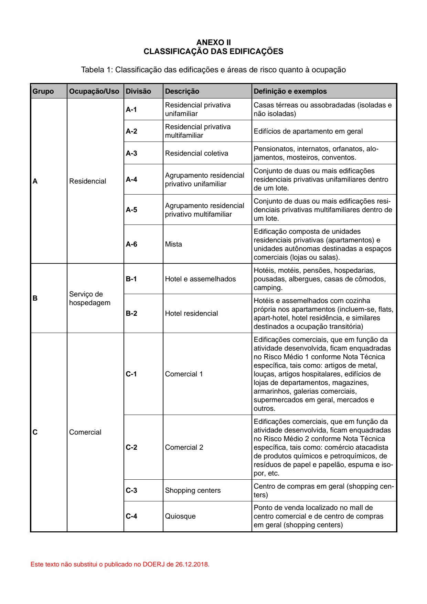

### ANEXO II CLASSIFICAÇÃO DAS EDIFICAÇÕES

Tabela 1: Classificação das edificações e áreas de risco quanto à ocupação

### Tabelas extraídas (bruto, não usar para citação)
#### Tabela 1 da página

| Grupo | Ocupação/Uso | Divisão | Descrição | Definição e exemplos |
| --- | --- | --- | --- | --- |
| A | Residencial | A-1 | Residencial privativa unifamiliar | Casas térreas ou assobradadas (isoladas e não isoladas) |
|  |  | A-2 | Residencial privativa multifamiliar | Edifícios de apartamento em geral |
|  |  | A-3 | Residencial coletiva | Pensionatos, internatos, orfanatos, alojamentos, mosteiros, conventos. |
|  |  | A-4 | Agrupamento residencial privativo unifamiliar | Conjunto de duas ou mais edificações residenciais privativas unifamiliares dentro de um lote. |
|  |  | A-5 | Agrupamento residencial privativo multifamiliar | Conjunto de duas ou mais edificações residenciais privativas multifamiliares dentro de um lote. |
|  |  | A-6 | Mista | Edificação composta de unidades residenciais privativas (apartamentos) e unidades autônomas destinadas a espaços comerciais (lojas ou salas). |
| B | Serviço de hospedagem | B-1 | Hotel e assemelhados | Hotéis, motéis, pensões, hospedarias, pousadas, albergues, casas de cômodos, camping. |
|  |  | B-2 | Hotel residencial | Hotéis e assemelhados com cozinha própria nos apartamentos (incluem-se, flats, apart-hotel, hotel residência, e similares destinados a ocupação transitória) |
| C | Comercial | C-1 | Comercial 1 | Edificações comerciais, que em função da atividade desenvolvida, ficam enquadradas no Risco Médio 1 conforme Nota Técnica específica, tais como: artigos de metal, louças, artigos hospitalares, edifícios de lojas de departamentos, magazines, armarinhos, galerias comerciais, supermercados em geral, mercados e outros. |
|  |  | C-2 | Comercial 2 | Edificações comerciais, que em função da atividade desenvolvida, ficam enquadradas no Risco Médio 2 conforme Nota Técnica específica, tais como: comércio atacadista de produtos químicos e petroquímicos, de resíduos de papel e papelão, espuma e isopor, etc. |
|  |  | C-3 | Shopping centers | Centro de compras em geral (shopping centers) |
|  |  | C-4 | Quiosque | Ponto de venda localizado no mall de centro comercial e de centro de compras em geral (shopping centers) |

---

## Página 21

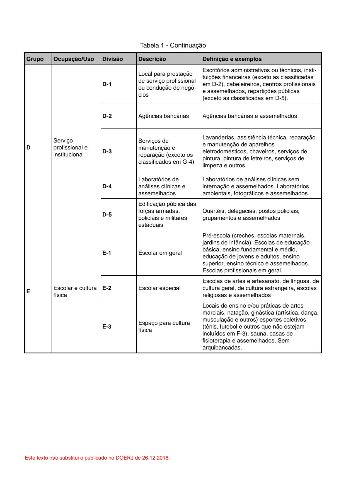

Tabela 1 - Continuação

### Tabelas extraídas (bruto, não usar para citação)
#### Tabela 1 da página

| Grupo | Ocupação/Uso | Divisão | Descrição | Definição e exemplos |
| --- | --- | --- | --- | --- |
| D | Serviço profissional e institucional | D-1 | Local para prestação de serviço profissional ou condução de negócios | Escritórios administrativos ou técnicos, instituições financeiras (exceto as classificadas em D-2), cabeleireiros, centros profissionais e assemelhados, repartições públicas (exceto as classificadas em D-5). |
|  |  | D-2 | Agências bancárias | Agências bancárias e assemelhados |
|  |  | D-3 | Serviços de manutenção e reparação (exceto os classificados em G-4) | Lavanderias, assistência técnica, reparação e manutenção de aparelhos eletrodomésticos, chaveiros, serviços de pintura, pintura de letreiros, serviços de limpeza e outros. |
|  |  | D-4 | Laboratórios de análises clínicas e assemelhados | Laboratórios de análises clínicas sem internação e assemelhados. Laboratórios ambientais, fotográficos e assemelhados. |
|  |  | D-5 | Edificação pública das forças armadas, policiais e militares estaduais | Quartéis, delegacias, postos policiais, grupamentos e assemelhados |
| E | Escolar e cultura física | E-1 | Escolar em geral | Pré-escola (creches, escolas maternais, jardins de infância). Escolas de educação básica, ensino fundamental e médio, educação de jovens e adultos, ensino superior, ensino técnico e assemelhados. Escolas profissionais em geral. |
|  |  | E-2 | Escolar especial | Escolas de artes e artesanato, de línguas, de cultura geral, de cultura estrangeira, escolas religiosas e assemelhados |
|  |  | E-3 | Espaço para cultura física | Locais de ensino e/ou práticas de artes marciais, natação, ginástica (artística, dança, musculação e outros) esportes coletivos (tênis, futebol e outros que não estejam incluídos em F-3), sauna, casas de fisioterapia e assemelhados. Sem arquibancadas. |

---

## Página 22

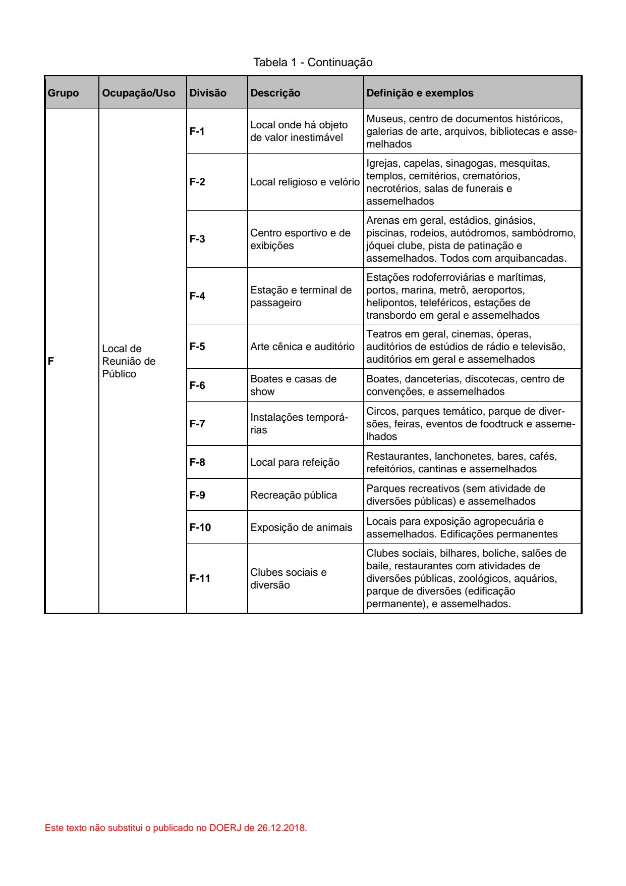

Tabela 1 - Continuação

### Tabelas extraídas (bruto, não usar para citação)
#### Tabela 1 da página

|  | Ocupação/Uso |  |  |  |
| --- | --- | --- | --- | --- |
| Grupo |  | Divisão | Descrição | Definição e exemplos |
|  |  |  |  |  |
| F | Local de Reunião de Público | F-1 | Local onde há objeto de valor inestimável | Museus, centro de documentos históricos, galerias de arte, arquivos, bibliotecas e assemelhados |
|  |  | F-2 | Local religioso e velório | Igrejas, capelas, sinagogas, mesquitas, templos, cemitérios, crematórios, necrotérios, salas de funerais e assemelhados |
|  |  | F-3 | Centro esportivo e de exibições | Arenas em geral, estádios, ginásios, piscinas, rodeios, autódromos, sambódromo, jóquei clube, pista de patinação e assemelhados. Todos com arquibancadas. |
|  |  | F-4 | Estação e terminal de passageiro | Estações rodoferroviárias e marítimas, portos, marina, metrô, aeroportos, helipontos, teleféricos, estações de transbordo em geral e assemelhados |
|  |  | F-5 | Arte cênica e auditório | Teatros em geral, cinemas, óperas, auditórios de estúdios de rádio e televisão, auditórios em geral e assemelhados |
|  |  | F-6 | Boates e casas de show | Boates, danceterias, discotecas, centro de convenções, e assemelhados |
|  |  | F-7 | Instalações temporárias | Circos, parques temático, parque de diversões, feiras, eventos de foodtruck e assemelhados |
|  |  | F-8 | Local para refeição | Restaurantes, lanchonetes, bares, cafés, refeitórios, cantinas e assemelhados |
|  |  | F-9 | Recreação pública | Parques recreativos (sem atividade de diversões públicas) e assemelhados |
|  |  | F-10 | Exposição de animais | Locais para exposição agropecuária e assemelhados. Edificações permanentes |
|  |  | F-11 | Clubes sociais e diversão | Clubes sociais, bilhares, boliche, salões de baile, restaurantes com atividades de diversões públicas, zoológicos, aquários, parque de diversões (edificação permanente), e assemelhados. |

---

## Página 23

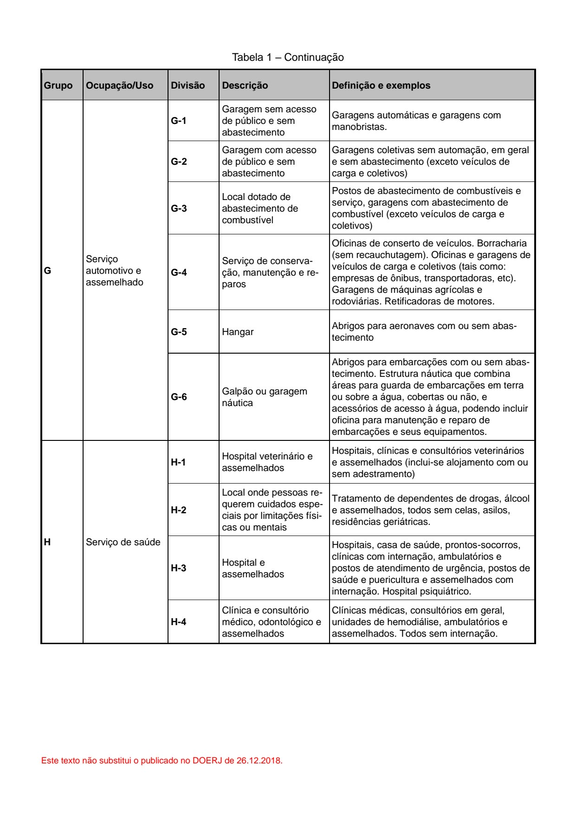

Tabela 1 - Continuação

### Tabelas extraídas (bruto, não usar para citação)
#### Tabela 1 da página

|  |  |  |  |  |
| --- | --- | --- | --- | --- |
| Grupo | Ocupação/Uso | Divisão | Descrição | Definição e exemplos |
|  |  |  |  |  |
| G | Serviço automotivo e assemelhado | G-1 | Garagem sem acesso de público e sem abastecimento | Garagens automáticas e garagens com manobristas. |
|  |  | G-2 | Garagem com acesso de público e sem abastecimento | Garagens coletivas sem automação, em geral e sem abastecimento (exceto veículos de carga e coletivos) |
|  |  | G-3 | Local dotado de abastecimento de combustível | Postos de abastecimento de combustíveis e serviço, garagens com abastecimento de combustível (exceto veículos de carga e coletivos) |
|  |  | G-4 | Serviço de conservação, manutenção e reparos | Oficinas de conserto de veículos. Borracharia (sem recauchutagem). Oficinas e garagens de veículos de carga e coletivos (tais como: empresas de ônibus, transportadoras, etc). Garagens de máquinas agrícolas e rodoviárias. Retificadoras de motores. |
|  |  | G-5 | Hangar | Abrigos para aeronaves com ou sem abastecimento |
|  |  | G-6 | Galpão ou garagem náutica | Abrigos para embarcações com ou sem abastecimento. Estrutura náutica que combina áreas para guarda de embarcações em terra ou sobre a água, cobertas ou não, e acessórios de acesso à água, podendo incluir oficina para manutenção e reparo de embarcações e seus equipamentos. |
| H | Serviço de saúde | H-1 | Hospital veterinário e assemelhados | Hospitais, clínicas e consultórios veterinários e assemelhados (inclui-se alojamento com ou sem adestramento) |
|  |  | H-2 | Local onde pessoas requerem cuidados especiais por limitações físicas ou mentais | Tratamento de dependentes de drogas, álcool e assemelhados, todos sem celas, asilos, residências geriátricas. |
|  |  | H-3 | Hospital e assemelhados | Hospitais, casa de saúde, prontos-socorros, clínicas com internação, ambulatórios e postos de atendimento de urgência, postos de saúde e puericultura e assemelhados com internação. Hospital psiquiátrico. |
|  |  | H-4 | Clínica e consultório médico, odontológico e assemelhados | Clínicas médicas, consultórios em geral, unidades de hemodiálise, ambulatórios e assemelhados. Todos sem internação. |

---

## Página 24

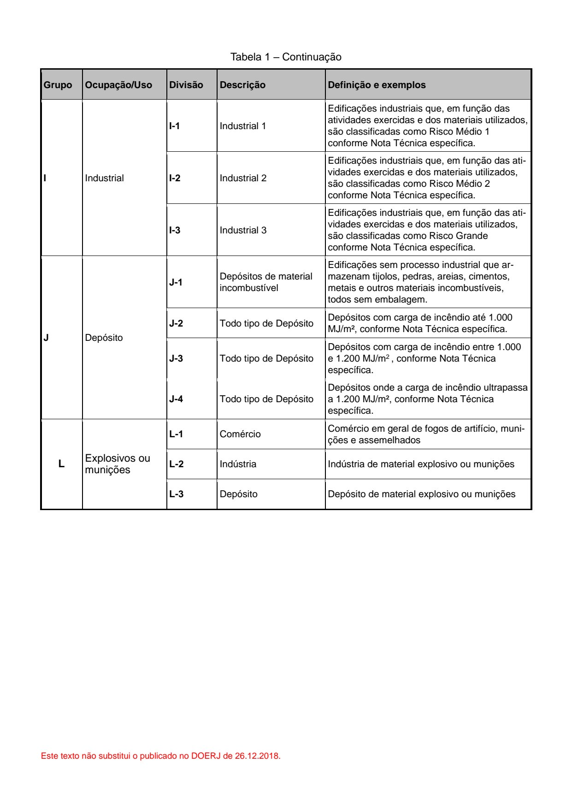

Tabela 1 - Continuação

### Tabelas extraídas (bruto, não usar para citação)
#### Tabela 1 da página

| Grupo | Ocupação/Uso |  | Descrição |  |
| --- | --- | --- | --- | --- |
|  |  | Divisão |  | Definição e exemplos |
|  |  |  |  |  |
| I | Industrial |  | Industrial 1 | Edificações industriais que, em função das |
|  |  |  |  | atividades exercidas e dos materiais utilizados, |
|  |  | I-1 |  |  |
|  |  |  |  | são classificadas como Risco Médio 1 |
|  |  |  |  |  |
|  |  |  |  | conforme Nota Técnica específica. |
|  |  |  | Industrial 2 | Edificações industriais que, em função das ati- |
|  |  |  |  | vidades exercidas e dos materiais utilizados, |
|  |  | I-2 |  |  |
|  |  |  |  | são classificadas como Risco Médio 2 |
|  |  |  |  |  |
|  |  |  |  | conforme Nota Técnica específica. |
|  |  |  | Industrial 3 | Edificações industriais que, em função das ati- |
|  |  |  |  | vidades exercidas e dos materiais utilizados, |
|  |  | I-3 |  |  |
|  |  |  |  | são classificadas como Risco Grande |
|  |  |  |  |  |
|  |  |  |  | conforme Nota Técnica específica. |
| J |  |  | Depósitos de material incombustível | Edificações sem processo industrial que ar- |
|  |  |  |  | mazenam tijolos, pedras, areias, cimentos, |
|  |  | J-1 |  |  |
|  |  |  |  | metais e outros materiais incombustíveis, |
|  |  |  |  |  |
|  |  |  |  | todos sem embalagem. |
|  |  |  | Todo tipo de Depósito | Depósitos com carga de incêndio até 1.000 |
|  |  | J-2 |  |  |
|  |  |  |  | MJ/m², conforme Nota Técnica específica. |
|  | Depósito |  | Todo tipo de Depósito | Depósitos com carga de incêndio entre 1.000 |
|  |  | J-3 |  | e 1.200 MJ/m2, conforme Nota Técnica |
|  |  |  |  | específica. |
|  |  |  | Todo tipo de Depósito | Depósitos onde a carga de incêndio ultrapassa |
|  |  | J-4 |  | a 1.200 MJ/m², conforme Nota Técnica |
|  |  |  |  | específica. |
| L |  |  | Comércio | Comércio em geral de fogos de artifício, muni- |
|  |  | L-1 |  |  |
|  |  |  |  | ções e assemelhados |
|  |  |  |  |  |
|  | Explosivos ou munições |  | Indústria |  |
|  |  | L-2 |  | Indústria de material explosivo ou munições |
|  |  |  |  |  |
|  |  |  | Depósito |  |
|  |  | L-3 |  | Depósito de material explosivo ou munições |
|  |  |  |  |  |

---

## Página 25

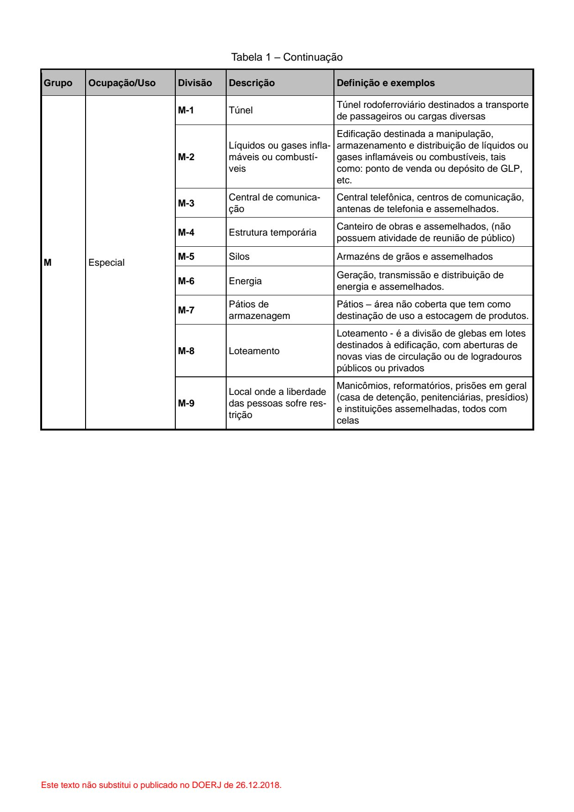

Tabela 1 - Continuação

### Tabelas extraídas (bruto, não usar para citação)
#### Tabela 1 da página

| Grupo | Ocupação/Uso | Divisão | Descrição | Definição e exemplos |
| --- | --- | --- | --- | --- |
| M | Especial | M-1 | Túnel | Túnel rodoferroviário destinados a transporte de passageiros ou cargas diversas |
|  |  | M-2 | Líquidos ou gases inflamáveis ou combustíveis | Edificação destinada a manipulação, armazenamento e distribuição de líquidos ou gases inflamáveis ou combustíveis, tais como: ponto de venda ou depósito de GLP, etc. |
|  |  | M-3 | Central de comunicação | Central telefônica, centros de comunicação, antenas de telefonia e assemelhados. |
|  |  | M-4 | Estrutura temporária | Canteiro de obras e assemelhados, (não possuem atividade de reunião de público) |
|  |  | M-5 | Silos | Armazéns de grãos e assemelhados |
|  |  | M-6 | Energia | Geração, transmissão e distribuição de energia e assemelhados. |
|  |  | M-7 | Pátios de armazenagem | Pátios - área não coberta que tem como destinação de uso a estocagem de produtos. |
|  |  | M-8 | Loteamento | Loteamento - é a divisão de glebas em lotes destinados à edificação, com aberturas de novas vias de circulação ou de logradouros públicos ou privados |
|  |  | M-9 | Local onde a liberdade das pessoas sofre restrição | Manicômios, reformatórios, prisões em geral (casa de detenção, penitenciárias, presídios) e instituições assemelhadas, todos com celas |

---

## Página 26

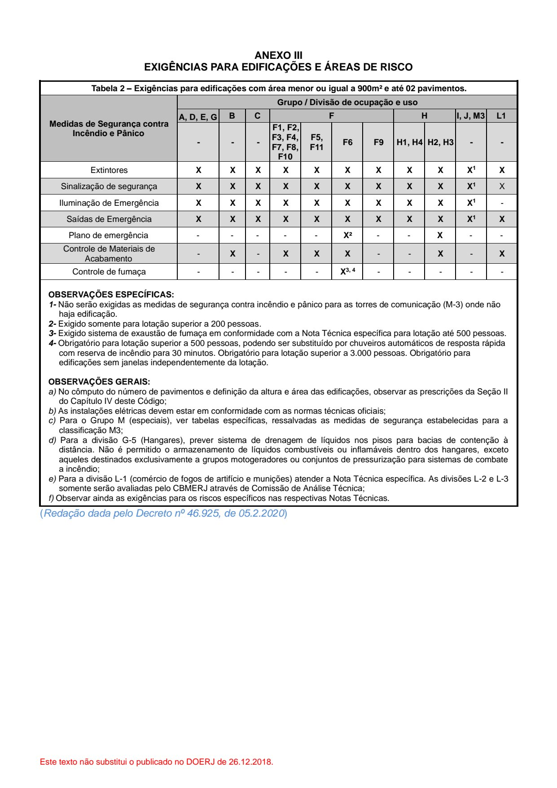

### ANEXO III EXIGÊNCIAS PARA EDIFICAÇÕES E ÁREAS DE RISCO

(Redação dada pelo Decreto nº 46.925, de 05.2.2020)

### Tabelas extraídas (bruto, não usar para citação)
#### Tabela 1 da página

| Tabela 2 - Exigências para edificações com área menor ou igual a 900m² e até 02 pavimentos. |  |  |  |  |  |  |  |  |  |  |  |
| --- | --- | --- | --- | --- | --- | --- | --- | --- | --- | --- | --- |
|  | Grupo / Divisão de ocupação e uso |  |  |  |  |  |  |  |  |  |  |
|  | A, D, E, G | B | C | F |  |  |  | H |  | I, J, M3 | L1 |
| Medidas de Segurança contra |  |  |  | F1, F2, |  |  |  |  |  |  |  |
| Incêndio e Pânico |  |  |  |  |  |  |  |  |  |  |  |
|  |  |  |  | F3, F4, | F5, |  |  |  |  |  |  |
|  | - | - | - |  |  | F6 | F9 | H1, H4 | H2, H3 | - | - |
|  |  |  |  | F7, F8, | F11 |  |  |  |  |  |  |
|  |  |  |  |  |  |  |  |  |  |  |  |
|  |  |  |  | F10 |  |  |  |  |  |  |  |
| Extintores | X | X | X | X | X | X | X | X | X | X1 | X |
|  |  |  |  |  |  |  |  |  |  |  |  |
| Sinalização de segurança | X | X | X | X | X | X | X | X | X | X1 | X |
|  |  |  |  |  |  |  |  |  |  |  |  |
| Iluminação de Emergência | X | X | X | X | X | X | X | X | X | X1 | - |
|  |  |  |  |  |  |  |  |  |  |  |  |
| Saídas de Emergência | X | X | X | X | X | X | X | X | X | X1 | X |
|  |  |  |  |  |  |  |  |  |  |  |  |
| Plano de emergência | - | - | - | - | - | X² | - | - | X | - | - |
| Controle de Materiais de |  |  |  |  |  |  |  |  |  |  |  |
|  | - | X | - | X | X | X | - | - | X | - | X |
| Acabamento |  |  |  |  |  |  |  |  |  |  |  |
|  |  |  |  |  |  |  |  |  |  |  |  |
| Controle de fumaça | - | - | - | - | - | X3, 4 | - | - | - | - | - |
| OBSERVAÇÕES ESPECÍFICAS: 1- Não serão exigidas as medidas de segurança contra incêndio e pânico para as torres de comunicação (M-3) onde não haja edificação. 2- Exigido somente para lotação superior a 200 pessoas. 3- Exigido sistema de exaustão de fumaça em conformidade com a Nota Técnica específica para lotação até 500 pessoas. 4- Obrigatório para lotação superior a 500 pessoas, podendo ser substituído por chuveiros automáticos de resposta rápida com reserva de incêndio para 30 minutos. Obrigatório para lotação superior a 3.000 pessoas. Obrigatório para edificações sem janelas independentemente da lotação. OBSERVAÇÕES GERAIS: a) No cômputo do número de pavimentos e definição da altura e área das edificações, observar as prescrições da Seção II do Capítulo IV deste Código; b) As instalações elétricas devem estar em conformidade com as normas técnicas oficiais; c) Para o Grupo M (especiais), ver tabelas específicas, ressalvadas as medidas de segurança estabelecidas para a classificação M3; d) Para a divisão G-5 (Hangares), prever sistema de drenagem de líquidos nos pisos para bacias de contenção à distância. Não é permitido o armazenamento de líquidos combustíveis ou inflamáveis dentro dos hangares, exceto aqueles destinados exclusivamente a grupos motogeradores ou conjuntos de pressurização para sistemas de combate a incêndio; e) Para a divisão L-1 (comércio de fogos de artifício e munições) atender a Nota Técnica específica. As divisões L-2 e L-3 somente serão avaliadas pelo CBMERJ através de Comissão de Análise Técnica; f) Observar ainda as exigências para os riscos específicos nas respectivas Notas Técnicas. |  |  |  |  |  |  |  |  |  |  |  |

---

## Página 27

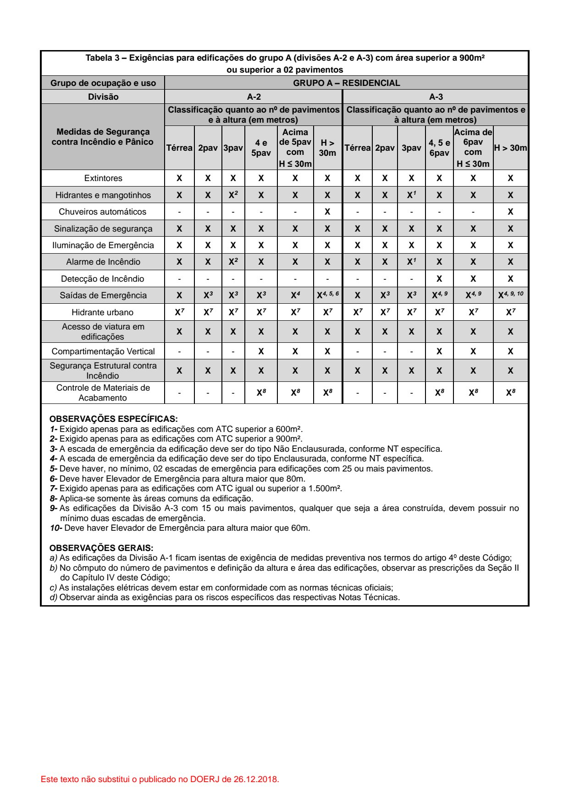

> Página sem texto extraível suficiente; consultar a representação visual ou o PDF oficial.

### Tabelas extraídas (bruto, não usar para citação)
#### Tabela 1 da página

| Tabela 3 - Exigências para edificações do grupo A (divisões A-2 e A-3) com área superior a 900m² |  |  |  |  |  |  |  |  |  |  |  |  |
| --- | --- | --- | --- | --- | --- | --- | --- | --- | --- | --- | --- | --- |
| ou superior a 02 pavimentos |  |  |  |  |  |  |  |  |  |  |  |  |
| Grupo de ocupação e uso | GRUPO A - RESIDENCIAL |  |  |  |  |  |  |  |  |  |  |  |
| Divisão | A-2 |  |  |  |  |  | A-3 |  |  |  |  |  |
|  | Classificação quanto ao nº de pavimentos |  |  |  |  |  | Classificação quanto ao nº de pavimentos e |  |  |  |  |  |
|  | e à altura (em metros) |  |  |  |  |  | à altura (em metros) |  |  |  |  |  |
| Medidas de Segurança |  |  |  |  | Acima |  |  |  |  |  | Acima de |  |
| contra Incêndio e Pânico |  |  |  | 4 e | de 5pav | H > |  |  |  | 4, 5 e | 6pav |  |
|  | Térrea | 2pav | 3pav |  |  |  | Térrea | 2pav | 3pav |  |  | H > 30m |
|  |  |  |  | 5pav | com | 30m |  |  |  | 6pav | com |  |
|  |  |  |  |  |  |  |  |  |  |  |  |  |
|  |  |  |  |  | H ≤ 30m |  |  |  |  |  | H ≤ 30m |  |
| Extintores | X | X | X | X | X | X | X | X | X | X | X | X |
| Hidrantes e mangotinhos | X | X | X2 | X | X | X | X | X | X1 | X | X | X |
| Chuveiros automáticos | - | - | - | - | - | X | - | - | - | - | - | X |
| Sinalização de segurança | X | X | X | X | X | X | X | X | X | X | X | X |
| Iluminação de Emergência | X | X | X | X | X | X | X | X | X | X | X | X |
| Alarme de Incêndio | X | X | X2 | X | X | X | X | X | X1 | X | X | X |
| Detecção de Incêndio | - | - | - | - | - | - | - | - | - | X | X | X |
| Saídas de Emergência | X | X3 | X3 | X3 | X4 | X4, 5, 6 | X | X3 | X3 | X4, 9 | X4, 9 | X4, 9, 10 |
| Hidrante urbano | X7 | X7 | X7 | X7 | X7 | X7 | X7 | X7 | X7 | X7 | X7 | X7 |
| Acesso de viatura em |  |  |  |  |  |  |  |  |  |  |  |  |
|  | X | X | X | X | X | X | X | X | X | X | X | X |
| edificações |  |  |  |  |  |  |  |  |  |  |  |  |
|  |  |  |  |  |  |  |  |  |  |  |  |  |
| Compartimentação Vertical | - | - | - | X | X | X | - | - | - | X | X | X |
| Segurança Estrutural contra |  |  |  |  |  |  |  |  |  |  |  |  |
|  | X | X | X | X | X | X | X | X | X | X | X | X |
| Incêndio |  |  |  |  |  |  |  |  |  |  |  |  |
|  |  |  |  |  |  |  |  |  |  |  |  |  |
| Controle de Materiais de Acabamento | - | - | - | X8 | X8 | X8 | - | - | - | X8 | X8 | X8 |
| OBSERVAÇÕES ESPECÍFICAS: 1- Exigido apenas para as edificações com ATC superior a 600m². 2- Exigido apenas para as edificações com ATC superior a 900m². 3- A escada de emergência da edificação deve ser do tipo Não Enclausurada, conforme NT específica. 4- A escada de emergência da edificação deve ser do tipo Enclausurada, conforme NT específica. 5- Deve haver, no mínimo, 02 escadas de emergência para edificações com 25 ou mais pavimentos. 6- Deve haver Elevador de Emergência para altura maior que 80m. 7- Exigido apenas para as edificações com ATC igual ou superior a 1.500m². 8- Aplica-se somente às áreas comuns da edificação. 9- As edificações da Divisão A-3 com 15 ou mais pavimentos, qualquer que seja a área construída, devem possuir no mínimo duas escadas de emergência. 10- Deve haver Elevador de Emergência para altura maior que 60m. OBSERVAÇÕES GERAIS: a) As edificações da Divisão A-1 ficam isentas de exigência de medidas preventiva nos termos do artigo 4º deste Código; b) No cômputo do número de pavimentos e definição da altura e área das edificações, observar as prescrições da Seção II do Capítulo IV deste Código; c) As instalações elétricas devem estar em conformidade com as normas técnicas oficiais; d) Observar ainda as exigências para os riscos específicos das respectivas Notas Técnicas. |  |  |  |  |  |  |  |  |  |  |  |  |

---

## Página 28

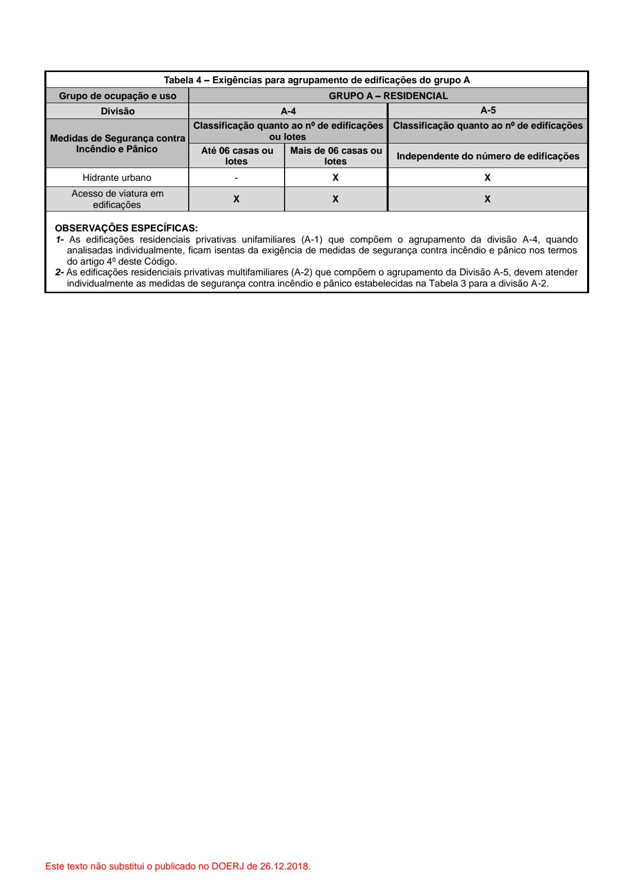

> Página sem texto extraível suficiente; consultar a representação visual ou o PDF oficial.

### Tabelas extraídas (bruto, não usar para citação)
#### Tabela 1 da página

| Tabela 4 - Exigências para agrupamento de edificações do grupo A |  |  |  |
| --- | --- | --- | --- |
| Grupo de ocupação e uso | GRUPO A - RESIDENCIAL |  |  |
| Divisão | A-4 |  | A-5 |
|  | Classificação quanto ao nº de edificações |  | Classificação quanto ao nº de edificações |
| Medidas de Segurança contra | ou lotes |  |  |
| Incêndio e Pânico | Até 06 casas ou | Mais de 06 casas ou |  |
|  |  |  | Independente do número de edificações |
|  | lotes | lotes |  |
|  |  |  |  |
| Hidrante urbano | - | X | X |
| Acesso de viatura em |  |  |  |
|  | X | X | X |
| edificações |  |  |  |
|  |  |  |  |
|  |  |  |  |
| OBSERVAÇÕES ESPECÍFICAS: |  |  |  |
| 1- As edificações residenciais privativas unifamiliares (A-1) que compõem o agrupamento da divisão A-4, quando |  |  |  |
| analisadas individualmente, ficam isentas da exigência de medidas de segurança contra incêndio e pânico nos termos |  |  |  |
| do artigo 4º deste Código. |  |  |  |
| 2- As edificações residenciais privativas multifamiliares (A-2) que compõem o agrupamento da Divisão A-5, devem atender |  |  |  |
| individualmente as medidas de segurança contra incêndio e pânico estabelecidas na Tabela 3 para a divisão A-2. |  |  |  |

---

## Página 29

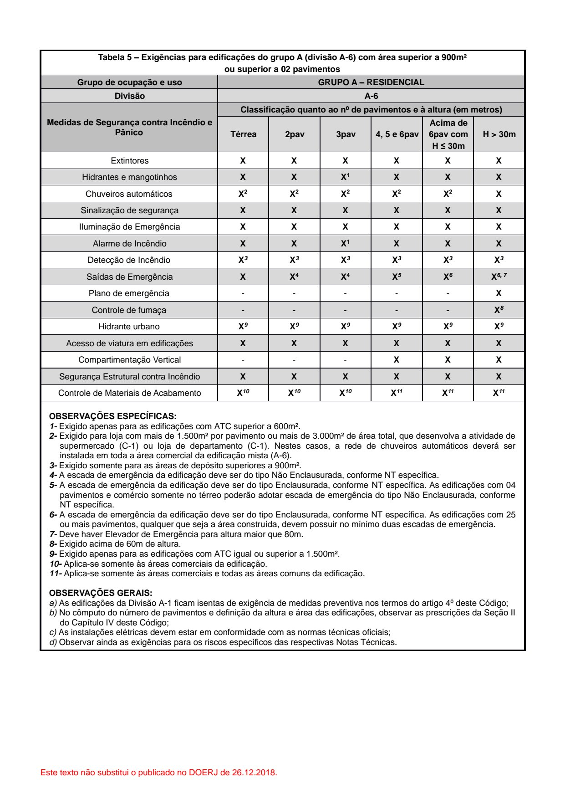

> Página sem texto extraível suficiente; consultar a representação visual ou o PDF oficial.

### Tabelas extraídas (bruto, não usar para citação)
#### Tabela 1 da página

| Tabela 5 - Exigências para edificações do grupo A (divisão A-6) com área superior a 900m² |  |  |  |  |  |  |
| --- | --- | --- | --- | --- | --- | --- |
| ou superior a 02 pavimentos |  |  |  |  |  |  |
| Grupo de ocupação e uso | GRUPO A - RESIDENCIAL |  |  |  |  |  |
| Divisão | A-6 |  |  |  |  |  |
|  | Classificação quanto ao nº de pavimentos e à altura (em metros) |  |  |  |  |  |
| Medidas de Segurança contra Incêndio e |  |  |  |  | Acima de |  |
| Pânico | Térrea | 2pav | 3pav | 4, 5 e 6pav | 6pav com | H > 30m |
|  |  |  |  |  | H ≤ 30m |  |
| Extintores | X | X | X | X | X | X |
|  |  |  |  |  |  |  |
| Hidrantes e mangotinhos | X | X | X1 | X | X | X |
|  |  |  |  |  |  |  |
| Chuveiros automáticos | X2 | X2 | X2 | X2 | X2 | X |
|  |  |  |  |  |  |  |
| Sinalização de segurança | X | X | X | X | X | X |
|  |  |  |  |  |  |  |
| Iluminação de Emergência | X | X | X | X | X | X |
|  |  |  |  |  |  |  |
| Alarme de Incêndio | X | X | X1 | X | X | X |
|  |  |  |  |  |  |  |
| Detecção de Incêndio | X3 | X3 | X3 | X3 | X3 | X3 |
|  |  |  |  |  |  |  |
| Saídas de Emergência | X | X4 | X4 | X5 | X6 | X6, 7 |
|  |  |  |  |  |  |  |
| Plano de emergência | - | - | - | - | - | X |
|  |  |  |  |  |  |  |
| Controle de fumaça | - | - | - | - | - | X8 |
|  |  |  |  |  |  |  |
| Hidrante urbano | X9 | X9 | X9 | X9 | X9 | X9 |
|  |  |  |  |  |  |  |
| Acesso de viatura em edificações | X | X | X | X | X | X |
|  |  |  |  |  |  |  |
| Compartimentação Vertical | - | - | - | X | X | X |
|  |  |  |  |  |  |  |
| Segurança Estrutural contra Incêndio | X | X | X | X | X | X |
|  |  |  |  |  |  |  |
| Controle de Materiais de Acabamento | X10 | X10 | X10 | X11 | X11 | X11 |
| OBSERVAÇÕES ESPECÍFICAS: 1- Exigido apenas para as edificações com ATC superior a 600m². 2- Exigido para loja com mais de 1.500m² por pavimento ou mais de 3.000m² de área total, que desenvolva a atividade de supermercado (C-1) ou loja de departamento (C-1). Nestes casos, a rede de chuveiros automáticos deverá ser instalada em toda a área comercial da edificação mista (A-6). 3- Exigido somente para as áreas de depósito superiores a 900m². 4- A escada de emergência da edificação deve ser do tipo Não Enclausurada, conforme NT específica. 5- A escada de emergência da edificação deve ser do tipo Enclausurada, conforme NT específica. As edificações com 04 pavimentos e comércio somente no térreo poderão adotar escada de emergência do tipo Não Enclausurada, conforme NT específica. 6- A escada de emergência da edificação deve ser do tipo Enclausurada, conforme NT específica. As edificações com 25 ou mais pavimentos, qualquer que seja a área construída, devem possuir no mínimo duas escadas de emergência. 7- Deve haver Elevador de Emergência para altura maior que 80m. 8- Exigido acima de 60m de altura. 9- Exigido apenas para as edificações com ATC igual ou superior a 1.500m². 10- Aplica-se somente às áreas comerciais da edificação. 11- Aplica-se somente às áreas comerciais e todas as áreas comuns da edificação. OBSERVAÇÕES GERAIS: a) As edificações da Divisão A-1 ficam isentas de exigência de medidas preventiva nos termos do artigo 4º deste Código; b) No cômputo do número de pavimentos e definição da altura e área das edificações, observar as prescrições da Seção II do Capítulo IV deste Código; c) As instalações elétricas devem estar em conformidade com as normas técnicas oficiais; d) Observar ainda as exigências para os riscos específicos das respectivas Notas Técnicas. |  |  |  |  |  |  |

<!-- tabela-conferida: Tabela 5 p29 -->
### Tabela 5 — Exigências para edificações do grupo A (divisão A-6) com área superior a 900m² ou superior a 02 pavimentos (conferida)

| Medidas de Segurança contra Incêndio e Pânico | Térrea | 2pav | 3pav | 4, 5 e 6pav | Acima de 6pav com H ≤ 30m | H > 30m |
| --- | --- | --- | --- | --- | --- | --- |
| Extintores | X | X | X | X | X | X |
| Hidrantes e mangotinhos | X | X | X1 | X | X | X |
| Chuveiros automáticos | X2 | X2 | X2 | X2 | X2 | X |
| Sinalização de segurança | X | X | X | X | X | X |
| Iluminação de Emergência | X | X | X | X | X | X |
| Alarme de Incêndio | X | X | X1 | X | X | X |
| Detecção de Incêndio | X3 | X3 | X3 | X3 | X3 | X3 |
| Saídas de Emergência | X | X4 | X4 | X5 | X6 | X6, 7 |
| Plano de emergência | - | - | - | - | - | X |
| Controle de fumaça | - | - | - | - | - | X8 |
| Hidrante urbano | X9 | X9 | X9 | X9 | X9 | X9 |
| Acesso de viatura em edificações | X | X | X | X | X | X |
| Compartimentação Vertical | - | - | - | X | X | X |
| Segurança Estrutural contra Incêndio | X | X | X | X | X | X |
| Controle de Materiais de Acabamento | X10 | X10 | X10 | X11 | X11 | X11 |

Fonte: Decreto 42/2018, página 29, Tabela 5; conferida em 2026-09-29 (visual + geometrica).
As observações específicas e gerais da tabela estão no texto da página (e na imagem); valem para as células com a nota correspondente.
<!-- /tabela-conferida: Tabela 5 p29 -->

---

## Página 30

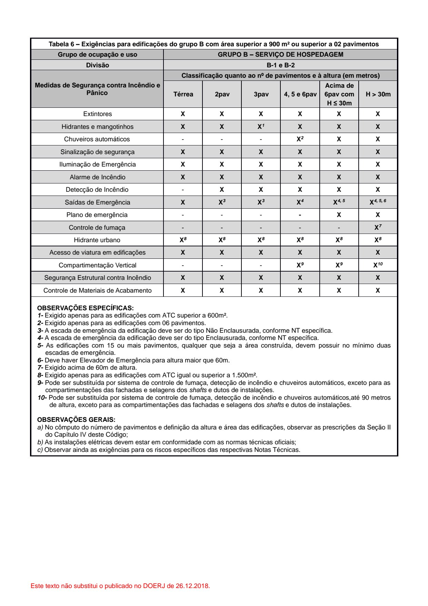

> Página sem texto extraível suficiente; consultar a representação visual ou o PDF oficial.

### Tabelas extraídas (bruto, não usar para citação)
#### Tabela 1 da página

| Tabela 6 - Exigências para edificações do grupo B com área superior a 900 m² ou superior a 02 pavimentos |  |  |  |  |  |  |
| --- | --- | --- | --- | --- | --- | --- |
| Grupo de ocupação e uso | GRUPO B - SERVIÇO DE HOSPEDAGEM |  |  |  |  |  |
| Divisão | B-1 e B-2 |  |  |  |  |  |
|  | Classificação quanto ao nº de pavimentos e à altura (em metros) |  |  |  |  |  |
| Medidas de Segurança contra Incêndio e |  |  |  |  | Acima de |  |
| Pânico | Térrea | 2pav | 3pav | 4, 5 e 6pav | 6pav com | H > 30m |
|  |  |  |  |  | H ≤ 30m |  |
| Extintores | X | X | X | X | X | X |
|  |  |  |  |  |  |  |
| Hidrantes e mangotinhos | X | X | X1 | X | X | X |
|  |  |  |  |  |  |  |
| Chuveiros automáticos | - | - | - | X2 | X | X |
|  |  |  |  |  |  |  |
| Sinalização de segurança | X | X | X | X | X | X |
|  |  |  |  |  |  |  |
| Iluminação de Emergência | X | X | X | X | X | X |
|  |  |  |  |  |  |  |
| Alarme de Incêndio | X | X | X | X | X | X |
|  |  |  |  |  |  |  |
| Detecção de Incêndio | - | X | X | X | X | X |
|  |  |  |  |  |  |  |
| Saídas de Emergência | X | X3 | X3 | X4 | X4, 5 | X4, 5, 6 |
|  |  |  |  |  |  |  |
| Plano de emergência | - | - | - | - | X | X |
|  |  |  |  |  |  |  |
| Controle de fumaça | - | - | - | - | - | X7 |
|  |  |  |  |  |  |  |
| Hidrante urbano | X8 | X8 | X8 | X8 | X8 | X8 |
|  |  |  |  |  |  |  |
| Acesso de viatura em edificações | X | X | X | X | X | X |
|  |  |  |  |  |  |  |
| Compartimentação Vertical | - | - | - | X9 | X9 | X10 |
|  |  |  |  |  |  |  |
| Segurança Estrutural contra Incêndio | X | X | X | X | X | X |
|  |  |  |  |  |  |  |
| Controle de Materiais de Acabamento | X | X | X | X | X | X |
| OBSERVAÇÕES ESPECÍFICAS: 1- Exigido apenas para as edificações com ATC superior a 600m². 2- Exigido apenas para as edificações com 06 pavimentos. 3- A escada de emergência da edificação deve ser do tipo Não Enclausurada, conforme NT específica. 4- A escada de emergência da edificação deve ser do tipo Enclausurada, conforme NT específica. 5- As edificações com 15 ou mais pavimentos, qualquer que seja a área construída, devem possuir no mínimo duas escadas de emergência. 6- Deve haver Elevador de Emergência para altura maior que 60m. 7- Exigido acima de 60m de altura. 8- Exigido apenas para as edificações com ATC igual ou superior a 1.500m². 9- Pode ser substituída por sistema de controle de fumaça, detecção de incêndio e chuveiros automáticos, exceto para as compartimentações das fachadas e selagens dos shafts e dutos de instalações. 10- Pode ser substituída por sistema de controle de fumaça, detecção de incêndio e chuveiros automáticos,até 90 metros de altura, exceto para as compartimentações das fachadas e selagens dos shafts e dutos de instalações. OBSERVAÇÕES GERAIS: a) No cômputo do número de pavimentos e definição da altura e área das edificações, observar as prescrições da Seção II do Capítulo IV deste Código; b) As instalações elétricas devem estar em conformidade com as normas técnicas oficiais; c) Observar ainda as exigências para os riscos específicos das respectivas Notas Técnicas. |  |  |  |  |  |  |

<!-- tabela-conferida: Tabela 6 p30 -->
### Tabela 6 — Exigências para edificações do grupo B com área superior a 900 m² ou superior a 02 pavimentos (conferida)

| Medidas de Segurança contra Incêndio e Pânico | Térrea | 2pav | 3pav | 4, 5 e 6pav | Acima de 6pav com H ≤ 30m | H > 30m |
| --- | --- | --- | --- | --- | --- | --- |
| Extintores | X | X | X | X | X | X |
| Hidrantes e mangotinhos | X | X | X1 | X | X | X |
| Chuveiros automáticos | - | - | - | X2 | X | X |
| Sinalização de segurança | X | X | X | X | X | X |
| Iluminação de Emergência | X | X | X | X | X | X |
| Alarme de Incêndio | X | X | X | X | X | X |
| Detecção de Incêndio | - | X | X | X | X | X |
| Saídas de Emergência | X | X3 | X3 | X4 | X4, 5 | X4, 5, 6 |
| Plano de emergência | - | - | - | - | X | X |
| Controle de fumaça | - | - | - | - | - | X7 |
| Hidrante urbano | X8 | X8 | X8 | X8 | X8 | X8 |
| Acesso de viatura em edificações | X | X | X | X | X | X |
| Compartimentação Vertical | - | - | - | X9 | X9 | X10 |
| Segurança Estrutural contra Incêndio | X | X | X | X | X | X |
| Controle de Materiais de Acabamento | X | X | X | X | X | X |

Fonte: Decreto 42/2018, página 30, Tabela 6; conferida em 2026-09-29 (visual + geometrica).
As observações específicas e gerais da tabela estão no texto da página (e na imagem); valem para as células com a nota correspondente.
<!-- /tabela-conferida: Tabela 6 p30 -->

---

## Página 31

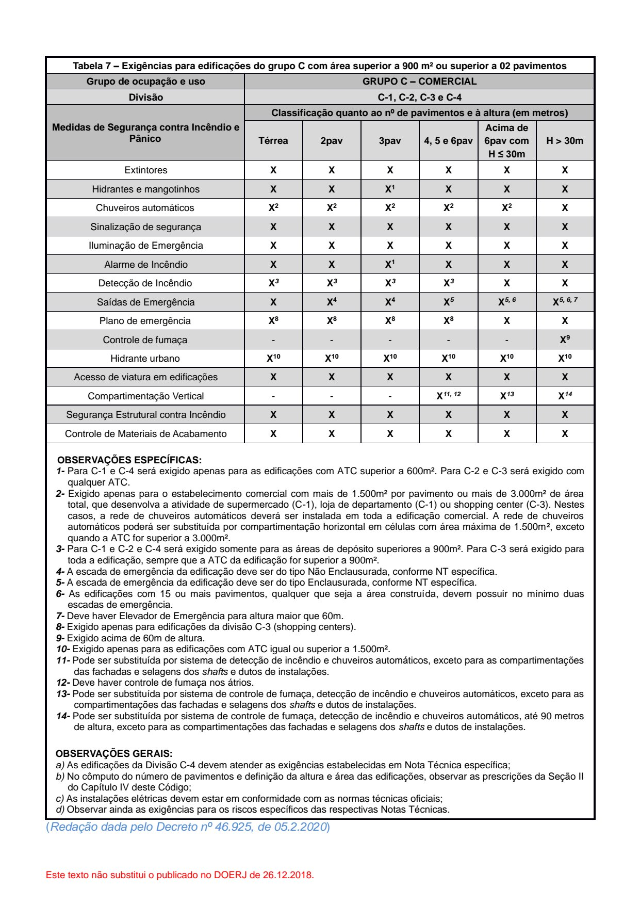

(Redação dada pelo Decreto nº 46.925, de 05.2.2020)

### Tabelas extraídas (bruto, não usar para citação)
#### Tabela 1 da página

| Tabela 7 - Exigências para edificações do grupo C com área superior a 900 m² ou superior a 02 pavimentos |  |  |  |  |  |  |
| --- | --- | --- | --- | --- | --- | --- |
| Grupo de ocupação e uso | GRUPO C - COMERCIAL |  |  |  |  |  |
| Divisão | C-1, C-2, C-3 e C-4 |  |  |  |  |  |
|  | Classificação quanto ao nº de pavimentos e à altura (em metros) |  |  |  |  |  |
| Medidas de Segurança contra Incêndio e |  |  |  |  | Acima de |  |
| Pânico | Térrea | 2pav | 3pav | 4, 5 e 6pav | 6pav com | H > 30m |
|  |  |  |  |  | H ≤ 30m |  |
| Extintores | X | X | X | X | X | X |
|  |  |  |  |  |  |  |
| Hidrantes e mangotinhos | X | X | X1 | X | X | X |
|  |  |  |  |  |  |  |
| Chuveiros automáticos | X2 | X2 | X2 | X2 | X2 | X |
|  |  |  |  |  |  |  |
| Sinalização de segurança | X | X | X | X | X | X |
|  |  |  |  |  |  |  |
| Iluminação de Emergência | X | X | X | X | X | X |
|  |  |  |  |  |  |  |
| Alarme de Incêndio | X | X | X1 | X | X | X |
|  |  |  |  |  |  |  |
| Detecção de Incêndio | X3 | X3 | X3 | X3 | X | X |
|  |  |  |  |  |  |  |
| Saídas de Emergência | X | X4 | X4 | X5 | X5, 6 | X5, 6, 7 |
|  |  |  |  |  |  |  |
| Plano de emergência | X8 | X8 | X8 | X8 | X | X |
|  |  |  |  |  |  |  |
| Controle de fumaça | - | - | - | - | - | X9 |
|  |  |  |  |  |  |  |
| Hidrante urbano | X10 | X10 | X10 | X10 | X10 | X10 |
|  |  |  |  |  |  |  |
| Acesso de viatura em edificações | X | X | X | X | X | X |
|  |  |  |  |  |  |  |
| Compartimentação Vertical | - | - | - | X11, 12 | X13 | X14 |
|  |  |  |  |  |  |  |
| Segurança Estrutural contra Incêndio | X | X | X | X | X | X |
|  |  |  |  |  |  |  |
| Controle de Materiais de Acabamento | X | X | X | X | X | X |
| OBSERVAÇÕES ESPECÍFICAS: 1- Para C-1 e C-4 será exigido apenas para as edificações com ATC superior a 600m². Para C-2 e C-3 será exigido com qualquer ATC. 2- Exigido apenas para o estabelecimento comercial com mais de 1.500m² por pavimento ou mais de 3.000m² de área total, que desenvolva a atividade de supermercado (C-1), loja de departamento (C-1) ou shopping center (C-3). Nestes casos, a rede de chuveiros automáticos deverá ser instalada em toda a edificação comercial. A rede de chuveiros automáticos poderá ser substituída por compartimentação horizontal em células com área máxima de 1.500m², exceto quando a ATC for superior a 3.000m². 3- Para C-1 e C-2 e C-4 será exigido somente para as áreas de depósito superiores a 900m². Para C-3 será exigido para toda a edificação, sempre que a ATC da edificação for superior a 900m². 4- A escada de emergência da edificação deve ser do tipo Não Enclausurada, conforme NT específica. 5- A escada de emergência da edificação deve ser do tipo Enclausurada, conforme NT específica. 6- As edificações com 15 ou mais pavimentos, qualquer que seja a área construída, devem possuir no mínimo duas escadas de emergência. 7- Deve haver Elevador de Emergência para altura maior que 60m. 8- Exigido apenas para edificações da divisão C-3 (shopping centers). 9- Exigido acima de 60m de altura. 10- Exigido apenas para as edificações com ATC igual ou superior a 1.500m². 11- Pode ser substituída por sistema de detecção de incêndio e chuveiros automáticos, exceto para as compartimentações das fachadas e selagens dos shafts e dutos de instalações. 12- Deve haver controle de fumaça nos átrios. 13- Pode ser substituída por sistema de controle de fumaça, detecção de incêndio e chuveiros automáticos, exceto para as compartimentações das fachadas e selagens dos shafts e dutos de instalações. 14- Pode ser substituída por sistema de controle de fumaça, detecção de incêndio e chuveiros automáticos, até 90 metros de altura, exceto para as compartimentações das fachadas e selagens dos shafts e dutos de instalações. OBSERVAÇÕES GERAIS: a) As edificações da Divisão C-4 devem atender as exigências estabelecidas em Nota Técnica específica; b) No cômputo do número de pavimentos e definição da altura e área das edificações, observar as prescrições da Seção II do Capítulo IV deste Código; c) As instalações elétricas devem estar em conformidade com as normas técnicas oficiais; d) Observar ainda as exigências para os riscos específicos das respectivas Notas Técnicas. |  |  |  |  |  |  |

<!-- tabela-conferida: Tabela 7 p31 -->
### Tabela 7 — Exigências para edificações do grupo C com área superior a 900 m² ou superior a 02 pavimentos (conferida)

| Medidas de Segurança contra Incêndio e Pânico | Térrea | 2pav | 3pav | 4, 5 e 6pav | Acima de 6pav com H ≤ 30m | H > 30m |
| --- | --- | --- | --- | --- | --- | --- |
| Extintores | X | X | X | X | X | X |
| Hidrantes e mangotinhos | X | X | X1 | X | X | X |
| Chuveiros automáticos | X2 | X2 | X2 | X2 | X2 | X |
| Sinalização de segurança | X | X | X | X | X | X |
| Iluminação de Emergência | X | X | X | X | X | X |
| Alarme de Incêndio | X | X | X1 | X | X | X |
| Detecção de Incêndio | X3 | X3 | X3 | X3 | X | X |
| Saídas de Emergência | X | X4 | X4 | X5 | X5, 6 | X5, 6, 7 |
| Plano de emergência | X8 | X8 | X8 | X8 | X | X |
| Controle de fumaça | - | - | - | - | - | X9 |
| Hidrante urbano | X10 | X10 | X10 | X10 | X10 | X10 |
| Acesso de viatura em edificações | X | X | X | X | X | X |
| Compartimentação Vertical | - | - | - | X11, 12 | X13 | X14 |
| Segurança Estrutural contra Incêndio | X | X | X | X | X | X |
| Controle de Materiais de Acabamento | X | X | X | X | X | X |

Fonte: Decreto 42/2018, página 31, Tabela 7; conferida em 2026-09-29 (visual + geometrica).
As observações específicas e gerais da tabela estão no texto da página (e na imagem); valem para as células com a nota correspondente.
<!-- /tabela-conferida: Tabela 7 p31 -->

---

## Página 32

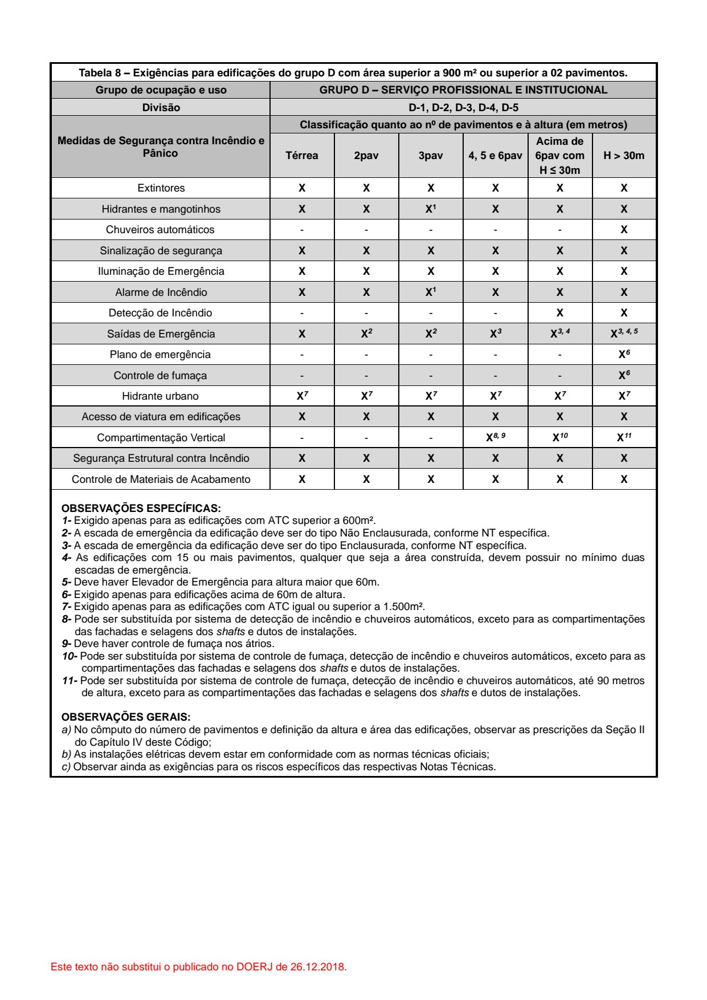

> Página sem texto extraível suficiente; consultar a representação visual ou o PDF oficial.

### Tabelas extraídas (bruto, não usar para citação)
#### Tabela 1 da página

| Tabela 8 - Exigências para edificações do grupo D com área superior a 900 m² ou superior a 02 pavimentos. |  |  |  |  |  |  |
| --- | --- | --- | --- | --- | --- | --- |
| Grupo de ocupação e uso | GRUPO D - SERVIÇO PROFISSIONAL E INSTITUCIONAL |  |  |  |  |  |
| Divisão | D-1, D-2, D-3, D-4, D-5 |  |  |  |  |  |
|  | Classificação quanto ao nº de pavimentos e à altura (em metros) |  |  |  |  |  |
| Medidas de Segurança contra Incêndio e |  |  |  |  | Acima de |  |
| Pânico | Térrea | 2pav | 3pav | 4, 5 e 6pav | 6pav com | H > 30m |
|  |  |  |  |  | H ≤ 30m |  |
| Extintores | X | X | X | X | X | X |
|  |  |  |  |  |  |  |
| Hidrantes e mangotinhos | X | X | X1 | X | X | X |
|  |  |  |  |  |  |  |
| Chuveiros automáticos | - | - | - | - | - | X |
|  |  |  |  |  |  |  |
| Sinalização de segurança | X | X | X | X | X | X |
|  |  |  |  |  |  |  |
| Iluminação de Emergência | X | X | X | X | X | X |
|  |  |  |  |  |  |  |
| Alarme de Incêndio | X | X | X1 | X | X | X |
|  |  |  |  |  |  |  |
| Detecção de Incêndio | - | - | - | - | X | X |
|  |  |  |  |  |  |  |
| Saídas de Emergência | X | X2 | X2 | X3 | X3, 4 | X3, 4, 5 |
|  |  |  |  |  |  |  |
| Plano de emergência | - | - | - | - | - | X6 |
|  |  |  |  |  |  |  |
| Controle de fumaça | - | - | - | - | - | X6 |
|  |  |  |  |  |  |  |
| Hidrante urbano | X7 | X7 | X7 | X7 | X7 | X7 |
|  |  |  |  |  |  |  |
| Acesso de viatura em edificações | X | X | X | X | X | X |
|  |  |  |  |  |  |  |
| Compartimentação Vertical | - | - | - | X8, 9 | X10 | X11 |
|  |  |  |  |  |  |  |
| Segurança Estrutural contra Incêndio | X | X | X | X | X | X |
|  |  |  |  |  |  |  |
| Controle de Materiais de Acabamento | X | X | X | X | X | X |
| OBSERVAÇÕES ESPECÍFICAS: 1- Exigido apenas para as edificações com ATC superior a 600m². 2- A escada de emergência da edificação deve ser do tipo Não Enclausurada, conforme NT específica. 3- A escada de emergência da edificação deve ser do tipo Enclausurada, conforme NT específica. 4- As edificações com 15 ou mais pavimentos, qualquer que seja a área construída, devem possuir no mínimo duas escadas de emergência. 5- Deve haver Elevador de Emergência para altura maior que 60m. 6- Exigido apenas para edificações acima de 60m de altura. 7- Exigido apenas para as edificações com ATC igual ou superior a 1.500m². 8- Pode ser substituída por sistema de detecção de incêndio e chuveiros automáticos, exceto para as compartimentações das fachadas e selagens dos shafts e dutos de instalações. 9- Deve haver controle de fumaça nos átrios. 10- Pode ser substituída por sistema de controle de fumaça, detecção de incêndio e chuveiros automáticos, exceto para as compartimentações das fachadas e selagens dos shafts e dutos de instalações. 11- Pode ser substituída por sistema de controle de fumaça, detecção de incêndio e chuveiros automáticos, até 90 metros de altura, exceto para as compartimentações das fachadas e selagens dos shafts e dutos de instalações. OBSERVAÇÕES GERAIS: a) No cômputo do número de pavimentos e definição da altura e área das edificações, observar as prescrições da Seção II do Capítulo IV deste Código; b) As instalações elétricas devem estar em conformidade com as normas técnicas oficiais; c) Observar ainda as exigências para os riscos específicos das respectivas Notas Técnicas. |  |  |  |  |  |  |

<!-- tabela-conferida: Tabela 8 p32 -->
### Tabela 8 — Exigências para edificações do grupo D com área superior a 900 m² ou superior a 02 pavimentos. (conferida)

| Medidas de Segurança contra Incêndio e Pânico | Térrea | 2pav | 3pav | 4, 5 e 6pav | Acima de 6pav com H ≤ 30m | H > 30m |
| --- | --- | --- | --- | --- | --- | --- |
| Extintores | X | X | X | X | X | X |
| Hidrantes e mangotinhos | X | X | X1 | X | X | X |
| Chuveiros automáticos | - | - | - | - | - | X |
| Sinalização de segurança | X | X | X | X | X | X |
| Iluminação de Emergência | X | X | X | X | X | X |
| Alarme de Incêndio | X | X | X1 | X | X | X |
| Detecção de Incêndio | - | - | - | - | X | X |
| Saídas de Emergência | X | X2 | X2 | X3 | X3, 4 | X3, 4, 5 |
| Plano de emergência | - | - | - | - | - | X6 |
| Controle de fumaça | - | - | - | - | - | X6 |
| Hidrante urbano | X7 | X7 | X7 | X7 | X7 | X7 |
| Acesso de viatura em edificações | X | X | X | X | X | X |
| Compartimentação Vertical | - | - | - | X8, 9 | X10 | X11 |
| Segurança Estrutural contra Incêndio | X | X | X | X | X | X |
| Controle de Materiais de Acabamento | X | X | X | X | X | X |

Fonte: Decreto 42/2018, página 32, Tabela 8; conferida em 2026-09-29 (visual + geometrica).
As observações específicas e gerais da tabela estão no texto da página (e na imagem); valem para as células com a nota correspondente.
<!-- /tabela-conferida: Tabela 8 p32 -->

---

## Página 33

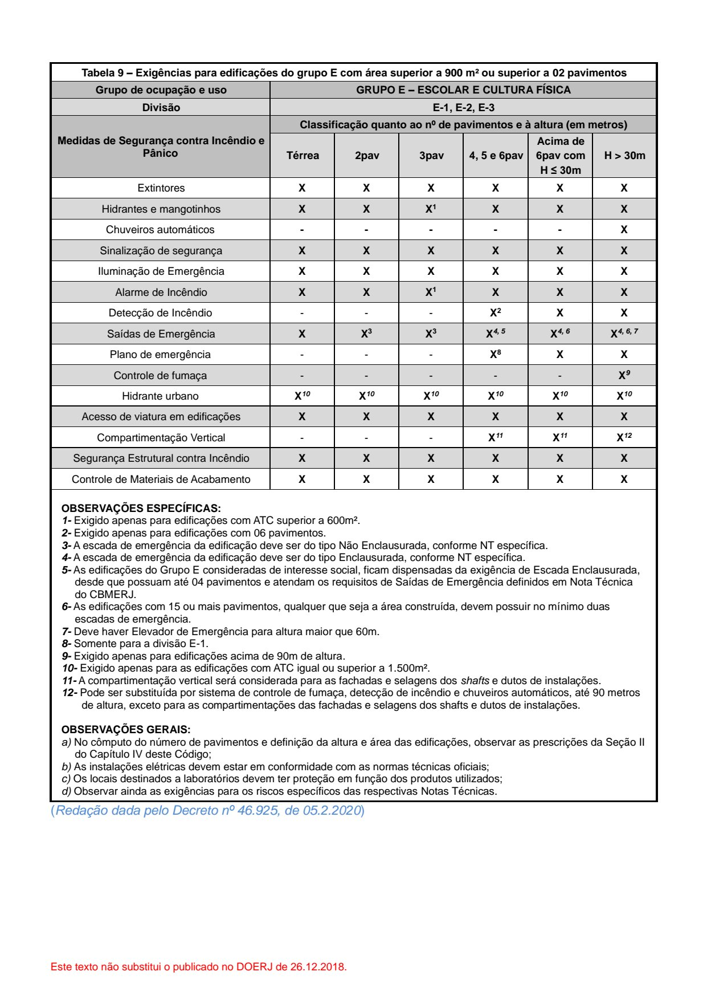

(Redação dada pelo Decreto nº 46.925, de 05.2.2020)

### Tabelas extraídas (bruto, não usar para citação)
#### Tabela 1 da página

| Tabela 9 - Exigências para edificações do grupo E com área superior a 900 m² ou superior a 02 pavimentos |  |  |  |  |  |  |
| --- | --- | --- | --- | --- | --- | --- |
| Grupo de ocupação e uso | GRUPO E - ESCOLAR E CULTURA FÍSICA |  |  |  |  |  |
| Divisão | E-1, E-2, E-3 |  |  |  |  |  |
|  | Classificação quanto ao nº de pavimentos e à altura (em metros) |  |  |  |  |  |
| Medidas de Segurança contra Incêndio e |  |  |  |  | Acima de |  |
| Pânico | Térrea | 2pav | 3pav | 4, 5 e 6pav | 6pav com | H > 30m |
|  |  |  |  |  | H ≤ 30m |  |
| Extintores | X | X | X | X | X | X |
|  |  |  |  |  |  |  |
| Hidrantes e mangotinhos | X | X | X1 | X | X | X |
|  |  |  |  |  |  |  |
| Chuveiros automáticos | - | - | - | - | - | X |
|  |  |  |  |  |  |  |
| Sinalização de segurança | X | X | X | X | X | X |
|  |  |  |  |  |  |  |
| Iluminação de Emergência | X | X | X | X | X | X |
|  |  |  |  |  |  |  |
| Alarme de Incêndio | X | X | X1 | X | X | X |
|  |  |  |  |  |  |  |
| Detecção de Incêndio | - | - | - | X2 | X | X |
|  |  |  |  |  |  |  |
| Saídas de Emergência | X | X3 | X3 | X4, 5 | X4, 6 | X4, 6, 7 |
|  |  |  |  |  |  |  |
| Plano de emergência | - | - | - | X8 | X | X |
|  |  |  |  |  |  |  |
| Controle de fumaça | - | - | - | - | - | X9 |
|  |  |  |  |  |  |  |
| Hidrante urbano | X10 | X10 | X10 | X10 | X10 | X10 |
|  |  |  |  |  |  |  |
| Acesso de viatura em edificações | X | X | X | X | X | X |
|  |  |  |  |  |  |  |
| Compartimentação Vertical | - | - | - | X11 | X11 | X12 |
|  |  |  |  |  |  |  |
| Segurança Estrutural contra Incêndio | X | X | X | X | X | X |
|  |  |  |  |  |  |  |
| Controle de Materiais de Acabamento | X | X | X | X | X | X |
| OBSERVAÇÕES ESPECÍFICAS: 1- Exigido apenas para edificações com ATC superior a 600m². 2- Exigido apenas para edificações com 06 pavimentos. 3- A escada de emergência da edificação deve ser do tipo Não Enclausurada, conforme NT específica. 4- A escada de emergência da edificação deve ser do tipo Enclausurada, conforme NT específica. 5- As edificações do Grupo E consideradas de interesse social, ficam dispensadas da exigência de Escada Enclausurada, desde que possuam até 04 pavimentos e atendam os requisitos de Saídas de Emergência definidos em Nota Técnica do CBMERJ. 6- As edificações com 15 ou mais pavimentos, qualquer que seja a área construída, devem possuir no mínimo duas escadas de emergência. 7- Deve haver Elevador de Emergência para altura maior que 60m. 8- Somente para a divisão E-1. 9- Exigido apenas para edificações acima de 90m de altura. 10- Exigido apenas para as edificações com ATC igual ou superior a 1.500m². 11- A compartimentação vertical será considerada para as fachadas e selagens dos shafts e dutos de instalações. 12- Pode ser substituída por sistema de controle de fumaça, detecção de incêndio e chuveiros automáticos, até 90 metros de altura, exceto para as compartimentações das fachadas e selagens dos shafts e dutos de instalações. OBSERVAÇÕES GERAIS: a) No cômputo do número de pavimentos e definição da altura e área das edificações, observar as prescrições da Seção II do Capítulo IV deste Código; b) As instalações elétricas devem estar em conformidade com as normas técnicas oficiais; c) Os locais destinados a laboratórios devem ter proteção em função dos produtos utilizados; d) Observar ainda as exigências para os riscos específicos das respectivas Notas Técnicas. |  |  |  |  |  |  |

<!-- tabela-conferida: Tabela 9 p33 -->
### Tabela 9 — Exigências para edificações do grupo E com área superior a 900 m² ou superior a 02 pavimentos (conferida)

| Medidas de Segurança contra Incêndio e Pânico | Térrea | 2pav | 3pav | 4, 5 e 6pav | Acima de 6pav com H ≤ 30m | H > 30m |
| --- | --- | --- | --- | --- | --- | --- |
| Extintores | X | X | X | X | X | X |
| Hidrantes e mangotinhos | X | X | X1 | X | X | X |
| Chuveiros automáticos | - | - | - | - | - | X |
| Sinalização de segurança | X | X | X | X | X | X |
| Iluminação de Emergência | X | X | X | X | X | X |
| Alarme de Incêndio | X | X | X1 | X | X | X |
| Detecção de Incêndio | - | - | - | X2 | X | X |
| Saídas de Emergência | X | X3 | X3 | X4, 5 | X4, 6 | X4, 6, 7 |
| Plano de emergência | - | - | - | X8 | X | X |
| Controle de fumaça | - | - | - | - | - | X9 |
| Hidrante urbano | X10 | X10 | X10 | X10 | X10 | X10 |
| Acesso de viatura em edificações | X | X | X | X | X | X |
| Compartimentação Vertical | - | - | - | X11 | X11 | X12 |
| Segurança Estrutural contra Incêndio | X | X | X | X | X | X |
| Controle de Materiais de Acabamento | X | X | X | X | X | X |

Fonte: Decreto 42/2018, página 33, Tabela 9; conferida em 2026-09-29 (visual + geometrica).
As observações específicas e gerais da tabela estão no texto da página (e na imagem); valem para as células com a nota correspondente.
<!-- /tabela-conferida: Tabela 9 p33 -->

---

## Página 34

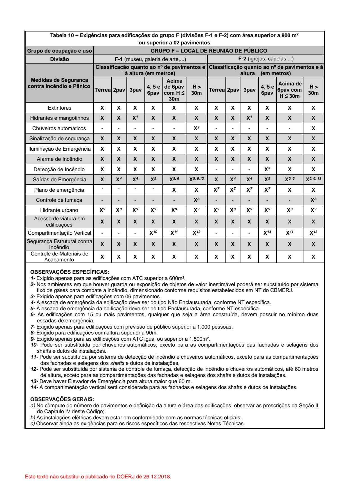

> Página sem texto extraível suficiente; consultar a representação visual ou o PDF oficial.

### Tabelas extraídas (bruto, não usar para citação)
#### Tabela 1 da página

| Tabela 10 - Exigências para edificações do grupo F (divisões F-1 e F-2) com área superior a 900 m2 |  |  |  |  |  |  |  |  |  |  |  |  |
| --- | --- | --- | --- | --- | --- | --- | --- | --- | --- | --- | --- | --- |
| ou superior a 02 pavimentos |  |  |  |  |  |  |  |  |  |  |  |  |
| Grupo de ocupação e uso | GRUPO F - LOCAL DE REUNIÃO DE PÚBLICO |  |  |  |  |  |  |  |  |  |  |  |
| Divisão | F-1 (museu, galeria de arte,...) |  |  |  |  |  | F-2 (igrejas, capelas,...) |  |  |  |  |  |
|  | Classificação quanto ao nº de pavimentos e |  |  |  |  |  | Classificação quanto ao nº de pavimentos e à |  |  |  |  |  |
|  | à altura (em metros) |  |  |  |  |  | altura (em metros) |  |  |  |  |  |
| Medidas de Segurança |  |  |  |  | Acima |  |  |  |  |  |  |  |
|  |  |  |  |  |  |  |  |  |  |  | Acima de |  |
| contra Incêndio e Pânico |  |  |  | 4, 5 e | de 6pav | H > |  |  |  | 4, 5 e |  | H > |
|  | Térrea | 2pav | 3pav |  |  |  | Térrea | 2pav | 3pav |  | 6pav com |  |
|  |  |  |  | 6pav | com H ≤ | 30m |  |  |  | 6pav |  | 30m |
|  |  |  |  |  |  |  |  |  |  |  | H ≤ 30m |  |
|  |  |  |  |  | 30m |  |  |  |  |  |  |  |
|  |  |  |  |  |  |  |  |  |  |  |  |  |
| Extintores | X | X | X | X | X | X | X | X | X | X | X | X |
|  |  |  |  |  |  |  |  |  |  |  |  |  |
| Hidrantes e mangotinhos | X | X | X1 | X | X | X | X | X | X1 | X | X | X |
|  |  |  |  |  |  |  |  |  |  |  |  |  |
| Chuveiros automáticos | - | - | - | - | - | X2 | - | - | - | - | - | X |
|  |  |  |  |  |  |  |  |  |  |  |  |  |
| Sinalização de segurança | X | X | X | X | X | X | X | X | X | X | X | X |
|  |  |  |  |  |  |  |  |  |  |  |  |  |
| Iluminação de Emergência | X | X | X | X | X | X | X | X | X | X | X | X |
|  |  |  |  |  |  |  |  |  |  |  |  |  |
| Alarme de Incêndio | X | X | X | X | X | X | X | X | X | X | X | X |
|  |  |  |  |  |  |  |  |  |  |  |  |  |
| Detecção de Incêndio | X | X | X | X | X | X | - | - | - | X3 | X | X |
|  |  |  |  |  |  |  |  |  |  |  |  |  |
| Saídas de Emergência | X | X4 | X4 | X5 | X5, 6 | X5, 6,13 | X | X4 | X4 | X5 | X5, 6 | X5, 6, 13 |
|  |  |  |  |  |  |  |  |  |  |  |  |  |
| Plano de emergência | - | - | - | - | X | X | X7 | X7 | X7 | X7 | X | X |
|  |  |  |  |  |  |  |  |  |  |  |  |  |
| Controle de fumaça | - | - | - | - | - | X8 | - | - | - | - | - | X8 |
|  |  |  |  |  |  |  |  |  |  |  |  |  |
| Hidrante urbano | X9 | X9 | X9 | X9 | X9 | X9 | X9 | X9 | X9 | X9 | X9 | X9 |
| Acesso de viatura em |  |  |  |  |  |  |  |  |  |  |  |  |
|  | X | X | X | X | X | X | X | X | X | X | X | X |
| edificações |  |  |  |  |  |  |  |  |  |  |  |  |
|  |  |  |  |  |  |  |  |  |  |  |  |  |
| Compartimentação Vertical | - | - | - | X10 | X11 | X12 | - | - | - | X14 | X11 | X12 |
| Segurança Estrutural contra |  |  |  |  |  |  |  |  |  |  |  |  |
|  | X | X | X | X | X | X | X | X | X | X | X | X |
| Incêndio |  |  |  |  |  |  |  |  |  |  |  |  |
|  |  |  |  |  |  |  |  |  |  |  |  |  |
| Controle de Materiais de Acabamento | X | X | X | X | X | X | X | X | X | X | X | X |
| OBSERVAÇÕES ESPECÍFICAS: 1- Exigido apenas para as edificações com ATC superior a 600m². 2- Nos ambientes em que houver guarda ou exposição de objetos de valor inestimável poderá ser substituído por sistema fixo de gases para combate a incêndio, dimensionado conforme requisitos estabelecidos em NT do CBMERJ. 3- Exigido apenas para edificações com 06 pavimentos. 4- A escada de emergência da edificação deve ser do tipo Não Enclausurada, conforme NT específica. 5- A escada de emergência da edificação deve ser do tipo Enclausurada, conforme NT específica. 6- As edificações com 15 ou mais pavimentos, qualquer que seja a área construída, devem possuir no mínimo duas escadas de emergência. 7- Exigido apenas para edificações com previsão de público superior a 1.000 pessoas. 8- Exigido para edificações com altura superior a 90m. 9- Exigido apenas para as edificações com ATC igual ou superior a 1.500m². 10- Pode ser substituída por chuveiros automáticos, exceto para as compartimentações das fachadas e selagens dos shafts e dutos de instalações. 11- Pode ser substituída por sistema de detecção de incêndio e chuveiros automáticos, exceto para as compartimentações das fachadas e selagens dos shafts e dutos de instalações. 12- Pode ser substituída por sistema de controle de fumaça, detecção de incêndio e chuveiros automáticos, até 60 metros de altura, exceto para as compartimentações das fachadas e selagens dos shafts e dutos de instalações. 13- Deve haver Elevador de Emergência para altura maior que 60 m. 14- A compartimentação vertical será considerada para as fachadas e selagens dos shafts e dutos de instalações. OBSERVAÇÕES GERAIS: a) No cômputo do número de pavimentos e definição da altura e área das edificações, observar as prescrições da Seção II do Capítulo IV deste Código; b) As instalações elétricas devem estar em conformidade com as normas técnicas oficiais; c) Observar ainda as exigências para os riscos específicos das respectivas Notas Técnicas. |  |  |  |  |  |  |  |  |  |  |  |  |

<!-- tabela-conferida: Tabela 10 p34 -->
### Tabela 10 — Exigências para edificações do grupo F (divisões F-1 e F-2) com área superior a 900 m2 ou superior a 02 pavimentos (conferida)

| Medidas de Segurança contra Incêndio e Pânico | F-1 — Térrea | F-1 — 2pav | F-1 — 3pav | F-1 — 4, 5 e 6pav | F-1 — Acima de 6pav com H ≤ 30m | F-1 — H > 30m | F-2 — Térrea | F-2 — 2pav | F-2 — 3pav | F-2 — 4, 5 e 6pav | F-2 — Acima de 6pav com H ≤ 30m | F-2 — H > 30m |
| --- | --- | --- | --- | --- | --- | --- | --- | --- | --- | --- | --- | --- |
| Extintores | X | X | X | X | X | X | X | X | X | X | X | X |
| Hidrantes e mangotinhos | X | X | X1 | X | X | X | X | X | X1 | X | X | X |
| Chuveiros automáticos | - | - | - | - | - | X2 | - | - | - | - | - | X |
| Sinalização de segurança | X | X | X | X | X | X | X | X | X | X | X | X |
| Iluminação de Emergência | X | X | X | X | X | X | X | X | X | X | X | X |
| Alarme de Incêndio | X | X | X | X | X | X | X | X | X | X | X | X |
| Detecção de Incêndio | X | X | X | X | X | X | - | - | - | X3 | X | X |
| Saídas de Emergência | X | X4 | X4 | X5 | X5, 6 | X5, 6,13 | X | X4 | X4 | X5 | X5, 6 | X5, 6, 13 |
| Plano de emergência | - | - | - | - | X | X | X7 | X7 | X7 | X7 | X | X |
| Controle de fumaça | - | - | - | - | - | X8 | - | - | - | - | - | X8 |
| Hidrante urbano | X9 | X9 | X9 | X9 | X9 | X9 | X9 | X9 | X9 | X9 | X9 | X9 |
| Acesso de viatura em edificações | X | X | X | X | X | X | X | X | X | X | X | X |
| Compartimentação Vertical | - | - | - | X10 | X11 | X12 | - | - | - | X14 | X11 | X12 |
| Segurança Estrutural contra Incêndio | X | X | X | X | X | X | X | X | X | X | X | X |
| Controle de Materiais de Acabamento | X | X | X | X | X | X | X | X | X | X | X | X |

Fonte: Decreto 42/2018, página 34, Tabela 10; conferida em 2026-09-29 (visual + geometrica).
As observações específicas e gerais da tabela estão no texto da página (e na imagem); valem para as células com a nota correspondente.
<!-- /tabela-conferida: Tabela 10 p34 -->

---

## Página 35

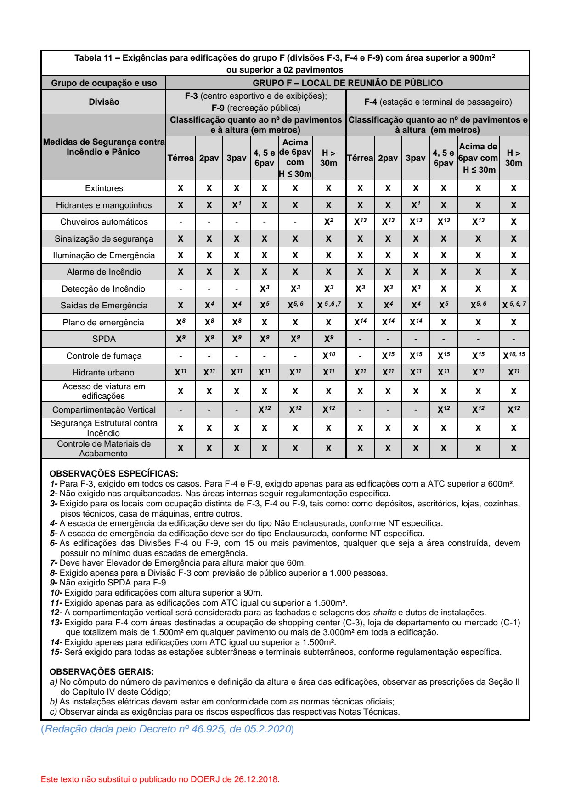

(Redação dada pelo Decreto nº 46.925, de 05.2.2020)

### Tabelas extraídas (bruto, não usar para citação)
#### Tabela 1 da página

| Tabela 11 - Exigências para edificações do grupo F (divisões F-3, F-4 e F-9) com área superior a 900m2 |  |  |  |  |  |  |  |  |  |  |  |  |
| --- | --- | --- | --- | --- | --- | --- | --- | --- | --- | --- | --- | --- |
| ou superior a 02 pavimentos |  |  |  |  |  |  |  |  |  |  |  |  |
| Grupo de ocupação e uso | GRUPO F - LOCAL DE REUNIÃO DE PÚBLICO |  |  |  |  |  |  |  |  |  |  |  |
|  | F-3 (centro esportivo e de exibições); |  |  |  |  |  |  |  |  |  |  |  |
| Divisão |  |  |  |  |  |  | F-4 (estação e terminal de passageiro) |  |  |  |  |  |
|  | F-9 (recreação pública) |  |  |  |  |  |  |  |  |  |  |  |
|  |  |  |  |  |  |  |  |  |  |  |  |  |
|  | Classificação quanto ao nº de pavimentos |  |  |  |  |  | Classificação quanto ao nº de pavimentos e |  |  |  |  |  |
|  | e à altura (em metros) |  |  |  |  |  | à altura (em metros) |  |  |  |  |  |
| Medidas de Segurança contra |  |  |  |  | Acima |  |  |  |  |  |  |  |
|  |  |  |  |  |  |  |  |  |  |  | Acima de |  |
| Incêndio e Pânico |  |  |  | 4, 5 e | de 6pav | H > |  |  |  | 4, 5 e |  | H > |
|  | Térrea | 2pav | 3pav |  |  |  | Térrea | 2pav | 3pav |  | 6pav com |  |
|  |  |  |  | 6pav | com | 30m |  |  |  | 6pav |  | 30m |
|  |  |  |  |  |  |  |  |  |  |  | H ≤ 30m |  |
|  |  |  |  |  | H ≤ 30m |  |  |  |  |  |  |  |
|  |  |  |  |  |  |  |  |  |  |  |  |  |
| Extintores | X | X | X | X | X | X | X | X | X | X | X | X |
|  |  |  |  |  |  |  |  |  |  |  |  |  |
| Hidrantes e mangotinhos | X | X | X1 | X | X | X | X | X | X1 | X | X | X |
|  |  |  |  |  |  |  |  |  |  |  |  |  |
| Chuveiros automáticos | - | - | - | - | - | X2 | X13 | X13 | X13 | X13 | X13 | X |
|  |  |  |  |  |  |  |  |  |  |  |  |  |
| Sinalização de segurança | X | X | X | X | X | X | X | X | X | X | X | X |
|  |  |  |  |  |  |  |  |  |  |  |  |  |
| Iluminação de Emergência | X | X | X | X | X | X | X | X | X | X | X | X |
|  |  |  |  |  |  |  |  |  |  |  |  |  |
| Alarme de Incêndio | X | X | X | X | X | X | X | X | X | X | X | X |
|  |  |  |  |  |  |  |  |  |  |  |  |  |
| Detecção de Incêndio | - | - | - | X3 | X3 | X3 | X3 | X3 | X3 | X | X | X |
|  |  |  |  |  |  |  |  |  |  |  |  |  |
| Saídas de Emergência | X | X4 | X4 | X5 | X5, 6 | X 5,6,7 | X | X4 | X4 | X5 | X5, 6 | X 5, 6, 7 |
|  |  |  |  |  |  |  |  |  |  |  |  |  |
| Plano de emergência | X8 | X8 | X8 | X | X | X | X14 | X14 | X14 | X | X | X |
|  |  |  |  |  |  |  |  |  |  |  |  |  |
| SPDA | X9 | X9 | X9 | X9 | X9 | X9 | - | - | - | - | - | - |
|  |  |  |  |  |  |  |  |  |  |  |  |  |
| Controle de fumaça | - | - | - | - | - | X10 | - | X15 | X15 | X15 | X15 | X10, 15 |
|  |  |  |  |  |  |  |  |  |  |  |  |  |
| Hidrante urbano | X11 | X11 | X11 | X11 | X11 | X11 | X11 | X11 | X11 | X11 | X11 | X11 |
|  |  |  |  |  |  |  |  |  |  |  |  |  |
| Acesso de viatura em edificações | X | X | X | X | X | X | X | X | X | X | X | X |
|  |  |  |  |  |  |  |  |  |  |  |  |  |
| Compartimentação Vertical | - | - | - | X12 | X12 | X12 | - | - | - | X12 | X12 | X12 |
|  |  |  |  |  |  |  |  |  |  |  |  |  |
| Segurança Estrutural contra Incêndio | X | X | X | X | X | X | X | X | X | X | X | X |
| Controle de Materiais de |  |  |  |  |  |  |  |  |  |  |  |  |
|  | X | X | X | X | X | X | X | X | X | X | X | X |
| Acabamento |  |  |  |  |  |  |  |  |  |  |  |  |
|  |  |  |  |  |  |  |  |  |  |  |  |  |
|  |  |  |  |  |  |  |  |  |  |  |  |  |
| OBSERVAÇÕES ESPECÍFICAS: |  |  |  |  |  |  |  |  |  |  |  |  |
| 1- Para F-3, exigido em todos os casos. Para F-4 e F-9, exigido apenas para as edificações com a ATC superior a 600m². |  |  |  |  |  |  |  |  |  |  |  |  |
| 2- Não exigido nas arquibancadas. Nas áreas internas seguir regulamentação específica. |  |  |  |  |  |  |  |  |  |  |  |  |
| 3- Exigido para os locais com ocupação distinta de F-3, F-4 ou F-9, tais como: como depósitos, escritórios, lojas, cozinhas, |  |  |  |  |  |  |  |  |  |  |  |  |
| pisos técnicos, casa de máquinas, entre outros. |  |  |  |  |  |  |  |  |  |  |  |  |
| 4- A escada de emergência da edificação deve ser do tipo Não Enclausurada, conforme NT específica. |  |  |  |  |  |  |  |  |  |  |  |  |
| 5- A escada de emergência da edificação deve ser do tipo Enclausurada, conforme NT específica. |  |  |  |  |  |  |  |  |  |  |  |  |
| 6- As edificações das Divisões F-4 ou F-9, com 15 ou mais pavimentos, qualquer que seja a área construída, devem |  |  |  |  |  |  |  |  |  |  |  |  |
| possuir no mínimo duas escadas de emergência. |  |  |  |  |  |  |  |  |  |  |  |  |
| 7- Deve haver Elevador de Emergência para altura maior que 60m. |  |  |  |  |  |  |  |  |  |  |  |  |
| 8- Exigido apenas para a Divisão F-3 com previsão de público superior a 1.000 pessoas. |  |  |  |  |  |  |  |  |  |  |  |  |
| 9- Não exigido SPDA para F-9. |  |  |  |  |  |  |  |  |  |  |  |  |
| 10- Exigido para edificações com altura superior a 90m. |  |  |  |  |  |  |  |  |  |  |  |  |
| 11- Exigido apenas para as edificações com ATC igual ou superior a 1.500m². |  |  |  |  |  |  |  |  |  |  |  |  |
| 12- A compartimentação vertical será considerada para as fachadas e selagens dos shafts e dutos de instalações. |  |  |  |  |  |  |  |  |  |  |  |  |
| 13- Exigido para F-4 com áreas destinadas a ocupação de shopping center (C-3), loja de departamento ou mercado (C-1) |  |  |  |  |  |  |  |  |  |  |  |  |
| que totalizem mais de 1.500m² em qualquer pavimento ou mais de 3.000m² em toda a edificação. |  |  |  |  |  |  |  |  |  |  |  |  |
| 14- Exigido apenas para edificações com ATC igual ou superior a 1.500m². |  |  |  |  |  |  |  |  |  |  |  |  |
| 15- Será exigido para todas as estações subterrâneas e terminais subterrâneos, conforme regulamentação específica. |  |  |  |  |  |  |  |  |  |  |  |  |
|  |  |  |  |  |  |  |  |  |  |  |  |  |
| OBSERVAÇÕES GERAIS: |  |  |  |  |  |  |  |  |  |  |  |  |
| a) No cômputo do número de pavimentos e definição da altura e área das edificações, observar as prescrições da Seção II |  |  |  |  |  |  |  |  |  |  |  |  |
| do Capítulo IV deste Código; |  |  |  |  |  |  |  |  |  |  |  |  |
| b) As instalações elétricas devem estar em conformidade com as normas técnicas oficiais; |  |  |  |  |  |  |  |  |  |  |  |  |
| c) Observar ainda as exigências para os riscos específicos das respectivas Notas Técnicas. |  |  |  |  |  |  |  |  |  |  |  |  |

<!-- tabela-conferida: Tabela 11 p35 -->
### Tabela 11 — Exigências para edificações do grupo F (divisões F-3, F-4 e F-9) com área superior a 900m2 ou superior a 02 pavimentos (conferida)

| Medidas de Segurança contra Incêndio e Pânico | F-3/F-9 — Térrea | F-3/F-9 — 2pav | F-3/F-9 — 3pav | F-3/F-9 — 4, 5 e 6pav | F-3/F-9 — Acima de 6pav com H ≤ 30m | F-3/F-9 — H > 30m | F-4 — Térrea | F-4 — 2pav | F-4 — 3pav | F-4 — 4, 5 e 6pav | F-4 — Acima de 6pav com H ≤ 30m | F-4 — H > 30m |
| --- | --- | --- | --- | --- | --- | --- | --- | --- | --- | --- | --- | --- |
| Extintores | X | X | X | X | X | X | X | X | X | X | X | X |
| Hidrantes e mangotinhos | X | X | X1 | X | X | X | X | X | X1 | X | X | X |
| Chuveiros automáticos | - | - | - | - | - | X2 | X13 | X13 | X13 | X13 | X13 | X |
| Sinalização de segurança | X | X | X | X | X | X | X | X | X | X | X | X |
| Iluminação de Emergência | X | X | X | X | X | X | X | X | X | X | X | X |
| Alarme de Incêndio | X | X | X | X | X | X | X | X | X | X | X | X |
| Detecção de Incêndio | - | - | - | X3 | X3 | X3 | X3 | X3 | X3 | X | X | X |
| Saídas de Emergência | X | X4 | X4 | X5 | X5, 6 | X 5 ,6 ,7 | X | X4 | X4 | X5 | X5, 6 | X 5, 6, 7 |
| Plano de emergência | X8 | X8 | X8 | X | X | X | X14 | X14 | X14 | X | X | X |
| SPDA | X9 | X9 | X9 | X9 | X9 | X9 | - | - | - | - | - | - |
| Controle de fumaça | - | - | - | - | - | X10 | - | X15 | X15 | X15 | X15 | X10, 15 |
| Hidrante urbano | X11 | X11 | X11 | X11 | X11 | X11 | X11 | X11 | X11 | X11 | X11 | X11 |
| Acesso de viatura em edificações | X | X | X | X | X | X | X | X | X | X | X | X |
| Compartimentação Vertical | - | - | - | X12 | X12 | X12 | - | - | - | X12 | X12 | X12 |
| Segurança Estrutural contra Incêndio | X | X | X | X | X | X | X | X | X | X | X | X |
| Controle de Materiais de Acabamento | X | X | X | X | X | X | X | X | X | X | X | X |

Fonte: Decreto 42/2018, página 35, Tabela 11; conferida em 2026-09-29 (visual + geometrica).
As observações específicas e gerais da tabela estão no texto da página (e na imagem); valem para as células com a nota correspondente.
<!-- /tabela-conferida: Tabela 11 p35 -->

---

## Página 36

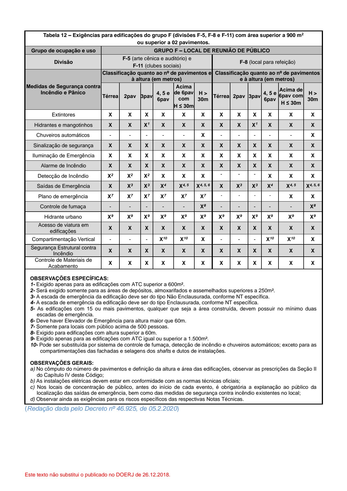

(Redação dada pelo Decreto nº 46.925, de 05.2.2020)

### Tabelas extraídas (bruto, não usar para citação)
#### Tabela 1 da página

| Tabela 12 - Exigências para edificações do grupo F (divisões F-5, F-8 e F-11) com área superior a 900 m2 |  |  |  |  |  |  |  |  |  |  |  |  |
| --- | --- | --- | --- | --- | --- | --- | --- | --- | --- | --- | --- | --- |
| ou superior a 02 pavimentos. |  |  |  |  |  |  |  |  |  |  |  |  |
| Grupo de ocupação e uso | GRUPO F - LOCAL DE REUNIÃO DE PÚBLICO |  |  |  |  |  |  |  |  |  |  |  |
|  | F-5 (arte cênica e auditório) e |  |  |  |  |  |  |  |  |  |  |  |
| Divisão |  |  |  |  |  |  | F-8 (local para refeição) |  |  |  |  |  |
|  | F-11 (clubes sociais) |  |  |  |  |  |  |  |  |  |  |  |
|  |  |  |  |  |  |  |  |  |  |  |  |  |
|  | Classificação quanto ao nº de pavimentos e |  |  |  |  |  | Classificação quanto ao nº de pavimentos |  |  |  |  |  |
|  | à altura (em metros) |  |  |  |  |  | e à altura (em metros) |  |  |  |  |  |
| Medidas de Segurança contra |  |  |  |  | Acima |  |  |  |  |  |  |  |
|  |  |  |  |  |  |  |  |  |  |  | Acima de |  |
| Incêndio e Pânico |  |  |  | 4, 5 e | de 6pav | H > |  |  |  | 4, 5 e |  | H > |
|  | Térrea | 2pav | 3pav |  |  |  | Térrea | 2pav | 3pav |  | 6pav com |  |
|  |  |  |  | 6pav | com | 30m |  |  |  | 6pav |  | 30m |
|  |  |  |  |  |  |  |  |  |  |  | H ≤ 30m |  |
|  |  |  |  |  | H ≤ 30m |  |  |  |  |  |  |  |
|  |  |  |  |  |  |  |  |  |  |  |  |  |
| Extintores | X | X | X | X | X | X | X | X | X | X | X | X |
|  |  |  |  |  |  |  |  |  |  |  |  |  |
| Hidrantes e mangotinhos | X | X | X1 | X | X | X | X | X | X1 | X | X | X |
|  |  |  |  |  |  |  |  |  |  |  |  |  |
| Chuveiros automáticos | - | - | - | - | - | X | - | - | - | - | - | X |
|  |  |  |  |  |  |  |  |  |  |  |  |  |
| Sinalização de segurança | X | X | X | X | X | X | X | X | X | X | X | X |
|  |  |  |  |  |  |  |  |  |  |  |  |  |
| Iluminação de Emergência | X | X | X | X | X | X | X | X | X | X | X | X |
|  |  |  |  |  |  |  |  |  |  |  |  |  |
| Alarme de Incêndio | X | X | X | X | X | X | X | X | X | X | X | X |
|  |  |  |  |  |  |  |  |  |  |  |  |  |
| Detecção de Incêndio | X2 | X2 | X2 | X | X | X | - | - | - | X | X | X |
|  |  |  |  |  |  |  |  |  |  |  |  |  |
| Saídas de Emergência | X | X3 | X3 | X4 | X4, 5 | X4, 5, 6 | X | X3 | X3 | X4 | X4, 5 | X4, 5, 6 |
|  |  |  |  |  |  |  |  |  |  |  |  |  |
| Plano de emergência | X7 | X7 | X7 | X7 | X7 | X7 | - | - | - | - | X | X |
|  |  |  |  |  |  |  |  |  |  |  |  |  |
| Controle de fumaça | - | - | - | - | - | X8 | - | - | - | - | - | X8 |
|  |  |  |  |  |  |  |  |  |  |  |  |  |
| Hidrante urbano | X9 | X9 | X9 | X9 | X9 | X9 | X9 | X9 | X9 | X9 | X9 | X9 |
| Acesso de viatura em |  |  |  |  |  |  |  |  |  |  |  |  |
|  | X | X | X | X | X | X | X | X | X | X | X | X |
| edificações |  |  |  |  |  |  |  |  |  |  |  |  |
|  |  |  |  |  |  |  |  |  |  |  |  |  |
| Compartimentação Vertical | - | - | - | X10 | X10 | X | - | - | - | X10 | X10 | X |
| Segurança Estrutural contra |  |  |  |  |  |  |  |  |  |  |  |  |
|  | X | X | X | X | X | X | X | X | X | X | X | X |
| Incêndio |  |  |  |  |  |  |  |  |  |  |  |  |
|  |  |  |  |  |  |  |  |  |  |  |  |  |
| Controle de Materiais de Acabamento | X | X | X | X | X | X | X | X | X | X | X | X |
| OBSERVAÇÕES ESPECÍFICAS: 1- Exigido apenas para as edificações com ATC superior a 600m². 2- Será exigido somente para as áreas de depósitos, almoxarifados e assemelhados superiores a 250m². 3- A escada de emergência da edificação deve ser do tipo Não Enclausurada, conforme NT específica. 4- A escada de emergência da edificação deve ser do tipo Enclausurada, conforme NT específica. 5- As edificações com 15 ou mais pavimentos, qualquer que seja a área construída, devem possuir no mínimo duas escadas de emergência. 6- Deve haver Elevador de Emergência para altura maior que 60m. 7- Somente para locais com público acima de 500 pessoas. 8- Exigido para edificações com altura superior a 60m. 9- Exigido apenas para as edificações com ATC igual ou superior a 1.500m². 10- Pode ser substituída por sistema de controle de fumaça, detecção de incêndio e chuveiros automáticos; exceto para as compartimentações das fachadas e selagens dos shafts e dutos de instalações. OBSERVAÇÕES GERAIS: a) No cômputo do número de pavimentos e definição da altura e área das edificações, observar as prescrições da Seção II do Capítulo IV deste Código; b) As instalações elétricas devem estar em conformidade com as normas técnicas oficiais; c) Nos locais de concentração de público, antes do início de cada evento, é obrigatória a explanação ao público da localização das saídas de emergência, bem como das medidas de segurança contra incêndio existentes no local; d) Observar ainda as exigências para os riscos específicos das respectivas Notas Técnicas. |  |  |  |  |  |  |  |  |  |  |  |  |

<!-- tabela-conferida: Tabela 12 p36 -->
### Tabela 12 — Exigências para edificações do grupo F (divisões F-5, F-8 e F-11) com área superior a 900 m2 ou superior a 02 pavimentos. (conferida)

| Medidas de Segurança contra Incêndio e Pânico | F-5/F-11 — Térrea | F-5/F-11 — 2pav | F-5/F-11 — 3pav | F-5/F-11 — 4, 5 e 6pav | F-5/F-11 — Acima de 6pav com H ≤ 30m | F-5/F-11 — H > 30m | F-8 — Térrea | F-8 — 2pav | F-8 — 3pav | F-8 — 4, 5 e 6pav | F-8 — Acima de 6pav com H ≤ 30m | F-8 — H > 30m |
| --- | --- | --- | --- | --- | --- | --- | --- | --- | --- | --- | --- | --- |
| Extintores | X | X | X | X | X | X | X | X | X | X | X | X |
| Hidrantes e mangotinhos | X | X | X1 | X | X | X | X | X | X1 | X | X | X |
| Chuveiros automáticos | - | - | - | - | - | X | - | - | - | - | - | X |
| Sinalização de segurança | X | X | X | X | X | X | X | X | X | X | X | X |
| Iluminação de Emergência | X | X | X | X | X | X | X | X | X | X | X | X |
| Alarme de Incêndio | X | X | X | X | X | X | X | X | X | X | X | X |
| Detecção de Incêndio | X2 | X2 | X2 | X | X | X | - | - | - | X | X | X |
| Saídas de Emergência | X | X3 | X3 | X4 | X4, 5 | X4, 5, 6 | X | X3 | X3 | X4 | X4, 5 | X4, 5, 6 |
| Plano de emergência | X7 | X7 | X7 | X7 | X7 | X7 | - | - | - | - | X | X |
| Controle de fumaça | - | - | - | - | - | X8 | - | - | - | - | - | X8 |
| Hidrante urbano | X9 | X9 | X9 | X9 | X9 | X9 | X9 | X9 | X9 | X9 | X9 | X9 |
| Acesso de viatura em edificações | X | X | X | X | X | X | X | X | X | X | X | X |
| Compartimentação Vertical | - | - | - | X10 | X10 | X | - | - | - | X10 | X10 | X |
| Segurança Estrutural contra Incêndio | X | X | X | X | X | X | X | X | X | X | X | X |
| Controle de Materiais de Acabamento | X | X | X | X | X | X | X | X | X | X | X | X |

Fonte: Decreto 42/2018, página 36, Tabela 12; conferida em 2026-09-29 (visual + geometrica).
As observações específicas e gerais da tabela estão no texto da página (e na imagem); valem para as células com a nota correspondente.
<!-- /tabela-conferida: Tabela 12 p36 -->

---

## Página 37

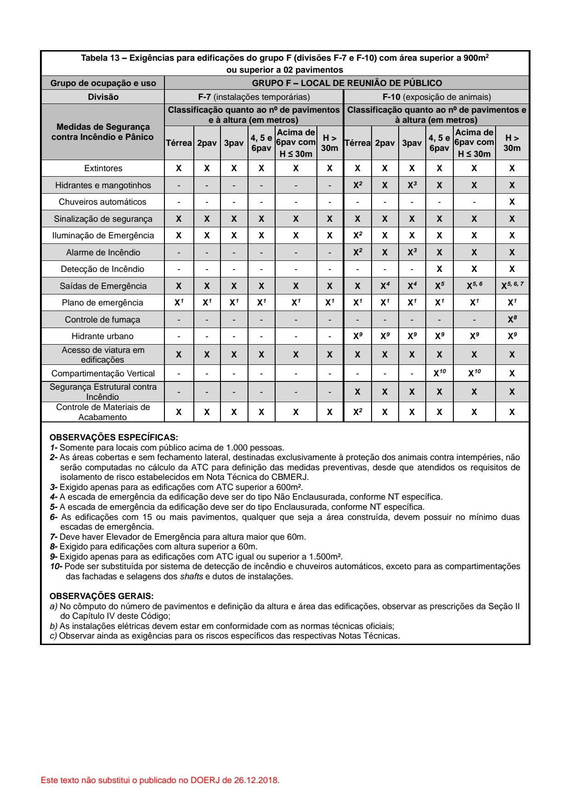

> Página sem texto extraível suficiente; consultar a representação visual ou o PDF oficial.

### Tabelas extraídas (bruto, não usar para citação)
#### Tabela 1 da página

| Tabela 13 - Exigências para edificações do grupo F (divisões F-7 e F-10) com área superior a 900m2 |  |  |  |  |  |  |  |  |  |  |  |  |
| --- | --- | --- | --- | --- | --- | --- | --- | --- | --- | --- | --- | --- |
| ou superior a 02 pavimentos |  |  |  |  |  |  |  |  |  |  |  |  |
| Grupo de ocupação e uso | GRUPO F - LOCAL DE REUNIÃO DE PÚBLICO |  |  |  |  |  |  |  |  |  |  |  |
| Divisão | F-7 (instalações temporárias) |  |  |  |  |  | F-10 (exposição de animais) |  |  |  |  |  |
|  | Classificação quanto ao nº de pavimentos |  |  |  |  |  | Classificação quanto ao nº de pavimentos e |  |  |  |  |  |
|  | e à altura (em metros) |  |  |  |  |  | à altura (em metros) |  |  |  |  |  |
| Medidas de Segurança |  |  |  |  |  |  |  |  |  |  |  |  |
|  |  |  |  |  | Acima de |  |  |  |  |  | Acima de |  |
| contra Incêndio e Pânico |  |  |  | 4, 5 e |  | H > |  |  |  | 4, 5 e |  | H > |
|  | Térrea | 2pav | 3pav |  | 6pav com |  | Térrea | 2pav | 3pav |  | 6pav com |  |
|  |  |  |  | 6pav |  | 30m |  |  |  | 6pav |  | 30m |
|  |  |  |  |  | H ≤ 30m |  |  |  |  |  | H ≤ 30m |  |
|  |  |  |  |  |  |  |  |  |  |  |  |  |
| Extintores | X | X | X | X | X | X | X | X | X | X | X | X |
|  |  |  |  |  |  |  |  |  |  |  |  |  |
| Hidrantes e mangotinhos | - | - | - | - | - | - | X2 | X | X3 | X | X | X |
|  |  |  |  |  |  |  |  |  |  |  |  |  |
| Chuveiros automáticos | - | - | - | - | - | - | - | - | - | - | - | X |
|  |  |  |  |  |  |  |  |  |  |  |  |  |
| Sinalização de segurança | X | X | X | X | X | X | X | X | X | X | X | X |
|  |  |  |  |  |  |  |  |  |  |  |  |  |
| Iluminação de Emergência | X | X | X | X | X | X | X2 | X | X | X | X | X |
|  |  |  |  |  |  |  |  |  |  |  |  |  |
| Alarme de Incêndio | - | - | - | - | - | - | X2 | X | X3 | X | X | X |
|  |  |  |  |  |  |  |  |  |  |  |  |  |
| Detecção de Incêndio | - | - | - | - | - | - | - | - | - | X | X | X |
|  |  |  |  |  |  |  |  |  |  |  |  |  |
| Saídas de Emergência | X | X | X | X | X | X | X | X4 | X4 | X5 | X5, 6 | X5, 6, 7 |
|  |  |  |  |  |  |  |  |  |  |  |  |  |
| Plano de emergência | X1 | X1 | X1 | X1 | X1 | X1 | X1 | X1 | X1 | X1 | X1 | X1 |
|  |  |  |  |  |  |  |  |  |  |  |  |  |
| Controle de fumaça | - | - | - | - | - | - | - | - | - | - | - | X8 |
|  |  |  |  |  |  |  |  |  |  |  |  |  |
| Hidrante urbano | - | - | - | - | - | - | X9 | X9 | X9 | X9 | X9 | X9 |
| Acesso de viatura em |  |  |  |  |  |  |  |  |  |  |  |  |
|  | X | X | X | X | X | X | X | X | X | X | X | X |
| edificações |  |  |  |  |  |  |  |  |  |  |  |  |
|  |  |  |  |  |  |  |  |  |  |  |  |  |
| Compartimentação Vertical | - | - | - | - | - | - | - | - | - | X10 | X10 | X |
| Segurança Estrutural contra |  |  |  |  |  |  |  |  |  |  |  |  |
|  | - | - | - | - | - | - | X | X | X | X | X | X |
| Incêndio |  |  |  |  |  |  |  |  |  |  |  |  |
|  |  |  |  |  |  |  |  |  |  |  |  |  |
| Controle de Materiais de Acabamento | X | X | X | X | X | X | X2 | X | X | X | X | X |
| OBSERVAÇÕES ESPECÍFICAS: 1- Somente para locais com público acima de 1.000 pessoas. 2- As áreas cobertas e sem fechamento lateral, destinadas exclusivamente à proteção dos animais contra intempéries, não serão computadas no cálculo da ATC para definição das medidas preventivas, desde que atendidos os requisitos de isolamento de risco estabelecidos em Nota Técnica do CBMERJ. 3- Exigido apenas para as edificações com ATC superior a 600m². 4- A escada de emergência da edificação deve ser do tipo Não Enclausurada, conforme NT específica. 5- A escada de emergência da edificação deve ser do tipo Enclausurada, conforme NT específica. 6- As edificações com 15 ou mais pavimentos, qualquer que seja a área construída, devem possuir no mínimo duas escadas de emergência. 7- Deve haver Elevador de Emergência para altura maior que 60m. 8- Exigido para edificações com altura superior a 60m. 9- Exigido apenas para as edificações com ATC igual ou superior a 1.500m². 10- Pode ser substituída por sistema de detecção de incêndio e chuveiros automáticos, exceto para as compartimentações das fachadas e selagens dos shafts e dutos de instalações. OBSERVAÇÕES GERAIS: a) No cômputo do número de pavimentos e definição da altura e área das edificações, observar as prescrições da Seção II do Capítulo IV deste Código; b) As instalações elétricas devem estar em conformidade com as normas técnicas oficiais; c) Observar ainda as exigências para os riscos específicos das respectivas Notas Técnicas. |  |  |  |  |  |  |  |  |  |  |  |  |

<!-- tabela-conferida: Tabela 13 p37 -->
### Tabela 13 — Exigências para edificações do grupo F (divisões F-7 e F-10) com área superior a 900m2 ou superior a 02 pavimentos (conferida)

| Medidas de Segurança contra Incêndio e Pânico | F-7 — Térrea | F-7 — 2pav | F-7 — 3pav | F-7 — 4, 5 e 6pav | F-7 — Acima de 6pav com H ≤ 30m | F-7 — H > 30m | F-10 — Térrea | F-10 — 2pav | F-10 — 3pav | F-10 — 4, 5 e 6pav | F-10 — Acima de 6pav com H ≤ 30m | F-10 — H > 30m |
| --- | --- | --- | --- | --- | --- | --- | --- | --- | --- | --- | --- | --- |
| Extintores | X | X | X | X | X | X | X | X | X | X | X | X |
| Hidrantes e mangotinhos | - | - | - | - | - | - | X2 | X | X3 | X | X | X |
| Chuveiros automáticos | - | - | - | - | - | - | - | - | - | - | - | X |
| Sinalização de segurança | X | X | X | X | X | X | X | X | X | X | X | X |
| Iluminação de Emergência | X | X | X | X | X | X | X2 | X | X | X | X | X |
| Alarme de Incêndio | - | - | - | - | - | - | X2 | X | X3 | X | X | X |
| Detecção de Incêndio | - | - | - | - | - | - | - | - | - | X | X | X |
| Saídas de Emergência | X | X | X | X | X | X | X | X4 | X4 | X5 | X5, 6 | X5, 6, 7 |
| Plano de emergência | X1 | X1 | X1 | X1 | X1 | X1 | X1 | X1 | X1 | X1 | X1 | X1 |
| Controle de fumaça | - | - | - | - | - | - | - | - | - | - | - | X8 |
| Hidrante urbano | - | - | - | - | - | - | X9 | X9 | X9 | X9 | X9 | X9 |
| Acesso de viatura em edificações | X | X | X | X | X | X | X | X | X | X | X | X |
| Compartimentação Vertical | - | - | - | - | - | - | - | - | - | X10 | X10 | X |
| Segurança Estrutural contra Incêndio | - | - | - | - | - | - | X | X | X | X | X | X |
| Controle de Materiais de Acabamento | X | X | X | X | X | X | X2 | X | X | X | X | X |

Fonte: Decreto 42/2018, página 37, Tabela 13; conferida em 2026-09-29 (visual + geometrica).
As observações específicas e gerais da tabela estão no texto da página (e na imagem); valem para as células com a nota correspondente.
<!-- /tabela-conferida: Tabela 13 p37 -->

---

## Página 38

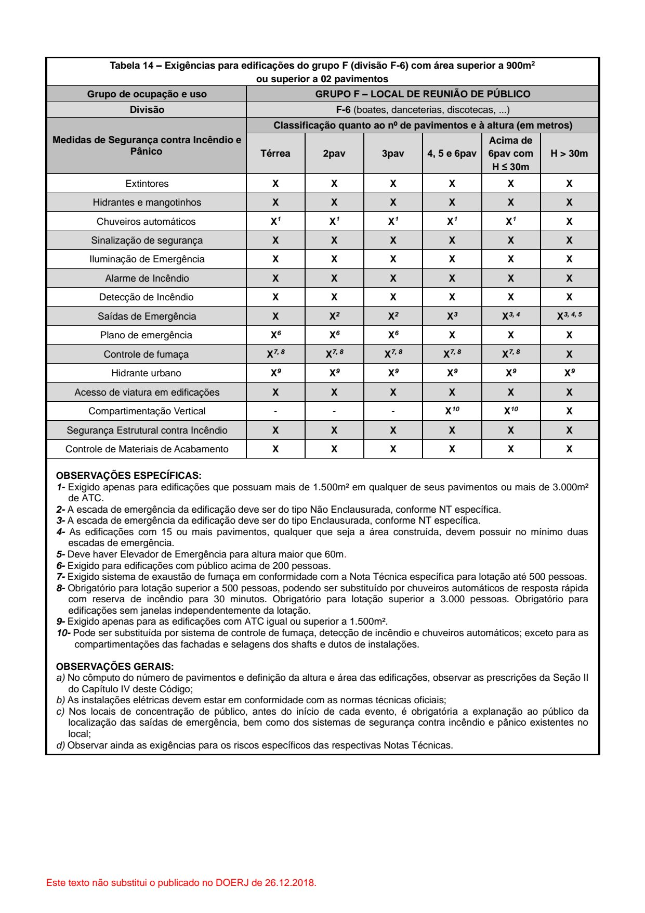

> Página sem texto extraível suficiente; consultar a representação visual ou o PDF oficial.

### Tabelas extraídas (bruto, não usar para citação)
#### Tabela 1 da página

| Tabela 14 - Exigências para edificações do grupo F (divisão F-6) com área superior a 900m2 |  |  |  |  |  |  |
| --- | --- | --- | --- | --- | --- | --- |
| ou superior a 02 pavimentos |  |  |  |  |  |  |
| Grupo de ocupação e uso | GRUPO F - LOCAL DE REUNIÃO DE PÚBLICO |  |  |  |  |  |
| Divisão | F-6 (boates, danceterias, discotecas,...) |  |  |  |  |  |
|  | Classificação quanto ao nº de pavimentos e à altura (em metros) |  |  |  |  |  |
| Medidas de Segurança contra Incêndio e |  |  |  |  | Acima de |  |
| Pânico | Térrea | 2pav | 3pav | 4, 5 e 6pav | 6pav com | H > 30m |
|  |  |  |  |  | H ≤ 30m |  |
| Extintores | X | X | X | X | X | X |
|  |  |  |  |  |  |  |
| Hidrantes e mangotinhos | X | X | X | X | X | X |
|  |  |  |  |  |  |  |
| Chuveiros automáticos | X1 | X1 | X1 | X1 | X1 | X |
|  |  |  |  |  |  |  |
| Sinalização de segurança | X | X | X | X | X | X |
|  |  |  |  |  |  |  |
| Iluminação de Emergência | X | X | X | X | X | X |
|  |  |  |  |  |  |  |
| Alarme de Incêndio | X | X | X | X | X | X |
|  |  |  |  |  |  |  |
| Detecção de Incêndio | X | X | X | X | X | X |
|  |  |  |  |  |  |  |
| Saídas de Emergência | X | X2 | X2 | X3 | X3, 4 | X3, 4, 5 |
|  |  |  |  |  |  |  |
| Plano de emergência | X6 | X6 | X6 | X | X | X |
|  |  |  |  |  |  |  |
| Controle de fumaça | X7, 8 | X7, 8 | X7, 8 | X7, 8 | X7, 8 | X |
|  |  |  |  |  |  |  |
| Hidrante urbano | X9 | X9 | X9 | X9 | X9 | X9 |
|  |  |  |  |  |  |  |
| Acesso de viatura em edificações | X | X | X | X | X | X |
|  |  |  |  |  |  |  |
| Compartimentação Vertical | - | - | - | X10 | X10 | X |
|  |  |  |  |  |  |  |
| Segurança Estrutural contra Incêndio | X | X | X | X | X | X |
|  |  |  |  |  |  |  |
| Controle de Materiais de Acabamento | X | X | X | X | X | X |
| OBSERVAÇÕES ESPECÍFICAS: 1- Exigido apenas para edificações que possuam mais de 1.500m² em qualquer de seus pavimentos ou mais de 3.000m² de ATC. 2- A escada de emergência da edificação deve ser do tipo Não Enclausurada, conforme NT específica. 3- A escada de emergência da edificação deve ser do tipo Enclausurada, conforme NT específica. 4- As edificações com 15 ou mais pavimentos, qualquer que seja a área construída, devem possuir no mínimo duas escadas de emergência. 5- Deve haver Elevador de Emergência para altura maior que 60m. 6- Exigido para edificações com público acima de 200 pessoas. 7- Exigido sistema de exaustão de fumaça em conformidade com a Nota Técnica específica para lotação até 500 pessoas. 8- Obrigatório para lotação superior a 500 pessoas, podendo ser substituído por chuveiros automáticos de resposta rápida com reserva de incêndio para 30 minutos. Obrigatório para lotação superior a 3.000 pessoas. Obrigatório para edificações sem janelas independentemente da lotação. 9- Exigido apenas para as edificações com ATC igual ou superior a 1.500m². 10- Pode ser substituída por sistema de controle de fumaça, detecção de incêndio e chuveiros automáticos; exceto para as compartimentações das fachadas e selagens dos shafts e dutos de instalações. OBSERVAÇÕES GERAIS: a) No cômputo do número de pavimentos e definição da altura e área das edificações, observar as prescrições da Seção II do Capítulo IV deste Código; b) As instalações elétricas devem estar em conformidade com as normas técnicas oficiais; c) Nos locais de concentração de público, antes do início de cada evento, é obrigatória a explanação ao público da localização das saídas de emergência, bem como dos sistemas de segurança contra incêndio e pânico existentes no local; d) Observar ainda as exigências para os riscos específicos das respectivas Notas Técnicas. |  |  |  |  |  |  |

<!-- tabela-conferida: Tabela 14 p38 -->
### Tabela 14 — Exigências para edificações do grupo F (divisão F-6) com área superior a 900m2 ou superior a 02 pavimentos (conferida)

| Medidas de Segurança contra Incêndio e Pânico | Térrea | 2pav | 3pav | 4, 5 e 6pav | Acima de 6pav com H ≤ 30m | H > 30m |
| --- | --- | --- | --- | --- | --- | --- |
| Extintores | X | X | X | X | X | X |
| Hidrantes e mangotinhos | X | X | X | X | X | X |
| Chuveiros automáticos | X1 | X1 | X1 | X1 | X1 | X |
| Sinalização de segurança | X | X | X | X | X | X |
| Iluminação de Emergência | X | X | X | X | X | X |
| Alarme de Incêndio | X | X | X | X | X | X |
| Detecção de Incêndio | X | X | X | X | X | X |
| Saídas de Emergência | X | X2 | X2 | X3 | X3, 4 | X3, 4, 5 |
| Plano de emergência | X6 | X6 | X6 | X | X | X |
| Controle de fumaça | X7, 8 | X7, 8 | X7, 8 | X7, 8 | X7, 8 | X |
| Hidrante urbano | X9 | X9 | X9 | X9 | X9 | X9 |
| Acesso de viatura em edificações | X | X | X | X | X | X |
| Compartimentação Vertical | - | - | - | X10 | X10 | X |
| Segurança Estrutural contra Incêndio | X | X | X | X | X | X |
| Controle de Materiais de Acabamento | X | X | X | X | X | X |

Fonte: Decreto 42/2018, página 38, Tabela 14; conferida em 2026-09-29 (visual + geometrica).
As observações específicas e gerais da tabela estão no texto da página (e na imagem); valem para as células com a nota correspondente.
<!-- /tabela-conferida: Tabela 14 p38 -->

---

## Página 39

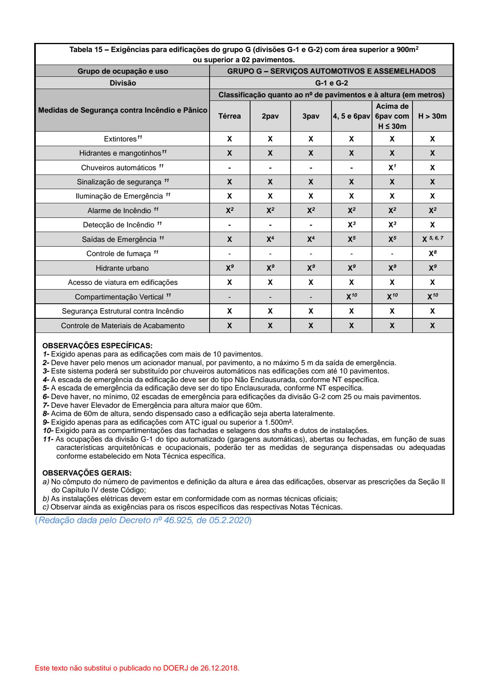

(Redação dada pelo Decreto nº 46.925, de 05.2.2020)

### Tabelas extraídas (bruto, não usar para citação)
#### Tabela 1 da página

| Tabela 15 - Exigências para edificações do grupo G (divisões G-1 e G-2) com área superior a 900m2 |  |  |  |  |  |  |
| --- | --- | --- | --- | --- | --- | --- |
| ou superior a 02 pavimentos. |  |  |  |  |  |  |
| Grupo de ocupação e uso | GRUPO G - SERVIÇOS AUTOMOTIVOS E ASSEMELHADOS |  |  |  |  |  |
| Divisão | G-1 e G-2 |  |  |  |  |  |
|  | Classificação quanto ao nº de pavimentos e à altura (em metros) |  |  |  |  |  |
|  |  |  |  |  | Acima de |  |
| Medidas de Segurança contra Incêndio e Pânico |  |  |  |  |  |  |
|  | Térrea | 2pav | 3pav | 4, 5 e 6pav | 6pav com | H > 30m |
|  |  |  |  |  |  |  |
|  |  |  |  |  | H ≤ 30m |  |
| Extintores11 | X | X | X | X | X | X |
|  |  |  |  |  |  |  |
| Hidrantes e mangotinhos11 | X | X | X | X | X | X |
|  |  |  |  |  |  |  |
| Chuveiros automáticos 11 | - | - | - | - | X1 | X |
|  |  |  |  |  |  |  |
| Sinalização de segurança 11 | X | X | X | X | X | X |
|  |  |  |  |  |  |  |
| Iluminação de Emergência 11 | X | X | X | X | X | X |
|  |  |  |  |  |  |  |
| Alarme de Incêndio 11 | X2 | X2 | X2 | X2 | X2 | X2 |
|  |  |  |  |  |  |  |
| Detecção de Incêndio 11 | - | - | - | X3 | X3 | X |
|  |  |  |  |  |  |  |
| Saídas de Emergência 11 | X | X4 | X4 | X5 | X5 | X 5, 6, 7 |
|  |  |  |  |  |  |  |
| Controle de fumaça 11 | - | - | - | - | - | X8 |
|  |  |  |  |  |  |  |
| Hidrante urbano | X9 | X9 | X9 | X9 | X9 | X9 |
|  |  |  |  |  |  |  |
| Acesso de viatura em edificações | X | X | X | X | X | X |
|  |  |  |  |  |  |  |
| Compartimentação Vertical 11 | - | - | - | X10 | X10 | X10 |
|  |  |  |  |  |  |  |
| Segurança Estrutural contra Incêndio | X | X | X | X | X | X |
|  |  |  |  |  |  |  |
| Controle de Materiais de Acabamento | X | X | X | X | X | X |
|  |  |  |  |  |  |  |
|  |  |  |  |  |  |  |
| OBSERVAÇÕES ESPECÍFICAS: |  |  |  |  |  |  |
| 1- Exigido apenas para as edificações com mais de 10 pavimentos. |  |  |  |  |  |  |
| 2- Deve haver pelo menos um acionador manual, por pavimento, a no máximo 5 m da saída de emergência. |  |  |  |  |  |  |
| 3- Este sistema poderá ser substituído por chuveiros automáticos nas edificações com até 10 pavimentos. |  |  |  |  |  |  |
| 4- A escada de emergência da edificação deve ser do tipo Não Enclausurada, conforme NT específica. |  |  |  |  |  |  |
| 5- A escada de emergência da edificação deve ser do tipo Enclausurada, conforme NT específica. |  |  |  |  |  |  |
| 6- Deve haver, no mínimo, 02 escadas de emergência para edificações da divisão G-2 com 25 ou mais pavimentos. |  |  |  |  |  |  |
| 7- Deve haver Elevador de Emergência para altura maior que 60m. |  |  |  |  |  |  |
| 8- Acima de 60m de altura, sendo dispensado caso a edificação seja aberta lateralmente. |  |  |  |  |  |  |
| 9- Exigido apenas para as edificações com ATC igual ou superior a 1.500m². |  |  |  |  |  |  |
| 10- Exigido para as compartimentações das fachadas e selagens dos shafts e dutos de instalações. |  |  |  |  |  |  |
| 11- As ocupações da divisão G-1 do tipo automatizado (garagens automáticas), abertas ou fechadas, em função de suas |  |  |  |  |  |  |
| características arquitetônicas e ocupacionais, poderão ter as medidas de segurança dispensadas ou adequadas |  |  |  |  |  |  |
| conforme estabelecido em Nota Técnica específica. |  |  |  |  |  |  |
|  |  |  |  |  |  |  |
| OBSERVAÇÕES GERAIS: |  |  |  |  |  |  |
| a) No cômputo do número de pavimentos e definição da altura e área das edificações, observar as prescrições da Seção II |  |  |  |  |  |  |
| do Capítulo IV deste Código; |  |  |  |  |  |  |
| b) As instalações elétricas devem estar em conformidade com as normas técnicas oficiais; |  |  |  |  |  |  |
| c) Observar ainda as exigências para os riscos específicos das respectivas Notas Técnicas. |  |  |  |  |  |  |

<!-- tabela-conferida: Tabela 15 p39 -->
### Tabela 15 — Exigências para edificações do grupo G (divisões G-1 e G-2) com área superior a 900m2 ou superior a 02 pavimentos. (conferida)

| Medidas de Segurança contra Incêndio e Pânico | Térrea | 2pav | 3pav | 4, 5 e 6pav | Acima de 6pav com H ≤ 30m | H > 30m |
| --- | --- | --- | --- | --- | --- | --- |
| Extintores11 | X | X | X | X | X | X |
| Hidrantes e mangotinhos11 | X | X | X | X | X | X |
| Chuveiros automáticos 11 | - | - | - | - | X1 | X |
| Sinalização de segurança 11 | X | X | X | X | X | X |
| Iluminação de Emergência 11 | X | X | X | X | X | X |
| Alarme de Incêndio 11 | X2 | X2 | X2 | X2 | X2 | X2 |
| Detecção de Incêndio 11 | - | - | - | X3 | X3 | X |
| Saídas de Emergência 11 | X | X4 | X4 | X5 | X5 | X 5, 6, 7 |
| Controle de fumaça 11 | - | - | - | - | - | X8 |
| Hidrante urbano | X9 | X9 | X9 | X9 | X9 | X9 |
| Acesso de viatura em edificações | X | X | X | X | X | X |
| Compartimentação Vertical 11 | - | - | - | X10 | X10 | X10 |
| Segurança Estrutural contra Incêndio | X | X | X | X | X | X |
| Controle de Materiais de Acabamento | X | X | X | X | X | X |

Fonte: Decreto 42/2018, página 39, Tabela 15; conferida em 2026-09-29 (visual + geometrica).
As observações específicas e gerais da tabela estão no texto da página (e na imagem); valem para as células com a nota correspondente.
<!-- /tabela-conferida: Tabela 15 p39 -->

---

## Página 40

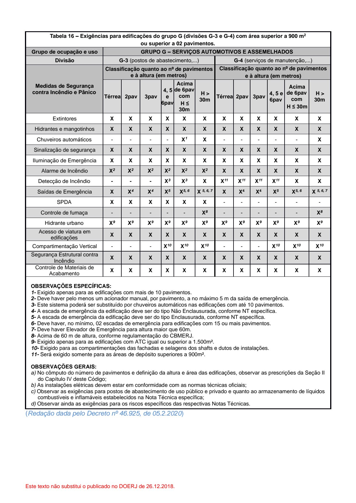

(Redação dada pelo Decreto nº 46.925, de 05.2.2020)

### Tabelas extraídas (bruto, não usar para citação)
#### Tabela 1 da página

| Tabela 16 - Exigências para edificações do grupo G (divisões G-3 e G-4) com área superior a 900 m2 |  |  |  |  |  |  |  |  |  |  |  |  |
| --- | --- | --- | --- | --- | --- | --- | --- | --- | --- | --- | --- | --- |
| ou superior a 02 pavimentos. |  |  |  |  |  |  |  |  |  |  |  |  |
| Grupo de ocupação e uso | GRUPO G - SERVIÇOS AUTOMOTIVOS E ASSEMELHADOS |  |  |  |  |  |  |  |  |  |  |  |
| Divisão | G-3 (postos de abastecimento,...) |  |  |  |  |  | G-4 (serviços de manutenção,...) |  |  |  |  |  |
|  | Classificação quanto ao nº de pavimentos |  |  |  |  |  | Classificação quanto ao nº de pavimentos |  |  |  |  |  |
|  | e à altura (em metros) |  |  |  |  |  | e à altura (em metros) |  |  |  |  |  |
|  |  |  |  |  | Acima |  |  |  |  |  |  |  |
| Medidas de Segurança |  |  |  |  |  |  |  |  |  |  | Acima |  |
|  |  |  |  | 4, 5 | de 6pav |  |  |  |  |  |  |  |
| contra Incêndio e Pânico |  |  |  |  |  | H > |  |  |  | 4, 5 e | de 6pav | H > |
|  | Térrea | 2pav | 3pav | e | com |  | Térrea | 2pav | 3pav |  |  |  |
|  |  |  |  |  |  | 30m |  |  |  | 6pav | com | 30m |
|  |  |  |  | 6pav | H ≤ |  |  |  |  |  |  |  |
|  |  |  |  |  |  |  |  |  |  |  | H ≤ 30m |  |
|  |  |  |  |  | 30m |  |  |  |  |  |  |  |
|  |  |  |  |  |  |  |  |  |  |  |  |  |
| Extintores | X | X | X | X | X | X | X | X | X | X | X | X |
|  |  |  |  |  |  |  |  |  |  |  |  |  |
| Hidrantes e mangotinhos | X | X | X | X | X | X | X | X | X | X | X | X |
|  |  |  |  |  |  |  |  |  |  |  |  |  |
| Chuveiros automáticos | - | - | - | - | X1 | X | - | - | - | - | - | X |
|  |  |  |  |  |  |  |  |  |  |  |  |  |
| Sinalização de segurança | X | X | X | X | X | X | X | X | X | X | X | X |
|  |  |  |  |  |  |  |  |  |  |  |  |  |
| Iluminação de Emergência | X | X | X | X | X | X | X | X | X | X | X | X |
|  |  |  |  |  |  |  |  |  |  |  |  |  |
| Alarme de Incêndio | X2 | X2 | X2 | X2 | X2 | X2 | X | X | X | X | X | X |
|  |  |  |  |  |  |  |  |  |  |  |  |  |
| Detecção de Incêndio | - | - | - | X3 | X3 | X | X11 | X11 | X11 | X11 | X | X |
|  |  |  |  |  |  |  |  |  |  |  |  |  |
| Saídas de Emergência | X | X4 | X4 | X5 | X5, 6 | X 5, 6, 7 | X | X4 | X4 | X5 | X5, 6 | X 5, 6, 7 |
|  |  |  |  |  |  |  |  |  |  |  |  |  |
| SPDA | X | X | X | X | X | X | - | - | - | - | - | - |
|  |  |  |  |  |  |  |  |  |  |  |  |  |
| Controle de fumaça | - | - | - | - | - | X8 | - | - | - | - | - | X8 |
|  |  |  |  |  |  |  |  |  |  |  |  |  |
| Hidrante urbano | X9 | X9 | X9 | X9 | X9 | X9 | X9 | X9 | X9 | X9 | X9 | X9 |
| Acesso de viatura em |  |  |  |  |  |  |  |  |  |  |  |  |
|  | X | X | X | X | X | X | X | X | X | X | X | X |
| edificações |  |  |  |  |  |  |  |  |  |  |  |  |
|  |  |  |  |  |  |  |  |  |  |  |  |  |
| Compartimentação Vertical | - | - | - | X10 | X10 | X10 | - | - | - | X10 | X10 | X10 |
| Segurança Estrutural contra |  |  |  |  |  |  |  |  |  |  |  |  |
|  | X | X | X | X | X | X | X | X | X | X | X | X |
| Incêndio |  |  |  |  |  |  |  |  |  |  |  |  |
|  |  |  |  |  |  |  |  |  |  |  |  |  |
| Controle de Materiais de Acabamento | X | X | X | X | X | X | X | X | X | X | X | X |
| OBSERVAÇÕES ESPECÍFICAS: 1- Exigido apenas para as edificações com mais de 10 pavimentos. 2- Deve haver pelo menos um acionador manual, por pavimento, a no máximo 5 m da saída de emergência. 3- Este sistema poderá ser substituído por chuveiros automáticos nas edificações com até 10 pavimentos. 4- A escada de emergência da edificação deve ser do tipo Não Enclausurada, conforme NT específica. 5- A escada de emergência da edificação deve ser do tipo Enclausurada, conforme NT específica. 6- Deve haver, no mínimo, 02 escadas de emergência para edificações com 15 ou mais pavimentos. 7- Deve haver Elevador de Emergência para altura maior que 60m. 8- Acima de 60 m de altura, conforme regulamentação do CBMERJ. 9- Exigido apenas para as edificações com ATC igual ou superior a 1.500m². 10- Exigido para as compartimentações das fachadas e selagens dos shafts e dutos de instalações. 11- Será exigido somente para as áreas de depósito superiores a 900m². OBSERVAÇÕES GERAIS: a) No cômputo do número de pavimentos e definição da altura e área das edificações, observar as prescrições da Seção II do Capítulo IV deste Código; b) As instalações elétricas devem estar em conformidade com as normas técnicas oficiais; c) Observar as exigências para postos de abastecimento de uso público e privado e quanto ao armazenamento de líquidos combustíveis e inflamáveis estabelecidos na Nota Técnica específica; d) Observar ainda as exigências para os riscos específicos das respectivas Notas Técnicas. |  |  |  |  |  |  |  |  |  |  |  |  |

<!-- tabela-conferida: Tabela 16 p40 -->
### Tabela 16 — Exigências para edificações do grupo G (divisões G-3 e G-4) com área superior a 900 m2 ou superior a 02 pavimentos. (conferida)

| Medidas de Segurança contra Incêndio e Pânico | G-3 — Térrea | G-3 — 2pav | G-3 — 3pav | G-3 — 4, 5 e 6pav | G-3 — Acima de 6pav com H ≤ 30m | G-3 — H > 30m | G-4 — Térrea | G-4 — 2pav | G-4 — 3pav | G-4 — 4, 5 e 6pav | G-4 — Acima de 6pav com H ≤ 30m | G-4 — H > 30m |
| --- | --- | --- | --- | --- | --- | --- | --- | --- | --- | --- | --- | --- |
| Extintores | X | X | X | X | X | X | X | X | X | X | X | X |
| Hidrantes e mangotinhos | X | X | X | X | X | X | X | X | X | X | X | X |
| Chuveiros automáticos | - | - | - | - | X1 | X | - | - | - | - | - | X |
| Sinalização de segurança | X | X | X | X | X | X | X | X | X | X | X | X |
| Iluminação de Emergência | X | X | X | X | X | X | X | X | X | X | X | X |
| Alarme de Incêndio | X2 | X2 | X2 | X2 | X2 | X2 | X | X | X | X | X | X |
| Detecção de Incêndio | - | - | - | X3 | X3 | X | X11 | X11 | X11 | X11 | X | X |
| Saídas de Emergência | X | X4 | X4 | X5 | X5, 6 | X 5, 6, 7 | X | X4 | X4 | X5 | X5, 6 | X 5, 6, 7 |
| SPDA | X | X | X | X | X | X | - | - | - | - | - | - |
| Controle de fumaça | - | - | - | - | - | X8 | - | - | - | - | - | X8 |
| Hidrante urbano | X9 | X9 | X9 | X9 | X9 | X9 | X9 | X9 | X9 | X9 | X9 | X9 |
| Acesso de viatura em edificações | X | X | X | X | X | X | X | X | X | X | X | X |
| Compartimentação Vertical | - | - | - | X10 | X10 | X10 | - | - | - | X10 | X10 | X10 |
| Segurança Estrutural contra Incêndio | X | X | X | X | X | X | X | X | X | X | X | X |
| Controle de Materiais de Acabamento | X | X | X | X | X | X | X | X | X | X | X | X |

Fonte: Decreto 42/2018, página 40, Tabela 16; conferida em 2026-09-29 (visual + geometrica).
As observações específicas e gerais da tabela estão no texto da página (e na imagem); valem para as células com a nota correspondente.
<!-- /tabela-conferida: Tabela 16 p40 -->

---

## Página 41

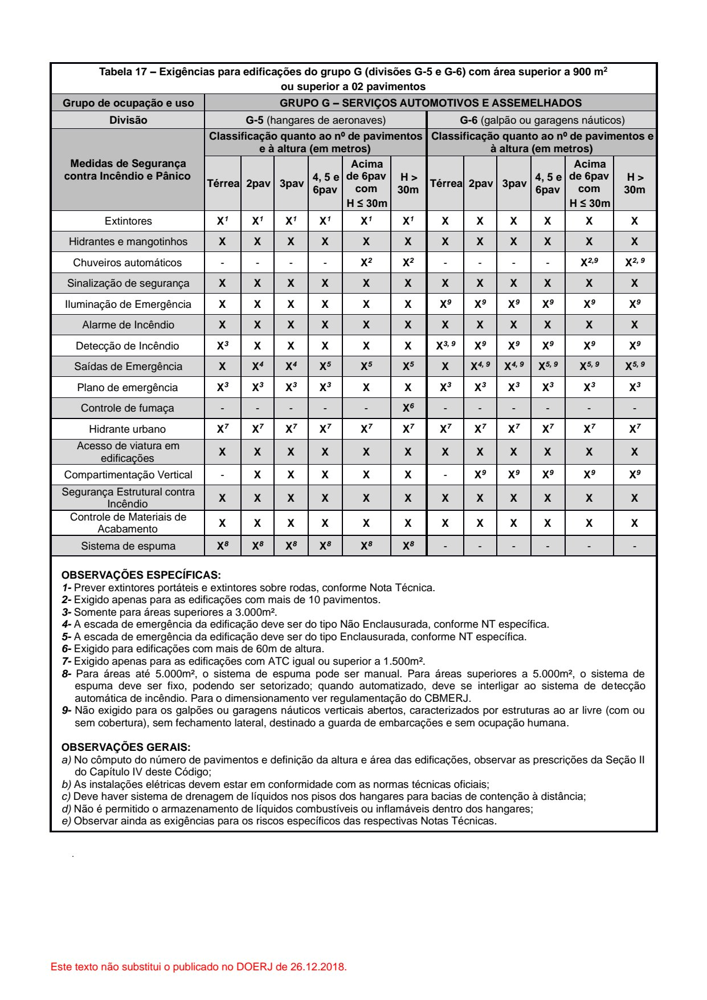

.

### Tabelas extraídas (bruto, não usar para citação)
#### Tabela 1 da página

| Tabela 17 - Exigências para edificações do grupo G (divisões G-5 e G-6) com área superior a 900 m2 |  |  |  |  |  |  |  |  |  |  |  |  |
| --- | --- | --- | --- | --- | --- | --- | --- | --- | --- | --- | --- | --- |
| ou superior a 02 pavimentos |  |  |  |  |  |  |  |  |  |  |  |  |
| Grupo de ocupação e uso | GRUPO G - SERVIÇOS AUTOMOTIVOS E ASSEMELHADOS |  |  |  |  |  |  |  |  |  |  |  |
| Divisão | G-5 (hangares de aeronaves) |  |  |  |  |  | G-6 (galpão ou garagens náuticos) |  |  |  |  |  |
|  | Classificação quanto ao nº de pavimentos |  |  |  |  |  | Classificação quanto ao nº de pavimentos e |  |  |  |  |  |
|  | e à altura (em metros) |  |  |  |  |  | à altura (em metros) |  |  |  |  |  |
| Medidas de Segurança |  |  |  |  | Acima |  |  |  |  |  | Acima |  |
| contra Incêndio e Pânico |  |  |  | 4, 5 e | de 6pav | H > |  |  |  | 4, 5 e | de 6pav | H > |
|  | Térrea | 2pav | 3pav |  |  |  | Térrea | 2pav | 3pav |  |  |  |
|  |  |  |  | 6pav | com | 30m |  |  |  | 6pav | com | 30m |
|  |  |  |  |  |  |  |  |  |  |  |  |  |
|  |  |  |  |  | H ≤ 30m |  |  |  |  |  | H ≤ 30m |  |
| Extintores | X1 | X1 | X1 | X1 | X1 | X1 | X | X | X | X | X | X |
|  |  |  |  |  |  |  |  |  |  |  |  |  |
| Hidrantes e mangotinhos | X | X | X | X | X | X | X | X | X | X | X | X |
|  |  |  |  |  |  |  |  |  |  |  |  |  |
| Chuveiros automáticos | - | - | - | - | X2 | X2 | - | - | - | - | X2,9 | X2, 9 |
|  |  |  |  |  |  |  |  |  |  |  |  |  |
| Sinalização de segurança | X | X | X | X | X | X | X | X | X | X | X | X |
|  |  |  |  |  |  |  |  |  |  |  |  |  |
| Iluminação de Emergência | X | X | X | X | X | X | X9 | X9 | X9 | X9 | X9 | X9 |
|  |  |  |  |  |  |  |  |  |  |  |  |  |
| Alarme de Incêndio | X | X | X | X | X | X | X | X | X | X | X | X |
|  |  |  |  |  |  |  |  |  |  |  |  |  |
| Detecção de Incêndio | X3 | X | X | X | X | X | X3, 9 | X9 | X9 | X9 | X9 | X9 |
|  |  |  |  |  |  |  |  |  |  |  |  |  |
| Saídas de Emergência | X | X4 | X4 | X5 | X5 | X5 | X | X4, 9 | X4, 9 | X5, 9 | X5, 9 | X5, 9 |
|  |  |  |  |  |  |  |  |  |  |  |  |  |
| Plano de emergência | X3 | X3 | X3 | X3 | X | X | X3 | X3 | X3 | X3 | X3 | X3 |
|  |  |  |  |  |  |  |  |  |  |  |  |  |
| Controle de fumaça | - | - | - | - | - | X6 | - | - | - | - | - | - |
|  |  |  |  |  |  |  |  |  |  |  |  |  |
| Hidrante urbano | X7 | X7 | X7 | X7 | X7 | X7 | X7 | X7 | X7 | X7 | X7 | X7 |
| Acesso de viatura em |  |  |  |  |  |  |  |  |  |  |  |  |
|  | X | X | X | X | X | X | X | X | X | X | X | X |
| edificações |  |  |  |  |  |  |  |  |  |  |  |  |
|  |  |  |  |  |  |  |  |  |  |  |  |  |
| Compartimentação Vertical | - | X | X | X | X | X | - | X9 | X9 | X9 | X9 | X9 |
| Segurança Estrutural contra |  |  |  |  |  |  |  |  |  |  |  |  |
|  | X | X | X | X | X | X | X | X | X | X | X | X |
| Incêndio |  |  |  |  |  |  |  |  |  |  |  |  |
|  |  |  |  |  |  |  |  |  |  |  |  |  |
| Controle de Materiais de Acabamento | X | X | X | X | X | X | X | X | X | X | X | X |
|  |  |  |  |  |  |  |  |  |  |  |  |  |
| Sistema de espuma | X8 | X8 | X8 | X8 | X8 | X8 | - | - | - | - | - | - |
|  |  |  |  |  |  |  |  |  |  |  |  |  |
|  |  |  |  |  |  |  |  |  |  |  |  |  |
| OBSERVAÇÕES ESPECÍFICAS: |  |  |  |  |  |  |  |  |  |  |  |  |
| 1- Prever extintores portáteis e extintores sobre rodas, conforme Nota Técnica. |  |  |  |  |  |  |  |  |  |  |  |  |
| 2- Exigido apenas para as edificações com mais de 10 pavimentos. |  |  |  |  |  |  |  |  |  |  |  |  |
| 3- Somente para áreas superiores a 3.000m². |  |  |  |  |  |  |  |  |  |  |  |  |
| 4- A escada de emergência da edificação deve ser do tipo Não Enclausurada, conforme NT específica. |  |  |  |  |  |  |  |  |  |  |  |  |
| 5- A escada de emergência da edificação deve ser do tipo Enclausurada, conforme NT específica. |  |  |  |  |  |  |  |  |  |  |  |  |
| 6- Exigido para edificações com mais de 60m de altura. |  |  |  |  |  |  |  |  |  |  |  |  |
| 7- Exigido apenas para as edificações com ATC igual ou superior a 1.500m². |  |  |  |  |  |  |  |  |  |  |  |  |
| 8- Para áreas até 5.000m², o sistema de espuma pode ser manual. Para áreas superiores a 5.000m², o sistema de |  |  |  |  |  |  |  |  |  |  |  |  |
| espuma deve ser fixo, podendo ser setorizado; quando automatizado, deve se interligar ao sistema de detecção |  |  |  |  |  |  |  |  |  |  |  |  |
| automática de incêndio. Para o dimensionamento ver regulamentação do CBMERJ. |  |  |  |  |  |  |  |  |  |  |  |  |
| 9- Não exigido para os galpões ou garagens náuticos verticais abertos, caracterizados por estruturas ao ar livre (com ou |  |  |  |  |  |  |  |  |  |  |  |  |
| sem cobertura), sem fechamento lateral, destinado a guarda de embarcações e sem ocupação humana. |  |  |  |  |  |  |  |  |  |  |  |  |
|  |  |  |  |  |  |  |  |  |  |  |  |  |
| OBSERVAÇÕES GERAIS: |  |  |  |  |  |  |  |  |  |  |  |  |
| a) No cômputo do número de pavimentos e definição da altura e área das edificações, observar as prescrições da Seção II |  |  |  |  |  |  |  |  |  |  |  |  |
| do Capítulo IV deste Código; |  |  |  |  |  |  |  |  |  |  |  |  |
| b) As instalações elétricas devem estar em conformidade com as normas técnicas oficiais; |  |  |  |  |  |  |  |  |  |  |  |  |
| c) Deve haver sistema de drenagem de líquidos nos pisos dos hangares para bacias de contenção à distância; |  |  |  |  |  |  |  |  |  |  |  |  |
| d) Não é permitido o armazenamento de líquidos combustíveis ou inflamáveis dentro dos hangares; |  |  |  |  |  |  |  |  |  |  |  |  |
| e) Observar ainda as exigências para os riscos específicos das respectivas Notas Técnicas. |  |  |  |  |  |  |  |  |  |  |  |  |

<!-- tabela-conferida: Tabela 17 p41 -->
### Tabela 17 — Exigências para edificações do grupo G (divisões G-5 e G-6) com área superior a 900 m2 ou superior a 02 pavimentos (conferida)

| Medidas de Segurança contra Incêndio e Pânico | G-5 — Térrea | G-5 — 2pav | G-5 — 3pav | G-5 — 4, 5 e 6pav | G-5 — Acima de 6pav com H ≤ 30m | G-5 — H > 30m | G-6 — Térrea | G-6 — 2pav | G-6 — 3pav | G-6 — 4, 5 e 6pav | G-6 — Acima de 6pav com H ≤ 30m | G-6 — H > 30m |
| --- | --- | --- | --- | --- | --- | --- | --- | --- | --- | --- | --- | --- |
| Extintores | X1 | X1 | X1 | X1 | X1 | X1 | X | X | X | X | X | X |
| Hidrantes e mangotinhos | X | X | X | X | X | X | X | X | X | X | X | X |
| Chuveiros automáticos | - | - | - | - | X2 | X2 | - | - | - | - | X2,9 | X2, 9 |
| Sinalização de segurança | X | X | X | X | X | X | X | X | X | X | X | X |
| Iluminação de Emergência | X | X | X | X | X | X | X9 | X9 | X9 | X9 | X9 | X9 |
| Alarme de Incêndio | X | X | X | X | X | X | X | X | X | X | X | X |
| Detecção de Incêndio | X3 | X | X | X | X | X | X3, 9 | X9 | X9 | X9 | X9 | X9 |
| Saídas de Emergência | X | X4 | X4 | X5 | X5 | X5 | X | X4, 9 | X4, 9 | X5, 9 | X5, 9 | X5, 9 |
| Plano de emergência | X3 | X3 | X3 | X3 | X | X | X3 | X3 | X3 | X3 | X3 | X3 |
| Controle de fumaça | - | - | - | - | - | X6 | - | - | - | - | - | - |
| Hidrante urbano | X7 | X7 | X7 | X7 | X7 | X7 | X7 | X7 | X7 | X7 | X7 | X7 |
| Acesso de viatura em edificações | X | X | X | X | X | X | X | X | X | X | X | X |
| Compartimentação Vertical | - | X | X | X | X | X | - | X9 | X9 | X9 | X9 | X9 |
| Segurança Estrutural contra Incêndio | X | X | X | X | X | X | X | X | X | X | X | X |
| Controle de Materiais de Acabamento | X | X | X | X | X | X | X | X | X | X | X | X |
| Sistema de espuma | X8 | X8 | X8 | X8 | X8 | X8 | - | - | - | - | - | - |

Fonte: Decreto 42/2018, página 41, Tabela 17; conferida em 2026-09-29 (visual + geometrica).
As observações específicas e gerais da tabela estão no texto da página (e na imagem); valem para as células com a nota correspondente.
<!-- /tabela-conferida: Tabela 17 p41 -->

---

## Página 42

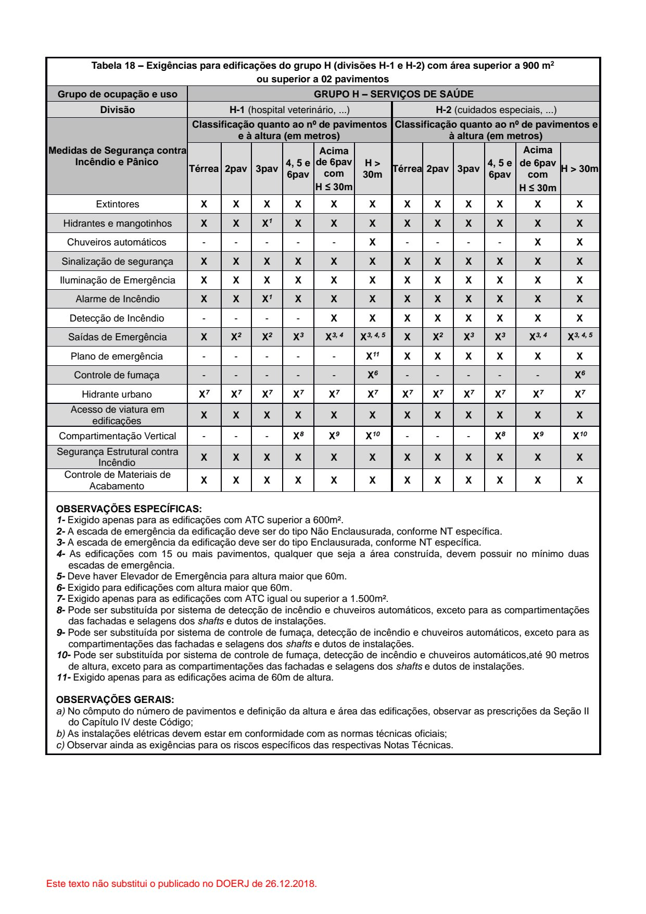

> Página sem texto extraível suficiente; consultar a representação visual ou o PDF oficial.

### Tabelas extraídas (bruto, não usar para citação)
#### Tabela 1 da página

| Tabela 18 - Exigências para edificações do grupo H (divisões H-1 e H-2) com área superior a 900 m2 |  |  |  |  |  |  |  |  |  |  |  |  |
| --- | --- | --- | --- | --- | --- | --- | --- | --- | --- | --- | --- | --- |
| ou superior a 02 pavimentos |  |  |  |  |  |  |  |  |  |  |  |  |
| Grupo de ocupação e uso | GRUPO H - SERVIÇOS DE SAÚDE |  |  |  |  |  |  |  |  |  |  |  |
| Divisão | H-1 (hospital veterinário,...) |  |  |  |  |  | H-2 (cuidados especiais,...) |  |  |  |  |  |
|  | Classificação quanto ao nº de pavimentos |  |  |  |  |  | Classificação quanto ao nº de pavimentos e |  |  |  |  |  |
|  | e à altura (em metros) |  |  |  |  |  | à altura (em metros) |  |  |  |  |  |
| Medidas de Segurança contra |  |  |  |  | Acima |  |  |  |  |  | Acima |  |
| Incêndio e Pânico |  |  |  | 4, 5 e | de 6pav | H > |  |  |  | 4, 5 e | de 6pav |  |
|  | Térrea | 2pav | 3pav |  |  |  | Térrea | 2pav | 3pav |  |  | H > 30m |
|  |  |  |  | 6pav | com | 30m |  |  |  | 6pav | com |  |
|  |  |  |  |  |  |  |  |  |  |  |  |  |
|  |  |  |  |  | H ≤ 30m |  |  |  |  |  | H ≤ 30m |  |
| Extintores | X | X | X | X | X | X | X | X | X | X | X | X |
|  |  |  |  |  |  |  |  |  |  |  |  |  |
| Hidrantes e mangotinhos | X | X | X1 | X | X | X | X | X | X | X | X | X |
|  |  |  |  |  |  |  |  |  |  |  |  |  |
| Chuveiros automáticos | - | - | - | - | - | X | - | - | - | - | X | X |
|  |  |  |  |  |  |  |  |  |  |  |  |  |
| Sinalização de segurança | X | X | X | X | X | X | X | X | X | X | X | X |
|  |  |  |  |  |  |  |  |  |  |  |  |  |
| Iluminação de Emergência | X | X | X | X | X | X | X | X | X | X | X | X |
|  |  |  |  |  |  |  |  |  |  |  |  |  |
| Alarme de Incêndio | X | X | X1 | X | X | X | X | X | X | X | X | X |
|  |  |  |  |  |  |  |  |  |  |  |  |  |
| Detecção de Incêndio | - | - | - | - | X | X | X | X | X | X | X | X |
|  |  |  |  |  |  |  |  |  |  |  |  |  |
| Saídas de Emergência | X | X2 | X2 | X3 | X3, 4 | X3, 4, 5 | X | X2 | X3 | X3 | X3, 4 | X3, 4, 5 |
|  |  |  |  |  |  |  |  |  |  |  |  |  |
| Plano de emergência | - | - | - | - | - | X11 | X | X | X | X | X | X |
|  |  |  |  |  |  |  |  |  |  |  |  |  |
| Controle de fumaça | - | - | - | - | - | X6 | - | - | - | - | - | X6 |
|  |  |  |  |  |  |  |  |  |  |  |  |  |
| Hidrante urbano | X7 | X7 | X7 | X7 | X7 | X7 | X7 | X7 | X7 | X7 | X7 | X7 |
| Acesso de viatura em |  |  |  |  |  |  |  |  |  |  |  |  |
|  | X | X | X | X | X | X | X | X | X | X | X | X |
| edificações |  |  |  |  |  |  |  |  |  |  |  |  |
|  |  |  |  |  |  |  |  |  |  |  |  |  |
| Compartimentação Vertical | - | - | - | X8 | X9 | X10 | - | - | - | X8 | X9 | X10 |
| Segurança Estrutural contra |  |  |  |  |  |  |  |  |  |  |  |  |
|  | X | X | X | X | X | X | X | X | X | X | X | X |
| Incêndio |  |  |  |  |  |  |  |  |  |  |  |  |
|  |  |  |  |  |  |  |  |  |  |  |  |  |
| Controle de Materiais de Acabamento | X | X | X | X | X | X | X | X | X | X | X | X |
| OBSERVAÇÕES ESPECÍFICAS: 1- Exigido apenas para as edificações com ATC superior a 600m². 2- A escada de emergência da edificação deve ser do tipo Não Enclausurada, conforme NT específica. 3- A escada de emergência da edificação deve ser do tipo Enclausurada, conforme NT específica. 4- As edificações com 15 ou mais pavimentos, qualquer que seja a área construída, devem possuir no mínimo duas escadas de emergência. 5- Deve haver Elevador de Emergência para altura maior que 60m. 6- Exigido para edificações com altura maior que 60m. 7- Exigido apenas para as edificações com ATC igual ou superior a 1.500m². 8- Pode ser substituída por sistema de detecção de incêndio e chuveiros automáticos, exceto para as compartimentações das fachadas e selagens dos shafts e dutos de instalações. 9- Pode ser substituída por sistema de controle de fumaça, detecção de incêndio e chuveiros automáticos, exceto para as compartimentações das fachadas e selagens dos shafts e dutos de instalações. 10- Pode ser substituída por sistema de controle de fumaça, detecção de incêndio e chuveiros automáticos,até 90 metros de altura, exceto para as compartimentações das fachadas e selagens dos shafts e dutos de instalações. 11- Exigido apenas para as edificações acima de 60m de altura. OBSERVAÇÕES GERAIS: a) No cômputo do número de pavimentos e definição da altura e área das edificações, observar as prescrições da Seção II do Capítulo IV deste Código; b) As instalações elétricas devem estar em conformidade com as normas técnicas oficiais; c) Observar ainda as exigências para os riscos específicos das respectivas Notas Técnicas. |  |  |  |  |  |  |  |  |  |  |  |  |

<!-- tabela-conferida: Tabela 18 p42 -->
### Tabela 18 — Exigências para edificações do grupo H (divisões H-1 e H-2) com área superior a 900 m2 ou superior a 02 pavimentos (conferida)

| Medidas de Segurança contra Incêndio e Pânico | H-1 — Térrea | H-1 — 2pav | H-1 — 3pav | H-1 — 4, 5 e 6pav | H-1 — Acima de 6pav com H ≤ 30m | H-1 — H > 30m | H-2 — Térrea | H-2 — 2pav | H-2 — 3pav | H-2 — 4, 5 e 6pav | H-2 — Acima de 6pav com H ≤ 30m | H-2 — H > 30m |
| --- | --- | --- | --- | --- | --- | --- | --- | --- | --- | --- | --- | --- |
| Extintores | X | X | X | X | X | X | X | X | X | X | X | X |
| Hidrantes e mangotinhos | X | X | X1 | X | X | X | X | X | X | X | X | X |
| Chuveiros automáticos | - | - | - | - | - | X | - | - | - | - | X | X |
| Sinalização de segurança | X | X | X | X | X | X | X | X | X | X | X | X |
| Iluminação de Emergência | X | X | X | X | X | X | X | X | X | X | X | X |
| Alarme de Incêndio | X | X | X1 | X | X | X | X | X | X | X | X | X |
| Detecção de Incêndio | - | - | - | - | X | X | X | X | X | X | X | X |
| Saídas de Emergência | X | X2 | X2 | X3 | X3, 4 | X3, 4, 5 | X | X2 | X3 | X3 | X3, 4 | X3, 4, 5 |
| Plano de emergência | - | - | - | - | - | X11 | X | X | X | X | X | X |
| Controle de fumaça | - | - | - | - | - | X6 | - | - | - | - | - | X6 |
| Hidrante urbano | X7 | X7 | X7 | X7 | X7 | X7 | X7 | X7 | X7 | X7 | X7 | X7 |
| Acesso de viatura em edificações | X | X | X | X | X | X | X | X | X | X | X | X |
| Compartimentação Vertical | - | - | - | X8 | X9 | X10 | - | - | - | X8 | X9 | X10 |
| Segurança Estrutural contra Incêndio | X | X | X | X | X | X | X | X | X | X | X | X |
| Controle de Materiais de Acabamento | X | X | X | X | X | X | X | X | X | X | X | X |

Fonte: Decreto 42/2018, página 42, Tabela 18; conferida em 2026-09-29 (visual + geometrica).
As observações específicas e gerais da tabela estão no texto da página (e na imagem); valem para as células com a nota correspondente.
<!-- /tabela-conferida: Tabela 18 p42 -->

---

## Página 43

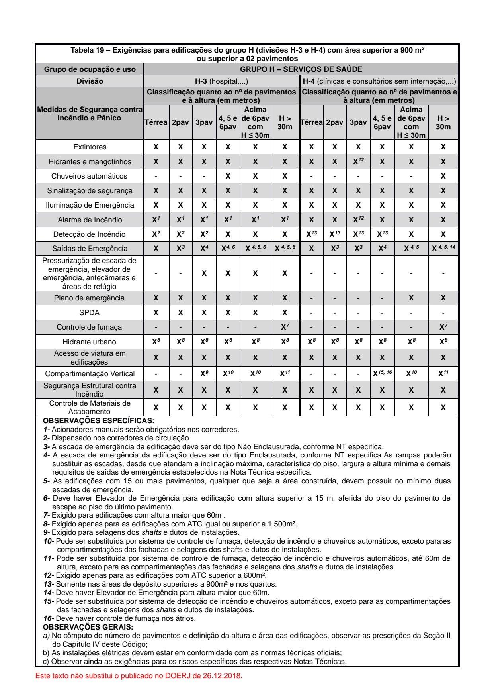

> Página sem texto extraível suficiente; consultar a representação visual ou o PDF oficial.

### Tabelas extraídas (bruto, não usar para citação)
#### Tabela 1 da página

| Tabela 19 - Exigências para edificações do grupo H (divisões H-3 e H-4) com área superior a 900 m2 |  |  |  |  |  |  |  |  |  |  |  |  |
| --- | --- | --- | --- | --- | --- | --- | --- | --- | --- | --- | --- | --- |
| ou superior a 02 pavimentos |  |  |  |  |  |  |  |  |  |  |  |  |
| Grupo de ocupação e uso | GRUPO H - SERVIÇOS DE SAÚDE |  |  |  |  |  |  |  |  |  |  |  |
| Divisão | H-3 (hospital,...) |  |  |  |  |  | H-4 (clínicas e consultórios sem internação,...) |  |  |  |  |  |
|  | Classificação quanto ao nº de pavimentos |  |  |  |  |  | Classificação quanto ao nº de pavimentos e |  |  |  |  |  |
|  | e à altura (em metros) |  |  |  |  |  | à altura (em metros) |  |  |  |  |  |
| Medidas de Segurança contra |  |  |  |  | Acima |  |  |  |  |  | Acima |  |
| Incêndio e Pânico |  |  |  | 4, 5 e | de 6pav | H > |  |  |  | 4, 5 e | de 6pav | H > |
|  | Térrea | 2pav | 3pav |  |  |  | Térrea | 2pav | 3pav |  |  |  |
|  |  |  |  | 6pav | com | 30m |  |  |  | 6pav | com | 30m |
|  |  |  |  |  |  |  |  |  |  |  |  |  |
|  |  |  |  |  | H ≤ 30m |  |  |  |  |  | H ≤ 30m |  |
| Extintores | X | X | X | X | X | X | X | X | X | X | X | X |
|  |  |  |  |  |  |  |  |  |  |  |  |  |
| Hidrantes e mangotinhos | X | X | X | X | X | X | X | X | X12 | X | X | X |
|  |  |  |  |  |  |  |  |  |  |  |  |  |
| Chuveiros automáticos | - | - | - | X | X | X | - | - | - | - | - | X |
|  |  |  |  |  |  |  |  |  |  |  |  |  |
| Sinalização de segurança | X | X | X | X | X | X | X | X | X | X | X | X |
|  |  |  |  |  |  |  |  |  |  |  |  |  |
| Iluminação de Emergência | X | X | X | X | X | X | X | X | X | X | X | X |
|  |  |  |  |  |  |  |  |  |  |  |  |  |
| Alarme de Incêndio | X1 | X1 | X1 | X1 | X1 | X1 | X | X | X12 | X | X | X |
|  |  |  |  |  |  |  |  |  |  |  |  |  |
| Detecção de Incêndio | X2 | X2 | X2 | X | X | X | X13 | X13 | X13 | X13 | X | X |
|  |  |  |  |  |  |  |  |  |  |  |  |  |
| Saídas de Emergência | X | X3 | X4 | X4, 6 | X 4, 5, 6 | X 4, 5, 6 | X | X3 | X3 | X4 | X 4, 5 | X 4, 5, 14 |
|  |  |  |  |  |  |  |  |  |  |  |  |  |
| Pressurização de escada de emergência, elevador de emergência, antecâmaras e áreas de refúgio | - | - | X | X | X | X | - | - | - | - | - | - |
|  |  |  |  |  |  |  |  |  |  |  |  |  |
| Plano de emergência | X | X | X | X | X | X | - | - | - | - | X | X |
|  |  |  |  |  |  |  |  |  |  |  |  |  |
| SPDA | X | X | X | X | X | X | - | - | - | - | - | - |
|  |  |  |  |  |  |  |  |  |  |  |  |  |
| Controle de fumaça | - | - | - | - | - | X7 | - | - | - | - | - | X7 |
|  |  |  |  |  |  |  |  |  |  |  |  |  |
| Hidrante urbano | X8 | X8 | X8 | X8 | X8 | X8 | X8 | X8 | X8 | X8 | X8 | X8 |
| Acesso de viatura em |  |  |  |  |  |  |  |  |  |  |  |  |
|  | X | X | X | X | X | X | X | X | X | X | X | X |
| edificações |  |  |  |  |  |  |  |  |  |  |  |  |
|  |  |  |  |  |  |  |  |  |  |  |  |  |
| Compartimentação Vertical | - | - | X9 | X10 | X10 | X11 | - | - | - | X15, 16 | X10 | X11 |
| Segurança Estrutural contra |  |  |  |  |  |  |  |  |  |  |  |  |
|  | X | X | X | X | X | X | X | X | X | X | X | X |
| Incêndio |  |  |  |  |  |  |  |  |  |  |  |  |
|  |  |  |  |  |  |  |  |  |  |  |  |  |
| Controle de Materiais de Acabamento | X | X | X | X | X | X | X | X | X | X | X | X |
| OBSERVAÇÕES ESPECÍFICAS: 1- Acionadores manuais serão obrigatórios nos corredores. 2- Dispensado nos corredores de circulação. 3- A escada de emergência da edificação deve ser do tipo Não Enclausurada, conforme NT específica. 4- A escada de emergência da edificação deve ser do tipo Enclausurada, conforme NT específica.As rampas poderão substituir as escadas, desde que atendam a inclinação máxima, característica do piso, largura e altura mínima e demais requisitos de saídas de emergência estabelecidos na Nota Técnica específica. 5- As edificações com 15 ou mais pavimentos, qualquer que seja a área construída, devem possuir no mínimo duas escadas de emergência. 6- Deve haver Elevador de Emergência para edificação com altura superior a 15 m, aferida do piso do pavimento de escape ao piso do último pavimento. 7- Exigido para edificações com altura maior que 60m. 8- Exigido apenas para as edificações com ATC igual ou superior a 1.500m². 9- Exigido para selagens dos shafts e dutos de instalações. 10- Pode ser substituída por sistema de controle de fumaça, detecção de incêndio e chuveiros automáticos, exceto para as compartimentações das fachadas e selagens dos shafts e dutos de instalações. 11- Pode ser substituída por sistema de controle de fumaça, detecção de incêndio e chuveiros automáticos, até 60m de altura, exceto para as compartimentações das fachadas e selagens dos shafts e dutos de instalações. 12- Exigido apenas para as edificações com ATC superior a 600m². 13- Somente nas áreas de depósito superiores a 900m² e nos quartos. 14- Deve haver Elevador de Emergência para altura maior que 60m. 15- Pode ser substituída por sistema de detecção de incêndio e chuveiros automáticos, exceto para as compartimentações das fachadas e selagens dos shafts e dutos de instalações. 16- Deve haver controle de fumaça nos átrios. OBSERVAÇÕES GERAIS: a) No cômputo do número de pavimentos e definição da altura e área das edificações, observar as prescrições da Seção II do Capítulo IV deste Código; b) As instalações elétricas devem estar em conformidade com as normas técnicas oficiais; c) Observar ainda as exigências para os riscos específicos das respectivas Notas Técnicas. |  |  |  |  |  |  |  |  |  |  |  |  |

<!-- tabela-conferida: Tabela 19 p43 -->
### Tabela 19 — Exigências para edificações do grupo H (divisões H-3 e H-4) com área superior a 900 m2 ou superior a 02 pavimentos (conferida)

| Medidas de Segurança contra Incêndio e Pânico | H-3 — Térrea | H-3 — 2pav | H-3 — 3pav | H-3 — 4, 5 e 6pav | H-3 — Acima de 6pav com H ≤ 30m | H-3 — H > 30m | H-4 — Térrea | H-4 — 2pav | H-4 — 3pav | H-4 — 4, 5 e 6pav | H-4 — Acima de 6pav com H ≤ 30m | H-4 — H > 30m |
| --- | --- | --- | --- | --- | --- | --- | --- | --- | --- | --- | --- | --- |
| Extintores | X | X | X | X | X | X | X | X | X | X | X | X |
| Hidrantes e mangotinhos | X | X | X | X | X | X | X | X | X12 | X | X | X |
| Chuveiros automáticos | - | - | - | X | X | X | - | - | - | - | - | X |
| Sinalização de segurança | X | X | X | X | X | X | X | X | X | X | X | X |
| Iluminação de Emergência | X | X | X | X | X | X | X | X | X | X | X | X |
| Alarme de Incêndio | X1 | X1 | X1 | X1 | X1 | X1 | X | X | X12 | X | X | X |
| Detecção de Incêndio | X2 | X2 | X2 | X | X | X | X13 | X13 | X13 | X13 | X | X |
| Saídas de Emergência | X | X3 | X4 | X4, 6 | X 4, 5, 6 | X 4, 5, 6 | X | X3 | X3 | X4 | X 4, 5 | X 4, 5, 14 |
| Pressurização de escada de emergência, elevador de emergência, antecâmaras e áreas de refúgio | - | - | X | X | X | X | - | - | - | - | - | - |
| Plano de emergência | X | X | X | X | X | X | - | - | - | - | X | X |
| SPDA | X | X | X | X | X | X | - | - | - | - | - | - |
| Controle de fumaça | - | - | - | - | - | X7 | - | - | - | - | - | X7 |
| Hidrante urbano | X8 | X8 | X8 | X8 | X8 | X8 | X8 | X8 | X8 | X8 | X8 | X8 |
| Acesso de viatura em edificações | X | X | X | X | X | X | X | X | X | X | X | X |
| Compartimentação Vertical | - | - | X9 | X10 | X10 | X11 | - | - | - | X15, 16 | X10 | X11 |
| Segurança Estrutural contra Incêndio | X | X | X | X | X | X | X | X | X | X | X | X |
| Controle de Materiais de Acabamento | X | X | X | X | X | X | X | X | X | X | X | X |

Fonte: Decreto 42/2018, página 43, Tabela 19; conferida em 2026-09-29 (visual + geometrica).
As observações específicas e gerais da tabela estão no texto da página (e na imagem); valem para as células com a nota correspondente.
<!-- /tabela-conferida: Tabela 19 p43 -->

---

## Página 44

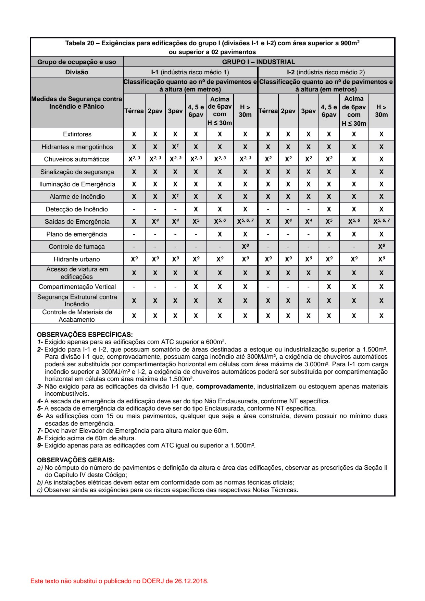

do Capítulo IV deste Código; b) As instalações elétricas devem estar em conformidade com as normas técnicas oficiais; c) Observar ainda as exigências para os riscos específicos das respectivas Notas Técnicas.

### Tabelas extraídas (bruto, não usar para citação)
#### Tabela 1 da página

| Tabela 20 - Exigências para edificações do grupo I (divisões I-1 e I-2) com área superior a 900m2 |  |  |  |  |  |  |  |  |  |  |  |  |
| --- | --- | --- | --- | --- | --- | --- | --- | --- | --- | --- | --- | --- |
| ou superior a 02 pavimentos |  |  |  |  |  |  |  |  |  |  |  |  |
| Grupo de ocupação e uso | GRUPO I - INDUSTRIAL |  |  |  |  |  |  |  |  |  |  |  |
| Divisão | I-1 (indústria risco médio 1) |  |  |  |  |  | I-2 (indústria risco médio 2) |  |  |  |  |  |
|  | Classificação quanto ao nº de pavimentos e |  |  |  |  |  | Classificação quanto ao nº de pavimentos e |  |  |  |  |  |
|  | à altura (em metros) |  |  |  |  |  | à altura (em metros) |  |  |  |  |  |
| Medidas de Segurança contra |  |  |  |  | Acima |  |  |  |  |  | Acima |  |
| Incêndio e Pânico |  |  |  | 4, 5 e | de 6pav | H > |  |  |  | 4, 5 e | de 6pav | H > |
|  | Térrea | 2pav | 3pav |  |  |  | Térrea | 2pav | 3pav |  |  |  |
|  |  |  |  | 6pav | com | 30m |  |  |  | 6pav | com | 30m |
|  |  |  |  |  |  |  |  |  |  |  |  |  |
|  |  |  |  |  | H ≤ 30m |  |  |  |  |  | H ≤ 30m |  |
| Extintores | X | X | X | X | X | X | X | X | X | X | X | X |
|  |  |  |  |  |  |  |  |  |  |  |  |  |
| Hidrantes e mangotinhos | X | X | X1 | X | X | X | X | X | X | X | X | X |
|  |  |  |  |  |  |  |  |  |  |  |  |  |
| Chuveiros automáticos | X2, 3 | X2, 3 | X2, 3 | X2, 3 | X2, 3 | X2, 3 | X2 | X2 | X2 | X2 | X | X |
|  |  |  |  |  |  |  |  |  |  |  |  |  |
| Sinalização de segurança | X | X | X | X | X | X | X | X | X | X | X | X |
|  |  |  |  |  |  |  |  |  |  |  |  |  |
| Iluminação de Emergência | X | X | X | X | X | X | X | X | X | X | X | X |
|  |  |  |  |  |  |  |  |  |  |  |  |  |
| Alarme de Incêndio | X | X | X1 | X | X | X | X | X | X | X | X | X |
|  |  |  |  |  |  |  |  |  |  |  |  |  |
| Detecção de Incêndio | - | - | - | X | X | X | - | - | - | X | X | X |
|  |  |  |  |  |  |  |  |  |  |  |  |  |
| Saídas de Emergência | X | X4 | X4 | X5 | X5, 6 | X5, 6, 7 | X | X4 | X4 | X5 | X5, 6 | X5, 6, 7 |
|  |  |  |  |  |  |  |  |  |  |  |  |  |
| Plano de emergência | - | - | - | - | X | X | - | - | - | X | X | X |
|  |  |  |  |  |  |  |  |  |  |  |  |  |
| Controle de fumaça | - | - | - | - | - | X8 | - | - | - | - | - | X8 |
|  |  |  |  |  |  |  |  |  |  |  |  |  |
| Hidrante urbano | X9 | X9 | X9 | X9 | X9 | X9 | X9 | X9 | X9 | X9 | X9 | X9 |
| Acesso de viatura em |  |  |  |  |  |  |  |  |  |  |  |  |
|  | X | X | X | X | X | X | X | X | X | X | X | X |
| edificações |  |  |  |  |  |  |  |  |  |  |  |  |
|  |  |  |  |  |  |  |  |  |  |  |  |  |
| Compartimentação Vertical | - | - | - | X | X | X | - | - | - | X | X | X |
| Segurança Estrutural contra |  |  |  |  |  |  |  |  |  |  |  |  |
|  | X | X | X | X | X | X | X | X | X | X | X | X |
| Incêndio |  |  |  |  |  |  |  |  |  |  |  |  |
|  |  |  |  |  |  |  |  |  |  |  |  |  |
| Controle de Materiais de Acabamento | X | X | X | X | X | X | X | X | X | X | X | X |
| OBSERVAÇÕES ESPECÍFICAS: 1- Exigido apenas para as edificações com ATC superior a 600m². 2- Exigido para I-1 e I-2, que possuam somatório de áreas destinadas a estoque ou industrialização superior a 1.500m². Para divisão I-1 que, comprovadamente, possuam carga incêndio até 300MJ/m², a exigência de chuveiros automáticos poderá ser substituída por compartimentação horizontal em células com área máxima de 3.000m². Para I-1 com carga incêndio superior a 300MJ/m² e I-2, a exigência de chuveiros automáticos poderá ser substituída por compartimentação horizontal em células com área máxima de 1.500m². 3- Não exigido para as edificações da divisão I-1 que, comprovadamente, industrializem ou estoquem apenas materiais incombustíveis. 4- A escada de emergência da edificação deve ser do tipo Não Enclausurada, conforme NT específica. 5- A escada de emergência da edificação deve ser do tipo Enclausurada, conforme NT específica. 6- As edificações com 15 ou mais pavimentos, qualquer que seja a área construída, devem possuir no mínimo duas escadas de emergência. 7- Deve haver Elevador de Emergência para altura maior que 60m. 8- Exigido acima de 60m de altura. 9- Exigido apenas para as edificações com ATC igual ou superior a 1.500m². OBSERVAÇÕES GERAIS: a) No cômputo do número de pavimentos e definição da altura e área das edificações, observar as prescrições da Seção II do Capítulo IV deste Código; b) As instalações elétricas devem estar em conformidade com as normas técnicas oficiais; c) Observar ainda as exigências para os riscos específicos das respectivas Notas Técnicas. |  |  |  |  |  |  |  |  |  |  |  |  |

<!-- tabela-conferida: Tabela 20 p44 -->
### Tabela 20 — Exigências para edificações do grupo I (divisões I-1 e I-2) com área superior a 900m2 ou superior a 02 pavimentos (conferida)

| Medidas de Segurança contra Incêndio e Pânico | I-1 — Térrea | I-1 — 2pav | I-1 — 3pav | I-1 — 4, 5 e 6pav | I-1 — Acima de 6pav com H ≤ 30m | I-1 — H > 30m | I-2 — Térrea | I-2 — 2pav | I-2 — 3pav | I-2 — 4, 5 e 6pav | I-2 — Acima de 6pav com H ≤ 30m | I-2 — H > 30m |
| --- | --- | --- | --- | --- | --- | --- | --- | --- | --- | --- | --- | --- |
| Extintores | X | X | X | X | X | X | X | X | X | X | X | X |
| Hidrantes e mangotinhos | X | X | X1 | X | X | X | X | X | X | X | X | X |
| Chuveiros automáticos | X2, 3 | X2, 3 | X2, 3 | X2, 3 | X2, 3 | X2, 3 | X2 | X2 | X2 | X2 | X | X |
| Sinalização de segurança | X | X | X | X | X | X | X | X | X | X | X | X |
| Iluminação de Emergência | X | X | X | X | X | X | X | X | X | X | X | X |
| Alarme de Incêndio | X | X | X1 | X | X | X | X | X | X | X | X | X |
| Detecção de Incêndio | - | - | - | X | X | X | - | - | - | X | X | X |
| Saídas de Emergência | X | X4 | X4 | X5 | X5, 6 | X5, 6, 7 | X | X4 | X4 | X5 | X5, 6 | X5, 6, 7 |
| Plano de emergência | - | - | - | - | X | X | - | - | - | X | X | X |
| Controle de fumaça | - | - | - | - | - | X8 | - | - | - | - | - | X8 |
| Hidrante urbano | X9 | X9 | X9 | X9 | X9 | X9 | X9 | X9 | X9 | X9 | X9 | X9 |
| Acesso de viatura em edificações | X | X | X | X | X | X | X | X | X | X | X | X |
| Compartimentação Vertical | - | - | - | X | X | X | - | - | - | X | X | X |
| Segurança Estrutural contra Incêndio | X | X | X | X | X | X | X | X | X | X | X | X |
| Controle de Materiais de Acabamento | X | X | X | X | X | X | X | X | X | X | X | X |

Fonte: Decreto 42/2018, página 44, Tabela 20; conferida em 2026-09-29 (visual + geometrica).
As observações específicas e gerais da tabela estão no texto da página (e na imagem); valem para as células com a nota correspondente.
<!-- /tabela-conferida: Tabela 20 p44 -->

---

## Página 45

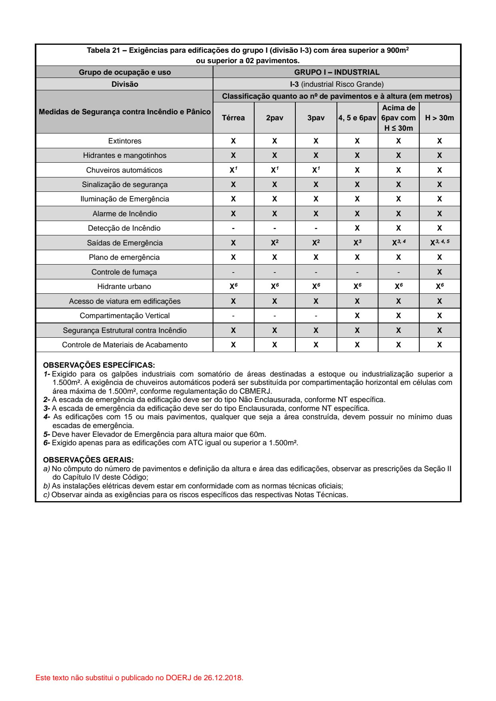

> Página sem texto extraível suficiente; consultar a representação visual ou o PDF oficial.

### Tabelas extraídas (bruto, não usar para citação)
#### Tabela 1 da página

| Tabela 21 - Exigências para edificações do grupo I (divisão I-3) com área superior a 900m2 |  |  |  |  |  |  |
| --- | --- | --- | --- | --- | --- | --- |
| ou superior a 02 pavimentos. |  |  |  |  |  |  |
| Grupo de ocupação e uso | GRUPO I - INDUSTRIAL |  |  |  |  |  |
| Divisão | I-3 (industrial Risco Grande) |  |  |  |  |  |
|  | Classificação quanto ao nº de pavimentos e à altura (em metros) |  |  |  |  |  |
|  |  |  |  |  | Acima de |  |
| Medidas de Segurança contra Incêndio e Pânico |  |  |  |  |  |  |
|  | Térrea | 2pav | 3pav | 4, 5 e 6pav | 6pav com | H > 30m |
|  |  |  |  |  |  |  |
|  |  |  |  |  | H ≤ 30m |  |
| Extintores | X | X | X | X | X | X |
|  |  |  |  |  |  |  |
| Hidrantes e mangotinhos | X | X | X | X | X | X |
|  |  |  |  |  |  |  |
| Chuveiros automáticos | X1 | X1 | X1 | X | X | X |
|  |  |  |  |  |  |  |
| Sinalização de segurança | X | X | X | X | X | X |
|  |  |  |  |  |  |  |
| Iluminação de Emergência | X | X | X | X | X | X |
|  |  |  |  |  |  |  |
| Alarme de Incêndio | X | X | X | X | X | X |
|  |  |  |  |  |  |  |
| Detecção de Incêndio | - | - | - | X | X | X |
|  |  |  |  |  |  |  |
| Saídas de Emergência | X | X2 | X2 | X3 | X3, 4 | X3, 4, 5 |
|  |  |  |  |  |  |  |
| Plano de emergência | X | X | X | X | X | X |
|  |  |  |  |  |  |  |
| Controle de fumaça | - | - | - | - | - | X |
|  |  |  |  |  |  |  |
| Hidrante urbano | X6 | X6 | X6 | X6 | X6 | X6 |
|  |  |  |  |  |  |  |
| Acesso de viatura em edificações | X | X | X | X | X | X |
|  |  |  |  |  |  |  |
| Compartimentação Vertical | - | - | - | X | X | X |
|  |  |  |  |  |  |  |
| Segurança Estrutural contra Incêndio | X | X | X | X | X | X |
|  |  |  |  |  |  |  |
| Controle de Materiais de Acabamento | X | X | X | X | X | X |
| OBSERVAÇÕES ESPECÍFICAS: 1- Exigido para os galpões industriais com somatório de áreas destinadas a estoque ou industrialização superior a 1.500m². A exigência de chuveiros automáticos poderá ser substituída por compartimentação horizontal em células com área máxima de 1.500m², conforme regulamentação do CBMERJ. 2- A escada de emergência da edificação deve ser do tipo Não Enclausurada, conforme NT específica. 3- A escada de emergência da edificação deve ser do tipo Enclausurada, conforme NT específica. 4- As edificações com 15 ou mais pavimentos, qualquer que seja a área construída, devem possuir no mínimo duas escadas de emergência. 5- Deve haver Elevador de Emergência para altura maior que 60m. 6- Exigido apenas para as edificações com ATC igual ou superior a 1.500m². OBSERVAÇÕES GERAIS: a) No cômputo do número de pavimentos e definição da altura e área das edificações, observar as prescrições da Seção II do Capítulo IV deste Código; b) As instalações elétricas devem estar em conformidade com as normas técnicas oficiais; c) Observar ainda as exigências para os riscos específicos das respectivas Notas Técnicas. |  |  |  |  |  |  |

<!-- tabela-conferida: Tabela 21 p45 -->
### Tabela 21 — Exigências para edificações do grupo I (divisão I-3) com área superior a 900m2 ou superior a 02 pavimentos. (conferida)

| Medidas de Segurança contra Incêndio e Pânico | Térrea | 2pav | 3pav | 4, 5 e 6pav | Acima de 6pav com H ≤ 30m | H > 30m |
| --- | --- | --- | --- | --- | --- | --- |
| Extintores | X | X | X | X | X | X |
| Hidrantes e mangotinhos | X | X | X | X | X | X |
| Chuveiros automáticos | X1 | X1 | X1 | X | X | X |
| Sinalização de segurança | X | X | X | X | X | X |
| Iluminação de Emergência | X | X | X | X | X | X |
| Alarme de Incêndio | X | X | X | X | X | X |
| Detecção de Incêndio | - | - | - | X | X | X |
| Saídas de Emergência | X | X2 | X2 | X3 | X3, 4 | X3, 4, 5 |
| Plano de emergência | X | X | X | X | X | X |
| Controle de fumaça | - | - | - | - | - | X |
| Hidrante urbano | X6 | X6 | X6 | X6 | X6 | X6 |
| Acesso de viatura em edificações | X | X | X | X | X | X |
| Compartimentação Vertical | - | - | - | X | X | X |
| Segurança Estrutural contra Incêndio | X | X | X | X | X | X |
| Controle de Materiais de Acabamento | X | X | X | X | X | X |

Fonte: Decreto 42/2018, página 45, Tabela 21; conferida em 2026-09-29 (visual + geometrica).
As observações específicas e gerais da tabela estão no texto da página (e na imagem); valem para as células com a nota correspondente.
<!-- /tabela-conferida: Tabela 21 p45 -->

---

## Página 46

> Página sem texto extraível suficiente; consultar a representação visual ou o PDF oficial.

### Tabelas extraídas (bruto, não usar para citação)
#### Tabela 1 da página

| Tabela 22 - Exigências para edificações do grupo J (divisões J-1 e J-2) com área superior a 900m2 |  |  |  |  |  |  |  |  |  |  |  |  |
| --- | --- | --- | --- | --- | --- | --- | --- | --- | --- | --- | --- | --- |
| ou superior a 02 pavimentos |  |  |  |  |  |  |  |  |  |  |  |  |
| Grupo de ocupação e uso | GRUPO J - DEPÓSITOS |  |  |  |  |  |  |  |  |  |  |  |
| Divisão | J-1 (material incombustível) |  |  |  |  |  | J-2 (risco médio 1) |  |  |  |  |  |
|  | Classificação quanto ao nº de pavimentos |  |  |  |  |  | Classificação quanto ao nº de pavimentos |  |  |  |  |  |
|  | e à altura (em metros) |  |  |  |  |  | e à altura (em metros) |  |  |  |  |  |
| Medidas de Segurança contra |  |  |  |  |  |  |  |  |  |  |  |  |
|  |  |  |  |  | Acima de |  |  |  |  |  | Acima de |  |
| Incêndio e Pânico |  |  |  | 4, 5 e |  | H > |  |  |  | 4, 5 e |  | H > |
|  | Térrea | 2pav | 3pav |  | 6pav com |  | Térrea | 2pav | 3pav |  | 6pav com |  |
|  |  |  |  | 6pav |  | 30m |  |  |  | 6pav |  | 30m |
|  |  |  |  |  | H ≤ 30m |  |  |  |  |  | H ≤ 30m |  |
|  |  |  |  |  |  |  |  |  |  |  |  |  |
| Extintores | X | X | X | X | X | X | X | X | X | X | X | X |
|  |  |  |  |  |  |  |  |  |  |  |  |  |
| Hidrantes e mangotinhos | X | X | X1 | X | X | X | X | X | X | X | X | X |
|  |  |  |  |  |  |  |  |  |  |  |  |  |
| Chuveiros automáticos | - | - | - | - | - | X | X2 | X2 | X2 | X2 | X2 | X |
|  |  |  |  |  |  |  |  |  |  |  |  |  |
| Sinalização de segurança | X | X | X | X | X | X | X | X | X | X | X | X |
|  |  |  |  |  |  |  |  |  |  |  |  |  |
| Iluminação de Emergência | X | X | X | X | X | X | X | X | X | X | X | X |
|  |  |  |  |  |  |  |  |  |  |  |  |  |
| Alarme de Incêndio | X | X | X1 | X | X | X | X | X | X | X | X | X |
|  |  |  |  |  |  |  |  |  |  |  |  |  |
| Detecção de Incêndio | - | - | - | - | - | X | - | - | - | - | X | X |
|  |  |  |  |  |  |  |  |  |  |  |  |  |
| Saídas de Emergência | X | X3 | X3 | X4 | X4, 5 | X4, 5, 6 | X | X3 | X3 | X4 | X4, 5 | X4, 5, 6 |
|  |  |  |  |  |  |  |  |  |  |  |  |  |
| Plano de emergência | - | - | - | - | - | - | - | - | - | - | X | X |
|  |  |  |  |  |  |  |  |  |  |  |  |  |
| Controle de fumaça | - | - | - | - | - | X7 | - | - | - | - | - | X7 |
|  |  |  |  |  |  |  |  |  |  |  |  |  |
| Hidrante urbano | X8 | X8 | X8 | X8 | X8 | X8 | X8 | X8 | X8 | X8 | X8 | X8 |
| Acesso de viatura em |  |  |  |  |  |  |  |  |  |  |  |  |
|  | X | X | X | X | X | X | X | X | X | X | X | X |
| edificações |  |  |  |  |  |  |  |  |  |  |  |  |
|  |  |  |  |  |  |  |  |  |  |  |  |  |
| Compartimentação Vertical | - | - | - | X9 | X9 | X | - | - | - | X10 | X10 | X |
| Segurança Estrutural contra |  |  |  |  |  |  |  |  |  |  |  |  |
|  | X | X | X | X | X | X | X | X | X | X | X | X |
| Incêndio |  |  |  |  |  |  |  |  |  |  |  |  |
|  |  |  |  |  |  |  |  |  |  |  |  |  |
| Controle de Materiais de Acabamento | - | X | X | X | X | X | X | X | X | X | X | X |
| OBSERVAÇÕES ESPECÍFICAS: 1- Exigido apenas para as edificações com ATC superior a 600m². 2- Exigido para os galpões com somatório de áreas destinadas a estoque ou industrialização superior a 1.500m². Para divisão J-2 que, comprovadamente, possuam carga incêndio até 300MJ/m², a exigência de chuveiros automáticos poderá ser substituída por compartimentação horizontal em células com área máxima de 3.000m². Para J-2 com carga incêndio superior a 300MJ/m², a exigência de chuveiros automáticos poderá ser substituída por compartimentação horizontal em células com área máxima de 1.500m². 3- A escada de emergência da edificação deve ser do tipo Não Enclausurada, conforme NT específica. 4- A escada de emergência da edificação deve ser do tipo Enclausurada, conforme NT específica. 5- As edificações com 15 ou mais pavimentos, qualquer que seja a área construída, devem possuir no mínimo duas escadas de emergência. 6- Deve haver Elevador de Emergência para altura maior que 60m. 7- Exigido acima de 60m de altura. 8- Exigido apenas para as edificações com ATC igual ou superior a 1.500m². 9- Exigido para as compartimentações das fachadas e selagens dos shafts e dutos de instalações. 10- Pode ser substituída por sistema de controle de fumaça, detecção de incêndio e chuveiros automáticos, exceto para as compartimentações das fachadas e selagens dos shafts e dutos de instalações. OBSERVAÇÕES GERAIS: a) No cômputo do número de pavimentos e definição da altura e área das edificações, observar as prescrições da Seção II do Capítulo IV deste Código; b) As instalações elétricas devem estar em conformidade com as normas técnicas oficiais; c) Observar ainda as exigências para os riscos específicos das respectivas Notas Técnicas. |  |  |  |  |  |  |  |  |  |  |  |  |

---

## Página 47

> Página sem texto extraível suficiente; consultar a representação visual ou o PDF oficial.

### Tabelas extraídas (bruto, não usar para citação)
#### Tabela 1 da página

| Tabela 23 - Exigências para edificações do grupo J (divisões J-3 e J-4) com área superior a 900m2 |  |  |  |  |  |  |  |  |  |  |  |  |
| --- | --- | --- | --- | --- | --- | --- | --- | --- | --- | --- | --- | --- |
| ou superior a 02 pavimentos |  |  |  |  |  |  |  |  |  |  |  |  |
| Grupo de ocupação e uso | GRUPO J - DEPÓSITOS |  |  |  |  |  |  |  |  |  |  |  |
| Divisão | J-3 (risco médio 2) |  |  |  |  |  | J-4 (risco grande) |  |  |  |  |  |
|  | Classificação quanto ao nº de pavimentos |  |  |  |  |  | Classificação quanto ao nº de pavimentos e |  |  |  |  |  |
|  | e à altura (em metros) |  |  |  |  |  | à altura (em metros) |  |  |  |  |  |
| Medidas de Segurança contra |  |  |  |  | Acima |  |  |  |  |  | Acima |  |
| Incêndio e Pânico |  |  |  | 4, 5 e | de 6pav |  |  |  |  | 4, 5 e | de 6pav |  |
|  | Térrea | 2pav | 3pav |  |  | H >30m | Térrea | 2pav | 3pav |  |  | H > 30m |
|  |  |  |  | 6pav | com |  |  |  |  | 6pav | com |  |
|  |  |  |  |  |  |  |  |  |  |  |  |  |
|  |  |  |  |  | H ≤ 30m |  |  |  |  |  | H ≤ 30m |  |
| Extintores | X | X | X | X | X | X | X | X | X | X | X | X |
|  |  |  |  |  |  |  |  |  |  |  |  |  |
| Hidrantes e mangotinhos | X | X | X | X | X | X | X | X | X | X | X | X |
|  |  |  |  |  |  |  |  |  |  |  |  |  |
| Chuveiros automáticos | X1 | X1 | X1 | X1 | X | X | X1 | X1 | X1 | X | X | X |
|  |  |  |  |  |  |  |  |  |  |  |  |  |
| Sinalização de segurança | X | X | X | X | X | X | X | X | X | X | X | X |
|  |  |  |  |  |  |  |  |  |  |  |  |  |
| Iluminação de Emergência | X | X | X | X | X | X | X | X | X | X | X | X |
|  |  |  |  |  |  |  |  |  |  |  |  |  |
| Alarme de Incêndio | X | X | X | X | X | X | X | X | X | X | X | X |
|  |  |  |  |  |  |  |  |  |  |  |  |  |
| Detecção de Incêndio | - | - | - | X | X | X | X | X | X | X | X | X |
|  |  |  |  |  |  |  |  |  |  |  |  |  |
| Saídas de Emergência | X | X2 | X2 | X3 | X3, 4 | X3, 4, 5 | X | X2 | X2 | X3 | X3, 4 | X3, 4, 5 |
|  |  |  |  |  |  |  |  |  |  |  |  |  |
| Plano de emergência | X | X | X | X | X | X | X | X | X | X | X | X |
|  |  |  |  |  |  |  |  |  |  |  |  |  |
| Controle de fumaça | - | - | - | - | - | X | - | - | - | - | - | X |
|  |  |  |  |  |  |  |  |  |  |  |  |  |
| Hidrante urbano | X6 | X6 | X6 | X6 | X6 | X6 | X6 | X6 | X6 | X6 | X6 | X6 |
| Acesso de viatura em |  |  |  |  |  |  |  |  |  |  |  |  |
|  | X | X | X | X | X | X | X | X | X | X | X | X |
| edificações |  |  |  |  |  |  |  |  |  |  |  |  |
|  |  |  |  |  |  |  |  |  |  |  |  |  |
| Compartimentação Vertical | - | - | - | X7 | X7 | X | - | - | - | X7 | X7 | X |
| Segurança Estrutural contra |  |  |  |  |  |  |  |  |  |  |  |  |
|  | X | X | X | X | X | X | X | X | X | X | X | X |
| Incêndio |  |  |  |  |  |  |  |  |  |  |  |  |
|  |  |  |  |  |  |  |  |  |  |  |  |  |
| Controle de Materiais de Acabamento | X | X | X | X | X | X | X | X | X | X | X | X |
| OBSERVAÇÕES ESPECÍFICAS: 1- Exigido para os galpões com somatório de áreas destinadas a estoque ou industrialização superior a 1.500m². A exigência de chuveiros automáticos poderá ser substituída por compartimentação horizontal em células com área máxima de 1.500m², conforme regulamentação do CBMERJ. 2- A escada de emergência da edificação deve ser do tipo Não Enclausurada, conforme NT específica. 3- A escada de emergência da edificação deve ser do tipo Enclausurada, conforme NT específica. 4- As edificações com 15 ou mais pavimentos, qualquer que seja a área construída, devem possuir no mínimo duas escadas de emergência. 5- Deve haver Elevador de Emergência para altura maior que 60m. 6- Exigido apenas para as edificações com ATC igual ou superior a 1.500m². 7- Pode ser substituída por sistema de controle de fumaça, detecção de incêndio e chuveiros automáticos, exceto para as compartimentações das fachadas e selagens dos shafts e dutos de instalações. OBSERVAÇÕES GERAIS: a) No cômputo do número de pavimentos e definição da altura e área das edificações, observar as prescrições da Seção II do Capítulo IV deste Código; b) As instalações elétricas devem estar em conformidade com as normas técnicas oficiais; c) Observar ainda as exigências para os riscos específicos das respectivas Notas Técnicas. |  |  |  |  |  |  |  |  |  |  |  |  |

---

## Página 48

> Página sem texto extraível suficiente; consultar a representação visual ou o PDF oficial.

### Tabelas extraídas (bruto, não usar para citação)
#### Tabela 1 da página

| Tabela 24 - Exigências para edificações do grupo L (divisão L-1) com área superior a 900m2 |  |  |  |  |  |  |
| --- | --- | --- | --- | --- | --- | --- |
| ou superior a 02 pavimentos |  |  |  |  |  |  |
| Grupo de ocupação e uso | GRUPO L - EXPLOSIVOS E MUNIÇÕES |  |  |  |  |  |
| Divisão | L-1 (comércio de fogos de artifício,..) |  |  |  |  |  |
|  | Classificação quanto ao nº de pavimentos e à altura (em metros) |  |  |  |  |  |
|  |  |  |  |  | Acima de |  |
| Medidas de Segurança contra Incêndio e Pânico |  |  |  |  |  |  |
|  | Térrea | 2pav | 3pav | 4, 5 e 6pav | 6pav com | H > 30m |
|  |  |  |  |  |  |  |
|  |  |  |  |  | H ≤ 30m |  |
| Extintores | X | X | X | X | X | X |
|  |  |  |  |  |  |  |
| Hidrantes e mangotinhos | X | X | X | X | X | X |
|  |  |  |  |  |  |  |
| Chuveiros automáticos | X1 | X1 | X1 | X1 | X1 | X |
|  |  |  |  |  |  |  |
| Sinalização de segurança | X | X | X | X | X | X |
|  |  |  |  |  |  |  |
| Iluminação de Emergência | X2 | X2 | X2 | X2 | X2 | X2 |
|  |  |  |  |  |  |  |
| Alarme de Incêndio | X | X | X | X | X | X |
|  |  |  |  |  |  |  |
| Detecção de Incêndio | X | X | X | X | X | X |
|  |  |  |  |  |  |  |
| Saídas de Emergência | X | X3 | X3 | X4 | X4, 5 | X4, 5, 6 |
|  |  |  |  |  |  |  |
| Plano de emergência | X | X | X | X | X | X |
|  |  |  |  |  |  |  |
| SPDA | X | X | X | X | X | X |
|  |  |  |  |  |  |  |
| Controle de fumaça | - | - | - | - | - | X7 |
|  |  |  |  |  |  |  |
| Hidrante urbano | X8 | X8 | X8 | X8 | X8 | X8 |
|  |  |  |  |  |  |  |
| Acesso de viatura em edificações | X | X | X | X | X | X |
|  |  |  |  |  |  |  |
| Compartimentação Vertical | - | - | - | X9 | X10 | X11 |
|  |  |  |  |  |  |  |
| Segurança Estrutural contra Incêndio | X | X | X | X | X | X |
|  |  |  |  |  |  |  |
| Controle de Materiais de Acabamento | X | X | X | X | X | X |
|  |  |  |  |  |  |  |
|  |  |  |  |  |  |  |
| OBSERVAÇÕES ESPECÍFICAS: |  |  |  |  |  |  |
| 1- Exigido para as edificações que possuam mais de 1.500m² em qualquer de seus pavimentos ou mais de 3.000m² de |  |  |  |  |  |  |
| ATC. |  |  |  |  |  |  |
| 2- Somente para as áreas acessíveis ao público (área de vendas) e rotas de escape. Não deve ser instalada no interior |  |  |  |  |  |  |
| das áreas de depósito e armazenamento de fogos de artifício e artefatos pirotécnicos. |  |  |  |  |  |  |
| 3- A escada de emergência da edificação deve ser do tipo Não Enclausurada, conforme NT específica. |  |  |  |  |  |  |
| 4- A escada de emergência da edificação deve ser do tipo Enclausurada, conforme NT específica. |  |  |  |  |  |  |
| 5- As edificações com 15 ou mais pavimentos, qualquer que seja a área construída, devem possuir no mínimo duas |  |  |  |  |  |  |
| escadas de emergência. |  |  |  |  |  |  |
| 6- Deve haver Elevador de Emergência para altura maior que 60m. |  |  |  |  |  |  |
| 7- Exigido acima de 60m de altura. |  |  |  |  |  |  |
| 8- Exigido apenas para edificações com mais de 1.500m² de ATC. |  |  |  |  |  |  |
| 9- Pode ser substituída por sistema de detecção de incêndio e chuveiros automáticos, exceto para as compartimentações |  |  |  |  |  |  |
| das fachadas e selagens dos shafts e dutos de instalações. |  |  |  |  |  |  |
| 10- Pode ser substituída por sistema de controle de fumaça, detecção de incêndio e chuveiros automáticos, exceto para as |  |  |  |  |  |  |
| compartimentações das fachadas e selagens dos shafts e dutos de instalações. |  |  |  |  |  |  |
| 11- Pode ser substituída por sistema de controle de fumaça, detecção de incêndio e chuveiros automáticos, até 90 metros |  |  |  |  |  |  |
| de altura, exceto para as compartimentações das fachadas e selagens dos shafts e dutos de instalações. |  |  |  |  |  |  |
|  |  |  |  |  |  |  |
| OBSERVAÇÕES GERAIS: |  |  |  |  |  |  |
| a) No cômputo do número de pavimentos e definição da altura e área das edificações, observar as prescrições da Seção II |  |  |  |  |  |  |
| do Capítulo IV deste Código; |  |  |  |  |  |  |
| b) As instalações elétricas devem estar em conformidade com as normas técnicas oficiais; |  |  |  |  |  |  |
| c) As atividades de fabricação, utilização, armazenagem, depósito e comércio de explosivos e munições devem obedecer |  |  |  |  |  |  |
| ao disposto na legislação específica e regulamentações do Exército Brasileiro; |  |  |  |  |  |  |
| d) Atender às exigências e condições particulares das medidas de segurança contra incêndio para as edificações |  |  |  |  |  |  |
| destinadas a fabricação, armazenagem e comércio de munições, explosivos e artefatos pirotécnicos, estabelecidas na |  |  |  |  |  |  |
| Nota Técnica específica; |  |  |  |  |  |  |
| e) Observar ainda as exigências para os riscos específicos das respectivas Notas Técnicas. |  |  |  |  |  |  |

---

## Página 49

> Página sem texto extraível suficiente; consultar a representação visual ou o PDF oficial.

### Tabelas extraídas (bruto, não usar para citação)
#### Tabela 1 da página

| Tabela 25 - Exigências para edificações e áreas de risco do grupo M (divisão M-1) com qualquer área |  |  |  |  |  |
| --- | --- | --- | --- | --- | --- |
| ou número de pavimentos |  |  |  |  |  |
| Grupo de ocupação e uso | GRUPO M - ESPECIAIS |  |  |  |  |
| Divisão | M-1 (Túneis rodoviários, metroviários e ferroviários) |  |  |  |  |
|  | Extensão em metros (m) |  |  |  |  |
| Medidas de Segurança contra Incêndio e |  |  |  | Acima de |  |
|  |  | Acima de 90 | Acima de 500 |  | Acima de |
| Pânico | Até 90 |  |  | 1000 |  |
|  |  | até 500 | até 1000 |  | 3000 |
|  |  |  |  | até 3000 |  |
|  |  |  |  |  |  |
| Extintores | - | X1 | X1 | X1 | X |
|  |  |  |  |  |  |
| Hidrantes e mangotinhos | - | X1 | X1 | X1 | X |
|  |  |  |  |  |  |
| Sinalização de segurança | X | X | X | X | X |
|  |  |  |  |  |  |
| Iluminação de Emergência | X2 | X2 | X | X | X |
|  |  |  |  |  |  |
| Detecção de Incêndio | X2 | X2 | X | X | X |
|  |  |  |  |  |  |
| Saídas de Emergência | X | X | X | X | X |
|  |  |  |  |  |  |
| Plano de emergência | - | X | X | X | X |
| Ventilação e controle de gases |  |  |  |  |  |
|  | X2 | X | X | X | X |
| e fumaça |  |  |  |  |  |
|  |  |  |  |  |  |
| Segurança Estrutural contra Incêndio | X | X | X | X | X |
|  |  |  |  |  |  |
| Controle de Materiais de Acabamento | X | X | X | X | X |
|  |  |  |  |  |  |
| Sistema de comunicação | X2 | X2 | X | X | X |
| OBSERVAÇÕES ESPECÍFICAS: 1- Exigido somente para túneis rodoviários. 2- Exigido somente para túneis metroviários e ferroviários. OBSERVAÇÕES GERAIS: a) As estações e terminais de passageiros devem atender as medidas de segurança contra incêndio e pânico estabelecidas na Tabela 11 para F-4; b) As instalações elétricas devem estar em conformidade com as normas técnicas oficiais; c) Atender às exigências e condições particulares das medidas de segurança contra incêndio para Túneis, de acordo com a Nota Técnica específica; d) Observar ainda as exigências para os riscos específicos das respectivas Notas Técnicas. |  |  |  |  |  |

---

## Página 50

> Página sem texto extraível suficiente; consultar a representação visual ou o PDF oficial.

### Tabelas extraídas (bruto, não usar para citação)
#### Tabela 1 da página

| Tabela 26 - Exigências para edificações e áreas de risco do grupo M (divisão M-2) com qualquer área |  |  |  |  |  |
| --- | --- | --- | --- | --- | --- |
| ou número de pavimentos |  |  |  |  |  |
| Grupo de ocupação e uso | GRUPO M - ESPECIAIS |  |  |  |  |
| Divisão | M-2 (Líquidos ou gases inflamáveis ou combustíveis) |  |  |  |  |
|  | Tanques ou cilindros e |  |  |  |  |
|  |  |  |  | Produtos acondicionados |  |
|  | processos |  |  |  |  |
|  |  |  | Plataforma de |  |  |
| Medidas de Segurança contra Incêndio | Líquidos até | Líquidos acima |  | Líquidos até | Líquidos acima |
|  |  |  | carregamento e |  |  |
| e Pânico | 20 m³ ou | de 20 m³ ou |  | 20 m³ ou | de 20 m³ ou |
|  |  |  | descarregamento |  |  |
|  | gases até | gases acima |  | gases até | gases acima de |
|  |  |  |  |  |  |
|  | 10 m³ (b) | de 10 m³ (b) |  | 12.480 kg | 12.480 kg |
| Extintores | X | X | X | X | X |
|  |  |  |  |  |  |
| Hidrantes e mangotinhos | - | X | X2 | X1 | X |
|  |  |  |  |  |  |
| Sinalização de segurança | X | X | X | X | X |
|  |  |  |  |  |  |
| Iluminação de Emergência | - | - | - | X3 | X3 |
|  |  |  |  |  |  |
| Alarme de Incêndio | - | X | X | - | X |
|  |  |  |  |  |  |
| Detecção de Incêndio | - | - | - | - | X |
|  |  |  |  |  |  |
| Saídas de Emergência | - | - | X | X | X |
|  |  |  |  |  |  |
| Plano de emergência | - | X | - | - | X |
|  |  |  |  |  |  |
| SPDA | X | X | X | X | X |
|  |  |  |  |  |  |
| Hidrante urbano | - | - | - | X4 | X4 |
|  |  |  |  |  |  |
| Acesso de viatura em edificações | X | X | X | X | X |
|  |  |  |  |  |  |
| Compartimentação Vertical | - | - | - | X5 | X5 |
|  |  |  |  |  |  |
| Segurança Estrutural contra Incêndio | - | - | - | X | X |
|  |  |  |  |  |  |
| Controle de Materiais de Acabamento | - | - | - | X | X |
|  |  |  |  |  |  |
| Sistema de Resfriamento | - | X | X2 | - | X |
|  |  |  |  |  |  |
| Sistema de Espuma | - | X2 | X2 | - | X2 |
|  |  |  |  |  |  |
|  |  |  |  |  |  |
| OBSERVAÇÕES ESPECÍFICAS: |  |  |  |  |  |
| 1- Não exigido para edificações com área menor ou igual a 900m² e até 02 pavimentos. |  |  |  |  |  |
| 2- Somente para líquidos inflamáveis e combustíveis, conforme exigências da Nota Técnica específica. |  |  |  |  |  |
| 3- Luminárias à prova de explosão, nas áreas de risco. |  |  |  |  |  |
| 4- Exigido apenas para as edificações com ATC igual ou superior a 1.500m². |  |  |  |  |  |
| 5- Para edificações com 04 ou mais pavimentos. |  |  |  |  |  |
|  |  |  |  |  |  |
| OBSERVAÇÕES GERAIS: |  |  |  |  |  |
| a) No cômputo do número de pavimentos e definição da altura e área das edificações, observar as prescrições da Seção II |  |  |  |  |  |
| do Capítulo IV deste Código; |  |  |  |  |  |
| b) As instalações elétricas devem estar em conformidade com as normas técnicas oficiais; |  |  |  |  |  |
| c) Devem ser verificadas as exigências quanto ao armazenamento e processamento (produção, manipulação etc.) de |  |  |  |  |  |
| líquidos inflamáveis e combustíveis; e manipulação, armazenamento, comercialização e utilização de gás liquefeito de |  |  |  |  |  |
| petróleo (GLP) e gás natural (GN), constante nas Notas Técnicas específicas; |  |  |  |  |  |
| d) Considera-se para efeito de gases inflamáveis a capacidade total do volume em água que o recipiente pode comportar, |  |  |  |  |  |
| expressa em m³ (metros cúbicos); |  |  |  |  |  |
| e) Observar ainda as exigências para os riscos específicos das respectivas Notas Técnicas. |  |  |  |  |  |

---

## Página 51

(Redação dada pelo Decreto nº 46.925, de 05.2.2020)

### Tabelas extraídas (bruto, não usar para citação)
#### Tabela 1 da página

| Tabela 27 - Exigências para edificações do grupo M (divisão M-3) com área superior a 900m2 |  |  |  |  |  |  |
| --- | --- | --- | --- | --- | --- | --- |
| ou superior a 02 pavimentos |  |  |  |  |  |  |
| Grupo de ocupação e uso | GRUPO M - ESPECIAIS |  |  |  |  |  |
| Divisão | M-3 (Central de comunicação) |  |  |  |  |  |
|  | Classificação quanto ao nº de pavimentos e à altura (em metros) |  |  |  |  |  |
| Medidas de Segurança contra Incêndio e |  |  |  |  | Acima de |  |
| Pânico | Térrea | 2pav | 3pav | 4, 5 e 6pav | 6pav com | H > 30m |
|  |  |  |  |  | H ≤ 30m |  |
| Extintores | X | X | X | X | X | X |
|  |  |  |  |  |  |  |
| Hidrantes e mangotinhos | X | X | X | X | X | X |
|  |  |  |  |  |  |  |
| Chuveiros automáticos | - | - | - | X1 | X1 | X |
|  |  |  |  |  |  |  |
| Sinalização de segurança | X | X | X | X | X | X |
|  |  |  |  |  |  |  |
| Iluminação de Emergência | X | X | X | X | X | X |
|  |  |  |  |  |  |  |
| Alarme de Incêndio | X | X | X | X | X | X |
|  |  |  |  |  |  |  |
| Detecção de Incêndio | - | - | X | X | X | X |
|  |  |  |  |  |  |  |
| Saídas de Emergência | X | X2 | X2 | X3 | X3, 4 | X3, 4 |
|  |  |  |  |  |  |  |
| Plano de emergência | - | - | - | X | X | X |
|  |  |  |  |  |  |  |
| Hidrante urbano | X5 | X5 | X5 | X5 | X5 | X5 |
|  |  |  |  |  |  |  |
| Acesso de viatura em edificações | X | X | X | X | X | X |
|  |  |  |  |  |  |  |
| Compartimentação Vertical | - | - | - | X | X | X |
|  |  |  |  |  |  |  |
| Segurança Estrutural contra Incêndio | X | X | X | X | X | X |
|  |  |  |  |  |  |  |
| Controle de Materiais de Acabamento | X | X | X | X | X | X |
|  |  |  |  |  |  |  |
|  |  |  |  |  |  |  |
| OBSERVAÇÕES ESPECÍFICAS: |  |  |  |  |  |  |
| 1- O sistema de chuveiros automáticos para a divisão M-3 pode ser substituído por sistema fixo de gases para combate a |  |  |  |  |  |  |
| incêndio, através de supressão total do ambiente, dimensionado conforme requisitos estabelecidos em NT do CBMERJ. |  |  |  |  |  |  |
| 2- A escada de emergência da edificação deve ser do tipo Não Enclausurada, conforme NT específica. |  |  |  |  |  |  |
| 3- A escada de emergência da edificação deve ser do tipo Enclausurada, conforme NT específica. |  |  |  |  |  |  |
| 4- As edificações com 15 ou mais pavimentos, qualquer que seja a área construída, devem possuir no mínimo duas |  |  |  |  |  |  |
| escadas de emergência. |  |  |  |  |  |  |
| 5- Exigido apenas para as edificações com ATC igual ou superior a 1.500m². |  |  |  |  |  |  |
|  |  |  |  |  |  |  |
| OBSERVAÇÕES GERAIS: |  |  |  |  |  |  |
| a) No cômputo do número de pavimentos e definição da altura e área das edificações, observar as prescrições da Seção II |  |  |  |  |  |  |
| do Capítulo IV deste Código; |  |  |  |  |  |  |
| b) As instalações elétricas devem estar em conformidade com as normas técnicas oficiais; |  |  |  |  |  |  |
| c) Observar ainda as exigências para os riscos específicos das respectivas Notas Técnicas. |  |  |  |  |  |  |

---

## Página 52

> Página sem texto extraível suficiente; consultar a representação visual ou o PDF oficial.

### Tabelas extraídas (bruto, não usar para citação)
#### Tabela 1 da página

| Tabela 28- Exigências para edificações e áreas de risco do grupo M (divisões M-4 e M-7) com qualquer área |  |  |  |  |
| --- | --- | --- | --- | --- |
| ou número de pavimentos |  |  |  |  |
| Grupo de ocupação e uso | GRUPO M - ESPECIAIS |  |  |  |
|  |  |  |  | M-7 (Pátio de |
| Divisão | M-4 (Canteiro de obras,..) |  |  |  |
|  |  |  |  | armazenagem) |
|  |  |  |  |  |
|  | M-4 |  |  | M-7 |
| Medidas de Segurança contra Incêndio e |  |  |  |  |
|  |  | 900 m² < ATC ≤ |  | Qualquer área |
| Pânico | ATC ≤ 900 m² |  | ATC > 1.500 m² |  |
|  |  | 1.500 m² |  | (não coberta) 5 |
|  |  |  |  |  |
| Extintores | X | X | X | X |
|  |  |  |  |  |
| Sinalização de segurança | X | X | X | X |
|  |  |  |  |  |
| Alarme de Incêndio | - | - | X1 | - |
|  |  |  |  |  |
| Saídas de Emergência | X2 | X2 | X2 | X2 |
|  |  |  |  |  |
| Plano de emergência | - | X | X | X |
|  |  |  |  |  |
| Hidrante urbano | - | - | - | X3 |
|  |  |  |  |  |
| Acesso de viatura em edificações | X | X | X | X |
|  |  |  |  |  |
| Sistema de Espuma | - | - | - | X4 |
|  |  |  |  |  |
|  |  |  |  |  |
| OBSERVAÇÕES ESPECÍFICAS: |  |  |  |  |
| 1- Somente para áreas de depósito com materiais combustíveis com mais de 900m². |  |  |  |  |
| 2- Para M-4 aceitam-se as próprias saídas da edificação, podendo as escadas ser do tipo NE. Para M-7 aceitam-se os |  |  |  |  |
| arruamentos entre as quadras de armazenamento, conforme Nota Técnica específica. |  |  |  |  |
| 3- Os pátios de armazenagem (M-7) devem possuir hidrante urbano ou fonte de água para captação e utilização pelo |  |  |  |  |
| CBMERJ em caso de incêndio, conforme os requisitos estabelecidos em Nota Técnica específica. |  |  |  |  |
| 4- Quando houver armazenamento de tanque portátil (isotanque) contendo líquidos combustíveis ou inflamáveis com |  |  |  |  |
| capacidade total acima de 20m³ (metros cúbicos). |  |  |  |  |
| 5- Para ocupações subsidiárias, verificar a proteção específica nos termos deste Código. |  |  |  |  |
|  |  |  |  |  |
| OBSERVAÇÕES GERAIS: |  |  |  |  |
| a) No cômputo do número de pavimentos e definição da altura e área das edificações, observar as prescrições da Seção II |  |  |  |  |
| do Capítulo IV deste Código; |  |  |  |  |
| b) As instalações elétricas devem estar em conformidade com as normas técnicas oficiais; |  |  |  |  |
| c) Observar também as exigências previstas em normas técnicas específicas; |  |  |  |  |
| d) As áreas a serem consideradas para M-7 são as áreas dos terrenos abertos (lotes) onde há estocagem de materiais ou |  |  |  |  |
| depósito de contêineres; |  |  |  |  |
| e) Quando houver edificação (construção) dentro do terreno das áreas de riscos, deve-se também verificar as exigências |  |  |  |  |
| particulares para cada ocupação; |  |  |  |  |
| f) Observar ainda as exigências para os riscos específicos das respectivas Notas Técnicas. |  |  |  |  |

---

## Página 53

> Página sem texto extraível suficiente; consultar a representação visual ou o PDF oficial.

### Tabelas extraídas (bruto, não usar para citação)
#### Tabela 1 da página

| Tabela 29 - Exigências para edificações e áreas de risco do grupo M (divisão M-5) qualquer área ou altura |  |
| --- | --- |
| Grupo de ocupação e uso | GRUPO M - ESPECIAIS |
| Divisão | M-5 (Silos) |
| Medidas de Segurança contra Incêndio e Pânico | Independente da área ou altura |
| Extintores | X |
|  |  |
| Hidrantes e mangotinhos | X1 |
|  |  |
| Chuveiros automáticos | X1 |
|  |  |
| Sinalização de segurança | X |
|  |  |
| Iluminação de Emergência | X2 |
|  |  |
| Alarme de Incêndio | X |
|  |  |
| Saídas de Emergência | X |
|  |  |
| Plano de emergência | X3 |
|  |  |
| SPDA | X |
|  |  |
| Hidrante urbano | X4 |
|  |  |
| Acesso de viatura em edificações | X |
|  |  |
| Controle de Temperatura | X |
|  |  |
| Controle de Fontes de Ignição | X |
|  |  |
| Controle de Pós | X |
|  |  |
|  |  |
| OBSERVAÇÕES ESPECÍFICAS: |  |
| 1- Observar regras e condições particulares para essa medida nas Notas Técnicas específicas. |  |
| 2- Somente para as áreas de circulação. |  |
| 3- Áreas de risco que possuam mais de um depósito de silagem. |  |
| 4- Exigido apenas para as edificações com ATC igual ou superior a 1.500m². |  |
|  |  |
| OBSERVAÇÕES GERAIS: |  |
| a) No cômputo do número de pavimentos e definição da altura e área das edificações, observar as prescrições da Seção II |  |
| do Capítulo IV deste Código; |  |
| b) As instalações elétricas devem estar em conformidade com as normas técnicas oficiais; |  |
| c) Observar ainda as exigências para os riscos específicos das respectivas Notas Técnicas. |  |

---

## Página 54

> Página sem texto extraível suficiente; consultar a representação visual ou o PDF oficial.

### Tabelas extraídas (bruto, não usar para citação)
#### Tabela 1 da página

| Tabela 30 - Exigências para edificações e áreas de risco do grupo M (divisão M-6) com qualquer área |  |  |  |  |  |  |
| --- | --- | --- | --- | --- | --- | --- |
| ou número de pavimentos. |  |  |  |  |  |  |
| Grupo de ocupação e uso | GRUPO M - ESPECIAIS |  |  |  |  |  |
| Divisão | M-6 (geração, transmissão e distribuição de energia,...) |  |  |  |  |  |
|  | Classificação quanto ao nº de pavimentos e à altura (em metros) |  |  |  |  |  |
| Medidas de Segurança contra Incêndio e |  |  |  |  | Acima de |  |
| Pânico | Térrea | 2pav | 3pav | 4, 5 e 6pav | 6pav com | H > 30m |
|  |  |  |  |  | H ≤ 30m |  |
| Extintores | X | X | X | X | X | X |
|  |  |  |  |  |  |  |
| Hidrantes e mangotinhos | X1 | X1 | X | X | X | X |
|  |  |  |  |  |  |  |
| Chuveiros automáticos | - | - | - | X2 | X2 | X2 |
|  |  |  |  |  |  |  |
| Sinalização de segurança | X | X | X | X | X | X |
|  |  |  |  |  |  |  |
| Iluminação de Emergência | X | X | X | X | X | X |
|  |  |  |  |  |  |  |
| Alarme de Incêndio | X | X | X | X | X | X |
|  |  |  |  |  |  |  |
| Detecção de Incêndio | X | X | X | X | X | X |
|  |  |  |  |  |  |  |
| Saídas de Emergência | X | X3 | X3 | X4 | X4 | X4 |
|  |  |  |  |  |  |  |
| Plano de emergência | X1 | X1 | X1 | X | X | X |
|  |  |  |  |  |  |  |
| Hidrante urbano | X5 | X5 | X5 | X5 | X5 | X5 |
|  |  |  |  |  |  |  |
| Acesso de viatura em edificações | X1 | X1 | X | X | X | X |
|  |  |  |  |  |  |  |
| Compartimentação Vertical | - | - | - | X | X | X |
|  |  |  |  |  |  |  |
| Segurança Estrutural contra Incêndio | X1 | X1 | X | X | X | X |
|  |  |  |  |  |  |  |
| Controle de Materiais de Acabamento | X | X | X | X | X | X |
|  |  |  |  |  |  |  |
|  |  |  |  |  |  |  |
| OBSERVAÇÕES ESPECÍFICAS: |  |  |  |  |  |  |
| 1- Exigido apenas quando a ATC for superior a 900m². |  |  |  |  |  |  |
| 2- O sistema de chuveiros automáticos pode ser substituído por sistema fixo de gases para combate a incêndio, através de |  |  |  |  |  |  |
| supressão total do ambiente, dimensionado conforme requisitos estabelecidos em NT do CBMERJ. Poderá, ainda, ser |  |  |  |  |  |  |
| substituído por outros sistemas fixos de supressão de incêndio, compatíveis ao risco específico do ambiente e em |  |  |  |  |  |  |
| conformidade com normas técnicas reconhecidas, desde que submetidos à análise do CBMERJ através de Comissão |  |  |  |  |  |  |
| de Análise Técnica (CAT). |  |  |  |  |  |  |
| 3- A escada de emergência da edificação deve ser do tipo Não Enclausurada, conforme NT específica. |  |  |  |  |  |  |
| 4- A escada de emergência da edificação deve ser do tipo Enclausurada, conforme NT específica. |  |  |  |  |  |  |
| 5- Exigido apenas quando a ATC for igual ou superior a 1.500m². |  |  |  |  |  |  |
|  |  |  |  |  |  |  |
| OBSERVAÇÕES GERAIS: |  |  |  |  |  |  |
| a) No cômputo do número de pavimentos e definição da altura e área das edificações, observar as prescrições da Seção II |  |  |  |  |  |  |
| do Capítulo IV deste Código; |  |  |  |  |  |  |
| b) As instalações elétricas devem estar em conformidade com as normas técnicas oficiais; |  |  |  |  |  |  |
| c) Para as subestações elétricas deve-se observar também os requisitos da Nota Técnica específica; |  |  |  |  |  |  |
| d) Observar ainda as exigências para os riscos específicos das respectivas Notas Técnicas. |  |  |  |  |  |  |

---

## Página 55

> Página sem texto extraível suficiente; consultar a representação visual ou o PDF oficial.

### Tabelas extraídas (bruto, não usar para citação)
#### Tabela 1 da página

| Tabela 31 - Exigências para áreas de risco do grupo M (divisão M-8) |  |
| --- | --- |
| Grupo de ocupação e uso | GRUPO M - ESPECIAIS |
| Divisão | M-8 (loteamentos) |
| Medidas de Segurança contra Incêndio e |  |
|  | Qualquer loteamento |
| Pânico |  |
|  |  |
| Hidrante urbano | X1 |
|  |  |
| Acesso de viatura em edificações | X |
|  |  |
|  |  |
| OBSERVAÇÕES ESPECÍFICAS: |  |
| 1- Será exigida a instalação de hidrantes urbanos em todos os loteamentos, em quantidade e localização de forma atender |  |
| a distância máxima para cada lote e requisitos estabelecidos em Nota Técnica específica. |  |
|  |  |
| OBSERVAÇÕES GERAIS: |  |
| a) Observar ainda as exigências para os riscos específicos das respectivas Notas Técnicas. |  |
| b) Caso haja lotes edificados, o loteamento deve ser classificado como agrupamento de edificações. |  |

---

## Página 56

as medidas alternativas estabelecidos em Nota Técnica específica; d) Observar ainda as exigências para os riscos específicos das respectivas Notas Técnicas.

### Tabelas extraídas (bruto, não usar para citação)
#### Tabela 1 da página

| Tabela 32 - Exigências para edificações do grupo M (divisão M-9) com qualquer área ou número de pavimentos |  |  |  |  |  |  |
| --- | --- | --- | --- | --- | --- | --- |
| Grupo de ocupação e uso | GRUPO M - ESPECIAIS |  |  |  |  |  |
| Divisão | M-9 (manicômios, reformatórios, prisões,..) |  |  |  |  |  |
|  | Classificação quanto ao nº de pavimentos e à altura (em metros) |  |  |  |  |  |
| Medidas de Segurança contra Incêndio e |  |  |  |  | Acima de |  |
| Pânico | Térrea | 2pav | 3pav | 4, 5 e 6pav | 6pav com | H > 30m |
|  |  |  |  |  | H ≤ 30m |  |
| Extintores | X | X | X | X | X | X |
|  |  |  |  |  |  |  |
| Hidrantes e mangotinhos | X1 | X1 | X | X | X | X |
|  |  |  |  |  |  |  |
| Chuveiros automáticos | - | - | - | - | - | X |
|  |  |  |  |  |  |  |
| Sinalização de segurança | X | X | X | X | X | X |
|  |  |  |  |  |  |  |
| Iluminação de Emergência | X | X | X | X | X | X |
|  |  |  |  |  |  |  |
| Alarme de Incêndio | X1 | X1 | X | X | X | X |
|  |  |  |  |  |  |  |
| Detecção de Incêndio | - | X1, 2 | X2 | X2 | X | X |
|  |  |  |  |  |  |  |
| Saídas de Emergência | X | X3 | X3 | X4 | X4 | X4, 5 |
|  |  |  |  |  |  |  |
| Plano de emergência | X1 | X1 | X | X | X | X |
|  |  |  |  |  |  |  |
| Controle de fumaça | - | - | - | - | - | X6 |
|  |  |  |  |  |  |  |
| Hidrante urbano | X7 | X7 | X7 | X7 | X7 | X7 |
|  |  |  |  |  |  |  |
| Acesso de viatura em edificações | X1 | X1 | X | X | X | X |
|  |  |  |  |  |  |  |
| Compartimentação Vertical | - | - | - | X | X | X |
|  |  |  |  |  |  |  |
| Segurança Estrutural contra Incêndio | X1 | X1 | X | X | X | X |
|  |  |  |  |  |  |  |
| Controle de Materiais de Acabamento | X | X | X | X | X | X |
| OBSERVAÇÕES ESPECÍFICAS: 1- Não exigido para edificações com área menor ou igual a 900 m² e até 02 pavimentos. 2- Para as prisões em geral (Casas de Detenção, Penitenciárias, Presídios etc.) não é exigido detecção automática de incêndio. Para os hospitais psiquiátricos e assemelhados, prever detecção em todos os quartos. 3- A escada de emergência da edificação deve ser do tipo Não Enclausurada, conforme NT específica. 4- A escada de emergência da edificação deve ser do tipo Enclausurada, conforme NT específica. 5- Deve haver Elevador de Emergência para altura maior que 60m. 6- Exigido apenas para edificações acima de 60m de altura. 7- Exigido apenas para as edificações com ATC igual ou superior a 1.500m². OBSERVAÇÕES GERAIS: a) No cômputo do número de pavimentos e definição da altura e área das edificações, observar as prescrições da Seção II do Capítulo IV deste Código; b) As instalações elétricas devem estar em conformidade com as normas técnicas oficiais; c) Para as edificações destinadas à restrição de liberdade, observar os requisitos de segurança contra incêndio e pânico e as medidas alternativas estabelecidos em Nota Técnica específica; d) Observar ainda as exigências para os riscos específicos das respectivas Notas Técnicas. |  |  |  |  |  |  |

---

## Página 57

### ANEXO IV VALORES DAS MULTAS PREVISTAS NO TERMO DE AJUSTAMENTO DE CONDUTA (TAC)

Tabela 33 - Valores de multas previstas no TAC em função da área total construída (ATC) e risco de incêndio

### Tabelas extraídas (bruto, não usar para citação)
#### Tabela 1 da página

| Tabela 33 - Valores de multas previstas no TAC em função da área total construída (ATC) e risco de incêndio dos imóveis, estabelecimentos e áreas de risco |  |  |  |  |  |  |  |  |  |  |  |  |  |  |  |
| --- | --- | --- | --- | --- | --- | --- | --- | --- | --- | --- | --- | --- | --- | --- | --- |
| Risco |  | ATC |  |  |  |  |  |  |  |  |  |  |  |  |  |
|  |  | Até 900m2 |  |  | Até 1.500m2 |  |  | Até 5.000m2 |  |  | Até 10.000m2 |  |  | Mais de 10.000m2 |  |
| Risco Leve | 1.600 a 3.200 UFIR-RJ |  |  | 2.400 a 4.800 UFIR-RJ |  |  | 16.000 a 32.000 UFIR-RJ |  |  | 80.000 a 160.000 UFIR-RJ |  |  | 200.000 a 400.000 UFIR-RJ |  |  |
| Risco Médio |  | 3.200 a 6.400 |  |  | 4.800 a 9.600 |  |  | 32.000 a 64.000 |  |  | 160.000 a 320.000 |  |  | 400.000 a 800.000 |  |
|  |  | UFIR-RJ |  |  | UFIR-RJ |  |  | UFIR-RJ |  |  | UFIR-RJ |  |  | UFIR-RJ |  |
| Risco Grande | 6.400 a 12.800 UFIR-RJ |  |  | 9.600 a 19.200 UFIR-RJ |  |  | 64.000 a 128.000 UFIR-RJ |  |  | 320.000 a 640.000 UFIR-RJ |  |  | 800.000 a 1.600.000 UFIR-RJ |  |  |
