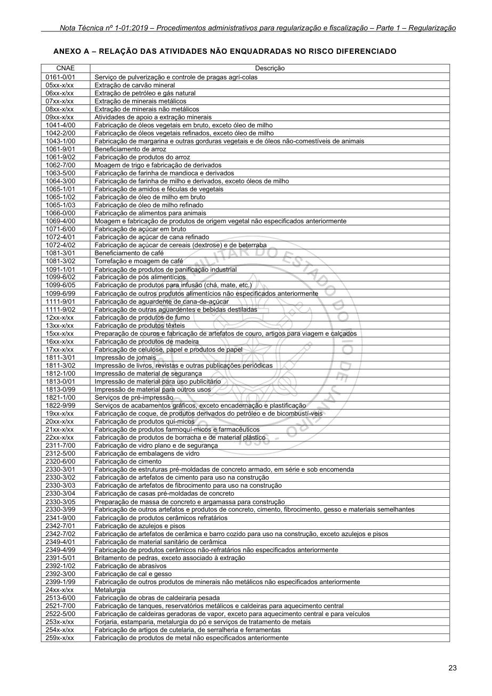
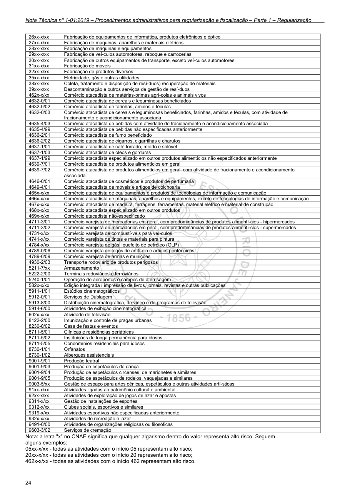

# NT 1-01 - Parte 1 - Procedimentos administrativos para regularização

> Conversão integral para consulta computacional. A numeração de página do PDF foi preservada. Quando houver tabela complexa, símbolo ou desenho, conferir também a representação visual indicada e o PDF oficial.

## Sumário por página

- [Página 1](#pagina-1)
- [Página 2](#pagina-2)
- [Página 3](#pagina-3)
- [Página 4](#pagina-4)
- [Página 5](#pagina-5)
- [Página 6](#pagina-6)
- [Página 7](#pagina-7)
- [Página 8](#pagina-8)
- [Página 9](#pagina-9)
- [Página 10](#pagina-10)
- [Página 11](#pagina-11)
- [Página 12](#pagina-12)
- [Página 13](#pagina-13)
- [Página 14](#pagina-14)
- [Página 15](#pagina-15)
- [Página 16](#pagina-16)
- [Página 17](#pagina-17)
- [Página 18](#pagina-18)
- [Página 19](#pagina-19)
- [Página 20](#pagina-20)
- [Página 21](#pagina-21)
- [Página 22](#pagina-22)
- [Página 23](#pagina-23)
- [Página 24](#pagina-24)
- [Página 25](#pagina-25)
- [Página 26](#pagina-26)

---

## Página 1

Aprovada pela Portaria CBMERJ nº 1071, de 27 de agosto de 2019 (DOERJ nº 167, de 04.09.2019).

Alterada pela Portaria CBMERJ nº 1109, de 20 de maio de 2020 (DOERJ nº 093, de 26.05.2020). Alterada pela Portaria CBMERJ nº 1167, de 02 de fevereiro de 2022 (DOERJ nº 023, de 04.02.2022). Alterada pela Portaria CBMERJ nº 1317, de 10 de dezembro de 2025 (DOERJ nº 229, de 12.12.2025).

### SUMÁRIO

### 1 OBJETIVO

### 2 APLICAÇÃO

### 3 REFERÊNCIAS NORMATIVAS E BIBLIOGRÁFICAS

### 4 DEFINIÇÕES E CONCEITOS

### 5 PROCEDIMENTOS ADMINISTRATIVOS PARA REGULARIZAÇÃO

### 6 PROCEDIMENTOS ADMINISTRATIVOS PARA O CADASTRAMENTO DE PROFISSIONAIS E PESSOAS JURÍDICAS

### ANEXOS

A - Relação das atividades não enquadradas no risco diferenciado

B - Relação de unidades de atendimento

### Tabelas extraídas

#### Tabela 1 da página

|  |  | NOTA |  |  | CBMERJ |  |
| --- | --- | --- | --- | --- | --- | --- |
|  |  | TÉCNICA |  |  | NT 1-01 |  |
|  | 1ª Edição 26 páginas Vigência: 04/09/2019 |  |  |  |  |  |
|  | Procedimentos administrativos para regularização e fiscalização - Parte 1 - Regularização |  |  |  |  |  |

---

## Página 2

Corpo de Bombeiros Militar do Estado do Rio de Janeiro CBMERJ Praça da República, nº 45, Centro, Rio de Janeiro - RJ. CEP: 20.211-350. www.cbmerj.rj.gov.br http://www.cbmerj.rj.gov.br/notas-tecnicas

---

## Página 3

### 1 OBJETIVO

1.1 Definir os procedimentos necessários para tramitação de processos de regularização de edificações ou áreas de risco, junto ao Corpo de Bombeiros Militar, no que tange às medidas de segurança contra incêndio e pânico, regulamentadas através do Decreto Estadual nº 42/2018 - Código de Segurança Contra Incêndio e Pânico do Estado do Rio de Janeiro (COSCIP).

1.2 Definir os procedimentos para tramitação de processos de regularização de edificações ou áreas de risco comprovadamente licenciadas para construção antes da vigência do Decreto Estadual nº 42/2018 - COSCIP estarão disóníveis na NT 1-05 - Edificações Anteriores.

1.3 Definir os procedimentos necessários para tramitação de processos de cadastramento de profissionais e pessoas jurídicas para realização de serviços relacionados à segurança contra incêndio e pânico.

1.4 Os procedimentos para tramitação de processos relacionados aos atos de fiscalização, realizados pelo Corpo de Bombeiros Militar do Estado do Rio de Janeiro (CBMERJ), estarão disponíveis na NT 1-01 - Procedimentos administrativos para regularização e fiscalização - Parte 2 - Fiscalização.

### 2 APLICAÇÃO

2.1 Esta Nota Técnica aplica-se aos processos de regularização junto ao CBMERJ, no que tange às medidas de segurança contra incêndio e pânico.

2.2 Esta Nota Técnica aplica-se aos processos de cadastramento de profissionais e pessoas jurídicas junto ao CBMERJ.

### 3 REFERÊNCIAS NORMATIVAS E BIBLIOGRÁFICAS

As normas e bibliografias abaixo contêm disposições que estão relacionadas com esta Nota Técnica:

a) Lei Estadual nº 4211, de 06 de novembro de 2003 - Estabelece a obrigatoriedade dos parques de diversões possuírem gerador reserva;

b) Lei Estadual nº 5390, de 19 de fevereiro de 2009 - Dispõe sobre a fabricação, comercialização, estocagem e queima de fogos de artifício no âmbito do Estado do Rio de Janeiro;

c) Decreto-Lei nº 247, de 21 de julho de 1975 - Dispõe sobre segurança contra incêndio e pânico no âmbito do Estado do Rio de Janeiro;

d) Decreto Federal nº 6795, de 16 de março de 2009 - Regulamenta o art. 23 da Lei nº 10.671, de 15 de maio de 2003, que dispõe sobre o controle das condições de segurança dos estádios desportivos;

e) Decreto Estadual nº 16695, de 12 de julho de 1991 - Transfere à Secretaria de Estado de Defesa Civil as atividades de controle e fiscalização das casas de

diversões e dá outras providências;

g) Decreto Estadual nº 42/2018 - Código de Segurança Contra Incêndio e Pânico do Estado do Rio de Janeiro (COSCIP);

h) Decreto Estadual nº 45970, de 31 de março de 2017 - cria o Documento de Autorização Temporária de Funcionamento - DATF;

i) Decreto Estadual nº 46216, de 01 de janeiro de 2018 - altera o artigo 1º do Decreto nº 45.970, de 31 de março de 2017;

j) Resolução SEDEC nº 142, de 15 de março de 1994- Baixa instruções complementares para execução do Código de Segurança Contra Incêndio e Pânico (COSCIP), dando nova redação à Portaria 002/78 e às Notas Técnicas, Normas Técnicas e Ordens de Serviço emitidas após a vigência do mesmo, até o ano de 1992;

k) Resolução SEDEC nº 169, de 28 de novembro de 1994 - Baixa instruções complementares para a apresentação de projetos de segurança contra incêndio e pânico na Diretoria Geral de Serviços Técnicos do Corpo de Bombeiros Militar do Estado do Rio de Janeiro;

l) Resolução SEDEC nº 278, de 21 de dezembro de 2004 - Define os locais de diversões públicas e estabelece que as atividades de coordenação, controle, fiscalização e vistoria das casas de diversões serão exercidas pela Diretoria de Diversões Públicas do Corpo de Bombeiros Militar do Estado do Rio de Janeiro;

m) Resolução SEDEC nº 31, de 10 de janeiro de 2013 - Dispõe sobre o credenciamento de empresas especializadas para realizar curso de formação, curso de atualização e habilitação de bombeiro civil (BC), de empresas especializadas para realizar curso de formação e atualização de brigadistas voluntários de incêndio (BVI), sobre o serviço de brigadas de incêndio e do credenciamento de empresas especializadas para prestação de serviço de bombeiro civil (BC) nas edificações, eventos e áreas de risco no Estado do Rio de Janeiro.

### 4 DEFINIÇÕES E CONCEITOS

Para efeito desta Nota Técnica aplicam-se, além das definições constantes no Decreto Estadual nº 42/2018 - COSCIP e na NT 1-02 - Terminologia de segurança contra incêndio e pânico, aplicam-se as definições específicas desta seção.

4.1 Área para exposição e promoção de produtos e serviços: pequenas estruturas destinadas ao atendimento ao cliente, com foco comercial na exposição e promoção de determinado produto ou serviço, sendo permitida a comercialização.

4.2 Atividade de diversões públicas: atividade de reunião de público, em locais fechados ou ao ar livre, com entrada paga ou não, destinados a entretenimento de qualquer natureza, recreio ou prática de esportes.

---

## Página 4

4.3 Atividade de reunião de público: atividade que envolve concentração de pessoas em um determinado local por um período de tempo. São exemplos de atividades de reunião de público: casas noturnas, boates, casas de festas, casas de espetáculo, restaurante com música ao vivo, espaço destinado à dança, lonas culturais, centro de convenções, teatros, cinemas, centros de exposição, circos, locais com auditório, templos religiosos, estádios de futebol, ginásios esportivos, arenas esportivas e congêneres.

4.4 Autorização para Evento (AE): documento que autoriza a realização de eventos de reunião de público.

4.5 Certificado de Aprovação (CA): documento que certifica que as edificações e áreas de risco estão regularizadas, após a comprovação do cumprimento das medidas de segurança contra incêndio e pânico exigidas.

4.6 Certificado de Aprovação Assistido: documento expedido pelo Corpo de Bombeiros Militar para um local quando um profissional técnico declara o cumprimento das medidas de segurança contra incêndio e pânico. A existência deste documento significa que a edificação ou área de risco está regularizada junto ao Corpo de Bombeiros Militar do Estado de Rio de Janeiro.

4.7 Certificado de Aprovação Simplificado: documento expedido pelo Corpo de Bombeiros Militar para um local quando o responsável legal se compromete com as informações fornecidas e informa que cumpriu as medidas de segurança contra incêndio e pânico. Este documento é emitido para locais com pequeno potencial de risco, classificados no risco diferenciado. Este documento reúne as medidas de segurança contra incêndio e pânico, os cuidados e restrições para o funcionamento do estabelecimento. Este documento significa que o imóvel, estabelecimento ou área de risco está regularizado no Corpo de Bombeiros Militar do Estado do Rio de Janeiro.

4.8 Certificado de Vistoria Anual (CVA): documento que certifica o cumprimento das medidas de segurança contra incêndio e pânico pelas edificações e áreas de risco com atividade de reunião de público, possuindo a validade de 1 (um) ano, a contar da data de emissão.

4.8 Certificado de Vistoria Anual (CVA): documento que certifica o cumprimento das medidas de segurança contra incêndio e pânico pelas edificações e áreas de risco com atividade de reunião de público, possuindo a validade de 1 (um) ano, a contar da data de emissão e que deve ser requerido ao CBMERJ pelo responsável técnico e o representante legal da edificação, que no ato se comprometem a atender às medidas de segurança e proteção dos riscos específicos atinentes à atividade, mediante a formalização de termos declaratórios e documentos de responsabilidade técnica emitidos pelos Conselhos profissionais. Cumpridas as formalidades processuais o CVA será emitido sem a obrigatoriedade de vistoria prévia da

edificação pelo Corpo de Bombeiros Militar do Estado do Rio de Janeiro. (Redação dada pela Portaria CBMERJ nº 1109, de 20/05/2020)

4.9 Cadastrado: profissional ou empresa que está registrado no Corpo de Bombeiros Militar para realizar serviços relacionados à segurança contra incêndio e pânico. São exemplos desses serviços: elaboração e tramitação de projeto de segurança contra incêndio e pânico, instalações ou manutenções em tubulações do sistema preventivo e hidrantes.

4.10 Documento de Autorização Temporária de Funcionamento (DATF): documento que autoriza, de forma temporária, especificamente as arenas e áreas comuns situadas no perímetro interno do Parque Olímpico na Barra da Tijuca e as instalações "modo legado" localizadas no bairro de Deodoro utilizada nos Jogos Olímpicos e Paralímpicos destinadas a abrigar eventos de reunião de público, sejam de natureza esportiva, de entretenimento musical, artístico, político ou religioso.

4.11 Eventos de reunião de público: eventos que envolvem a concentração de pessoas em um determinado local por um período de tempo, podendo ocorrer em locais abertos ou fechados.

4.12 Eventos em locais abertos: eventos realizados ao ar livre, podendo ocorrer em terrenos, praças ou áreas descobertas.

4.13 Eventos em locais fechados: eventos realizados em edificações, podendo ocorrer em centros de convenções, clubes, auditórios, entre outros edifícios.

4.14 Ficha de Avaliação de Risco em Eventos (FARE): documento preenchido pelo profissional de saúde responsável pelo atendimento médico no evento, no qual estão relacionadas as informações básicas do evento e descrição da estrutura de atendimento. Este documento necessita ser analisado pelo Corpo de Bombeiros Militar.

4.15 Laudo de Exigências: documento expedido pelo CBMERJ como resultado da análise e aprovação do Projeto de Segurança Contra Incêndio e Pânico, no qual constam as medidas de segurança contra incêndio e pânico projetadas para uma edificação, estabelecimento, área de risco ou agrupamento.

4.16 Laudo técnico circunstanciado: documento elaborado por profissional técnico com a descrição minuciosa do funcionamento e manutenção das estruturas, equipamentos e engenhos, atestando as condições de operacionalidade e de qualidade técnica de montagem e instalação dos mesmos.

4.17 Locais de baixo risco: locais considerados “pontos de referência” ou “domicílios fiscais”. Tratamse de imóveis residenciais (casa ou apartamento), sem atendimento ao público e sem estoque de mercadorias. Estes locais ficam dispensados de documentos.

4.18 Locais de diversões públicas: locais destinados

---

## Página 5

a entretenimento de qualquer natureza, recreio ou prática de esportes e que reúnam um determinado público. Estes locais podem ser fechados ou ao ar livre, com entrada paga ou não.

4.19 Estabelecimento comercial: parte de uma edificação destinada ao exercício de uma atividade comercial, com acesso direto ao logradouro ou através de galeria.

4.20 Parecer Técnico: ato administrativo opinativo que funciona como embasamento jurídico para procedimentos administrativos, que indicam e fundamentam soluções para determinado assunto não previsto pela legislação.

4.21 Pátio de armazenagem: área não coberta com a finalidade de estocar, de forma provisória ou não, produtos manufaturados de origem comercial ou industrial, produtos relacionados às atividades agrícolas, de extrativismo vegetal ou mineral, assim como materiais, tubulações, aparelhos, equipamentos, veículos ou containers. Pode ser isolado ou complementar uma edificação, servindo de área de armazenamento para edificação.

4.22 Produtos perigosos: substâncias químicas com potencial lesivo à saúde humana e ao meio ambiente.

4.23 Quadro resumo: tabela que reúne, de forma sintética, as principais informações do projeto, tais como: características arquitetônicas, medidas de segurança e riscos específicos.

4.24 Responsável legal: pessoa responsável pela edificação ou área de risco ou evento. Trata-se do proprietário, síndico, administrador, locatário (no caso de local alugado) ou cessionário (no caso de cessão de um espaço). No caso de pessoa jurídica, um dos sócios poderá representar a empresa. A pessoa, física ou jurídica, poderá ser representada por terceiros, desde que haja uma procuração outorgando tal competência.

4.25 Reunião de público: trata-se da expressão relacionada à concentração de pessoas em um determinado local por um período de tempo. São exemplos de locais de reunião de público: templos religiosos, auditórios, centros de convenção, boates, cinemas, teatros, entre outros similares.

4.26 Risco diferenciado: enquadramento de risco relativo a edificações e estabelecimentos cujas características e atividades econômicas desenvolvidas apresentam menor vulnerabilidade e menor grau de perigo à integridade física de pessoas, ao meio ambiente ou ao patrimônio, ensejando a regularização por meio de procedimento simplificado, sendo autodeclatório e não havendo necessidade de profissional técnico.

4.27 Sala comercial: parte de uma edificação, destinada ao exercício de atividades comerciais, de negócios ou de profissionais liberais, geralmente abrindo para circulações internas do edifício.

### 5 PROCEDIMENTOS ADMINISTRATIVOS PARA REGULARIZAÇÃO

5.1 Informações preliminares

5.1.1 Um imóvel ou área de risco será considerado regularizado no Corpo de Bombeiros Militar do Estado do Rio de Janeiro (CBMERJ), quando possuir o Certificado de Aprovação (CA), o Certificado de Aprovação Simplificado (CAS) ou o Certificado de Aprovação Assistido (CAA).

5.1.2 Os Certificados de Aprovação e os Certificados de Aprovação Assistidos permanecem válidos por cinco anos, a contar da data de emissão. Antes de expirar o prazo, o proprietário ou o responsável legal deverá solicitar um novo Certificado de Aprovação.

5.1.3 O local possuidor de CA, CAS ou CAA, mesmo que esteja dentro do prazo de validade, que passar por mudanças das características arquitetônicas, de tipo de ocupação ou de responsável legal, precisará iniciar um novo processo de regularização.

5.1.4 Os locais de baixo risco são dispensados de documentos de regularização do CBMERJ. As empresas consideradas “pontos de referência”, ou seja, que funcionam em imóvel residencial (casa ou apartamento), não realizam atendimento ao público e nem possuem estoque de mercadorias ficam dispensadas de documentos. O empresário sabe que foi dispensado de documento ao concluir o registro da empresa no órgão de registro (Junta Comercial ou Registro Civil de Pessoa Jurídica). A resposta é enviada automaticamente pelo sistema do Corpo de Bombeiros, sem necessidade de abrir uma solicitação ou preencher um requerimento.

5.1.5 As edificações e áreas de risco com atividades de reunião de público enquadradas nas divisões F-3, F-5, F-6 e F-11 precisarão ser vistoriadas anualmente. Sendo assim, antes do Certificado de Aprovação completar um ano, o proprietário ou o responsável legal deverá solicitar um novo Certificado de Vistoria Anual. Para mais detalhes, ver a Seção 5.6.

5.1.5 As edificações e áreas de risco com atividades de reunião de público enquadradas nas divisões F-3, F-5, F-6 e F-11 precisarão refazer anualmente os procedimentos de manutenção, de modo a manter o pleno funcionamento dos equipamentos preventivos e as condições de saídas de emergência. Sendo assim, antes do Certificado de Aprovação completar um ano, o proprietário ou o responsável legal deverá solicitar um novo Certificado de Vistoria Anual. Para mais detalhes, ver a Seção 5.6. (Redação dada pela Portaria CBMERJ nº 1109, de 20/05/2020)

5.1.6 Em relação à tramitação de processos, os locais com menor potencial de risco e enquadrados no risco diferenciado, poderão utilizar o procedimento simplificado para se regularizar junto ao CBMERJ. Neste caso, será aberto apenas um processo e o seu andamento ocorrerá de forma totalmente virtual. Ao

---

## Página 6

concluir o passo a passo, será disponibilizado o CAS. Para mais detalhes, ver a Seção 5.2.

5.1.7 Para os locais não enquadrados nos parâmetros do procedimento simplificado, o solicitante precisará apresentar Projeto de Segurança Contra Incêndio e Pânico. Após aprovação do projeto, com a expedição do Laudo de Exigências, o requerente necessitará solicitar a emissão do Certificado de Aprovação. Portanto, o licenciamento ocorrerá em duas fases. Para mais detalhes, ver as Seções 5.3, 5.4 e 5.5.

5.1.8 No momento da solicitação do Certificado de Aprovação, um profissional técnico irá se responsabilizar pela edificação ou área de risco. O responsável legal se compromete em manter os dispositivos preventivos em boas condições de uso e dentro do prazo de validade. Para mais detalhes, ver Seção 5.5.

5.1.9 O administrador das edificações, que possuam quiosques (C-4) ou áreas de exposição e promoção de produtos, deverá aprovar o layout com a designação de todos os espaços pretendidos. Para tal, deverá ser apresentado um Projeto de Segurança Contra Incêndio e Pânico, o qual ao ser deferido, resultará na expedição de Certificado de Despacho Deferido. Para mais detalhes, ver as Seções 5.3 e 5.4.

5.1.10 Nos casos específicos de site de antena de telefonia ou rádio (M-3), deverá ser apresentado Projeto de Segurança Contra Incêndio e Pânico, o qual ao ser deferido, resultará na emissão do Certificado de Despacho Deferido, sendo este o documento final de regularização no CBMERJ. Para mais detalhes ver a Seção 5.4.

5.1.11 No caso de estruturas ou eventos temporários de reunião de público, em locais abertos (ao ar livre) ou fechados, sob a administração pública ou privada, com entrada paga ou não, com implantação de equipamentos ou montagem de estruturas provisórias ou cenográficas, o responsável pelo evento deverá solicitar previamente Autorização do CBMERJ para realização do evento. Para mais detalhes, ver as Seções 5.8 e 5.9.

5.1.12 Os eventos privados realizados em imóveis residenciais, que não caracterizem prática de atividade econômica, ficam isentos de autorização do CBMERJ, desde que mantida a destinação residencial privativa e atendidas às medidas de segurança contra incêndio e pânico exigidas para o imóvel.

5.1.13 No caso de estruturas ou eventos temporários de reunião de público com estimativa de público igual ou superior a 1.000 pessoas, antes de solicitar a Autorização para o mesmo, será necessário que o médico responsável técnico, durante o evento, solicite ao CBMERJ a análise da Ficha de Avaliação de Risco em Eventos (FARE). Feita a análise e emitido o deferimento pelo CBMERJ, o médico responsável técnico pelo atendimento deverá emitir o Certificado de Anotação de Responsabilidade Técnica (CART). Para

mais detalhes, ver a Seção 5.12.

5.1.14 No caso de evento em local fechado, será necessário que a edificação esteja regularizada no CBMERJ.

5.1.15 Quando for solicitada a apresentação de Anotação de Responsabilidade Técnica (ART) ou do Registro de Responsabilidade Técnica (RRT), emitido pelo CREA-RJ ou CAU-RJ respectivamente, os mesmos deverão estar devidamente assinados pelo contratado e pelo contratante. Além disso, somente serão aceitas as vias definitivas das ARTs ou RRTs emitidas após a realização do pagamento das mesmas.

5.1.16 É dever do responsável legal da edificação ou área de risco manter o local em boas condições de segurança contra incêndio e pânico.

5.2 Procedimento simplificado

5.2.1 É o procedimento de regularização para edificações ou áreas de risco enquadradas no risco diferenciado, ou seja, locais com pequeno potencial de risco. A tramitação ocorre de forma não presencial e por meio de autodeclarações do responsável legal da empresa que ocupa o espaço.

5.2.2 Enquadram-se no procedimento simplificado as empresas situadas em edificações ou áreas de risco que atendam a todos os seguintes critérios:

a) possuir área total construída (ATC) até 900 m²;

b) possuir até 02 pavimentos, sendo que o(s) mezanino(s) ou jirau(s) será(ão) computado(s) como pavimento(s);

c) não realizar atividade de reunião de público, seja como atividade principal, secundária ou temporária;

d) não realizar atividade de posto de abastecimento de líquidos inflamáveis, combustíveis e/ou gás natural veicular (GNV);

e) comercializar, armazenar ou manipular até 200 l de líquidos inflamáveis e/ou combustíveis;

f) caso possua instalação de gás liquefeito de petróleo (GLP), utilizar apenas 02 botijões de 13 Kg de GLP, sendo 01 botijão instalado e o outro de reserva ou utilizar uma central de GLP com, no máximo, 02 cilindros de GLP de 45 Kg. Nos dois casos, os cilindros ou botijões deverão estar abrigados no pavimento térreo, no exterior da edificação (fora da projeção da edificação) e em local ventilado;

g) não comercializar ou armazenar gás liquefeito de petróleo (GLP) e não utilizar qualquer outro tipo de gás inflamável;

h) não comercializar, armazenar ou manipular materiais perigosos, pirotécnicos, munições ou explosivos;

i) salas comerciais que possuem canalização de chuveiros automáticos do tipo Sprinkler e que não sofreram qualquer tipo de modificação da canalização de chuveiros automáticos ou do leiaute interno, seja

---

## Página 7

com paredes internas, divisórias com mais de 1,60 m ou armários com altura superior a 1,60 m;

j) Quiosques (C-4) ou áreas de exposição e promoção de produtos.

5.2.3 Não se enquadram as salas comerciais que não possuem chuveiros automáticos do tipo Sprinkler, mas que estão situados em edifícios com 10 ou mais pavimentos.

5.2.4 Não se enquadram as lojas comerciais que possuem canalização de chuveiros automáticos do tipo Sprinkler.

5.2.5 Não se enquadram as lojas comerciais localizadas em edifícios que possuam exigência de canalização de chuveiros automáticos do tipo Sprinkler.

5.2.6 Não se enquadram os túneis rodoviários ou ferroviários.

5.2.7 No caso de lojas ou salas comerciais, é necessário que o prédio possua o Certificado de Aprovação.

5.2.8 No caso da utilização de central de GLP, deverá atender às instruções previstas na NT 3-02 - Gás (GLP/GN) - Uso predial.

5.2.9 A atividade econômica desenvolvida no imóvel ou estabelecimento não poderá estar elencada na relação das atividades não enquadradas no risco diferenciado, conforme Anexo A da presente Nota Técnica.

5.2.10 O procedimento simplificado começa com o preenchimento do formulário do Corpo de Bombeiros Militar, de forma online, durante a abertura ou modificação da empresa no sistema de registro de empresas, utilizado pela Junta Comercial do Estado do Rio de Janeiro (JUCERJA) e pelo Registro Civil de Pessoas Jurídicas (RCPJ).

5.2.11 Caso a empresa já possua cadastro comercial, poderá solicitar sua regularização junto ao Corpo de Bombeiros Militar no sistema de registro de empresas. Na própria interface do sistema de registro de empresas, o usuário será direcionado para o preenchimento do formulário do Corpo de Bombeiros Militar.

5.2.12 Após o preenchimento do formulário do Corpo de Bombeiros Militar e conclusão da viabilidade no sistema de registro de empresas, o CBMERJ informará ao usuário, de forma online, se a empresa foi ou não enquadrada no procedimento simplificado.

5.2.13 Após a tramitação no orgão de registro (JUCERJA ou RCPJ), caso a empresa tenha sido enquadrada no procedimento simplificado, será automaticamente aberto o processo simplificado de regularização.

5.2.14 Ao acessar a interface do processo simplificado, o usuário deverá:

a) imprimir a guia de emolumentos, disponível no

sistema, e realizar o pagamento da mesma;

b) após a constatação do pagamento do emolumento, imprimir o Termo de Responsabilidade, que deverá ser assinado pelo sócio, administrador ou responsável legal da empresa. Este termo deverá ser mantido no local onde a empresa funciona;

c) autodeclarar que cumpriu as exigências;

d) por último, imprimir o Certificado de Aprovação Simplificado, que estará disponível no sistema. Este Certificado deverá estar fixado em local visível onde funciona a empresa.

5.2.15 No caso de Microempreendedor Individual (MEI) optante pelo regime tributário denominado “Simples Nacional”, não será necessário realizar o pagamento de emolumento para regularização da empresa.

5.3 Análise de Projeto de Segurança Contra Incêndio e Pânico

5.3.1 Consiste na avaliação das medidas de segurança e riscos específicos referentes à edificação ou área de risco, com base no Projeto de Segurança Contra Incêndio e Pânico, elaborado por profissional técnico, contratado pelo responsável legal.

5.3.2 Quando não se enquadrar no procedimento simplificado, é dever do responsável legal pela edificação ou área de risco apresentar o Projeto de Segurança Contra Incêndio e Pânico para avaliação do CBMERJ.

5.3.3 Ao elaborar o Projeto de Segurança Contra Incêndio e Pânico, o profissional técnico deverá observar as medidas de segurança previstas para edificação ou área de risco em estudo, devendo se basear no Decreto Estadual nº 42/2018 - COSCIP.

5.3.4 Caso o profissional técnico adote outras medidas de segurança contra incêndio e pânico, além das previstas no Decreto Estadual nº 42/2018 - COSCIP, elas não serão objeto de análise por parte do CBMERJ.

5.3.5 Os símbolos gráficos presentes no Projeto de Segurança Contra Incêndio e Pânico deverão estar de acordo com a NT 1-03 - Símbolos gráficos para projetos de segurança contra incêndio e pânico.

5.3.6 Para definição da classificação das edificações quanto ao risco, deverá ser atendido o previsto na NT 1-04 - Classificação das edificações quanto ao risco de incêndio.

5.3.7 Na apresentação do Projeto de Segurança Contra Incêndio e Pânico, o requerente deverá:

a) apresentar requerimento eletrônico impresso e assinado pelo requerente;

b) recolher emolumento, com código de receita nº 101 ou 102, dependendo da área total construída, com o comprovante de pagamento;

c) apresentar cópia da identidade do responsável legal pela edificação ou área de risco que assina as plantas;

---

## Página 8

d) apresentar cópia do título de propriedade (RGI, ônus reais, contrato de locação ou similar);

e) apresentar cópia do contrato social, estatuto ou documento similiar, no caso de pessoa jurídica;

f) apresentar memorial descritivo do projeto;

g) apresentar cópia da Anotação de Responsabilidade Técnica (ART) ou Registro de Responsabilidade Técnica (RRT) referente ao projeto, assinada pelo contratante e pelo profissional contratado;

h) compor o Projeto de Segurança Contra Incêndio e Pânico com planta de situação, plantas baixas, cortes, telhado, isométrico e fachada. Na planta de situação, ou prancha 01, deverá estar impresso o Quadro Resumo. O modelo do Quadro Resumo está disponível no Portal do Requerente. No caso de lojas ou salas comerciais, dispensa-se a apresentação de planta de situação, de telhado e de fachada.

5.3.8 Na elaboração do Projeto de Segurança Contra Incêndio e Pânico, o elaborador do projeto deverá atentar também para:

a) no caso de cozinhas em edificações classificadas nas divisões A-1, A-2, A-4, A-5 e A-6 (exceto na área comercial) não será necessário apresentar projeto específico de exaustão mecânica. Nos demais casos, deverá representar a exaustão mecânica, seguindo as instruções previstas na NT 3-01 - Cozinha profissional;

b) no caso da edificação possuir exigência de plano de emergência, deverá ser indicado no quadro resumo, atendendo a NT 2-10 - Plano de emergência contra incêndio e pânico;

c) no caso de grupo motogerador, representar em planta o tanque de líquido inflamável ou combustível e o motogerador, devendo indicar as características no Quadro Resumo. Deverá, ainda, adotar as instruções previstas na NT 3-03 - Motogeradores de energia em edificações e áreas de risco;

d) no caso de controle de fumaça, atender à NT 2-14 - Controle de fumaça;

e) no caso de tanque aéreo de armazenamento de líquido combustível ou inflamável, indicar as características no Quadro Resumo. Na planta baixa, deverá representar o posicionamento, a capacidade individual, o nome do líquido armazenado, o diâmetro e altura do tanque. Representar também o dique de contenção e o volume previsto. Os hidrantes dotados de líquido gerador de espuma (LGE) deverão ser indicados. O volume disponível de LGE deverá estar mencionado no Quadro Resumo. No caso de mais de um tanque, representar um quadro dos tanques, contendo os volumes individuais e o nome do líquido. Além dessas medidas, deverá adotar as instruções previstas na NT 3-06 - Armazenagem de líquidos inflamáveis e combustíveis;

f) no caso de tanque de armazenamento de líquido combustível ou inflamável enterrado ou de superfície

coberto por aterro, representar suas características no Quadro Resumo. Na planta baixa, deverá representar o posicionamento, a capacidade individual e o nome do líquido armazenado no tanque. Além dessas medidas, deverá adotar as instruções previstas na NT 3-06 - Armazenagem de líquidos inflamáveis e combustíveis;

g) no caso de depósito de munições, materiais explosivos ou pirotécnicos, no Quadro Resumo deverá constar a descrição dos locais onde serão armazenados os referidos materiais, as quantidades armazenadas, a forma de armazenamento e o tipo de acondicionamento. Incluir planta de localização com a representação das edificações, rodovias, ferrovias e outros depósitos. Incluir nota na planta de localização, na qual o responsável legal pela edificação se compromete com os afastamentos mínimos em relação às outras edificações. Acrescentar o memorial descritivo do material armazenado. Além disso, deverá atender às instruções previstas na NT 4-04 - Munições, explosivos e artefatos pirotécnicos - Fabricação, armazenagem e comércio;

h) no caso de edificação com previsão de instalação de quiosque(s) e/ou área(s) para exposição e promoção de produtos e serviços, representar nas plantas baixas dos pavimentos a localização das áreas destinadas à instalação destas estruturas, com a numeração ou identificação dos espaços, devendo atender às instruções previstas na NT 4-01 - Quiosques e áreas para exposição ou venda de produtos e serviços;

i) no caso da edificação não ser abastecida por gás combustível (gás natural ou gás liquefeito de petróleo - GLP), deverá indicar esta informação no Quadro Resumo. No caso da edificação ser abastecida por gás natural ou GLP, deverá indicar esta informação no Quadro Resumo. No caso de GLP, representar em planta a localização e os componentes da central de GLP, seguindo as instruções previstas na NT 3-02 - Gás (GLP/GN) - Uso predial;

j) no caso de edificação que utiliza ou armazena outro tipo de gás, ou seja, diferente do gás natural ou GLP, representar em planta o local onde são armazenados os cilindros, identificar as quantidades individuais por cilindro e o produto que está sendo armazenado. Neste caso, anexar ficha de informação de segurança para produtos químicos. Na ausência de nota técnica específica, seguir as instruções previstas em normas vigentes;

k) quando for previsto sistema de proteção contra descargas atmosféricas, atender às instruções previstas na NT 2-12 - Sistema de proteção contra descargas atmosféricas (SPDA).

5.3.9 Deverão ser apresentadas duas vias do Projeto de Segurança Contra Incêndio e Pânico impressas e devidamente assinadas.

5.3.10 O Projeto de Segurança Contra Incêndio e Pânico precisará ser assinado pelo:

---

## Página 9

a) responsável legal pela edificação ou área de risco;

b) profissional que realizou o levantamento arquitetônico, autor do projeto arquitetônico ou profissional responsável pela execução da obra;

c) profissional elaborador do projeto, será o responsável pelo dimensionamento das medidas de segurança contra incêndio e pânico.

5.3.11 Nos casos de Projeto de Segurança Contra Incêndio e Pânico contendo hidrantes, magotinhos, chuveiros automáticos ou controle de fumaça, o profissional elaborador deverá estar cadastrado no CBMERJ como autônomo ou como responsável técnico de empresa de projeto ou instaladora.

5.3.11 Nos casos de Projeto de Segurança Contra Incêndio e Pânico contendo hidrantes, mangotinhos, chuveiros automáticos ou controle de fumaça, o profissional elaborador deverá estar cadastrado no CBMERJ como profissional autônomo, empresa de projeto ou empresa instaladora. (Redação dada pela Portaria CBMERJ nº 1317, de 10/12/2025)

5.3.12 Os profissionais técnicos precisarão carimbar as plantas assinadas, informando o seu nome completo, número de registro profissional e órgão de registro. No caso de profissional cadastrado no CBMERJ, o carimbo deverá contemplar o número de registro no CBMERJ. Quando o profissional estiver assinando na condição de responsável técnico por empresa cadastrada no CBMERJ, deverá também constar na(s) prancha(s) o nome da empresa e o número de registro.

5.3.13 O memorial descritivo deverá ser composto pelo quadro de dispositivos preventivos, memória de cálculo do(s) sistema(s) preventivo(s) fixo(s) e resumo do funcionamento dos dispositivos.

5.3.14 Após a entrada do processo, o requerente ou o profissional técnico contratado deverá realizar o upload do Quadro Resumo. Este deverá estar no formato pdf (Portable Document Format) e ser assinado pelo profissional responsável pelo Projeto de Segurança Contra Incêndio e Pânico. Para realizar o upload, o requerente ou profissional técnico contratado utilizará o Portal do Requerente.

5.3.15 Para saber o local de tramitação, basta pesquisar a Unidade do Corpo de Bombeiros mais próxima da edificação ou área de risco. A ferramenta de busca está na disponível na página da DGST, na aba “Atendimento”. Além disso, a lista das Unidades está disponível no Anexo B.

5.4 Apresentação de projeto de segurança contra incêndio e pânico - casos específicos

5.4.1 Para postos de combustíveis, além dos itens da Seção 5.3, o autor do projeto deverá atentar para o seguinte:

a) na planta de situação, deverá constar o Quadro Resumo com a descrição das áreas, separando a cobertura de bombas. Mencionar o cálculo de taxa de

ocupação. Indicar no Quadro Resumo o volume individual dos tanques, o tipo de combustível e/ou inflamável armazenado e o somatório total armazenado;

b) na planta baixa, representar a localização dos tanques e das bombas de abastecimento;

c) deverá atender as instruções previstas na NT 4-06 - Postos de serviços e abastecimento de veículos.

5.4.2 Para postos de combustíveis com gás natural veicular (GNV), além dos itens descritos na Seção 5.3, o elaborador do projeto deverá atentar para o seguinte:

a) na planta de situação deverá constar o Quadro Resumo com a descrição das áreas, separando a cobertura de bombas. Mencionar o cálculo de taxa de ocupação. Indicar no Quadro Resumo o volume individual dos tanques, o tipo de combustível e/ou inflamável armazenado, o somatório total de combustíveis líquidos armazenados, a quantidade de cilindros de armazenamento de gás natural e a capacidade individual dos mesmos;

b) na planta baixa, representar a localização dos tanques, das bombas de abastecimento, dos cilindros de gás natural, do compressor, da botoeira de emergência e das paredes resistentes ao fogo;

c) atender às instruções previstas na NT 2-19 - Segurança estrutural nas edificações - Resistência ao fogo dos elementos de construção;

d) atender as instruções previstas na NT 4-06 - Postos de serviços e abastecimento de veículos.

5.4.3 Para postos de venda ou depósitos de gás liquefeito de petróleo (GLP), além dos itens descritos na Seção 5.3, o elaborador do projeto deverá atentar para o seguinte:

a) na planta de situação, deverá constar, no Quadro Resumo, a quantidade de cilindros cheios e vazios;

b) na planta baixa, representar o leiaute de armazenamento dos botijões cheios e vazios, quantidade de botijões armazenados em cada ilha e os tipos de botijões. Caso existam paredes resistentes ao fogo, deverá indicar em planta quais as paredes com este tipo de resistência;

c) apresentar original e cópia simples ou cópia autenticada de certidão de zoneamento, informando que após consulta à lei de zoneamento, a Prefeitura permite a atividade de ponto de venda ou depósito de GLP no local. A certidão em formato digital também será aceita, desde que possua consulta de veracidade através de página da internet. A viabilidade aprovada pela Prefeitura também poderá substituir a certidão de zoneamento;

d) não serão aceitas cozinhas neste tipo de edificação;

e) no caso de paredes resistentes ao fogo, deverá atender às instruções previstas na NT 2-19 - Segurança estrutural nas edificações - Resistência ao

---

## Página 10

fogo dos elementos de construção;

f) deverá atender as instruções previstas na NT 4-05 - Gás (GLP/GN) - Manipulação, armazenamento e comercialização.

5.4.4 Para depósitos de munições, explosivos ou pirotécnicos, além dos itens descritos na Seção 5.3, o elaborador do projeto deverá atentar para o seguinte:

a) na planta de situação, deverá constar no Quadro Resumo, a descrição dos locais onde serão armazenados os materiais explosivos ou pirotécnicos e as munições, descrição das quantidades armazenadas, a forma de armazenagem e o tipo de acondicionamento do material;

b) apresentar planta de localização com a representação das edificações ao redor, rodovias, ferrovias ou outros depósitos;

c) firmar termo de responsabilidade, se comprometendo com os afastamentos mínimos em relação a outras edificações;

d) memorial descritivo do material armazenado;

e) Título de Registro, expedido pelo Exército Brasileiro, nos casos de munições ou materiais pirotécnicos;

f) original mais cópia simples ou cópia autenticada de certidão de zoneamento, informando que após consulta à lei de zoneamento, a Prefeitura permite a atividade de depósito de munições, explosivos ou munições no local. A certidão em formato digital também será aceita, desde que possua consulta de veracidade através de página da internet. A viabilidade aprovada pela Prefeitura também poderá substituir a certidão de zoneamento e neste caso não precisará ser autenticada ou assinada;

g) deverá atender as instruções previstas na NT 4-04 - Munições, explosivos e artefatos pirotécnicos - Fabricação, armazenagem e comércio.

5.4.5 Para pátio de armazenagem, além dos itens descritos na Seção 5.3, o elaborador do projeto deverá atentar para o seguinte:

a) na planta de situação, deverá constar no Quadro Resumo, a descrição do tipo de armazenamento (container, pilha compacta ou outros), altura de armazenamento e os materiais armazenados;

b) representar em planta as vistas frontais, indicando a altura de armazenamento dos materiais;

c) emitir memorial descritivo do(s) material(is) armazenado(s);

d) no caso de materiais químicos ou perigosos, deverá apresentar a(s) Ficha(s) Técnica(s) do(s) produto(s);

e) deverá atender às instruções previstas na NT 4-08 - Pátios para armazenagens diversas.

5.4.6 Para Site para antena de telefonia, além dos itens descritos na Seção 5.3, o responsável técnico

deverá atentar para os seguintes pontos:

a) cópia da ART ou RRT, emitida pelo CREA-RJ ou CAU-RJ, referente à montagem da antena;

b) cópia da ART ou RRT, emitida pelo CREA-RJ ou CAU-RJ, referente à instalação elétrica e à proteção contra descargas atmosféricas da antena;

c) cópia da ART ou RRT, emitida pelo CREA-RJ ou CAU-RJ, referente ao projeto;

d) no corte, deverão ser representados os componentes do sistema de proteção contra descargas atmosféricas, assim como o material das cordoalhas de descida e os respectivos diâmetros;

e) deverá atender às instruções previstas na NT 2-12 - Sistema de proteção contra descargas atmosféricas (SPDA).

5.4.7 Para túneis rodoviários ou ferroviários, além dos itens descritos na Seção 5.3, o responsável técnico deverá atentar para o seguinte:

a) Incluir, na planta de situação ou prancha 01, nota com a indicação da extensão total do túnel e com a extensão coberta do mesmo;

b) Deverá atender às instruções previstas na NT 4-09 - Túneis.

5.4.8 Para aprovação de layout de quiosque ou áreas de exposição e promoção de produtos e serviços no interior de edificações, além dos itens descritos na Seção 5.3, o responsável técnico deverá atentar para o seguinte:

5.4.8.1 O projeto com o leiaute trazendo a distribuição dos quiosques e áreas de exposição poderá ser apresentado no mesmo momento da análise do projeto de toda edificação. No entanto, caso a edificação já esteja regularizada no CBMERJ, poderá apresentar somente o projeto com a distribuição dos quiosques e áreas de exposição, complementando o projeto aprovado anteriormente.

5.4.8.2 No projeto contemplando a distribuição dos locais previstos para instalação de quiosques ou áreas para exposição, deverão ser representados os respectivos lugares, com as referências numéricas ou identificações das áreas, devendo atender às instruções previstas na NT 4-01 - Quiosques e áreas para exposição ou venda de produtos e serviços.

5.4.9 Para quiosques ou áreas para exposição e promoção de produtos e serviços no interior de edificações, além dos itens descritos na Seção 5.3, o responsável técnico deverá atentar para o seguinte:

5.4.9.1 Em geral, os quiosques ou áreas de exposição e promoção poderão ser regularizados pelo procedimento simplificado, não sendo necessário apresentar projeto.

5.4.9.2 Caso o quiosque ou área de exposição ou promoção não tenha sido enquadrado no procedimento

---

## Página 11

simplificado e necessite apresentar projeto específico, deverá:

a) Representar na Planta baixa do pavimento do edifício ou shopping o local onde estará situado o quiosque, de maneira que se permita identificar a largura do corredor com a instalação do quiosque. Além disso, será necessário apresentar a planta baixa do quiosque;

b) Na prancha 01, deverá constar o Quadro Resumo e se o quiosque utiliza gás combustível.

5.4.9.3 No caso específico de quiosque no interior de um edifício ou shopping, sendo deferida a solicitação através da análise de projeto, o CBMERJ emitirá um Certificado de Despacho Deferido. Neste caso, não será necessário solicitar o Certificado de Aprovação para o quiosque.

5.4.9.4 Deverá, ainda, atender às instruções previstas na NT 4-01 - Quiosques e áreas para exposição ou venda de produtos e serviços.

5.5 Emissão de Certificado de Aprovação

5.5.1 O requerente deve solicitar o Certificado de Aprovação, após o cumprimento das medidas de segurança contra incêndio e pânico. Um pré-requisito para solicitar o Certificado de Aprovação é possuir o Projeto de Segurança Contra Incêndio e Pânico aprovado pelo CBMERJ, com a expedição do Laudo de Exigências.

5.5.2 Toda solicitação de Certificado de Aprovação ocorrerá através do procedimento assistido. Neste procedimento o representante pela edificação ou área de risco será acompanhado por engenheiro ou arquiteto devidamente habilitado e registrado no CREA ou CAU, respectivamente. Este profissional será identificado por responsável técnico. O responsável técnico e o representante legal se comprometem pelo atendimento das medidas de segurança e proteção dos riscos específicos atínentes à edificação ou área de risco.

5.5.3 Após a emissão do Laudo de Exigências, o requerente necessita solicitar o Certificado de Aprovação. Somente o Laudo de Exigências não significa que a edificação está regularizada no CBMERJ.

5.5.4 No caso site para antena de telefonia, estes serão regularizados por meio de Certificado de Despacho Deferido, conforme Seção 5.4.

5.5.5 Os locais enquadradados nas divisões F-3, F-5, F-6 e F-11 que já possuem o Certificado de Aprovação, precisarão solicitar o Certificado de Vistoria Anual, antes do Certificado de Aprovação completar um ano. Para mais detalhes sobre o Certificado de Vistoria Anual, ver a Seção 5.6 desta Nota Técnica.

5.5.6 Os locais enquadrados nas divisões F-3, F-5, F-6 e F-11 que já possuem o Certificado de Registro, precisarão solicitar o Certificado de Vistoria Anual,

antes do Certificado de Registro completar um ano. Nestes casos, o Certificado de Registro será substítuído pelo Certificado de Vistoria Anual. Para mais detalhes, sobre esta solicitação, ver a Seção 5.6 desta Nota Técnica.

5.5.7 Para solicitação de Certificado de Aprovação, o requerente deverá atentar para os itens descritos a seguir:

a) requerimento eletrônico impresso e assinado pelo solicitante;

b) emolumento, com código de receita nº 116, com o comprovante de pagamento;

c) cópia da identidade do responsável legal da edificação ou área de risco;

d) cópia do título de propriedade (RGI, ônus reais, contrato de locação ou similar);

e) cópia do contrato social, estatuto ou documento similiar, no caso de pessoa jurídica;

f) disponibilizar, no local a ser vistoriado, o projeto aprovado pelo CBMERJ;

g) Declaração do Responsável Legal;

h) Declaração do Responsável Técnico;

i) cópia da ART ou RRT, emitida pelo CREA-RJ ou CAU-RJ, referente à instalação, inspeção ou manutenção dos dispositivos preventivos;

j) No caso da edificação ou área de risco possuir dispositivo preventivo fixo, deverá apresentar Laudo Técnico Circunstaciado (com fotos);

k) no caso de loja, sala ou parte de uma edificação, deverá informar o número do Laudo de Exigências e o número do Certificado de Aprovação do prédio;

l) cópia da(s) nota(s) fiscal(is) dos dispositivos preventivos (extintores, mangueiras, esguichos, portas corta-fogo (PCF), chuveiros automáticos do tipo sprinkler e etc.) referentes à aquisição, inspeção ou manutenção dos dispositivos. Todos os dispositivos deverão possuir selo do Instituto Nacional de Metrologia, Qualidade e Tecnologia (INMETRO) e/ou marca de conformidade da Associação Brasileira de Normas Técnicas (ABNT). Serão aceitos dispositivos com a certificação internacional, desde que os laboratórios sejam acreditados pelo INMETRO;

m) no caso da edificação utilizar gás natural, deverá apresentar a cópia da(s) ART(s) ou RRT(s), emitida(s) pelo CREA-RJ ou CAU-RJ, referente à execução, inspeção ou manutenção da rede de distribuição interna de gás combustível e referente ao ensaio de estanqueidade da instalação interna, ambas conforme a NBR 15.526 ou NBR 15.358;

n) no caso da edificação utilizar gás do tipo GLP, deverá apresentar a cópia da ART ou RRT, emitida pelo CREA-RJ ou CAU-RJ, referente à execução, inspeção ou manutenção da central de GLP, conforme NT 3-02 -

---

## Página 12

Gás (GLP/GN) - Uso predial e NBR 13.523. Considerando a rede de distribuição interna, apresentar ART ou RRT, emitida pelo CREA-RJ ou CAU-RJ, referente à execução, inspeção ou manutenção e ensaio de estanqueidade, conforme NBR 15.526 ou NBR 15.358. No caso de parede resistente ao fogo, apresentar ART ou RRT, emitida pelo CREARJ ou CAU-RJ, referente à construção, inspeção ou manutenção das estruturas com resistência ao fogo, de no mínimo, 02 horas (TRRF mínimo de duas horas), conforme NT 2-19 - Segurança estrutural nas edificações - Resistência ao fogo dos elementos de construção;

o) no caso de coifa de exaustão, cópia da ART ou RRT, emitida pelo CREA-RJ ou CAU-RJ, referente à instalação e/ou manutenção, atendendo as instruções previstas na NT 3-01 - Cozinha profissional;

p) no caso de armazenamento de líquido combustível e/ou inflamável, em tanques aéreos ou enterrados, quando a quantidade de líquido inflamável ou combustível for igual ou superior a 3.000 litros, deverá apresentar ART ou RRT, emitida pelo CREA-RJ ou CAU-RJ, referente à instalação, inspeção ou manutenção dos tanques de inflamáveis e/ou combustíveis, atendendo as instruções previstas na NT 3-06 - Armazenagem de líquidos inflamáveis e combustíveis;

q) no caso de grupo gerador, cópia da ART ou RRT, emitida pelo CREA-RJ ou CAU-RJ, referente à instalação, inspeção ou manutenção do grupo gerador, atendendo as instruções previstas na NT 3-03 - Motogeradores de energia em edificações e áreas de risco;

r) no caso de exigência de brigada de incêndio, cópia do contrato de prestação de serviço de bombeiro civil, firmado com empresa credenciada no Corpo de Bombeiros Militar, atendendo as instruções previstas na NT 2-11 - Brigadas de incêndio.

5.5.8 No caso de loja, sala ou parte de uma edificação, é necessário que o prédio possua Certificado de Aprovação.

5.5.9 Os modelos da Declaração do Representante Legal e da Declaração do Responsável Técnico pela Edificação estão disponíveis no Portal do Requerente, na página da DGST.

5.5.10 As medidas de segurança e os riscos específicos serão verificados pelo responsável técnico, tomando por base o projeto aprovado e o Laudo de Exigências, emitido pelo CBMERJ.

5.5.11 O profissional técnico deverá atentar para as Notas Técnicas relacionadas às medidas de segurança e riscos específicos presentes na edificação ou área de risco.

5.5.12 No caso de utilização de gás liquefeito de petróleo (GLP), o profissional técnico se responsabilizará pela localização dos recipientes, de

forma que os botijões ou cilindros de GLP estejam em local térrreo, fora da projeção da edificação, em local ventilado e atendendo às instruções previstas na NT 3- 02 - Gás (GLP/GN) - Uso predial.

5.5.13 Para saber o local de tramitação, basta pesquisar a Unidade do Corpo de Bombeiros mais próxima da edificação ou área de risco. A ferramenta de busca está na disponível na página da DGST, na aba “Atendimento”. Além disso, a lista das Unidades está disponível no Anexo B.

5.6 Vistoria para emissão de Certificado de Vistoria Anual (CVA)

5.6 Emissão de Certificado de Vistoria Anual (CVA) (Redação dada pela Portaria CBMERJ nº 1109, de 20/05/2020)

5.6.1 É o procedimento no qual o CBMERJ verifica se o local continua atendendo às medidas de segurança contra incêndio e pânico. Ao final, o CBMERJ emitirá o Certificado de Vistoria Anual (CVA).

5.6.1 É o procedimento, que consiste na formalização de processo administrativo requerendo a emissão de Certificado de Vistoria Anual, no qual o responsável técnico e o representante legal da edificação ou área de risco, se comprometem a atender às medidas de segurança e proteção dos riscos específicos atinentes à atividade, mediante a formalização de termos declaratórios e documentos de responsabilidade técnica emitidos pelos Conselhos profissionais. Cumpridas as formalidades processuais o CVA será emitido sem a obrigatoriedade de vistoria prévia da edificação pelo Corpo de Bombeiros Militar do Estado do Rio de Janeiro. (Redação dada pela Portaria CBMERJ nº 1109, de 20/05/2020)

5.6.2 Considerando que os locais de diversões públicas e edificações residenciais transitórias (hotel, pousada, motel, apart-hotel, hostel e similares) precisam ser vistoriados anualmente pelo CBMERJ, antes de completar um ano da emissão do Certificado de Aprovação, o responsável pela edificação precisará solicitar o Certificado de Vistoria Anual através de requerimento. Posteriormente, o CVA precisará ser renovado a cada doze meses, a contar da data de sua emissão.

5.6.2 Os locais de diversões públicas (F-3, F-5, F-6 e F-11) e edificações residenciais transitórias (B-1 e B- 2), que desenvolvem atividades de diversões públicas, deverão solicitar o CVA antes de completar um ano da emissão do Certificado de Aprovação. Posteriormente, o CVA precisará ser renovado a cada doze meses, a contar da data de sua emissão. (Redação dada pela Portaria CBMERJ nº 1109, de 20/05/2020)

5.6.3 Caso o local possua Certificado de Registro, antes do mesmo completar 01 ano, a contar de sua data de emissão, o responsável pela edificação precisará solicitar o Certificado de Vistoria Anual. O Certificado de Vistoria Anual irá substituir o Certificado de

---

## Página 13

Registro.

5.6.4 No caso de estádios de futebol, o responsável legal pela edificação poderá realizar uma única solicitação, apresentando os documentos necessários para o Certificado de Vistoria Anual e para o Laudo de Prevenção e Combate de Incêndio e Pânico (LPCIP).

5.6.4 No caso de estádios de futebol, o responsável legal pela edificação poderá realizar uma única solicitação, seja na Diretoria de Diversões Públicas (DDP) ou no Grupamento de Prevenção em Estádios (GPrevE), apresentando os documentos necessários para o Certificado de Vistoria Anual e para o Laudo de Prevenção e Combate a Incêndio e Pânico (LPCIP), sendo necessário para tanto a apresentação de dois requerimentos, para solicitação do Certificado de Vistoria Anual (CVA) e para solicitação do Laudo de Prevenção e Combate a Incêndio e Pânico (LPCIP), além dos dois emolumentos seguidos de seus comprovantes de pagamento, instruídos dos respectivos documentos necessários. (Redação dada pela Portaria CBMERJ nº 1109, de 20/05/2020)

5.6.5 Para solicitação de Certificado de Vistoria Anual, o requerente deverá atentar para os itens descritos a seguir:

a) requerimento eletrônico impresso e assinado pelo solicitante;

b) emolumento, com código de receita nº 910 ou 911, dependendo do tipo de edificação, com o comprovante de pagamento;

c) cópia da identidade do responsável legal do estabelecimento ou edificação;

d) cópia do título de propriedade (RGI, contrato de locação ou similar);

e) cópia do contrato social, estatuto ou documento similiar, no caso de pessoa jurídica;

f) informar o número do Laudo de Exigências e do Certificado de Aprovação do local;

f) cópia do Laudo de Exigências e do Certificado de Aprovação do local; (Redação dada pela Portaria CBMERJ nº 1109, de 20/05/2020)

g) disponibilizar, no local a ser vistoriado, o projeto aprovado pelo Corpo de Bombeiros Militar;

g) termo de responsabilidade do proprietário ou seu representante legal e do responsável técnico contratado, atestando que manterá o funcionamento e manutenção de todos os dispositivos preventivos da edificação, a disposição e largura das saídas de emergência e as mesmas características arquitetônicas aprovadas anteriormente; (Redação dada pela Portaria CBMERJ nº 1109, de 20/05/2020)

h) cópia da(s) nota(s) fiscal(is) dos dispositivos preventivos (extintores, mangueiras, esguichos, portas corta-fogo (PCF), chuveiros automáticos do tipo sprinkler e etc.) referentes à aquisição, inspeção ou

manutenção dos dispositivos. Todos os dispositivos deverão possuir selo do Instituto Nacional de Metrologia, Qualidade e Tecnologia (INMETRO) e/ou marca de conformidade da Associação Brasileira de Normas Técnicas (ABNT). Serão aceitos dispositivos com a certificação internacional, desde que os laboratórios sejam acreditados pelo INMETRO;

h) cópia da(s) nota(s) fiscal(is) dos dispositivos preventivos móveis (extintores) referentes à aquisição, inspeção ou manutenção; (Redação dada pela Portaria CBMERJ nº 1109, de 20/05/2020)

i) quando possuir sistema preventivo fixo, ART ou RRT, emitida pelo CREA-RJ ou CAU-RJ, referente à instalação, inspeção ou manutenção do sistema preventivo fixo, emitida por empresa credenciada pelo Corpo de Bombeiros Militar do Estado do Rio de Janeiro;

j) no caso da edificação utilizar gás natural, deverá apresentar a cópia da ART ou RRT, emitida pelo CREARJ ou CAU-RJ, referente à execução, inspeção e/ou manutenção da rede de distribuição interna, conforme NBR 15.526 ou NBR 15.358;

k) no caso da edificação utilizar central de GLP, deverá apresentar a cópia da ART ou RRT, emitida pelo CREARJ ou CAU-RJ, referente à execução, inspeção e/ou manutenção da central de GLP, conforme NBR 13.523. No caso de rede de distribuição interna, apresentar ART ou RRT, emitida pelo CREA-RJ ou CAU-RJ, referente à execução, inspeção e/ou manutenção, conforme NBR 15.526 ou NBR 15.358;

l) no caso de coifa de exaustão, cópia da ART ou RRT, emitida pelo CREA-RJ ou CAU-RJ, referente à instalação, inspeção e/ou manutenção do sistema de exaustão mecânica;

m) no caso de armazenamento de líquido combustível e/ou inflamável em tanques aéreos ou enterrado, quando a quantidade de líquido inflamável ou combustível for igual ou superior a 3.000 litros, será exigida ART ou RRT, emitida pelo CREA-RJ ou CAURJ, referente à instalação, inspeção ou manutenção dos tanques de inflamáveis e/ou combustíveis;

n) no caso de grupo gerador, apresentar cópia da ART ou RRT, emitido pelo CREA-RJ ou CAU-RJ, referente à instalação, inspeção ou manutenção do grupo gerador;

o) caso utilize carpetes ou cortinas, deverá apresentar o certificado de ignifugação destes materiais, emitida por empresa registrada no Conselho Regional de Química (CRQ-RJ), acompanhada da certidão de anotação de responsabilidade técnica da empresa que prestou o serviço de ignifugação;

o) caso utilize carpetes ou cortinas, deverá apresentar o certificado de ignifugação destes materiais, emitido por empresa registrada no Conselho Regional de Engenharia e Agronomia (CREA-RJ), sob a responsabilidade técnica de um engenheiro químico, ou por empresa registrada no Conselho Regional de

---

## Página 14

Química (CRQ-RJ). O certificado de ignifugação deve estar acompanhado de documento de responsabilidade técnica da empresa que prestou o serviço de ignifugação; (Redação dada pela Portaria CBMERJ nº 1317, de 10/12/2025)

p) no caso de engenhos mecânicos, apresentar cópia da ART ou RRT, emitida pelo CREA-RJ ou CAU-RJ, referente à instalação, inspeção ou manutenção dos engenhos mecânicos;

q) no caso de engenhos mecânicos, apresentar laudo técnico circunstanciado, emitido por profissional habilitado e registrado no CREA-RJ ou CAU-RJ;

r) no caso de exigência de brigada de incêndio, cópia do contrato de prestação de serviço de bombeiro civil, firmado com empresa credenciada no CBMERJ. Para mais detalhes, verificar a NT 2-11 - Brigadas de incêndio.

r) no caso de exigência de brigada de incêndio, apresentar termo de responsabilidade no qual se compromete a utilizar o serviço de bombeiro civil, conforme os requisitos da NT 2-11 - Brigadas de incêndio. (Redação dada pela Portaria CBMERJ nº 1109, de 20/05/2020)

5.6.6 A tramitação do processo ocorrerá exclusivamente na Diretoria de Diversões Públicas (DDP).

5.7 Vistoria para emissão de Laudo de Prevenção e Combate de Incêndio e Pânico (LPCIP)

5.7.1 O Laudo de Prevenção e Combate de Incêndio e Pânico é o documento expedido pelo CBMERJ para estádios de futebol, no intuito de atender ao previsto no Decreto nº 6.795, de 16 de março de 2009. O CBMERJ realizará vistoria ao local avaliando as condições de segurança contra incêndio e pânico e, posteriormente, emitirá o LPCIP,.

5.7.2 O requerente poderá apresentar a documentação necessária para o LPCIP no mesmo momento em que for solicitar o Certificado de Vistoria Anual.

5.7.3 O Laudo de Prevenção e Combate de Incêndio e Pânico (LPCIP) possui validade de 01 ano. Antes de expirar este prazo, o responsável pelo estádio necessitará solicitar um novo LPCIP.

5.7.4 Para solicitação de Laudo de Prevenção e Combate de Incêndio e Pânico, o requerente deverá atentar para os itens descritos a seguir:

a) aperesentar requerimento eletrônico impresso e assinado pelo solicitante;

b) recolher emolumento, com código de receita nº 129, com o comprovante de pagamento;

c) apresentar cópia da identidade do responsável legal do estádio de futebol;

d) apresentar cópia do título de propriedade (RGI, contrato de locação ou similar);

e) apresentar cópia do contrato social, estatuto ou documento similiar, no caso de pessoa jurídica;

f) informar o número do Laudo de Exigências e do Certificado de Aprovação do estádio de futebol;

g) informar o número do Certificado de Registro, que está dentro do prazo de validade;

h) disponibilizar, no local a ser vistoriado, o projeto aprovado pelo Corpo de Bombeiros Militar.

5.7.5 Esta solicitação deverá ser protocolada na Diretoria de Diversões Públicas (DDP).

5.8 Autorização para evento

5.8.1 É o tipo de solicitação na qual o CBMERJ autoriza a realização de um evento, desde que sejam atendidas as condições de segurança contra incêndio e pânico.

5.8.2 Qualquer edificação que já esteja regularizada no Corpo de Bombeiros Militar do Estado do Rio de Janeiro, inclusive a que possua Certificado de Registro ou Certificado de Vistoria Anual, precisará solicitar autorização para um evento quando ocorrer:

a) mudança temporária do leiaute aprovada pelo projeto de segurança contra incêndio e pânico;

b) montagem de estruturas temporárias, como palcos, arquibancadas, camarotes, tendas e congêneres;

c) mudança temporária de atividade fim prevista para edificação.

5.8.2.1 Qualquer edificação que não esteja plenamente regularizada no Corpo de Bombeiros Militar do Estado do Rio de Janeiro, mas que guarde as condições de segurança necessárias à realização de eventos, poderá solicitar autorização para um evento pontualmente, devendo ser aplicada imediatamente Notificação ou outra medida coercitiva que obrigue o proprietário ou responsável legal pelo local a se regularizar nos prazos previstos na presente NT. (Incluído pela Portaria CBMERJ nº 1109, de 20/05/2020)

5.8.3 Deverão ser atendidas as instruções previstas na NT 5-04 - Eventos temporários de reunião de público em todos os casos de eventos.

5.8.4 As autorizações de eventos com estimativa de público de até 5.000 pessoas poderão tramitar na Unidade do Corpo de Bombeiros Militar do Estado do Rio de Janeiro que atende operacionalmente o local. Para mais detalhes ver o Anexo B, desta Nota Técnica.

5.8.5 Os seguintes casos de autorização de eventos tramitarão exclusivamente na Diretoria de Diversões Públicas:

a) eventos com estimativa de público superior a 5.000 pessoas;

b) queima de fogos;

c) carros alegóricos e trio elétrico. (Revogado pela Portaria CBMERJ nº 1109, de 20/05/2020)

---

## Página 15

5.8.6 Na solicitação de autorização para evento, o solicitante deverá apresentar:

a) requerimento eletrônico impresso e assinado;

b) comprovante de recolhimento de emolumento, com código de receita nº 901, 941, 942, 943, 944, 945 ou 946, dependendo da estimativa de público;

c) documento especificando local, data, horário, público estimado, faixa etária e para que se destina o evento;

d) cópia de contrato social, estatuto ou documento similiar da empresa responsável pelo evento;

e) cópia da identidade do responsável pelo evento;

f) no caso do responsável pelo evento ser representado por terceiros, procuração outorgando poderes ao requerente;

g) cópia do título de propriedade (RGI, contrato de locação ou similar) ou contrato de cessão de espaço;

h) cópia da ART ou RRT, emitida pelo CREA-RJ ou CAU-RJ, referente à sonorização, iluminação, distribuição de energia elétrica de baixa tensão e de grupos geradores;

i) cópia da ART ou RRT, emitida pelo CREA-RJ ou CAU-RJ, referente à montagem de todas as estruturas utilizadas no evento, incluindo palco, equipamentos de som, camarotes, camarins, house-mix, torres, passarelas, arquibancadas, postos médicos, cenografia, cercamento, entre outras estruturas;

j) cópia da ART ou RRT, emitida pelo CREA-RJ ou CAU-RJ, específica dos testes de carga e cópia do memorial descritivo conclusivo, aprovando a estrutura para o fim declarado, contendo as fotos do carregamento no local;

k) no caso de utilizar gás combustível na forma de gás natural, descrever em planta esta informação. No caso de utilizar botijões de 13 Kg ou cilindros de GLP, representar em planta os botijões e os cilindros, com as quantidades individuais dos recipientes;

k) no caso de utilizar gás combustível na forma de gás natural, descrever em planta esta informação. No caso de utilizar botijões de 13 Kg ou cilindros de GLP, representar em planta os botijões e os cilindros, com as quantidades individuais dos recipientes, e apresentar termo de responsabilidade referente à utilização de GLP; (Redação dada pela Portaria CBMERJ nº 1167, de 02/02/2022)

l) no caso de evento em local fechado, cópia do Laudo de Exigências, do Certificado de Aprovação, do Certificado de Registro (caso possua) ou Certificado de Vistoria Anual (caso possua) do local;

m) no caso de evento em local aberto, declaração de "Nada a Opor", emitido pela Prefeitura Municipal;

n) no caso de utilizar engenhos mecânicos, elétricos ou eletrônicos, cópia da ART ou RRT, emitida pelo CREARJ ou CAU-RJ, atestando o bom estado de

funcionamento dos equipamentos;

o) cópia da carteira de registro do profissional, que emitiu cada ART ou RRT, que compõe o processo;

p) no caso de eventos com público estimado acima de 1.000 pessoas, Certificado de Anotação de Responsabilidade Técnica (CART), emitido pelo CREMERJ e Ficha de Avaliação de Risco em Eventos (FARE), emitida pelo 1ºGrupamento de Socorro de Emergência (1ºGSE - Catete);

q) no caso de exigência de brigada de incêndio, cópia do contrato de prestação de serviço de bombeiro civil, firmado com empresa credenciada no CBMERJ. Para mais detalhes, verificar a NT 2-11 - Brigadas de incêndio;

r) no caso da exigência de maqueiros, cópia do contrato de prestação de serviço;

s) cópia da nota fiscal da aquisição, inspeção, recarga ou aluguel dos extintores para o evento, sendo que todos os extintores deverão possuir o selo do Instituto Nacional de Metrologia, Qualidade e Tecnologia (INMETRO) e estar dentro do prazo de validade;

t) no caso de estrutura coberta por lona, ensaio de flamabilidade ou documento similar, emitido por laboratório acreditado pelo Instituto Nacional de Metrologia, Qualidade e Tecnologia (INMETRO), atestando as características auto-extinguíveis da mesma;

u) no caso de carpetes, tecidos, cortinas, cenografias e materiais decorativos construídos com material de fácil combustão, certificado de ignifugação destes materiais, emitida por empresa registrada no Conselho Regional de Química (CRQ-RJ), acompanhada da certidão de anotação de responsabilidade técnica da empresa que prestou o serviço de ignifugação;

u) no caso de carpetes, tecidos, cortinas, cenografias e materiais decorativos construídos com material de fácil combustão, certificado de ignifugação destes materiais, emitido por empresa registrada no Conselho Regional de Engenharia e Agronomia (CREA-RJ), sob a responsabilidade técnica de um engenheiro químico, ou por empresa registrada no Conselho Regional de Química (CRQ-RJ). O certificado de ignifugação deve estar acompanhado de documento de responsabilidade técnica da empresa que prestou o serviço de ignifugação; (Redação dada pela Portaria CBMERJ nº 1317, de 10/12/2025)

v) dois jogos de plantas com leiaute do evento, em escala ou cotadas, no padrão da Associação Brasileira de Normas Técnicas (ABNT), assinada pelo engenheiro ou arquiteto e com a indicação das saídas de emergência, largura das portas e corredores, lotação estimada e localização do posto médico;

w) plantas das estruturas a serem montadas para o evento, em escala ou cotadas no padrão da ABNT;

x) no caso de eventos com animais, documento de

---

## Página 16

autorização da Secretaria Estadual de Agricultura e declaração do médico veterinário se responsabilizando pelo bem estar dos animais;

y) Declaração do Responsável Legal e Declaração do Responsável Técnico; e (Incluído pela Portaria CBMERJ nº 1167, de 02/02/2022)

z) no caso de eventos esportivos, cópia do contrato de prestação de serviço de ambulância, exigido conforme artigo 16 da Lei Federal nº 10.671, de 15 de maio de 2003. (Incluído pela Portaria CBMERJ nº 1167, de 02/02/2022)

5.8.7 Os modelos do termo de responsabilidade referente à utilização de GLP, da Declaração do Representante Legal e da Declaração do Responsável Técnico estão disponíveis na página da DDP. (Incluído pela Portaria CBMERJ nº 1167, de 02/02/2022)

5.9 Casos específicos de Autorização para eventos

5.9.1 Circos

5.9.1.1 No caso específico de autorização para circos, além dos itens descritos na Seção 5.8 desta Nota Técnica, deverá atentar para os pontos abaixo:

a) nas plantas, deverá constar as disposições dos assentos, das circulações, dos locais destinados a entrada e saída de público;

b) apresentar um documento especificando o período de estabelecimento do circo, descrevendo a data e horário dos eventos, número de ingressos ou convites expedidos e faixa etária a qual se destina o evento;

c) apresentar documento expedido pela concessionária local de fornecimento de energia elétrica, informando que a execução da instalação elétrica, provisória ou permanente, exclusiva do circo, está em consonância com as normas vigentes;

5.9.1.2 No caso específico de autorização para circos, o CBMERJ emitirá um Certificado de Despacho Deferido para o local.

5.9.2 Parques de Diversões Temporários

5.9.2.1 No caso específico de autorização para parques de diversões temporários, além dos itens descritos na Seção 5.8 desta Nota Técnica, o solicitante deverá:

a) apresentar documento expedido pela concessionária local de fornecimento de energia elétrica, informando que a execução da instalação elétrica, provisória ou permanente, exclusiva do parque de diversões, está em consonância com as normas vigentes;

b) apresentar notas fiscais de compra ou aluguel de geradores reservas para o parque;

c) apresentar laudo técnico circunstanciado, emitido por profissional habilitado e registrado no CREA-RJ ou CAU-RJ;

d) apresentar documento, expedido pela Prefeitura Municipal, autorizando a utilização engenhos

mecânicos e/ou elétricos pelo parque de diversões.

5.9.2.2 No caso específico de solicitação de autorização para parques de diversões, o CBMERJ emitirá um Certificado de Despacho Deferido para o local.

5.9.3 Queima de Fogos

5.9.3.1 No caso específico de autorização para queima de fogos, deverá apresentar os seguintes documentos:

a) requerimento eletrônico impresso e assinado pelo solicitante;

b) emolumento, com código de receita nº 901, com o comprovante de pagamento;

c) contrato social da empresa responsável pela queima;

d) cópia da identidade do responsável pela empresa;

e) autorização do proprietário do imóvel, onde ocorrerá a queima;

f) no caso de queima em logradouros públicos, autorização da Prefeitura;

g) cópia autenticada da Permissão Especial para Queima de Fogos, emitido pela Polícia Civil do Estado do Rio de Janeiro;

h) duas plantas de localização, assinadas pelo responsável técnico, informando sobre o distanciamento da queima de fogos, com base no Art. 16 da Lei nº 5390, de 19 de fevereiro de 2009;

i) termo de responsabilidade, se comprometendo com os afastamentos mínimos do local de queima de fogos;

j) ART ou RRT, emitida pelo CREA-RJ ou CAU-RJ, referente à montagem e inspeção da queima de fogos;

k) duas plantas, assinadas pelo responsável técnico, detalhando o local da queima, de forma a possibilitar a conferência da quantidade de artefatos a serem queimados e seu posicionamento no ponto de queima;

l) cópia autenticada do certificado de habilitação ou documento similar dos técnicos em pirotecnia e documento da empresa, declarando quem são os responsáveis técnicos pela queima de fogos, para a qual foi contratada;

m) termo de compromisso e responsabilidade firmado pelo técnico pelo espetáculo pirotécnico;

n) em caso de queima em embarcações, apresentar autorização de fundeio da Capitania dos Portos, bem como carta náutica, informando a latitude e longitude da queima;

o) memorial descritivo informando dia e horário da queima, quantidade e tipo de fogos a serem queimados, tipo de acionamento e posição dos acionadores;

p) nota fiscal da compra dos artefatos ou guia de importação, no caso de fogos de procedência estrangeira;

---

## Página 17

q) Título de Registro, expedido pelo Exército Brasileiro;

r) cópia da nota fiscal da aquisição, inspeção, recarga ou aluguel dos extintores para o evento, sendo que todos os extintores deverão possuir o selo do Instituto Nacional de Metrologia, Qualidade e Tecnologia (INMETRO) e estar dentro do prazo de validade.

5.9.3.2 No caso específico de autorização para queima de fogos, deverá atender às instruções previstas na NT 5-02 - Eventos pirotécnicos.

5.9.4 Carros Alegóricos ou Trios Elétricos

5.9.4.1 No caso específico de autorização para carros alegóricos e trios elétricos, deverá apresentar os seguintes documentos:

a) requerimento eletrônico impresso e assinado pelo solicitante;

b) emolumento, com código de receita nº 901, com o comprovante de pagamento;

c) contrato social da agremiação;

d) cópia da identidade do responsável pelos carros alegóricos ou trio elétrico;

e) no caso do responsável pelos carros alegóricos ou trio elétrico, ser representado por terceiros, procuração outorgando poderes ao requerente;

f) documento especificando a data, horário e quantidade de pessoas sobre cada carro alegórico;

g) cópia da ART ou RRT, emitida pelo CREA-RJ ou CAU-RJ, referente aos serviços de distribuição de energia elétrica de baixa tensão e serviço de iluminação;

h) cópia da ART ou RRT, emitida pelo CREA-RJ ou CAU-RJ, referente aos grupos geradores;

i) cópia da ART ou RRT, emitida pelo CREA-RJ ou CAU-RJ, referente à montagem das estruturas do carro alegórico e/ou trio elétrico;

j) cópia da ART ou RRT, emitida pelo CREA-RJ ou CAU-RJ, específica de teste de carga dos carros alegóricos e/ou trio elétrico e memorial descritivo conclusivo, aprovando as estruturas para o fim declarado, contendo fotos do carregamento no local;

k) cópia da nota fiscal da aquisição, inspeção, recarga ou aluguel dos extintores para o evento, sendo que todos os extintores deverão possuir o selo do Instituto Nacional de Metrologia, Qualidade e Tecnologia (INMETRO) e estar dentro do prazo de validade;

l) no caso de carpetes, tecidos, cortinas, cenografias e materiais decorativos construídos com material de fácil combustão, deverá apresentar o certificado de ignifugação destes materiais, emitida por empresa registrada no Conselho Regional de Química (CRQRJ), acompanhada da certidão de anotação de responsabilidade técnica da empresa que prestou o serviço de ignifugação;

l) no caso de carpetes, tecidos, cortinas, cenografias e materiais decorativos construídos com material de fácil combustão, deverá apresentar o certificado de ignifugação destes materiais, emitido por empresa registrada no Conselho Regional de Engenharia e Agronomia (CREA-RJ), sob a responsabilidade técnica de um engenheiro químico, ou por empresa registrada no Conselho Regional de Química (CRQ-RJ). O certificado deve estar acompanhado de documento de responsabilidade técnica da empresa que prestou o serviço de ignifugação; (Redação dada pela Portaria CBMERJ nº 1317, de 10/12/2025)

m) projeto de cada carro alegórico e/ou trio elétrico, com a localização de cada gerador, em escala ou cotadas, no padrão da Associação Brasileira de Normas Técnicas (ABNT), assinada pelo engenheiro ou arquiteto e com a indicação das saídas de emergência e localização do posto médico;

n) cópia do CRLV (certificado de registro e licenciamento de veículo), seja trio elétrico ou carro de som, e CNH (carteira nacional de habilitação) do condutor durante o evento. (Incluído pela Portaria CBMERJ nº 1109, de 20/05/2020)

5.9.4.2 No caso específico de autorização para carros alegóricos e trios elétricos, deverá atender às instruções previstas na NT 5-03 - Carros alegóricos, trios elétricos e carros de som.

5.10 Análise da Ficha de Avaliação de Risco em Eventos (FARE)

5.10.1 É o tipo de solicitação no qual o CBMERJ avalia as informações presentes na Ficha de Avaliação de Risco em Eventos (FARE) e verifica se a estrutura médica está adequada para o tipo de evento. Ao ser deferida a solicitação fica autorizada a emissão do Certificado de Responsabilidade Tecnica (CART) pelo responsável pelo atendimento médico durante o evento. O CART é emitido pelo Conselho Regional de Medicina do Estado do Rio de Janeiro (CREMERJ).

5.10.2 A FARE precisará ser emitida para qualquer evento com estimativa de público superior a 1.000 pessoas. Englobam-se aqui eventos de qualquer natureza, tais como: artísticos, religiosos, esportivos, festas de fim de ano, carnaval, espetáculos musicais, feiras, exposições, entre outros.

5.10.3 A FARE é composta por três vias. As vias deverão ser preenchidas e assinadas pelo médico responsável pelo atendimento durante o evento. A FARE está disponível na página do 1º Grupamento de Socorro de Emergências (1ºGSE).

5.10.4 Na solicitação de análise da FARE, deverão ser apresentados:

a) três vias da FARE, assinadas pelo médico responsável pelo atendimento durante o evento;

b) emolumento, com código de receita nº 931, 932, 933, 934, 935 dependendo da estimativa de público, com o

---

## Página 18

comprovante de pagamento;

c) carta comunicando sobre o evento com o recebido do hospital referenciado;

d) jogo de plantas com leiaute do evento, no padrão da Associação Brasileira de Normas Técnicas (ABNT), assinada pelo engenheiro ou arquiteto e com a indicação das saídas de emergência, largura das portas e corredores, lotação estimada e localização do posto médico.

5.10.5 A tramitação deste tipo de solicitação ocorrerá exclusivamente no 1ºGrupamento de Socorro de Emergência (1ºGSE).

5.10.6 Para retirada da documentação após análise do Corpo de Bombeiros Militar, será necessário apresentar o protocolo do processo. Ao retirar a documentação, será necessário assinar o livro de saída do FARE, no 1ºGSE.

5.10.7 Deverá atender às instruções previstas na NT 5- 05 - Atendimento médico para eventos de reunião de público.

### 6 PROCEDIMENTOS ADMINISTRATIVOS PARA O CADASTRAMENTO DE EMPRESAS E PROFISSIONAIS AUTÔNOMOS

6.1 Informações preliminares

6.1.1 O cadastramento de empresa ou profissional autônomo pelo Corpo de Bombeiros Militar do Estado do Rio de Janeiro (CBMERJ) é uma forma de cadastrar, previamente, as empresas e os profissionais autônomos que irão projetar, instalar, inspecionar ou manutenir os sistemas de segurança contra incêndio e pânico.

6.1.2 Estará disponível na página do Corpo de Bombeiros Militar, a relação de cadastrados com registro dentro do prazo de validade.

6.1.3 No cadastramento, o CBMERJ atribuirá um número de registro para empresa ou profissional autônomo.

6.1.4 Os credenciamentos terão validade de 12 meses, a contar da data de deferimento da solicitação.

6.1.5 Na renovação do cadastramento, o CBMERJ atualizará a validade do registro da empresa, sendo mantido o número de registro.

6.1.6 É responsabilidade do cadastrado manter o registro profissional ativo no órgão de classe (CREA-RJ ou CAU-RJ).

6.1.7 No caso de mudança de representante legal, deverá comunicar à Diretoria Geral de Serviços Técnicos (DGST), em um prazo máximo de 05 (cinco) dias, sobre tal mudança. Deverá anexar a cópia da identidade do novo representante legal. Caso esta modificação tenha provocado alteração do contrato social da empresa, deverá ser anexada também a nova versão do contrato social, com o registro da Junta Comercial do Estado do Rio de Janeiro.

6.1.8 No caso de mudança de responsável técnico de empresa cadastrada, deverá comunicar à Diretoria Geral de Serviços Técnicos, em um prazo máximo de 05 (cinco) dias,

sobre tal mudança. Deverá ser anexada a cópia da carteira de registro, emitida pelo CREA-RJ ou CAU-RJ, comprovante da anuidade do CREA-RJ ou CAU-RJ e nova cópia do registro da empresa ou certidão, emitida pelo CREA-RJ ou CAU-RJ, com a indicação do profissional técnico.

6.1.9 Um profissional poderá se responsabilizar por mais de uma empresa cadastrada no CBMERJ, desde que o CREARJ ou CAU-RJ autorize tal situação. Para que haja aceitação pelo CBMERJ, ambas as empresas precisarão apresentar a certidão do CREA-RJ ou CAU-RJ, no qual o mesmo profissional conste como responsável técnico.

6.1.10 Quando os cadastrados elaborarem um projeto de segurança contra incêndio e pânico, necessariamente deverão elaborar a ART ou RRT, emitida pelo CREA-RJ ou CAU-RJ, referente ao projeto.

6.1.11 As empresas credenciadas ao realizarem instalação, inspeção ou manutenção dos sistemas preventivos que compõem o sistema de segurança contra incêndio e pânico, necessariamente deverão elaborar a ART ou RRT, emitida pelo CREA-RJ ou CAU-RJ, referente aos serviços prestados.

6.1.12 O Corpo de Bombeiros Militar do Estado do Rio de Janeiro realizará o cadastramento nas seguintes categorias:

a) empresas de projeto;

b) profissionais autônomos;

c) empresas instaladoras;

d) condomínios ou administradores;

e) empresas formadoras de bombeiro civil e brigadista voluntário de incêndio;

f) empresas prestadoras de serviço de bombeiro civil.

6.1.13 As empresas de projeto são as que devidamente registradas no Corpo de Bombeiros Militar do Estado do Rio de Janeiro, encontram-se em condições de projetar os sistemas de segurança contra incêndio e pânico.

6.1.14 Os profissionais autônomos são aqueles, que devidamente habilitados pelo CREA ou CAU, estão registrados no Corpo de Bombeiros Militar do Estado do Rio de Janeiro, estando em condições de projetar os sistemas de segurança contra incêndio e pânico.

6.1.15 As empresas instaladoras são as que devidamente registradas no Corpo de Bombeiros Militar do Estado do Rio de Janeiro, encontram-se em condições de projetar, instalar, inspecionar e conservar as instalações de sistema fixos de segurança contra incêndio e pânico.

6.1.16 Os condomínios ou administradores são as empresas que possuem um corpo de profissionais técnicos e que desejam efetuar as suas próprias instalações, inspeções ou manutenções. Não estão registradas para prestar serviços de projeto, instalação inspeção ou manutenção na área de sistemas preventivos fixos para outras empresas.

6.1.17 As empresas formadoras de bombeiro civil e brigadista voluntário de incêndio são as empresas que devidamente registradas no CBMERJ, encontram-se em condições de realizar o curso de formação e atualização de

---

## Página 19

bombeiro civil e o curso de formação e atualização de brigadista voluntário de incêndio.

6.1.17.1 Quando a empresa formadora concluir o curso de formação ou de atualização de bombeiro civil, a mesma deverá solicitar ao CBMERJ a homologação da referida turma.

6.1.17.2 A homologação de turma de bombeiro civil consiste no reconhecimento pelo CBMERJ de todas as etapas pertinentes ao curso de formação ou atualização de bombeiro civil.

6.1.17.3 Todas as turmas homologadas pelo CBMERJ ficam disponíveis para consulta pública na página da DGST. Ao selecionar a turma, é possível visualizar todos os concludentes.

6.1.17.4 O CBMERJ não emite carteira de identidade para bombeiro civil que tenha concluído o curso de formação.

6.1.18 As empresas prestadoras de serviço de bombeiro civil são as empresas que devidamente registradas no CBMERJ, encontram-se em condições de prestar serviço de bombeiro civil.

6.2 Cadastramento ou renovação do cadastramento de empresa de projeto

6.2.1 Para o cadastramento ou renovação do cadastramento de empresa de projeto, deverá realizar o upload dos seguintes documentos:

a) cópia da identidade do representante legal;

b) cópia dos atos constitutivos (contrato social, estatuto ou similar), devidamente registrado na Junta Comercial do Estado do Rio de Janeiro (JUCERJA) ou no Registro Civil de Pessoas Jurídicas (RCPJ);

c) cópia do comprovante de inscrição e de situação cadastral na Receita Federal, emitida considerando o número do Cadastro Nacional de Pessoas Jurídicas (CNPJ) da empresa, pelo portal da Receita Federal;

d) cópia do cadastro da empresa na Secretaria de Fazenda do Estado do Rio de Janeiro (SEFAZ);

e) cópia do certificado de regularidade jurídico fiscal (CRJL) ou da certidão negativa de débito (CND), do Instituto Nacional de Seguridade Social (INSS);

f) cópia do alvará de localização e funcionamento da empresa, emitida pela Prefeitura Municipal;

g) no caso do cadastramento, cópia do comprovante de pagamento da caução, através da guia de recolhimento do Estado do Rio de Janeiro (GRE) ou Fiança Bancária, no valor correspondente a 442,655 UFIR-RJ. No caso de renovação do credenciamento, não será necessário recolher a caução novamente;

g) no caso do cadastramento, cópia do comprovante de pagamento da caução, através da guia de recolhimento do Estado do Rio de Janeiro (GRE), no valor correspondente a 442,655 UFIR-RJ. No caso de renovação do credenciamento, não será necessário recolher a caução novamente; (Redação dada pela Portaria CBMERJ nº

1317, de 10/12/2025)

h) cópia da carteira de registro, emitida pelo CREA-RJ ou CAU-RJ, do profissional técnico responsável pela empresa de projeto;

i) cópia do comprovante de pagamento da anuidade do órgao de registro (CREA-RJ ou CAU-RJ) do profissional técnico, no ano corrente;

j) cópia do registro da empresa ou certidão, emitida pelo CREA-RJ ou CAU-RJ, com a indicação do representante legal, do profissional técnico e da atividade de engenharia de segurança contra incêndio e pânico;

k) cópia da certidão, emitida pelo CREA-RJ ou CAU-RJ, mencionando que a empresa está com registro ativo no órgão de classe, no ano corrente.

6.2.2 Este tipo de solicitação terá sua tramitação na Diretoria Geral de Serviços Técnicos (DGST).

6.3 Cadastramento ou renovação do cadastramento de profissional autônomo

6.3.1 Para o cadastramento ou renovação do cadastramento de profissional autônomo, deverá realizar o upload dos seguintes documentos:

a) cópia da identidade do profissinal autônomo;

b) no caso do cadastramento, cópia do comprovante de pagamento da caução, através da da guia de recolhimento do Estado do Rio de Janeiro (GRE) ou Fiança Bancária, no valor correspondente a 442,655 UFIR-RJ. No caso de renovação de cadastramento, não será necessário recolher a caução novamente;

b) no caso do cadastramento, cópia do comprovante de pagamento da caução, através da guia de recolhimento do Estado do Rio de Janeiro (GRE), no valor correspondente a 442,655 UFIR-RJ. No caso de renovação do credenciamento, não será necessário recolher a caução novamente; (Redação dada pela Portaria CBMERJ nº 1317, de 10/12/2025)

c) cópia da carteira de registro, emitida pelo CREA-RJ ou CAU-RJ, do profissional autônomo;

d) cópia do comprovante de pagamento da anuidade do órgao de registro (CREA-RJ ou CAU-RJ) do profissional autônomo, no ano corrente.

6.3.2 Este tipo de solicitação terá sua tramitação na Diretoria Geral de Serviços Técnicos (DGST).

6.4 Cadastramento ou renovação de cadastramento de empresa instaladora

6.4.1 Para o cadastramento ou renovação de cadastramento de empresa instaladora, deverá realizar o upload dos seguintes documentos:

a) cópia da identidade do representante legal;

b) cópia dos atos constitutivos (contrato social, estatuto ou similar), devidamente registrado na Junta Comercial do Estado do Rio de Janeiro (JUCERJA) ou no Registro Civil de Pessoas Jurídicas (RCPJ);

---

## Página 20

c) cópia do comprovante de inscrição e de situação cadastral na receita federal, emitida considerando o número do Cadastro Nacional de Pessoas Jurídicas (CNPJ) da empresa, pelo portal da Receita Federal;

d) cópia do cadastro da empresa na Secretaria de Fazenda do Estado do Rio de Janeiro (SEFAZ);

e) cópia do Certificado de Regularidade Jurídico Fiscal (CRJL) ou da certidão negativa de débito (CND), do Instituto Nacional de Seguridade Social (INSS);

f) cópia do alvará de localização e funcionamento da empresa, emitida pela Prefeitura Municipal;

g) no caso do cadastramento, cópia do comprovante de pagamento da caução, através da guia de recolhimento do Estado do Rio de Janeiro (GRE) ou Fiança Bancária, no valor correspondente a 4.426,55 UFIR-RJ. No caso de renovação de cadastramento, não será necessário recolher a caução novamente;

g) no caso do cadastramento, cópia do comprovante de pagamento da caução, através da guia de recolhimento do Estado do Rio de Janeiro (GRE), no valor correspondente a 4.426,55 UFIR-RJ. No caso de renovação do credenciamento, não será necessário recolher a caução novamente; (Redação dada pela Portaria CBMERJ nº 1317, de 10/12/2025)

h) cópia da carteira de registro, emitida pelo CREA-RJ ou CAU-RJ, do profissional técnico responsável pela empresa instaladora;

i) cópia do comprovante de pagamento da anuidade do órgao de registro (CREA-RJ ou CAU-RJ) do profissional técnico, no ano corrente;

j) cópia do registro da empresa ou certidão, emitida pelo CREA-RJ ou CAU-RJ, com a indicação do representante legal, do profissional técnico e da atividade de engenharia de segurança contra incêndio e pânico;

k) cópia da certidão, emitida pelo CREA-RJ ou CAURJ, mencionando que a empresa está com registro ativo no órgão de classe, no ano corrente.

6.4.2 Este tipo de solicitação terá sua tramitação na Diretoria Geral de Serviços Técnicos (DGST).

6.5 Cadastramento ou renovação de cadastramento de condomínios ou administradores

6.5.1 Para o cadastramento ou renovação de cadastramento de condomínio ou administrador, deverá realizar o upload dos seguintes documentos:

a) cópia da identidade do representante legal;

b) cópia dos atos constitutivos (contrato social, estatuto ou similar), devidamente registrado na Junta Comercial do Estado do Rio de Janeiro (JUCERJA) ou no Registro Civil de Pessoas Jurídicas (RCPJ);

c) cópia do comprovante de inscrição e de situação cadastral na Receita Federal, emitida considerando o número do Cadastro Nacional de Pessoas Jurídicas

(CNPJ) da empresa, pelo portal da Receita Federal;

d) cópia do cadastro da empresa na Secretaria de Fazenda do Estado do Rio de Janeiro (SEFAZ);

e) cópia do certificado de regularidade jurídico fiscal (CRJL) ou da certidão negativa de débito (CND), do Instituto Nacional de Seguridade Social (INSS);

f) no caso de empresa, cópia do alvará de localização e funcionamento, emitida pela Prefeitura Municipal;

g) no caso do cadastramento, cópia do comprovante de pagamento da caução, através da guia de recolhimento do Estado do Rio de Janeiro (GRE) ou Fiança Bancária, no valor correspondente a 442,65 UFIR-RJ. No caso de renovação de cadastramento, não será necessário recolher a caução novamente;

g) no caso do cadastramento, cópia do comprovante de pagamento da caução, através da guia de recolhimento do Estado do Rio de Janeiro (GRE), no valor correspondente a 442,655 UFIR-RJ. No caso de renovação do credenciamento, não será necessário recolher a caução novamente; (Redação dada pela Portaria CBMERJ nº 1317, de 10/12/2025)

h) cópia da carteira de registro, emitida pelo CREA-RJ ou CAU-RJ, do profissional técnico responsável pela empresa ou condomínio;

i) cópia do comprovante de pagamento da anuidade do órgao de registro (CREA-RJ ou CAU-RJ) do profissional técnico, no ano corrente.

6.5.2 Este tipo de solicitação terá sua tramitação na Diretoria Geral de Serviços Técnicos (DGST).

6.6 Cadastramento ou renovação de cadastramento de empresa formadora de bombeiro civil e brigadista voluntário de incêndio

6.6.1 Para o cadastramento ou renovação de cadastramento de empresa formadora de bombeiro civil e brigadista voluntário de incêndio, deverá realizar o upload dos seguintes documentos:

a) cópia da identidade do representante legal;

b) cópia dos atos constitutivos (contrato social, estatuto ou similar), devidamente registrado na Junta Comercial do Estado do Rio de Janeiro (JUCERJA) ou no Registro Civil de Pessoas Jurídicas (RCPJ);

c) cópia do comprovante de inscrição e de situação cadastral na Receita Federal, emitida considerando o número do Cadastro Nacional de Pessoas Jurídicas (CNPJ) da empresa, pelo portal da Receita Federal;

d) cópia do cadastro da empresa na Secretaria de Fazenda do Estado do Rio de Janeiro (SEFAZ);

e) cópia do Certificado de Regularidade Jurídico Fiscal (CRJL) ou da certidão negativa de débito (CND), do Instituto Nacional de Seguridade Social (INSS);

f) cópia do alvará de localização e funcionamento, emitida pela Prefeitura Municipal, da sede ou filial,

---

## Página 21

onde serão procedidos os cursos, com autorização de funcionamento para atividades de capacitação e/ou treinamento. No caso de renovação de credenciamento, não será necessário apresentar o alvará novamente, a não ser que tenha mudado o local de funcionamento dos cursos;

g) no caso do cadastramenrto, cópia do comprovante de pagamento da caução, através da guia de recolhimento do Estado do Rio de Janeiro (GRE) ou Fiança Bancária, no valor correspondente a 442,65 UFIR-RJ. No caso de renovação de cadastramento, não será necessário recolher a caução novamente;

g) no caso do cadastramento, cópia do comprovante de pagamento da caução, através da guia de recolhimento do Estado do Rio de Janeiro (GRE), no valor correspondente a 442,655 UFIR-RJ. No caso de renovação do credenciamento, não será necessário recolher a caução novamente; (Redação dada pela Portaria CBMERJ nº 1317, de 10/12/2025)

h) cópia da carteira de identidade, cópia de documento com a indicação do número de cadastro de pessoa física (CPF), cópia de registro profissional e currículo do responsável técnico. No caso de renovação de credenciamento, não havendo mudança de responsável técnico, somente será necessário reapresentar os registros profissionais que são renovados anualmente nos órgãos de classe (CREA-RJ ou CAU-RJ);

i) cópia da carteira de identidade, cópia de documento com a indicação do número de cadastro de pessoa física (CPF), cópia de registro profissional e currículo de todos os instrutores dos cursos de formação e treinamentos. No caso de renovação de credenciamento, somente precisará atualizar as informações dos novos instrutores e dos instrutores antigos quando os registros forem renovados anualmente, como por exemplo: registro do CREA-RJ ou CAU-RJ;

j) cópia do relatório fotográfico das instalações físicas da empresa, com ênfase nas salas de aula, campo de treinamento, simuladores, casa de fumaça e equipamentos. No caso de renovação de credenciamento, somente precisará apresentar o relatório fotográfico, caso tenham ocorrido mudanças nas instalações;

k) cópia do Laudo de Exigências e Certificado de Aprovação, emitidos pelo CBMERJ, para as instalações da empresa. No caso de renovação de credenciamento, somente precisará apresentar cópia destes documentos quando ocorrer mudança das instalações;

l) cópia do material didático impresso distribuído aos instruendos (apostilas, livros, folhetos), utilizados nos treinamentos de prevenção e combate a incêndios e de primeiros socorros. No caso de renovação de credenciamento, somente precisará apresentar os novos materiais didáticos;

m) cópia das notas fiscais ou documento declarando a posse dos equipamentos necessários para as instruções e treinamentos;

n) cópia da licença ambiental referente ao local de treinamento prático de combate a incêndio, emitida pela Prefeitura Municipal ou pelo Instituto Estadual do Ambiente (INEA);

o) no caso de alugar campo de treinamento prático, cópia do contrato de utilização do campo. No caso de renovação de credenciamento, apresentar a cópia do novo contrato de utilização do campo;

p) no caso de alugar equipamentos para o treinamento prático, cópia do contrato citando os equipamentos que estão sendo alugados. No caso de renovação de credenciamento, apresentar a cópia do novo contrato de aluguel dos equipamentos.

6.6.2 Este tipo de solicitação terá sua tramitação na Diretoria Geral de Serviços Técnicos (DGST).

6.7 Cadastramento ou renovação de cadastramento de empresa prestadora de serviço de bombeiro civil

6.7.1 Para o cadastramento ou renovação de cadastramento de empresa prestadora de serviço de bombeiro civil, deverá realizar o upload dos seguintes documentos:

a) cópia da identidade do representante legal;

b) cópia dos atos constitutivos (contrato social, estatuto ou similar), devidamente registrado na Junta Comercial do Estado do Rio de Janeiro (JUCERJA) ou no Registro Civil de Pessoas Jurídicas (RCPJ). No ato constitutivo da empresa deverá estar descrita a atividade correlata com a prestação de serviço de segurança contra incêndio e pânico;

c) cópia do comprovante de inscrição e de situação cadastral na Receita Federal, emitida considerando o número do Cadastro Nacional de Pessoas Jurídicas (CNPJ) da empresa, pelo portal da Receita Federal;

d) cópia do cadastro da empresa na Secretaria de Fazenda do Estado do Rio de Janeiro (SEFAZ);

e) cópia do Certificado de Regularidade Jurídico Fiscal (CRJL) ou da certidão negativa de débito (CND), do Instituto Nacional de Seguridade Social (INSS);

f) no caso do cadastramento, cópia do comprovante de pagamento da caução, através da guia de recolhimento do Estado do Rio de Janeiro (GRE) ou Fiança Bancária, no valor correspondente a 4.426,55 UFIR-RJ. No caso de renovação de cadastramento, não será necessário recolher a caução novamente;

f) no caso do cadastramento, cópia do comprovante de pagamento da caução, através da guia de recolhimento do Estado do Rio de Janeiro (GRE), no valor correspondente a 4.426,55 UFIR-RJ. No caso de renovação do credenciamento, não será necessário recolher a caução novamente; (Redação dada pela Portaria CBMERJ nº 1317, de 10/12/2025)

---

## Página 22

g) cópia da carteira de identidade, cópia de documento com a indicação do número de cadastro de pessoa física (CPF), cópia de registro profissional e currículo do responsável técnico e responsável(is) técnico(s) auxiliar(es). No caso de renovação de credenciamento, não havendo mudança de responsável técnico, somente será necessário reapresentar os registros profissionais que são renovados anualmente nos órgãos de classe (CREA-RJ ou CAU-RJ);

h) relatório fotográfico do modelo de uniforme, utilizado pelos bombeiros civis nos locais onde presta serviço. Este uniforme não poderá ter semelhança com os uniformes do CBMERJ em relação as suas cores, formatos, padrões estéticos e logotipos. No caso de renovação de credenciamento, somente necessitará apresentar o relatório novamente, quando ocorrer mudança de uniforme;

i) relatório fotográfico das instalações físicas da empresa, mostrando o local das atividades administrativas e o almoxarifado. No caso de renovação de credenciamento, somente precisará apresentar o relatório fotográfico, caso tenham ocorrido mudanças na instalações;

j) cópia do Laudo de Exigências e Certificado de Aprovação, emitidos pelo CBMERJ, para as instalações da empresa. No caso de renovação de credenciamento, somente precisará apresentar cópia destes documentos quando ocorrer mudança das instalações;

k) cópia das notas fiscais ou documento declarando a posse dos equipamentos de proteção individual (EPI) necessários para os bombeiros civis que prestarão o serviço nos locais atendidos pela empresa;

6.7.2 Este tipo de solicitação terá sua tramitação na Diretoria Geral de Serviços Técnicos (DGST).

6.8 Homologação de turma de bombeiro civil

6.8.1 Para a homologação de turma de bombeiro civil formada por empresa cadastrada no CBMERJ, deverá realizar o upload dos seguintes documentos:

a) cópia da relação dos concludentes, na qual todas as folhas deverão estar assinadas pelo representante legal e responsável técnico da empresa formadora. As assinaturas deverão estar acompanhadas pelos respectivos carimbos, com o nome completo e função;

b) cópia da relação dos concludentes, com as suas respectivas notas por disciplina, na qual todas as folhas deverão estar assinadas pelo representante legal e pelo responsável técnico da empresa formadora. As assinaturas deverão estar acompanhadas pelos respectivos carimbos, com o nome completo e função;

c) cópia das listas de presença por aula e por disciplina, assinada pelos alunos, pelo instrutor, pelo representante legal e pelo responsável técnico da empresa formadora. As assinaturas do representante legal e do responsável técnico deverão estar acompanhadas pelos respectivos carimbos, com o

nome completo e função.

6.8.2 Este tipo de solicitação terá sua tramitação na Diretoria Geral de Serviços Técnicos (DGST).

---

## Página 23

### ANEXO A - RELAÇÃO DAS ATIVIDADES NÃO ENQUADRADAS NO RISCO DIFERENCIADO

### Tabelas extraídas

#### Tabela 1 da página

| CNAE | Descrição |
| --- | --- |
| 0161-0/01 | Serviço de pulverização e controle de pragas agrí-colas |
| 05xx-x/xx | Extração de carvão mineral |
| 06xx-x/xx | Extração de petróleo e gás natural |
| 07xx-x/xx | Extração de minerais metálicos |
| 08xx-x/xx | Extração de minerais não metálicos |
| 09xx-x/xx | Atividades de apoio a extração minerais |
| 1041-4/00 | Fabricação de óleos vegetais em bruto, exceto óleo de milho |
| 1042-2/00 | Fabricação de óleos vegetais refinados, exceto óleo de milho |
| 1043-1/00 | Fabricação de margarina e outras gorduras vegetais e de óleos não-comestíveis de animais |
| 1061-9/01 | Beneficiamento de arroz |
| 1061-9/02 | Fabricação de produtos do arroz |
| 1062-7/00 | Moagem de trigo e fabricação de derivados |
| 1063-5/00 | Fabricação de farinha de mandioca e derivados |
| 1064-3/00 | Fabricação de farinha de milho e derivados, exceto óleos de milho |
| 1065-1/01 | Fabricação de amidos e féculas de vegetais |
| 1065-1/02 | Fabricação de óleo de milho em bruto |
| 1065-1/03 | Fabricação de óleo de milho refinado |
| 1066-0/00 | Fabricação de alimentos para animais |
| 1069-4/00 | Moagem e fabricação de produtos de origem vegetal não especificados anteriormente |
| 1071-6/00 | Fabricação de açúcar em bruto |
| 1072-4/01 | Fabricação de açúcar de cana refinado |
| 1072-4/02 | Fabricação de açúcar de cereais (dextrose) e de beterraba |
| 1081-3/01 | Beneficiamento de café |
| 1081-3/02 | Torrefação e moagem de café |
| 1091-1/01 | Fabricação de produtos de panificação industrial |
| 1099-6/02 | Fabricação de pós alimentícios |
| 1099-6/05 | Fabricação de produtos para infusão (chá, mate, etc.) |
| 1099-6/99 | Fabricação de outros produtos alimentícios não especificados anteriormente |
| 1111-9/01 | Fabricação de aguardente de cana-de-açúcar |
| 1111-9/02 | Fabricação de outras aguardentes e bebidas destiladas |
| 12xx-x/xx | Fabricação de produtos de fumo |
| 13xx-x/xx | Fabricação de produtos têxteis |
| 15xx-x/xx | Preparação de couros e fabricação de artefatos de couro, artigos para viagem e calçados |
| 16xx-x/xx | Fabricação de produtos de madeira |
| 17xx-x/xx | Fabricação de celulose, papel e produtos de papel |
| 1811-3/01 | Impressão de jornais |
| 1811-3/02 | Impressão de livros, revistas e outras publicações periódicas |
| 1812-1/00 | Impressão de material de segurança |
| 1813-0/01 | Impressão de material para uso publicitário |
| 1813-0/99 | Impressão de material para outros usos |
| 1821-1/00 | Serviços de pré-impressão |
| 1822-9/99 | Serviços de acabamentos gráficos, exceto encadernação e plastificação |
| 19xx-x/xx | Fabricação de coque, de produtos derivados do petróleo e de bicombustí-veis |
| 20xx-x/xx | Fabricação de produtos quí-micos |
| 21xx-x/xx | Fabricação de produtos farmoquí-micos e farmacêuticos |
| 22xx-x/xx | Fabricação de produtos de borracha e de material plástico |
| 2311-7/00 | Fabricação de vidro plano e de segurança |
| 2312-5/00 | Fabricação de embalagens de vidro |
| 2320-6/00 | Fabricação de cimento |
| 2330-3/01 | Fabricação de estruturas pré-moldadas de concreto armado, em série e sob encomenda |
| 2330-3/02 | Fabricação de artefatos de cimento para uso na construção |
| 2330-3/03 | Fabricação de artefatos de fibrocimento para uso na construção |
| 2330-3/04 | Fabricação de casas pré-moldadas de concreto |
| 2330-3/05 | Preparação de massa de concreto e argamassa para construção |
| 2330-3/99 | Fabricação de outros artefatos e produtos de concreto, cimento, fibrocimento, gesso e materiais semelhantes |
| 2341-9/00 | Fabricação de produtos cerâmicos refratários |
| 2342-7/01 | Fabricação de azulejos e pisos |
| 2342-7/02 | Fabricação de artefatos de cerâmica e barro cozido para uso na construção, exceto azulejos e pisos |
| 2349-4/01 | Fabricação de material sanitário de cerâmica |
| 2349-4/99 | Fabricação de produtos cerâmicos não-refratários não especificados anteriormente |
| 2391-5/01 | Britamento de pedras, exceto associado à extração |
| 2392-1/02 | Fabricação de abrasivos |
| 2392-3/00 | Fabricação de cal e gesso |
| 2399-1/99 | Fabricação de outros produtos de minerais não metálicos não especificados anteriormente |
| 24xx-x/xx | Metalurgia |
| 2513-6/00 | Fabricação de obras de caldeiraria pesada |
| 2521-7/00 | Fabricação de tanques, reservatórios metálicos e caldeiras para aquecimento central |
| 2522-5/00 | Fabricação de caldeiras geradoras de vapor, exceto para aquecimento central e para veículos |
| 253x-x/xx | Forjaria, estamparia, metalurgia do pó e serviços de tratamento de metais |
| 254x-x/xx | Fabricação de artigos de cutelaria, de serralheria e ferramentas |
| 259x-x/xx | Fabricação de produtos de metal não especificados anteriormente |

---

## Página 24

> Página sem texto extraível suficiente; consultar a representação visual ou o PDF oficial.

### Tabelas extraídas

#### Tabela 1 da página

| 26xx-x/xx | Fabricação de equipamentos de informática, produtos eletrônicos e óptico |
| --- | --- |
| 27xx-x/xx | Fabricação de máquinas, aparelhos e materiais elétricos |
| 28xx-x/xx | Fabricação de máquinas e equipamentos |
| 29xx-x/xx | Fabricação de veí-culos automotores, reboque e carrocerias |
| 30xx-x/xx | Fabricação de outros equipamentos de transporte, exceto veí-culos automotores |
| 31xx-x/xx | Fabricação de móveis |
| 32xx-x/xx | Fabricação de produtos diversos |
| 35xx-x/xx | Eletricidade, gás e outras utilidades |
| 38xx-x/xx | Coleta, tratamento e disposição de resí-duos) recuperação de materiais |
| 39xx-x/xx | Descontaminação e outros serviços de gestão de resí-duos |
| 462x-x/xx | Comércio atacadista de matérias-primas agrí-colas e animais vivos |
| 4632-0/01 | Comércio atacadista de cereais e leguminosas beneficiados |
| 4632-0/02 | Comércio atacadista de farinhas, amidos e féculas |
| 4632-0/03 | Comércio atacadista de cereais e leguminosas beneficiados, farinhas, amidos e féculas, com atividade de fracionamento e acondicionamento associada |
| 4635-4/03 | Comércio atacadista de bebidas com atividade de fracionamento e acondicionamento associada |
| 4635-4/99 | Comércio atacadista de bebidas não especificadas anteriormente |
| 4636-2/01 | Comércio atacadista de fumo beneficiado |
| 4636-2/02 | Comércio atacadista de cigarros, cigarrilhas e charutos |
| 4637-1/01 | Comércio atacadista de café torrado, moído e solúvel |
| 4637-1/03 | Comércio atacadista de óleos e gorduras |
| 4637-1/99 | Comércio atacadista especializado em outros produtos alimentícios não especificados anteriormente |
| 4639-7/01 | Comércio atacadista de produtos alimentícios em geral |
| 4639-7/02 | Comércio atacadista de produtos alimentícios em geral, com atividade de fracionamento e acondicionamento associada |
| 4646-0/01 | Comércio atacadista de cosméticos e produtos de perfumaria |
| 4649-4/01 | Comércio atacadista de móveis e artigos de colchoaria |
| 465x-x/xx | Comércio atacadista de equipamentos e produtos de tecnologias de informação e comunicação |
| 466x-x/xx | Comércio atacadista de máquinas, aparelhos e equipamentos, exceto de tecnologias de informação e comunicação |
| 467x-x/xx | Comércio atacadista de madeira, ferragens, ferramentas, material elétrico e material de construção |
| 468x-x/xx | Comércio atacadista especializado em outros produtos |
| 469x-x/xx | Comércio atacadista não-especificado |
| 4711-3/01 | Comércio varejista de mercadorias em geral, com predominâncias de produtos alimentí-cios - hipermercados |
| 4711-3/02 | Comércio varejista de mercadorias em geral, com predominâncias de produtos alimentí-cios - supermercados |
| 4731-x/xx | Comércio varejista de combustí-veis para veí-culos |
| 4741-x/xx | Comércio varejista de tintas e materiais para pintura |
| 4784-x/xx | Comércio varejista de gás liquefeito de petróleo (GLP) |
| 4789-0/06 | Comércio varejista de fogos de artifí-cio e artigos pirotécnicos |
| 4789-0/09 | Comércio varejista de armas e munições |
| 4930-2/03 | Transporte rodoviário de produtos perigosos |
| 5211-7/xx | Armazenamento |
| 5222-2/00 | Terminais rodoviários e ferroviários |
| 5240-1/01 | Operação de aeroportos e campos de aterrisagem |
| 582x-x/xx | Edição integrada í impressão de livros, jornais, revistas e outras publicações |
| 5911-1/01 | Estúdios cinematográficos |
| 5912-0/01 | Serviços de Dublagem |
| 5913-8/00 | Distribuição cinematográfica, de vídeo e de programas de televisão |
| 5914-6/00 | Atividades de exibição cinematográfica |
| 602x-x/xx | Atividade de televisão |
| 8122-2/00 | Imunização e controle de pragas urbanas |
| 8230-0/02 | Casa de festas e eventos |
| 8711-5/01 | Clínicas e residências geriátricas |
| 8711-5/02 | Instituições de longa permanência para idosos |
| 8711-5/05 | Condomínios residenciais para idosos |
| 8730-1/01 | Orfanatos |
| 8730-1/02 | Albergues assistenciais |
| 9001-9/01 | Produção teatral |
| 9001-9/03 | Produção de espetáculos de dança |
| 9001-9/04 | Produção de espetáculos circenses, de marionetes e similares |
| 9001-9/05 | Produção de espetáculos de rodeios, vaquejadas e similares |
| 9003-5/xx | Gestão de espaço para artes cênicas, espetáculos e outras atividades artí-sticas |
| 91xx-x/xx | Atividades ligadas ao patrimônio cultural e ambiental |
| 92xx-x/xx | Atividades de exploração de jogos de azar e apostas |
| 9311-x/xx | Gestão de instalações de esportes |
| 9312-x/xx | Clubes sociais, esportivos e similares |
| 9319-x/xx | Atividades esportivas não especificadas anteriormente |
| 932x-x/xx | Atividades de recreação e lazer |
| 9491-0/00 | Atividades de organizações religiosas ou filosóficas |
| 9603-3/02 | Serviços de cremação |

---

## Página 25

### ANEXO B - RELAÇÃO DE UNIDADES DE ATENDIMENTO

### INTRODUÇÃO

As solicitações de análise de projeto de segurança contra incêndio e pânico deverão ser protocoladas nos Grupamentos do CBMERJ, que atendem ao local que está sendo regularizado. Em casos específicos, de acordo com a complexidade, o projeto deverá ser protocolado exclusivamente na Diretoria Geral de Serviços Técnicos (DGST). Os projetos referentes às edificações ou áreas de risco enquadradas nos critérios abaixo, tramitarão nos Grupamentos: a) Sites de Telefonia - antenas; b) Edificação de usos especiais - postos de abastecimento de combustíveis líquidos com ou sem GNV, com até 1.500,00 m² de ATC, incluindo a cobertura de bombas; c) Agrupamento de Edificações Residenciais Privativas Unifamiliares, independentemente do número de unidades residenciais e da ATC; d) Edificações Escolares com até 30,00 (trinta) metros de altura e ATC de até 3.000,00 m²; e) Edificações Comerciais com até 30,00 (trinta) metros de altura e ATC de até 1.500,00 m² (ver as observações abaixo); f) Edificações Mistas (residenciais privativas multifamiliares e comerciais) com até 30,00 (trinta) metros de altura, independentemente da ATC, desde que a área comercial seja de até 1.500,00 m² (ver as observações abaixo); g) Quiosques em edificações já possuidoras de Laudo de Exigências e/ou Certificado de Despacho expedido(s) pelo CBMERJ que autorize(m) o posicionamento dos espaços em questão; h) Lojas e salas comerciais com ATC de até 1.500,00 m²; i) Depósito de GLP até classe IV, com ATC de até 900,00 m²; j) Modificações de itens de Laudos emitidos pela própria OBM; k) Agrupamentos de edificações residenciais privativas multifamiliares até 04(quatro) pavimentos, independentemente da ATC; l) Edificações residenciais privativas multifamiliares com até 30,00 (trinta) metros de altura, independentemente da ATC; m)Isenção de hidrante urbano para agrupamentos e edificações cujo Laudo de Exigências tenha sido emitido pela própria OBM; n) Edificações Residenciais Transitórias e Coletivas com até 12,00 (doze) metros de altura e ATC de até 2.000,00 m²; o) Edificações Industriais com o máximo de 02 (dois) pavimentos, ATC de até 900,00 m² e que não possuam depósitos de líquidos, gases e outros Inflamáveis; p) Edificações Públicas com o máximo de 02 (dois) pavimentos e ATC de até 900,00 m²; q) Edificações Hospitalares e Laboratoriais com o máximo de 02 (dois) pavimentos e ATC de até 900,00 m²; r) Edifícios Garagem, Terminais Rodoviários e Galpões Garagem com o máximo de 02 (dois) pavimentos e ATC de até 900,00 m²; s) Edificações de Usos Especiais Diversos com o máximo de 03 (três) pavimentos, ATC de até 900,00 m² e que não possuam depósitos de líquidos, gases e outros inflamáveis, assim como, explosivos ou pirotécnicos; e t) Edificações de Reunião de Público com o máximo de 03 (três) pavimentos e ATC de até 900,00 m².

### OBSERVAÇÕES:

1. Os projetos enquadrados nos critérios acima e que já haviam tramitado na DGST, tendo sido indeferidos, ao dar reentrada permanecerão sendo analisados na Diretoria. 2. Permanecerão tramitando na DGST exclusivamente: a) Os projetos que contemplem SPDA ou escada pressurizada, mesmo atendendo aos critérios acima; b) As lojas que possuem área total construída superior a 1.500,00 m² e possuem sistema de chuveiros automáticos do tipo Sprinkler; c) Os projetos referentes a shopping centers, lojas de departamento ou supermercados que possuem área superior a 1.000 m² em qualquer pavimento ou área total construída superior a 1.500 m²; d) Os projetos das edificações que possuam altura superior a 12,00 (doze) metros e que não seja possível o acesso e o estabelecimento de um auto-escada mecânica. 3. Caso o projeto tenha tramitado no Grupamento do CBMERJ, tendo sido indeferido por duas vezes seguidas pelo mesmo motivo, havendo discordância de entendimento entre o profissional técnico e o analista do CBMERJ, o mesmo poderá ser tramitado na Diretoria Geral de Serviços Técnicos. 4. Na página da DGST existe uma ferramenta que ao digitar o endereço, aponta o Grupamento do CBMERJ responsável pela regularização da edificação ou área de risco.

---

## Página 26

Tabela 1 - Unidades de atendimento na cidade do Rio de Janeiro

Tabela 2 - Unidades de atendimento na cidade de Duque de Caxias

Tabela 3 - Unidades de atendimento nas demais cidades

Tabela 4 - Diretorias relacionadas aos serviços técnicos

Tabela 5 - Unidade especializada em prevenção em estádios

Tabela 6 - Unidade com atendimento de FARE

### Tabelas extraídas

#### Tabela 1 da página

|  | Unidade |  |  | Endereço |  |
| --- | --- | --- | --- | --- | --- |
| 1ºGBM - Humaitá |  |  | Rua do Humaitá, 126, Humaitá |  |  |
| 2ºGBM - Méier |  |  | Rua Aristides Caire, 56, Méier |  |  |
| 8ºGBM - Campinho |  |  | Rua Domingos Lopes, 336, Campinho |  |  |
| 11ºGBM - Vila Isabel |  |  | Rua Oito de Dezembro, 456, Vila Isabel |  |  |
| 12ºGBM - Jacarepaguá |  |  | Rua Henriqueta, 99, Jacarepaguá |  |  |
| 13ºGBM - Campo Grande |  |  | Avenida Cesário de Melo, 3226, Campo Grande |  |  |
| 17ºGBM - Copacabana |  |  | Rua Xavier da Silveira, 120, Copacabana |  |  |
| 19ºGBM - Ilha do Governador |  |  | Estrada do Galeão, s/n, Ilha do Governador |  |  |
| 24ºGBM - Irajá |  |  | Avenida Brasil, 19001, Irajá |  |  |
| 25ºGBM - Gávea |  |  | Rua Major Rubens Vaz, 194, Gávea |  |  |
| 28ºGBM - Penha |  |  | Avenida Nossa Senhora da Penha, 25, Penha |  |  |
| GBS - Barra da Tijuca |  |  | Avenida Ayrton Senna, 2001, Barra da Tijuca |  |  |
| GOCG - Centro |  |  | Praça da República, 35, Centro |  |  |

#### Tabela 2 da página

|  | Unidade |  |  | Endereço |  |
| --- | --- | --- | --- | --- | --- |
| 14ºGBM - Duque de Caxias |  |  | Rua Doutor Manoel Teles, 1767, Prainha |  |  |
| GOPP - Campos Elíseos |  |  | Rodovia Washington Luiz, Km 113, Campos Elíseos |  |  |

#### Tabela 3 da página

|  | Unidade |  |  | Endereço |  |
| --- | --- | --- | --- | --- | --- |
| 2ºGSFMA - Magé |  |  | Estrada do Contorno, Km 24, Iriri, Magé |  |  |
| 3ºGBM - Niterói |  |  | Rua Marquês de Paraná, 134, Centro, Niterói |  |  |
| 4ºGBM - Nova Iguaçu |  |  | Avenida Governador Roberto da Silveira, 1221, Posse, Nova Iguaçu |  |  |
| 5ºGBM - Campos dos Goytacazes |  |  | Avenida Rui Barbosa, 1027, Centro, Campos dos Goytacazes |  |  |
| 6ºGBM - Nova Friburgo |  |  | Praça da Bandeira, 1027, Centro, Nova Friburgo |  |  |
| 7ºGBM - Barra Mansa |  |  | Avenida Homero Leite, 352, Saudade, Barra Mansa |  |  |
| 9ºGBM - Macaé |  |  | Rua Alfredo Becker, 290, Centro, Macaé |  |  |
| 10ºGBM - Angra dos Reis |  |  | Rua Lídia Coutinho, s/n, Balneário, Angra dos Reis |  |  |
| 15ºGBM - Petrópolis |  |  | Avenida Barão do Rio Branco, 1957, Quarteirão Brasileiro, Petrópolis |  |  |
| 16ºGBM - Teresópolis |  |  | Rua Guandu, 680, Pimenteiras, Teresópolis |  |  |
| 18ºGBM - Cabo Frio |  |  | Avenida Nilo Peçanha, 256, Centro, Cabo Frio |  |  |
| 20ºGBM - São Gonçalo |  |  | Avenida São Miguel, 44, São Miguel, São Gonçalo |  |  |
| 21ºGBM - Itaperuna |  |  | Avenida Santos Dumont, 40, Padre Humberto Lindelauf, Itaperuna |  |  |
| 22ºGBM - Volta Redonda |  |  | Rua Governador Luiz Monteiro Portela, 346, Aterrado, Volta Redonda |  |  |
| 23ºGBM - Resende |  |  | Avenida Marcílio Dias, 550, Jardim Jalisco, Resende |  |  |
| 26ºGBM - Paraty |  |  | Avenida Roberto Silveira, s/n, Paraty |  |  |
| 27ºGBM - Araruama |  |  | RJ 124, Km 36, Rio do Limão, Araruama |  |  |

#### Tabela 4 da página

|  | Diretoria |  |  | Endereço |  |
| --- | --- | --- | --- | --- | --- |
| DGST - Diretoria Geral de Serviços Técnicos |  |  | Praça da República, 39, Centro, Rio de Janeiro |  |  |
| DDP - Diretoria de Diversões Públicas |  |  | Rua do Senado, 22, Centro, Rio de Janeiro |  |  |

#### Tabela 5 da página

|  | Unidade |  |  | Endereço |  |
| --- | --- | --- | --- | --- | --- |
| GPREVE - Prevenção em Estádios |  |  | Rua Aristides Caire, 56, Méier, Rio de Janeiro |  |  |

#### Tabela 6 da página

|  | Unidade |  |  | Endereço |  |
| --- | --- | --- | --- | --- | --- |
| 1ºGSE - Catete |  |  | Praça São Salvador, 4, Catete, Rio de Janeiro |  |  |
