# NT 1-01 - Parte 2 - Procedimentos administrativos para fiscalização

> Conversão integral para consulta computacional. A numeração de página do PDF foi preservada. Quando houver tabela complexa, símbolo ou desenho, conferir também a representação visual indicada e o PDF oficial.

## Sumário por página

- [Página 1](#pagina-1)
- [Página 2](#pagina-2)
- [Página 3](#pagina-3)
- [Página 4](#pagina-4)
- [Página 5](#pagina-5)
- [Página 6](#pagina-6)
- [Página 7](#pagina-7)
- [Página 8](#pagina-8)
- [Página 9](#pagina-9)
- [Página 10](#pagina-10)
- [Página 11](#pagina-11)
- [Página 12](#pagina-12)
- [Página 13](#pagina-13)
- [Página 14](#pagina-14)
- [Página 15](#pagina-15)
- [Página 16](#pagina-16)
- [Página 17](#pagina-17)
- [Página 18](#pagina-18)
- [Página 19](#pagina-19)
- [Página 20](#pagina-20)
- [Página 21](#pagina-21)
- [Página 22](#pagina-22)
- [Página 23](#pagina-23)
- [Página 24](#pagina-24)
- [Página 25](#pagina-25)
- [Página 26](#pagina-26)
- [Página 27](#pagina-27)
- [Página 28](#pagina-28)
- [Página 29](#pagina-29)
- [Página 30](#pagina-30)
- [Página 31](#pagina-31)
- [Página 32](#pagina-32)
- [Página 33](#pagina-33)
- [Página 34](#pagina-34)
- [Página 35](#pagina-35)
- [Página 36](#pagina-36)
- [Página 37](#pagina-37)
- [Página 38](#pagina-38)
- [Página 39](#pagina-39)
- [Página 40](#pagina-40)
- [Página 41](#pagina-41)
- [Página 42](#pagina-42)

---

## Página 1

Aprovada pela Portaria CBMERJ nº 1.151, de 10 de maio de 2021 (DOERJ nº 089, de 11.05.2021).

### SUMÁRIO

### 1 OBJETIVO

### 2 APLICAÇÃO

### 3 REFERÊNCIAS NORMATIVAS E BIBLIOGRÁFICAS

### 4 DEFINIÇÕES E CONCEITOS

### 5 PROCEDIMENTOS ADMINISTRATIVOS PARA FISCALIZAÇÃO DO CORPO DE BOMBEIROS

### 6 PROCEDIMENTOS ADMINISTRATIVOS PARA CELEBRAÇÃO DO COMPROMISSO DE AJUSTAMENTO DE CONDUTA

### 7 PROCESSO ADMINISTRATIVO ESTADUAL

### ANEXOS

A - Modelo de Notificação

B - Modelo de Auto de Infração

C - Modelo de Auto de Interdição

D - Modelo de Auto de Desinterdição

E - Modelo de Relatório das Condições de Segurança Contra Incêndio e Pânico

F - Modelo do Cronograma de Execução - Compromisso de Ajustamento de Conduta

G - Modelo do Termo de Ajustamento de Conduta

H - Tabela das Multas Previstas no Termo De Ajustamento De Conduta (TAC)

### Tabelas extraídas (bruto, não usar para citação)
#### Tabela 1 da página

|  |  | NOTA |  |  | CBMERJ |  |
| --- | --- | --- | --- | --- | --- | --- |
|  |  | TÉCNICA |  |  | NT 1-01 |  |
|  | Versão: 02 42 páginas Vigência: 11/05/2021 |  |  |  |  |  |
|  | Procedimentos Administrativos para Regularização e Fiscalização - Parte 2 (Fiscalização) |  |  |  |  |  |

---

## Página 2

Corpo de Bombeiros Militar do Estado do Rio de Janeiro CBMERJ Praça da República, nº 45, Centro, Rio de Janeiro - RJ. CEP: 20.211-350. www.cbmerj.rj.gov.br http://www.cbmerj.rj.gov.br/notas-tecnicas

---

## Página 3

### 1 OBJETIVO

1.1 De acordo com o parágrafo 3º do Art. 1º do Decreto Estadual nº 42/2018 - Código de Segurança Contra Incêndio e Pânico (COSCIP), esta Nota Técnica tem o objetivo de definir os procedimentos para tramitação de processos relacionados aos atos de fiscalização de edificações ou áreas de risco realizados pelo Corpo de Bombeiros Militar do Estado do Rio de Janeiro (CBMERJ).

1.2 Regular e definir os procedimentos necessários para celebração do Compromisso de Ajustamento de Conduta com o CBMERJ, previsto no Capítulo XIII do Decreto Estadual nº 42/2018 - COSCIP.

### 2 APLICAÇÃO

2.1 Esta Nota Técnica aplica-se aos procedimentos referentes aos atos de fiscalização (notificações, autos de infração, interdições ou desinterdições) cominados às edificações e áreas de risco, em todo território do Estado do Rio de Janeiro.

2.2 Esta Nota Técnica aplica-se aos procedimentos adotados pelo CBMERJ para a celebração de Compromisso de Ajustamento de Conduta às exigências legais destinadas à regularização das edificações e áreas de risco, em todo território do Estado do Rio de Janeiro.

### 3 REFERÊNCIAS NORMATIVAS E BIBLIOGRÁFICAS

As normas e bibliografias abaixo contêm disposições que estão relacionadas com esta Nota Técnica:

a) Lei nº 13.874, de 20 de setembro de 2019 - Institui a Declaração de Direitos de Liberdade Econômica; estabelece garantias de livre mercado; altera as Leis nº(s) 10.406, de 10 de janeiro de 2002 (Código Civil), 6.404, de 15 de dezembro de 1976, 11.598, de 3 de dezembro de 2007, 12.682, de 9 de julho de 2012, 6.015, de 31 de dezembro de 1973, 10.522, de 19 de julho de 2002, 8.934, de 18 de novembro 1994, o Decreto-Lei nº 9.760, de 5 de setembro de 1946 e a Consolidação das Leis do Trabalho, aprovada pelo Decreto-Lei nº 5.452, de 1º de maio de 1943; revoga a Lei Delegada nº 4, de 26 de setembro de 1962, a Lei nº 11.887, de 24 de dezembro de 2008, e dispositivos do Decreto-Lei nº 73, de 21 de novembro de 1966; e dá outras providências;

b) Lei nº 5427, de 01 de abril de 2009 - Estabelece normas sobre atos e processos administrativos no âmbito do Estado do Rio de Janeiro e dá outras providências;

c) Decreto-Lei nº 247, de 21 de julho de 1975 - Dispõe sobre segurança contra incêndio e pânico no âmbito do Estado do Rio de Janeiro;

d) Decreto-Lei nº 2.848, de 7 de dezembro de 1940 - Código Penal;

e) Decreto Estadual nº 897, de 21 de setembro de 1976 - Regulamenta o Decreto-Lei nº 247, de 21 de julho de 1975, que dispõe sobre segurança contra incêndio e pânico.(Revogado pelo Decreto Estadual nº 42, de 17 de dezembro de 2018 - COSCIP);

f) Decreto Estadual nº 10, de 05 de junho de 2018 - Autoriza o CBMERJ a celebrar Termo de Ajustamento de Conduta às exigências legais para a regularização de imóveis ou estabelecimentos. (Revogado pelo Decreto Estadual nº 42/2018 - COSCIP);

g) Decreto Estadual nº 42, de 17 de dezembro de 2018 - COSCIP - Regulamenta o Decreto-Lei nº 247, de 21 de julho de 1975, que dispõe sobre segurança contra incêndio e pânico, no âmbito do Estado do Rio de Janeiro (Alterado pelo Decreto Estadual nº 46.925, de 05 de fevereiro de 2020);

h) Decreto Estadual nº 46.730, de 09 de agosto de 2019 - Regulamenta a Lei Estadual nº 5.427, de 01 de abril de 2009, no que dispõe sobre a produção e tramitação eletrônica de documentos e processos administrativos na Administração Pública Estadual, e dá outras providências;

i) Resolução SEDEC nº 124, de 17 de junho de 1993 - Aprova as Normas Técnicas nº EMG BM/7-003, 004 e 005/93, que definem a padronização dos sistemas de bombas de incêndio, os critérios na aplicação de notificações e autos de infração e define a reserva técnica para ocupação industrial de risco médio. (Revogada pelo Decreto Estadual nº 42/2018 - COSCIP);

j) Resolução SEDEC nº 142, de 15 de março de 1994 - Baixa instruções complementares para execução do Código de Segurança Contra Incêndio e Pânico (COSCIP), dando nova redação à Portaria-002/78, e às Notas Técnicas, Normas Técnicas e Ordens de Serviço emitidas após a vigência do mesmo, até o ano de 1992. (Revogada pelo Decreto Estadual nº 42/2018 - COSCIP);

k) Portaria CBMERJ nº 883, de 19 janeiro de 2016 - Define instruções a serem adotadas para a regularização de imóveis ou estabelecimentos de risco diferenciado e dá outras providências;

l) Portaria CBMERJ nº 1008, de 06 de setembro de 2018 - estabelece procedimentos a serem adotados pelo Corpo de Bombeiros Militar do Estado do Rio de Janeiro para celebração de compromisso de ajustamento de conduta às exigências legais para regularização de imóveis e estabelecimentos, e dá providências - Termo de Ajustamento de Conduta - TAC;

m) Aditamento Administrativo de Serviços Técnicos 002/2011 - Nota DGST 271/2011 - Define diretrizes para a execução do serviço de fiscalização das condições de segurança contra incêndio e pânico das edificações;

n) Aditamento Administrativo de Serviços Técnicos 08/2014 - Nota DGST 225/2014 - Procedimentos de fiscalização em edificações;

o) Aditamento Administrativo de Serviços Técnicos 09/2014 - Nota DGST 226/2014 - Competência para interdição de edificações;

p) Nota DGST 333/2003, publicada no Boletim da SEDEC/CBMERJ nº 145 de 06/08/2003;

3

---

## Página 4

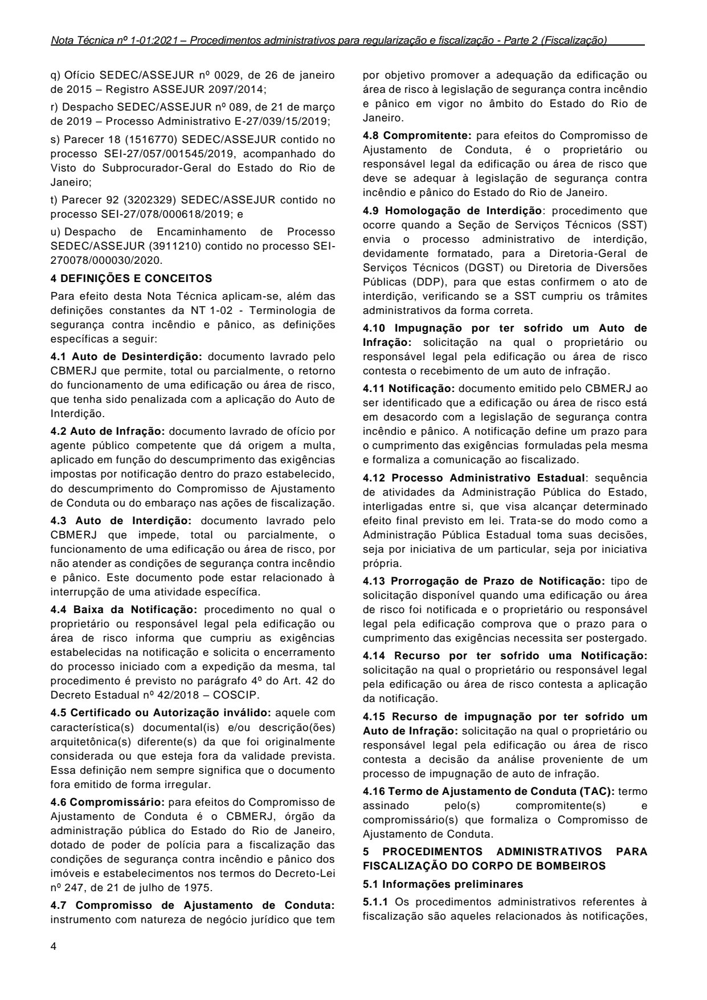

q) Ofício SEDEC/ASSEJUR nº 0029, de 26 de janeiro de 2015 - Registro ASSEJUR 2097/2014;

r) Despacho SEDEC/ASSEJUR nº 089, de 21 de março de 2019 - Processo Administrativo E-27/039/15/2019;

s) Parecer 18 (1516770) SEDEC/ASSEJUR contido no processo SEI-27/057/001545/2019, acompanhado do Visto do Subprocurador-Geral do Estado do Rio de Janeiro;

t) Parecer 92 (3202329) SEDEC/ASSEJUR contido no processo SEI-27/078/000618/2019; e

u) Despacho de Encaminhamento de Processo SEDEC/ASSEJUR (3911210) contido no processo SEI- 270078/000030/2020.

### 4 DEFINIÇÕES E CONCEITOS

Para efeito desta Nota Técnica aplicam-se, além das definições constantes da NT 1-02 - Terminologia de segurança contra incêndio e pânico, as definições específicas a seguir:

4.1 Auto de Desinterdição: documento lavrado pelo CBMERJ que permite, total ou parcialmente, o retorno do funcionamento de uma edificação ou área de risco, que tenha sido penalizada com a aplicação do Auto de Interdição.

4.2 Auto de Infração: documento lavrado de ofício por agente público competente que dá origem a multa, aplicado em função do descumprimento das exigências impostas por notificação dentro do prazo estabelecido, do descumprimento do Compromisso de Ajustamento de Conduta ou do embaraço nas ações de fiscalização.

4.3 Auto de Interdição: documento lavrado pelo CBMERJ que impede, total ou parcialmente, o funcionamento de uma edificação ou área de risco, por não atender as condições de segurança contra incêndio e pânico. Este documento pode estar relacionado à interrupção de uma atividade específica.

4.4 Baixa da Notificação: procedimento no qual o proprietário ou responsável legal pela edificação ou área de risco informa que cumpriu as exigências estabelecidas na notificação e solicita o encerramento do processo iniciado com a expedição da mesma, tal procedimento é previsto no parágrafo 4º do Art. 42 do Decreto Estadual nº 42/2018 - COSCIP.

4.5 Certificado ou Autorização inválido: aquele com característica(s) documental(is) e/ou descrição(ões) arquitetônica(s) diferente(s) da que foi originalmente considerada ou que esteja fora da validade prevista. Essa definição nem sempre significa que o documento fora emitido de forma irregular.

4.6 Compromissário: para efeitos do Compromisso de Ajustamento de Conduta é o CBMERJ, órgão da administração pública do Estado do Rio de Janeiro, dotado de poder de polícia para a fiscalização das condições de segurança contra incêndio e pânico dos imóveis e estabelecimentos nos termos do Decreto-Lei nº 247, de 21 de julho de 1975.

4.7 Compromisso de Ajustamento de Conduta: instrumento com natureza de negócio jurídico que tem

4

4.8 Compromitente: para efeitos do Compromisso de Ajustamento de Conduta, é o proprietário ou responsável legal da edificação ou área de risco que deve se adequar à legislação de segurança contra incêndio e pânico do Estado do Rio de Janeiro.

4.9 Homologação de Interdição: procedimento que ocorre quando a Seção de Serviços Técnicos (SST) envia o processo administrativo de interdição, devidamente formatado, para a Diretoria-Geral de Serviços Técnicos (DGST) ou Diretoria de Diversões Públicas (DDP), para que estas confirmem o ato de interdição, verificando se a SST cumpriu os trâmites administrativos da forma correta.

4.10 Impugnação por ter sofrido um Auto de Infração: solicitação na qual o proprietário ou responsável legal pela edificação ou área de risco contesta o recebimento de um auto de infração.

4.11 Notificação: documento emitido pelo CBMERJ ao ser identificado que a edificação ou área de risco está em desacordo com a legislação de segurança contra incêndio e pânico. A notificação define um prazo para o cumprimento das exigências formuladas pela mesma e formaliza a comunicação ao fiscalizado.

4.12 Processo Administrativo Estadual: sequência de atividades da Administração Pública do Estado, interligadas entre si, que visa alcançar determinado efeito final previsto em lei. Trata-se do modo como a Administração Pública Estadual toma suas decisões, seja por iniciativa de um particular, seja por iniciativa própria.

4.13 Prorrogação de Prazo de Notificação: tipo de solicitação disponível quando uma edificação ou área de risco foi notificada e o proprietário ou responsável legal pela edificação comprova que o prazo para o cumprimento das exigências necessita ser postergado.

4.14 Recurso por ter sofrido uma Notificação: solicitação na qual o proprietário ou responsável legal pela edificação ou área de risco contesta a aplicação da notificação.

4.15 Recurso de impugnação por ter sofrido um Auto de Infração: solicitação na qual o proprietário ou responsável legal pela edificação ou área de risco contesta a decisão da análise proveniente de um processo de impugnação de auto de infração.

### 5 PROCEDIMENTOS ADMINISTRATIVOS PARA FISCALIZAÇÃO DO CORPO DE BOMBEIROS

5.1 Informações preliminares

5.1.1 Os procedimentos administrativos referentes à fiscalização são aqueles relacionados às notificações,

### Tabelas extraídas (bruto, não usar para citação)
#### Tabela 1 da página

| por objetivo promover a adequação da edificação ou |  |
| --- | --- |
| área de risco à legislação de segurança contra incêndio |  |
| e pânico em vigor no âmbito do Estado do Rio de |  |
| Janeiro. |  |

#### Tabela 2 da página

| 4.16 Termo de Ajustamento de Conduta (TAC): termo |  |
| --- | --- |
| assinado pelo(s) compromitente(s) e |  |
| compromissário(s) que formaliza o Compromisso de |  |
| Ajustamento de Conduta. |  |

---

## Página 5

autos de infração, autos de interdição, autos de desinterdição e cassação de Certificado ou Autorização.

5.1.2 Para cada notificação, auto de infração por fiscalização impedida ou interdição por perigo sério e iminente, aplicado, a Organização de Bombeiro Militar (OBM) deverá:

a) abrir o competente processo administrativo seguindo o padrão estabelecido pelo Poder Executivo Estadual, registrando e tramitando o competente processo através do sistema de protocolo vigente. O procedimento sobre a confecção do processo administrativo está descrito na seção 7 desta Nota Técnica; e

b) registrar o ato de fiscalização em sistema próprio do CBMERJ.

5.1.2.1 Todo procedimento de fiscalização realizado como desdobramento dos atos que ensejaram a abertura de processo administrativo, deverá ser registrado em sistema próprio do CBMERJ.

5.1.3 Em qualquer localidade no Estado do Rio de Janeiro, somente as Organizações de Bombeiro Militar que dispõem de Serviços Técnicos em suas estruturas organizacionais, dentro das suas respectivas áreas geográficas de atuação, terão competência para fiscalizar edificações ou áreas de risco e proceder a quaisquer outras ações atinentes a serviços técnicos de segurança contra incêndio e pânico.

5.1.4 As modalidades de notificação serão aplicadas visando a adequação da edificação ou área de risco à legislação de segurança contra incêndio e pânico vigente, discriminando as exigências e determinando prazos de cumprimento.

5.1.4.1 A apresentação de projeto para obtenção do Laudo de Exigências poderá ser apenas uma das fases de regularização para que determinadas edificações ou áreas de risco obtenham o competente Certificado de Aprovação. Dessa forma, não haverá notificação específica para tal finalidade, exceto no caso previsto em 5.1.4.2.

5.1.4.2 Nos casos em que a Organização de Bombeiro Militar (OBM) necessitar do Projeto de Segurança Contra Incêndio e Pânico aprovado pelo Corpo de Bombeiros para efetuar alguma vistoria e o mesmo não estiver disponível no local, o procedimento será:

a) se o Projeto de Segurança Contra Incêndio e Pânico foi aprovado pela Organização de Bombeiro Militar (OBM), a Seção de Serviços Técnicos (SST) deverá desarquivar o mesmo e proceder com a vistoria;

b) se o Projeto de Segurança Contra Incêndio e Pânico foi aprovado pela Diretoria-Geral de Serviços Técnicos (DGST), a Seção de Serviços Técnicos (SST) deverá solicitar o desarquivamento do mesmo via Correspondência Interna. Diante disso, a DiretoriaGeral de Serviços Técnicos (DGST) deverá disponibilizar o empréstimo para a Seção de Serviços Técnicos (SST) retirar sob cautela e depois efetuar a devolução; ou

c) somente se o Projeto de Segurança Contra Incêndio e Pânico não for encontrado pelo CBMERJ, nem estiver disponível na edificação ou área de risco, a Seção de Serviços Técnicos (SST) poderá lavrar a notificação prevista na alínea “d” do item 5.2.3.1 desta Nota Técnica.

5.1.5 O ato de fiscalização presencial de uma edificação ou área de risco será permitido unicamente a oficial ou praça Bombeiro Militar fardado e identificado, devidamente capacitado e classificado na Seção de Serviços Técnicos (SST) da Organização de Bombeiro Militar (OBM) a que pertence.

5.1.6 Compete aos integrantes das Seções de Serviços Técnicos, sob a supervisão dos seus respectivos Comandantes, o controle dos processos de fiscalização abertos pela OBM, após a aplicação de notificação, observando-se os prazos concedidos e o retorno das ações de fiscalização na edificação, para verificação do cumprimento das exigências estabelecidas na notificação, sem a necessidade de interferência da Diretoria-Geral de Serviços Técnicos (DGST) ou Diretoria de Diversões Públicas (DDP), para a persecução da plena regularização daquelas, nos termos da legislação.

5.1.7 Em cada documento de fiscalização lavrado de forma presencial deverá ser inserida a assinatura do(a) Bombeiro Militar investido(a) em função fiscalizadora responsável pela lavratura e, sob ela, a redação correspondente à sua plena identificação de modo manuscrito, em letra de forma legível e totalmente por extenso ou por carimbo abrangendo nome completo com grifo no nome de guerra, posto ou graduação, sigla do quadro, ano de inclusão, registro geral e identidade funcional em todas as vias dos documentos de fiscalização.

5.1.8 Em cada documento de fiscalização lavrado de forma presencial deverá ser inserida a assinatura da pessoa responsável pelo recebimento e, sob ela, a redação correspondente à sua plena identificação de modo manuscrito, em letra de forma legível e totalmente por extenso abrangendo nome completo, sigla do órgão emissor de sua carteira de identidade, número de seu registro geral de identidade ou Cadastro de Pessoas Físicas (CPF) e descrição de seu vínculo com a edificação em todas as vias do documento de fiscalização, à exceção da primeira via, que ficará em poder da pessoa responsável pelo recebimento do documento.

5.1.8.1 Quando ocorrer a recusa por parte do responsável ou representante legal da edificação ou área de risco, em atestar o recebimento com a aposição da sua assinatura, o(a) Bombeiro Militar responsável pela lavratura dos aludidos documentos, deverá inserir neles, de modo manuscrito, em letra de forma legível, por extenso e sem abreviaturas, ou por carimbo, a redação "RECEBIMENTO RECUSADO" e, se possível, a identificação da pessoa que tiver recusado o recebimento, bem como deixar a primeira via original na edificação ou área de risco.

5

---

## Página 6

5.1.9 Todas as redações utilizadas para o preenchimento de qualquer documento de fiscalização deverão estar em letra de forma legível, por extenso e sem abreviaturas, podendo ser manuscritas, digitadas ou por carimbo.

5.1.10 Qualquer pessoa que possua vínculo funcional ou residencial com a edificação ou área de risco poderá atestar o recebimento de qualquer documento de fiscalização aplicado de forma presencial pelo CBMERJ, desde que atendidas as exigências previstas em 5.1.8.

5.1.10.1 Em edificações ou área de risco de propriedade ou sob administração pública, o(a) Bombeiro Militar investido(a) na atividade de fiscalização deverá, quando possível, se reportar ao setor de protocolo ou outro correspondente para entrega dos documentos de fiscalização.

5.1.11 Todos os prazos estabelecidos por qualquer notificação ou auto de infração deverão ser suspensos, caso sejam abertos processos no CBMERJ com solicitação de:

a) aprovação de projeto com emissão de laudo de exigências, modificação de item, parecer técnico ou congêneres;

b) baixa de notificação;

c) prorrogação de prazo de notificação;

d) recurso de notificação ou de auto de infração;

e) compromisso de ajustamento de conduta.

5.1.11.1 Caso os processos tratados em 5.1.11 sejam indeferidos, os prazos serão continuados a partir da movimentação deste indeferimento para o status de “pronto” em sistema próprio do CBMERJ.

5.1.11.2 No caso de deferimento dos processos tratados na alínea “a” de 5.1.11, no momento em que for realizada esta alteração para o status de “pronto” em sistema próprio do CBMERJ, os prazos para cumprimento das exigências estabelecidas pela notificação serão reiniciados ao prazo original da mesma, sendo inseridas as devidas prorrogações de prazo, se for o caso.

5.1.12 Os documentos de fiscalização lavrados de forma presencial deverão atender aos modelos previstos nos anexos desta NT.

5.1.12.1 Os documentos de fiscalização para envio por correios ou via postal deverão seguir padrão similar aos dos anexos desta NT.

5.1.13 Os documentos de fiscalização lavrados de forma presencial deverão possuir 02 (duas) vias com os seguintes destinos:

a) primeira via: pessoa responsável pelo recebimento, que tenha vínculo com a edificação ou área de risco;

b) segunda via: Organização de Bombeiro Militar (OBM) que lavrou o documento de fiscalização.

5.1.14 Todo processo de regularização de edificações ou áreas de risco que possuem interdições e/ou Termo de Ajustamento de Conduta (TAC) associados, deverá

6

obrigatoriamente ter prioridade imediata em sua análise pelo Corpo de Bombeiros.

5.1.15 A Seção de Serviços Técnicos (SST) poderá emitir os documentos de regularização para estabelecimentos localizados em unidades autônomas de edificações comprovadamente licenciadas para construção antes da vigência do Decreto Estadual nº 42/2018, devendo para tal, aplicar as medidas previstas no Art. 42 do mesmo Decreto à edificação como um todo.

5.1.15.1 Em decorrência do disposto no parágrafo 2º do Art. 29 do Decreto Estadual nº 42/2018, a renovação do Certificado de Aprovação das unidades autônomas, está condicionada à regularização da edificação como um todo, portanto as Seções de Serviços Técnicos (SST) deverão prezar para que sejam esgotados, até o limite máximo, todos os procedimentos de fiscalização previstos no Art. 42 do Decreto Estadual nº 42/2018.

5.1.16 Nos casos de fiscalizações realizadas pelo CBMERJ em edificações que não possuem condomínio constituído, bem como nenhum administrador ou morador que identifique-se como síndico, a Organização de Bombeiro Militar (OBM) deverá oficiar o Cartório de Registro de Imóveis competente, solicitando o registro do imóvel que está sendo fiscalizado, e explicitando que a informação solicitada é necessária para o exercício do Poder de Polícia do CBMERJ, para aplicação da Lei em vigor e para resguardar vidas.

5.1.16.1 A ação prevista em 5.1.16 permitirá que o CBMERJ tenha acesso a todos os proprietários, que serão responsáveis em conjunto, cada um na sua fração, pelas áreas comuns do edifício que devem estar adequadas à legislação em vigor, devendo este "conjunto de responsáveis" ser alvo de uma mesma notificação ou qualquer outra penalidade imposta pela legislação em vigor ao edifício fiscalizado.

5.1.17 Caso alguma edificação ou área de risco tenha processo de regularização em tramitação no CBMERJ, seja: solicitação de análise de projeto, ajustamento de conduta, solicitação de certificado de aprovação e/ou cancelamentos ou impugnações de atos de fiscalização. Esta não deverá receber novos documentos de fiscalização pela Seção de Serviços Técnicos antes do resultado da análise de tais processos, exceto nos casos em que se constate perigo sério e iminente previsto no Art. 51 do Decreto Estadual nº 42/2018 (COSCIP), ocasião em que deve ser lavrado o competente Auto de Interdição, se o mesmo ainda não tiver sido expedido.

5.1.17.1 Caso os processos de regularização citados no item anterior sejam encerrados com indeferimento, as Seções de Serviços Técnicos poderão aguardar o prazo de 30 (trinta) dias corridos a contar da movimentação do processo para o status de pronto para dar prosseguimento nas ações de fiscalização.

5.1.17.2 Caso os processos de solicitação de análise de projetos sejam encerrados com deferimento e

---

## Página 7

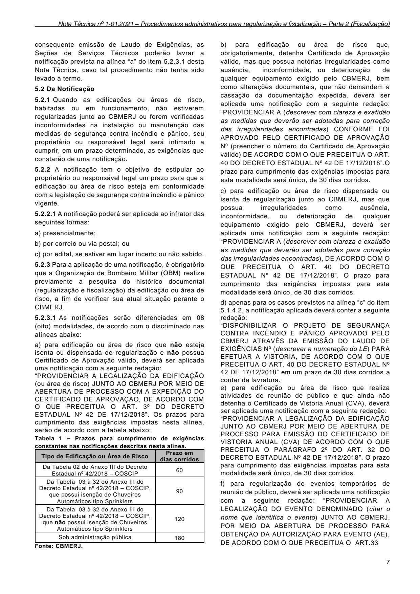

consequente emissão de Laudo de Exigências, as Seções de Serviços Técnicos poderão lavrar a notificação prevista na alínea “a” do item 5.2.3.1 desta Nota Técnica, caso tal procedimento não tenha sido levado a termo.

5.2 Da Notificação

5.2.1 Quando as edificações ou áreas de risco, habitadas ou em funcionamento, não estiverem regularizadas junto ao CBMERJ ou forem verificadas inconformidades na instalação ou manutenção das medidas de segurança contra incêndio e pânico, seu proprietário ou responsável legal será intimado a cumprir, em um prazo determinado, as exigências que constarão de uma notificação.

5.2.2 A notificação tem o objetivo de estipular ao proprietário ou responsável legal um prazo para que a edificação ou área de risco esteja em conformidade com a legislação de segurança contra incêndio e pânico vigente.

5.2.2.1 A notificação poderá ser aplicada ao infrator das seguintes formas:

a) presencialmente;

b) por correio ou via postal; ou

c) por edital, se estiver em lugar incerto ou não sabido.

5.2.3 Para a aplicação de uma notificação, é obrigatório que a Organização de Bombeiro Militar (OBM) realize previamente a pesquisa do histórico documental (regularização e fiscalização) da edificação ou área de risco, a fim de verificar sua atual situação perante o CBMERJ.

5.2.3.1 As notificações serão diferenciadas em 08 (oito) modalidades, de acordo com o discriminado nas alíneas abaixo:

a) para edificação ou área de risco que não esteja isenta ou dispensada de regularização e não possua Certificado de Aprovação válido, deverá ser aplicada uma notificação com a seguinte redação: “PROVIDENCIAR A LEGALIZAÇÃO DA EDIFICAÇÃO (ou área de risco) JUNTO AO CBMERJ POR MEIO DE ABERTURA DE PROCESSO COM A EXPEDIÇÃO DO CERTIFICADO DE APROVAÇÃO, DE ACORDO COM O QUE PRECEITUA O ART. 3º DO DECRETO ESTADUAL Nº 42 DE 17/12/2018”. Os prazos para cumprimento das exigências impostas nesta alínea, serão de acordo com a tabela abaixo: Tabela 1 - Prazos para cumprimento de exigências constantes nas notificações descritas nesta alínea.

b) para edificação ou área de risco que, obrigatoriamente, detenha Certificado de Aprovação válido, mas que possua notórias irregularidades como ausência, inconformidade, ou deterioração de qualquer equipamento exigido pelo CBMERJ, bem como alterações documentais, que não demandem a cassação da documentação expedida, deverá ser aplicada uma notificação com a seguinte redação: “PROVIDENCIAR A (descrever com clareza e exatidão as medidas que deverão ser adotadas para correção das irregularidades encontradas) CONFORME FOI APROVADO PELO CERTIFICADO DE APROVAÇÃO Nº (preencher o número do Certificado de Aprovação válido) DE ACORDO COM O QUE PRECEITUA O ART. 40 DO DECRETO ESTADUAL Nº 42 DE 17/12/2018”.O prazo para cumprimento das exigências impostas para esta modalidade será único, de 30 dias corridos.

c) para edificação ou área de risco dispensada ou isenta de regularização junto ao CBMERJ, mas que possua irregularidades como ausência, inconformidade, ou deterioração de qualquer equipamento exigido pelo CBMERJ, deverá ser aplicada uma notificação com a seguinte redação: “PROVIDENCIAR A (descrever com clareza e exatidão as medidas que deverão ser adotadas para correção das irregularidades encontradas), DE ACORDO COM O QUE PRECEITUA O ART. 40 DO DECRETO ESTADUAL Nº 42 DE 17/12/2018”. O prazo para cumprimento das exigências impostas para esta modalidade será único, de 30 dias corridos.

d) apenas para os casos previstos na alínea “c” do item 5.1.4.2, a notificação aplicada deverá conter a seguinte redação: “DISPONIBILIZAR O PROJETO DE SEGURANÇA CONTRA INCÊNDIO E PÂNICO APROVADO PELO CBMERJ ATRAVÉS DA EMISSÃO DO LAUDO DE EXIGÊNCIAS Nº (descrever a numeração do LE) PARA EFETUAR A VISTORIA, DE ACORDO COM O QUE PRECEITUA O ART. 40 DO DECRETO ESTADUAL Nº 42 DE 17/12/2018” em um prazo de 30 dias corridos a contar da lavratura. e) para edificação ou área de risco que realiza atividades de reunião de público e que ainda não detenha o Certificado de Vistoria Anual (CVA), deverá ser aplicada uma notificação com a seguinte redação: “PROVIDENCIAR A LEGALIZAÇÃO DA EDIFICAÇÃO JUNTO AO CBMERJ POR MEIO DE ABERTURA DE PROCESSO PARA EMISSÃO DO CERTIFICADO DE VISTORIA ANUAL (CVA) DE ACORDO COM O QUE PRECEITUA O PARÁGRAFO 2º DO ART. 32 DO DECRETO ESTADUAL Nº 42 DE 17/12/2018”. O prazo para cumprimento das exigências impostas para esta modalidade será único, de 30 dias corridos.

f) para regularização de eventos temporários de reunião de público, deverá ser aplicada uma notificação com a seguinte redação: “PROVIDENCIAR A LEGALIZAÇÃO DO EVENTO DENOMINADO (citar o nome que identifica o evento) JUNTO AO CBMERJ, POR MEIO DA ABERTURA DE PROCESSO PARA OBTENÇÃO DA AUTORIZAÇÃO PARA EVENTO (AE), DE ACORDO COM O QUE PRECEITUA O ART.33

7

### Tabelas extraídas (bruto, não usar para citação)
#### Tabela 1 da página

| Tipo de Edificação ou Área de Risco |  | Prazo em |  |
| --- | --- | --- | --- |
|  |  | dias corridos |  |
| Da Tabela 02 do Anexo III do Decreto Estadual nº 42/2018 - COSCIP | 60 |  |  |
| Da Tabela 03 à 32 do Anexo III do Decreto Estadual nº 42/2018 - COSCIP, que possui isenção de Chuveiros Automáticos tipo Sprinklers | 90 |  |  |
| Da Tabela 03 à 32 do Anexo III do Decreto Estadual nº 42/2018 - COSCIP, que não possui isenção de Chuveiros Automáticos tipo Sprinklers | 120 |  |  |
| Sob administração pública | 180 |  |  |

<!-- tabela-conferida: Tabela 1 p7 -->
### Tabela 1 — Prazos para cumprimento de exigências constantes nas notificações descritas nesta alínea (conferida)

| Tipo de Edificação ou Área de Risco | Prazo em dias corridos |
| --- | --- |
| Da Tabela 02 do Anexo III do Decreto Estadual nº 42/2018 – COSCIP | 60 |
| Da Tabela 03 à 32 do Anexo III do Decreto Estadual nº 42/2018 – COSCIP, que possui isenção de Chuveiros Automáticos tipo Sprinklers | 90 |
| Da Tabela 03 à 32 do Anexo III do Decreto Estadual nº 42/2018 – COSCIP, que não possui isenção de Chuveiros Automáticos tipo Sprinklers | 120 |
| Sob administração pública | 180 |

Fonte: NT 1-01 Parte 2, página 7, Tabela 1; conferida em 2026-09-29 (visual + geometrica).
Tabela da alínea a) do item 5.2.3.1 (notificação para edificação ou área de risco que não esteja isenta ou dispensada de regularização e não possua Certificado de Aprovação válido).
Fonte: CBMERJ.
<!-- /tabela-conferida: Tabela 1 p7 -->

---

## Página 8

DO DECRETO ESTADUAL Nº 42 DE 17/12/2018”. O prazo para cumprimento das exigências impostas para esta modalidade será sempre em dias corridos e poderá ser para cumprimento imediato ou estabelecido de acordo com a data do evento, conforme análise do militar que estiver expedindo a notificação.

g) quando uma edificação possuir um Certificado ou Autorização inválido e exista a necessidade de cassação de documentação de regularização já emitida e entregue ao requerente, prevista na Seção IV do Capítulo XI do Decreto Estadual nº 42/2018 - COSCIP, a Organização de Bombeiro Militar (OBM) deverá adotar os procedimentos definidos em 5.7 e aplicar notificação com o seguinte teor: “PROVIDENCIAR A LEGALIZAÇÃO DA EDIFICAÇÃO (ou área de risco) JUNTO AO CBMERJ POR MEIO DE ABERTURA DE PROCESSO COM A EXPEDIÇÃO DO CERTIFICADO DE APROVAÇÃO, DE ACORDO COM O QUE PRECEITUA O ART. 3º DO DECRETO ESTADUAL Nº 42 DE 17/12/2018, CONSIDERANDO A NULIDADE DO CERTIFICADO DE APROVAÇÃO Nº (preencher o número do Certificado ou Autorização inválido). Os prazos para cumprimento das exigências impostas nesta alínea, serão de acordo com a tabela 1 da alínea “a” do item 5.2.3.1.

h) apenas nos casos de edificações ou áreas de risco que possuam pendências no cumprimento de etapas do cronograma anteriormente aprovado pela DGST, por meio de Certificado de Despacho Deferido, deverá ser aplicada notificação com a seguinte redação:

"PROVIDENCIAR A LEGALIZAÇÃO DA EDIFICAÇÃO JUNTO AO CBMERJ POR MEIO DO PLENO CUMPRIMENTO DA (inserir, por extenso, o número ordinal correspondente à etapa) ETAPA DO CRONOGRAMA APROVADO PELA DGST COM A EXPEDIÇÃO DO CERTIFICADO DE DESPACHO Nº (inserir o n° do certificado de despacho), estabelecendo um prazo de 30 (trinta) dias corridos para o seu cumprimento.

5.2.3.1.1 Todos os procedimentos relacionados ao efetivo cumprimento das notificações estão descritos na NT 1-01 - Procedimentos Administrativos para Regularização e Fiscalização - Parte 1 (Regularização).

5.2.3.1.2 Os textos e prazos previstos nas alíneas do item 5.2.3.1 poderão, em caráter excepcional, ser adaptados para atender casos específicos não previstos nesta Nota Técnica, desde que devidamente justificado através de correspondência interna que deverá estar presente no processo administrativo da notificação.

5.2.3.2 O processamento de toda notificação deverá conter as seguintes informações:

a) nome do recebedor ou preposto, inscrição no cadastro de pessoas físicas (CPF), bem como os demais elementos necessários à sua qualificação e identificação civil e vínculo com a edificação ou área de risco ou razão social, inscrição no cadastro de pessoas

8

jurídicas (CNPJ), endereço da edificação ou área de risco, além dos demais elementos necessários à sua qualificação e identificação civil; e

b) local, data e hora que foi verificada a irregularidade.

5.2.4 Caso a edificação ou área de risco tenha sofrido uma notificação, estarão disponíveis os seguintes serviços:

a) uma única prorrogação de prazo de notificação, de acordo com 5.2.5;

b) recurso por ter sofrido uma notificação, de acordo com 5.2.6;

c) baixa de notificação, de acordo com 5.2.7; e/ou

d) celebração do compromisso de ajustamento de conduta, de acordo com a seção 6.

5.2.5 Da prorrogação de prazo de notificação

5.2.5.1 O serviço de prorrogação de prazo não se aplica às notificações da categoria descrita na alínea “f” da 5.2.3.1 (eventos temporários de reunião de público).

5.2.5.2 Para protocolar este tipo de solicitação é necessário que o prazo estabelecido pela notificação ainda esteja em vigor.

5.2.5.3 Ao ser deferida a prorrogação o novo prazo será estabelecido por período igual àquele concedido pela notificação original.

5.2.5.3.1 O início do prazo de prorrogação começará a ser contado no dia imediatamente posterior à data de término do prazo estabelecido pela notificação original.

5.2.5.4 Para solicitação de prorrogação de prazo para cumprimento das exigências impostas por notificação devem ser apresentados os seguintes documentos:

a) requerimento eletrônico impresso e assinado pelo solicitante;

b) emolumento, com código de receita nº 180, com o comprovante de pagamento;

c) cópia da identidade do proprietário ou responsável legal da edificação ou área de risco;

d) cópia do título de propriedade (RGI, contrato de locação ou similar);

e) cópia do contrato social, estatuto ou documento similar, no caso de pessoa jurídica;

f) cópia da notificação expedida pelo CBMERJ; e

g) no caso de condomínios, apresentar a ata de assembleia com a nomeação do síndico.

5.2.5.5 O processo para essa solicitação será protocolado e tramitará na mesma Organização de Bombeiro Militar (OBM) que expediu a notificação.

5.2.5.6 A notificação poderá ser prorrogada através deste procedimento uma única vez.

5.2.5.7 A Organização de Bombeiro Militar (OBM) deverá analisar o processo em sistema eletrônico vigente em um prazo não superior a 10 dias corridos e deferir através do Certificado de Despacho Deferido (CD) ou indeferir através do Certificado de Despacho Indeferido (DI), especificando os respectivos motivos, realizando as atualizações nos sistemas,

---

## Página 9

providenciando a autuação do resultado da análise no processo administrativo iniciado pela notificação e produzindo os efeitos que o caso exigir.

5.2.5.8 O texto padrão para Certificado de Despacho Deferido (CD) de prorrogação de prazo será:

“De acordo com o previsto no item 5.2.5 da Nota Técnica 1-01 - Procedimentos Administrativos para Regularização e Fiscalização - Parte 2 (Fiscalização) que trata da prorrogação do prazo estabelecido pela notificação nº XXXX (citar o número da notificação), lavrada pelo (citar a OBM que lavrou) em XX/XX/XXXX (citar a data da lavratura) para o cumprimento da exigência de (descrever as exigências da notificação) com prazo original para cumprimento de XX (citar o prazo estabelecido para cumprimento das exigências impostas pela notificação) dias corridos e que o presente processo fora protocolado antes do término da vigência deste prazo, a Seção de Serviços Técnicos desta OBM DECIDE:

Prorrogar o prazo para cumprimento das exigências formuladas pela Notificação nº XXXX (citar o número da notificação) por mais XXX (mesmo nº de dias da notificação) dias corridos, a contar de XX/XX/XXXX (data imediatamente posterior ao término do prazo da notificação original).

- Observações:

a) o prazo final para cumprimento das exigências impostas pela notificação será até o dia XX/XX/XXXX (citar a data final); e

b) findo o prazo que trata a presente prorrogação e não cumprida as exigências, a edificação estará sujeita a aplicação das penalidades previstas no Art. 42 do Decreto Estadual nº 42, de 17/12/2018.”

5.2.5.9 O texto padrão para Certificado de Despacho Indeferido (DI) de prorrogação de prazo, no caso de abertura de processo em data posterior ao término do prazo estabelecido pela notificação, será:

“De acordo com o previsto no item 5.2.5.2 da Nota Técnica 1-01 - Procedimentos Administrativos para Regularização e Fiscalização - Parte 2 (Fiscalização) que trata da prorrogação do prazo estabelecido pela notificação nº XXXX (citar o número da notificação), lavrada pelo (citar a OBM que lavrou) em XX/XX/XXXX (citar a data da lavratura) para o cumprimento da exigência de (descrever as exigências da notificação) com prazo original para cumprimento de XX (citar o prazo estabelecido para cumprimento das exigências impostas pela notificação) dias corridos e que o presente processo fora protocolado após do término da vigência deste, a Seção de Serviços Técnicos desta OBM DECIDE:

Indeferir o presente processo de prorrogação de prazo, por contrariar o item 5.2.5.2 da Nota Técnica 1-01 - Procedimentos Administrativos para Regularização e Fiscalização - Parte 2 (Fiscalização).

5.2.5.9.1 Caso o indeferimento seja por outro motivo, o texto de 5.2.5.9 deverá ser adaptado, descrevendo de forma clara o motivo de tal indeferimento.

5.2.5.10 Caso a prorrogação de prazo seja deferida, é obrigatório que a Seção de Serviços Técnicos realize o registro e upload imediato de tal deferimento no sistema de fiscalização do CBMERJ, obedecendo os seguintes procedimentos:

a) efetuar o upload do Certificado de Despacho Deferido (CD);

b) não alterar o status e a data de expedição da notificação no campo “último procedimento adotado”;

c) alterar apenas o número de dias para cumprimento das exigências, conforme o estabelecido no Certificado de Despacho Deferido (CD).

5.2.5.11 Tanto o Certificado de Despacho Deferido (CD), como o Certificado de Despacho Indeferido (DI) de prorrogação de prazo de notificação deverão obrigatoriamente ser anexados no processo administrativo iniciado com a lavratura desta.

5.2.6 Do recurso por ter sofrido uma notificação

5.2.6.1 Será cancelada a notificação se:

a) no momento de lavratura da notificação, havia processo de regularização tramitando no CBMERJ, desde que tal processo seja de solicitação ao exigido na notificação aplicada;

b) a edificação ou área de risco havia cumprido as exigências previstas na notificação no momento da lavratura da mesma; e/ou

c) houver vícios processuais de acordo com a legislação vigente.

5.2.6.2 Não será cancelada a notificação, se o cumprimento das exigências for executado em momento posterior à lavratura da notificação. Nesse caso o requerente deve solicitar a abertura de processo de baixa de notificação previsto em 5.2.7.

5.2.6.3 Para solicitação de recurso por ter sofrido uma notificação não haverá pagamento de Documento de Arrecadação de Emolumentos (DAEM) e devem ser apresentados os seguintes documentos:

a) requerimento eletrônico impresso e assinado pelo solicitante;

b) cópia da identidade do proprietário ou responsável legal da edificação ou área de risco;

c) cópia do título de propriedade (RGI, contrato de locação ou similar);

d) cópia do contrato social, estatuto ou documento similar, no caso de pessoa jurídica;

e) cópia da notificação expedida pelo CBMERJ;

f) no caso de condomínios, apresentar a ata de assembleia com a nomeação do síndico; e

g) documento assinado pelo proprietário ou responsável legal pela edificação ou área de risco, com a exposição de motivos para solicitação de cancelamento da notificação. Poderá ser anexado, por exemplo: protocolo de um processo em tramitação ou cópia do Certificado de Aprovação, expedido pelo CBMERJ.

9

---

## Página 10

5.2.6.4 Para dar entrada na solicitação de recurso, é necessário que o prazo estipulado para o cumprimento das exigências esteja em vigor. Caso contrário, não será possível cancelar a notificação pelo motivo de intempestividade.

5.2.6.5 Este tipo de solicitação será protocolado e tramitará nas Seções de Serviços Técnicos (SSTs) das OBMs.

5.2.6.6 A Seção de Serviços Técnicos (SST) deverá analisar o processo em sistema próprio em um prazo não superior a 10 (dez) dias corridos e deferir através do Certificado de Despacho Deferido (CD) ou indeferir através do Certificado de Despacho Indeferido (DI), especificando os respectivos motivos, realizando as atualizações nos sistemas, providenciando a autuação do resultado da análise no processo administrativo iniciado pela notificação e produzindo os efeitos que o caso exigir.

5.2.6.7 Tanto o Certificado de Despacho Deferido (CD), como o Certificado de Despacho Indeferido (DI) de recurso por ter recebido uma notificação, deverão obrigatoriamente ser anexados no processo administrativo iniciado com a lavratura desta.

5.2.7 Da baixa de notificação

5.2.7.1 Se o proprietário ou responsável legal da edificação ou área de risco não realizar a abertura de processo para baixa de notificação, o auto de infração poderá ser gerado automaticamente no sistema do CBMERJ e enviado para o endereço cadastrado na notificação, preferencialmente, pelo correio ou via postal, podendo também ser pessoalmente ou por edital, se estiver em lugar incerto ou não sabido.

5.2.7.2 Para solicitação da baixa de notificação, devem ser apresentados os seguintes documentos:

a) requerimento eletrônico impresso e assinado pelo solicitante;

b) cópia da identidade do proprietário ou responsável legal da edificação ou área de risco;

c) cópia do título de propriedade (RGI, contrato de locação ou similar);

d) cópia do contrato social, estatuto ou documento similar, no caso de pessoa jurídica;

e) cópia da notificação expedida pelo CBMERJ;

f) no caso de condomínios, apresentar a ata de assembléia com a nomeação do síndico; e

g) documento, assinado pelo proprietário ou responsável pela edificação ou área de risco, com a exposição de motivos para baixa de notificação. Poderá ser anexado qualquer documento. Por exemplo: cópia do Certificado de Aprovação, expedido pelo CBMERJ, nota fiscal ou Documento de Responsabilidade Técnica do serviço realizado elaborado por profissional devidamente habilitado e emitido pelo Conselho de Classe correspondente.

5.2.7.3 Este tipo de solicitação será protocolado e tramitará na mesma Organização de Bombeiro Militar (OBM) que expediu a notificação.

10

5.2.7.4 A Organização de Bombeiro Militar (OBM) que expediu a notificação deverá analisar o processo em sistema próprio em um prazo não superior a 30 dias corridos e deferir através do Certificado de Despacho Deferido (CD) ou indeferir através do Certificado de Despacho Indeferido (DI), especificando os respectivos motivos, realizando as atualizações nos sistemas, providenciando a autuação do resultado da análise no processo administrativo iniciado pela notificação e produzindo os efeitos que o caso exigir.

5.2.7.5 A constatação do cumprimento das exigências poderá ser realizadada das seguintes formas:

a) por comprovante de tramitação de processos no CBMERJ; e/ou

b) por apresentação de declarações e anotações, nos mesmos moldes praticados na obtenção do Certificado de Aprovação Assistido (CAA), atestando a realização dos serviços, de acordo com a NT 1-01 - Procedimentos Administrativos para Regularização e Fiscalização - Parte 1 (Regularização).

5.2.7.5.1 A vistoria para constatação do cumprimento das exigência(s) imposta(s) pela notificação no procedimento de análise da solicitação de baixa de notificação será facultativa.

5.2.7.6 No caso de pleno cumprimento das exigências formuladas na notificação, o deferimento no processo de solicitação de baixa de notificação é medida indispensável para garantir o encerramento dos efeitos produzidos pela mesma. Caso contrário o notificado estará sujeito ao recebimento do auto de infração.

5.2.7.7 Caso a Diretoria-Geral de Serviços Técnicos (DGST), Diretoria de Diversões Públicas (DDP) ou a Seção de Serviços Técnicos (SST) tomem ciência do cumprimento das exigências impostas por notificação, poderão realizar o encerramento da mesma automaticamente, sem a necessidade de abertura de processo de baixa de notificação, bastando encerrar em sistema próprio do CBMERJ e no processo administrativo gerado pela mesma, justificando no próprio sistema o motivo pelo qual tal procedimento fora adotado.

5.2.7.8 Tanto o Certificado de Despacho Deferido (CD), como o Certificado de Despacho Indeferido (DI) de baixa de notificação deverão ser anexados no processo administrativo iniciado com a lavratura desta.

5.2.7.9 Ao emitir um documento de regularização, a Seção de Serviços Técnicos deverá utilizar os meios de buscas disponíveis no sistema de fiscalização do CBMERJ e verificar se há processo de fiscalização em aberto, em caso positivo deverá proceder da seguinte maneira:

a) verificar se o documento de regularização representa o cumprimento das exigências impostas por Notificação e, se for o caso, encerrar o processo, realizando o upload deste documento de regularização no sistema;

b) atualizar o correspondente processo administrativo, realizando o devido upload do documento de regularização e, se for o caso, encerrá-lo.

---

## Página 11

5.3 Do Auto de Infração por não cumprimento das exigências estabelecidas pela notificação dentro do prazo estipulado

5.3.1 Quando as edificações e áreas de risco, habitadas ou em funcionamento, receberem uma notificação com prazo estipulado para o saneamento de irregularidades apontadas e não efetuarem o cumprimento das exigências, será expedido o primeiro auto de infração no valor de 221,33 UFIR-RJ e o prazo para cumprimento das exigências ficará automaticamente prorrogado por 30 dias corridos, a contar da data registrada no auto de infração.

5.3.1.1 O primeiro auto de infração deverá possuir a seguinte redação: “NÃO TER CUMPRIDO A(S) EXIGÊNCIA(S) FORMULADA(S) PELA NOTIFICAÇÃO Nº (mencionar o número da notificação), EXPEDIDA EM (mencionar a data de expedição da notificação) DE ACORDO COM O QUE PRECEITUA O PARÁGRAFO 1º DO ART. 42 DO DECRETO ESTADUAL Nº 42 DE 17/12/2018”;

5.3.2 Findo o prazo da prorrogação previsto em 5.3.1, não sendo comprovado o cumprimento das exigências formuladas na notificação, será expedido o segundo auto de infração no valor de 442,66 UFIR-RJ e o prazo para cumprimento das exigências ficará automaticamente prorrogado por mais 30 dias corridos, a contar da data registrada neste auto de infração.

5.3.2.1 O segundo auto de infração (multa) deverá possuir a seguinte redação: “NÃO TER CUMPRIDO A(S) EXIGÊNCIA(S) FORMULADA(S) PELA NOTIFICAÇÃO Nº (mencionar o número da notificação), EXPEDIDA EM (mencionar a data de expedição da notificação) DE ACORDO COM O QUE PRECEITUA O PARÁGRAFO 2º DO ART. 42 DO DECRETO ESTADUAL Nº 42 DE 17/12/2018”.

5.3.3 Findo o prazo da prorrogação previsto em 5.3.2, não sendo comprovado o cumprimento das exigências formuladas na notificação, a edificação ou área de risco poderá ser interditada por inércia do proprietário ou responsável legal.

5.3.3.1 Os procedimentos referentes à fase de interdição estão descritos em 5.5 da presente Nota Técnica.

5.3.4 Os autos de infração serão, preferencialmente, enviados pelo correio ou via postal, para o endereço cadastrado na notificação, podendo também ser entregues pessoalmente, ou por edital se estiver em lugar incerto ou não sabido.

5.3.5 O processamento do auto de infração deverá ser elaborado da seguinte maneira:

a) nome do infrator ou preposto, inscrição no cadastro de pessoas físicas (CPF), seu domicílio e residência, bem como os demais elementos necessários à sua qualificação e identificação civil; ou razão social, inscrição no cadastro de pessoas jurídicas (CNPJ), endereço da edificação ou área de risco, além dos demais elementos necessários à sua qualificação; e

b) local, data e hora em que foi verificada a infração;

5.3.6 Caso a edificação ou área de risco tenha recebido um auto de infração, o infrator poderá:

a) realizar o pagamento da multa de acordo com 5.3.7; ou

b) protocolar processo de impugnação por ter sofrido um auto de infração, de acordo com 5.3.8.

5.3.7 Do pagamento de multa.

5.3.7.1 Para quitação do auto de infração, o proprietário ou responsável legal pela edificação ou área de risco, deverá efetuar o pagamento do Documento de Arrecadação de Emolumentos (DAEM) de multa, que será disponibilizado das seguintes maneiras:

a) via correio ou serviço postal;

b) guia eletrônica disponível no Portal do CBMERJ; e/ou

c) pessoalmente.

5.3.8 Da impugnação de auto de infração

5.3.8.1 Para solicitação de impugnação por ter sofrido um auto de infração não haverá pagamento de Documento de Arrecadação de Emolumentos (DAEM) e devem ser apresentados os seguintes documentos:

a) requerimento eletrônico impresso e assinado pelo solicitante;

b) cópia da identidade do proprietário ou responsável legal da edificação ou área de risco;

c) cópia do título de propriedade (RGI, contrato de locação ou similar);

d) cópia do contrato social, estatuto ou documento similar, no caso de pessoa jurídica;

e) cópia da notificação e do(s) auto(s) de infração expedidos pelo CBMERJ;

f) no caso de condomínios, apresentar a ata de assembleia com a nomeação do síndico; e

g) documento assinado pelo proprietário ou responsável legal pela edificação ou área de risco, com a exposição de motivos para solicitação de cancelamento do auto de infração. Poderá ser anexado, por exemplo: protocolo de um processo em tramitação ou cópia do Certificado de Aprovação, expedido pelo CBMERJ, etc.

5.3.8.2 Este tipo de solicitação será protocolada e tramitará na Organização de Bombeiro Militar (OBM) que lavrou o auto de infração, e não poderá ser analisada pelo mesmo militar que aplicou esse auto.

5.3.8.3 A Organização de Bombeiro Militar (OBM) deverá analisar o processo em sistema próprio, no prazo não superior a 30 dias corridos e deferir através do Certificado de Despacho Deferido (CD) ou indeferir através do Certificado de Despacho Indeferido (DI), especificando e fundamentando os respectivos motivos, realizando as atualizações nos sistemas, providenciando a autuação do resultado da análise no processo administrativo iniciado pela notificação e produzindo os efeitos que o caso exigir.

5.3.8.4 Este tipo de solicitação só será analisada se for

11

---

## Página 12

protocolada até 30 dias corridos a contar da data de expedição ou recebimento do auto de infração, conforme o disposto no Art. 57 do Decreto Estadual nº 42/2018 - COSCIP.

5.3.8.4.1 Caso seja identificado que o processo de impugnação de auto de infração fora protocolado com prazo superior a 30 dias corridos da expedição, será gerado o Certificado de Despacho Indeferido (DI) sem análise do mérito por motivo de intempestividade.

5.3.8.5 Será impugnado o auto de infração quando:

a) a edificação ou área de risco receber o auto de infração, estando a mesma com processo de regularização em tramitação no CBMERJ;

b) a edificação ou área de risco receber auto de infração, estando a mesma com um processo de regularização que já foi analisado (disponível no protocolo) em menos de 30 dias corridos;

c) a edificação ou área de risco receber auto de infração e comprovar ter cumprido, em tempo hábil, as exigências previstas na notificação;

d) a edificação ou área de risco receber auto de infração antes do término do prazo estabelecido pela notificação atrelada ao mesmo;

e) a edificação ou área de risco receber auto de infração, com base em uma notificação que anteriormente foi cancelada; e/ou

f) a edificação ou área de risco receber auto de infração em discordância com a legislação em vigência ou com vício processual.

5.3.8.5.1 Poderão ser anulados sem a necessidade de abertura de processo os autos de infração originados em notificações que sofreram cancelamento.

5.3.8.6 Tanto o Certificado de Despacho Deferido (CD), como o Certificado de Despacho Indeferido (DI) de impugnação de auto de infração deverão obrigatoriamente ser anexados ao processo administrativo iniciado com a lavratura da notificação ou outro processo administrativo que gerou a lavratura de tal penalidade.

5.3.9 Do recurso de impugnação por ter sofrido um Auto de Infração:

5.3.9.1 Para solicitação do recurso de impugnação por ter sofrido um auto de infração não haverá pagamento de Documento de Arrecadação de Emolumentos (DAEM) e devem ser apresentados os seguintes documentos:

a) requerimento eletrônico impresso e assinado pelo solicitante;

b) cópia da identidade do proprietário ou responsável legal da edificação ou área de risco;

c) cópia do título de propriedade (RGI, contrato de locação ou similar);

d) cópia do contrato social, estatuto ou documento similar, no caso de pessoa jurídica;

e) cópia da notificação e do(s) auto(s) de infração expedidos pelo CBMERJ;

12

f) no caso de condomínios, apresentar a ata de assembleia com a nomeação do síndico; e

g) documento assinado pelo proprietário ou responsável legal pela edificação ou área de risco, com a exposição de motivos para solicitação de cancelamento do auto de infração. Poderá ser anexado, por exemplo: protocolo de um processo em tramitação ou cópia do Certificado de Aprovação, expedido pelo CBMERJ, etc.

h) Certificado de Despacho Indeferido emitido pela Seção de Serviços Técnicos (SST) referente ao processo de impugnação do Auto de Infração.

5.3.9.2 Este tipo de solicitação será protocolada e tramitará na Diretoria-Geral de Serviços Técnicos (DGST) ou na Diretoria de Diversões Públicas (DDP), caso a notificação expedida seja das modalidades previstas nas alíneas “e” ou “f” de 5.2.3.1.

5.3.9.3 A Diretoria-Geral de Serviços Técnicos (DGST) e a Diretoria de Diversões Públicas (DDP) deverão analisar o processo em sistema próprio em um prazo não superior a 30 dias corridos e deferir através do Certificado de Despacho Deferido (CD) ou indeferir através do Certificado de Despacho Indeferido (DI), especificando e fundamentando os respectivos motivos, realizando as atualizações nos sistemas, providenciando a autuação do resultado da análise no processo administrativo iniciado pela notificação e produzindo os efeitos que o caso exigir.

5.3.9.4 Este tipo de solicitação só será analisada se for protocolada até 30 dias corridos a contar da movimentação do Certificado de Despacho Indeferido relacionado na alínea “h” do item 5.3.9. para o status de “pronto” em sistema próprio do CBMERJ. Caso contrário será gerado um novo Certificado de Despacho Indeferido (DI), sem análise do mérito por motivo de intempestividade.

5.4 Do Auto de Infração por embaraço à atuação de fiscalização

5.4.1 O embaraço à vistoria do CBMERJ é caracterizado pelas ações advindas do proprietário, do responsável legal ou de terceiros quando:

a) o Bombeiro Militar investido de função fiscalizadora for impedido de ingressar no interior de uma edificação ou área de risco para fiscalizá-la;

b) for observada qualquer omissão voluntária que importe em dificultar ou impedir o exercício da fiscalização pelo CBMERJ, caracterizada pela negativa não justificada de exibição dos documentos de regularização expedidos; e/ou

c) não houver fornecimento de informações sobre a ocupação e atividade desenvolvida no local.

5.4.2 Constatado o embaraço à vistoria, deverão ser adotados os seguintes procedimentos:

a) aplicação de auto de infração no valor de 442,66 UFIR-RJ, com a seguinte redação: TER CAUSADO EMBARAÇO À AÇÃO DE FISCALIZAÇÃO DO CBMERJ, DE ACORDO COM O PARÁGRAFO 4º DO

---

## Página 13

ART. 50 DO DECRETO ESTADUAL Nº 42, DE 17/12/2018”; e

b) gerar o competente processo administrativo, nos moldes definidos na seção 7.

5.4.3 A análise do processo de impugnação para esta modalidade de auto de infração, seguirá o mesmo procedimento descrito em 5.3.8.

5.4.4 Após a aplicação do auto de infração por embaraço à fiscalização, a Organização de Bombeiro Militar (OBM) deverá agendar nova vistoria em prazo não superior a 30 dias corridos.

5.4.4.1 Permanecendo o embaraço à fiscalização, caracterizado pelo impedimento do acesso às instalações da edificação ou área de risco para exercício fiscalizatório pelo CBMERJ, presumir-se-á condição de insegurança com risco iminente à vida, devendo ser aplicado o competente Auto de Interdição. Nesse caso, a Organização de Bombeiro Militar (OBM) deverá adotar as providências necessárias à realização da fiscalização pendente.

5.4.5 Se o embaraço à fiscalização for cometido por órgão pertencente ao Estado do Rio de Janeiro, a multa não poderá ser aplicada, devendo a Diretoria-Geral de Serviços Técnicos (DGST) ou Diretoria de Diversões Públicas (DDP) ser cientificada pela Seção de Serviços Técnicos (SST) via Correspondência Interna. A competente Diretoria deverá encaminhar o processo informando o embaraço à vistoria do CBMERJ via Chefia de Gabinete do Comando-Geral do CBMERJ para a Secretaria de Estado a qual pertence a edificação, para providências cabíveis que o caso requer.

5.5 Da Interdição

5.5.1 Conforme prevê o Art. 51 do Decreto Estadual nº 42/2018 - COSCIP, o CBMERJ poderá determinar interdição imediata, total ou parcial das edificações ou áreas de risco que caracterizem perigo sério e iminente de causar danos, tais como:

a) risco de explosão, incêndio ou dano ambiental grave;

b) condição que prejudique o escape seguro das pessoas; e/ou

c) condição que gere insegurança com risco iminente à vida.

5.5.2 A interdição de uma edificação ou área de risco poderá ser total ou parcial e ocorrerá nas seguintes circunstâncias:

a) interdição imediata, prevista no Art. 51 do Decreto Estadual nº 42/2018 - COSCIP. No ato da aplicação da interdição, o auto de interdição deverá obrigatoriamente ser acompanhado da aplicação de uma notificação, de acordo com o enquadramento em 5.2.3.1 desta NT.

b) quando se verificar o não cumprimento de exigências formuladas mediante notificação, após decorridas as etapas e os prazos estabelecidos no Art. 42 do Decreto Estadual nº 42/2018 - COSCIP e não apresentado protocolo em vigor de celebração de compromisso de

ajustamento de conduta;

c) 30 dias corridos após a lavratura do auto de infração por descumprimento do compromisso de ajustamento de conduta, conforme previsto em 6.8.3 desta Nota Técnica; e/ou

d) por permanecer o embaraço à fiscalização, após a aplicação do auto de infração previsto em 5.4.2.

5.5.2.1 O auto de interdição previsto na alínea “a” do item 5.5.2 (interdição por perigo sério e iminente) terá a seguinte redação: “ART. 51 DO DECRETO ESTADUAL Nº 42 DE 17/12/2018, FICANDO INTERDITADA PARCIALMENTE OU INTEGRALMENTE (devendo a OBM definir o tipo de interdição) POR REUNIR OS SEGUINTES ELEMENTOS QUE CARACTERIZAM PERIGO SÉRIO E IMINENTE DE CAUSAR DANOS: (mencionar as principais inconformidades encontradas que podem caracterizar perigo sério e iminente de causar danos)”. No caso de interdição parcial, deverá constar no Auto de interdição de forma clara as atividades que estão interditadas (Ex: Atividades de Reunião de Público, Abastecimento de Gás, etc).

5.5.2.2 O auto de interdição previsto na alínea “b” do item 5.5.2 (interdição por inércia, ou seja, descumprimento de notificação) terá a seguinte redação: “INCISO I DO ART. 52 DO DECRETO ESTADUAL Nº 42 DE 17/12/2018, FICANDO INTERDITADA PARCIALMENTE OU INTEGRALMENTE (devendo a OBM definir o tipo de interdição) POR DESCUMPRIMENTO DA(S) EXIGÊNCIA(S) IMPOSTA(S) PELA LAVRATURA DA NOTIFICAÇÃO Nº (mencionar o número da notificação) EXPEDIDA EM (mencionar a data de expedição da notificação)”. No caso de interdição parcial, deverá constar no Auto de interdição de forma clara as atividades que estão interditadas.

5.5.2.3 O auto de interdição previsto na alínea “c” do item 5.5.2 (interdição por descumprimento do compromisso de ajustamento de conduta) terá a seguinte redação: “INCISO II DO ART. 52 DO DECRETO ESTADUAL Nº 42 DE 17/12/2018, FICANDO INTERDITADA PARCIALMENTE OU INTEGRALMENTE (devendo a OBM definir o tipo de interdição) POR DESCUMPRIMENTO DO TERMO DE AJUSTAMENTO DE CONDUTA Nº (mencionar o número do TAC), DATADO DE (mencionar a data de assinatura do TAC) E DECORRIDO MAIS DE 30 DIAS CORRIDOS DO RECEBIMENTO DO AUTO DE INFRAÇÃO Nº (mencionar o número do auto de infração por descumprimento de TAC) EXPEDIDO EM (mencionar a data de expedição do auto de infração por descumprimento de TAC)”. No caso de interdição parcial, deverá constar no Auto de interdição de forma clara as atividades que estão interditadas.

5.5.2.4 O auto de interdição previsto na alínea “d” do item 5.5.2 (permanecer o embaraço à fiscalização) terá a seguinte redação: “ART. 51 DO DECRETO ESTADUAL Nº 42 DE 17/12/2018, FICANDO INTERDITADA PARCIALMENTE OU

13

---

## Página 14

INTEGRALMENTE POR MANTER O EMBARAÇO À FISCALIZAÇÃO APÓS A APLICAÇÃO DO AUTO DE INFRAÇÃO Nº (mencionar o número do Auto de Infração por embaraço à fiscalização) EXPEDIDO EM (mencionar a data de expedição do Auto de Infração por embaraço à fiscalização), CONFIGURANDO CONDIÇÃO DE INSEGURANÇA COM RISCO IMINENTE À VIDA.” No caso de interdição parcial, deverá constar no Auto de interdição de forma clara as atividades que estão interditadas.

5.5.2.5 As modalidades de interdição previstas anteriormente nas alíneas “a”, “b” e “c” do item 5.5.2 ensejarão o preenchimento, no ato da lavratura do auto de interdição, do relatório das condições de segurança contra incêndio e pânico na forma do Anexo E desta Nota Técnica, com vistas à composição do correspondente processo administrativo.

5.5.3 Após a aplicação do auto de interdição, a Organização de Bombeiro Militar (OBM) deverá efetuar a atualização de status do processo de fiscalização correspondente em sistema próprio do CBMERJ, no mesmo dia da aplicação, realizando uploads, providenciando a autuação dos documentos no processo administrativo iniciado pela notificação e produzindo os efeitos que o caso exigir.

5.5.4 O processo administrativo aberto pela Organização de Bombeiro Militar (OBM) através da aplicação da notificação só deverá ser enviado para a Diretoria-Geral de Serviços Técnicos (DGST) ou Diretoria de Diversões Públicas (DDP), conforme for o caso, após a aplicação do auto de interdição.

5.5.4.1 Obrigatoriamente para envio de processos de fiscalização para a Diretoria-Geral de Serviços Técnicos (DGST) ou Diretoria de Diversões Públicas (DDP), conforme for o caso, que tenham seus procedimentos esgotados pela Seção de Serviços Técnicos (SST) deverá ser preenchido o relatório das condições de segurança contra incêndio e pânico na forma do Anexo E desta Nota Técnica, contendo o detalhamento da existência ou não, bem como as condições de funcionamento dos dispositivos preventivos contra incêndio, saídas de emergência e demais itens julgados pertinentes pelo elaborador do referido relatório, que conterá também registros fotográficos.

5.5.5 A competência para manutenção da obediência da interdição não caberá ao CBMERJ, devendo a Organização de Bombeiro Militar (OBM) oficiar, anexando cópia do auto de interdição, ao Batalhão de Polícia Militar, à Delegacia de Polícia Civil, ao Ministério Público e ao setor de licenciamento e fiscalização da Prefeitura Municipal da área de circunscrição de onde a edificação ou área de risco estiver localizada no âmbito do Estado do Rio de Janeiro para providências julgadas cabíveis por cada órgão em suas respectivas esferas de atribuições.

5.5.6 Antes da aplicação do auto de interdição pela Organização de Bombeiro Militar (OBM) por descumprimento de exigência(s) imposta(s) por

14

notificação, a Seção de Serviços Técnicos deverá:

a) verificar a pertinência da notificação emitida: exigência(s) imposta(s), razão social, endereço, prazos concedidos;

b) verificar a existência de processo de regularização da edificação ou área de risco no CBMERJ, de análise de impugnação de notificação/auto de infração, de prorrogação de prazo da notificação, e de compromisso de ajustamento de conduta; e

c) verificar se para todos os documentos decorrentes dos atos de fiscalização foi executado o respectivo cadastramento (upload) no sistema eletrônico utilizado pelo CBMERJ, com a devida atualização do status do procedimento de fiscalização.

5.5.7 O(a) Bombeiro Militar, investido em função fiscalizadora, responsável pela aplicação do auto de interdição deverá sempre orientar o proprietário ou representante legal da edificação ou área de risco sobre o necessário trâmite de processos para regularização, para desinterdição ou se for o caso, orientar sobre os procedimentos necessários para a celebração de compromisso de ajustamento de conduta, conforme a seção 6.

5.5.8 A interdição só cessará a requerimento do proprietário ou responsável legal, seguindo os procedimentos do item 5.6 desta NT.

5.5.9 O relatório das condições de segurança contra incêndio e pânico, nos moldes do anexo E desta Nota Técnica, deverá ser anexado tanto no sistema de fiscalização utilizado pelo CBMERJ, como no processo administrativo descrito na seção 7.

5.5.10 A aplicação do auto de interdição, exceto em casos de perigo sério e iminente, em edificações ou áreas de risco da administração pública (Federal, Estadual ou Municipal) deverá ser ponderada no sentido de não ferir o princípio da continuidade do serviço público, podendo estabelecer interdições parciais, de maneira a minimizar o risco.

5.5.10.1 O processo administrativo de interdição relacionado à edificações ou área de risco da administração pública deverá ser confeccionado nos termos da seção 7 dessa Nota Técnica. O mesmo deverá ser remetido através da Chefia de Gabinete do Comandante-Geral para as Secretarias ou similares que respondem diretamente ou indiretamente pela edificação ou área de risco sob administração pública.

5.5.10.2 Caso seja constatado perigo sério e iminente previsto no Art. 51 do Decreto Estadual nº 42/2018 - COSCIP, a edificação ou área de risco, ainda que esteja ocupada pela administração pública de qualquer esfera, deverá ser interditada imediatamente, podendo essa interdição ser total ou parcial.

5.5.11 Caso seja constatado o descumprimento do auto de interdição, a Organização de Bombeiro Militar (OBM) responsável pela área de circunscrição de onde a edificação ou área de risco estiver localizada deverá comunicar a Delegacia de Polícia correspondente a possível ocorrência do crime de desobediência,

---

## Página 15

previsto no Art. 330 do Código Penal.

5.6 Da Desinterdição

5.6.1 Após a integral correção das irregularidades que motivaram a interdição ou quando houver discordância acerca da aplicação do auto de interdição, o proprietário ou responsável legal pela edificação ou área de risco poderá protocolar processo solicitando análise prévia para posterior desinterdição.

5.6.2 Para solicitação de análise prévia para posterior desinterdição não haverá pagamento de Documento de Arrecadação de Emolumentos (DAEM) e deverão ser apresentados os seguintes documentos:

a) requerimento eletrônico impresso e assinado pelo solicitante;

b) cópia da identidade do responsável legal da edificação ou área de risco;

c) cópia do título de propriedade (RGI, contrato de locação ou similar);

d) cópia do contrato social, estatuto ou documento similar, no caso de pessoa jurídica;

e) cópia dos documentos de fiscalização expedidos pelo CBMERJ, incluindo o auto de interdição aplicado;

f) caso existam multas aplicadas, deverão ser anexados os comprovantes de pagamento das mesmas;

g) no caso de condomínios, apresentar a ata de assembleia com a nomeação do síndico;

h) documento assinado pelo proprietário ou responsável legal pela edificação ou área de risco, com a exposição de motivos para solicitação da desinterdição. Poderá ser anexado qualquer documento que comprove os motivos que possibilitem a desinterdição; e

i) caso seja necessário serviço de instalação ou manutenção de dispositivos preventivos por profissional habilitado, apresentar Documento de Responsabilidade Técnica desse serviço, elaborado pelo profissional e emitido pelo Conselho de Classe correspondente.

5.6.3 O processo de análise prévia para posterior de desinterdição tramitará, na Diretoria-Geral de Serviços Técnicos (DGST) ou Diretoria de Diversões Públicas (DDP), que analisará o processo de verificação de penalidades, ficando tais Diretorias autorizadas, caso julguem necessário, por meio de Nota em Boletim Ostensivo a descentralizar para as Seções de Serviços Técnicos a tramitação deste processo.

5.6.3.1 A Seção de Serviços Técnicos (SST) poderá protocolar o processo de análise prévia para posterior desinterdição e deverá encaminhar, em até 24 horas, todos os documentos escaneados via Correspondência Interna pelo sistema de processo do Poder Executivo Estadual em vigor, para a análise da Diretoria-Geral de Serviços Técnicos (DGST) ou Diretoria de Diversões Públicas (DDP), que posteriormente irá anexar o resultado da análise neste mesmo processo e retornará para a Organização de Bombeiro Militar (OBM), onde o

requerente poderá retirar a cópia do resultado deste processo. Caso o mesmo necessite do documento original, deverá comparecer à Diretoria-Geral de Serviços Técnicos (DGST) ou à Diretoria de Diversões Públicas (DDP).

5.6.3.2 A Diretoria-Geral de Serviços Técnicos (DGST) ou Diretoria de Diversões Públicas (DDP) deverá analisar o processo de análise prévia para posterior desinterdição em sistema próprio em um prazo não superior a 15 (quinze) dias corridos e deferir através do Certificado de Despacho Deferido (CD) ou indeferir através do Certificado de Despacho Indeferido (DI), especificando os respectivos motivos, realizando as atualizações nos sistemas próprios do CBMERJ, providenciando a autuação do resultado da análise no processo administrativo e produzindo os efeitos que o caso requer, retornando o processo administrativo para a Organização de Bombeiro Militar (OBM) onde o mesmo tenha sido iniciado para providências necessárias que o caso requer.

5.6.3.2.1 O Certificado de Despacho Deferido (CD) que trata o item anterior não poderá ser movimentado para o status de “pronto” em sistema próprio do CBMERJ antes da vistoria da Seção de Serviços Técnicos (SST), que deverá ser solicitada pela correspondente Diretoria, autorizando, se for o caso, a lavratura o Auto de Desinterdição pela SST. Este processo só poderá ser movimentado para status de “pronto”, após o envio pela SST do competente Auto de Desinterdição.

5.6.3.2.2 O texto padrão para Certificado de Despacho Deferido (CD) de processo de análise prévia para posterior desinterdição será:

“Certificamos que no processo número (citar número do processo) de (data de entrada do processo), no qual (citar nome do requerente), representando (citar nome empresarial), solicita análise prévia para posterior desinterdição, para a edificação (citar classificação da edificação), situada na (citar o endereço), foi exarado o seguinte despacho: DEFERIDO.

Considerando que (citar os motivos/documentos que foram apresentados para fins de comprovação do cumprimento da exigência que motivou a interdição)

Dadas as considerações e a análise do pleiteado no referido processo, o (citar a OBM) realizou nova vistoria para verificação do cumprimento das exigências (texto livre para citar os fatores motivadores da interdição) que foram fatores motivadores da lavratura do Auto de Interdição nº (citar o número do Auto de Interdição) por (citar se foi por perigo sério e iminente ou descumprimento da exigência imposta pela notificação nº XXX) e caso a edificação tenha cumprido de fato as exigências, o AUTO DE DESINTERDIÇÃO poderá ser lavrado pela OBM.

Outrossim, informamos que o presente Certificado de Despacho não é Documento hábil para a obtenção de habite-se, alvará e tampouco configura a desinterdição da edificação de fato.

15

---

## Página 16

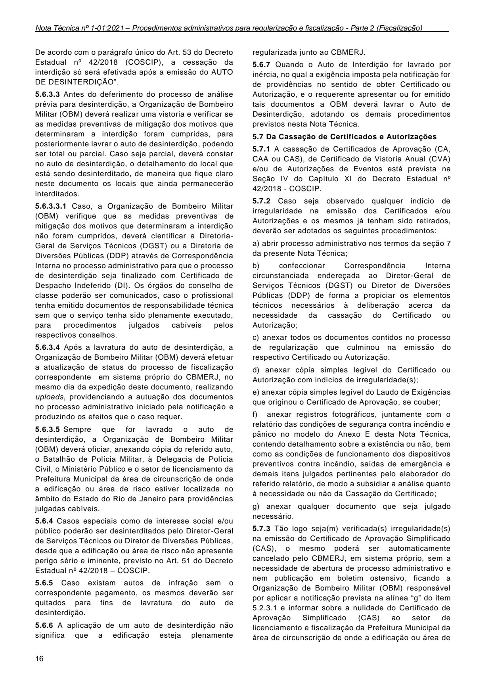

De acordo com o parágrafo único do Art. 53 do Decreto Estadual nº 42/2018 (COSCIP), a cessação da interdição só será efetivada após a emissão do AUTO DE DESINTERDIÇÃO”.

5.6.3.5 Sempre que for lavrado o auto de desinterdição, a Organização de Bombeiro Militar (OBM) deverá oficiar, anexando cópia do referido auto, o Batalhão de Polícia Militar, à Delegacia de Polícia Civil, o Ministério Público e o setor de licenciamento da Prefeitura Municipal da área de circunscrição de onde a edificação ou área de risco estiver localizada no âmbito do Estado do Rio de Janeiro para providências julgadas cabíveis.

5.6.4 Casos especiais como de interesse social e/ou público poderão ser desinterditados pelo Diretor-Geral de Serviços Técnicos ou Diretor de Diversões Públicas, desde que a edificação ou área de risco não apresente perigo sério e iminente, previsto no Art. 51 do Decreto Estadual nº 42/2018 - COSCIP.

5.6.5 Caso existam autos de infração sem o correspondente pagamento, os mesmos deverão ser quitados para fins de lavratura do auto de desinterdição.

5.6.6 A aplicação de um auto de desinterdição não significa que a edificação esteja plenamente

16

regularizada junto ao CBMERJ.

5.6.7 Quando o Auto de Interdição for lavrado por inércia, no qual a exigência imposta pela notificação for de providências no sentido de obter Certificado ou Autorização, e o requerente apresentar ou for emitido tais documentos a OBM deverá lavrar o Auto de Desinterdição, adotando os demais procedimentos previstos nesta Nota Técnica.

5.7 Da Cassação de Certificados e Autorizações

5.7.1 A cassação de Certificados de Aprovação (CA, CAA ou CAS), de Certificado de Vistoria Anual (CVA) e/ou de Autorizações de Eventos está prevista na Seção IV do Capítulo XI do Decreto Estadual nº 42/2018 - COSCIP.

5.7.2 Caso seja observado qualquer indício de irregularidade na emissão dos Certificados e/ou Autorizações e os mesmos já tenham sido retirados, deverão ser adotados os seguintes procedimentos:

a) abrir processo administrativo nos termos da seção 7 da presente Nota Técnica;

b) confeccionar Correspondência Interna circunstanciada endereçada ao Diretor-Geral de Serviços Técnicos (DGST) ou Diretor de Diversões Públicas (DDP) de forma a propiciar os elementos técnicos necessários à deliberação acerca da necessidade da cassação do Certificado ou Autorização;

c) anexar todos os documentos contidos no processo de regularização que culminou na emissão do respectivo Certificado ou Autorização.

d) anexar cópia simples legível do Certificado ou Autorização com indícios de irregularidade(s);

e) anexar cópia simples legível do Laudo de Exigências que originou o Certificado de Aprovação, se couber;

g) anexar qualquer documento que seja julgado necessário.

5.7.3 Tão logo seja(m) verificada(s) irregularidade(s) na emissão do Certificado de Aprovação Simplificado (CAS), o mesmo poderá ser automaticamente cancelado pelo CBMERJ, em sistema próprio, sem a necessidade de abertura de processo administrativo e nem publicação em boletim ostensivo, ficando a Organização de Bombeiro Militar (OBM) responsável por aplicar a notificação prevista na alínea “g” do item 5.2.3.1 e informar sobre a nulidade do Certificado de Aprovação Simplificado (CAS) ao setor de licenciamento e fiscalização da Prefeitura Municipal da área de circunscrição de onde a edificação ou área de

### Tabelas extraídas (bruto, não usar para citação)
#### Tabela 1 da página

| 5.6.3.3 Antes do deferimento do processo de análise |  |  |  |
| --- | --- | --- | --- |
| prévia para desinterdição, a Organização de Bombeiro |  |  |  |
| Militar (OBM) deverá realizar uma vistoria e verificar se |  |  |  |
| as medidas preventivas de mitigação dos motivos que |  |  |  |
| determinaram a interdição foram cumpridas, para |  |  |  |
| posteriormente lavrar o auto de desinterdição, podendo |  |  |  |
| ser total ou parcial. Caso seja parcial, deverá constar |  |  |  |
| no auto de desinterdição, o detalhamento do local que |  |  |  |
| está sendo desinterditado, de maneira que fique claro |  |  |  |
| neste documento os locais que ainda permanecerão |  |  |  |
| interditados. |  |  |  |
| 5.6.3.3.1 Caso, a Organização de Bombeiro Militar |  |  |  |
| (OBM) verifique que as medidas preventivas de |  |  |  |
| mitigação dos motivos que determinaram a interdição |  |  |  |
| não foram cumpridos, deverá cientificar a Diretoria- |  |  |  |
| Geral de Serviços Técnicos (DGST) ou a Diretoria de |  |  |  |
| Diversões Públicas (DDP) através de Correspondência |  |  |  |
| Interna no processo administrativo para que o processo |  |  |  |
| de desinterdição seja finalizado com Certificado de |  |  |  |
| Despacho Indeferido (DI). Os órgãos do conselho de |  |  |  |
| classe poderão ser comunicados, caso o profissional |  |  |  |
| tenha emitido documentos de responsabilidade técnica |  |  |  |
| sem que o serviço tenha sido plenamente executado, |  |  |  |
| para procedimentos julgados cabíveis pelos |  |  |  |
| respectivos conselhos. |  |  |  |
| 5.6.3.4 Após a lavratura do auto de desinterdição, a |  |  |  |
| Organização de Bombeiro Militar (OBM) deverá efetuar |  |  |  |
| a atualização de status do processo de fiscalização |  |  |  |
| correspondente |  | em sistema próprio do CBMERJ, no |  |

#### Tabela 2 da página

| f) anexar registros fotográficos, juntamente com o |  |
| --- | --- |
| relatório das condições de segurança contra incêndio e |  |
| pânico no modelo do Anexo E desta Nota Técnica, |  |
| contendo detalhamento sobre a existência ou não, bem |  |
| como as condições de funcionamento dos dispositivos |  |
| preventivos contra incêndio, saídas de emergência e |  |
| demais itens julgados pertinentes pelo elaborador do |  |
| referido relatório, de modo a subsidiar a análise quanto |  |
| à necessidade ou não da Cassação do Certificado; |  |

---

## Página 17

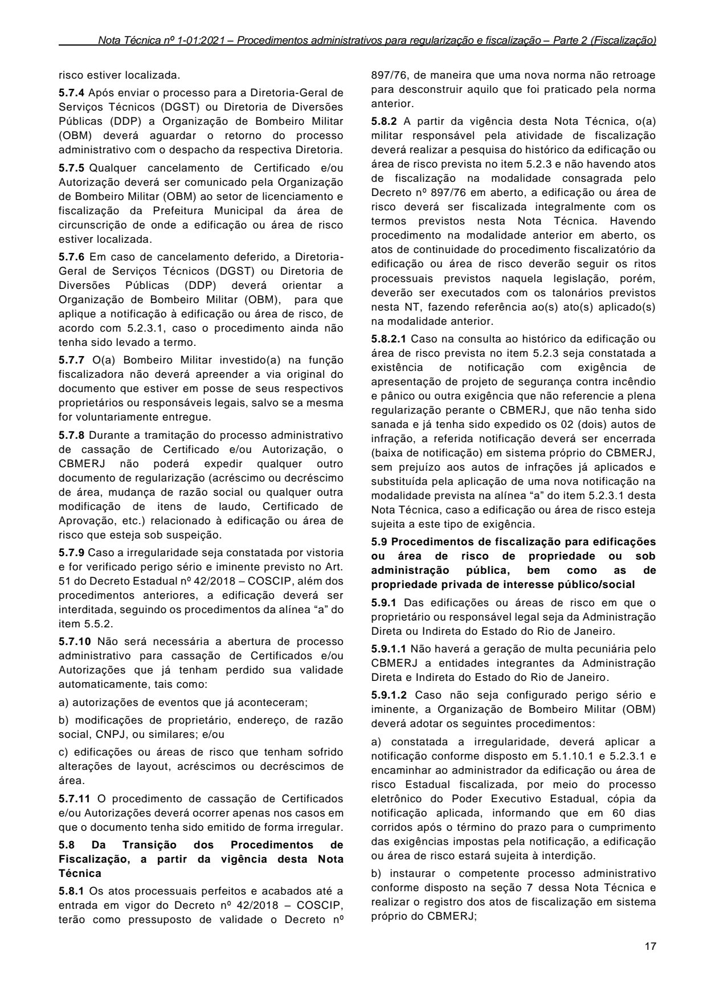

risco estiver localizada.

5.7.4 Após enviar o processo para a Diretoria-Geral de Serviços Técnicos (DGST) ou Diretoria de Diversões Públicas (DDP) a Organização de Bombeiro Militar (OBM) deverá aguardar o retorno do processo administrativo com o despacho da respectiva Diretoria.

5.7.5 Qualquer cancelamento de Certificado e/ou Autorização deverá ser comunicado pela Organização de Bombeiro Militar (OBM) ao setor de licenciamento e fiscalização da Prefeitura Municipal da área de circunscrição de onde a edificação ou área de risco estiver localizada.

5.7.6 Em caso de cancelamento deferido, a DiretoriaGeral de Serviços Técnicos (DGST) ou Diretoria de Diversões Públicas (DDP) deverá orientar a Organização de Bombeiro Militar (OBM), para que aplique a notificação à edificação ou área de risco, de acordo com 5.2.3.1, caso o procedimento ainda não tenha sido levado a termo.

5.7.7 O(a) Bombeiro Militar investido(a) na função fiscalizadora não deverá apreender a via original do documento que estiver em posse de seus respectivos proprietários ou responsáveis legais, salvo se a mesma for voluntariamente entregue.

5.7.8 Durante a tramitação do processo administrativo de cassação de Certificado e/ou Autorização, o CBMERJ não poderá expedir qualquer outro documento de regularização (acréscimo ou decréscimo de área, mudança de razão social ou qualquer outra modificação de itens de laudo, Certificado de Aprovação, etc.) relacionado à edificação ou área de risco que esteja sob suspeição.

5.7.9 Caso a irregularidade seja constatada por vistoria e for verificado perigo sério e iminente previsto no Art. 51 do Decreto Estadual nº 42/2018 - COSCIP, além dos procedimentos anteriores, a edificação deverá ser interditada, seguindo os procedimentos da alínea “a” do item 5.5.2.

5.7.10 Não será necessária a abertura de processo administrativo para cassação de Certificados e/ou Autorizações que já tenham perdido sua validade automaticamente, tais como:

a) autorizações de eventos que já aconteceram;

b) modificações de proprietário, endereço, de razão social, CNPJ, ou similares; e/ou

c) edificações ou áreas de risco que tenham sofrido alterações de layout, acréscimos ou decréscimos de área.

5.7.11 O procedimento de cassação de Certificados e/ou Autorizações deverá ocorrer apenas nos casos em que o documento tenha sido emitido de forma irregular.

5.8 Da Transição dos Procedimentos de Fiscalização, a partir da vigência desta Nota Técnica

5.8.1 Os atos processuais perfeitos e acabados até a entrada em vigor do Decreto nº 42/2018 - COSCIP, terão como pressuposto de validade o Decreto nº

897/76, de maneira que uma nova norma não retroage para desconstruir aquilo que foi praticado pela norma anterior.

5.9 Procedimentos de fiscalização para edificações ou área de risco de propriedade ou sob administração pública, bem como as de propriedade privada de interesse público/social

5.9.1 Das edificações ou áreas de risco em que o proprietário ou responsável legal seja da Administração Direta ou Indireta do Estado do Rio de Janeiro.

5.9.1.2 Caso não seja configurado perigo sério e iminente, a Organização de Bombeiro Militar (OBM) deverá adotar os seguintes procedimentos:

17

### Tabelas extraídas (bruto, não usar para citação)
#### Tabela 1 da página

| de fiscalização | na modalidade consagrada pelo |  |  |
| --- | --- | --- | --- |
| Decreto nº 897/76 em aberto, a edificação ou área de |  |  |  |
| risco deverá ser fiscalizada integralmente com os |  |  |  |
| termos previstos nesta Nota Técnica. Havendo |  |  |  |
| procedimento na modalidade anterior em aberto, os |  |  |  |
| atos de continuidade do procedimento fiscalizatório da |  |  |  |
| edificação ou área de risco deverão seguir os ritos |  |  |  |
| processuais previstos naquela legislação, porém, |  |  |  |
| deverão ser executados com os talonários previstos |  |  |  |
| nesta NT, fazendo referência ao(s) ato(s) aplicado(s) |  |  |  |
| na modalidade anterior. |  |  |  |
| 5.8.2.1 Caso na consulta ao histórico da edificação ou |  |  |  |
| área de risco prevista no item 5.2.3 seja constatada a |  |  |  |
| existência de notificação com exigência de |  |  |  |
| apresentação de projeto de segurança contra incêndio |  |  |  |
| e pânico ou outra exigência que não referencie a plena |  |  |  |
| regularização perante o CBMERJ, que não tenha sido |  |  |  |
| sanada e já tenha sido expedido os 02 (dois) autos de |  |  |  |
| infração, a referida notificação deverá ser encerrada |  |  |  |
| (baixa de notificação) em sistema próprio do CBMERJ, |  |  |  |
| sem prejuízo aos autos de infrações já aplicados e |  |  |  |
| substituída pela aplicação de uma nova notificação na |  |  |  |
| modalidade prevista na alínea “a” do item 5.2.3.1 desta |  |  |  |
| Nota Técnica, caso a edificação ou área de risco esteja |  |  |  |
| sujeita a este tipo de exigência. |  |  |  |

#### Tabela 2 da página

| Aprovação, etc | .) relacionado à edificação ou área de |  |
| --- | --- | --- |
| risco que esteja sob suspeição. |  |  |

#### Tabela 3 da página

| 5.9.1.1 Não haverá a geração de multa pecuniária pelo |  |
| --- | --- |
| CBMERJ a entidades integrantes da Administração |  |
| Direta e Indireta do Estado do Rio de Janeiro. |  |

#### Tabela 4 da página

| a) constatada a irregularidade, deverá aplicar a |  |  |
| --- | --- | --- |
| notificação conforme disposto em 5.1.10.1 e 5.2.3.1 e |  |  |
| encaminhar ao administrador da edificação ou área de |  |  |
| risco Estadual fiscalizada, por meio do processo |  |  |
| eletrônico do Poder Executivo Estadual, cópia da |  |  |
| notificação aplicada, informando que em 60 dias |  |  |
| corridos após o término do prazo para o cumprimento |  |  |
| das exigências impostas pela notificação, a edificação |  |  |
| ou área de risco estará sujeita à interdição. |  |  |
| b) instaurar o competente processo administrativo |  |  |
| conforme disposto na seção 7 dessa Nota Técnica e |  |  |
| realizar o registro dos atos de fiscalização em sistema |  |  |
| próprio do CBMERJ; |  |  |

---

## Página 18

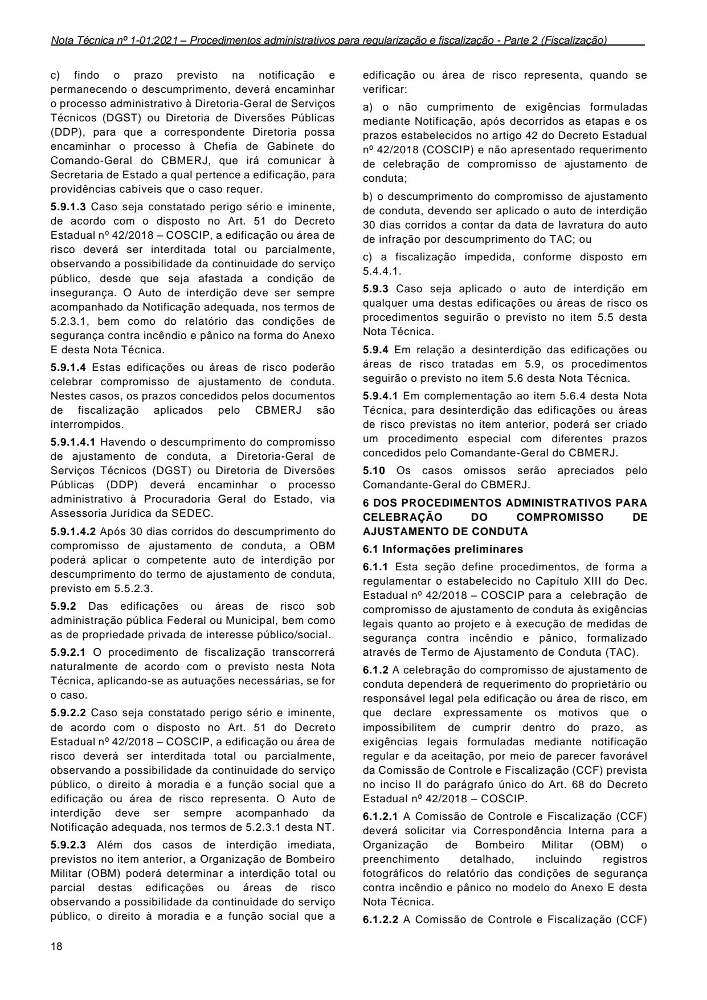

5.9.2 Das edificações ou áreas de risco sob administração pública Federal ou Municipal, bem como as de propriedade privada de interesse público/social.

18

5.10 Os casos omissos serão apreciados pelo Comandante-Geral do CBMERJ.

### 6 DOS PROCEDIMENTOS ADMINISTRATIVOS PARA CELEBRAÇÃO DO COMPROMISSO DE AJUSTAMENTO DE CONDUTA

6.1 Informações preliminares

6.1.1 Esta seção define procedimentos, de forma a regulamentar o estabelecido no Capítulo XIII do Dec. Estadual nº 42/2018 - COSCIP para a celebração de compromisso de ajustamento de conduta às exigências legais quanto ao projeto e à execução de medidas de segurança contra incêndio e pânico, formalizado através de Termo de Ajustamento de Conduta (TAC).

6.1.2 A celebração do compromisso de ajustamento de conduta dependerá de requerimento do proprietário ou responsável legal pela edificação ou área de risco, em que declare expressamente os motivos que o impossibilitem de cumprir dentro do prazo, as exigências legais formuladas mediante notificação regular e da aceitação, por meio de parecer favorável da Comissão de Controle e Fiscalização (CCF) prevista no inciso II do parágrafo único do Art. 68 do Decreto Estadual nº 42/2018 - COSCIP.

### Tabelas extraídas (bruto, não usar para citação)
#### Tabela 1 da página

| c) findo o prazo previsto na notificação e |  |  |  |  |
| --- | --- | --- | --- | --- |
| permanecendo o descumprimento, deverá encaminhar |  |  |  |  |
| o processo administrativo à Diretoria-Geral de Serviços |  |  |  |  |
| Técnicos (DGST) ou Diretoria de Diversões Públicas |  |  |  |  |
| (DDP), para que a correspondente Diretoria possa |  |  |  |  |
| encaminhar o processo à Chefia de Gabinete do |  |  |  |  |
| Comando-Geral do CBMERJ, que irá comunicar à |  |  |  |  |
| Secretaria de Estado a qual pertence a edificação, para |  |  |  |  |
| providências cabíveis que o caso requer. |  |  |  |  |
| 5.9.1.3 Caso seja constatado perigo sério e iminente, |  |  |  |  |
| de acordo com o disposto no Art. 51 do Decreto |  |  |  |  |
| Estadual nº 42/2018 - COSCIP, a edificação ou área de |  |  |  |  |
| risco deverá ser interditada total ou parcialmente, |  |  |  |  |
| observando a possibilidade da continuidade do serviço |  |  |  |  |
| público, desde que seja afastada a condição de |  |  |  |  |
| insegurança. O Auto de interdição deve ser sempre |  |  |  |  |
| acompanhado da Notificação adequada, nos termos de |  |  |  |  |
| 5.2.3.1, bem como do relatório das condições de |  |  |  |  |
| segurança contra incêndio e pânico na forma do Anexo |  |  |  |  |
| E desta Nota Técnica. |  |  |  |  |
| 5.9.1.4 Estas edificações ou áreas de risco poderão |  |  |  |  |
| celebrar compromisso de ajustamento de conduta. |  |  |  |  |
| Nestes casos, os prazos concedidos pelos documentos |  |  |  |  |
| de fiscalização aplicados pelo CBMERJ são |  |  |  |  |
| interrompidos. |  |  |  |  |
| 5.9.1.4.1 Havendo o descumprimento do compromisso |  |  |  |  |
| de ajustamento de conduta, a Diretoria-Geral de |  |  |  |  |
| Serviços Técnicos (DGST) ou Diretoria de Diversões |  |  |  |  |
| Públicas (DDP) deverá encaminhar o processo |  |  |  |  |
| administrativo à Procuradoria Geral do Estado, via |  |  |  |  |
| Assessoria Jurídica da SEDEC. |  |  |  |  |
| 5.9.1.4.2 Após 30 dias corridos do descumprimento do |  |  |  |  |
| compromisso de ajustamento de conduta, a OBM |  |  |  |  |
| poderá aplicar o competente auto de interdição por |  |  |  |  |
| descumprimento do termo de ajustamento de conduta, |  |  |  |  |
| previsto em 5.5.2.3. |  |  |  |  |

#### Tabela 2 da página

| edificação ou área de risco representa, quando se |  |  |  |
| --- | --- | --- | --- |
| verificar: |  |  |  |
| a) o não cumprimento de exigências formuladas |  |  |  |
| mediante Notificação, após decorridos as etapas e os |  |  |  |
| prazos estabelecidos no artigo 42 do Decreto Estadual |  |  |  |
| nº 42/2018 (COSCIP) e não apresentado requerimento |  |  |  |
| de celebração de compromisso de ajustamento de |  |  |  |
| conduta; |  |  |  |
| b) o descumprimento do compromisso de ajustamento |  |  |  |
| de conduta, devendo ser aplicado o auto de interdição |  |  |  |
| 30 dias corridos a contar da data de lavratura do auto |  |  |  |
| de infração por descumprimento do TAC; ou |  |  |  |
| c) a fiscalização impedida, conforme disposto em |  |  |  |
| 5.4.4.1. |  |  |  |

#### Tabela 3 da página

| 5.9.3 Caso seja aplicado o auto de interdição em |  |  |  |
| --- | --- | --- | --- |
| qualquer uma destas edificações ou áreas de risco os |  |  |  |
| procedimentos seguirão o previsto no item 5.5 desta |  |  |  |
| Nota Técnica. |  |  |  |
| 5.9.4 Em relação a desinterdição das edificações ou |  |  |  |
| áreas de risco tratadas em 5.9, os procedimentos |  |  |  |
| seguirão o previsto no item 5.6 desta Nota Técnica. |  |  |  |
| 5.9.4.1 Em complementação ao item 5.6.4 desta Nota |  |  |  |
| Técnica, para desinterdição das edificações ou áreas |  |  |  |
| de risco previstas no item anterior, poderá ser criado |  |  |  |
| um procedimento especial com diferentes prazos |  |  |  |
| concedidos pelo Comandante-Geral do CBMERJ. |  |  |  |

#### Tabela 4 da página

| 5.9.2.1 O procedimento de fiscalização transcorrerá |  |
| --- | --- |
| naturalmente de acordo com o previsto nesta Nota |  |
| Técnica, aplicando-se as autuações necessárias, se for |  |
| o caso. |  |
| 5.9.2.2 Caso seja constatado perigo sério e iminente, |  |
| de acordo com o disposto no Art. 51 do Decreto |  |
| Estadual nº 42/2018 - COSCIP, a edificação ou área de |  |
| risco deverá ser interditada total ou parcialmente, |  |
| observando a possibilidade da continuidade do serviço |  |
| público, o direito à moradia e a função social que a |  |
| edificação ou área de risco representa. O Auto de |  |
| interdição deve ser sempre acompanhado da |  |
| Notificação adequada, nos termos de 5.2.3.1 desta NT. |  |
| 5.9.2.3 Além dos casos de interdição imediata, |  |
| previstos no item anterior, a Organização de Bombeiro |  |
| Militar (OBM) poderá determinar a interdição total ou |  |
| parcial destas edificações ou áreas de risco |  |
| observando a possibilidade da continuidade do serviço |  |
| público, o direito à moradia e a função social que a |  |

#### Tabela 5 da página

| regular e | da aceitação, por meio de parecer favorável |  |  |
| --- | --- | --- | --- |
| da Comissão de Controle e Fiscalização (CCF) prevista |  |  |  |
| no inciso II do parágrafo único do Art. 68 do Decreto |  |  |  |
| Estadual nº 42/2018 - COSCIP. |  |  |  |
| 6.1.2.1 A Comissão de Controle e Fiscalização (CCF) |  |  |  |
| deverá solicitar via Correspondência Interna para a |  |  |  |
| Organização de Bombeiro Militar (OBM) o |  |  |  |
| preenchimento detalhado, incluindo registros |  |  |  |
| fotográficos do relatório das condições de segurança |  |  |  |
| contra incêndio e pânico no modelo do Anexo E desta |  |  |  |
| Nota Técnica. |  |  |  |
| 6.1.2.2 A Comissão de Controle e Fiscalização (CCF) |  |  |  |

---

## Página 19

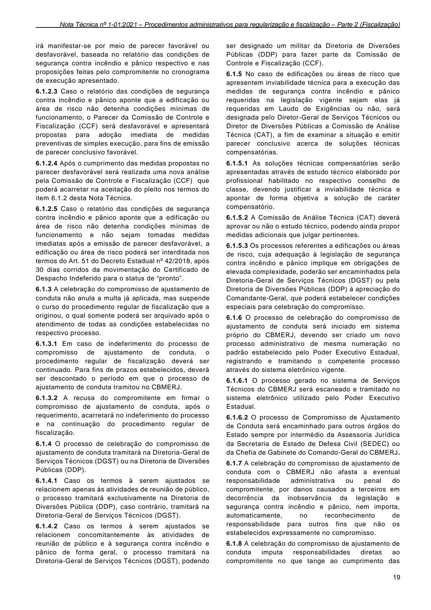

6.1.3 A celebração do compromisso de ajustamento de conduta não anula a multa já aplicada, mas suspende o curso do procedimento regular de fiscalização que a originou, o qual somente poderá ser arquivado após o atendimento de todas as condições estabelecidas no respectivo processo.

6.1.3.2 A recusa do compromitente em firmar o compromisso de ajustamento de conduta, após o requerimento, acarretará no indeferimento do processo e na continuação do procedimento regular de fiscalização.

6.1.4 O processo de celebração do compromisso de ajustamento de conduta tramitará na Diretoria-Geral de Serviços Técnicos (DGST) ou na Diretoria de Diversões Públicas (DDP).

6.1.4.1 Caso os termos à serem ajustados se relacionem apenas às atividades de reunião de público, o processo tramitará exclusivamente na Diretoria de Diversões Pública (DDP), caso contrário, tramitará na Diretoria-Geral de Serviços Técnicos (DGST).

6.1.4.2 Caso os termos à serem ajustados se relacionem concomitantemente às atividades de reunião de público e à segurança contra incêndio e pânico de forma geral, o processo tramitará na Diretoria-Geral de Serviços Técnicos (DGST), podendo

ser designado um militar da Diretoria de Diversões Públicas (DDP) para fazer parte da Comissão de Controle e Fiscalização (CCF).

6.1.5 No caso de edificações ou áreas de risco que apresentem inviabilidade técnica para a execução das medidas de segurança contra incêndio e pânico requeridas na legislação vigente sejam elas já requeridas em Laudo de Exigências ou não, será designada pelo Diretor-Geral de Serviços Técnicos ou Diretor de Diversões Públicas a Comissão de Análise Técnica (CAT), a fim de examinar a situação e emitir parecer conclusivo acerca de soluções técnicas compensatórias.

6.1.5.2 A Comissão de Análise Técnica (CAT) deverá aprovar ou não o estudo técnico, podendo ainda propor medidas adicionais que julgar pertinentes.

6.1.5.3 Os processos referentes a edificações ou áreas de risco, cuja adequação à legislação de segurança contra incêndio e pânico implique em obrigações de elevada complexidade, poderão ser encaminhados pela Diretoria-Geral de Serviços Técnicos (DGST) ou pela Diretoria de Diversões Públicas (DDP) à apreciação do Comandante-Geral, que poderá estabelecer condições especiais para celebração do compromisso.

6.1.6 O processo de celebração do compromisso de ajustamento de conduta será iniciado em sistema próprio do CBMERJ, devendo ser criado um novo processo administrativo de mesma numeração no padrão estabelecido pelo Poder Executivo Estadual, registrando e tramitando o competente processo através do sistema eletrônico vigente.

6.1.7 A celebração do compromisso de ajustamento de conduta com o CBMERJ não afasta a eventual responsabilidade administrativa ou penal do compromitente, por danos causados a terceiros em decorrência da inobservância da legislação e segurança contra incêndio e pânico, nem importa, automaticamente, no reconhecimento de responsabilidade para outros fins que não os estabelecidos expressamente no compromisso.

6.1.8 A celebração do compromisso de ajustamento de conduta imputa responsabilidades diretas ao compromitente no que tange ao cumprimento das

19

### Tabelas extraídas (bruto, não usar para citação)
#### Tabela 1 da página

| irá manifestar-se por meio de parecer favorável ou |  |  |  |  |
| --- | --- | --- | --- | --- |
| desfavorável, baseada no relatório das condições de |  |  |  |  |
| segurança contra incêndio e pânico respectivo e nas |  |  |  |  |
| proposições feitas pelo compromitente no cronograma |  |  |  |  |
| de execução apresentado. |  |  |  |  |
| 6.1.2.3 Caso o relatório das condições de segurança |  |  |  |  |
| contra incêndio e pânico aponte que a edificação ou |  |  |  |  |
| área de risco não detenha condições mínimas de |  |  |  |  |
| funcionamento, o Parecer da Comissão de Controle e |  |  |  |  |
| Fiscalização (CCF) será desfavorável e apresentará |  |  |  |  |
| propostas para adoção imediata de medidas |  |  |  |  |
| preventivas de simples execução, para fins de emissão |  |  |  |  |
| de parecer conclusivo favorável. |  |  |  |  |
| 6.1.2.4 Após o cumprimento das medidas propostas no |  |  |  |  |
| parecer desfavorável será realizada uma nova análise |  |  |  |  |
| pela Comissão de Controle e Fiscalização (CCF) que |  |  |  |  |
| poderá acarretar na aceitação do pleito nos termos do |  |  |  |  |
| item 6.1.2 desta Nota Técnica. |  |  |  |  |
| 6.1.2.5 Caso o relatório das condições de segurança |  |  |  |  |
| contra incêndio e pânico aponte que a edificação ou |  |  |  |  |
| área de risco não detenha condições mínimas de |  |  |  |  |
| funcionamento e não sejam tomadas medidas |  |  |  |  |
| imediatas após a emissão de parecer desfavorável, a |  |  |  |  |
| edificação ou área de risco poderá ser interditada nos |  |  |  |  |
| termos do Art. 51 do Decreto Estadual nº 42/2018, após |  |  |  |  |
| 30 dias corridos da movimentação do Certificado de |  |  |  |  |
| Despacho Indeferido para o status de “pronto”. |  |  |  |  |

#### Tabela 2 da página

| requeridas na legislação vigente | sejam elas já |  |
| --- | --- | --- |
| requeridas em Laudo de Exigências ou não, |  | será |

#### Tabela 3 da página

| 6.1.5.1 As soluções técnicas compensatórias serão |  |
| --- | --- |
| apresentadas através de estudo técnico elaborado por |  |
| profissional habilitado no respectivo conselho de |  |
| classe, devendo justificar a inviabilidade técnica e |  |
| apontar de forma objetiva a solução de caráter |  |
| compensatório. |  |

#### Tabela 4 da página

| 6.1.3.1 Em caso de indeferimento do processo de |  |
| --- | --- |
| compromisso de ajustamento de conduta, o |  |
| procedimento regular de fiscalização deverá ser |  |
| continuado. Para fins de prazos estabelecidos, deverá |  |
| ser descontado o período em que o processo de |  |
| ajustamento de conduta tramitou no CBMERJ. |  |

#### Tabela 5 da página

| 6.1.6.1 O processo gerado no sistema de Serviços |  |
| --- | --- |
| Técnicos do CBMERJ será escaneado e tramitado no |  |
| sistema eletrônico utilizado pelo Poder Executivo |  |
| Estadual. |  |
| 6.1.6.2 O processo de Compromisso de Ajustamento |  |
| de Conduta será encaminhado para outros órgãos do |  |
| Estado sempre por intermédio da Assessoria Jurídica |  |
| da Secretaria de Estado de Defesa Civil (SEDEC) ou |  |
| da Chefia de Gabinete do Comando-Geral do CBMERJ. |  |

---

## Página 20

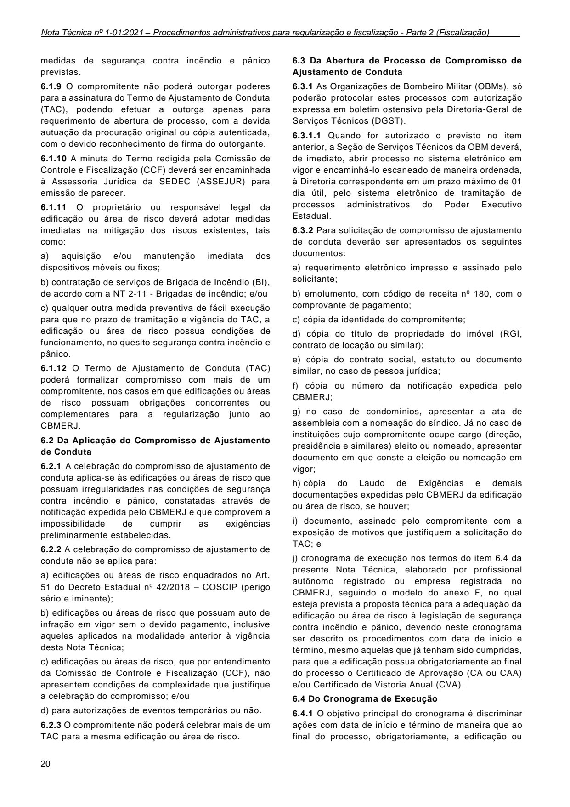

medidas de segurança contra incêndio e pânico previstas.

6.1.9 O compromitente não poderá outorgar poderes para a assinatura do Termo de Ajustamento de Conduta (TAC), podendo efetuar a outorga apenas para requerimento de abertura de processo, com a devida autuação da procuração original ou cópia autenticada, com o devido reconhecimento de firma do outorgante.

6.1.10 A minuta do Termo redigida pela Comissão de Controle e Fiscalização (CCF) deverá ser encaminhada à Assessoria Jurídica da SEDEC (ASSEJUR) para emissão de parecer.

6.1.11 O proprietário ou responsável legal da edificação ou área de risco deverá adotar medidas imediatas na mitigação dos riscos existentes, tais como:

a) aquisição e/ou manutenção imediata dos dispositivos móveis ou fixos;

b) contratação de serviços de Brigada de Incêndio (BI), de acordo com a NT 2-11 - Brigadas de incêndio; e/ou

c) qualquer outra medida preventiva de fácil execução para que no prazo de tramitação e vigência do TAC, a edificação ou área de risco possua condições de funcionamento, no quesito segurança contra incêndio e pânico.

6.1.12 O Termo de Ajustamento de Conduta (TAC) poderá formalizar compromisso com mais de um compromitente, nos casos em que edificações ou áreas de risco possuam obrigações concorrentes ou complementares para a regularização junto ao CBMERJ.

6.2 Da Aplicação do Compromisso de Ajustamento de Conduta

6.2.1 A celebração do compromisso de ajustamento de conduta aplica-se às edificações ou áreas de risco que possuam irregularidades nas condições de segurança contra incêndio e pânico, constatadas através de notificação expedida pelo CBMERJ e que comprovem a impossibilidade de cumprir as exigências preliminarmente estabelecidas.

6.2.2 A celebração do compromisso de ajustamento de conduta não se aplica para:

6.2.3 O compromitente não poderá celebrar mais de um TAC para a mesma edificação ou área de risco.

20

6.3 Da Abertura de Processo de Compromisso de Ajustamento de Conduta

6.3.1 As Organizações de Bombeiro Militar (OBMs), só poderão protocolar estes processos com autorização expressa em boletim ostensivo pela Diretoria-Geral de Serviços Técnicos (DGST).

6.3.2 Para solicitação de compromisso de ajustamento de conduta deverão ser apresentados os seguintes documentos:

a) requerimento eletrônico impresso e assinado pelo solicitante;

b) emolumento, com código de receita nº 180, com o comprovante de pagamento;

d) cópia do título de propriedade do imóvel (RGI, contrato de locação ou similar);

e) cópia do contrato social, estatuto ou documento similar, no caso de pessoa jurídica;

f) cópia ou número da notificação expedida pelo CBMERJ;

h) cópia do Laudo de Exigências e demais documentações expedidas pelo CBMERJ da edificação ou área de risco, se houver;

6.4 Do Cronograma de Execução

6.4.1 O objetivo principal do cronograma é discriminar ações com data de início e término de maneira que ao final do processo, obrigatoriamente, a edificação ou

### Tabelas extraídas (bruto, não usar para citação)
#### Tabela 1 da página

| 6.3.1.1 Quando for autorizado o previsto no item |  |
| --- | --- |
| anterior, a Seção de Serviços Técnicos da OBM deverá, |  |
| de imediato, abrir processo no sistema eletrônico em |  |
| vigor e encaminhá-lo escaneado de maneira ordenada, |  |
| à Diretoria correspondente em um prazo máximo de 01 |  |
| dia útil, pelo sistema eletrônico de tramitação de |  |
| processos administrativos do Poder Executivo |  |
| Estadual. |  |

#### Tabela 2 da página

| do compromitente; |  |  |
| --- | --- | --- |
| propriedade | do imóvel (RGI, |  |

#### Tabela 3 da página

| g) no caso de condomínios, apresentar a ata de |  |
| --- | --- |
| assembleia com a nomeação do síndico. Já no caso de |  |
| instituições cujo compromitente ocupe cargo (direção, |  |
| presidência e similares) eleito ou nomeado, apresentar |  |
| documento em que conste a eleição ou nomeação em |  |
| vigor; |  |

#### Tabela 4 da página

| i) documento, assinado pelo compromitente com a |  |  |
| --- | --- | --- |
| exposição de motivos que justifiquem a solicitação do |  |  |
| TAC; e |  |  |
| j) cronograma de execução nos termos do item 6.4 da |  |  |
| presente Nota Técnica, elaborado por profissional |  |  |
| autônomo registrado ou empresa registrada no |  |  |
| CBMERJ, seguindo o modelo do anexo F, no qual |  |  |
| esteja prevista a proposta técnica para a adequação da |  |  |
| edificação ou área de risco à legislação de segurança |  |  |
| contra incêndio e pânico, devendo neste cronograma |  |  |
| ser descrito os procedimentos com data de início e |  |  |
| término, mesmo aquelas que já tenham sido cumpridas, |  |  |
| para que a edificação possua obrigatoriamente ao final |  |  |
| do processo o Certificado de Aprovação (CA ou CAA) |  |  |
| e/ou Certificado de Vistoria Anual (CVA). |  |  |

#### Tabela 5 da página

| a) edificações ou áreas de risco enquadrados no Art. |  |
| --- | --- |
| 51 do Decreto Estadual nº 42/2018 - COSCIP (perigo |  |
| sério e iminente); |  |
| b) edificações ou áreas de risco que possuam auto de |  |
| infração em vigor sem o devido pagamento, inclusive |  |
| aqueles aplicados na modalidade anterior à vigência |  |
| desta Nota Técnica; |  |
| c) edificações ou áreas de risco, que por entendimento |  |
| da Comissão de Controle e Fiscalização (CCF), não |  |
| apresentem condições de complexidade que justifique |  |
| a celebração do compromisso; e/ou |  |
| d) para autorizações de eventos temporários ou não. |  |

---

## Página 21

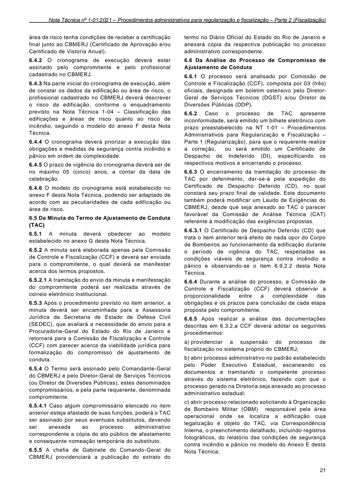

área de risco tenha condições de receber a certificação final junto ao CBMERJ (Certificado de Aprovação e/ou Certificado de Vistoria Anual).

6.4.4 O cronograma deverá priorizar a execução das obrigações e medidas de segurança contra incêndio e pânico em ordem de complexidade.

6.4.5 O prazo de vigência do cronograma deverá ser de no máximo 05 (cinco) anos, a contar da data de celebração.

6.4.6 O modelo do cronograma está estabelecido no anexo F desta Nota Técnica, podendo ser adaptado de acordo com as peculiaridades de cada edificação ou área de risco.

6.5 Da Minuta do Termo de Ajustamento de Conduta (TAC)

6.5.1 A minuta deverá obedecer ao modelo estabelecido no anexo G desta Nota Técnica.

6.5.2 A minuta será elaborada apenas pela Comissão de Controle e Fiscalização (CCF) e deverá ser enviada para o compromitente, o qual deverá se manifestar acerca dos termos propostos.

6.5.2.1 A tramitação do envio da minuta e manifestação do compromitente poderá ser realizada através de correio eletrônico institucional.

6.5.3 Após o procedimento previsto no item anterior, a minuta deverá ser encaminhada para a Assessoria Jurídica da Secretaria de Estado de Defesa Civil (SEDEC), que avaliará a necessidade do envio para a Procuradoria-Geral do Estado do Rio de Janeiro e retornará para a Comissão de Fiscalização e Controle (CCF) com parecer acerca da viabilidade jurídica para formalização do compromisso de ajustamento de conduta.

6.5.4 O Termo será assinado pelo Comandante-Geral do CBMERJ e pelo Diretor-Geral de Serviços Técnicos (ou Diretor de Diversões Públicas), estes denominados compromissários, e pela parte requerente, denominada compromitente.

6.6 Da Análise do Processo de Compromisso de Ajustamento de Conduta

6.6.1 O processo será analisado por Comissão de Controle e Fiscalização (CCF), composta por 03 (três) oficiais, designada em boletim ostensivo pelo DiretorGeral de Serviços Técnicos (DGST) e/ou Diretor de Diversões Públicas (DDP).

6.6.5 Após realizar a análise das documentações descritas em 6.3.2,a CCF deverá adotar os seguintes procedimentos:

a) providenciar a suspensão do processo de fiscalização no sistema próprio do CBMERJ;

b) abrir processo administrativo no padrão estabelecido pelo Poder Executivo Estadual, escaneando os documentos e tramitando o competente processo através do sistema eletrônico, fazendo com que o processo gerado na Diretoria seja anexado ao processo administrativo estadual;

c) abrir processo relacionado solicitando à Organização de Bombeiro Militar (OBM) responsável pela área operacional onde se localiza a edificação cuja legalização é objeto do TAC, via Correspondência Interna, o preenchimento detalhado, incluindo registros fotográficos, do relatório das condições de segurança contra incêndio e pânico no modelo do Anexo E desta Nota Técnica;

21

### Tabelas extraídas (bruto, não usar para citação)
#### Tabela 1 da página

| termo no Diário Oficial do Estado do Rio de Janeiro e |  |
| --- | --- |
| anexará cópia da respectiva publicação no processo |  |
| administrativo correspondente. |  |

#### Tabela 2 da página

| 6.4.2 O cronograma de execução deverá estar |  |
| --- | --- |
| assinado pelo compromitente e pelo profissional |  |
| cadastrado no CBMERJ. |  |

#### Tabela 3 da página

| previsto na Nota Técnica 1-04 - |  | Classificação das |
| --- | --- | --- |
| edificações e áreas de risco quanto ao risco de |  |  |
| incêndio, seguindo o modelo do anexo F desta Nota |  |  |
| Técnica. |  |  |

#### Tabela 4 da página

| 6.6.2 Caso o processo de TAC apresente |  |
| --- | --- |
| inconformidade, será emitido um bilhete eletrônico com |  |
| prazo preestabelecido na NT 1-01 - Procedimentos |  |
| Administrativos para Regularização e Fiscalização - |  |
| Parte 1 (Regularização), | para que o requerente realize |

#### Tabela 5 da página

| respectivos motiv |  | os e e | ncerrando o processo. |  |  |
| --- | --- | --- | --- | --- | --- |
| 6.6.3 O encerramento da tramitação do processo de |  |  |  |  |  |
| TAC por deferimento, dar-se-á pela expedição do |  |  |  |  |  |
| Certificado de Despacho Deferido (CD), no qual |  |  |  |  |  |
| constará seu prazo final de validade. Este documento |  |  |  |  |  |
| também poderá modificar um Laudo de Exigências do |  |  |  |  |  |
| CBMERJ, desde que seja anexado ao TAC o parecer |  |  |  |  |  |
| favorável da Comissão de Análise Técnica (CAT) |  |  |  |  |  |
| referente à modificação das exigências propostas. |  |  |  |  |  |
| 6.6.3.1 O Certificado de Despacho Deferido (CD) que |  |  |  |  |  |
| trata o item anterior terá efeito de nada opor do Corpo |  |  |  |  |  |
| de Bombeiros ao funcionamento da edificação durante |  |  |  |  |  |
| o período de vigência do TAC, respeitadas as |  |  |  |  |  |
| condições viáveis de segurança contra incêndio e |  |  |  |  |  |
| pânico e observando-se o item 6.9.2.2 desta Nota |  |  |  |  |  |
| Técnica. |  |  |  |  |  |
| 6.6.4 Durante a análise do processo, a Comissão de |  |  |  |  |  |
| Controle e Fiscalização (CCF) deverá observar a |  |  |  |  |  |
| proporcionalidade entre a complexidade das |  |  |  |  |  |
| obrigações e os prazos para conclusão de cada etapa |  |  |  |  |  |
| proposta pelo compromitente. |  |  |  |  |  |

#### Tabela 6 da página

| desta Nota Técnica. |  |  |
| --- | --- | --- |
| orada | apenas | pela |

#### Tabela 7 da página

| 6.5.4.1 Caso algum compromissário elencado no item |  |
| --- | --- |
| anterior esteja afastado de suas funções, poderá o TAC |  |
| ser assinado por seus eventuais substitutos, devendo |  |
| ser anexada ao processo administrativo |  |
| correspondente a cópia do ato público de afastamento |  |
| e consequente nomeação temporária do substituto. |  |
| 6.5.5 A chefia de Gabinete do Comando-Geral do |  |
| CBMERJ providenciará a publicação do extrato do |  |

---

## Página 22

d) verificar a necessidade de convocação da Comissão de Análise Técnica (CAT), prevista no Art. 61 do Decreto nº 42/2018 - COSCIP;

e) confeccionar o parecer conclusivo;

f) se o parecer for desfavorável, emitir o bilhete eletrônico ou Certificado de Despacho Indeferido (DI) especificando os motivos;

g) se o parecer for favorável, confeccionar a minuta do Termo de Ajustamento de Conduta (TAC) no modelo do anexo G e adotar os procedimentos previstos em 6.5;

h) Disponibilizar 03 (três) vias do Termo de Ajustamento de Conduta (TAC) após o retorno do processo da Assessoria Jurídica (ASSEJUR) da SEDEC com o parecer jurídico, conforme o item 6.5.3 desta Nota Técnica, para assinatura do compromitente e Diretor-Geral de Serviços Técnicos ou de Diversões Públicas ou seus eventuais substitutos, conforme disposto em 6.5.4.1;

i) remeter o processo administrativo para Chefia de Gabinete, a fim de que seja colhida a assinatura do Comandante-Geral do CBMERJ ou seu eventual substituto, conforme disposto em 6.5.4.1;

j) aguardar a publicação do extrato do Termo de Ajustamento de Conduta (TAC), que será realizado através da Chefia de Gabinete do Comandante-Geral do CBMERJ, no Diário Oficial do Estado do Rio de Janeiro (DOERJ);

k) disponibilizar o Certificado de Despacho Deferido (CD) com efeito de nada opor e modificar o processo para o status de pronto para retirada pelo compromitente;

l) escanear o Certificado de Despacho Deferido (CD) e o Termo de Ajustamento de Conduta (TAC) assinados e realizar o upload no sistema de Serviços Técnicos e no processo administrativo correspondente; e

m) gerar correspondência interna no mesmo processo referido anteriormente informando, através de Correspondência Interna, à Organização de Bombeiro Militar (OBM) responsável pela área operacional onde se localiza a edificação cuja legalização é objeto do TAC, sobre a celebração do TAC e sobre seus prazos, anexando no processo o Certificado de Despacho Deferido (CD) e o Termo de Ajustamento de Conduta (TAC) assinados para que a Seção de Serviços Técnicos adote as medidas de verificação de cumprimento ou não do TAC sem a necessidade de intervenção da Diretoria-Geral de Serviços Técnicos ou Diretoria de Diversões Públicas, conforme for o caso.

6.6.6 O Termo de Ajustamento de Conduta (TAC) assinado em 03 vias pelo compromitente e compromissários deverá ter as seguintes destinações:

a) 02 vias arquivadas na DGST; e

b) 01 via para o compromitente.

6.6.7 Toda documentação referente ao processo de compromisso de ajustamento de conduta, deverá ser escaneada no sistema em ordem cronológica, conforme o padrão estabelecido pelo Poder Executivo Estadual.

22

6.7 Do Aditamento de Termo de Ajustamento de Conduta (TAC)

6.7.1 O Termo de Ajustamento de Conduta (TAC) poderá ser alterado, devidamente fundamentado e justificado, mediante a celebração de Termo Aditivo, cujas vias serão em mesma quantidade de signatários do termo inicial.

6.7.2 O prazo poderá ser modificado pelo Termo Aditivo desde que a vigência total incluindo o aditamento não ultrapasse 05 (cinco) anos.

6.7.3 O processo de solicitação de aditamento deverá ser protocolado, antes do término da vigência do TAC original, sendo instruído com os documentos previstos em 6.3.2 desta Nota Técnica, acrescidos das cópias simples do Certificado de Despacho Deferido (CD) e do Termo de Ajustamento de Conduta (TAC) original devidamente assinado.

6.7.4 A tramitação do Termo Aditivo seguirá os mesmos procedimentos previstos na tramitação do TAC original.

6.7.5 Quando houver necessidade de emissão de Laudo de Exigências que contemple exigências não previstas no compromisso assinado ou até isenção de exigências inseridas no cronograma constante no Termo, o compromitente deverá solicitar aditamento do TAC, prevendo as devidas atualizações.

6.7.6 Quando um Termo de Ajustamento de Conduta (TAC) for aditado, o mesmo não modificará sua numeração, deverá ser nomeado como 1º Aditamento do TAC nº (citar a numeração original do TAC) e assim sucessivamente, para o caso de novos aditamentos do mesmo TAC.

6.8 Do Descumprimento do Termo de Ajustamento de Conduta (TAC) - Rescisão Unilateral do Compromisso, através da aplicação de multa e/ou interdição

6.8.1 Todo Termo de Ajustamento de Conduta (TAC) deve ser finalizado mediante a emissão do Certificado de Aprovação ou Certificado de Vistoria Anual.

6.8.1.1 A Organização de Bombeiro Militar (OBM) responsável pela área operacional onde se localiza a edificação cuja legalização é objeto do TAC deverá, ao término do prazo previsto no Termo de Ajustamento de Conduta (TAC), consultar em sistema próprio do CBMERJ se houve a emissão da Certificação final prevista no cronograma de execução e caso o procedimento não tenha sido levado a termo, deverá providenciar a aplicação do auto de infração, exceto nos casos em que o compromitente for integrante da Administração Direta ou Indireta do Estado do Rio de Janeiro próprio ao Estado do Rio de Janeiro, em função do disposto em 5.9.1.1.

6.8.2 No auto de infração deverá constar:

a) razão social, endereço, CNPJ cadastrados no TAC;

b) numeração do TAC descumprido;

c) valor da multa, conforme pré estabelecido no TAC; e

d) a seguinte redação: “NÃO TER CUMPRIDO O TERMO DE AJUSTAMENTO DE CONDUTA Nº

---

## Página 23

(mencionar o número do TAC), DATADO DE (mencionar a data de assinatura do TAC) DE ACORDO COM O QUE PRECEITUA O ANEXO IV DO DECRETO ESTADUAL Nº 42 DE 17/12/2018”.

6.8.3 Decorridos 30 dias consecutivos após o envio do auto de infração, caso a edificação ou área de risco não detenha as certificações acordadas no Termo de Ajustamento de Conduta (TAC), esta poderá ser interditada, nos termos de 5.5 desta NT. A redação do auto de interdição por descumprimento de TAC está descrito no item 5.5.2.3 desta Nota Técnica.

6.8.4 A Diretoria-Geral de Serviços Técnicos (DGST) ou Diretoria de Diversões Públicas (DDP), deverá anexar no processo administrativo do Termo de Ajustamento de Conduta (TAC) o auto de infração e/ou auto de intedição aplicados e enviar para a Assessoria Jurídica da Secretaria de Estado de Defesa Civil (SEDEC) informando o descumprimento do compromisso de ajustamento de conduta, para que seja remetido à Procuradoria-Geral do Estado (PGE) um comunicado com vistas à propositura de ação cabível, informando da disponibilidade da via original do TAC assinada.

6.8.5 O auto de infração por descumprimento do Termo de Ajustamento de Conduta (TAC), atendendo aos critérios estabelecidos no Decreto nº 42/2018- COSCIP, será determinado em função dos seguintes parâmetros:

a) área total construída;

b) risco de incêndio do imóvel ou estabelecimento; e

c) prazo de vigência do Termo de Ajustamento de Conduta (TAC).

6.8.5.1 O risco de incêndio da edificação ou área de risco será estabelecido conforme o enquadramento previsto na Nota Técnica 1-04 - Classificação das edificações e áreas de risco quanto ao risco de incêndio

6.8.5.2 Os valores da multa referente ao Auto de infração por descumprimento do Termo de Ajustamento de Conduta (TAC) foram fixados conforme o anexo H, sendo respeitado o estabelecido pelo anexo IV do Decreto Estadual nº 42/2018 - COSCIP.

6.8.6 A aplicação da multa significa rescisão unilateral do compromisso firmado, por motivo de descumprimento por parte do compromitente.

6.9 Das Disposições finais

6.9.1 Os processos de interdição, desinterdição e recursos/impugnações de penalidades oriundos da rescisão unilateral do compromisso de ajustamento de conduta, seguirão os respectivos procedimentos descritos anteriormente nesta Nota Técnica.

6.9.2 A assinatura do Termo de Ajustamento de Conduta (TAC) com emissão do Certificado de Despacho Deferido (CD) não significa que a edificação ou área de risco esteja aprovada junto ao CBMERJ.

6.9.2.1 O processo de Termo de Ajustamento de Conduta (TAC) em tramitação ou com deferimento ensejará na suspensão do curso do procedimento

regular de fiscalização do CBMERJ até o prazo estabelecido no Termo.

6.9.2.2 Caberá aos demais órgãos públicos de qualquer esfera, relacionados ao licenciamento de edificações ou áreas de risco, a responsabilidade de verificar se o Termo de Ajustamento de Conduta (TAC) assinado junto ao CBMERJ corresponde ou não a devida liberação para funcionamento dentro da especificidade correspondente.

6.9.3 O descumprimento de etapas do cronograma do Termo de Ajustamento de Conduta (TAC) não será obrigatoriamente fiscalizado pelo CBMERJ, que deverá atuar quando terminar o prazo final previsto no Termo.

6.9.4 Conforme descrito nos itens 6.1.7 e 6.1.8 a assinatura do Termo de Ajustamento de Conduta (TAC) não imputa de forma alguma responsabilidade para o CBMERJ em caso de ocorrência de sinistro no período de vigência do Termo.

6.9.5 Os casos omissos serão apreciados pelo Comandante-Geral do CBMERJ.

### 7 PROCESSO ADMINISTRATIVO ESTADUAL

7.1 Para cada notificação lavrada deverá ser gerado pela Organização de Bombeiro Militar (OBM) um processo administrativo estabelecido pelo Poder Executivo Estadual na forma de Correspondência Interna ou de fiscalização, caso tenha disponibilidade.

7.1.1 Para cada Auto de Infração por embargo de fiscalização, auto de interdição por perigo sério e iminente e processos de Termo de Ajustamento de Conduta (TAC) deverá ser gerado pela Organização de Bombeiro Militar (OBM) um processo administrativo estabelecido pelo Poder Executivo Estadual na forma de Correspondência Interna ou de fiscalização, caso tenha disponibilidade, de forma independente do processo descrito em 7.1. Tais processos tramitarão de forma paralela, podendo serem relacionados no sistema eletrônico de tramitação do Poder Executivo Estadual.

7.2 O processo administrativo é eletrônico, devendo os documentos serem anexados com a sua respectiva nomenclatura e em ordem cronológica dos fatos.

7.3 O processo administrativo de fiscalização só deverá ser encaminhado pela Organização de Bombeiro Militar (OBM) às respectivas Diretorias (DGST ou DDP) na fase de aplicação do auto de interdição, exceto nos casos em que há impedimentos previstos nesta Nota Técnica de aplicação de demais penalidades. Nestes casos, o processo deverá ser encaminhado pela OBM tão logo sejam esgotados seus respectivos procedimentos de fiscalização.

7.4 Os processos deverão ser confeccionados de forma organizada, anexando sempre os desdobramentos atinentes à notificação ou outro procedimento de fiscalização que gerou o competente processo.

7.5 A Organização de Bombeiro Militar (OBM) deverá formatar o processo administrativo de acordo com os seguintes procedimentos:

23

---

## Página 24

a) gerar, em até 01 (um) dia útil, o processo como Administrativo: Elaboração de Correspondência Interna ou outra nomenclatura similar ao processo relacionado com a fiscalização do CBMERJ;

b) gerar o número do processo, podendo ser automático ou informado (utilizar este para os casos em que já existiam processos formatados em modalidade anterior);

c) preencher a especificação, detalhando a origem do processo;

d) colocar a Diretoria-Geral de Serviços Técnicos ou Diretoria de Diversões Públicas como interessada no processo;

e) anexar o fator motivador da aplicação da notificação (denúncia, demanda da DGST, etc.), se for o caso;

f) anexar cópia legível da notificação ou outro documento correspondente que motivou a abertura do referido processo;

g) anexar cópias legíveis dos Certificados de Despachos Deferidos ou Indeferidos de baixa, impugnação, prorrogação de prazo, Termo de Ajustamento de Conduta, etc, se for o caso;

h) anexar cópia legível dos correspondentes autos de infração, se for o caso;

i) anexar o relatório das condições de segurança contra incêndio e pânico, de acordo com o anexo E, incluindo registros fotográficos;

j) anexar cópia legível do auto de interdição, se for o caso;

k) anexar cópias simples legíveis dos ofícios informativos com o devido recebido dos seguintes órgãos: Batalhão de Polícia Militar, Delegacia de Polícia Civil, Ministério Público e ao setor de licenciamento e fiscalização da Prefeitura Municipal da área de circunscrição de onde a edificação ou área de risco estiver localizada;

l) se for o caso, anexar cópias legíveis de demais documentações emitidas pelo CBMERJ (Laudos de Exigências, Certificados de Aprovação, etc.);

m) anexar cópia legível do auto de desinterdição, se for o caso; e

n) anexar demais documentações que se fizerem necessárias.

7.6 A Diretoria-Geral de Serviços Técnicos (DGST) ou Diretoria de Diversões Públicas (DDP) na responsabilidade de seus respectivos Diretores deverão analisar o processo administrativo e retornar para a Organização de Bombeiro Militar (OBM) correspondente ou encaminhar para os órgãos específicos para providências que julgarem necessárias.

7.7 Caso já exista processo eletrônico no padrão estabelecido pelo Poder Executivo Estadual referente a fiscalização de determinada edificação ou área de risco, aberto por unidade do CBMERJ, o processo administrativo citado em 7.1 seguirá o fluxo normal,

24

sem a necessidade de abertura de um novo processo administrativo específico pela OBM que vier a aplicar uma notificação ou outra penalidade.

7.7.1 Nesse caso, a numeração do processo administrativo a ser preenchida no sistema próprio de fiscalização do CBMERJ será da OBM que originou o processo.

7.7.2 Caso o processo administrativo tenha sido iniciado por outro órgão governamental, a OBM deverá abrir novo processo conforme item 7.1.

---

## Página 25

### ANEXO A - MODELO DE NOTIFICAÇÃO

### CORPO DE BOMBEIROS MILITAR DO ESTADO DO RIO DE JANEIRO

NOTIFICAÇÃO Nº ________

Nos termos do Decreto-Lei nº 247, de 21 de julho de 1975, regulamentado pelo Decreto Estadual nº 42, de 17 de dezembro de 2018, NOTIFICO:

Razão Social: ______________________________________________________________________________________________________________

__________________________________________________________________________________________________________________________

CNPJ/CPF: ________________________________________________ Classificação: ____________________________________________________

Endereço: _________________________________________________________________________________________________________________

__________________________________________________________________________________________________________________________

Bairro ______________________________________________ Município ______________________________________ CEP ___________________

Prazo: _____ (_________________) dias corridos, a contar da data de recebimento da presente Notificação.

Exigência(s):_______________________________________________________________________________________________________________

__________________________________________________________________________________________________________________________

__________________________________________________________________________________________________________________________

__________________________________________________________________________________________________________________________

__________________________________________________________________________________________________________________________

_________________________________________________________________________________________________________________________.

Cumprida(s) a(s) exigência(s) acima relacionada(s), o(a) interessado(a) deverá proceder obrigatoriamente à abertura de processo junto à Organização de

Bombeiro Militar (OBM) situada na ___________________________________________________________________________________________

_________________________________________________________________________________________________________________________.

O não cumprimento da(s) exigência(s) acima elencada(s), dentro do prazo estabelecido por esta Notificação, sujeitará à edificação ou área de risco as

penalidades de multas e interdição, de acordo com o que preceitua o Art. 42 do Decreto Estadual nº 42/2018, intitulado Código de Segurança Contra

Notificação lavrada às: ____:____ no município ________________________, dia ____ de ________________ de ________.

### (OBM)

Incêndio e Pânico do Estado do Rio de Janeiro.

### _______________________________________________________ ASSINATURA DA PESSOA RESPONSÁVEL PELO RECEBIMENTO

### NOME COMPLETO: DOCUMENTO DE IDENTIFICAÇÃO: VÍNCULO FUNCIONAL:

_____________________________________________________

### ASSINATURA DO MILITAR RESPONSÁVEL PELA LAVRATURA

### NOME COMPLETO: POSTO/GRADUAÇÃO: RG: ID FUNCIONAL:

25

---

## Página 26

### VERSO DA NOTIFICAÇÃO

### INFORMAÇÕES ÚTEIS - NOTIFICAÇÃO

1 - De acordo com o artigo 1º do Decreto-Lei nº 247, de 21 de julho de 1975, é competência do Corpo de Bombeiros Militar do Estado do Rio de Janeiro

o estudo, o planejamento, a fiscalização e a execução das normas que disciplinam a segurança das pessoas e dos seus bens contra incêndios e pânico

em todo o Estado do Rio de Janeiro, na forma do disposto no aludido Decreto-Lei e em sua regulamentação.

2 - Em conformidade com o artigo 3º do Decreto nº 42, de 17 de dezembro de 2018, que regulamenta o Decreto-Lei nº 247, de 21 de julho de 1975, a

regularização das edificações e áreas de risco, em todo território do Estado do Rio de Janeiro, dependerá de Certificados ou Autorizações expedidos pelo

Corpo de Bombeiros, sem prejuízo da competência de outros órgãos públicos.

3 - Segundo o artigo 40 do Decreto nº 42, de 17 de dezembro de 2018, que regulamenta o Decreto-Lei nº 247, de 21 de julho de 1975, o proprietário ou

responsável legal pela edificação ou área de risco deverá:

a) providenciar a regularização perante o Corpo de Bombeiros com a obtenção do Certificado ou Autorização;

b) providenciar a regularização em caso de modificações arquitetônicas, documentais ou na ocupação;

c) providenciar a renovação do Certificado ou Autorização dentro dos prazos de validade estabelecidos;

d) garantir que as edificações e áreas de risco sejam destinadas ao uso para os quais foram projetadas e aprovadas;

e) manter as medidas de segurança contra incêndio e pânico em conformidade com a legislação vigente; e

f) providenciar a adequação das edificações e áreas de risco às exigências estabelecidas neste Código.

4 - Findo o prazo determinado na Notificação e verificado o não cumprimento da(s) exigência(s) por ela formulada(s), o infrator ficará sujeito ao recebimento

da primeira multa em 221,33 UFIR-RJ e o prazo da Notificação automaticamente prorrogado por até 30 (trinta) dias corridos.

5 - Findo o prazo da prorrogação de que trata o item anterior e não comprovado o cumprimento das exigências formuladas, o infrator será multado em

442,66 UFIR-RJ e o prazo da Notificação prorrogado por mais 30 (trinta) dias corridos.

6 - Findo o prazo da prorrogação de que trata o item anterior, não comprovado o cumprimento das exigências formuladas, a edificação ou área de risco

poderá ser interditada até o cumprimento total das exigências formuladas pelo Corpo de Bombeiros.

7 - O impedimento proposital de ato de fiscalização empreendido por bombeiro-militar investido em função fiscalizadora sujeitará o infrator ao recebimento

de multa(s), interdição e, em uma situação extrema, a ter que permitir o mencionado ato de fiscalização por força de mandado judicial. Constitui embaraço

a fiscalização toda ação ou omissão voluntária, advinda do proprietário, de responsável ou de terceiros, que importe em dificultar ou impedir o exercício

da fiscalização pelo Corpo de Bombeiros, caracterizada pela negativa não justificada de exibição dos documentos de regularização expedidos pelo

CBMERJ, não fornecimento de informações sobre a ocupação e atividade desenvolvida no local, negativa de acesso às edificações e áreas de risco, bem

como a qualquer outro local onde se desenvolvam as atividades, ou seja, necessária à verificação visual das medidas de segurança contra incêndio e

pânico.

8 - A notificação poderá ser aplicada das seguintes formas: presencialmente, por correio ou via postal ou por edital, se estiver em lugar incerto ou não

sabido.

9 - Ao receber a Notificação, estarão disponíveis os seguintes serviços: prorrogação de prazo, recurso, baixa de notificação e/ou celebração de termo de

ajustamento de conduta. Todos os procedimentos estão disponíveis na Parte 2 da Nota Técnica 1-01 Procedimentos administrativos para regularização e

fiscalização, disponível no Portal da DGST (www.dgst.cbmerj.rj.gov.br).

10 - Ao realizar o cumprimento da(s) exigência(s) formulada(s) pela Notificação, com objetivo de evitar recebimento de multa(s), o responsável deverá

comparecer no protocolo da Organização de Bombeiro Militar (OBM) identificada nesta Notificação, para abertura de processo de baixa de Notificação,

seguindo os procedimentos da Parte 2 da Nota Técnica 1-01 Procedimentos administrativos para regularização e fiscalização, disponível no Portal da

DGST (www.dgst.cbmerj.rj.gov.br).

26

---

## Página 27

### ANEXO B - MODELO DE AUTO DE INFRAÇÃO

### CORPO DE BOMBEIROS MILITAR DO ESTADO DO RIO DE JANEIRO

### FISCALIZAÇÃO

AUTO DE INFRAÇÃO Nº ________

Nos termos do Decreto-Lei nº 247, de 21 de julho de 1975, regulamentado pelo Decreto Estadual nº 42, de 17 de dezembro de 2018, AUTUO:

Razão Social: ______________________________________________________________________________________________________________

__________________________________________________________________________________________________________________________

CNPJ/CPF: ________________________________________________ Classificação: ____________________________________________________

Endereço: _________________________________________________________________________________________________________________

__________________________________________________________________________________________________________________________

Bairro ______________________________________________ Município ______________________________________ CEP ___________________

Por ter infringido os seguintes dispositivos: _______________________________________________________________________________________

__________________________________________________________________________________________________________________________

__________________________________________________________________________________________________________________________

__________________________________________________________________________________________________________________________

__________________________________________________________________________________________________________________________

_________________________________________________________________________________________________________________________.

Valor da Multa _____________________________________________________________________________________.

A presente multa deverá ser paga ou impugnada no prazo de 30 (trinta) dias corridos a contar da data de lavratura deste auto de infração.

Caso esta multa seja motivada pelo não cumprimento da(s) exigência(s) imposta(s) por Notificação, o prazo estabelecido para cumprimento

da(s) exigência(s) fica automaticamente prorrogado por 30 (trinta) dias corridos a contar da data de lavratura deste auto de infração, sob pena de

recebimento de outro auto de infração ou interdição, conforme preceitua o Art. 42 do Decreto Estadual nº 42/2018 intitulado Código de Segurança Contra

Auto de Infração lavrado às: ____:____ no município ________________________, dia ____ de ________________ de ________.

### (OBM)

Incêndio e Pânico do Estado do Rio de Janeiro.

### _______________________________________________________ ASSINATURA DA PESSOA RESPONSÁVEL PELO RECEBIMENTO

### NOME COMPLETO: DOCUMENTO DE IDENTIFICAÇÃO: VÍNCULO FUNCIONAL:

_____________________________________________________

### ASSINATURA DO MILITAR RESPONSÁVEL PELA LAVRATURA

### NOME COMPLETO: POSTO/GRADUAÇÃO: RG: ID FUNCIONAL:

27

---

## Página 28

### INFORMAÇÕES ÚTEIS - AUTO DE INFRAÇÃO

1 - De acordo com o artigo 1º do Decreto-Lei nº 247, de 21 de julho de 1975, é competência do Corpo de Bombeiros Militar do Estado do Rio de Janeiro

o estudo, o planejamento, a fiscalização e a execução das normas que disciplinam a segurança das pessoas e dos seus bens contra incêndios e pânico

em todo o Estado do Rio de Janeiro, na forma do disposto no aludido Decreto-Lei e em sua regulamentação.

2 - Em conformidade com o artigo 3º do Decreto nº 42, de 17 de dezembro de 2018, que regulamenta o Decreto-Lei nº 247, de 21 de julho de 1975, a

regularização das edificações e áreas de risco, em todo território do Estado do Rio de Janeiro, dependerá de Certificados ou Autorizações expedidos pelo

3 - Segundo o artigo 40 do Decreto nº 42, de 17 de dezembro de 2018, que regulamenta o Decreto-Lei nº 247, de 21 de julho de 1975, o proprietário ou

a) providenciar a regularização perante o Corpo de Bombeiros com a obtenção do Certificado ou Autorização;

b) providenciar a regularização em caso de modificações arquitetônicas, documentais ou na ocupação;

c) providenciar a renovação do Certificado ou Autorização dentro dos prazos de validade estabelecidos;

d) garantir que as edificações e áreas de risco sejam destinadas ao uso para os quais foram projetadas e aprovadas;

e) manter as medidas de segurança contra incêndio e pânico em conformidade com a legislação vigente; e

f) providenciar a adequação das edificações e áreas de risco às exigências estabelecidas neste Código.

4 - Findo o prazo determinado na Notificação e verificado o não cumprimento da(s) exigência(s) por ela formulada(s), o infrator ficará sujeito ao recebimento

da primeira multa em 221,33 UFIR-RJ e o prazo da Notificação automaticamente prorrogado por até 30 (trinta) dias corridos.

5 - Findo o prazo da prorrogação de que trata o item anterior e não comprovado o cumprimento das exigências formuladas, o infrator será multado em

442,66 UFIR-RJ e o prazo da Notificação prorrogado por mais 30 (trinta) dias corridos.

6 - Findo o prazo da prorrogação de que trata o item anterior, e não comprovado o cumprimento das exigências formuladas, a edificação e área de risco

poderá ser interditada por até o cumprimento total das exigências formuladas pelo Corpo de Bombeiros.

7 - O impedimento proposital de ato de fiscalização empreendido por bombeiro-militar investido em função fiscalizadora sujeitará o infrator ao recebimento

de multa(s), interdição e, em uma situação extrema, a ter que permitir o mencionado ato de fiscalização por força de mandado judicial. Constitui embaraço

a fiscalização toda ação ou omissão voluntária, advinda do proprietário, de responsável ou de terceiros, que importe em dificultar ou impedir o exercício

da fiscalização pelo Corpo de Bombeiros, caracterizada pela negativa não justificada de exibição dos documentos de regularização expedidos pelo

CBMERJ, não fornecimento de informações sobre a ocupação e atividade desenvolvida no local, negativa de acesso às edificações e áreas de risco, bem

como a qualquer outro local onde se desenvolvam as atividades, ou seja, necessária à verificação visual das medidas de segurança contra incêndio e

8 - Para quitação do auto de infração (multa), o proprietário ou responsável legal pela edificação ou área de risco, deverá efetuar o pagamento do

Documento de Arrecadação de Emolumentos (DAEM) de multa, que será disponibilizado das seguintes maneiras: via correio ou serviço postal, guia

eletrônica disponível no Portal da DGST (www.dgst.cbmerj.rj.gov.br); ou pessoalmente.

9 - Ao receber um auto de infração (multa), o infrator poderá: realizar o pagamento da multa e/ou protocolar processo de recurso/impugnação. Todos os

procedimentos estão disponíveis na Parte 2 da Nota Técnica 1-01 Procedimentos administrativos para regularização e fiscalização, disponível no Portal

10 - Ao realizar o cumprimento da(s) exigência(s) formulada(s) pela Notificação, com objetivo de evitar recebimento de multa(s), o responsável deverá

comparecer no protocolo da Organização de Bombeiro Militar (OBM) identificada neste documento, para abertura de processo de baixa de Notificação,

seguindo os procedimentos da Parte 2 da Nota Técnica 1-01 Procedimentos administrativos para regularização e fiscalização, disponível no Portal da

11 - Os valores relativos às multas atreladas a Autos de Infração deverão ser pagos exclusivamente em unidades da rede bancária autorizada, uma vez

que o Corpo de Bombeiros Militar do Estado do Rio de Janeiro não recebe os mesmos.

12 - As multas por descumprimento de Termo de Ajustamento de Conduta obedecerão aos valores assinados pelo compromissário e compromitente,

conforme a Parte 2 da Nota Técnica 1-01 Procedimentos administrativos para regularização e fiscalização, disponível no Portal da DGST

Corpo de Bombeiros, sem prejuízo da competência de outros órgãos públicos.

responsável legal pela edificação ou área de risco deverá:

pânico.

da DGST (www.dgst.cbmerj.rj.gov.br).

DGST (www.dgst.cbmerj.rj.gov.br).

(www.dgst.cbmerj.rj.gov.br).

28

### VERSO DO AUTO DE

### INFRAÇÃO

---

## Página 29

### ANEXO C - MODELO DE AUTO DE INTERDIÇÃO

### CORPO DE BOMBEIROS MILITAR DO ESTADO DO RIO DE JANEIRO

AUTO DE INTERDIÇÃO Nº ________

Nos termos do Decreto-Lei nº 247, de 21 de julho de 1975, regulamentado pelo Decreto Estadual nº 42, de 17 de dezembro de 2018 INTERDITO

Razão Social: ______________________________________________________________________________________________________________

__________________________________________________________________________________________________________________________

CNPJ/CPF: ________________________________________________ Classificação: ____________________________________________________

Endereço: _________________________________________________________________________________________________________________

__________________________________________________________________________________________________________________________

Bairro ______________________________________________ Município ______________________________________ CEP ___________________

Por ter incorridonos seguintes dispositivos legais: __________________________________________________________________________________

__________________________________________________________________________________________________________________________

__________________________________________________________________________________________________________________________

__________________________________________________________________________________________________________________________

__________________________________________________________________________________________________________________________

__________________________________________________________________________________________________________________________

O presente Auto de Interdição permanecerá em vigor até que cessem totalmente os motivos que tiveram determinado a sua lavratura, após a abertura do

competente processo administrativo na Organização de Bombeiro Militar (OBM) da localidade, se for o caso, será lavrado o consequente Auto de

As autoridades policiais, a Prefeitura Municipal e o Ministério Público Estadual serão cientificados do presente Auto de Interdição, para que sejam adotadas

medidas julgadas necessárias pelos órgãos em suas respectivas esferas de atribuições.

Auto de Interdição lavrado às: ____:____ no município ________________________,dia ____ de ________________ de ________.

### (OBM)

integralmente (___) ou parcialmente (___):

Desinterdição.

### _______________________________________________________ ASSINATURA DA PESSOA RESPONSÁVEL PELO RECEBIMENTO

### NOME COMPLETO: DOCUMENTO DE IDENTIFICAÇÃO: VÍNCULO FUNCIONAL:

### _____________________________________________________ ASSINATURA DO MILITAR RESPONSÁVEL PELA INTERDIÇÃO

### NOME COMPLETO: POSTO/GRADUAÇÃO: RG: ID FUNCIONAL:

29

---

## Página 30

### INFORMAÇÕES ÚTEIS - AUTO DE INTERDIÇÃO

1 - De acordo com o artigo 1º do Decreto-Lei nº 247, de 21 de julho de 1975, é competência do Corpo de Bombeiros Militar do Estado do Rio de Janeiro

o estudo, o planejamento, a fiscalização e a execução das normas que disciplinam a segurança das pessoas e dos seus bens contra incêndios e pânico

em todo o Estado do Rio de Janeiro, na forma do disposto no aludido Decreto-Lei e em sua regulamentação.

2 - Em conformidade com o artigo 3º do Decreto nº 42, de 17 de dezembro de 2018, que regulamenta o Decreto-Lei nº 247, de 21 de julho de 1975, a

regularização das edificações e áreas de risco, em todo território do Estado do Rio de Janeiro, dependerá de Certificados ou Autorizações expedidos pelo

3 - Segundo o artigo 40 do Decreto nº 42, de 17 de dezembro de 2018, que regulamenta o Decreto-Lei nº 247, de 21 de julho de 1975, o proprietário ou

a) providenciar a regularização perante o Corpo de Bombeiros com a obtenção do Certificado ou Autorização;

b) providenciar a regularização em caso de modificações arquitetônicas, documentais ou na ocupação;

c) providenciar a renovação do Certificado ou Autorização dentro dos prazos de validade estabelecidos;

d) garantir que as edificações e áreas de risco sejam destinadas ao uso para os quais foram projetadas e aprovadas;

e) manter as medidas de segurança contra incêndio e pânico em conformidade com a legislação vigente; e

f) providenciar a adequação das edificações e áreas de risco às exigências estabelecidas neste Código.

4 - Findo o prazo determinado na Notificação e verificado o não cumprimento da(s) exigência(s) por ela formulada(s), o infrator ficará sujeito ao recebimento

da primeira multa em 221,33 UFIR-RJ e o prazo da Notificação automaticamente prorrogado por até 30 (trinta) dias corridos.

5 - Findo o prazo da prorrogação de que trata o item anterior e não comprovado o cumprimento das exigências formuladas, o infrator será multado em

442,66 UFIR-RJ e o prazo da Notificação prorrogado por mais 30 (trinta) dias corridos.

6 - Findo o prazo da prorrogação de que trata o item anterior, e não comprovado o cumprimento das exigências formuladas, a edificação e área de risco

poderá ser interditada até o cumprimento total das exigências formuladas pelo Corpo de Bombeiros.

7 - O impedimento proposital de ato de fiscalização empreendido por bombeiro-militar investido em função fiscalizadora sujeitará o infrator ao recebimento

de multa(s), interdição e, em uma situação extrema, a ter que permitir o mencionado ato de fiscalização por força de mandado judicial. Constitui embaraço

a fiscalização toda ação ou omissão voluntária, advinda do proprietário, de responsável ou de terceiros, que importe em dificultar ou impedir o exercício

da fiscalização pelo Corpo de Bombeiros, caracterizada pela negativa não justificada de exibição dos documentos de regularização expedidos pelo

CBMERJ, não fornecimento de informações sobre a ocupação e atividade desenvolvida no local, negativa de acesso às edificações e áreas de risco, bem

como a qualquer outro local onde se desenvolvam as atividades, ou seja, necessária à verificação visual das medidas de segurança contra incêndio e

8 - Após 30 dias corridos da lavratura de um último Auto de Infração (442,66 UFIR-RJ) em continuação a um processo iniciado por uma Notificação, assim como a constatação de uma irregularidade caracterizada como perigo sério e iminente, descrito no Art. 51 do Decreto Estadual nº 42/2018 - COSCIP, bem como após 30 dias corridos do recebimento de um Auto de Infração por fiscalização impedida ou por descumprimento do Termo de Ajustamento de Conduta, sujeitará o infrator, à pena de interdição da referida edificação ou área de risco. 9 - Ao receber um auto de interdição, a mesma só cessará a requerimento do proprietário ou responsável legal, seguindo os procedimentos da Parte 2 da Nota Técnica 1-01 Procedimentos administrativos para regularização e fiscalização, disponível no Portal da DGST (www.dgst.cbmerj.rj.gov.br). Caso existam multas aplicadas sem o correspondente pagamento, as mesmas deverão ser quitadas por seus proprietários ou representantes legais para fins de solicitação de processo de desinterdição. 10 - Ao realizar o cumprimento da(s) exigência(s) formulada(s) pela Notificação, com objetivo de evitar recebimento de multa(s), o responsável deverá comparecer no protocolo da Organização de Bombeiro Militar (OBM) identificada neste documento, para abertura de processo de baixa de Notificação, seguindo os procedimentos da Parte 2 da Nota Técnica 1-01 Procedimentos administrativos para regularização e fiscalização, disponível no Portal da DGST (www.dgst.cbmerj.rj.gov.br). 11 - Os valores relativos às multas atreladas aos Autos de Infração deverão ser pagos exclusivamente em unidades da rede bancária autorizada, uma vez que o Corpo de Bombeiros Militar do Estado do Rio de Janeiro não recebe os mesmos. 12 - As multas por descumprimento de Termo de Ajustamento de Conduta obedecerão aos valores assinados pelo compromissário e compromitente, conforme a Parte 2 da Nota Técnica 1-01 Procedimentos administrativos para regularização e fiscalização, disponível no Portal da DGST (www.dgst.cbmerj.rj.gov.br).

Corpo de Bombeiros, sem prejuízo da competência de outros órgãos públicos.

responsável legal pela edificação ou área de risco deverá:

pânico.

30

### VERSO DO AUTO DE

### INTERDIÇÃO

---

## Página 31

### ANEXO D - MODELO DE AUTO DE DESINTERDIÇÃO

### CORPO DE BOMBEIROS MILITAR DO ESTADO DO RIO DE JANEIRO

AUTO DE DESINTERDIÇÃO Nº ________

Nos termos do Decreto-Lei nº 247, de 21 de julho de 1975, regulamentado pelo Decreto Estadual nº 42, de 17 de dezembro de 2018

Razão Social: ______________________________________________________________________________________________________________

__________________________________________________________________________________________________________________________

CNPJ/CPF: ________________________________________________ Classificação: ____________________________________________________

Endereço: _________________________________________________________________________________________________________________

__________________________________________________________________________________________________________________________

Bairro ______________________________________________ Município ______________________________________ CEP ___________________

Em razão da cessação dos motivos que determinaram a lavratura do Auto de Interdição nº __________ pelo _________ (OBM) em ____ de

As autoridades policiais, a Prefeitura Municipal e o Ministério Público Estadual serão cientificados do presente Auto de Desinterdição, para que

sejam adotadas medidas julgadas necessárias pelos órgãos em suas respectivas esferas de atribuições.

Considerações especiais a respeito da desinterdição aplicada:

__________________________________________________________________________________________________________________________

__________________________________________________________________________________________________________________________

Auto de Desinterdição lavrado às: ____:____ no município _____________________ dia ____ de ________________ de ________.

### (OBM)

DESINTERDITO integralmente (___) ou parcialmente (___):

________________ de ________.

### _______________________________________________________ ASSINATURA DA PESSOA RESPONSÁVEL PELO RECEBIMENTO

### NOME COMPLETO: DOCUMENTO DE IDENTIFICAÇÃO: VÍNCULO FUNCIONAL:

__________________________________________________________

### ASSINATURA DO MILITAR RESPONSÁVEL PELA DESINTERDIÇÃO

### NOME COMPLETO: POSTO/GRADUAÇÃO: RG: ID FUNCIONAL:

31

---

## Página 32

INFORMAÇÕES ÚTEIS - AUTO DE DESINTERDIÇÃO 1 - De acordo com o artigo 1º do Decreto-Lei nº 247, de 21 de julho de 1975, é competência do Corpo de Bombeiros Militar do Estado do Rio de Janeiro

o estudo, o planejamento, a fiscalização e a execução das normas que disciplinam a segurança das pessoas e dos seus bens contra incêndios e pânico

em todo o Estado do Rio de Janeiro, na forma do disposto no aludido Decreto-Lei e em sua regulamentação.

2 - Em conformidade com o artigo 3º do Decreto nº 42, de 17 de dezembro de 2018, que regulamenta o Decreto-Lei nº 247, de 21 de julho de 1975, a

regularização das edificações e áreas de risco, em todo território do Estado do Rio de Janeiro, dependerá de Certificados ou Autorizações expedidos pelo

3 - Segundo o artigo 40 do Decreto nº 42, de 17 de dezembro de 2018, que regulamenta o Decreto-Lei nº 247, de 21 de julho de 1975, o proprietário ou

a) providenciar a regularização perante o Corpo de Bombeiros com a obtenção do Certificado ou Autorização;

b) providenciar a regularização em caso de modificações arquitetônicas, documentais ou na ocupação;

c) providenciar a renovação do Certificado ou Autorização dentro dos prazos de validade estabelecidos;

d) garantir que as edificações e áreas de risco sejam destinadas ao uso para os quais foram projetadas e aprovadas;

e) manter as medidas de segurança contra incêndio e pânico em conformidade com a legislação vigente; e

f) providenciar a adequação das edificações e áreas de risco às exigências estabelecidas neste Código.

4 - Findo o prazo determinado na Notificação e verificado o não cumprimento da(s) exigência(s) por ela formulada(s), o infrator ficará sujeito ao recebimento

da primeira multa em 221,33 UFIR-RJ e o prazo da Notificação automaticamente prorrogado por até 30 (trinta) dias corridos.

5 - Findo o prazo da prorrogação de que trata o item anterior e não comprovado o cumprimento das exigências formuladas, o infrator será multado em

442,66 UFIR-RJ e o prazo da Notificação prorrogado por mais 30 (trinta) dias corridos.

6 - Findo o prazo da prorrogação de que trata o item anterior, e não comprovado o cumprimento das exigências formuladas, a edificação e área de risco

poderá ser interditada por até o cumprimento total das exigências formuladas pelo Corpo de Bombeiros.

7 - O impedimento proposital de ato de fiscalização empreendido por bombeiro-militar investido em função fiscalizadora sujeitará o infrator ao recebimento

de multa(s), interdição e, em uma situação extrema, a ter que permitir o mencionado ato de fiscalização por força de mandado judicial. Constitui embaraço

a fiscalização toda ação ou omissão voluntária, advinda do proprietário, de responsável ou de terceiros, que importe em dificultar ou impedir o exercício

da fiscalização pelo Corpo de Bombeiros, caracterizada pela negativa não justificada de exibição dos documentos de regularização expedidos pelo

CBMERJ, não fornecimento de informações sobre a ocupação e atividade desenvolvida no local, negativa de acesso às edificações e áreas de risco, bem

como a qualquer outro local onde se desenvolvam as atividades, ou seja, necessária à verificação visual das medidas de segurança contra incêndio e

8 - Após 30 dias corridos da lavratura de um último Auto de Infração (442,66 UFIR-RJ) em continuação a um processo iniciado por uma Notificação, assim

como a constatação de uma irregularidade caracterizada como perigo sério e iminente, descrito no Art. 51 do Decreto Estadual nº 42/2018 - COSCIP, bem

como após 30 dias corridos do recebimento de um Auto de Infração por fiscalização impedida ou por descumprimento do Termo de Ajustamento de

Conduta, sujeitará o infrator, à pena de interdição da referida edificação ou área de risco.

9 - Ao receber um auto de desinterdição e a edificação ou área de risco continuar irregular, o responsável legal ou proprietário deverão providenciar a

10 - Ao realizar o cumprimento da(s) exigência(s) formulada(s) pela Notificação, com objetivo de evitar recebimento de multa(s), o responsável deverá

comparecerno protocolo da Organização de Bombeiro Militar (OBM) identificada nestedocumento, para abertura de processo de baixa de Notificação,

seguindo os procedimentos da Parte 2 da Nota Técnica 1-01 Procedimentos administrativa para regularização e fiscalização, disponível no Portal da DGST

11 - Os valores relativos às multas atreladas aos Autos de Infração deverão ser pagos exclusivamente em unidades da rede bancária autorizada, uma vez

que o Corpo de Bombeiros Militar do Estado do Rio de Janeiro não recebe os mesmos.

12 - As multas por descumprimento de Termo de Ajustamento de Conduta obedecerão aos valores assinados pelo compromissário e compromitente,

conforme a Parte 2 da Nota Técnica 1-01 Procedimentos administrativos para regularização e fiscalização, disponível no Portal da DGST

Corpo de Bombeiros, sem prejuízo da competência de outros órgãos públicos.

responsável legal pela edificação ou área de risco deverá:

pânico.

regularização, sob pena de aplicação de novo Auto de Interdição.

(www.dgst.cbmerj.rj.gov.br).

(www.dgst.cbmerj.rj.gov.br).

32

### VERSO DO AUTO DE

### DESINTERDIÇÃO

---

## Página 33

### ANEXO E - MODELO DE RELATÓRIO DAS CONDIÇÕES DE SEGURANÇA CONTRA INCÊNDIO E PÂNICO

### CORPO DE BOMBEIROS MILITAR DO ESTADO DO RIO DE JANEIRO RELATÓRIO DAS CONDIÇÕES DE SEGURANÇA CONTRA INCÊNDIO E PÂNICO

### 1 - DESCRIÇÃO DA EDIFICAÇÃO OU ÁREA DE RISCO:

### 1.1 ENDEREÇO COMPLETO (POR EXTENSO E COM A INCLUSÃO DO CEP):

### R: _______________________________________________________________________________________________

### 1.2 NOME DO PROPRIETÁRIO OU RAZÃO SOCIAL:

### R: _______________________________________________________________________________________________

### 1.3 CNPJ (PARA PESSOA JURÍDICA) OU DO CPF (PARA PESSOA FÍSICA):

### R: _______________________________________________________________________________________________

1.4 CLASSIFICAÇÃO (DE ACORDO COM O ANEXO II DO DECRETO ESTADUAL Nº 42/2018 - COSCIP):

### R: _______________________________________________________________________________________________

### 1.5 ÁREA TOTAL CONSTRUÍDA (EXATA OU APROXIMADA):

### R: _______________________________________________________________________________________________

### 1.6 PAVIMENTOS - NÚMERO E DENOMINAÇÃO(ÕES):

### R: _______________________________________________________________________________________________

### 1.7 ALTURAS (EXATA OU APROXIMADA, DA LAJE DO PISO DO TÉRREO À LAJE DO TETO DO ÚLTIMO PAVIMENTO):

### R: _______________________________________________________________________________________________

### 1.8 DATA DE CONSTRUÇÃO OU DE LICENCIAMENTO

### R: _______________________________________________________________________________________________

### 1.9 DOCUMENTO(S) DE REGULARIZAÇÃO EXPEDIDO(S) PELO CBMERJ

### R: _______________________________________________________________________________________________

### 1.10 PROCESSO(S) EM TRAMITAÇÃO NA DGST, DDP OU NA OBM:

### R: _______________________________________________________________________________________________

### 1.11 OUTROS DOCUMENTOS DE FISCALIZAÇÃO EXPEDIDOS PELO CBMERJ (NOTIFICAÇÕES, AUTOS DE INFRAÇÃO, AUTOS DE INTERDIÇÃO E AUTOS DE DESINTERDIÇÃO):

### R: _______________________________________________________________________________________________

33

---

## Página 34

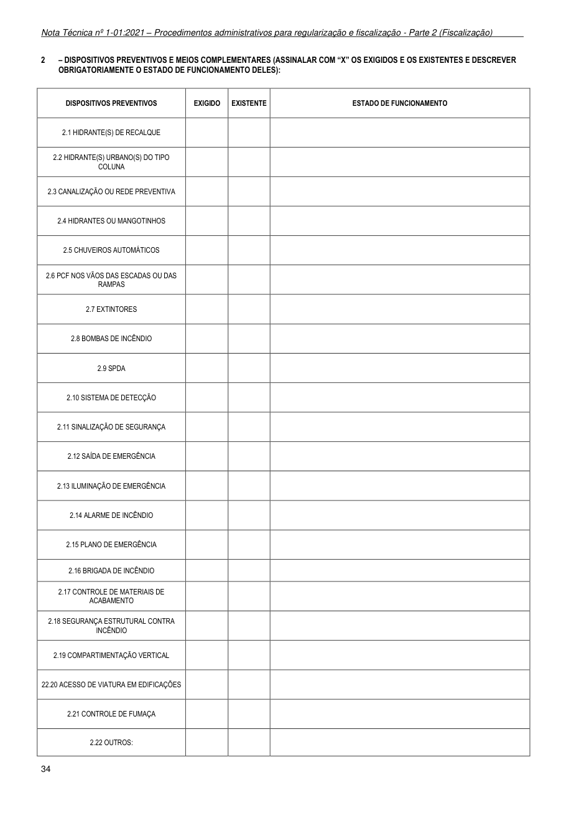

2 - DISPOSITIVOS PREVENTIVOS E MEIOS COMPLEMENTARES (ASSINALAR COM “X” OS EXIGIDOS E OS EXISTENTES E DESCREVER OBRIGATORIAMENTE O ESTADO DE FUNCIONAMENTO DELES):

34

### Tabelas extraídas (bruto, não usar para citação)
#### Tabela 1 da página

| DISPOSITIVOS PREVENTIVOS | EXIGIDO | EXISTENTE | ESTADO DE FUNCIONAMENTO |
| --- | --- | --- | --- |
| 2.1 HIDRANTE(S) DE RECALQUE |  |  |  |
| 2.2 HIDRANTE(S) URBANO(S) DO TIPO COLUNA |  |  |  |
| 2.3 CANALIZAÇÃO OU REDE PREVENTIVA |  |  |  |
| 2.4 HIDRANTES OU MANGOTINHOS |  |  |  |
| 2.5 CHUVEIROS AUTOMÁTICOS |  |  |  |
| 2.6 PCF NOS VÃOS DAS ESCADAS OU DAS RAMPAS |  |  |  |
| 2.7 EXTINTORES |  |  |  |
| 2.8 BOMBAS DE INCÊNDIO |  |  |  |
| 2.9 SPDA |  |  |  |
| 2.10 SISTEMA DE DETECÇÃO |  |  |  |
| 2.11 SINALIZAÇÃO DE SEGURANÇA |  |  |  |
| 2.12 SAÍDA DE EMERGÊNCIA |  |  |  |
| 2.13 ILUMINAÇÃO DE EMERGÊNCIA |  |  |  |
| 2.14 ALARME DE INCÊNDIO |  |  |  |
| 2.15 PLANO DE EMERGÊNCIA |  |  |  |
| 2.16 BRIGADA DE INCÊNDIO |  |  |  |
| 2.17 CONTROLE DE MATERIAIS DE ACABAMENTO |  |  |  |
| 2.18 SEGURANÇA ESTRUTURAL CONTRA INCÊNDIO |  |  |  |
| 2.19 COMPARTIMENTAÇÃO VERTICAL |  |  |  |
| 22.20 ACESSO DE VIATURA EM EDIFICAÇÕES |  |  |  |
| 2.21 CONTROLE DE FUMAÇA |  |  |  |
| 2.22 OUTROS: |  |  |  |

<!-- tabela-conferida: Anexo E, item 2 p34 -->
### Anexo E, item 2 — Dispositivos preventivos e meios complementares (modelo de relatório das condições de segurança) (conferida)

| DISPOSITIVOS PREVENTIVOS | EXIGIDO | EXISTENTE | ESTADO DE FUNCIONAMENTO |
| --- | --- | --- | --- |
| 2.1 HIDRANTE(S) DE RECALQUE |  |  |  |
| 2.2 HIDRANTE(S) URBANO(S) DO TIPO COLUNA |  |  |  |
| 2.3 CANALIZAÇÃO OU REDE PREVENTIVA |  |  |  |
| 2.4 HIDRANTES OU MANGOTINHOS |  |  |  |
| 2.5 CHUVEIROS AUTOMÁTICOS |  |  |  |
| 2.6 PCF NOS VÃOS DAS ESCADAS OU DAS RAMPAS |  |  |  |
| 2.7 EXTINTORES |  |  |  |
| 2.8 BOMBAS DE INCÊNDIO |  |  |  |
| 2.9 SPDA |  |  |  |
| 2.10 SISTEMA DE DETECÇÃO |  |  |  |
| 2.11 SINALIZAÇÃO DE SEGURANÇA |  |  |  |
| 2.12 SAÍDA DE EMERGÊNCIA |  |  |  |
| 2.13 ILUMINAÇÃO DE EMERGÊNCIA |  |  |  |
| 2.14 ALARME DE INCÊNDIO |  |  |  |
| 2.15 PLANO DE EMERGÊNCIA |  |  |  |
| 2.16 BRIGADA DE INCÊNDIO |  |  |  |
| 2.17 CONTROLE DE MATERIAIS DE ACABAMENTO |  |  |  |
| 2.18 SEGURANÇA ESTRUTURAL CONTRA INCÊNDIO |  |  |  |
| 2.19 COMPARTIMENTAÇÃO VERTICAL |  |  |  |
| 22.20 ACESSO DE VIATURA EM EDIFICAÇÕES |  |  |  |
| 2.21 CONTROLE DE FUMAÇA |  |  |  |
| 2.22 OUTROS: |  |  |  |

Fonte: NT 1-01 Parte 2, página 34, Anexo E, item 2; conferida em 2026-09-29 (visual + geometrica).
Título do quadro na página: "2 – DISPOSITIVOS PREVENTIVOS E MEIOS COMPLEMENTARES (ASSINALAR COM “X” OS EXIGIDOS E OS EXISTENTES E DESCREVER OBRIGATORIAMENTE O ESTADO DE FUNCIONAMENTO DELES)".
As colunas EXIGIDO, EXISTENTE e ESTADO DE FUNCIONAMENTO são para preenchimento.
<!-- /tabela-conferida: Anexo E, item 2 p34 -->

---

## Página 35

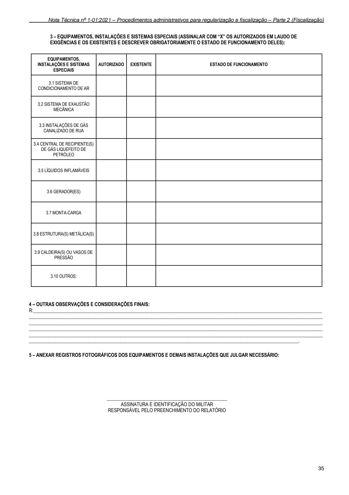

3 - EQUIPAMENTOS, INSTALAÇÕES E SISTEMAS ESPECIAIS (ASSINALAR COM “X” OS AUTORIZADOS EM LAUDO DE EXIGÊNCIAS E OS EXISTENTES E DESCREVER OBRIGATORIAMENTE O ESTADO DE FUNCIONAMENTO DELES):

4 - OUTRAS OBSERVAÇÕES E CONSIDERAÇÔES FINAIS: R:________________________________________________________________________________________________________________________ __________________________________________________________________________________________________________________________ __________________________________________________________________________________________________________________________ __________________________________________________________________________________________________________________________ __________________________________________________________________________________________________________________________ ________________________________________________________________________________________________________________.

### 5 - ANEXAR REGISTROS FOTOGRÁFICOS DOS EQUIPAMENTOS E DEMAIS INSTALAÇÕES QUE JULGAR NECESSÁRIO:

__________________________________________________

### ASSINATURA E IDENTIFICAÇÃO DO MILITAR RESPONSÁVEL PELO PREENCHIMENTO DO RELATÓRIO

35

### Tabelas extraídas (bruto, não usar para citação)
#### Tabela 1 da página

| EQUIPAMENTOS, INSTALAÇÕES E SISTEMAS ESPECIAIS | AUTORIZADO | EXISTENTE | ESTADO DE FUNCIONAMENTO |
| --- | --- | --- | --- |
| 3.1 SISTEMA DE CONDICIONAMENTO DE AR |  |  |  |
| 3.2 SISTEMA DE EXAUSTÃO MECÂNICA |  |  |  |
| 3.3 INSTALAÇÕES DE GÁS CANALIZADO DE RUA |  |  |  |
| 3.4 CENTRAL DE RECIPIENTE(S) DE GÁS LIQUEFEITO DE PETRÓLEO |  |  |  |
| 3.5 LÍQUIDOS INFLAMÁVEIS |  |  |  |
| 3.6 GERADOR(ES) |  |  |  |
| 3.7 MONTA-CARGA |  |  |  |
| 3.8 ESTRUTURA(S) METÁLICA(S) |  |  |  |
| 3.9 CALDEIRA(S) OU VASOS DE PRESSÃO |  |  |  |
| 3.10 OUTROS: |  |  |  |

<!-- tabela-conferida: Anexo E, item 3 p35 -->
### Anexo E, item 3 — Equipamentos, instalações e sistemas especiais (modelo de relatório das condições de segurança) (conferida)

| EQUIPAMENTOS, INSTALAÇÕES E SISTEMAS ESPECIAIS | AUTORIZADO | EXISTENTE | ESTADO DE FUNCIONAMENTO |
| --- | --- | --- | --- |
| 3.1 SISTEMA DE CONDICIONAMENTO DE AR |  |  |  |
| 3.2 SISTEMA DE EXAUSTÃO MECÂNICA |  |  |  |
| 3.3 INSTALAÇÕES DE GÁS CANALIZADO DE RUA |  |  |  |
| 3.4 CENTRAL DE RECIPIENTE(S) DE GÁS LIQUEFEITO DE PETRÓLEO |  |  |  |
| 3.5 LÍQUIDOS INFLAMÁVEIS |  |  |  |
| 3.6 GERADOR(ES) |  |  |  |
| 3.7 MONTA-CARGA |  |  |  |
| 3.8 ESTRUTURA(S) METÁLICA(S) |  |  |  |
| 3.9 CALDEIRA(S) OU VASOS DE PRESSÃO |  |  |  |
| 3.10 OUTROS: |  |  |  |

Fonte: NT 1-01 Parte 2, página 35, Anexo E, item 3; conferida em 2026-09-29 (visual + geometrica).
Título do quadro na página: "3 – EQUIPAMENTOS, INSTALAÇÕES E SISTEMAS ESPECIAIS (ASSINALAR COM “X” OS AUTORIZADOS EM LAUDO DE EXIGÊNCIAS E OS EXISTENTES E DESCREVER OBRIGATORIAMENTE O ESTADO DE FUNCIONAMENTO DELES)".
As colunas AUTORIZADO, EXISTENTE e ESTADO DE FUNCIONAMENTO são para preenchimento.
<!-- /tabela-conferida: Anexo E, item 3 p35 -->

---

## Página 36

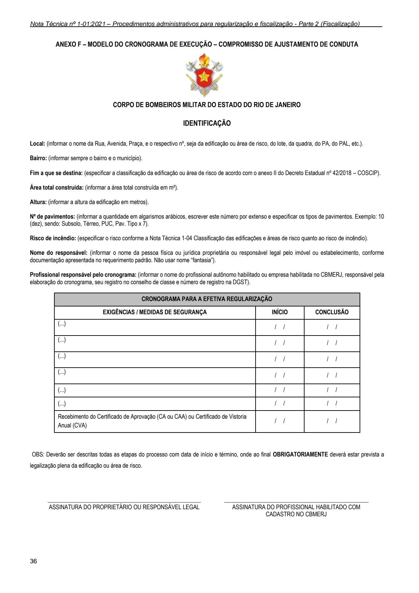

### ANEXO F - MODELO DO CRONOGRAMA DE EXECUÇÃO - COMPROMISSO DE AJUSTAMENTO DE CONDUTA

### CORPO DE BOMBEIROS MILITAR DO ESTADO DO RIO DE JANEIRO

### IDENTIFICAÇÃO

Local: (informar o nome da Rua, Avenida, Praça, e o respectivo nº, seja da edificação ou área de risco, do lote, da quadra, do PA, do PAL, etc.). Bairro: (informar sempre o bairro e o município). Fim a que se destina: (especificar a classificação da edificação ou área de risco de acordo com o anexo II do Decreto Estadual nº 42/2018 - COSCIP). Área total construída: (informar a área total construída em m²). Altura: (informar a altura da edificação em metros). Nº de pavimentos: (informar a quantidade em algarismos arábicos, escrever este número por extenso e especificar os tipos de pavimentos. Exemplo: 10 (dez), sendo: Subsolo, Térreo, PUC, Pav. Tipo x 7). Risco de incêndio: (especificar o risco conforme a Nota Técnica 1-04 Classificação das edificações e áreas de risco quanto ao risco de incêndio). Nome do responsável: (informar o nome da pessoa física ou jurídica proprietária ou responsável legal pelo imóvel ou estabelecimento, conforme documentação apresentada no requerimento padrão. Não usar nome “fantasia”). Profissional responsável pelo cronograma: (informar o nome do profissional autônomo habilitado ou empresa habilitada no CBMERJ, responsável pela elaboração do cronograma, seu registro no conselho de classe e número de registro na DGST).

OBS: Deverão ser descritas todas as etapas do processo com data de início e término, onde ao final OBRIGATORIAMENTE deverá estar prevista a

legalização plena da edificação ou área de risco.

_____________________________________________________

### ASSINATURA DO PROPRIETÁRIO OU RESPONSÁVEL LEGAL

36

__________________________________________________

### ASSINATURA DO PROFISSIONAL HABILITADO COM

### CADASTRO NO CBMERJ

### Tabelas extraídas (bruto, não usar para citação)
#### Tabela 1 da página

|  | CRONOGRAMA PARA A EFETIVA REGULARIZAÇÃO |  |  |  |
| --- | --- | --- | --- | --- |
| EXIGÊNCIAS / MEDIDAS DE SEGURANÇA |  | INÍCIO | CONCLUSÃO |  |
| (...) |  | / / | / / |  |
| (...) |  | / / | / / |  |
| (...) |  | / / | / / |  |
| (...) |  | / / | / / |  |
| (...) |  | / / | / / |  |
| (...) |  | / / | / / |  |
| Recebimento do Certificado de Aprovação (CA ou CAA) ou Certificado de Vistoria Anual (CVA) |  | / / | / / |  |

<!-- tabela-conferida: Anexo F p36 -->
### Anexo F — Modelo do cronograma de execução – Compromisso de Ajustamento de Conduta (cronograma para a efetiva regularização) (conferida)

| Exigências / medidas de segurança | Início | Conclusão |
| --- | --- | --- |
| (...) | / / | / / |
| (...) | / / | / / |
| (...) | / / | / / |
| (...) | / / | / / |
| (...) | / / | / / |
| (...) | / / | / / |
| Recebimento do Certificado de Aprovação (CA ou CAA) ou Certificado de Vistoria Anual (CVA) | / / | / / |

Fonte: NT 1-01 Parte 2, página 36, Anexo F; conferida em 2026-09-29 (visual + geometrica).
Modelo: "(...)" e "/ /" são campos para preenchimento.
OBS: Deverão ser descritas todas as etapas do processo com data de início e término, onde ao final OBRIGATORIAMENTE deverá estar prevista a legalização plena da edificação ou área de risco.
<!-- /tabela-conferida: Anexo F p36 -->

---

## Página 37

### ANEXO G - MODELO DO TERMO DE AJUSTAMENTO DE CONDUTA

### CORPO DE BOMBEIROS MILITAR DO ESTADO DO RIO DE JANEIRO

TERMO DE AJUSTAMENTO DE CONDUTA - TAC Nº XXXX/XXX

O CORPO DE BOMBEIROS MILITAR DO ESTADO DO RIO DE JANEIRO, doravante CBMERJ, com sede

na Praça da República, nº 45, Centro, Rio de Janeiro, RJ, CEP: 20.211-350, inscrito no CNPJ sob o n°

28.176.998/0004-41, representado neste ato pelo Comandante-Geral do CBMERJ, (posto/QOC/nome),

(nacionalidade), (estado civil), bombeiro militar, portador da carteira de identidade n° (...), expedida pelo

CBMERJ, inscrito no CPF/MF sob o n° (...), a DIRETORIA GERAL DE SERVIÇOS TÉCNICOS, doravante

denominada DGST, com sede na Praça da República, nº 39, Centro, Rio de Janeiro - RJ, CEP: 20.211-350,

inscrita no CNPJ sob o nº. (...), neste ato representada pelo Diretor-Geral de Serviços Técnicos,

(posto/QOC/nome), bombeiro militar, RG-CBMERJ nº (...), por (posto/QOC/nome), bombeiro militar, RG-

CBMERJ nº (...), inscrito no CPF/MF sob o n° (...), em conjunto designados COMPROMISSÁRIOS e, de outro

lado, a empresa (...), com sede na (...), neste ato representada por (...), (nacionalidade), (estado civil),

(profissão), portador da carteira de identidade n° (...) expedida pelo (...), inscrito no CPF/MF sob o nº (...)

doravante designada simplesmente COMPROMITENTE.

CONSIDERANDO que:

- Nos termos do artigo 1º do Decreto-Lei nº 247, de 21 de julho de 1975, compete ao CBMERJ a

fiscalização das normas que disciplinam a segurança das pessoas e seus bens, contra incêndio e pânico em

todo o Estado do Rio de Janeiro, sendo este regulamentado pelo Decreto Estadual nº 42, de 17 de dezembro

de 2018, intitulado Código de Segurança Contra Incêndio e Pânico (COSCIP), alterado pelo Decreto Estadual

nº 46.925, de 05 de fevereiro de 2020, juntamente com as respectivas Notas Técnicas aprovadas por Portaria

do Comando-Geral do CBMERJ;

- O COMPROMITENTE não tem cumprindo integralmente suas obrigações quanto à legislação de

segurança contra incêndio e pânico do Estado do Rio de Janeiro;

- Consta no processo administrativo nº (...)de (...) de (...) de (...);

RESOLVEM celebrar, com eficácia de título executivo extrajudicial, o presente TERMO DE

AJUSTAMENTO DE CONDUTA - TAC, que se regerá pelas seguintes cláusulas e condições:

37

---

## Página 38

### CLÁUSULA PRIMEIRA - DO OBJETO

1.1 O presente termo de ajustamento tem por objeto a regularização da (edificação ou área de risco) de

propriedade (ou sob a responsabilidade) do COMPROMITENTE, edificado à Rua/Avenida(…), nº(…),

Bairro(…), Lote(…), Quadra(…), Município de(…),possuindo uma área total construída de (…)m²,

(...)pavimentos, destinado à finalidade de (especificar a classificação da edificação ou área de risco de acordo

com o anexo II do Decreto Estadual nº 42/2018 - COSCIP), classificado como risco (especificar a

classificação da edificação ou área de risco de acordo com a Nota Técnica 1-04 - Classificação das

edificações e áreas de risco quanto ao risco de incêndio), com vistas a estabelecer garantias de proteção

das pessoas e seus bens em caso de incêndio e pânico.

### CLÁUSULA SEGUNDA - DA FINALIDADE

2.1 O presente termo tem por finalidade estabelecer prazos e condições para cumprimento da legislação do

Estado do Rio de Janeiro, no que concerne à execução das medidas de segurança contra incêndio e pânico

exigíveis pelo Código de Segurança contra Incêndio e Pânico do Estado do Rio de Janeiro e legislação

complementar e à regularização da (edificação ou área de risco) objeto da cláusula anterior, sob a

responsabilidade legal do COMPROMITENTE, junto ao CBMERJ.

### CLÁUSULA TERCEIRA - DAS NORMAS APLICÁVEIS

3.1 A adequação da (edificação ou área de risco) será disciplinada pelo Decreto nº 42, de 17 de dezembro

de 2018, intitulado Código de Segurança Contra Incêndio e Pânico, alterado pelo Decreto Estadual nº 46.925,

de 05 de fevereiro de 2020, e Notas Técnicas em vigor no âmbito do Estado do Rio de Janeiro.

### CLÁUSULA QUARTA - DO PRAZO

4.1 O prazo de vigência do presente TAC é de (...) (dias/anos), a contar da data de sua assinatura.

Parágrafo único: O prazo de vigência deste Termo poderá ser prorrogado mediante a celebração de Termo

Aditivo, com base em justificativa apresentada pelo COMPROMITENTE antes do vencimento do prazo

estipulado pelo TAC originário, se o CBMERJ considerar pertinente, desde que a vigência total incluindo o

aditamento não ultrapasse 05 (cinco) anos.

(Este parágrafo único só será inserido no Termo, caso o prazo original seja menor que 05 anos).

### CLÁUSULA QUINTA - DAS IRREGULARIDADES E SANÇÕES APLICADAS

5.1 As irregularidades que deram causa à celebração do presente compromisso, assim se caracterizam:

A (edificação ou área de risco) objeto deste Termo recebeu a Notificação nº (...), expedida pelo CBMERJ, em

(...), a qual estabelece que o COMPROMITENTE deverá providenciar a legalização junto ao CBMERJ no

prazo de (...) dias corridos (ou úteis).

O COMPROMITENTE recebeu o primeiro Auto de Infração nº (...), expedido pelo CBMERJ em (...), por não

ter cumprido a exigência formulada pela Notificação nº (...).

38

---

## Página 39

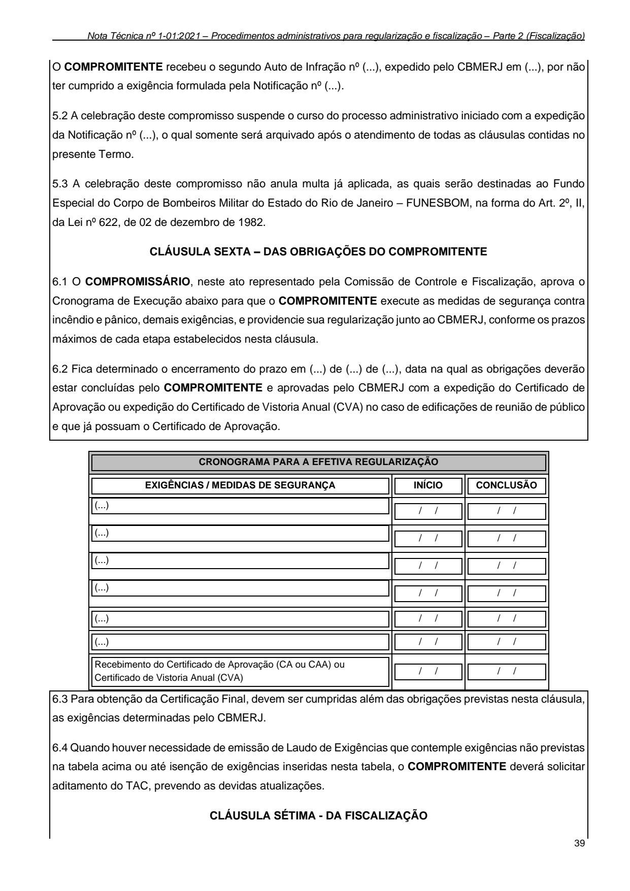

O COMPROMITENTE recebeu o segundo Auto de Infração nº (...), expedido pelo CBMERJ em (...), por não

ter cumprido a exigência formulada pela Notificação nº (...).

5.2 A celebração deste compromisso suspende o curso do processo administrativo iniciado com a expedição

da Notificação nº (...), o qual somente será arquivado após o atendimento de todas as cláusulas contidas no

presente Termo.

5.3 A celebração deste compromisso não anula multa já aplicada, as quais serão destinadas ao Fundo

Especial do Corpo de Bombeiros Militar do Estado do Rio de Janeiro - FUNESBOM, na forma do Art. 2º, II,

da Lei nº 622, de 02 de dezembro de 1982.

### CLÁUSULA SEXTA - DAS OBRIGAÇÕES DO COMPROMITENTE

6.1 O COMPROMISSÁRIO, neste ato representado pela Comissão de Controle e Fiscalização, aprova o

Cronograma de Execução abaixo para que o COMPROMITENTE execute as medidas de segurança contra

incêndio e pânico, demais exigências, e providencie sua regularização junto ao CBMERJ, conforme os prazos

máximos de cada etapa estabelecidos nesta cláusula.

6.2 Fica determinado o encerramento do prazo em (...) de (...) de (...), data na qual as obrigações deverão

estar concluídas pelo COMPROMITENTE e aprovadas pelo CBMERJ com a expedição do Certificado de

Aprovação ou expedição do Certificado de Vistoria Anual (CVA) no caso de edificações de reunião de público

e que já possuam o Certificado de Aprovação.

39

### Tabelas extraídas (bruto, não usar para citação)
#### Tabela 1 da página

|  |  |  |  |  |
| --- | --- | --- | --- | --- |
|  | CRONOGRAMA PARA A EFETIVA REGULARIZAÇÃO |  |  |  |
|  |  |  |  |  |
|  |  | INÍCIO | CONCLUSÃO |  |
|  | EXIGÊNCIAS / MEDIDAS DE SEGURANÇA |  |  |  |
|  |  |  |  |  |
|  | (...) | / / | / / |  |
|  |  |  |  |  |
|  | (...) | / / | / / |  |
|  |  |  |  |  |
|  | (...) | / / | / / |  |
|  |  |  |  |  |
|  | (...) | / / | / / |  |
|  |  |  |  |  |
|  |  | / / | / / |  |
|  | (...) |  |  |  |
|  |  |  |  |  |
|  |  | / / | / / |  |
|  | (...) |  |  |  |
|  |  |  |  |  |
|  |  | / / | / / |  |
|  | Recebimento do Certificado de Aprovação (CA ou CAA) ou Certificado de Vistoria Anual (CVA) |  |  |  |
|  |  |  |  |  |
| 6.3 Para obtenção da Certificação Final, devem ser cumpridas além das obrigações previstas nesta cláusula, as exigências determinadas pelo CBMERJ. 6.4 Quando houver necessidade de emissão de Laudo de Exigências que contemple exigências não previstas na tabela acima ou até isenção de exigências inseridas nesta tabela, o COMPROMITENTE deverá solicitar aditamento do TAC, prevendo as devidas atualizações. CLÁUSULA SÉTIMA - DA FISCALIZAÇÃO |  |  |  |  |

<!-- tabela-conferida: Cronograma da cláusula sexta do Anexo G p39 -->
### Cronograma da cláusula sexta do Anexo G — Cronograma para a efetiva regularização (modelo do Termo de Ajustamento de Conduta) (conferida)

| Exigências / medidas de segurança | Início | Conclusão |
| --- | --- | --- |
| (...) | / / | / / |
| (...) | / / | / / |
| (...) | / / | / / |
| (...) | / / | / / |
| (...) | / / | / / |
| (...) | / / | / / |
| Recebimento do Certificado de Aprovação (CA ou CAA) ou Certificado de Vistoria Anual (CVA) | / / | / / |

Fonte: NT 1-01 Parte 2, página 39, Cronograma da cláusula sexta do Anexo G; conferida em 2026-09-29 (visual + geometrica).
Modelo: "(...)" e "/ /" são campos para preenchimento.
A extração lê a moldura da página inteira como tabela; só as linhas do cronograma entram na comparação.
<!-- /tabela-conferida: Cronograma da cláusula sexta do Anexo G p39 -->

---

## Página 40

7.1 O presente compromisso não limita o CBMERJ em suas atribuições de fiscalizar a (edificação ou área de

risco) objeto deste Termo, conforme suas competências legais estabelecida no Decreto-Lei nº 247, de 21 de

julho de 1975.

### CLÁUSULA OITAVA - DO TERMO ADITIVO

8.1 Este TAC somente poderá ser alterado por escrito, mediante a celebração de Termo Aditivo.

8.2 Atentar para a cláusula 6.4 do presente Termo.

### CLÁUSULA NONA - DO DESCUMPRIMENTO - RESCISÃO UNILATERAL

9.1 Expirado o prazo de vigência deste Termo, e não comprovado o cumprimento total das obrigações

assumidas pelo COMPROMITENTE, o CBMERJ poderá realizar vistoria e, o COMPROMITENTE será

autuado pelo descumprimento do TAC, configurando assim a rescisão unilateral do presente Termo por

descumprimento.

9.2 Decorridos 30 dias corridos a contar da aplicação da multa, a edificação (ou área de risco) poderá ser

interditada. (não se aplica nos casos em que o compromitente for integrante da Administração Direta ou Indireta do Estado

do Rio de Janeiro próprio ao Estado do Rio de Janeiro).

### CLÁUSULA DÉCIMA - DA PENALIDADE

10.1 A multa prevista na cláusula anterior incidirá pena pecuniária no valor de (...) UFIR-RJ, fixada conforme

Decreto nº 42, de 17 de dezembro de 2018, e Nota Técnica1-01Procedimentos Administrativos de

Regularização e Fiscalização - Parte 2 (Fiscalização), a ser recolhida pelo COMPROMITENTE junto ao

Fundo Especial do CBMERJ (FUNESBOM), no prazo de 30 (trinta) dias corridos.(não se aplica nos casos em que

o compromitente for integrante da Administração Direta ou Indireta do Estado do Rio de Janeiro próprio ao Estado do Rio de

Janeiro).

### CLÁUSULA DÉCIMA PRIMEIRA - DA ELEIÇÃO DE FORO

11.1 Fica eleito o foro da Comarca da Capital do Estado do Rio de Janeiro para dirimir questões ou disputas,

envolvendo o presente TAC, com expressa renúncia de qualquer outro, por mais privilegiado que seja.

11.2 E, por estarem assim justos e acordados, assinam o presente em três vias de igual teor e forma quantos

forem os signatários, para um só efeito, obrigando-se a fazê-lo firme e valioso por si e seus eventuais

sucessores.

Rio de Janeiro, (dia) / (mês) / (ano).

(assinatura)

_________________________

(Nome Completo)

### (CPF/CNPJ)

40

---

## Página 41

Representante da Empresa (...)

### COMPROMITENTE

(assinatura)

_________________________

(...) QOCBM (Nome Completo)

### RG CBMERJ: (...)

Diretor-Geral de Serviços Técnicos

### COMPROMISSÁRIO

(assinatura)

_________________________

(...) QOCBM (Nome Completo)

### RG CBMERJ: (...)

Comandante-Geral do CBMERJ

### COMPROMISSÁRIO

OBS: Se o processo de TAC for de competência exclusiva da Diretoria de Diversões Públicas (DDP), os

campos previstos como Diretoria-Geral de Serviços Técnicos (DGST) deverão ser substituídos.

41

---

## Página 42

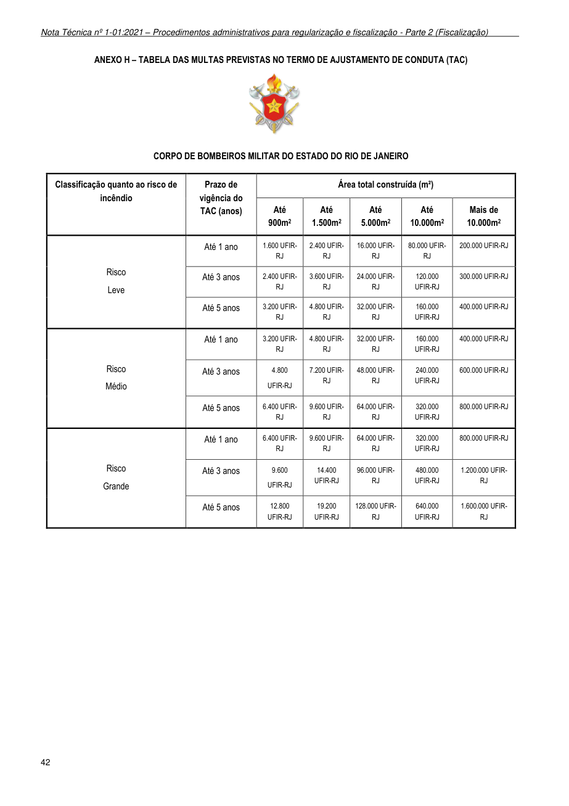

### ANEXO H - TABELA DAS MULTAS PREVISTAS NO TERMO DE AJUSTAMENTO DE CONDUTA (TAC)

### CORPO DE BOMBEIROS MILITAR DO ESTADO DO RIO DE JANEIRO

42

### Tabelas extraídas (bruto, não usar para citação)
#### Tabela 1 da página

| Classificação quanto ao risco de incêndio | Prazo de vigência do TAC (anos) | Área total construída (m²) |  |  |  |  |
| --- | --- | --- | --- | --- | --- | --- |
|  |  | Até 900m2 | Até 1.500m2 | Até 5.000m2 | Até 10.000m2 | Mais de 10.000m2 |
| Risco Leve | Até 1 ano | 1.600 UFIRRJ | 2.400 UFIRRJ | 16.000 UFIRRJ | 80.000 UFIRRJ | 200.000 UFIR-RJ |
|  | Até 3 anos | 2.400 UFIRRJ | 3.600 UFIRRJ | 24.000 UFIRRJ | 120.000 UFIR-RJ | 300.000 UFIR-RJ |
|  | Até 5 anos | 3.200 UFIRRJ | 4.800 UFIRRJ | 32.000 UFIRRJ | 160.000 UFIR-RJ | 400.000 UFIR-RJ |
| Risco Médio | Até 1 ano | 3.200 UFIRRJ | 4.800 UFIRRJ | 32.000 UFIRRJ | 160.000 UFIR-RJ | 400.000 UFIR-RJ |
|  | Até 3 anos | 4.800 UFIR-RJ | 7.200 UFIRRJ | 48.000 UFIRRJ | 240.000 UFIR-RJ | 600.000 UFIR-RJ |
|  | Até 5 anos | 6.400 UFIRRJ | 9.600 UFIRRJ | 64.000 UFIRRJ | 320.000 UFIR-RJ | 800.000 UFIR-RJ |
| Risco Grande | Até 1 ano | 6.400 UFIRRJ | 9.600 UFIRRJ | 64.000 UFIRRJ | 320.000 UFIR-RJ | 800.000 UFIR-RJ |
|  | Até 3 anos | 9.600 UFIR-RJ | 14.400 UFIR-RJ | 96.000 UFIRRJ | 480.000 UFIR-RJ | 1.200.000 UFIRRJ |
|  | Até 5 anos | 12.800 UFIR-RJ | 19.200 UFIR-RJ | 128.000 UFIRRJ | 640.000 UFIR-RJ | 1.600.000 UFIRRJ |
<!-- tabela-conferida: Anexo H p42 -->
### Anexo H — Tabela das multas previstas no Termo de Ajustamento de Conduta (TAC) (conferida)

| Classificação quanto ao risco de incêndio | Prazo de vigência do TAC (anos) | Área total construída: até 900m² | Até 1.500m² | Até 5.000m² | Até 10.000m² | Mais de 10.000m² |
| --- | --- | --- | --- | --- | --- | --- |
| Risco Leve | Até 1 ano | 1.600 UFIR-RJ | 2.400 UFIR-RJ | 16.000 UFIR-RJ | 80.000 UFIR-RJ | 200.000 UFIR-RJ |
| Risco Leve | Até 3 anos | 2.400 UFIR-RJ | 3.600 UFIR-RJ | 24.000 UFIR-RJ | 120.000 UFIR-RJ | 300.000 UFIR-RJ |
| Risco Leve | Até 5 anos | 3.200 UFIR-RJ | 4.800 UFIR-RJ | 32.000 UFIR-RJ | 160.000 UFIR-RJ | 400.000 UFIR-RJ |
| Risco Médio | Até 1 ano | 3.200 UFIR-RJ | 4.800 UFIR-RJ | 32.000 UFIR-RJ | 160.000 UFIR-RJ | 400.000 UFIR-RJ |
| Risco Médio | Até 3 anos | 4.800 UFIR-RJ | 7.200 UFIR-RJ | 48.000 UFIR-RJ | 240.000 UFIR-RJ | 600.000 UFIR-RJ |
| Risco Médio | Até 5 anos | 6.400 UFIR-RJ | 9.600 UFIR-RJ | 64.000 UFIR-RJ | 320.000 UFIR-RJ | 800.000 UFIR-RJ |
| Risco Grande | Até 1 ano | 6.400 UFIR-RJ | 9.600 UFIR-RJ | 64.000 UFIR-RJ | 320.000 UFIR-RJ | 800.000 UFIR-RJ |
| Risco Grande | Até 3 anos | 9.600 UFIR-RJ | 14.400 UFIR-RJ | 96.000 UFIR-RJ | 480.000 UFIR-RJ | 1.200.000 UFIR-RJ |
| Risco Grande | Até 5 anos | 12.800 UFIR-RJ | 19.200 UFIR-RJ | 128.000 UFIR-RJ | 640.000 UFIR-RJ | 1.600.000 UFIR-RJ |

Fonte: NT 1-01 Parte 2, página 42, Anexo H; conferida em 2026-09-29 (visual + geometrica).
"UFIR-RJ" aparece quebrado em duas linhas em várias células ("UFIR-" / "RJ").
<!-- /tabela-conferida: Anexo H p42 -->

