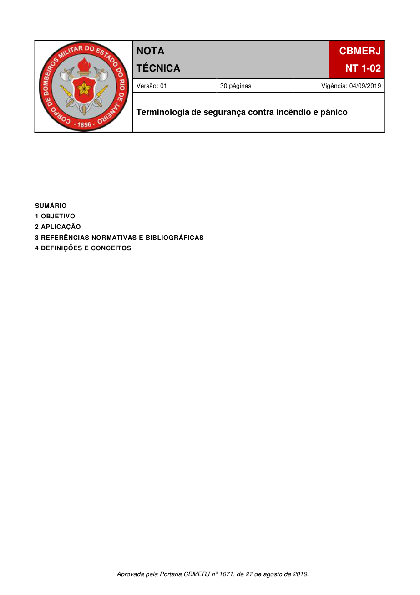

# NT 1-02 - Terminologia de segurança contra incêndio e pânico

> Conversão integral para consulta computacional. A numeração de página do PDF foi preservada. Quando houver tabela complexa, símbolo ou desenho, conferir também a representação visual indicada e o PDF oficial.

## Sumário por página

- [Página 1](#pagina-1)
- [Página 2](#pagina-2)
- [Página 3](#pagina-3)
- [Página 4](#pagina-4)
- [Página 5](#pagina-5)
- [Página 6](#pagina-6)
- [Página 7](#pagina-7)
- [Página 8](#pagina-8)
- [Página 9](#pagina-9)
- [Página 10](#pagina-10)
- [Página 11](#pagina-11)
- [Página 12](#pagina-12)
- [Página 13](#pagina-13)
- [Página 14](#pagina-14)
- [Página 15](#pagina-15)
- [Página 16](#pagina-16)
- [Página 17](#pagina-17)
- [Página 18](#pagina-18)
- [Página 19](#pagina-19)
- [Página 20](#pagina-20)
- [Página 21](#pagina-21)
- [Página 22](#pagina-22)
- [Página 23](#pagina-23)
- [Página 24](#pagina-24)
- [Página 25](#pagina-25)
- [Página 26](#pagina-26)
- [Página 27](#pagina-27)
- [Página 28](#pagina-28)
- [Página 29](#pagina-29)
- [Página 30](#pagina-30)

---

## Página 1

### SUMÁRIO

### 1 OBJETIVO

### 2 APLICAÇÃO

### 3 REFERÊNCIAS NORMATIVAS E BIBLIOGRÁFICAS

### 4 DEFINIÇÕES E CONCEITOS

Aprovada pela Portaria CBMERJ nº 1071, de 27 de agosto de 2019.

### Tabelas extraídas

#### Tabela 1 da página

|  |  | NOTA |  |  | CBMERJ |  |
| --- | --- | --- | --- | --- | --- | --- |
|  |  | TÉCNICA |  |  | NT 1-02 |  |
|  | Versão: 01 30 páginas Vigência: 04/09/2019 |  |  |  |  |  |
|  | Terminologia de segurança contra incêndio e pânico |  |  |  |  |  |

---

## Página 2

> Página sem texto extraível suficiente; consultar a representação visual ou o PDF oficial.

---

## Página 3

### 1 OBJETIVO

Padronizar toda a terminologia referente à segurança contra incêndio e pânico no âmbito do Estado do Rio de Janeiro conforme previsto no Decreto Estadual nº 42/2018 - Código de Segurança Contra Incêndio e Pânico do Estado do Rio de Janeiro (COSCIP).

### 2 APLICAÇÃO

Esta Nota Técnica (NT) aplica-se às NTs do Corpo de Bombeiros Militar do Estado do Rio de Janeiro (CBMERJ), regulamentando o Decreto Estadual nº 42/2018 - COSCIP.

### 3 REFERÊNCIAS NORMATIVAS E BIBLIOGRÁFICAS

As normas e bibliografias abaixo contêm disposições que estão relacionadas com esta Nota Técnica:

a) Decreto-Lei nº 247, de 21 de julho de 1975, que dispõe sobre segurança contra incêndio e pânico;

b) Decreto Estadual nº 42, de 17 de dezembro de 2018, que regulamenta o Decreto-Lei nº 247, de 21 de julho de 1975, dispondo sobre o Código de Segurança Contra Incêndio e Pânico - COSCIP, no âmbito do Estado do Rio de Janeiro.

### 4 DEFINIÇÕES E CONCEITOS

Para efeitos desta NT, aplicam-se as seguintes definições e conceitos:

Abrigo de GLP: construção com material não combustível, destinado à proteção física de recipientes transportáveis de gás liquefeito de petróleo (GLP) e seus complementos.

Absorvedor de energia: dispositivo destinado a reduzir o impacto transmitido ao corpo do trabalhador e sistema de segurança durante a contenção da queda.

Acantonamento: volume livre compreendido entre o chão e o teto/ telhado, delimitado por painéis de fumaça (barreira de fumaça).

Acesso: caminho a ser percorrido pelos usuários do pavimento ou do setor, constituindo a rota de saída para se alcançar uma escada, ou uma rampa, ou uma área de refúgio, ou descarga para saída do recinto. Os acessos podem ser constituídos por corredores, passagens, vestíbulos, balcões, varandas, terraços e similares.

Acesso lateral: corredor de circulação paralelo às filas (fileiras) de assentos ou arquibancadas, geralmente possui piso plano ou levemente inclinado (rampa).

Acesso radial: corredor de circulação que dá acesso direto na área de acomodação dos espectadores (patamares das arquibancadas), podendo ser inclinado (rampa) ou com degraus. Deve ter largura mínima de 1,20 m.

Acionador manual: botão do tipo liga, para os ventiladores.

Aeroporto: todo aeródromo público dotado de

instalações e facilidades para apoio a aeronaves e ao embarque e desembarque de pessoas e cargas.

Afastamento: distância mínima, determinada pela legislação em vigor, entre duas edificações ou entre uma edificação e as linhas divisórias do terreno onde ela se situa; o afastamento é frontal, lateral, ou de fundos quando essas divisórias forem, respectivamente, a testada, os lados ou os fundos do terreno.

Agente extintor: substância utilizada para a extinção de fogo.

Agentes gasosos: agentes extintores de incêndio que nas condições normais de temperatura e pressão se apresentam no estado gasoso. Classificam-se em: dióxido de carbono (CO2), halon e agentes limpos.

Agentes limpos: agentes gasosos desenvolvidos a partir do Protocolo de Montreal, ou seja, que buscaram substituir o halon, sendo eficazes na extinção dos incêndios, apresentando baixo ou nulo Potencial de Destruição da Camada de Ozônio (PDO). Dividem-se em gases ativos e gases inertes.

Agrupamento: conjunto constituído por edificações ou áreas de terreno no mesmo lote, destinadas a unidades autônomas.

Alarmes para bombas de incêndio: sinal de supervisão que indica uma condição anormal que requer atenção imediata.

Alinhamento: linha que define o limite entre o terreno e o logradouro público.

Altura da edificação: dimensão vertical medida em metros, tendo como referência o nível do logradouro público ou via interior e o teto do ultimo pavimento habitável.

Altura da exposição ao fogo (H): altura, em metros, de cada uma das paredes confrontantes de edificações contíguas.

Altura de armazenagem ou altura de estocagem: distância entre o topo da mercadoria armazenada e o piso.

Altura disponível para armazenamento: altura máxima, a partir do piso, na qual as mercadorias podem ser armazenadas e ainda manter espaçamento adequado dos elementos estruturais e distância livre vertical requerida para os chuveiros automáticos.

Análise: ato formal de verificação das exigências das medidas de segurança contra incêndio e pânico das edificações e áreas de risco em Processo de Segurança Contra Incêndio e Pânico - PSCIP ou Processo de Verificação de Infração - PVI.

Análise de risco: avaliação dos riscos potenciais, suas causas, consequências e medidas de controle.

Analista: quem realiza a análise de Processo de Segurança Contra Incêndio e Pânico - PSCIP ou Processo de Verificação de Infração - PVI.

Andar: piso acima do piso térreo, piso elevado.

Aparelhos a gás: aparelhos destinados à utilização de gás combustível.

### Tabelas extraídas

#### Tabela 1 da página

|  | abertura na vegetação que atua como barreira |
| --- | --- |
| para retardar ou impedir o progresso de incêndio |  |
| florestal. |  |

---

## Página 4

Código de Segurança Contra Incêndio e Pânico - Estado do Rio de Janeiro

Ar externo: ar oriundo do exterior da edificação.

Área a construir: somatório das áreas cobertas a serem construídas de uma edificação, em metros quadrados.

Área administrativa: local destinado ao desenvolvimento e apoio das atividades administrativas, tais como escritórios, cozinha, refeitório, vestiários, ambulatórios e portaria.

Área bruta de pavimento: medida, em qualquer pavimento de uma edificação, do espaço compreendido pelo perímetro interno das paredes externas e paredes corta-fogo, excluindo a área das antecâmaras e dos recintos fechados de escadas e rampas.

Área classificada: área dentro da qual pode ocorrer mistura inflamável.

Área coberta: área de uma edificação que, dependendo da sua tipologia, corresponde à superfície delimitada pelo perímetro do extradorso das paredes exteriores ou pela linha média das paredes divisórias.

Área controlável de armazenamento: edificação ou parte de uma edificação onde líquidos inflamáveis ou combustíveis possam ser armazenados, envasados, utilizados ou manuseados em quantidades que não excedam as quantidades máximas permitidas.

Área de abastecimento: local destinado ao abastecimento de veículos, provido de pontos de abastecimento.

Área de apoio operacional: local destinado ao suporte das atividades operacionais da base primária ou secundária, tais como central de ar comprimido, manutenção de recipientes, manutenção de veículos e de equipamentos, subestação de energia elétrica e reservatório de água potável.

Área de armazenamento: local contínuo destinado ao armazenamento de recipientes transportáveis de gás liquefeito de petróleo (GLP), cheios, parcialmente utilizados, e vazios, compreendendo os corredores de inspeção, quando existirem.

Área de armazenamento ao ar livre: local onde não existe qualquer tipo de cobertura e nem fechamento lateral, sendo admitido tela metálica para delimitar a área de armazenamento, sem que se configure fechamento lateral.

Área de armazenamento coberta: local onde existe somente fechamento superior através de uma cobertura, sendo esta apoiada por pilares ou estrutura sem qualquer tipo de fechamento lateral, sendo admitido tela metálica para delimitar a área de armazenamento sem que se configure fechamento lateral.

Área de armazenamento de apoio: local onde se armazenam recipientes transportáveis de GLP para efeito de comercialização direta ao consumidor ou demonstração de aparelhos e equipamentos que utilizam GLP, situado dentro do imóvel onde se encontra a área de armazenamento de recipientes transportável de GLP.

Área de armazenamento fechada: além do fechamento superior existe a configuração de fechamento lateral, por meio de paredes, ainda que parcial.

Área de caldeira: quando a caldeira é instalada em ambiente aberto.

Área de envasamento: local destinado a preparação e enchimento dos recipientes transportáveis.

Área de estacionamento: área externa a qualquer edificação, descoberta, destinada a estacionamento.

Área de eventos: área medida em metros quadrados, onde são alocadas todas as estruturas do evento, inclusive área destinada ao público e estruturas de apoio.

Área de isolamento: espaço localizado entre o veículo e a área destinada ao público.

Área de ocupação para o comércio ambulante: somatório das áreas de projeção no solo, de toda a estrutura de funcionamento do comércio.

Área de pavimento: medida em metros quadrados, em qualquer pavimento de uma edificação, do espaço compreendido pelo perímetro interno das paredes externas e paredes corta-fogo, e excluindo a área de antecâmaras e dos recintos fechados de escadas e rampas.

Área de pouso e decolagem de emergência: área de pouso e decolagem construída sobre edificações, cadastrada no Comando Aéreo Regional respectivo, que poderá ser utilizada para pousos e decolagens de helicópteros, exclusivamente em casos de emergência ou de calamidade.

Área de pouso e decolagem: área do heliponto ou heliporto, com dimensões definidas, onde o helicóptero pousa e decola.

Área de pouso e decolagem eventual: área selecionada e demarcada para pouso e decolagem de helicóptero, possuindo características físicas compatíveis com aquelas estabelecidas pela Agência Nacional de Aviação Civil (ANAC) para helipontos normais, que pode ser usada, esporadicamente, em condições visuais, por helicóptero em operações aéreas policiais ou de defesa civil, de socorro médico, de inspeções de linhas de transmissão elétrica ou de dutos transportando líquidos ou gases etc.

Área de queda: local, incluso na área de segurança, onde o produto resultante da queima dos fogos de artifício e/ou artefatos pirotécnicos cairão.

Área de refúgio: local seguro que é utilizado temporariamente pelo usuário, acessado através das saídas de emergência de um setor ou setores, ficando entre esse (s) e o logradouro público ou área externa com acesso aos setores.

Área de risco: área não construída, associada ou não à edificação, que contém produtos inflamáveis ou combustíveis, instalações elétricas ou de gás, ou outros riscos específicos, incluindo-se os loteamentos.

Área de segurança: limites mínimos de afastamento que deverão ser obrigatoriamente adotados segundo a

---

## Página 5

legislação vigente.

Área de transferência: local que tem como finalidade transferir GLP a granel (também conhecido como área de transvaso).

Área imprópria ao uso: áreas que por sua característica geológica ou topográfica impossibilitam a sua exploração; por exemplo: taludes em aclive acentuado, barrancos em pedra, lagos mesmo os artificiais, riachos e poços, dentre outros.

Área livre: espaço descoberto, livre de edificações ou construções dentro dos limites de um terreno.

Área livre de um vão de fachada (entrada de ar limpo): área geométrica efetivamente desobstruída para passagem de ar, levando em conta a eventual existência de grelhas.

Área não destinada à ocupação: área cuja destinação não preveja presença humana.

Área normalmente ocupada: área onde a ocupação humana seja frequente ou cuja destinação preveja presença humana.

Área protegida: área dotada de sistemas preventivos de segurança contra incêndio e pânico.

Área técnica: área de uma edificação destinada a abrigar reservatórios, máquinas, equipamentos e acessórios, destinados ao funcionamento predial, sem a permanência de pessoas.

Área total construída (ATC): somatório das áreas edificadas, incluindo as áreas horizontais das paredes e pilares.

Área total edificável (ATE): área máxima edificável, conforme índice de aproveitamento do terreno estabelecido pela municipalidade.

Área útil (AU): área de piso de um compartimento, excluindo as áreas horizontais das paredes e colunas.

Área útil de um vão de fachada, de uma boca de ventilação ou de um exaustor de fumaça: área equivalente a um percentual de área livre, utilizada para fins de cálculo, considerando a influência dos ventos e das eventuais deformações provocadas por um aquecimento excessivo.

Áreas de apoio administrativo: áreas no canteiro de obras (áreas administrativas, guarita ou portaria e plantão de vendas) que compreendem aquelas instalações que desempenham funções de apoio aos processos administrativos.

Áreas de vivência: áreas no canteiro de obras (cozinha, refeitório, vestiário, área de lazer, alojamentos e banheiros) destinadas a suprir as necessidades básicas humanas de alimentação, higiene, descanso, lazer e convivência.

Áreas operacional e de apoio à produção: áreas no canteiro de obras (depósito e áreas de produção) que desenvolvem as atividades de trabalho ligadas à produção.

Áreas para exposição e promoção de produtos e serviços: pequenas estruturas destinadas ao atendi-

mento ao cliente, com foco comercial na exposição e promoção de determinado produto ou serviço, sendo permitida a comercialização.

Armazenagem: constituída por um conjunto de funções de recepção, descarga, carregamento, arrumação e conservação de matérias-primas, produtos acabados ou semiacabados. Desta forma essa atividade diz respeito à estocagem ordenada e à distribuição de produtos acabados dentro da própria fábrica ou em locais destinados a este fim, pelos fabricantes, ou através de um processo de distribuição. Compreende, assim, todas as atividades de um ponto destinado à guarda temporária e à distribuição de materiais.

Armazenagem em estantes compartimentadas: armazenagem em estruturas com menos de 75 cm de profundidade, com prateleiras com espaçamento vertical aproximado de 60 cm, providas de divisórias verticais a cada 1,2 m, no máximo, e separadas por corredores de aproximadamente 75 cm. O mesmo efeito de compartimentalização pode ser obtido com caixas de madeira, metal ou papelão, com cinco lados fechados (caixas tipo bin-box) e um lado aberto voltado para o corredor. As caixas podem ser autoportantes ou suportadas por uma estrutura projetada de tal forma que pouco ou nenhum espaço vertical se mantenha entre elas.

Armazenagem em estantes simples: armazenagem em estruturas com menos de 75 cm de profundidade, com prateleiras com espaçamento vertical aproximado de 60 cm e separadas por corredores de aproximadamente 75 cm.

Armazenagem em pilhas sólidas (empilhamento sólido): armazenagem no piso, sem paletes ou outros dispositivos de manuseio de materiais. As cargas unitárias são colocadas umas sobre as outras, não se deixando nenhum espaço horizontal entre as mesmas.

Armazenagem paletizada sobre o piso (empilhamento paletizado): configuração de armazenagem que consiste em produtos armazenados sobre paletes, sem o uso de estruturas porta-paletes. As cargas dos paletes são posicionadas umas sobre as outras, ficando a carga inferior posicionada diretamente sobre o piso.

Armazenagem transitória (estocagem de miscelâneas): material armazenado a uma altura de armazenagem máxima de 3,7 m e que não seja a ocupação principal de uma área utilizada para outra atividade. Essa armazenagem não deve ocupar mais que 10% da área da edificação ou mais de 370 m² da área coberta por chuveiros, tomando-se a maior dessas áreas. Cada pilha ou área de armazenagem não deve exceder 90 m², e cada pilha ou área deve ser separada de outras áreas de armazenagem por pelo menos 7,6 m.

Armazenamento protegido: armazenamento protegido por sistema automático de proteção contra incêndio.

---

## Página 6

Código de Segurança Contra Incêndio e Pânico - Estado do Rio de Janeiro

Arquibancada: série de assentos em filas sucessivas, cada uma em plano mais elevado que a outra, em forma de degraus, e que se destina a dar melhor visibilidade aos espectadores, em estádios, anfiteatros, circos, auditórios, etc. Podem ser providas de assentos (cadeiras ou poltronas) ou não. Há também a modalidade de arquibancadas para público em pé.

Arruamento privado: arruamento trafegável para aproximação e operação dos veículos de emergência junto à pelo menos uma das fachadas da edificação, desde que não seja cega.

Artefatos pirotécnicos: fogos de vista com ou sem estampido, com ou sem flecha de apito ou de lágrimas, com ou sem bomba.

Artifício pirotécnico: designação comum de peças pirotécnicas preparadas para transmitir a inflamação e produzir luz, ruído, incêndios ou explosões, com a finalidade de sinalização, salvamento ou emprego especial em operações de combate, fogos de artifício, etc.

Aspersor: dispositivo utilizado nos sistemas de pulverização de água que tem por finalidade a aplicação do agente extintor para controle ou extinção de incêndios ou resfriamento.

Assento rebatível: mobiliário que apresenta duas peças principais, encosto e assento. A peça do assento possui características retráteis, seja por contra de peso ou de mola, permanecendo na posição recolhida quando desocupada.

Ático: parte do volume superior de uma edificação, destinada a abrigar máquinas, piso técnico de elevadores, caixas de água e circulação vertical.

Atividade de reunião de público: atividade que envolve concentração de pessoas em um determinado local por um período de tempo. São exemplos de atividades de reunião de público: casas noturnas, boates, casas de festas, casas de espetáculo, restaurante com música ao vivo, espaço destinado a dança, lonas culturais, centro de convenções, teatros, cinemas, centros de exposição, circos, locais com auditório, templos religiosos, estádios de futebol, ginásios esportivos, arenas esportivas e congêneres.

Atmosfera explosiva: mistura com ar, sob condições atmosféricas, de substâncias inflamáveis ou combustíveis na forma de gás, vapor ou névoa, na qual, após a ignição, a combustão se propaga.

Átrio: espaço amplo criado por um andar aberto ou conjuntos de andares abertos, conectando dois ou mais pavimentos cobertos, com ou sem fechamento na cobertura, excetuando-se os locais destinados à escada, escada rolante, “shafts” de hidráulica, eletricidade, ar-condicionado, cabos de comunicação e poços de ventilação e iluminação.

Átrio ao ar livre: aqueles que possuem um volume livre fechado sob todas as suas faces laterais, cuja menor dimensão é inferior ou igual à altura da edificação e não comportam nenhuma oclusão em sua parte superior.

Átrio coberto: aqueles que possuem um volume livre fechado sob todas as suas faces laterais, com uma cobertura total ou parcial, podendo subdividir-se em:

a) átrios cobertos abertos: nos quais os níveis são abertos permanentemente sobre o volume central;

b) átrios cobertos fechados: cujos níveis (à exceção do nível inferior) são fechados por uma parede, mesmo que ela comporte aberturas, balcões ou uma circulação horizontal aberta.

Atualização: curso realizado pelas empresas formadoras de Bombeiro Civil (BC) e Brigadista Voluntário de Incêndio (BVI), visando à atualização dos conhecimentos adquiridos no curso de formação e realizado periodicamente para o exercício das funções.

Auto de Desinterdição: documento expedido pelo CBMERJ para permitir o retorno do funcionamento das edificações e áreas de risco que foram interditados.

Auto de Infração: documento expedido pelo CBMERJ, para multar os responsáveis por edificações e áreas de risco, especificando as irregularidades existentes e, em alguns casos, dando novo prazo para o cumprimento das mesmas;

Auto de Interdição: documento expedido pelo CBMERJ para impedir a continuidade de funcionamento das edificações e áreas de risco que estejam com as medidas de segurança contra incêndio e pânico em desacordo com este Decreto e demais diplomas legais que norteiam as atividades do sistema.

Autonomia do sistema: tempo mínimo em que o sistema de pressurização assegura os parâmetros de vazão de ar exigidos.

Autorização: documento expedido pelo Corpo de Bombeiros que autoriza a realização de eventos de reunião de público, em locais abertos ou fechados, com entrada paga ou não.

Avisador sonoro: dispositivo que emite sinais audíveis de alerta.

Bacia de contenção: área constituída por uma depressão, pela topografia do terreno ou, ainda, limitada por diques, destinada a conter eventuais vazamentos de produtos.

Balada: massa de composição pirotécnica, compactada em formato esférico ou cilíndrico, destinada a geração de efeitos visuais e/ou sonoros.

Balcão ou sacada: parte de pavimento da edificação em balanço em relação à parede externa do prédio, tendo, pelo menos, uma face aberta para o exterior.

Barreiras: estruturas físicas destinadas a impedir ou dificultar a livre circulação de pessoas.

Barreiras antiesmagamento: barreiras destinadas a evitar esmagamentos dos espectadores, devido à pressão da multidão aglomerada nas áreas de acomodação de público em pé.

Barricada: anteparo natural ou artificial tecnicamente adequado em tipo, dimensões e construção para

---

## Página 7

limitar, de maneira objetiva, os efeitos de uma explosão eventual sobre as construções, rodovias, ferrovias, a ela adjacentes.

Barrilete: tubulação que se origina de um reservatório superior e que possui a função de alimentar todos os ramais existentes através das suas colunas de distribuição.

Bases de armazenamento de GLP em recipientes estacionários, envasamento e distribuição de GLP: instalação apta para receber, armazenar, engarrafar e distribuir GLP. Este produto pode ser distribuído a granel e/ou envasado.

Bases e estações de manipulação e distribuição de gás natural comprimido (GNC): conjunto de instalações físicas com equipamentos, dispositivos e armazenamento que se destina a manipular e distribuir o gás natural para o consumo.

Bláster pirotécnico: também denominado cabo pirotécnico, é o operador responsável pelo planejamento, supervisão e/ou execução do evento pirotécnico, legalmente habilitado pelo órgão estadual competente, segundo a regulamentação do Exército Brasileiro, em especial o Reg/T 3.

Bloco: agrupamento de assentos preferencialmente localizados entre dois acessos radiais ou entre um acesso radial e uma barreira.

Bocel ou nariz do degrau: borda saliente do degrau sobre o espelho, arredondada inferiormente ou não.

Boilover: fenômeno que ocorre devido ao armazenamento de água no fundo de um recipiente, sob combustíveis inflamáveis, sendo que a água empurra o combustível quente para cima, durante um incêndio, espalhando-o e arremessando-o a grandes distâncias.

Bomba de incêndio: bomba que fornece vazão e pressão de líquido dedicada à proteção contra incêndio.

Bomba de pressurização (jockey ou auxiliar): bomba projetada para manter a pressão no sistema de proteção contra incêndio entre limites préestabelecidos, quando o sistema não está fluindo água.

Bombas centrífugas: bomba na qual a pressão é desenvolvida principalmente pela ação de força centrífuga.

Bombeiro civil (BC): aquele que, habilitado nos termos da Lei nº 11.901, de 12 de janeiro de 2009, exerça, em caráter habitual, função remunerada e exclusiva de prevenção e combate a incêndio, com vínculo empregatício estabelecido com pessoa jurídica de direito privado, credenciada junto ao CBMERJ e especializada na prestação de serviços de prevenção e combate a incêndios. Os BC que exercem funções classificadas como de Bombeiro Civil, nível básico, combatente ou não, do fogo, deverão possuir homologação e habilitação registradas no Corpo de Bombeiros Militar do Estado do Rio de Janeiro

(CBMERJ), na forma prevista nesta Nota Técnica.

Bombeiro civil líder: formado como técnico em prevenção e combate a incêndio, em nível de ensino médio, comandante de guarnição em seu horário de trabalho.

Bombeiro civil mestre: formado em engenharia com especialização em prevenção e combate a incêndio, responsável pelo Departamento de Prevenção e Combate a Incêndio.

4.1 Botijão: recipiente transportável de GLP, com massa líquida de GLP de até 13 Kg e capacidade volumétrica de 32 litros ou 0,032 m³, fabricado conforme ABNT NBR 8460.

Botoeira “liga-desliga”: acionador manual, do tipo liga-desliga, para os ventiladores.

Brigada de incêndio (BI): grupo organizado de pessoas treinadas e capacitadas para atuar na prevenção e combate a incêndio, na orientação ao escape da população fixa e flutuante das edificações, eventos, bem como no atendimento às emergências setoriais, sendo composta de Bombeiros Civis (BC) e/ou Brigadistas Voluntários de Incêndio (BVI), sendo de acordo com a análise de risco, compostas somente por BC, BVI ou mistas.

Brigadista voluntário de incêndio (BVI): aquele que, pertencente à população fixa do local objeto da proteção (exceto profissionais terceirizados ou temporários), é treinado e capacitado a exercer, sem exclusividade, as atividades básicas de prevenção e combate a incêndios, bem como o atendimento a emergências setoriais, conforme NT 2-11 - Brigadas de Incêndio.

Cadastrado: profissional ou empresa que está habilitado pelo Corpo de Bombeiros para realizar serviços relacionados à segurança contra incêndio e pânico. São exemplos desses serviços: recarga de extintores, elaboração e tramitação de projeto de segurança contra incêndio e pânico, instalações ou manutenções em tubulações do sistema preventivo e caixas de incêndio.

Cadeias públicas ou estabelecimentos congêneres: estabelecimentos penais destinados ao recolhimento de pessoas presas em caráter provisório.

Caixas do tipo bin-box: caixas de madeira, metal ou papelão, consistindo de cinco lados fechados e um lado aberto voltado para o corredor. As caixas são autos suportadas ou suportadas por uma estrutura que deixa poucos ou nenhum vão horizontal ou vertical ao redor das caixas.

Caldeiras: caldeiras a vapor são equipamentos destinados a produzir e acumular vapor sob pressão superior à atmosférica, utilizando qualquer fonte de energia, projetados conforme códigos pertinentes, excetuando-se refervedores e similares.

Camada de fumaça “smoke layer”: espessura acumulada de fumaça por uma barreira ou painel.

---

## Página 8

Código de Segurança Contra Incêndio e Pânico - Estado do Rio de Janeiro

Caminhão-tanque: caminhão equipado com um reservatório acoplado para transporte de óleo diesel até a edificação para o abastecimento dos reservatórios de diesel.

Canalização preventiva: tubulação em ferro fundido, ferro galvanizado, aço carbono ou cobre com diâmetro nominal mínimo de 63 mm (2 ½”), destinados a conduzir a água para alimentar os equipamentos de combate a incêndio.

Canhão monitor: equipamento usado para lançar jatos com grande quantidade de água ou de espuma, com movimento lateral e vertical. Pode ser fixo ou móvel (portátil).

Canteiro de obras: área de trabalho fixa e temporária, onde se desenvolvem as operações de apoio e execução de um objeto de obra.

Capacidade extintora: medida do poder de extinção de fogo de um extintor, obtida em ensaio prático normatizado.

Capacidade total da central: capacidade volumétrica total da central de GLP, expressa em litros ou metros cúbicos, resultante do somatório da capacidade volumétrica de cada recipiente de GLP integrante da central.

Capacidade volumétrica: capacidade total em volume de água que o recipiente ou a tubulação pode comportar, expressa em litros ou metros cúbicos.

Carga: elemento componente do artefato pirotécnico podendo ser de propulsão/projeção, abertura ou efeito ou quantidade de agente extintor contida no extintor de incêndio, medida em litro ou quilograma.

Carga de apoio transitório: armazenamento de botijões ou cilindros de GLP no interior do imóvel destinado a comercialização de recipientes transportáveis de GLP, de forma transitória e auxiliar, necessário para a operação de logística e transporte dos recipientes transportáveis de GLP.

Carga de incêndio: soma das energias caloríficas possíveis de serem liberadas pela combustão completa de todos os materiais combustíveis em um espaço, inclusive o revestimento das paredes, divisórias, pisos e tetos.

Cargas de vento: cargas principais, que definem o deslocamento da estrutura. Através desta análise é definido o sistema estrutural responsável por impedir o deslocamento lateral do edifício.

Cargas padronizadas: aquelas que diminuem o tempo de movimentação no recebimento ao longo do processo de armazenagem, bem como durante a expedição dos produtos para embarque - carregamento de veículos. Os tipos de padronização de cargas mais comuns são a paletização e a conteinerização.

Cargas perigosas: quaisquer cargas, que por serem

explosivas, gases comprimidos ou liquefeitos, inflamáveis, oxidantes, venenosas, infecciosas, radioativas, corrosivas ou poluentes, possam representar riscos aos trabalhadores e ao ambiente.

Cargas vivas: animais de uso comercial, silvestres ou não, os domésticos, e os selvagens da flora brasileira ou exóticos.

Carretel axial: dispositivo rígido destinado ao enrolamento de mangueiras semirrígidas

Carro de som: veículos com ou sem reboque do tipo carreta que sejam utilizados para sonorização, não comportem pessoas em sua carroceria e façam parte de qualquer tipo de evento.

Cartas de cobertura: documento que indica a espessura necessária de cada material de proteção, em função do fator de massividade e do TRRF.

Casa de caldeira: quando a caldeira é instalada em ambiente fechado (prédio separado, com interposição de paredes e cobertura resistentes ao fogo, e TRRF mínimo de 02 horas, conforme NT 2-19 - Segurança estrutural nas edificações - Resistência ao fogo dos elementos de construção, em alvenaria cintada, tendo o teto em estrutura leve, ou no caso de laje, esta deve ser simplesmente apoiada, objetivando direcionar a formação de choques para cima em caso de explosões, podendo ter apenas uma parede adjacente a outras instalações do estabelecimento, porém com as outras paredes afastadas de, no mínimo, 3,0 m de outras instalações, do limite de propriedade de terceiros, do limite com as vias públicas e de depósitos de combustíveis, excetuando-se reservatórios para partida com até 2000 l de capacidade.

Casa de máquinas de incêndio (CMI): compartimento destinado especificamente ao abrigo de bombas de incêndio e demais apetrechos complementares ao seu funcionamento, não se admitindo o uso para circulação de pessoas ou qualquer outro fim

Casas do albergado: estabelecimentos penais destinados a abrigar pessoas presas que cumprem pena privativa de liberdade em regime aberto, ou pena de limitação de fins de semana.

Castelo d’água: reservatório d’água elevado e localizado, geralmente, fora da projeção da construção, destinado a abastecer uma edificação ou agrupamento de edificações.

Cela coletiva: qualquer cômodo com a mesma função de uma cela individual, porém com capacidade para abrigar mais de uma pessoa presa simultaneamente.

Cela individual: menor célula possível de um estabelecimento penal. Neste cômodo devem ser previstos cama e área de higienização pessoal com pelo menos lavatório e aparelho sanitário, além da circulação.

Central de espuma: local onde situam-se as bombas, aparelhos dosadores e/ou geradores de

### Tabelas extraídas

#### Tabela 1 da página

|  | toda carga homogênea, sem |
| --- | --- |
| acondicionamento específico, apresentando-se sob a |  |
| forma de sólidos, líquidos e gases. |  |

---

## Página 9

espuma, suprimento de espuma, registros de controle etc., destinados a pôr em funcionamento o sistema de espuma para instalação fixa.

4.2 Central de gás ou central de GLP: área devidamente delimitada que contém os recipientes transportáveis ou estacionários e acessórios, destinados ao armazenamento de GLP para consumo da própria instalação.

Central de GNV: área destinada à alocação de componentes da instalação de GNV (estação de medição e totalização de gás, conjunto de filtragem e secagem do gás, compressores, estocagem e instalação elétrica).

Central de penas e medidas alternativas: estabelecimentos destinados a atender pessoas que cumprem penas e medidas alternativas.

Centro de controle operacional (CCO): local destinado ao gerenciamento e monitoramento do túnel. Nele são instalados todos os equipamentos de operação e controle dos sistemas e subsistemas operacionais e de emergência.

Centro de destroca: local que se destina à destroca de recipientes transportáveis de GLP, entre as empresas distribuidoras.

Centro de eventos: local destinado à recepção de público para eventos, que se caracterizam pela mudança de ocupação temporária, com montagens de infraestruturas específicas e servindo à atividades diversas que atraiam público, tais como centros de convenções, parques para montagens de feiras, pavilhões e assemelhados.

Centro de exibição: local destinado a exibição de desfiles, performances, apresentações musicais, concertos, shows, apresentações de esportes motorizados, esportes envolvendo animais, rodeios, comícios, assembleias, cultos religiosos e assemelhados, tais como sambódromos, arenas de rodeio, parques de exposições, conchas acústicas, coliseus, anfiteatros e assemelhados.

Centro esportivo: local destinado a receber atividades de prática esportiva, destinadas a treinamentos ou competições, tais como estádios, ginásios, piscinas, canchas, quadras e assemelhados, excluindo-se as edificações destinadas exclusivamente a atividades comerciais e escolares de academias de ginástica, musculação, crossfit, aeróbica, danças, lutas marciais e assemelhados.

Centros de observação criminológica: estabelecimentos penais de regime fechado e de segurança máxima onde devem ser realizados os exames cujos resultados serão encaminhados às comissões técnicas de classificação, as quais indicarão o tipo de estabelecimento e o tratamento adequado para cada pessoa presa.

Certificado anual de diversões públicas (CADP): documento expedido pelo Corpo de Bombeiros para locais de diversões públicas. Este documento certifica o cumprimento das medidas de segurança contra

incêndio e pânico e possui validade de um ano.

Certificado de aprovação (CA): documento expedido pelo Corpo de Bombeiros, que certifica o cumprimento de todas as medidas de segurança contra incêndio e pânico, baseado no laudo de exigências. Este documento atesta que o imóvel, estabelecimento ou área de risco está regularizado no Corpo de Bombeiros Militar do Estado do Rio de Janeiro.

Certificado de aprovação assistido (CAA): documento expedido pelo Corpo de Bombeiros para um local quando um profissional técnico declara o cumprimento das medidas de segurança contra incêndio e pânico. Este documento atesta que o imóvel, estabelecimento ou área de risco está regularizado no Corpo de Bombeiros Militar do Estado de Rio de Janeiro.

Certificado de aprovação simplificado (CAS): documento expedido pelo Corpo de Bombeiros para um local quando o representante legal, sócio ou administrador da empresa se compromete com as informações fornecidas ao Corpo de Bombeiros Militar do Estado do Rio de Janeiro e informa que cumpriu as medidas de segurança de contra incêndio e pânico. Este documento é emitido para locais de baixo risco, classificados no risco diferenciado. Este documento reúne as medidas de segurança contra incêndio e pânico, os cuidados e restrições para o funcionamento do estabelecimento. Este documento atesta que o imóvel, estabelecimento ou área de risco está regularizado no Corpo de Bombeiros Militar do Estado do Rio de Janeiro.

Certificado de registro - CR: documento hábil que autoriza as pessoas físicas ou jurídicas à utilização industrial, armazenagem, comércio, exportação, importação, transporte, manutenção, recuperação e manuseio de produtos controlados pelo Exército.

Chuveiro automático de controle para aplicações específicas (CCAE) ou chuveiro de gotas grandes: chuveiro que atua no modo de controle e se caracteriza por produzir gotas grandes de água e que é testado e aprovado para uso em áreas de incêndios de alta intensidade.

Chuveiro automático de resposta e supressão rápidas (ESFR): chuveiro que atua no modo de supressão e que se caracteriza por possuir coeficiente de descarga K entre 201 e 363. Classifica-se como sendo de resposta rápida e distribui água em grande quantidade e de forma especificada, sobre uma área limitada, de modo a proporcionar rápida extinção do fogo, quando instalado apropriadamente.

Chuveiro automático do tipo sprinkler: dispositivo para extinção ou controle de incêndios que funciona automaticamente quando seu elemento termossensível é aquecido a sua temperatura de operação ou acima dela, permitindo que a água seja descarregada sobre uma área específica. Em geral, este dispositivo está localizado junto ao teto e possui um bulbo de vidro com um líquido na cor vermelha ou

---

## Página 10

Código de Segurança Contra Incêndio e Pânico - Estado do Rio de Janeiro

amarela.

Chuveiro de cobertura estendida: tipo de chuveiro projetado para cobrir uma área maior do que a área de cobertura de chuveiros de cobertura padrão.

Chuveiros intraprateleira (sprinklers in-racks) e chuveiros para nível intermediário: chuveiro equipado com uma guarnição que protege seu elemento de operação contra a água descarregada por outros chuveiros instalados em níveis superiores.

Cilindro: recipiente transportável, com massa líquida de GLP acima de 13 Kg e até 90 Kg (inclusive), fabricado conforme ABNT NBR 8460.

Cinto de segurança tipo paraquedista: equipamento de proteção individual utilizado para trabalhos em altura onde haja risco de queda, constituído de sustentação na parte inferior do peitoral, acima dos ombros e envolto nas coxas.

Circulação de uso comum: passagem que dá acesso à saída de mais de uma unidade autônoma, quarto de hotel ou assemelhado.

Classe do SPDA: número que denota a classificação de um SPDA de acordo com o nível de proteção para o qual ele é projetado.

Cobertura: fechamento superior da edificação, inclinado em um ângulo máximo de 70° em relação à horizontal, que não apresenta as características de piso.

Cocção: processo de preparação de alimentos onde há o emprego de energia térmica, gerando a emissão de vapor d´água, calor e gases da combustão contendo propriedades poluentes, aderentes e combustíveis, com odores característicos.

Código de projeto: conjunto de normas e regras que estabelece os requisitos para o projeto, construção, montagem, controle de qualidade da fabricação e inspeção de equipamentos.

Coifa: tipo de captor cujo formato e o posicionamento deve ser adequado aos distintos equipamentos de cocção da cozinha profissional, de forma a realizar captação local, e de forma contínua, dos vapores com ou sem gordura e/ou materiais particulados, enquanto perdurar a cocção de alimentos.

Colônias agrícolas, industriais ou similares: estabelecimentos penais destinados a abrigar pessoas presas que cumprem pena em regime semiaberto.

Comércio ambulante: atividade funcionando em vias e área públicas, com tabuleiros, cabanas, tendas ou qualquer proteção física, desde que não seja utilizada alvenaria e caracterizando assim, sua possibilidade de desmonte e transferência para outro local, sem definição da sua estrutura.

Comissão de Análise Técnica (CAT): comissão técnica instituída pelo Comandante-Geral do CBMERJ, com atribuição de analisar e emitir pareceres relativos aos casos específicos que necessitarem de soluções técnicas complexas ou apresentem dúvidas quanto às exigências previstas no

Decreto 42/2018 - COSCIP.

Comissão de Controle e Fiscalização (CCF): comissão técnica instituída pelo Comandante-Geral do CBMERJ, com atribuição de analisar processos, recursos e firmar compromissos de ajustamento de conduta relativos aos procedimentos de fiscalização.

Comissão permanente de assuntos normativos (CPAN): comissão técnica instituída pelo Comandante-Geral do CBMERJ, com atribuição de propor atualizações, inovações e reavaliar toda a legislação de segurança contra incêndio e pânico, inclusive consolidando as decisões da CAT e da CCF.

Compartimentação: medida de proteção passiva por meio de vedos, fixos ou móveis, destinados a evitar ou minimizar a propagação de fogo, calor e gases, interna ou externamente ao edifício, no mesmo pavimento ou para outros pavimentos e riscos a edifícios vizinhos, possuindo resistência mecânica à variação térmica nos tempos requeridos de resistência ao fogo (TRRF), determinado pela Nota Técnica específica.

Compartimentar: separar um ou mais locais do resto da edificação por intermédio de paredes e portas corta-fogo.

Compartimento: edificação ou parte dela, compreendendo um ou mais cômodos, espaços ou pavimentos, construídos para evitar a propagação do incêndio de dentro para fora de seus limites, incluindo a propagação entre edifícios adjacentes, quando aplicável.

Complexos ou conjuntos penais: conjunto arquitetônico de unidades penais que formem um sistema de atendimentos com algumas funções centralizadas e compartilhadas pelas unidades que o constituem.

Composição pirotécnica: substância ou mistura de substâncias contendo sais oxidantes e materiais combustíveis, para a obtenção de efeitos de projeção, propulsão, sonoros, visuais, fúmeos ou combinação destes.

Comprimento de exposição ao fogo (L): comprimento, em metros, de cada uma das paredes confrontantes de edificações contíguas.

Concentração de agente extintor: porção de agente extintor na mistura ar e agente, considerando o volume do ambiente protegido pelo sistema de inundação total, expressa em porcentagem do volume total.

Concentração de projeto: concentração adotada no dimensionamento do sistema fixo de gases, devendo ser maior ou igual a maior concentração mínima de projeto dentre os combustíveis protegidos pelo sistema.

Concentração mínima de projeto: concentração de mínima teórica incrementada por um fator de segurança previsto em norma. Assim como a concentração mínima teórica é específica para cada combustível.

Concentração mínima teórica: concentração mínima de agente extintor determinada por ensaios de extinção das chamas ou inertização específicas para um

---

## Página 11

determinado combustível. Como exemplo, podemos citar o Cup Burner Method.

4.3 Concessionária: empresa ou entidade a quem o Poder Público delega a prestação do serviço público de distribuição de gases combustíveis canalizados por prazo determinado.

Condição padrão do ar: condição do ar à temperatura de 20 °C, à pressão atmosférica ao nível do mar (Patm = 101,325 kPa) e umidade absoluta nula (0 kg/kg).

Condutor de equipotencialização: condutor que interliga partes condutoras ao SPDA.

Condutor em anel: condutor formando um laço fechado ao redor da estrutura e interconectando os condutores de descida para a distribuição da corrente da descarga atmosférica entre eles.

Conexão de ensaio: conexão projetada para facilitar ensaios elétricos e medições em subsistemas do SPDA.

Conjunto de bombeamento: conjunto composto por: bomba de incêndio, motor, painel de controle principal e acessórios.

Construção: processo que inclui projeto, especificação de material, fabricação, inspeção, exame, teste e avaliação de conformidade de caldeiras, vasos de pressão e tubulações.

Controle de fumaça por exaustão natural: sistema que permite a extração da fumaça para o exterior por meios naturais, através de aberturas projetadas nas fachadas e cobertura. A fumaça é extraída através de aberturas permanentes no telhado ou automatizado.

Corredor de circulação: espaço totalmente desimpedido, destinado a circulação e evacuação de pessoas, localizado entre lotes de recipientes contíguos e entre estes e os limites da área de armazenamento.

Corrimão: barra, cano ou peça similar, com superfície lisa, arredondada e contínua, localizada junto às paredes ou guardas de escadas, rampas ou passagens para as pessoas nela se apoiarem ao subir, descer ou se deslocar.

Costado do tanque: estrutura externa de um tanque.

Cozinha profissional: ambiente delimitado por um único compartimento, ou por compartimentos adjacentes, independente da distinção de pavimentos, contendo equipamentos cuja finalidade é o processo de preparo de alimentos, que se destina diretamente à finalidade econômica desempenhada, e/ou ao atendimento da própria coletividade pertencente desempenha, em apoio aos seus ocupantes, ao exercício de atividades econômicas.

CPVC (policloreto de vinila clorado): tubulação em policloreto de vinila clorado destinados a conduzir a água para alimentar os equipamentos de combate a incêndio.

Cup Burner Method: ensaio de extinção de chamas previsto na NFPA 2001 e aplicado para combustíveis classe B.

Damper corta-fogo: dispositivo de proteção ativa contra incêndio, instalado no duto de exaustão, na seção onde este atravessa uma parede, piso ou teto que limite o ambiente da cozinha, sendo de acionamento eletromecânico, cuja função é de bloquear, em caso de incêndio no interior do referido duto de exaustão, a propagação de fumaça, fogo, e efluentes oriundos do processo de cocção, a outros ambientes distintos ao da cozinha profissional.

Degrau: conjunto dos dois elementos, horizontal e vertical, de uma escada: o piso é a superfície horizontal do degrau, e o espelho é a superfície vertical entre um piso (degrau) e outro.

Densidade relativa do gás: relação entre a densidade absoluta do gás combustível e a densidade absoluta do ar seco, na mesma pressão e temperatura.

Depósito: para aplicação desta Nota, serão considerados depósitos todas as edificações que armazenam materiais diversos com altura superior a 3,5 m de estocagem e possuam pé direito acima de 4,0 m e área construída superior a 450 m².

Depósitos aprimorados (ou paióis): depósitos construídos visando o armazenamento de explosivos, acessórios destes, munições, petrechos etc. por longo tempo. São construídos em alvenaria ou concreto, com paredes duplas (com ventilação especial, natural ou artificial, visando à permanência prolongada do material armazenado). Geralmente usado em fábricas, entrepostos e para grande quantidade de material.

Depósitos rústicos: aqueles de construção sumária, dada à renovação constante do estoque de explosivos neles contidos, sendo constituídos, em princípio, de um cômodo de parede de alvenaria simples, de pouca resistência ao choque, coberto de laje de concreto simples ou de telhas. Dispondo de ventilação natural (geralmente obtida de aberturas enteladas nas partes altas das paredes) e de um piso cimentado ou asfaltado. É o tipo de depósito construído para armazenamento de explosivos e acessórios em demolições industriais (pedreiras, minerações, desmontes).

Descaracterização: reforma executada em elementos tombados.

Descarga: parte da saída de emergência de uma edificação que fica entre a escada ou a rampa e o logradouro público ou área externa com acesso a este, podendo ser constituídos por corredores ou átrios cobertos ou a céu aberto.

Desinterdição: liberação para o funcionamento de um imóvel ou estabelecimento, que foi interditado pelo Corpo de Bombeiros.

Detecção localizada: quando o objetivo é a rapidez em se detectar a localização da ocorrência, tendo em vista minimizar consideráveis perdas de elevado valor agregado, onde os pontos de captação de amostra de ar estejam localizados dentro de equipamentos, máquinas e aparelhos.

Detecção principal: quando os pontos de amostra-

---

## Página 12

Código de Segurança Contra Incêndio e Pânico - Estado do Rio de Janeiro

gem são localizados com o mesmo critério adotado para os detectores pontuais de fumaça.

Detecção secundária: quando os pontos de amostragem são localizados diretamente no fluxo de ar do ambiente protegido.

Detecção vertical: quando a tubulação responsável pela amostragem do ar ambiente for posicionada na vertical ou inclinada.

Detectores de chama: monitoram ambientes, onde o principal fator considerado é o surgimento de chama no ambiente, em comparação a outros fatores. São recomendados em ambientes onde haja o surgimento rápido de chama ou em ambientes abertos ou semiabertos, onde a ação de vento pode favorecer a dissipação de fumaça e calor do ambiente, eliminando os fatores de ação dos dispositivos detectores de fumaça ou de temperatura.

Detectores de fumaça por amostragem de ar: composto por dispositivo de detecção integrado a rede de tubulação destinada a coletar o ar ambiente e realizar a análise percentual de partículas de fumaça em suspensão no ambiente. Os detectores por amostragem de ar podem ser classificados, a saber:

Detectores lineares de fumaça: são distribuídos no ambiente a proteger, onde a detecção de fumaça seja o principal fator considerado no início de combustão. Recebem a especificação de lineares, tendo em vista que seus posicionamentos são de tal forma que os feixes luminosos são projetados em direção paralela ao teto do ambiente.

Detectores lineares de temperatura do tipo cabo: que detecta o aumento de temperatura em qualquer parte de sua extensão, constituído de um sensor de temperatura fixa.

Detectores lineares de temperatura do tipo fibra óptica: que detecta variação de temperatura e pressão, em função da variação local quanto as características da luz refletida no interior da fibra.

Detectores lineares de temperatura do tipo pneumático: baseado no princípio físico, mantendo-se o volume de gases constante, conforme se aumenta a temperatura, acarreta um aumento de pressão.

Detectores lineares de temperatura: aplicados próximos ou em contato direto com o material a proteger. Recomenda-se a aplicação em bandejas de cabos, esteiras rolantes e similares. Os referidos detectores podem ser classificados quanto ao tipo:

Detectores pontuais de fumaça: monitoram ambientes com presença de materiais e atuam no início da combustão, onde o principal fator considerado é a geração de fumaça no ambiente, em comparação a outros fatores. Os dispositivos de detectores mais utilizados são os tipos óptico (fotoelétrico) e iônico.

Detectores pontuais de temperatura: monitoram ambientes com presença de materiais e atuam no início da combustão, onde o principal fator considerado é a geração de calor no ambiente, em compara-

ção a outros fatores. Os dispositivos de detectores mais utilizados são os de temperatura fixa, onde são acionados quando o ambiente atinge uma temperatura determinada, e os termovelocimétricos, instalados em ambientes onde a característica de inicio de combustão seja a elevação brusca de temperatura no sensor.

Diferencial de pressão: diferença de pressão entre dois ambientes adjacentes.

Dique de contenção: maciço de terra, concreto ou outro material quimicamente compatível com os produtos armazenados nos tanques, de forma a conter o volume oriundo de eventuais vazamentos.

Dispenser: dispositivo montado sobre uma plataforma elevada referido como um refúgio de bomba. O dispositivo de dispensa de combustível líquido ou gasoso, incluindo gasolina ou gás natural comprimido, e simultaneamente, mede a quantidade dispensada.

Dispositivo contra bloqueio inadvertido (DCBI): meio utilizado para evitar que bloqueios inadvertidos impeçam a atuação de dispositivos de segurança.

Dispositivo regulador de pressão: dispositivo projetado com a finalidade de reduzir, regular, controlar ou restringir a pressão da água.

Dispositivos de segurança: dispositivos ou componentes que protegem um equipamento contra sobrepressão manométrica, independente da ação do operador e de acionamento por fonte externa de energia.

Distância de segurança: distância entre uma face exposta da edificação ou de um local compartimentado à divisão do lote, ao eixo da rua ou a uma linha imaginária entre duas edificações ou áreas compartimentadas do mesmo lote, medida perpendicularmente à face exposta da edificação ou distância medida a partir da extremidade do artifício pirotécnico, devendo ser utilizada como distância mínima para o início de posicionamento do público. Distância que delimita a área de segurança.

Distância elétrica: distância mínima em linha reta entre partes energizadas expostas de um equipamento e partes metálicas da instalação.

Distância livre: distância entre o topo do material armazenado e os defletores dos chuveiros do teto.

Distância máxima a ser percorrida: distância máxima real, em metros, a ser percorrida por um operador, do ponto de fixação do extintor a qualquer ponto da área protegida pelo extintor.

Diversões públicas: atividade de reunião de público, em locais fechados ou ao ar livre, com entrada paga ou não, destinados a entretenimento de qualquer natureza, recreio ou prática de esportes, que reúna um determinado público;

Duto de entrada de ar (DE): espaço vertical no interior da edificação, que conduz ar puro, coletado ao nível inferior desta, às escadas, antecâmaras ou acessos, exclusivamente, mantendo-os, com isso, devidamente ventilados e livres de fumaça em caso de incêndio.

---

## Página 13

Duto de exaustão: utilizados como condutores de gases, vapores e demais efluentes oriundos da cocção, sendo construído em formato de prisma ou em formato cilíndrico, constituídos por materiais incombustíveis, tais como: chapa de aço carbono, aço inoxidável, ou qualquer outro material que venha a garantir os mesmos critérios de resistência mecânica ao fogo e à corrosão, estanqueidade e rugosidade interna equivalente aos dutos de aço.

Duto de saída de ar (DS): espaço vertical no interior da edificação, que permite a saída, em qualquer pavimento, de gases e fumaça da antecâmara da escada para o ar livre, acima da cobertura da edificação.

Edificação: construção destinada a abrigar qualquer atividade humana, materiais ou equipamentos, incluindo-se os estabelecimentos.

Edificação aberta lateralmente: edificação ou parte de edificação que, em cada pavimento:

a) tenha ventilação permanente em duas ou mais fachadas externas, provida por aberturas que possam ser consideradas uniformemente distribuídas e que tenham comprimentos em planta que somados atinjam pelo menos 40% do perímetro e áreas que somadas correspondam a pelo menos 20% da superfície total das fachadas externas;

b) tenha ventilação permanente em duas ou mais fachadas externas, provida por aberturas cujas áreas somadas correspondam a pelo menos 1/3 da superfície total das fachadas externas, e pelo menos 50% destas áreas abertas situadas em duas fachadas opostas;

c) em qualquer caso, as áreas das aberturas nas fachadas externas somadas devem corresponder a pelo menos 5% da área do piso no pavimento e as obstruções internas eventualmente existentes devem ter pelo menos 20% de suas áreas abertas, com as aberturas dispostas de forma a poderem ser consideradas uniformemente distribuídas, para permitir ventilação.

Edificação anterior: edificação comprovadamente construída ou regularizada anteriormente à publicação do Decreto 42/2018 - COSCIP, desde que mantidas a área e a ocupação da época e não haja disposição em contrário pelo Sistema de Segurança contra Incêndio e Pânico.

Edificação bifamiliar: edificação destinada ao uso exclusivamente residencial constituída por duas unidades.

Edificação constituída por unidades autônomas: edificação destinada a abrigar usos e atividades não residenciais, apresentando mais de uma unidade autônoma.

Edificação geminada: tipo de edificação que compartilha a estrutura, alvenaria e telhado com outra.

Edificação mista: para efeitos do Decreto 42/2018 - COSCIP, é edificação constituída de unidades residenciais privativas (apartamentos) e unidades

autônomas destinadas a espaços comerciais (lojas e salas).

Edificação multifamiliar: edificação destinada ao uso exclusivamente residencial constituída por mais de duas unidades residenciais.

Edificação ou material resistente a fogo: material de construção com propriedades de resistir à ação do fogo por determinado período de tempo, mantendo sua segurança estrutural, estanqueidade e isolamento, onde aplicável.

Edificação térrea: construção de um pavimento, podendo possuir mezaninos cujo somatório de áreas deve ser menor que a metade da área do piso de pavimento.

Edificação unifamiliar: edificação destinada ao uso exclusivamente residencial constituída por uma única unidade.

Edificações com tombamento isolado: edificações tombadas individualmente, por valores atribuídos diretamente a ela.

Edificações destacadas e desprotegidas: edificações desprovidas de sistema fixo de combate a incêndio.

Edificação residencial privativa multifamiliar: edificação destinada ao uso exclusivamente residencial privativo constituída por duas ou mais unidades residenciais.

Edificação residencial privativa unifamiliar: edificação destinada ao uso exclusivamente residencial privativo constituída por uma única unidade.

Edificação térrea: construção de um pavimento, podendo possuir jirau ou mezanino desde que atendidos os requisitos do artigo 11 do Decreto nº 42, de 17 de dezembro de 2018.

Edifício garagem: edificação que se destina ao estacionamento de veículos, seja de forma exclusiva ou de forma compartilhada com outras atividades.

Efeito chaminé: fluxo de ar vertical dentro das edificações, causado pela diferença de temperatura interna e externa.

Efeito do sistema: efeito causado pelo erro de projeto e/ou instalação com configurações inadequadas do sistema onde o ventilador está instalado, ocasionando redução do desempenho do ventilador em termos de vazão.

Elemento estrutural: todo e qualquer elemento construtivo do qual dependa a resistência e a estabilidade total ou parcial da edificação.

Eletrobomba: bomba centrífuga de pressurização com acionamento elétrico.

Eletrobomba Jockey: bomba centrífuga com acio-

### Tabelas extraídas

#### Tabela 1 da página

|  | que são arrastados |
| --- | --- |
| pelo sistema de exaustão e são descarregados na |  |
| atmosfera. |  |

---

## Página 14

Código de Segurança Contra Incêndio e Pânico - Estado do Rio de Janeiro

namento elétrico, que tem a função de manter o sistema pressurizado, compensando pequenos vazamentos.

Eletrodo de aterramento: parte ou conjunto de partes do subsistema de aterramento capaz de realizar o contato elétrico direto com a terra e que dispersa a corrente da descarga atmosférica nesta.

Eletrodo de aterramento em anel: eletrodo de aterramento formando um anel fechado ao redor da estrutura, em contato com a superfície ou abaixo do solo.

Elevador comum: aparelho de transporte vertical projetado para mobilizar as pessoas ou bens entre diferentes níveis.

Elevador de emergência ou elevador de bombeiros: aparelho que obedece a todas as características de um elevador comum, utilizado para evacuação de feridos, doentes ou pessoas com mobilidade reduzida, e em arranha-céus. Deve ficar à disposição dos bombeiros ou equipes de socorro.

Embasamento: parte da edificação composta pelos pavimentos inferiores, cujas dimensões horizontais excedem a projeção dos pavimentos superiores.

Emboque: estrutura (embocadura) que delimita a entrada e saída de um túnel.

Emergência: situação crítica e fortuita que representa perigo à vida, ao meio ambiente e ao patrimônio, decorrente de atividade humana ou fenômeno da natureza que obriga a uma rápida intervenção operacional.

Empilhamento: colocação, em posição vertical, de um botijão de GLP sobre o outro, desde que assegurada sua estabilidade.

Empilhamento estável: disposições de mercadorias onde o colapso ou o deslizamento destas ou a inclinação das pilhas em direção aos canais verticais entre estas não é provável ocorrer no estágio inicial do incêndio.

Empilhamento instável: disposições de mercadorias onde o colapso ou o deslizamento destas ou a inclinação das pilhas em direção aos canais verticais entre estas deve ocorrer tão logo inicie o desenvolvimento do fogo.

Empresas de prestação de serviço de brigadas de incêndio: são aquelas que devidamente registradas e habilitadas no CBMERJ, se encontram em condições de executar o serviço de brigadas de incêndio, no território do Estado do Rio de Janeiro.

Empresas formadoras de bombeiro civil e brigadista voluntário de incêndio: são aquelas que devidamente registradas e habilitadas no CBMERJ, se encontram em condições de executar a formação e a atualização de bombeiro civil (BC) e a formação e a atualização do brigadista voluntário de incêndio (BVI), no território do Estado do Rio de Janeiro.

Encapsulamento: método de embalagem que consiste em envolver com filme plástico as laterais e o

topo da carga de um palete contendo mercadorias combustíveis ou embalagens combustíveis. As mercadorias combustíveis embaladas individualmente com filme plástico e armazenadas de forma exposta sobre um palete são também consideradas encapsuladas. O fechamento com filme plástico somente das laterais da carga sobre paletes não é considerado encapsulamento. O termo encapsulamento não se aplica a produtos ou embalagens envoltas em plástico colocadas dentro de caixas grandes fechadas, não envoltas em plástico.

Ensaio: atividade que envolve o estudo ou a investigação sumária dos aspectos técnicos e/ou científicos de determinado assunto, resultando numa peça escrita.

Entrepiso: conjunto de elementos de construção, com ou sem espaços vazios, compreendido entre a parte inferior do forro de um pavimento e a parte superior do piso do pavimento imediatamente superior.

Equipamento ou máquina que produz calor: equipamento ou máquina construído com a finalidade de produzir calor (caldeira, fornos, boilers etc.), capaz de causar uma autoignição do GLP, a uma temperatura situada entre 490ºC e 610ºC.

Equipamentos de cocção: equipamentos que se destinam a preparação de alimentos, através de energia térmica, proveniente do uso de fonte elétrica, uso de gás ou sólido combustível.

Equipotencialização para descargas atmosféricas: ligação ao SPDA de partes condutoras separadas, por conexões diretas ou via dispositivos de proteção contra surto (DPS), para reduzir diferenças de potencial causadas pela corrente da descarga atmosférica.

Escada comum ou não enclausurada (NE): escada que, embora possa fazer parte de uma rota de saída, se comunica diretamente com os demais ambientes, como corredores, halls e outros, em cada pavimento, não possuindo paredes e portas corta-fogo.

Escada de emergência: escada integrante de uma rota de saída, podendo ser uma escada pressurizada, escada enclausurada à prova de fumaça, escada enclausurada protegida ou escada não enclausurada.

Escada de emergência enclausurada à prova de fumaça (PF): escada cuja caixa é envolvida por paredes corta-fogo e dotada de portas corta-fogo, acessada por antecâmara igualmente enclausurada ou local aberto, de modo a evitar fogo e fumaça em caso de incêndio.

Escada de emergência pressurizada (EEP): escada à prova de fumaça, envolvida por paredes corta-fogo e dotada de portas corta-fogo, cuja condição de estanqueidade à fumaça é garantida por sistema de pressurização.

Escape de ar: vazão de ar que sai dos ambientes pressurizados, definida em projeto.

Esguicho regulável básico: esguicho de jato regulável em que a vazão de lançamento dá-se a uma

---

## Página 15

pressão determinada pelo ajuste da forma do jato.

Espaços adjacentes: áreas dentro de uma edificação com comunicação com corredores, malls e átrios (ex. lojas em um shopping center).

Espoleta: tubo de alumínio contendo, em geral, uma carga de nitropenta e um misto de azida e estifinato de chumbo. É destinado a iniciação de explosivos.

Estabelecimento: para efeitos do Decreto 42/2018 - COSCIP, considera-se estabelecimento todo complexo de bens organizado, para exercício da atividade da empresa, por empresário, ou por sociedade empresária, em uma edificação ou partes desta (sala comercial, loja ou unidades autônomas).

Estabelecimentos comerciais: estabelecimentos que manuseiam, armazenam ou exponham líquidos inflamáveis e combustíveis em recipientes voltados para o comércio.

Estabelecimentos especiais: estabelecimentos cuja atividade não envolva o comércio nem a industrialização de líquidos inflamáveis ou combustíveis.

Estabelecimentos para idosos: estabelecimentos penais próprios, ou seções, ou módulos autônomos, incorporados ou anexos a estabelecimentos para adultos, destinados a abrigar pessoas presas que tenham no mínimo 60 anos de idade ao ingressarem ou as que completem essa idade durante o tempo de privação de liberdade.

Estabelecimentos penais: todos aqueles utilizados pela justiça com a finalidade de alojar ou atender pessoas presas, quer provisórias, quer condenadas, ou ainda aquelas que estejam submetidas à medida de segurança.

Estacionamento: local coberto ou descoberto em um terreno, destinado à guarda de veículos.

Estanqueidade: capacidade de um elemento construtivo de impedir a ocorrência de rachaduras ou aberturas, através das quais podem passar chamas e gases quentes capazes de ignizar um chumaço de algodão, conforme estabelecido nas NBR 5628 e NBR 10636.

Estocagem: instalação representada por feixes ou conjunto móvel de GCC, destinados ao armazenamento de GCC. Permite o abastecimento rápido por equalização de pressão sucessiva.

Estrutura porta-paletes (racks): qualquer combinação de elementos estruturais verticais, horizontais e diagonais que apoiam mercadorias armazenadas. Algumas estruturas porta-paletes utilizam prateleiras sólidas. As estruturas porta-paletes podem ser fixas, modulares ou móveis. O carregamento pode ser manual, utilizando empilhadeiras, gruas ou colocação manual; ou automático, com sistemas de armazenagem e recuperação controlados por máquinas.

Estruturas com risco de explosão: estruturas contendo materiais explosivos ou zonas perigosas.

Estruturas principais: considerar, para efeito desta NT, como sendo todas as estruturas que sejam es-

senciais à estabilidade da edificação como um todo.

Estruturas temporárias: edificações provisórias fixadas em um espaço por um lapso temporal não superior a 90 dias, geralmente até o fim da realização de determinado evento quando serão desmontadas e transportadas para outro local. São exemplos de estruturas temporárias para atividades de caráter eventual: palcos, camarins, camarotes, tablados, tendas, fechamentos metálicos (tapumes), house mix, palanques, pórticos diversos para sustentação de iluminação, som e afins.

Estruturas verticais abertas e automatizadas de estacionamento: estruturas situadas ao ar livre e sem fechamento lateral, destinadas a estacionamento, em que o sistema de condução dos veículos é totalmente automatizado e sem a presença humana.

Evento pirotécnico: a queima e o uso de fogos de artifício e/ou artefatos pirotécnicos.

Evento temporário: qualquer tipo (s) de evento (s) classificado na seção 2 da Nota Técnica 5-04 - Eventos temporários de reunião de público, que possua duração inferior a 90 dias.

Exercícios simulados: atividade prática realizada periodicamente conforme o plano de emergência contra incêndio pânico (PECIP), com o objetivo de manter os ocupantes da edificação em condições de enfrentar uma situação real de emergência, realizando o abandono da edificação e os procedimentos básicos de emergência.

Explosão com projeção: explosão gerando projeção de material incandescente que pode atingir outros artefatos.

Explosão em massa: explosão a partir da iniciação de um artefato ou material, deflagrando a explosão dos demais artefatos ou materiais armazenados.

Explosivos plásticos: massas maleáveis, normalmente a base de ciclonite (RDX), trinitrotolueno, nitropenta e óleos aglutinantes.

Explosivos tipo ANFO: misturas de nitrato de amônio com óleos combustíveis.

Explosivos tipo dinamite: todos os que contêm nitroglicerina em sua composição.

Explosivos tipo emulsão: misturas de nitrato de amônio diluído em água e óleos combustíveis, obtidas a partir de um agente emulsificante.

Explosivos tipo lama: misturas de nitratos diluídos em água e agentes sensibilizantes na forma de pastas.

Extintor de incêndio: aparelho de acionamento manual, constituído de recipiente e acessórios contendo o agente extintor destinado a combater princípios de incêndio.

### Tabelas extraídas

#### Tabela 1 da página

|  | em que o |
| --- | --- |
| sistema de condução dos veículos é totalmente auto- |  |
| matizado e sem a presença humana. |  |

---

## Página 16

Código de Segurança Contra Incêndio e Pânico - Estado do Rio de Janeiro

Extintor portátil: extintor que possui massa total até 245 N (25 kgf).

Extintor sobrerrodas: extintor que possui massa total superior a 245 N (25 kgf), montado sobre rodas.

Extração de fumaça: Retirada (natural ou mecânica) da fumaça de ambientes protegidos pelo sistema de controle de fumaça.

Fachada cega: paredes laterais de uma edificação sem aberturas (portas ou janelas).

Fachada de aproximação: fachada da edificação localizada ao longo de uma via pública ou privada, com largura livre maior ou igual a 6 m, sem obstrução, possibilitando o acesso e o posicionamento adequado dos equipamentos de combate. A fachada deve possuir pelo menos um meio de acesso ao interior do edifício e não ter obstáculos.

Fachada: qualquer das faces externas de uma edificação, voltada para o logradouro ou para os afastamentos da edificação em relação ao terreno ou a outra edificação.

Famílias de substâncias destruidoras da camada de ozônio (SDOs): clorofluorcarbonos (CFCs), hidroclorofluorcarbonos (HCFCs), Halons, brometo de metila, tetracloreto de carbono (CTC), metilclorofórmio e hidrobromofluorcarbonos (HBFCs).

Fator de fachada: razão entre a maior e a menor dimensão da parede de cada uma das edificações confrontantes.

Ficha de segurança pré-evento: ficha que deve ser preenchida pelos responsáveis das edificações ou estabelecimentos de reunião de público (com atividade de diversões públicas), para cada evento, antes da abertura ao público. Representa uma lista de verificação das condições gerais de segurança contra incêndio e pânico do local.

Filtro de partículas: elemento destinado a realizar a retenção de partículas existentes no escoamento de ar e que estão sendo arrastadas por este fluxo.

Flashover: Ignição simultânea de toda carga de incêndio presente no ambiente superaquecido.

Fogo classe A: fogo envolvendo materiais combustíveis sólidos, tais como madeiras, tecidos, papéis, borrachas, plásticos termoestáveis e outras fibras orgânicas, que queimam em superfície e profundidade, deixando resíduos.

Fogo classe B: fogo envolvendo líquidos e/ou gases inflamáveis ou combustíveis, plásticos e graxas que se liquefazem por ação do calor e queimam somente em superfície.

Fogo classe C: fogo envolvendo equipamentos energizados, fios, cabos, quadros elétricos e similares, onde deve se utilizar extintores não condutores de eletricidade para proteger seus operadores.

Fogos de artifício: designação comum a peças pirotécnicas preparadas para transmitir a inflamação a fim de produzir luz, ruído, chamas ou explosões e normalmente empregado em festividades.

Fogos frios ou indoor: fogos que quando entram em combustão e consequentemente entram em contato com o oxigênio, apresentam uma rápida perda de calorias.

Fogos utilizados: fogos empregados no evento pirotécnico.

Foliões: pessoas que participam dos eventos com o propósito de se entreter.

Fonte de ignição: energia mínima necessária, introduzida na mistura combustível/comburente, que dá início ao processo de combustão. As formas de ignição mais comuns são: chamas, superfícies aquecidas, fagulhas, centelha e arcos elétricos.

Food truck: veículo automotor destinado à comercialização de gêneros alimentícios em logradouros públicos, vias e áreas públicas ou privadas, com atividades que compreendam a venda direta ou distribuição gratuita de alimentos ao consumidor, de caráter permanente ou eventual, de modo estacionário ou itinerante.

Formação: curso realizado pelas empresas formadoras de bombeiro civil e brigadista voluntário de incêndio visando à preparação do aluno para exercer as funções de bombeiro civil (BC) ou brigadista voluntário de incêndio (BVI).

Forro resistente ao fogo: conjunto envolvendo as placas, perfis, suportes e selagens das aberturas, devidamente ensaiado (conjunto), atendendo ao TRRF mínimo igual ao que seria exigido para o elemento protegido considerado.

Gabinete de armazenamento de líquidos inflamáveis e combustíveis: armários projetados para centralizar o armazenamento e a estocagem de líquidos inflamáveis e combustíveis de classes I, II e II A, em recipientes. A capacidade volumétrica individual por gabinete é de até 460 litros.

Gás combustível comprimido (GCC): combustível gasoso, gás natural seco ou biogás purificado, odorizado e sob pressão.

GLP: Gás liquefeito de petróleo.

Gás natural (GN): mistura de gases inorgânicos e hidrocarbonetos saturados, contendo principalmente metano, cuja composição qualitativa e quantitativa depende dos fatores envolvidos no processo de produção, coleta, condicionamento e escoamento do gás combustível, encontrado em rochas porosas no subsolo.

Gás natural liquefeito (GNL): fluido no estado líquido em condições criogênicas, composto predominantemente de metano e que pode conter quantidades mínimas de etano, propano, nitrogênio ou outros componentes normalmente encontrados no gás natural.

Gás natural veicular (GNV): gás natural destinado à utilização em veículos.

Gases ativos: compostos halogenados que possuem baixo ou nulo potencial de destruição da camada de ozônio.

Gases inertes: agentes que contenham, como com-

---

## Página 17

ponentes primários, um ou mais dos seguintes gases: hélio, neônio, argônio ou nitrogênio. Quando são misturas de gases, podem ter como componentes secundários o dióxido de carbono.

Gelatina explosiva: mistura de nitrocelulose e nitroglicerina utilizada na fabricação de explosivos tipo dinamite.

Grelha de insuflação: dispositivo utilizado nas saídas de ar dos dutos de insuflação para direcionar e distribuir o ar de modo adequado.

Grelhas e venezianas: aberturas para introdução e extração de ar.

Guarda ou guarda-corpo: barreira protetora vertical, maciça ou não, delimitando as faces laterais abertas de escadas, rampas, patamares, terraços, balcões, galerias e assemelhados, servindo como proteção contra eventuais quedas de um nível para outro.

Habilitação: reconhecimento e validação de todas as etapas pertinentes a manutenção de suas rotinas em cursos de atualização e dos seus certificados de conclusão dos cursos de atualização emitidos por empresa formadora de BC credenciada no CBMERJ realizada periodicamente para o exercício das funções profissionais.

Halon: composto halogenado produzido artificialmente, contendo carbono, bromo e cloro e/ou flúor. Por possuírem alto potencial destruidor da camada de ozônio (PDCO), sua importação foi totalmente proibida em 2010 pelo Protocolo de Montreal. Atualmente só é permitida a importação de halons regenerados (substância usada que foi reprocessada para retornar às mesmas especificações do produto original) por não fazerem parte do cronograma de eliminação do protocolo.

Heliponto: área homologada ou registrada, ao nível do solo ou elevada utilizada para pousos e decolagens de helicópteros.

Heliporto: helipontos públicos dotados de instalações e facilidades para apoio de helicópteros e de embarque e desembarque de pessoas, tais como: pátio de estacionamento, estação de passageiros, locais de abastecimento, equipamentos de manutenção, etc.

Hidrante (tomada de incêndio): ponto de tomada d’água provido de registro de manobra e união tipo engate rápido.

Hidrante de recalque (hidrante de passeio ou de fachada): dispositivo instalado na canalização ou rede preventiva, destinado a utilização pelas viaturas do Corpo de Bombeiros.

Hidrante urbano: ponto de tomada de água provido de dispositivo de manobra (registro) interligado à rede da companhia distribuidora local.

Homologação: reconhecimento de todas as etapas pertinentes ao seu curso de formação e do seu certificado de conclusão emitidos por empresa formadora de BC credenciada no CBMERJ, com a emissão

da carteira de habilitação de bombeiro civil, confeccionada pelo Corpo de Bombeiros Militar do Estado do Rio de Janeiro - CBMERJ, renovada a cada 05 anos, conforme o Art. 2o da Lei no 7355 de 14 de julho de 2016.

Hospitais de custódia e tratamento, aqui denominados serviço de atenção ao paciente judiciário: estabelecimentos penais destinados a atender pessoas submetidas à medida de segurança.

Iluminação incandescente: iluminação gerada por lâmpadas constituídas de um bulbo evacuado contendo um filamento metálico que, ao receber uma corrente elétrica, atinge elevadíssimas temperaturas e “incandesce”, emitindo calor e luz.

Imóvel: lote ou terreno, público ou privado, edificado ou não.

Imóvel edificado: imóvel ocupado total ou parcialmente com edificação permanente.

Imóvel não edificado: imóvel não ocupado ou ocupado com edificação provisória, em que não se exerçam atividades nos termos da legislação de uso e ocupação do solo.

Incêndio: fogo fora de controle.

Incêndio natural: variação de temperatura que simula o incêndio real, função da geometria, ventilação, características térmicas dos elementos de vedação e da carga de incêndio específica.

Incêndio padrão: elevação padronizada de temperatura em função do tempo, dada pela seguinte expressão:

θg = θo + 345 log (8 t + 1) onde:

t é o tempo, em minutos;

θo é a temperatura do ambiente antes do início do aquecimento, em graus celsius, geralmente tomada igual a 20°C;

θg é a temperatura dos gases, em graus celsius, no instante t.

Incombustível: material que atende aos padrões de método de ensaio para determinação da não-combustibilidade.

Índice de massividade: razão entre o perímetro exposto ao incêndio e a área da seção transversal de um perfil estrutural.

Iniciador: conjunto composto por espoleta e tubo flexível oco com revestimento interno de película de mistura explosiva.

Iniciador pirotécnico: dispositivo que sob ação de fricção, chama, percussão ou corrente elétrica gera o calor necessário de modo a principiar o funcionamento do fogo de artifício.

Integridade estrutural: conjunto de propriedades e características físicas necessárias para que um equipamento ou item desempenhe com segurança e eficiência as funções para as quais foi projetado.

Interdição: ato que impede, total ou parcialmente, o funcionamento de um imóvel, um estabelecimento ou

---

## Página 18

Código de Segurança Contra Incêndio e Pânico - Estado do Rio de Janeiro

o uso de uma determinada área, por não atender as condições de segurança contra incêndio e pânico. Este ato pode estar relacionado à interrupção de uma atividade específica.

Interligação: abertura entre túneis, sinalizada, iluminada e provida de porta de emergência do tipo cortafogo (PCF) com tempo requerido de resistência ao fogo (TRRF) de 90 min.

Intervenção: toda alteração do aspecto físico, das condições de visibilidade ou da ambiência do bem edificado, tombado ou da sua área de entorno tais como: serviços de instalação, reforma, reconstrução etc.

Isolamento de risco: distância ou proteção que eliminam o risco de transmissão do fogo, de tal forma que, para fins de previsão das exigências de medidas de segurança contra incêndio, uma edificação seja considerada independente em relação à outra.

Jirau: piso elevado no interior de um compartimento, com altura reduzida, em geral sem fechamento ou divisões, cobrindo apenas parcialmente a área do mesmo; distingue-se do mezanino por suas menores dimensões, situando-se em compartimentos ou em edificações pequenas, muito usado em lojas.

Lanço de escada: sucessão ininterrupta de degraus entre dois patamares sucessivos, nunca inferior a três degraus.

Largura do degrau (L): distância entre o bocel do degrau e a projeção do bocel do degrau imediatamente superior, medida horizontalmente sobre a linha de percurso da escada.

Laudo de exigências (LE): documento expedido pelo CBMERJ como resultado da análise e aprovação do Projeto de Segurança Contra incêndio e Pânico, no qual constam as medidas de segurança contra incêndio e pânico projetadas para uma edificação, estabelecimento, área de risco ou agrupamento.

Laudo de prevenção e combate de incêndio (LPCI): documento expedido pelo Corpo de Bombeiros para estádios de futebol, no intuito de atender ao previsto no Decreto nº 6.795, de 16 de março de 2009. Este documento é um parecer elaborado após vistoria no local, avaliando as condições de segurança contra incêndio e pânico.

Legislação: envolve todas as normas jurídicas referentes à segurança contra incêndio e pânico, no âmbito do Estado do Rio de Janeiro.

Leiaute (“layout”): distribuição física de elementos num determinado espaço.

Licenças: atos administrativos que permitem o exercício lícito de habitação ou atividade em um imóvel ou estabelecimento, prescrevendo sistemas preventivos a serem mantidos e conservados; são formalizados através de documentos emitidos pelo CBMERJ, conforme os tipos de imóveis e ocupações a serem licenciados:

a) Certificado de aprovação (CA): documento expe-

dido pelo Corpo de Bombeiros Militar, que certifica o cumprimento de todas as medidas de segurança contra incêndio e pânico, baseado no laudo de exigências. Este documento atesta que o imóvel, estabelecimento ou área de risco está regularizado no Corpo de Bombeiros Militar do Estado do Rio de Janeiro;

b) Certificado de aprovação assistido (CAA): documento expedido pelo Corpo de Bombeiros Militar para um local quando um profissional técnico declara o cumprimento das medidas de segurança contra incêndio e pânico. Este documento significa que o imóvel, estabelecimento ou área de risco está regularizado no Corpo de Bombeiros Militar do Estado de Rio de Janeiro.

c) Certificado de aprovação simplificado (CAS): documento expedido pelo Corpo de Bombeiros Militar para um local quando o responsável legal se compromete com as informações fornecidas e informa que cumpriu as medidas de segurança de contra incêndio e pânico. Este documento é emitido para locais de baixo risco, classificados no risco diferenciado. Este documento reúne as medidas de segurança contra incêndio e pânico, os cuidados e restrições para o funcionamento do estabelecimento. Este documento significa que o imóvel, estabelecimento ou área de risco está regularizado no Corpo de Bombeiros Militar do Estado do Rio de Janeiro.

d) Certificado de vistoria anual (CVA): documento expedido pelo Corpo de Bombeiros Militar para locais que possuem áreas de reunião de público. Este documento certifica o cumprimento das medidas de segurança contra incêndio e pânico e possui validade de doze meses, a contar da data de emissão.

d) Certificado de despacho (CD): documento emitido para atestação de pendências nas solicitações de laudos de exigências ou certificados de aprovação, bem como na concordância de solicitações que não ensejem na emissão dos documentos descritos pelas alíneas (a) e (b);

e) Laudo de exigências (LE): documento elaborado por vistoriador após vistoria inicial, quando houver, que descreve as providências a serem tomadas pelo proprietário ou responsável com o objetivo de adequar o imóvel à legislação dentro do prazo estabelecido;

f) Laudo de prevenção e combate a incêndio e pânico (LPCIP): documento expedido pelo CBMERJ para estádios de futebol, no intuito de atender ao previsto no Decreto nº 6.795/2009;

Limite da área de armazenamento: linha fixada pela fileira externa de recipientes transportáveis de GLP, em um lote externo de recipiente, acrescida da largura do corredor de circulação, quando houver.

Limite da propriedade: linha ou divisa que define a área externa ao empreendimento, delimitando a propriedade imobiliária, separando o logradouro público da área privada e separando terrenos ou construções vizinhas que sejam de propriedade de terceiros.

---

## Página 19

Limite do lote de recipientes: linha fixada pela fileira externa dos recipientes transportáveis de GLP, em um lote de recipientes.

Linha de abastecimento: trecho da tubulação para a condução de GLP, normalmente em fase líquida, que interliga a tomada de abastecimento ao (s) recipiente (s) da central de GLP.

Líquido miscível em água: líquido que, em qualquer proporção, se misture com a água sem a utilização de aditivos químicos, como agentes emulsificantes.

Locais de diversões públicas: locais destinados a entretenimento de qualquer natureza, recreio ou prática de esportes e que reúnam um determinado público. Estes locais podem ser fechados ou ao ar livre, com entrada paga ou não.

Locais de reunião de público: espaço destinado ao agrupamento de pessoas, em imóvel de uso coletivo, público ou não, com capacidade superior a 200 pessoas, tais como estádios, auditórios, ginásios, escolas, clubes, teatros, cinemas, parques de diversão, hospitais, supermercados, cultos religiosos e salões de uso diverso.

Local da apresentação: área necessária à realização do evento pirotécnico. Nesta área não estão incluídas as áreas destinadas ao desembarque, armazenamento, espectadores, estacionamento, etc.

Local de relativa segurança: local dentro de uma edificação ou estrutura onde, por um período limitado de tempo, as pessoas têm alguma proteção contra os efeitos do fogo e da fumaça. Este local deve possuir resistência ao fogo e elementos construtivos, de acabamento e de revestimento incombustíveis, proporcionando às pessoas continuarem sua saída para um local de segurança. Exemplos: escadas de segurança, escadas abertas externas, corredores de circulação (saída) ventilados (mínimo de 1/3 da lateral com ventilação permanente).

Local de saída única: local em um pavimento da edificação, onde a saída é possível apenas em um sentido.

Local de segurança: local fora da edificação, no qual as pessoas estão sem perigo imediato dos efeitos do fogo.

Local fechado: ambiente com paredes ou grades fixas como fechamento, com portas ou vãos que dão acesso ao interior do espaço, neste caso podendo possuir cobertura ou não.

Logradouro público: espaço de propriedade municipal, estadual ou federal, destinado ao trânsito público, oficialmente reconhecido, aceito e identificado por uma denominação.

Lote de recipiente: conjunto de recipiente transportáveis de GLP, sem que haja necessidade de corredor de circulação entre eles, com área máxima equivalente à superfície ocupada por 120 recipientes de massa líquida, igual a 13kg (até 20m2).

Lote: parcela autônoma de terreno resultante de lote-

amento, desmembramento ou remembramento, cuja testada é adjacente a logradouro público reconhecido.

Loteamento: divisão de glebas em lotes destinados à edificação, com aberturas de novas vias de circulação ou de logradouros públicos ou privados.

Maior risco predominante: risco considerado mais relevante (pior risco) dentre os diversos riscos presentes na edificação.

Mais desfavorável: circunstância em que, havendo mais de uma opção de distância a ser percorrida por pessoas ou pela água e demais substâncias extintoras em sistemas preventivos, se adote a de maior risco.

Mangotinho: ponto de tomada de água onde existe uma saída contendo válvula de abertura rápida, adaptador, mangueira semirrígida e esguicho regulável.

Mangueira: condutor flexível para conduzir água do hidrante ao esguicho.

Materiais de acabamento: todo material ou conjunto de materiais utilizados como arremates entre elementos construtivos.

Materiais de revestimento: todo material ou conjunto de materiais empregados nas superfícies dos elementos construtivos das edificações, tanto nos ambientes internos como nos externos, com finalidade de atribuir características estéticas, de conforto, de durabilidade etc. Incluem-se pisos, forros, revestimentos têxteis (carpetes, pisos, paredes, dentre outros), papéis de parede e as proteções térmicas dos elementos estruturais.

Materiais termo acústicos: materiais utilizados para o isolamento térmico e/ou acústico, como lã de vidro, isopores, vermiculita, vidros e outros.

Material de cobertura: lonas, vidro, telhas cerâmicas e outros.

Material resistente ao fogo: material capaz de resistir ao fogo durante no mínimo 2 horas, ensaiado conforme ABNT NBR 10636.

Material retardante: produtos ou materiais que, em seu processo químico, recebem tratamento para melhor se comportarem ante a ação do calor, ou ainda aqueles protegidos por produtos que dificultem a queima, quando expostos a um processo de combustão.

Medidas de prevenção de incêndios: aquelas destinadas a minimizar os riscos de ocorrência de incêndios no sistema de exaustão e nos equipamentos de cocção.

Medidas de proteção ativa: aquelas acionadas somente por ocasião do incêndio e compreendem sistemas fixos de detecção, de alarme e de extinção com ação automática ou manual, registros, damper corta-fogo com acionamento eletromecânico, extintores portáteis, hidrantes e dispositivos de intertravamento para bloqueio das fontes de energia elétrica do sistema de exaustão e das fontes de energia elétrica e combustível dos equipamentos de cocção.

---

## Página 20

Código de Segurança Contra Incêndio e Pânico - Estado do Rio de Janeiro

Medidas de proteção contra incêndio: aquelas destinadas a minimizar os danos decorrentes do incêndio, impedindo sua propagação para outros ambientes e propiciando a possibilidade de sua extinção ou auto extinção.

Medidas de proteção passiva: aquelas associadas a aspectos construtivos intrínsecos ao sistema de exaustão e compreende: seleção de materiais e procedimentos de fabricação e instalação, incluindo, onde aplicável, selagem corta-fogo, enclausuramento e/ou atendimento aos afastamentos mínimos.

Medidas de segurança contra incêndio e pânico: conjunto de dispositivos, sistemas ou procedimentos a serem adotados nas edificações e áreas de risco, necessários a evitar o surgimento de um incêndio, limitar sua propagação, possibilitar sua extinção, bem como propiciar a proteção à vida, meio ambiente e patrimônio.

Medidor: equipamento destinado à medição do consumo de gás combustível.

Megajoule (MJ): medida de capacidade calorífica dos corpos e materiais, estabelecida pelo sistema internacional de unidades (SI).

Mercadorias classe I, II, III e IV: combinação de produtos com suas embalagens e recipientes, com variados graus de combustibilidade.

Método de cálculo determinístico: método de cálculo baseado no prévio conhecimento da quantidade e qualidade de materiais existentes na edificação em estudo.

Método de cálculo probabilístico: método de cálculo baseado em resultados estatísticos do tipo de atividade exercida na edificação em estudo.

Mezanino: andar encaixado no pé-direito de outro pavimento, geralmente contendo abertura parcial para este pavimento. Em compartimentos ou edificações de menor porte é comumente chamado de jirau.

Módulo de celas: conjunto de celas individuais e/ou coletivas, que podem ser dispostas em alas (corredores) e possuem a estrutura intrínseca às atividades primordiais e cotidianas das pessoas presas como, por exemplo, refeitório, pátio descoberto (pátio de sol), pátio coberto. Normalmente possui uma entrada única assistida por um controle de agentes de segurança penitenciária. O módulo de celas pode ser chamado também de raio, bloco, pavilhão, vivência, entre outros.

Motobomba: bomba centrífuga de pressurização acionada por motor à explosão.

Mudança de ocupação: consiste na alteração de uso da edificação que motive a mudança de classificação da ocupação, prevista na tabela do Anexo II do

Decreto 42/2018 - COSCIP.

Nicho: compartimento com paredes e cobertura com tempo requerido de resistência ao fogo (TRRF) de no mínimo 02 (duas) horas, construído sob a projeção da edificação, no pavimento térreo e com acesso pela fachada da edificação. Destinado à proteção física de recipientes transportáveis de GLP e seus complementos.

Nível de descarga: nível no qual uma porta externa conduz ao exterior.

Nível de escape: nível no qual uma porta conduz a um local seguro no exterior da edificação.

Nível mais baixo onde se observam efeitos adversos (LOAEL): nível mais baixo de concentração de agente extintor onde se observam efeitos toxicológicos ou fisiológicos adversos ao ser humano.

Nível onde não se observam efeitos adversos (NO AEL): nível mais alto de concentração de agente extintor onde não se observam efeitos toxicológicos ou fisiológicos adversos ao ser humano.

Nível ou pavimento de acesso: nível do terreno no ponto em que se atravessa a projeção da fachada ao se entrar na edificação.

Nível ou pavimento de descarga: parte da saída de emergência de uma edificação que fica entre a escada ou rampa e o logradouro público ou área externa com acesso a este.

Nota técnica (NT): documento técnico, aprovado por portaria do Comandante-Geral do CBMERJ, que regulamenta as medidas de segurança contra incêndio e pânico, além de procedimentos administrativos para regularização e fiscalização das edificações e áreas de risco.

Notificação: documento emitido pelo Corpo de Bombeiros ao ser identificado que o imóvel ou estabelecimento não está devidamente regularizado no Corpo de Bombeiros ou deixa de atender alguma medida de segurança contra incêndio e pânico. A notificação define um prazo para o cumprimento das medidas. Caso não sejam cumpridas as exigências descritas na notificação, o imóvel ou estabelecimento estará sujeito ao auto de infração.

NPSH (Net Positive Suction Head): pressão mínima exigida na entrada da bomba para evitar a cavitação.

Objeto da obra: edificação ou estrutura, provisória ou não, que compõe a obra propriamente dita. É o que está sendo construído ou demolido.

Ocupação: tipo de atividade econômica, uso residencial ou outro, com ou sem fins lucrativos, nacional ou não, exercida em uma propriedade pública ou privada, onde possa haver pessoas ou bens.

Ocupação múltipla: para que a ocupação múltipla se caracterize, é necessário que a área destinada às ocupações secundárias seja superior a 10% da área total da edificação ou superior a 1.500m². Caracterizam-se também como ocupação múltipla as edificações que possuam em qualquer pavimento

### Tabelas extraídas

#### Tabela 1 da página

|  | gerador com um invólucro, |
| --- | --- |
| um gabinete fechando o equipamento. As cabines |  |
| podem receber tratamento acústico. Algumas cabines |  |
| também podem ser usadas ao tempo, sem necessi- |  |
| dade de uma sala apropriada. |  |

---

## Página 21

ocupações secundárias estabelecidas em área igual ou maior que 90% do mesmo pavimento. Não se considera como ocupação múltipla, o local onde predomine uma atividade principal juntamente com atividades subsidiárias, fundamentais para a sua concretização.

Ocupação secundária: atividade ou uso exercido na edificação, sendo não subsidiária e não correlata com a ocupação principal.

Ocupação subsidiária: atividade ou uso de apoio ou suporte vinculada a uma ocupação principal, correlata e fundamental para a sua concretização, sendo considerada parte integrante desta. Caso a atividade de apoio seja depósito, esta não poderá exceder 10% da área total da edificação (limitada a 1.500m²) para que seja considerada subsidiária.

Ocupação predominante: ocupação ou atividade de maior risco exercido na edificação, mesmo não sendo a atividade econômica principal.

Oficinas de requalificação: local que se destina aos trabalhos de requalificação e/ou manutenção de recipientes transportáveis de GLP.

Operação de abastecimento: operação de transferência de GLP entre o veículo abastecedor e os recipientes da central de GLP.

Operador: responsável pelas medidas preparatórias e pelas ações exigidas no decorrer do evento, tendo a seu encargo a realização do evento pirotécnico, as precauções do desembarque, o recebimento, a guarda, a preparação, o isolamento e o disparo dos fogos de artifício.

Organização Bombeiro Militar (OBM): toda estrutura física do CBMERJ, dotada de efetivo para o exercício das ações de segurança contra incêndio e pânico.

Órgão de preservação: autarquias ou fundações cuja missão estabelecida em lei ou outro instrumento legal é a proteção do patrimônio cultural brasileiro. Pode ter âmbito federal, estadual e/ou municipal.

Painel alveolar: painéis pré-moldados de concreto, em geral, protendido, que possuem seção transversal com altura constante e alvéolos em seu comprimento.

Painel de controle principal de bombas de incêndio: conjunto de dispositivos utilizados para controlar a partida e a parada do motor da bomba de incêndio, bem como para monitorar e sinalizar a situação e a condição do conjunto da bomba de incêndio.

Painel de fumaça/Barreira de fumaça: elemento vertical de separação inserido no teto constituído por partes de construção da edificação ou qualquer outro elemento que seja resistente ao fogo, utilizado para evitar a propagação horizontal da fumaça.

Palete: estrado de madeira, metal ou plástico utilizado para suportar cargas, facilitando o transporte e armazenamento de mercadorias.

Palete de madeira: palete construído inteiramente de madeira.

Palete de plástico: palete constituído total ou

parcialmente de material plástico.

Palete de plástico reforçado: palete de plástico reforçado internamente por aço ou fibra de vidro ou outros materiais.

Pânico: susto ou pavor que, repentino, provoca nas pessoas reação desordenada, individual ou coletiva, de propagação rápida.

Papéis de alta gramatura: papéis de alta gramatura são papéis com mais de 100 g/m2.

Papéis de baixa gramatura: papéis de baixa gramatura são papéis com menos de 50 g/m2.

Papéis de média gramatura: papéis de média gramatura são papéis com gramatura entre 50 a 100 g/m2.

Papéis tissue: papéis macios e absorventes, com textura característica de gaze, independentemente da gramatura, como por exemplo, lenços de papel, guardanapos, papel higiênico, toalhas de papel, papel para filtros.

Papel: material constituído por uma pasta de fibras de celulose, cargas minerais e outros produtos, utilizado para grande variedade de usos, principalmente imprimir, escrever e embalar. Para efeito desta nota técnica, o termo papel é utilizado independentemente da gramatura da folha, número de camadas ou método de fabricação do material.

Parecer técnico (PT): ato administrativo opinativo que funciona como embasamento jurídico para procedimentos administrativos, que indicam e fundamentam soluções para determinado assunto não previsto pela legislação.

Parede cega: parede que não tem portas, janelas ou outra abertura.

Parede corta-fogo: tipo de compartimentação que, sob a ação do fogo, conserva suas características de resistência mecânica, estanqueidade à propagação da chama e proporciona um isolamento térmico tal que a temperatura medida sobre a superfície não exposta não ultrapasse 140°C durante um tempo especificado.

Parte interna: local situado no interior da estrutura física do veículo.

Passarela de emergência: estrutura destinada a passagem de pedestres, exclusivamente para rota de saída, resgate ou manutenção, construída ao longo da pista ou dos trilhos do túnel, desprovida de qualquer obstáculo e dotada de sinalização e iluminação.

Passeio: parte da via pública, normalmente segregada, destinada à circulação de qualquer pessoa, independente de idade, estatura, limitação de mobilidade ou percepção, com autonomia e segurança, bem como à implantação de mobiliário urbano, equipamentos de infraestrutura, vegetação, sinalização e outros fins previstos em leis específicas.

Patamar: superfície horizontal mais alongada que os pisos (degraus). Servem como descanso ao subir uma escada que vence uma grande altura piso a piso.

---

## Página 22

Código de Segurança Contra Incêndio e Pânico - Estado do Rio de Janeiro

Pátio contíguo: entende-se por pátio contíguo a área descoberta balizada lateralmente a uma edificação permanente e/ou provisória, dentro do seu perímetro, que possua canalização preventiva.

Pátio de armazenagem: área não coberta que tem como destinação de uso a estocagem provisória de produtos manufaturados de origem comercial ou industrial; de produtos produzidos pela atividade agrícola, de extrativismo vegetal ou mineral; bem como daqueles derivados das atividades e atribuições legais do poder público.

Pátio de sol: espaço coletivo destinado ao banho de sol e ao lazer.

Pátio Isolado: área descoberta em terreno delimitado ou que possua edificação permanente e/ou provisória, dentro do seu perímetro, isenta de canalização preventiva.

Pavimento: conjunto de áreas cobertas ou descobertas em uma edificação, situadas entre o plano de um piso e o teto imediatamente superior, admitindo-se um desnível máximo de 1,50m.

Pavimento de uso comum (PUC): parte integrante das áreas comuns da edificação, podendo abrigar dependências de serviço e apoio ao uso principal, atividades de lazer e recreação, de administração, de estacionamento, e outras admitidas pela legislação.

Pavimento em pilotis: local edificado de uso comum, aberto em pelo menos três lados, devendo os lados abertos ficar afastados, no mínimo, 1,50 m das divisas. Ou o local coberto, aberto em pelo menos duas faces opostas, cujo perímetro aberto tenha, no mínimo, 70% do perímetro total.

Pavimento em subsolo: pavimento cuja cota da face superior da laje de cobertura não ultrapassa a cota do nível do logradouro.

Pavimento semiembutido ou semienterrado: aqueles que têm partes de seus pés direitos contidas acima e abaixo do nível do logradouro. As partes acima do nível do logradouro, tomada em seu eixo central, deverão ter altura máxima de 1,50 m.

Pavimento técnico: pavimento de uma edificação, destinado a abrigar máquinas, piso técnico de elevadores, caixas de água, circulação vertical ou qualquer equipamento, sendo vedada a sua utilização para qualquer fim de ocupação humana permanente.

Pé direito de referência: média aritmética das alturas do ponto mais alto e do ponto mais baixo da cobertura (ou do falso teto) medida a partir da face superior do piso.

Pé-direito: distância vertical entre o piso e o teto de um andar em uma edificação.

Penitenciárias: estabelecimentos penais destinados ao recolhimento de pessoas presas com condenação à pena privativa de liberdade em regime fechado, dotadas de celas individuais e coletivas.

Perícia de incêndio: consiste na apuração das causas, desenvolvimento e consequências dos sinistros

atendidos pelo CBMERJ, mediante exame técnico das edificações, materiais e equipamentos, no local ou em laboratório especializado.

Perigo sério e iminente de causar danos: situação ensejadora de interdição ou embargo, prevista no Decreto-Lei nº 247/75, caracterizada nas hipóteses do Capítulo VII - Das Infrações e Penalidades.

Pessoa com deficiência: aquela que tem impedimento de longo prazo de natureza física, mental, intelectual ou sensorial, o qual, em interação com uma ou mais barreiras, pode obstruir sua participação plena e efetiva na sociedade em igualdade de condições com as demais pessoas.

Pessoa com mobilidade reduzida: aquela que tenha, por qualquer motivo, dificuldade de movimentação, permanente ou temporária, gerando redução efetiva da mobilidade, da flexibilidade, da coordenação motora ou da percepção, incluindo idoso, gestante, lactante, pessoa com criança de colo e obeso.

Piso: superfície superior do elemento construtivo horizontal sobre a qual haja previsão de estocagem de materiais ou onde os usuários da edificação tenham acesso irrestrito.

Plano de abandono: parte integrante do Plano de Emergência Contra Incêndio Pânico, que estabelece um conjunto de ações e procedimentos a ser adotado em uma edificação ou área de risco, visando a remoção rápida, segura e ordenada de toda a população fixa e flutuante da edificação em caso de emergência.

Plano de emergência contra incêndio e pânico (PECIP): documento estabelecido em função dos riscos de incêndio e pânico da edificação, que encerra um conjunto de ações e procedimentos a ser adotado, visando à proteção da vida, do meio ambiente e do patrimônio, bem como a redução das consequências de sinistros.

Planta de emergência: mapa simplificado do local, em escala, indicando os principais riscos existentes, as rotas de fuga a os meios que podem ser utilizados em caso de sinistro.

Plásticos, elastômeros e borracha: plásticos, elastômeros e borrachas são classificados como Grupos A, B ou C. Esta classificação é baseada em plásticos não modificados. O uso de produtos retardantes de chama ou de fogo, ou alterações na forma física do material, podem alterar a classificação.

Plásticos expandidos (espumados ou celulares): plásticos cuja densidade é reduzida pela presença de grande número de células, interconectadas ou não, dispersas em seu corpo.

Plásticos expostos: plásticos não recobertos por embalagens ou por envoltórios que absorvam água ou retardem significativamente a combustão da mercadoria. Quando envoltos em papel ou encapsulados em filme plástico, ou ambos, devem ser considerados expostos.

Plásticos sujeitos a derramamento: plásticos que

---

## Página 23

caem de suas embalagens durante um incêndio, obstruindo os vãos verticais e criando um efeito de abafamento do fogo. Exemplos incluem plásticos em pó, paletizados, em flocos ou pequenos objetos (estojos de lâminas de barbear, pequenos frascos de 30 g a 60 g, etc).

Pólvora Negra: mistura de nitrato de potássio, carvão e enxofre.

Ponto de abastecimento: conjunto formado por uma mangueira e bico, destinado a efetuar a transferência de GCC para veículos, feixes, ou conjunto móvel de GCC, podendo possuir as facilidades necessárias para a medição da quantidade abastecida ou ponto destinado ao abastecimento a granel por volume, através do acoplamento de mangueiras, para transferência de GLP do veículo abastecedor para o recipiente.

Ponto de ancoragem: ponto destinado a suportar carga de pessoas para a conexão de dispositivos de segurança, tais como cordas, cabos de aço, travaqueda e talabartes.

Ponto de encontro: local seguro externo à edificação, protegido dos efeitos do sinistro, onde os ocupantes devem aguardar a chegada do socorro, ou permanecer após o abandono da edificação em caso de emergência. Deve ser previamente estabelecido no plano de emergência contra incêndio e pânico.

Ponto de quiosque: área que referencia o local do quiosque, em projeto.

Ponto de utilização: extremidade da tubulação da rede de distribuição interna, destinada à conexão de aparelhos a gás.

Pontos de venda de GLP: estabelecimento comercial que juntamente com outras atividades econômicas, se destina também ao armazenamento e revenda recipientes transportáveis de GLP, não sendo esta sua atividade econômica principal.

População: número de pessoas para as quais uma edificação, ou parte dela, é projetada.

População fixa: população que permanece regularmente na edificação (residentes, funcionários, colaboradores, etc.), de acordo com os turnos de trabalho e natureza da ocupação.

População flutuante: população que não permanece regularmente na edificação. Deve ser considerado sempre o número máximo simultâneo de pessoas.

Porta corta-fogo leve: porta resistente ao fogo utilizada com a finalidade de garantir proteção contra incêndios impedindo a passagem de fogo ou fumaça entre compartimentos. Deve atender as exigências de resistência mecânica, estanqueidade e isolamento térmico, contidos na NBR 11.742.

Posto de abastecimento de uso exclusivo: instalação interna a uma indústria ou empresa, cuja finalidade é o abastecimento de combustível e/ou lubrificantes para sua frota.

Posto de abastecimento de uso público: aqueles

destinados ao abastecimento público.

Posto de comando: local fixo ou móvel, com representantes de todos os órgãos envolvidos no atendimento de uma emergência.

Posto de gasolina inertizado: posto de gasolina que, após tratamento específico, elimina atmosferas inflamáveis, atmosferas explosivas e demais produtos combustíveis.

Prateleiras sólidas: prateleiras sólidas podem ser fixas, vazadas, de tela metálica ou de outro tipo, utilizadas em estruturas porta-paletes. As prateleiras não serão consideradas sólidas caso tenham mais de 50% de área vazada, e caso a estrutura tenha vãos verticais desimpedidos. Também se excluem desta definição prateleiras sólidas com área igual ou menor a 1,85 m².

Precipitador eletrostático: comumente denominado de filtro de ar eletrostático, constitui-se em um equipamento industrial de controle de poluição destinado à coleta de material particulado de gases de exaustão. Este dispositivo mecânico ou elétrico, por meio de processo de ionização, carrega eletrostaticamente estas partículas poluentes para então capturá-las por atração eletromagnética.

Preservação: ato ou efeito de proteger, defender, guardar ou manter a salvo de perigo, ameaça, mal ou dano futuro aos atributos com significação cultural de um bem patrimonial.

Princípio de incêndio: período inicial da queima de materiais, compostos químicos ou equipamentos, enquanto o incêndio é incipiente.

Prisma: espaço livre e descoberto, de seção horizontal constante ao longo de toda altura da edificação.

Procedimentos operacionais: conjunto de ações realizadas antes das atividades rotineiras de trabalho em altura.

Processo de adequação técnica (PAT): instaurado a fim de se analisar e emitir pareceres relativos aos casos que necessitarem de soluções técnicas complexas para novos sistemas construtivos ou para alternativas de adequação de edificações comprovadamente existentes antes do Decreto 42/2018 - COSCIP.

Processo de segurança contra incêndio e pânico - (PSCIP): composto pela documentação necessária para a regularização das condições de segurança contra incêndio e pânico das edificações e áreas de risco, conforme estabelecido em Nota Técnica. Nos casos em que couber, conterá o Projeto de Segurança Contra Incêndio e Pânico.

Processo de verificação de infração (PVI): processo administrativo instaurado para apurar o descumprimento da legislação de segurança contra incêndio e pânico.

Profissional Habilitado - PH: aquele que tem competência legal para o exercício da profissão de engenheiro nas atividades referentes a projeto de construção, acompanhamento da operação e da manutenção,

---

## Página 24

Código de Segurança Contra Incêndio e Pânico - Estado do Rio de Janeiro

inspeção e supervisão de inspeção de caldeiras, vasos de pressão e tubulações, em conformidade com a regulamentação profissional vigente no país.

Profundidade de piso em subsolo: profundidade medida em relação ao nível de descarga da edificação.

Projeção horizontal: toda a área coberta da edificação, excluídas as áreas em balanço, como as varandas, sacadas, helipontos, heliportos e estruturas congêneres.

Projeto de segurança contra incêndio e pânico: é o projeto específico que representa as medidas de segurança contra incêndio e pânico exigidas para a edificação, estabelecimento ou área de risco. Somente pode ser elaborado por profissional habilitado e cadastrado junto ao CBMERJ.

Projeto simples: é o projeto técnico simples, assinado por engenheiro ou arquiteto.

Propriedade não-propagante: propriedade que somente permite a queima do material com a presença de fonte de calor externa (o material quando incendiado por fonte de calor externa, por si só, não mantém a combustão, sendo extinto o incêndio ao se retirar a chama externa).

Proteção ativa: tipo de proteção contra incêndio que é ativada manual ou automaticamente em resposta aos estímulos provocados pelo fogo, composta basicamente das instalações prediais de proteção contra incêndio.

Proteção passiva: conjunto de medidas incorporado ao sistema construtivo do edifício, sendo funcional durante o uso normal da edificação e que reage passivamente ao desenvolvimento do incêndio, não estabelecendo condições propícias ao seu crescimento e propagação, garantindo a resistência ao fogo, facilitando a fuga dos usuários e a aproximação e o ingresso no edifício para o desenvolvimento das ações de combate. Deve ser obtida através do uso de afastamentos e enclausuramentos específicos ou revestimento com isolante térmico, aplicados nos encaminhamentos horizontais e verticais, conforme orientações técnicas da ABNT/NBR 14518:2000.

Projeção horizontal: toda a área coberta da edificação, excluídas as áreas em balanço, como as varandas, sacadas, helipontos e estruturas congêneres.

Quiosque: pequenas estruturas, tipo estandes comumente destinados a exposição e venda de produtos, instaladas em galerias e/ou circulações internas a uma edificação.

Rampa: parte inclinada de uma rota de saída, que se destina a unir dois níveis de pavimento.

Recipiente enterrado: recipiente situado abaixo do nível do solo, coberto com terra ou material inerte semelhante.

Recipiente estacionário: recipiente com capacidade volumétrica acima de 0,25 m3, projetado e construído

conforme especificações (como por exemplo, ASME - American Society for Testing and Materials, DIN - Deutsches Institut Für Normung, BS - British Standards, UNI - Ente Nazionale Italiano di Unificazione, AFNOR - Association Française de Normalisation, JIS - Japanese Standards Association), para ser abastecido no local da instalação. O recipiente estacionário pode ser transportado ou movimentado, contendo no máximo um resíduo de 10% em volume de GLP na fase líquida.

Recipiente estacionário: recipiente com capacidade volumétrica superior a 0,5 m³, projetado e construído conforme normas reconhecidas internacionalmente.

Recipiente transportável abastecido no local: recipiente transportável, projetado e construído conforme ABNT NBR 8460 e ABNT NBR 13523, que pode ser abastecido por volume no próprio local da central de GLP, através de dispositivos apropriados para este fim, respeitando o limite máximo de enchimento a 85 % da capacidade volumétrica.

Recipiente transportável trocável: recipiente de GLP com capacidade volumétrica igual ou inferior a 0,5 m³, projetado e construído conforme ABNT NBR 8460 e ABNT NBR 13523, abastecido por massa em base de engarrafamento e transportado cheio para troca.

Recipiente transportável: recipiente para acondicionar GLP que podem ser transportados manualmente ou por qualquer outro meio, com capacidade volumétrica total superior a 0,5 m³ (500 l), em conformidade com a ABNT NBR 8460.

Reconstrução: intervenção destinada a reproduzir características arquitetônicas e técnicas de edificações pré-existentes acometidas de sinistros como: incêndio, desabamento, etc

Recuo: incorporação ao logradouro público de uma área de terreno de propriedade particular adjacente ao mesmo logradouro, a fim de possibilitar a implantação ou modificação de alinhamento aprovado pelo município.

Rede de alimentação: trecho da instalação em alta pressão, situado entre os recipientes de GLP e o primeiro regulador de pressão.

Rede de distribuição interna: conjunto de tubulações, medidores, reguladores e válvulas, com os necessários complementos, destinados à condução e ao uso do gás combustível, compreendido entre o limite da propriedade até os pontos de utilização. No caso de GLP, considera-se a rede de distribuição interna a partir da central de GLP.

Rede de Espuma: instalação hidráulica de combate a incêndio que atua, mediante comando, para lançamento de espuma.

Rede geral: tubulação existente nos logradouros públicos, da qual derivam a canalização (ramal) que conduz o gás combustível até o medidor ou local do medidor.

---

## Página 25

Rede preventiva: tubulação em ferro fundido, ferro galvanizado, aço carbono ou cobre com diâmetro nominal mínimo de 75 mm (3”), destinados a conduzir a água para alimentar os equipamentos de combate a incêndio.

Reforma: intervenção que altera as características originais da edificação como, por exemplo, acréscimo ou redução de área.

Registro de bomba: registro destinado a abrir e fechar o hidrante.

Registro de sobrepressão: dispositivo que atua como regulador da pressão do ar em ambiente que deva ser mantido em determinado nível de pressão, evitando que esta ultrapasse os valores especificados.

Registro geral de corte: dispositivo destinado a interromper o abastecimento de gás combustível para toda a rede de distribuição interna e todos os pontos de consumo, usualmente, denominado válvula de ramal.

Regulador de pressão: equipamento destinado a reduzir a pressão do gás combustível.

Rendimento da bomba: relação entre a potência útil fornecida pela bomba ao líquido e a potência absorvida por ela.

Reparação: intervenção que não altera as características originais da edificação.

Reserva técnica de incêndio (RTI): volume de água destinado exclusivamente ao combate a incêndio.

Reservatório: compartimento destinado ao armazenamento d’água.

Resíduos sólidos: produtos que resultam de atividades de origem industrial, doméstica, hospitalar, comercial, agrícola, de serviços e de varrição, e que são classificados como passivo ambiental, e, por isso demandam cuidados específicos por conta do risco de contaminação.

Resistência ao fogo em túnel: definida como o tempo decorrido entre o início do incêndio e o momento em que a estrutura não mais exerce a função para a qual foi projetada, devido ao excesso de deformação ou colapso.

Resistência ao fogo: propriedade de um elemento de construção de resistir à ação do fogo por determinado período de tempo, mantendo sua segurança estrutural, estanqueidade e isolamento, onde aplicável.

Responsável técnico: profissional legalmente habilitado perante o órgão de fiscalização profissional, para elaboração ou execução das atividades relacionadas com a segurança contra incêndio e pânico.

Retardo: dispositivo de queima lenta destinado à transmissão de chama para iniciação de carga de abertura e/ou de efeito, proporcionando um tempo de espera, compatível com a segurança e o efeito desejável.

Reverso de fumaça (backlayering): deslocamento e movimentação do fluxo de fumaça e dos gases quentes em sentido contrário ao da direção do fluxo de ar

de ventilação.

Risco: probabilidade latente de que ocorram perdas para a saúde, propriedade ou ambiente, avaliado em função da intensidade da ameaça e dos níveis de vulnerabilidade existentes.

Risco diferenciado: enquadramento de risco relativo a imóveis ou estabelecimentos cujas características e atividades econômicas desenvolvidas apresentem menor vulnerabilidade e menor grau de perigo à integridade física de pessoas, ao meio ambiente ou ao patrimônio, ensejando a regularização por meio de procedimento simplificado.

Risco específico: situação que proporciona uma probabilidade aumentada de perigo à edificação, tais como: caldeira, casa de máquinas, incineradores, centrais de gás combustível, transformadores, fontes de ignição e outros.

Risco isolado: característica construtiva, concebida pelo arquiteto ou engenheiro, na qual se tem a separação física de uma edificação em relação às demais circunvizinhas, cuja característica básica é a impossibilidade técnica de uma edificação ser atingida pelo calor irradiado, conduzido ou propagado pela convecção de massas gasosas aquecidas, emanadas de outra atingida por incêndio.

Rota de saída: caminhos e saídas devidamente sinalizados, dotados de proteção contra incêndio e desobstruídos, que devem ser percorridos pelas pessoas para um rápido e seguro abandono da edificação, deslocando-se de qualquer local até o ponto de encontro.

Saída de emergência: caminho contínuo, devidamente protegido e sinalizado, proporcionado por portas, corredores, “halls”, passagens externas, balcões, vestíbulos, escadas, rampas ou outros dispositivos de saída, ou combinações desses, a ser percorrido pelo usuário em caso de emergência, de qualquer ponto da edificação até atingir a via pública ou espaço aberto protegido do incêndio ou pânico, em comunicação com o logradouro.

Saída horizontal: passagem de um edifício para outro por meio de porta corta-fogo, vestíbulo, passagem coberta, passadiço ou balcão.

Sala de armazenamento: ambiente onde estão instalados os tanques ou recipiente de óleo diesel empregados para o abastecimento dos tanques de consumo diário da edificação.

Sala de comando e controle: local instalado em ponto estratégico que proporcione visão geral de todo recinto (setores de público, campo, quadra, arena etc.), devidamente equipado com todos os recursos de informação e de comunicação disponíveis no local, destinado à coordenação integrada das operações desenvolvidas pelos órgãos de Defesa Civil e Segurança Pública em situação de normalidade.

Sala de motogerador: ambiente onde estão instalados os motogeradores e os tanques ou recipiente de óleo diesel empregados no consumo diário dos moto-

---

## Página 26

Código de Segurança Contra Incêndio e Pânico - Estado do Rio de Janeiro

geradores da edificação.

Segurança contra incêndio e pânico: conjunto de ações, medidas de proteção ativa e passiva, além dos recursos internos e externos as edificações e áreas de risco, que permitem controlar a situação de incêndio, promover o escape seguro de pessoas e garantir o acesso das equipes de socorro.

Segurança contra incêndio em cozinha profissional: adoção de medidas de prevenção e de medidas ativas e passivas de proteção, aplicáveis ao sistema de exaustão mecânica e aos equipamentos de cocção.

Selagem de travessia: é o emprego de material com finalidade de preenchimento do vão ou fresta resultante entre a passagem de duto de exaustão e parede, piso ou teto transpassado pelo referido duto. O material empregado deverá garantir, no mínimo, a mesma classificação do elemento penetrado, principalmente quanto a resistência mecânica ao fogo.

Serviço de Segurança Contra Incêndio e Pânico: compreende todas as unidades do CBMERJ que, direta ou indiretamente, desenvolvem as atividades relacionadas à segurança contra incêndio e pânico nas edificações e áreas de risco, observando-se o cumprimento das exigências estabelecidas no Decreto 42/2018 - COSCIP.

Setor: espaço delimitado para acomodação dos espectadores, permitindo a ocupação ordenada do recinto, definido por um conjunto de blocos.

Setor externo: setor cujo fluxo componha-se de pessoas estranhas ao estabelecimento (visitas), guarda externa e pessoal administrativo.

Setor intermediário: setor onde possam vir a circular pessoas dos setores externo e interno.

Setor interno: setor onde o uso é exclusivamente de pessoas presas e de funcionários.

Shaft: área específica em uma construção onde passa-se várias tubulações aparentes, do tipo água, elétrica, esgoto, incêndio.

Sinalização: marcação de piso, parede, coluna e/ou teto, destinada a indicar a presença de um extintor.

Sinalização de alerta: sinalização que visa alertar para áreas e materiais com potencial risco de incêndio ou explosão.

Sinalização de equipamentos: sinalização que visa indicar a localização e os tipos de equipamentos de combate a incêndio e alarme disponíveis no local.

Sinalização de orientação e salvamento: sinalização que visa indicar as rotas de saída e as ações necessárias para o seu acesso e uso adequado.

Sinalização de proibição: sinalização que visa proibir e coibir ações capazes de conduzir ao início do incêndio ou ao seu agravamento.

Sinistro: ocorrência proveniente de risco que resulte em prejuízo ou dano.

Sistema de ancoragem: componentes definitivos ou temporários, dimensionados para suportar impactos

de queda, aos quais o trabalhador possa conectar seu equipamento de proteção individual, diretamente ou através de outro dispositivo, de modo a que permaneça conectado em caso de perda de equilíbrio, desfalecimento ou queda.

Sistema de aplicação local: sistema desenhado para aplicação do agente extintor diretamente sobre o material em chamas.

Sistema de detecção algorítmico: sistema analógico, com a avaliação de um ou mais critérios, em consideração das condições encontradas do ambiente a ser protegido em função do tempo.

Sistema de detecção analógico: sistema endereçável, com monitoramento contínuo da central, considerando-se os padrões de valores previamente definidos de temperatura e fumaça, para comparação as condições apresentadas no ambiente a ser protegido.

Sistema de detecção convencional: composto por um ou mais circuitos de detecção, distribuídos pelos ambientes de uma edificação. Ao ser acionado um desses dispositivos de detecção pertencente a um determinado circuito, a central indica o ambiente protegido por esse circuito em questão.

Sistema de detecção endereçável: composto por um ou mais circuitos de detecção, distribuídos pelos ambientes de uma edificação. Ao ser acionado um desses dispositivos de detecção, a central identificada, não somente o ambiente a ser protegido, mas assim como o específico dispositivo de detecção atuante.

Sistema de detectores: elementos componentes do sistema, instalados em determinados ambientes a serem protegidos, capazes de detectar um princípio de incêndio com brevidade.

Sistema de espuma: conjunto de equipamentos que, associado ao sistema de água de combate a incêndio, é capaz de produzir e aplicar espuma, a partir de um líquido gerador de espuma (LGE).

Sistema de injeção de água: sistema de segurança contra incêndio que injeta água a uma grande vazão e pressão diretamente no interior do recipiente GLP.

Sistema de inundação total: sistema desenhado para aplicação do agente extintor no ambiente onde está o incêndio, de forma que a atmosfera obtida impeça o desenvolvimento e manutenção do fogo.

Sistema de proteção contra descargas atmosféricas (SPDA): sistema completo utilizado para minimizar os danos físicos causados por descargas atmosféricas em uma estrutura. Consiste nos sistemas de proteção externo e interno.

Sistema de resfriamento para recipientes de gás liquefeito de petróleo: sistema composto por de hidrantes, canhão monitor e/ou aspersores juntamente com conjunto de dispositivos de combate a incêndio reserva técnica de água, bombas de incêndio, rede de tubulação e outros acessórios descritos necessários ao seu funcionamento, tendo como objetivo principal reduzir a temperatura dos recipientes de GLP em caso

---

## Página 27

de incêndio.

Sistema externo de proteção contra descargas atmosféricas: parte do SPDA consistindo em um subsistema de captação, um subsistema de descida e um subsistema de aterramento.

Sistema fixo de extinção de incêndio: são dispositivos utilizados na proteção de captores e de dutos de exaustão, com acionamento automático e manual, sendo que o acionamento manual deve ser instalado na rota de fuga. São indicados como sistema fixo de extinção: sistema de aspersores de água por chuveiros automáticos, sistema de injeção por vapor d´água saturado, injeção de água neblinada e injeção de agente químico saponificante úmido, além também do uso de sistema de extinção com dióxido de carbono (CO2).

Sistema interno de proteção contra descargas atmosféricas: parte do SPDA consistindo em ligações equipotenciais para descargas atmosféricas ou isolação elétrica do SPDA externo.

Sistemas preventivos de segurança contra incêndio e pânico: conjunto de equipamentos, construções e seus acessórios, serviços profissionais e estímulos visuais ou sonoros destinados a minimizar as possibilidades de ocorrência de incêndio e pânico, assim como sua propagação, acelerar a recuperação, viabilizando a proteção à vida, ao meio ambiente e ao patrimônio.

Sobressolo: pavimentos destinados à garagem ou estacionamento de veículos, limitados a dois, e localizados acima do subsolo ou do pavimento térreo.

Soleira: parte inferior do vão da porta, ao nível do chão, constituída por pedra, mármore ou peça de madeira quadrilonga.

Subestação: conjunto de equipamentos usados para controlar as características e/ou a distribuição da potência elétrica, podendo apresentar várias possibilidades de projeto, o qual pode exigir dispositivos de manobra, transformação, reação, correção e/ou proteção.

Subestação externa: instalação cujos equipamentos estão expostos ao tempo e sujeitos à ação das intempéries.

Subestação interna: instalação cujos equipamentos estão ao abrigo das intempéries, podendo tal abrigo consistir em uma edificação ou câmara subterrânea.

Subsistema de aterramento: parte de um SPDA externo que é destinada a conduzir e dispersar a corrente da descarga atmosférica na terra.

Subsistema de captação: parte do SPDA externo que utiliza elementos metálicos dispostos em qualquer direção, que são projetados e posicionados para interceptar as descargas atmosféricas.

Subsistema de descida: parte de um SPDA externo projetado para conduzir a corrente da descarga atmosférica desde o subsistema de captação até o subsistema de aterramento.

Subsolo: pavimento situado abaixo do perfil do terreno, podendo ser semi-enterrado. Não será considerado como subsolo o pavimento semienterrado que tiver sua laje de cobertura acima de 1,50 m (um metro e cinquenta centímetros) do perfil do terreno.

Talabarte: dispositivo de conexão de um sistema de segurança, regulável ou não, para sustentar, posicionar e/ou limitar a movimentação do trabalhador.

Tanque com selo flutuante: tanque vertical com teto fixo metálico que dispõe em seu interior de um selo flutuante metálico suportado por dispositivos herméticos de flutuação metálicos.

Tanque com teto flutuante: tanque vertical projetado para operar à pressão atmosférica, cujo teto flutue sobre a superfície do líquido.

Tanque de armazenamento: tanque destinado ao armazenamento de óleo diesel e alimentação de tanque diário.

Tanque de consumo diário: tanque diretamente ligado ao grupo motogerador, visando a sua alimentação imediata.

Tanque de pressão: tanque hidropneumático localizando dentro da CMI o qual tem por função manter a pressão de trabalho da canalização preventiva, necessária ao perfeito funcionamento do sistema.

Tanque de superfície: tanque que possui sua base totalmente apoiada acima da superfície, na superfície ou abaixo da superfície com ou sem aterro.

Tanque horizontal: tanque com eixo horizontal que pode ser construído e instalado para operar acima do nível, no nível ou abaixo do nível do solo.

Tanque portátil: qualquer recipiente fechado contendo capacidade líquida superior a 230 L e inferior a 3 000 L, e que não seja destinado à instalação fixa. Inclui os recipientes intermediários para granel (IBG}, conforme definido e regulamentado pela Agência Nacional de Transportes Terrestres (ANTT).

Tanque subterrâneo: tanque horizontal construído e instalado para operar abaixo do nível do solo e totalmente enterrado.

Tanque vertical: tanque com eixo vertical, instalado com sua base totalmente apoiada sobre a superfície do solo.

Tanques aéreos isolados: aqueles considerados isolados para fins de proteção contra incêndio, quando distanciarem entre si no mínimo duas vezes o diâmetro do maior tanque vertical ou duas vezes a maior dimensão do tanque horizontal ou 15m de área livre do terreno a partir do seu costado, considerando a maior das três distâncias, e quando estiverem em bacias de contenção isoladas.

Taxa de fluxo (F): número de pessoas que passam por minuto, por determinada largura de saída (pessoas/minuto).

Taxa de ocupação: relação entre a projeção hori-

---

## Página 28

Código de Segurança Contra Incêndio e Pânico - Estado do Rio de Janeiro

zontal máxima permitida para a edificação e a área total do terreno, definida pela municipalidade e variando conforme o tipo de ocupação.

Tempo de saída: tempo no qual todos os espectadores, em condições normais, conseguem deixar a respectiva área de acomodação (setor) e adentrarem em um local seguro ou de relativa segurança. Observação: Não inclui o tempo total necessário para percorrer a circulação inteira de saída (do assento ao exterior).

Tempo equivalente de resistência ao fogo: tempo, determinado a partir do incêndio-padrão, necessário para que um elemento estrutural atinja a máxima temperatura calculada por meio do incêndio natural considerado.

Tempo requerido de resistência ao fogo (TRRF): tempo mínimo em horas que um elemento estrutural deve impedir a propagação do fogo sem comprometer sua função estrutural.

Termo de declaração e compromisso: termo inicial em que o requerente fornece informações cruciais para o enquadramento do imóvel ou estabelecimento na classificação do correspondente risco, atestando que tem ciência das exigências a serem atendidas, comprometendo-se a atender todas as exigências até o início da atividade, além de manter as condições de operação dos sistemas preventivos durante a validade de suas licenças.

Terraço: local sobre uma edificação ou ao nível de um de seus pavimentos acima do pavimento térreo, não em balanço, com pelo menos uma face aberta para o exterior.

Testada: linha que separa o logradouro público do lote ou terreno e coincide com o alinhamento existente ou projetado.

Teste hidrostático (TH): tipo de teste de pressão com fluido incompressível, executado com o objetivo de avaliar a integridade estrutural dos equipamentos e o rearranjo de possíveis tensões residuais, de acordo com o código de projeto.

Título de registro: documento hábil que autoriza a pessoa jurídica à fabricação de produtos controlados pelo Exército.

4.4 Tomada para abastecimento: o mesmo que ponto de abastecimento.

Tombamento: meio legal para a preservação de um bem, através de ato administrativo que tem por finalidade proteger, por intermédio de aplicação de legislações específicas, bens de valor cultural, impedindo que venham a ser destruídos ou descaracterizados.

Tombamento integral: tombamento do imóvel de maneira geral, interna e externamente.

Tombamento parcial: é o tombamento apenas da volumetria, fachada e/ou cobertura, ou de alguns elementos específicos.

Trailer: veículo rebocável destinado à comercializa-

ção de gêneros alimentícios em logradouros públicos, vias e áreas públicas ou privadas, com atividades que compreendam a venda direta ou distribuição gratuita de alimentos ao consumidor, de caráter permanente ou eventual, de modo estacionário ou itinerante.

Trajetória de escape do ar: caminho percorrido pelo ar de escape até o exterior da edificação.

Transposição: abertura ou túnel de interligação entre túneis gêmeos, sinalizada, com pavimentação rodoviária ou trilhos ferroviários servindo de desvio do tráfego de veículos ou de trens.

Trava-queda: dispositivo de segurança para proteção do usuário contra quedas em operações com movimentação vertical ou horizontal, quando conectado com cinturão de segurança para proteção contra quedas.

Trio elétrico: veículo, reboque e semirreboque adaptados com equipamentos de sonorização para qualquer tipo de apresentação, pronunciamentos e similares (musicais ou não) através de alto-falantes e que tenha a carroceria adaptada para comportar pessoas.

Tubo de lançamento: tubo de carregamento ante carga utilizado para projeção de bombas aéreas ou dispositivos similares.

Tubulação: conjunto de tubos, conexões e outros acessórios destinados a conduzir a água desde a reserva técnica de incêndio até os hidrantes ou mangotinhos.

Túneis gêmeos: destinados ao tráfego de veículos e trens, constituem-se em túneis singelos, interligados por transposições e com acesso por meio de emboques.

Túnel bidirecional: túnel singelo com tráfego nos dois sentidos.

Túnel de acesso ou “vomitório”: passagem coberta que interliga as áreas de acomodação de público (arquibancadas) às circulações de saída ou de entrada do recinto.

Túnel de serviço: túnel de menor porte, interligado ao principal, destinado a manutenção, rota de fuga e acesso de socorro.

Túnel ferroviário: destinado ao tráfego de trens ferroviários, constitui-se em galeria subterrânea de seção ampla com estrutura pavimentada com trilhos, que liga duas seções de uma via férrea.

Túnel metroviário: destinado ao tráfego de trens metroviários, constitui-se em galeria subterrânea de seção ampla com estrutura pavimentada com trilhos, que liga duas seções de uma via férrea.

Túnel rodoviário: destinado ao tráfego de veículos, constitui-se em galeria subterrânea de seção ampla com estrutura pavimentada e que liga duas seções de uma estrada e/ou rodovia.

Túnel singelo: galeria subterrânea com tubo único para tráfego de veículos ou trens, cujo acesso é delimitado por emboques.

---

## Página 29

Túnel unidirecional: túnel gêmeo com tráfego em sentido único.

União tipo engate rápido (junta storz): peça destinada ao acoplamento de equipamentos por encaixe de ¼ de volta.

Unidade autônoma: parte da edificação vinculada a uma fração ideal de terreno e coisas comuns, sujeita às limitações da lei, constituída de dependências e instalações de uso privativo e de parcela das dependências e instalações de uso comum da edificação, destinada a fins residenciais ou não, assinalada por designação especial numérica ou alfabética, para efeitos de identificação e discriminação.

Unidade de passagem: largura mínima para a passagem de uma fila de pessoas, fixada em 0,55 m.

Unidades de abastecimento: conjunto de, no máximo, dois pontos de abastecimento.

Válvula: acessório de tubulação destinado a controlar ou bloquear o fluxo de água no interior das tubulações.

Válvula de alívio: dispositivo automático que a determinado ponto de temperatura e/ou de pressão, liberando o fluido para a atmosfera ou outro espaço seguro até que seja restabelecido os parâmetros de temperatura e/ou de pressão preestabelecido, dependendo de sua aplicação; ou válvula próxima à descarga da bomba de incêndio utilizada para limitar a pressão do sistema de proteção contra incêndio, em condições anormais.

Válvula de bloqueio: dispositivo de acionamento rápido com a finalidade de interromper o fluxo de gás mediante ao acionamento manual e/ou a distância ou registro instalado na rede de alimentação dos hidrantes para fechamento, em caso de reparo.

Válvula de bloqueio por excesso de fluxo: dispositivo projetado e calibrado para assegurar que na ocorrência de um corte ou ruptura na tubulação ou qualquer outro acessório, possa imediatamente interromper o fluxo de gás.

Válvula de retenção: dispositivo projetado para permitir o escoamento somente em um único sentido predeterminado.

Válvula de segurança ou válvula de alívio de pressão: dispositivo destinado a aliviar a pressão interna do recipiente ou tubulação, por liberação total ou parcial do produto nele contido para a atmosfera.

Varanda: parte da edificação, não em balanço, limitada pela parede perimetral do edifício, tendo pelo menos uma das faces aberta para o logradouro ou área de ventilação.

Vasos de pressão: reservatórios projetados para resistir com segurança a pressões internas diferentes da pressão atmosférica, ou submetidos à pressão externa, cumprindo assim a sua função básica no processo no qual estão inseridos; para efeitos desta NT, estão excluídos os vasos de gás liquefeito de

petróleo, devendo estes seguirem Nota Técnica específica.

Vazamento de ar: vazão de ar que sai do ambiente e/ou do interior da rede de dutos de modo não desejável, causando a perda de uma parcela do ar movimentado pelo ventilador.

Vazão da bomba (Q): volume de líquido impulsionado pela bomba, numa unidade de tempo, que atravessa seu bocal de saída.

Vazão nominal (Qn): vazão para a qual a bomba é projetada e, consequentemente, apresenta o melhor rendimento quando nela trabalha.

4.5 Veículo abastecedor: veículo homologado para transporte e transferência de GLP a granel.

Veículos transportadores de GLP: todo e qualquer meio de transporte existente, seja motorizado ou não, por quaisquer vias (terrestres, marítimas ou aéreas), utilizado para transporte de GLP.

Ventilação forçada, semilongitudinal (por ventiladores axiais), horizontais ou verticais: sistema constituído de poços ou aberturas intermediárias, providas de equipamentos de ventilação, por onde o ar é exaurido ou insuflado no interior do túnel.

Ventilação longitudinal: sistema constituído por jatos ventiladores, através dos quais cria-se um fluxo de ar uniforme ao longo de toda a extensão do túnel. Sistema constituído de poços ou aberturas intermediárias, providas de equipamentos de ventilação, por onde o ar é exaurido ou insuflado no interior do túnel.

Ventilação transversal: utilização de dutos fisicamente separados, atuando de forma paralela e simultânea, sendo o mais recomendado para túneis. Destina-se a insuflação de ar exterior e exaustão de fumaça do interior do túnel.

Via de acesso: arruamento trafegável para aproximação e operação dos veículos e equipamentos de emergência, junto às edificações ou área de risco.

Via interna: via privada para acesso às unidades de agrupamentos.

Vigas e estruturas secundárias: vigas e estruturas não enquadradas no conceito de estruturas principais e vigas principais. A classificação das vigas e estruturas como secundárias ou principais é de total responsabilidade do técnico responsável pelo projeto estrutural.

Vigas principais: vigas que estão diretamente ligadas aos pilares ou a outros elementos estruturais que sejam essenciais à estabilidade da edificação como um todo.

Viradouro: área destinada à manobra e ao retorno de veículos em vias sem saída.

Vistoria: diligência realizada para verificação do cumprimento da exigência das medidas de segurança contra incêndio e pânico nas edificações e áreas de risco, por meio de exame no local.

Zona enfumaçada: espaço compreendido entre a

---

## Página 30

Código de Segurança Contra Incêndio e Pânico - Estado do Rio de Janeiro

zona livre de fumaça e a cobertura ou o teto.

Zona livre de fumaça: espaço compreendido entre o piso de um pavimento e a face inferior das barreiras de fumaça ou, nos casos em que estes não existam, a face inferior das bandeiras das portas.
