# NT 1-03 - Símbolos gráficos para projetos de segurança contra incêndio e pânico

> Conversão integral para consulta computacional. A numeração de página do PDF foi preservada. Quando houver tabela complexa, símbolo ou desenho, conferir também a representação visual indicada e o PDF oficial.

## Sumário por página

- [Página 1](#pagina-1)
- [Página 2](#pagina-2)
- [Página 3](#pagina-3)
- [Página 4](#pagina-4)
- [Página 5](#pagina-5)
- [Página 6](#pagina-6)
- [Página 7](#pagina-7)
- [Página 8](#pagina-8)
- [Página 9](#pagina-9)
- [Página 10](#pagina-10)
- [Página 11](#pagina-11)
- [Página 12](#pagina-12)

---

## Página 1

### NT 1-03

### N O T A T É C N I C A 1 - 0 3

S í m b o l o s g r á f i c o s p a r a p r o j e t o s d e s e g u r a n ç a

c o n t r a i n c ê n d i o e p â n i c o

2 0 2 3

---

## Página 2

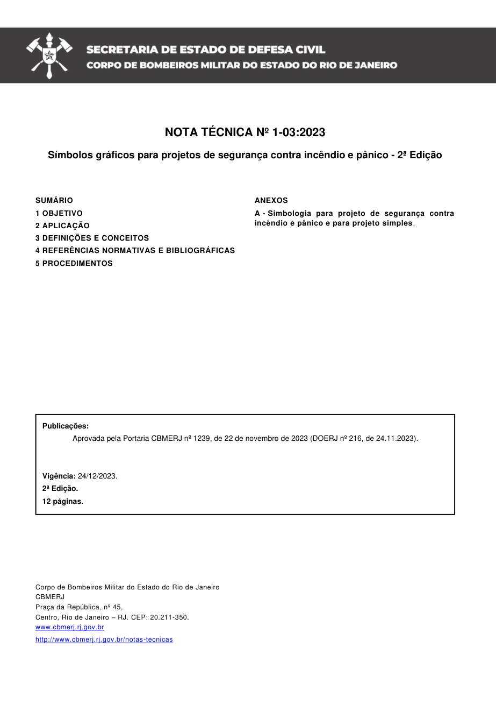

NOTA TÉCNICA Nº 1-03:2023

Símbolos gráficos para projetos de segurança contra incêndio e pânico - 2ª Edição

Aprovada pela Portaria CBMERJ nº 1239, de 22 de novembro de 2023 (DOERJ nº 216, de 24.11.2023).

Publicada no Boletim da SEDEC/CBMERJ nº XX, de XX de XX de 2023.

### SUMÁRIO

### 1 OBJETIVO

### 2 APLICAÇÃO

### 3 DEFINIÇÕES E CONCEITOS

### 4 REFERÊNCIAS NORMATIVAS E BIBLIOGRÁFICAS

### 5 PROCEDIMENTOS

Publicações:

Vigência: 24/12/2023.

2ª Edição.

12 páginas.

Corpo de Bombeiros Militar do Estado do Rio de Janeiro CBMERJ Praça da República, nº 45, Centro, Rio de Janeiro - RJ. CEP: 20.211-350. www.cbmerj.rj.gov.br

http://www.cbmerj.rj.gov.br/notas-tecnicas

### ANEXOS

A - Simbologia para projeto de segurança contra incêndio e pânico e para projeto simples.

---

## Página 3

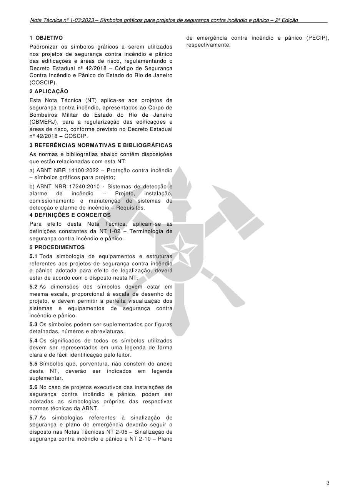

### 1 OBJETIVO

de emergência contra incêndio e pânico (PECIP), respectivamente.

Padronizar os símbolos gráficos a serem utilizados nos projetos de segurança contra incêndio e pânico das edificações e áreas de risco, regulamentando o Decreto Estadual nº 42/2018 - Código de Segurança Contra Incêndio e Pânico do Estado do Rio de Janeiro (COSCIP).

### 2 APLICAÇÃO

Esta Nota Técnica (NT) aplica-se aos projetos de segurança contra incêndio, apresentados ao Corpo de Bombeiros Militar do Estado do Rio de Janeiro (CBMERJ), para a regularização das edificações e áreas de risco, conforme previsto no Decreto Estadual nº 42/2018 - COSCIP.

### 3 REFERÊNCIAS NORMATIVAS E BIBLIOGRÁFICAS

As normas e bibliografias abaixo contêm disposições que estão relacionadas com esta NT:

a) ABNT NBR 14100:2022 - Proteção contra incêndio - símbolos gráficos para projeto;

b) ABNT NBR 17240:2010 - Sistemas de detecção e alarme de incêndio - Projeto, instalação, comissionamento e manutenção de sistemas de detecção e alarme de incêndio - Requisitos. 4 DEFINIÇÕES E CONCEITOS

Para efeito desta Nota Técnica, aplicam-se as definições constantes da NT 1-02 - Terminologia de segurança contra incêndio e pânico.

### 5 PROCEDIMENTOS

5.1 Toda simbologia de equipamentos e estruturas referentes aos projetos de segurança contra incêndio e pânico adotada para efeito de legalização, deverá estar de acordo com o disposto nesta NT.

5.2 As dimensões dos símbolos devem estar em mesma escala, proporcional à escala de desenho do projeto, e devem permitir a perfeita visualização dos sistemas e equipamentos de segurança contra incêndio e pânico.

5.3 Os símbolos podem ser suplementados por figuras detalhadas, números e abreviaturas.

5.4 Os significados de todos os símbolos utilizados devem ser representados em uma legenda de forma clara e de fácil identificação pelo leitor.

5.5 Símbolos que, porventura, não constem do anexo desta NT, deverão ser indicados em legenda suplementar.

5.6 No caso de projetos executivos das instalações de segurança contra incêndio e pânico, podem ser adotadas as simbologias próprias das respectivas normas técnicas da ABNT.

5.7 As simbologias referentes à sinalização de segurança e plano de emergência deverão seguir o disposto nas Notas Técnicas NT 2-05 - Sinalização de segurança contra incêndio e pânico e NT 2-10 - Plano

---

## Página 4

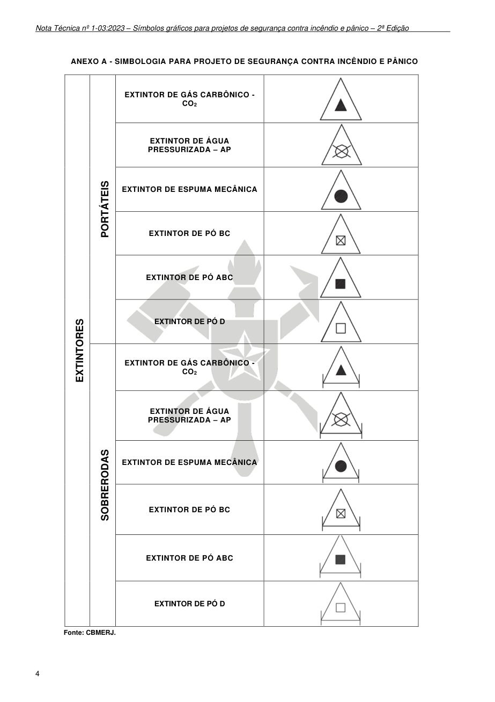

### ANEXO A - SIMBOLOGIA PARA PROJETO DE SEGURANÇA CONTRA INCÊNDIO E PÂNICO

Fonte: CBMERJ.

### Tabelas extraídas (bruto, não usar para citação)
#### Tabela 1 da página

| EXTINTORES | PORTÁTEIS | EXTINTOR DE GÁS CARBÔNICO - CO2 |  |
| --- | --- | --- | --- |
|  |  | EXTINTOR DE ÁGUA PRESSURIZADA - AP |  |
|  |  | EXTINTOR DE ESPUMA MECÂNICA |  |
|  |  | EXTINTOR DE PÓ BC |  |
|  |  | EXTINTOR DE PÓ ABC |  |
|  |  | EXTINTOR DE PÓ D |  |
|  | SOBRERODAS | EXTINTOR DE GÁS CARBÔNICO - CO2 |  |
|  |  | EXTINTOR DE ÁGUA PRESSURIZADA - AP |  |
|  |  | EXTINTOR DE ESPUMA MECÂNICA |  |
|  |  | EXTINTOR DE PÓ BC |  |
|  |  | EXTINTOR DE PÓ ABC |  |
|  |  | EXTINTOR DE PÓ D |  |

---

## Página 5

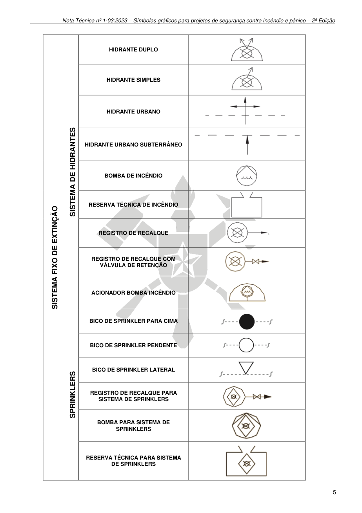

> Página sem texto extraível suficiente; consultar a representação visual ou o PDF oficial.

### Tabelas extraídas (bruto, não usar para citação)
#### Tabela 1 da página

| SISTEMA FIXO DE EXTINÇÃO | SISTEMA DE HIDRANTES | HIDRANTE DUPLO |  |
| --- | --- | --- | --- |
|  |  | HIDRANTE SIMPLES |  |
|  |  | HIDRANTE URBANO |  |
|  |  | HIDRANTE URBANO SUBTERRÂNEO |  |
|  |  | BOMBA DE INCÊNDIO |  |
|  |  | RESERVA TÉCNICA DE INCÊNDIO |  |
|  |  | REGISTRO DE RECALQUE |  |
|  |  | REGISTRO DE RECALQUE COM VÁLVULA DE RETENÇÃO |  |
|  |  | ACIONADOR BOMBA INCÊNDIO |  |
|  | SPRINKLERS | BICO DE SPRINKLER PARA CIMA |  |
|  |  | BICO DE SPRINKLER PENDENTE |  |
|  |  | BICO DE SPRINKLER LATERAL |  |
|  |  | REGISTRO DE RECALQUE PARA SISTEMA DE SPRINKLERS |  |
|  |  | BOMBA PARA SISTEMA DE SPRINKLERS |  |
|  |  | RESERVA TÉCNICA PARA SISTEMA DE SPRINKLERS |  |

---

## Página 6

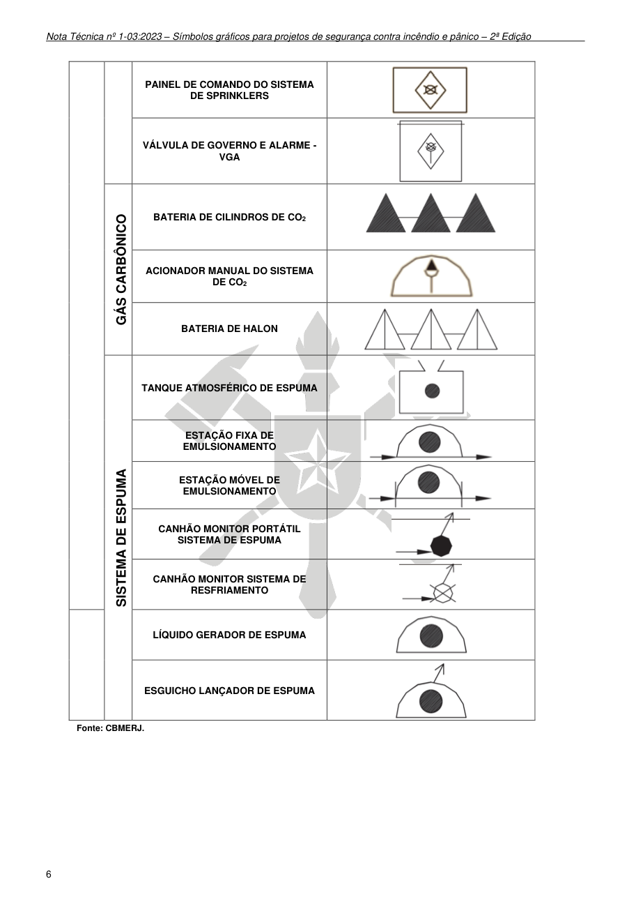

Fonte: CBMERJ.

### Tabelas extraídas (bruto, não usar para citação)
#### Tabela 1 da página

|  |  | PAINEL DE COMANDO DO SISTEMA DE SPRINKLERS |  |
| --- | --- | --- | --- |
|  |  | VÁLVULA DE GOVERNO E ALARME - VGA |  |
|  | GÁS CARBÔNICO | BATERIA DE CILINDROS DE CO2 |  |
|  |  | ACIONADOR MANUAL DO SISTEMA DE CO2 |  |
|  |  | BATERIA DE HALON |  |
|  | SISTEMA DE ESPUMA | TANQUE ATMOSFÉRICO DE ESPUMA |  |
|  |  | ESTAÇÃO FIXA DE EMULSIONAMENTO |  |
|  |  | ESTAÇÃO MÓVEL DE EMULSIONAMENTO |  |
|  |  | CANHÃO MONITOR PORTÁTIL SISTEMA DE ESPUMA |  |
|  |  | CANHÃO MONITOR SISTEMA DE RESFRIAMENTO |  |
|  |  | LÍQUIDO GERADOR DE ESPUMA |  |
|  |  | ESGUICHO LANÇADOR DE ESPUMA |  |

---

## Página 7

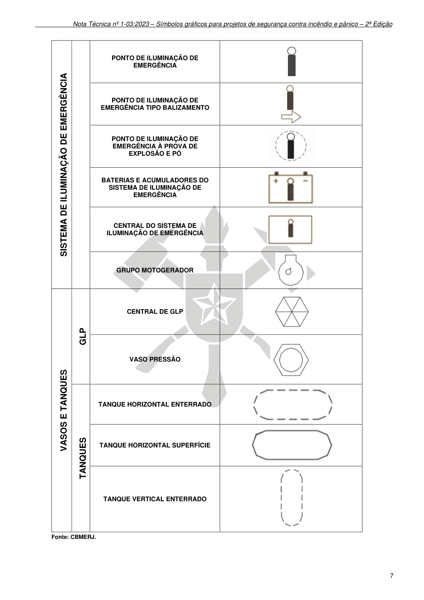

Fonte: CBMERJ.

### Tabelas extraídas (bruto, não usar para citação)
#### Tabela 1 da página

| SISTEMA DE ILUMINAÇÃO DE EMERGÊNCIA |  | PONTO DE ILUMINAÇÃO DE EMERGÊNCIA |  |
| --- | --- | --- | --- |
|  |  | PONTO DE ILUMINAÇÃO DE EMERGÊNCIA TIPO BALIZAMENTO |  |
|  |  | PONTO DE ILUMINAÇÃO DE EMERGÊNCIA À PROVA DE EXPLOSÃO E PÓ |  |
|  |  | BATERIAS E ACUMULADORES DO SISTEMA DE ILUMINAÇÃO DE EMERGÊNCIA |  |
|  |  | CENTRAL DO SISTEMA DE ILUMINAÇÃO DE EMERGÊNCIA |  |
|  |  | GRUPO MOTOGERADOR |  |
| VASOS E TANQUES | GLP | CENTRAL DE GLP |  |
|  |  | VASO PRESSÃO |  |
|  | TANQUES | TANQUE HORIZONTAL ENTERRADO |  |
|  |  | TANQUE HORIZONTAL SUPERFÍCIE |  |
|  |  | TANQUE VERTICAL ENTERRADO |  |

---

## Página 8

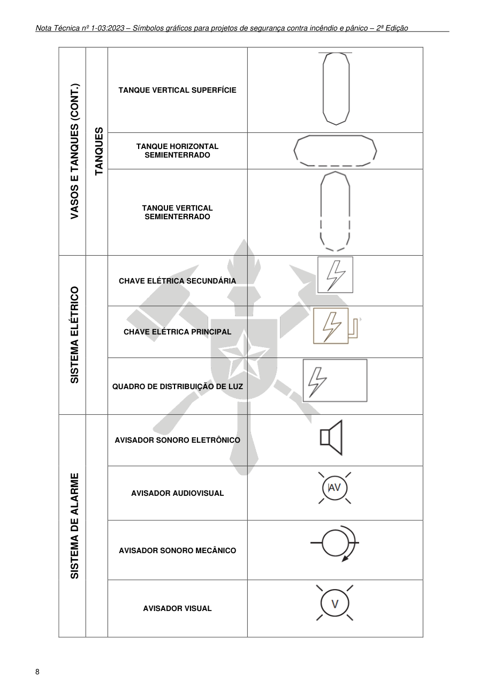

> Página sem texto extraível suficiente; consultar a representação visual ou o PDF oficial.

### Tabelas extraídas (bruto, não usar para citação)
#### Tabela 1 da página

| VASOS E TANQUES (CONT.) | TANQUES | TANQUE VERTICAL SUPERFÍCIE |  |
| --- | --- | --- | --- |
|  |  | TANQUE HORIZONTAL SEMIENTERRADO |  |
|  |  | TANQUE VERTICAL SEMIENTERRADO |  |
| SISTEMA ELÉTRICO |  | CHAVE ELÉTRICA SECUNDÁRIA |  |
|  |  | CHAVE ELÉTRICA PRINCIPAL |  |
|  |  | QUADRO DE DISTRIBUIÇÃO DE LUZ |  |
| SISTEMA DE ALARME |  | AVISADOR SONORO ELETRÔNICO |  |
|  |  | AVISADOR AUDIOVISUAL |  |
|  |  | AVISADOR SONORO MECÂNICO |  |
|  |  | AVISADOR VISUAL |  |

---

## Página 9

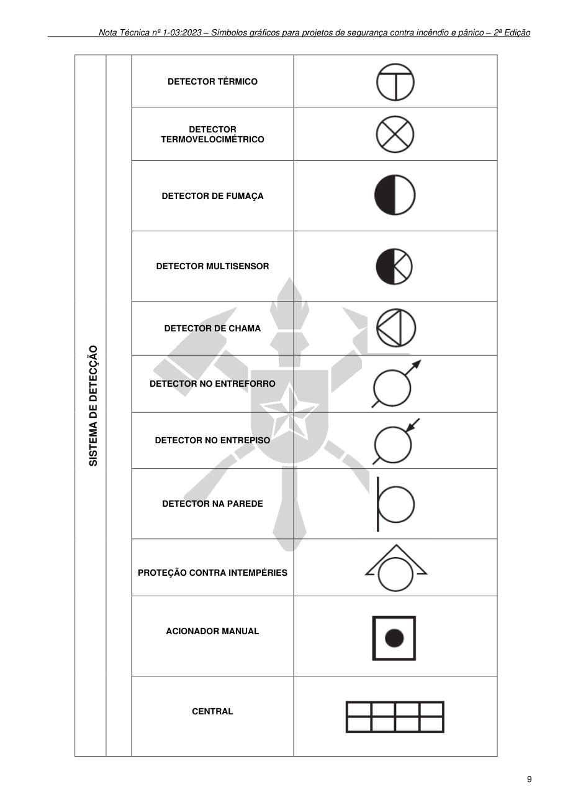

> Página sem texto extraível suficiente; consultar a representação visual ou o PDF oficial.

### Tabelas extraídas (bruto, não usar para citação)
#### Tabela 1 da página

| SISTEMA DE DETECÇÃO |  | DETECTOR TÉRMICO |  |
| --- | --- | --- | --- |
|  |  | DETECTOR TERMOVELOCIMÉTRICO |  |
|  |  | DETECTOR DE FUMAÇA |  |
|  |  | DETECTOR MULTISENSOR |  |
|  |  | DETECTOR DE CHAMA |  |
|  |  | DETECTOR NO ENTREFORRO |  |
|  |  | DETECTOR NO ENTREPISO |  |
|  |  | DETECTOR NA PAREDE |  |
|  |  | PROTEÇÃO CONTRA INTEMPÉRIES |  |
|  |  | ACIONADOR MANUAL |  |
|  |  | CENTRAL |  |

---

## Página 10

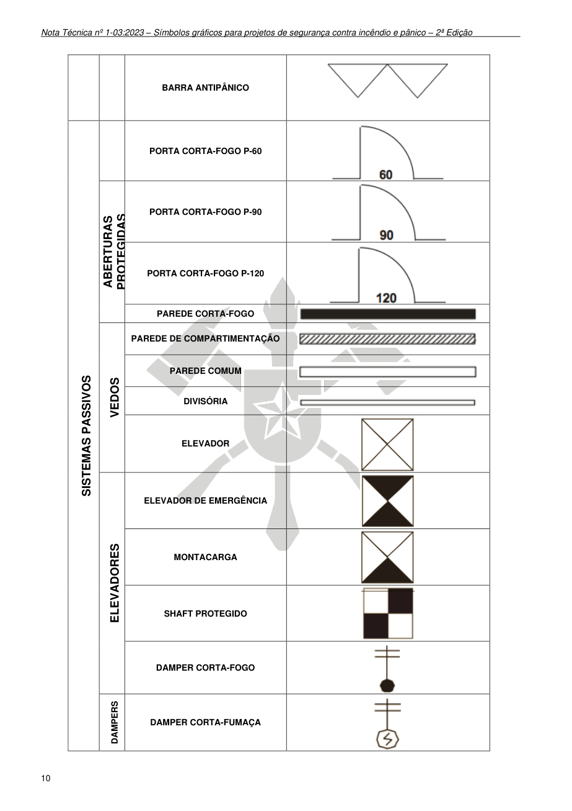

> Página sem texto extraível suficiente; consultar a representação visual ou o PDF oficial.

### Tabelas extraídas (bruto, não usar para citação)
#### Tabela 1 da página

|  |  | BARRA ANTIPÂNICO |  |
| --- | --- | --- | --- |
| SISTEMAS PASSIVOS |  | PORTA CORTA-FOGO P-60 |  |
|  | ABERTURAS PROTEGIDAS | PORTA CORTA-FOGO P-90 |  |
|  |  | PORTA CORTA-FOGO P-120 |  |
|  |  | PAREDE CORTA-FOGO |  |
|  | VEDOS | PAREDE DE COMPARTIMENTAÇÃO |  |
|  |  | PAREDE COMUM |  |
|  |  | DIVISÓRIA |  |
|  |  | ELEVADOR |  |
|  | ELEVADORES | ELEVADOR DE EMERGÊNCIA |  |
|  |  | MONTACARGA |  |
|  |  | SHAFT PROTEGIDO |  |
|  |  | DAMPER CORTA-FOGO |  |
|  | DAMPERS | DAMPER CORTA-FUMAÇA |  |

---

## Página 11

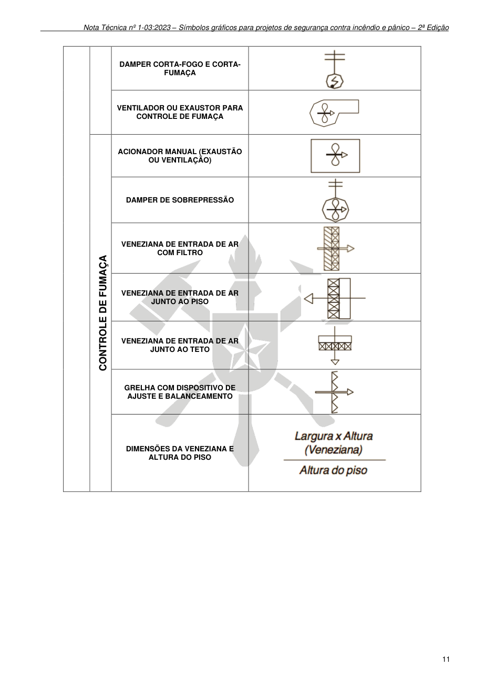

> Página sem texto extraível suficiente; consultar a representação visual ou o PDF oficial.

### Tabelas extraídas (bruto, não usar para citação)
#### Tabela 1 da página

|  |  | DAMPER CORTA-FOGO E CORTAFUMAÇA |  |
| --- | --- | --- | --- |
|  |  | VENTILADOR OU EXAUSTOR PARA CONTROLE DE FUMAÇA |  |
|  | CONTROLE DE FUMAÇA | ACIONADOR MANUAL (EXAUSTÃO OU VENTILAÇÃO) |  |
|  |  | DAMPER DE SOBREPRESSÃO |  |
|  |  | VENEZIANA DE ENTRADA DE AR COM FILTRO |  |
|  |  | VENEZIANA DE ENTRADA DE AR JUNTO AO PISO |  |
|  |  | VENEZIANA DE ENTRADA DE AR JUNTO AO TETO |  |
|  |  | GRELHA COM DISPOSITIVO DE AJUSTE E BALANCEAMENTO |  |
|  |  | DIMENSÕES DA VENEZIANA E ALTURA DO PISO |  |

---

## Página 12

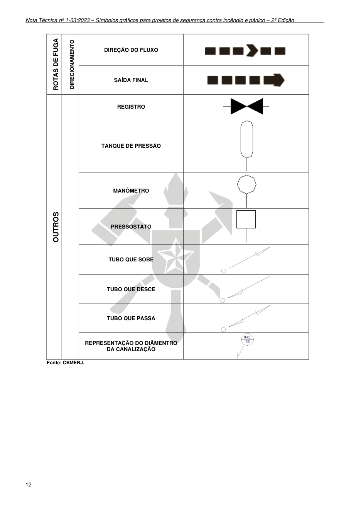

Fonte: CBMERJ.

### Tabelas extraídas (bruto, não usar para citação)
#### Tabela 1 da página

| ROTAS DE FUGA | DIRECIONAMENTO | DIREÇÃO DO FLUXO |  |
| --- | --- | --- | --- |
|  |  | SAÍDA FINAL |  |
| OUTROS |  | REGISTRO |  |
|  |  | TANQUE DE PRESSÃO |  |
|  |  | MANÔMETRO |  |
|  |  | PRESSOSTATO |  |
|  |  | TUBO QUE SOBE |  |
|  |  | TUBO QUE DESCE |  |
|  |  | TUBO QUE PASSA |  |
|  |  | REPRESENTAÇÃO DO DIÂMENTRO DA CANALIZAÇÃO |  |
