# NT 1-04 - Classificação das edificações e áreas de risco quanto ao risco de incêndio

> Conversão integral para consulta computacional. A numeração de página do PDF foi preservada. Quando houver tabela complexa, símbolo ou desenho, conferir também a representação visual indicada e o PDF oficial.

## Sumário por página

- [Página 1](#pagina-1)
- [Página 2](#pagina-2)
- [Página 3](#pagina-3)
- [Página 4](#pagina-4)
- [Página 5](#pagina-5)
- [Página 6](#pagina-6)
- [Página 7](#pagina-7)
- [Página 8](#pagina-8)
- [Página 9](#pagina-9)
- [Página 10](#pagina-10)
- [Página 11](#pagina-11)
- [Página 12](#pagina-12)
- [Página 13](#pagina-13)
- [Página 14](#pagina-14)
- [Página 15](#pagina-15)
- [Página 16](#pagina-16)
- [Página 17](#pagina-17)
- [Página 18](#pagina-18)
- [Página 19](#pagina-19)
- [Página 20](#pagina-20)

---

## Página 1

Aprovada pela Portaria CBMERJ nº 1071, de 27 de agosto de 2019.

### SUMÁRIO

### 1 OBJETIVO

### 2 APLICAÇÃO

### 3 REFERÊNCIAS NORMATIVAS E BIBLIOGRÁFICAS

### 4 DEFINIÇÕES E CONCEITOS

### 5 PROCEDIMENTOS

### ANEXOS

A - Classificação das edificações e áreas de risco quanto a ocupação

B - Classificação das edificações e áreas de risco quanto ao risco de incêndio

C - Método tabelado para levantamento da carga incêndio específica (depósitos)

D - Método determinístico para levantamento da carga de incêndio específica (depósitos)

E - Exemplo de planilha para cálculo da carga de incêndio específica

### Tabelas extraídas (bruto, não usar para citação)
#### Tabela 1 da página

|  |  | NOTA |  |  | CBMERJ |  |
| --- | --- | --- | --- | --- | --- | --- |
|  |  | TÉCNICA |  |  | NT 1-04 |  |
|  | Versão: 01 20 páginas Vigência: 04/09/2019 |  |  |  |  |  |
|  | Classificação das edificações e áreas de risco quanto ao risco de incêndio |  |  |  |  |  |

---

## Página 2

> Página sem texto extraível suficiente; consultar a representação visual ou o PDF oficial.

---

## Página 3

### 1 OBJETIVO

Classificar as edificações e áreas de risco quanto ao risco de incêndio conforme previsto pelo Decreto Estadual nº 42/2018 - Código de Segurança Contra Incêndio e Pânico do Estado do Rio de Janeiro (COSCIP).

### 2 APLICAÇÃO

Esta Nota Técnica (NT) aplica-se às edificações e áreas de risco para classificação do risco e determinação do nível de exigência das medidas de segurança contra incêndio, conforme prevê o Decreto Estadual nº 42/2018 - COSCIP.

### 3 REFERÊNCIAS NORMATIVAS E BIBLIOGRÁFICAS

As normas e bibliografias abaixo contêm disposições que estão relacionadas com esta Nota Técnica:

a) Decreto n° 42, de 17 de Dezembro de 2018, que regulamenta o Decreto- Lei n°247, de 21 de Julho de 1975, dispondo sobre o Código de Segurança Contra Incêndio e Pânico - COSCIP, no âmbito do Estado do Rio de Janeiro;

b) Resolução SEDEC nº 109/93 - Anexo I - Classificação das edificações quanto aos riscos de incêndio;

c) ABNT NBR 14432/2001 - Exigências de resistência ao fogo de elementos construtivos de edificações - Procedimento;

d) NTCB nº 07/2009 - Carga de incêndio. Corpo de Bombeiros Militar do Estado do Mato Grosso;

e) IT n° 14/2018- Carga de incêndio nas edificações e áreas de risco. Corpo de Bombeiros da Polícia Militar do Estado de São Paulo;

### 4 DEFINIÇÕES E CONCEITOS

Para efeito desta Nota Técnica, além das definições constantes da NT 1-02 - Terminologia de segurança contra incêndio e pânico, aplicam-se as definições específicas deste item.

4.1 Armazenagem: a armazenagem é constituída por um conjunto de funções de recepção, descarga, carregamento, arrumação e conservação de matériasprimas, produtos acabados ou semiacabados. Desta forma essa atividade diz respeito à estocagem ordenada e à distribuição de produtos acabados dentro da própria fábrica ou em locais destinados a este fim, pelos fabricantes, ou através de um processo de distribuição. Compreende, assim, todas as atividades de um ponto destinado à guarda temporária e à distribuição de materiais.

4.2 Carga de incêndio: soma das energias caloríficas possíveis de serem liberadas pela combustão completa de todos os materiais combustíveis em um espaço, inclusive os revestimentos das paredes, divisórias, pisos e tetos.

4.3 Carga de incêndio específica: valor da carga de incêndio dividido pela área de piso do espaço considerado, expresso em megajoule por metro quadrado (MJ/m²).

4.4 Depósito: para aplicação desta NT, serão considerados depósitos todas as edificações e áreas cobertas que armazenem materiais diversos com altura superior a 3,7 m de estocagem e possuam pé direito acima de 4,0 m e área construída superior a 500 m².

4.5 Método de cálculo probabilístico: método de cálculo baseado em resultados estatísticos do tipo de atividade exercida na edificação em estudo.

4.6 Método de cálculo determinístico: método de cálculo baseado no prévio conhecimento da quantidade e qualidade de materiais existentes na edificação em estudo.

### 5 PROCEDIMENTOS

5.1 As edificações são classificadas quanto a ocupação conforme o Anexo II do Decreto Estadual nº 42/2018 - COSCIP e Anexo A desta NT.

5.2 As edificações são classificadas quanto ao risco de incêndio como: risco pequeno, risco médio 1, risco médio 2 e risco grande.

5.3 As densidades de carga de incêndio constantes do Anexo D aplicam-se somente para a classificação do risco dos depósitos e, consequentemente, a determinação do nível de exigência das medidas de segurança contra incêndio e pânico, conforme Decreto Estadual nº 42/2018 - COSCIP.

5.4 As edificações, exceto depósitos, têm a sua classificação quanto ao risco de incêndio definida no Anexo B.

5.5 Em complemento ao que consta em 5.4, quando a ocupação não estiver listada no Anexo B, o risco deverá ser definido conforme a atividade desenvolvida no local e enquadrada por similaridade no referido anexo.

5.6 Os depósitos serão classificados mediante a correlação da altura de estocagem com sua carga de incêndio específica constante na tabela 1 do Anexo C.

5.6.1 O levantamento da carga de incêndio específica constante do Anexo C deve ser realizado em módulos de, no máximo, 1.000 m² de área de piso (espaço considerado). Módulos maiores de 1.000 m² podem ser utilizados quando o espaço analisado possuir materiais combustíveis com potenciais caloríficos semelhantes e uniformemente distribuídos.

5.6.2 Considerar para o cálculo: 1 kg de madeira equivale a 19 MJ; 1 cal equivale a 4,185 J; e 1 BTU equivale a 252 cal.

5.7 Os depósitos, quando não contemplados na tabela 1 do Anexo C, devem ter os valores da carga de incêndio específica determinados pela metodologia

---

## Página 4

Código de Segurança Contra Incêndio e Pânico - Estado do Rio de Janeiro

constante do Anexo D (método determinístico). Após o cálculo do valor da carga específica, deverá verificar a Tabela 2 do Anexo C para classificação de risco. O modelo de planilha para elaboração do cálculo está contido no Anexo E.

5.8 Os depósitos, quando não especificada a carga incêndio do material estocado, serão classificados no risco grande.

5.9 As edificações mistas classificadas pela ocupação em A-6, conforme prevê o Anexo B da presente Nota Técnica ficarão classificadas no risco pequeno, apenas quando a parte comercial se situar apenas no pavimento térreo e possuir uma área construída de até 900 m².

5.10 As edificações comerciais de tintas e solventes, classificadas em C-1, conforme prevê a o Anexo B, para serem classificadas no risco médio 1 deverão possuir um estoque de até 500 litros de inflamáveis. Quando este valor for ultrapassado, deverá ser apresentado cálculo da carga incêndio conforme previsto no Anexo D da presente NT.

5.11 As edificações comerciais atacadistas classificadas em C-2, conforme prevê o Anexo B, quando possuírem estoques com altura superior a 3,70 m, serão classificadas no risco grande.

5.12 Toda edificação que possuir Heliponto deverá atentar para o item 5.20.3 da Nota Técnica 2-02 Sistemas de hidrantes e de mangotinhos para combate a incêndio, no qual são definidos os parâmetros mínimos requeridos pelo sistema, portanto o sistema da edificação ao possuir heliponto poderá ter sua classificação majorada.

5.13 As edificações das divisões I-2 e I-3 conforme o Anexo B, poderão ter seu risco revisto, desde que seja comprovado através da apresentação de cálculo de valor da carga de incêndio previsto no Anexo D da presente NT.

5.14 As edificações das divisões G-1, G-2 e G-3, que possuírem área coberta destinada especificamente ao estacionamento de veículos superior a 1.500 m², terão a classificação de risco de incêndio majorada para Risco Médio 2.

5.15 Sempre que em uma edificação houver mais de uma atividade/ocupação, será considerada, para fins de exigências, a de maior risco, mesmo que não seja a atividade econômica principal.

5.16 Casos omissos e não contemplados na presente NT devem ser submetidos à análise da Comissão de Análise Técnica (CAT), que somente através da emissão de Parecer Técnico definirá a classificação de risco.

---

## Página 5

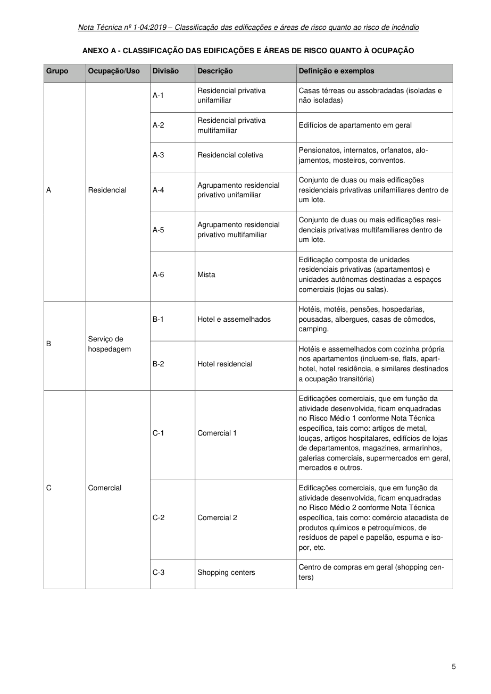

### ANEXO A - CLASSIFICAÇÃO DAS EDIFICAÇÕES E ÁREAS DE RISCO QUANTO À OCUPAÇÃO

### Tabelas extraídas (bruto, não usar para citação)
#### Tabela 1 da página

| Grupo | Ocupação/Uso | Divisão | Descrição | Definição e exemplos |
| --- | --- | --- | --- | --- |
| A | Residencial | A-1 | Residencial privativa unifamiliar | Casas térreas ou assobradadas (isoladas e não isoladas) |
|  |  | A-2 | Residencial privativa multifamiliar | Edifícios de apartamento em geral |
|  |  | A-3 | Residencial coletiva | Pensionatos, internatos, orfanatos, alojamentos, mosteiros, conventos. |
|  |  | A-4 | Agrupamento residencial privativo unifamiliar | Conjunto de duas ou mais edificações residenciais privativas unifamiliares dentro de um lote. |
|  |  | A-5 | Agrupamento residencial privativo multifamiliar | Conjunto de duas ou mais edificações residenciais privativas multifamiliares dentro de um lote. |
|  |  | A-6 | Mista | Edificação composta de unidades residenciais privativas (apartamentos) e unidades autônomas destinadas a espaços comerciais (lojas ou salas). |
| B | Serviço de hospedagem | B-1 | Hotel e assemelhados | Hotéis, motéis, pensões, hospedarias, pousadas, albergues, casas de cômodos, camping. |
|  |  | B-2 | Hotel residencial | Hotéis e assemelhados com cozinha própria nos apartamentos (incluem-se, flats, aparthotel, hotel residência, e similares destinados a ocupação transitória) |
| C | Comercial | C-1 | Comercial 1 | Edificações comerciais, que em função da atividade desenvolvida, ficam enquadradas no Risco Médio 1 conforme Nota Técnica específica, tais como: artigos de metal, louças, artigos hospitalares, edifícios de lojas de departamentos, magazines, armarinhos, galerias comerciais, supermercados em geral, mercados e outros. |
|  |  | C-2 | Comercial 2 | Edificações comerciais, que em função da atividade desenvolvida, ficam enquadradas no Risco Médio 2 conforme Nota Técnica específica, tais como: comércio atacadista de produtos químicos e petroquímicos, de resíduos de papel e papelão, espuma e isopor, etc. |
|  |  | C-3 | Shopping centers | Centro de compras em geral (shopping centers) |

<!-- tabela-conferida: Tabela do Anexo A p5 -->
### Tabela do Anexo A — Classificação quanto à ocupação (página 5) (conferida)

| Grupo | Ocupação/Uso | Divisão | Descrição | Definição e exemplos |
| --- | --- | --- | --- | --- |
| A | Residencial | A-1 | Residencial privativa unifamiliar | Casas térreas ou assobradadas (isoladas e não isoladas) |
| A | Residencial | A-2 | Residencial privativa multifamiliar | Edifícios de apartamento em geral |
| A | Residencial | A-3 | Residencial coletiva | Pensionatos, internatos, orfanatos, alojamentos, mosteiros, conventos. |
| A | Residencial | A-4 | Agrupamento residencial privativo unifamiliar | Conjunto de duas ou mais edificações residenciais privativas unifamiliares dentro de um lote. |
| A | Residencial | A-5 | Agrupamento residencial privativo multifamiliar | Conjunto de duas ou mais edificações residenciais privativas multifamiliares dentro de um lote. |
| A | Residencial | A-6 | Mista | Edificação composta de unidades residenciais privativas (apartamentos) e unidades autônomas destinadas a espaços comerciais (lojas ou salas). |
| B | Serviço de hospedagem | B-1 | Hotel e assemelhados | Hotéis, motéis, pensões, hospedarias, pousadas, albergues, casas de cômodos, camping. |
| B | Serviço de hospedagem | B-2 | Hotel residencial | Hotéis e assemelhados com cozinha própria nos apartamentos (incluem-se, flats, aparthotel, hotel residência, e similares destinados a ocupação transitória) |
| C | Comercial | C-1 | Comercial 1 | Edificações comerciais, que em função da atividade desenvolvida, ficam enquadradas no Risco Médio 1 conforme Nota Técnica específica, tais como: artigos de metal, louças, artigos hospitalares, edifícios de lojas de departamentos, magazines, armarinhos, galerias comerciais, supermercados em geral, mercados e outros. |
| C | Comercial | C-2 | Comercial 2 | Edificações comerciais, que em função da atividade desenvolvida, ficam enquadradas no Risco Médio 2 conforme Nota Técnica específica, tais como: comércio atacadista de produtos químicos e petroquímicos, de resíduos de papel e papelão, espuma e isopor, etc. |
| C | Comercial | C-3 | Shopping centers | Centro de compras em geral (shopping centers) |

Fonte: NT 1-04, página 5, Tabela do Anexo A; conferida em 2026-09-29 (visual + texto).
Classificação quanto à ocupação (NT 1-04, Anexo A), páginas 5 a 10; um arquivo por página. "^" = célula mesclada com a de cima (grupo e ocupação). Hifenização de fim de linha da imagem ("alo-jamentos", "iso-por") desfeita.
<!-- /tabela-conferida: Tabela do Anexo A p5 -->

---

## Página 6

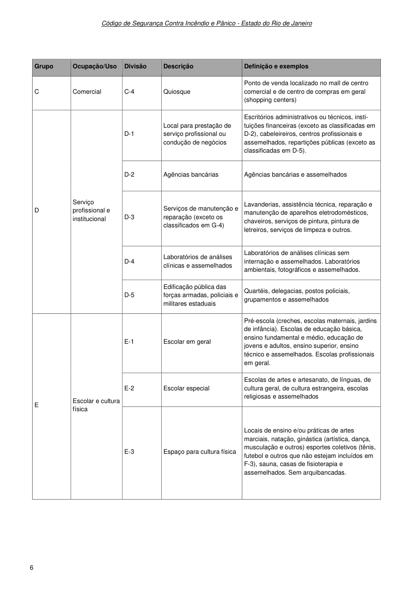

Código de Segurança Contra Incêndio e Pânico - Estado do Rio de Janeiro

### Tabelas extraídas (bruto, não usar para citação)
#### Tabela 1 da página

| Grupo | Ocupação/Uso | Divisão | Descrição | Definição e exemplos |
| --- | --- | --- | --- | --- |
| C | Comercial | C-4 | Quiosque | Ponto de venda localizado no mall de centro comercial e de centro de compras em geral (shopping centers) |
| D | Serviço profissional e institucional | D-1 | Local para prestação de serviço profissional ou condução de negócios | Escritórios administrativos ou técnicos, instituições financeiras (exceto as classificadas em D-2), cabeleireiros, centros profissionais e assemelhados, repartições públicas (exceto as classificadas em D-5). |
|  |  | D-2 | Agências bancárias | Agências bancárias e assemelhados |
|  |  | D-3 | Serviços de manutenção e reparação (exceto os classificados em G-4) | Lavanderias, assistência técnica, reparação e manutenção de aparelhos eletrodomésticos, chaveiros, serviços de pintura, pintura de letreiros, serviços de limpeza e outros. |
|  |  | D-4 | Laboratórios de análises clínicas e assemelhados | Laboratórios de análises clínicas sem internação e assemelhados. Laboratórios ambientais, fotográficos e assemelhados. |
|  |  | D-5 | Edificação pública das forças armadas, policiais e militares estaduais | Quartéis, delegacias, postos policiais, grupamentos e assemelhados |
| E | Escolar e cultura física | E-1 | Escolar em geral | Pré-escola (creches, escolas maternais, jardins de infância). Escolas de educação básica, ensino fundamental e médio, educação de jovens e adultos, ensino superior, ensino técnico e assemelhados. Escolas profissionais em geral. |
|  |  | E-2 | Escolar especial | Escolas de artes e artesanato, de línguas, de cultura geral, de cultura estrangeira, escolas religiosas e assemelhados |
|  |  | E-3 | Espaço para cultura física | Locais de ensino e/ou práticas de artes marciais, natação, ginástica (artística, dança, musculação e outros) esportes coletivos (tênis, futebol e outros que não estejam incluídos em F-3), sauna, casas de fisioterapia e assemelhados. Sem arquibancadas. |

<!-- tabela-conferida: Tabela do Anexo A p6 -->
### Tabela do Anexo A — Classificação quanto à ocupação (página 6) (conferida)

| Grupo | Ocupação/Uso | Divisão | Descrição | Definição e exemplos |
| --- | --- | --- | --- | --- |
| C | Comercial | C-4 | Quiosque | Ponto de venda localizado no mall de centro comercial e de centro de compras em geral (shopping centers) |
| D | Serviço profissional e institucional | D-1 | Local para prestação de serviço profissional ou condução de negócios | Escritórios administrativos ou técnicos, instituições financeiras (exceto as classificadas em D-2), cabeleireiros, centros profissionais e assemelhados, repartições públicas (exceto as classificadas em D-5). |
| D | Serviço profissional e institucional | D-2 | Agências bancárias | Agências bancárias e assemelhados |
| D | Serviço profissional e institucional | D-3 | Serviços de manutenção e reparação (exceto os classificados em G-4) | Lavanderias, assistência técnica, reparação e manutenção de aparelhos eletrodomésticos, chaveiros, serviços de pintura, pintura de letreiros, serviços de limpeza e outros. |
| D | Serviço profissional e institucional | D-4 | Laboratórios de análises clínicas e assemelhados | Laboratórios de análises clínicas sem internação e assemelhados. Laboratórios ambientais, fotográficos e assemelhados. |
| D | Serviço profissional e institucional | D-5 | Edificação pública das forças armadas, policiais e militares estaduais | Quartéis, delegacias, postos policiais, grupamentos e assemelhados |
| E | Escolar e cultura física | E-1 | Escolar em geral | Pré-escola (creches, escolas maternais, jardins de infância). Escolas de educação básica, ensino fundamental e médio, educação de jovens e adultos, ensino superior, ensino técnico e assemelhados. Escolas profissionais em geral. |
| E | Escolar e cultura física | E-2 | Escolar especial | Escolas de artes e artesanato, de línguas, de cultura geral, de cultura estrangeira, escolas religiosas e assemelhados |
| E | Escolar e cultura física | E-3 | Espaço para cultura física | Locais de ensino e/ou práticas de artes marciais, natação, ginástica (artística, dança, musculação e outros) esportes coletivos (tênis, futebol e outros que não estejam incluídos em F-3), sauna, casas de fisioterapia e assemelhados. Sem arquibancadas. |

Fonte: NT 1-04, página 6, Tabela do Anexo A; conferida em 2026-09-29 (visual + texto).
Classificação quanto à ocupação (NT 1-04, Anexo A), páginas 5 a 10; um arquivo por página. "^" = célula mesclada com a de cima (grupo e ocupação). Hifenização de fim de linha da imagem ("alo-jamentos", "iso-por") desfeita.
<!-- /tabela-conferida: Tabela do Anexo A p6 -->

---

## Página 7

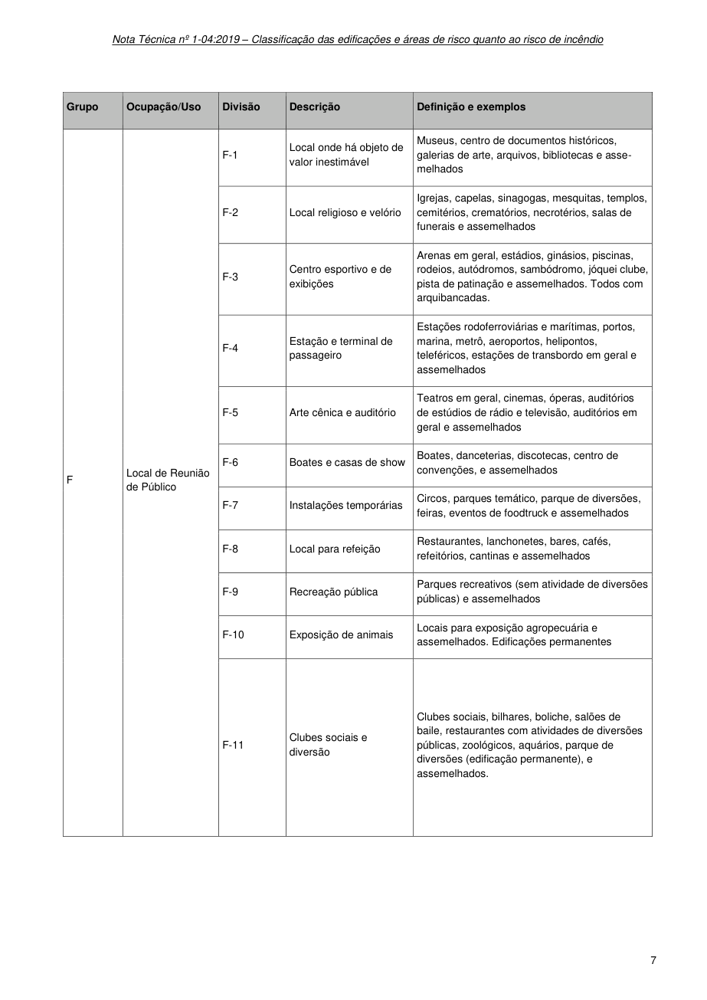

> Página sem texto extraível suficiente; consultar a representação visual ou o PDF oficial.

### Tabelas extraídas (bruto, não usar para citação)
#### Tabela 1 da página

|  |  |  |  |  |
| --- | --- | --- | --- | --- |
| Grupo | Ocupação/Uso | Divisão | Descrição | Definição e exemplos |
|  |  |  |  |  |
| F | Local de Reunião de Público | F-1 | Local onde há objeto de valor inestimável | Museus, centro de documentos históricos, galerias de arte, arquivos, bibliotecas e assemelhados |
|  |  | F-2 | Local religioso e velório | Igrejas, capelas, sinagogas, mesquitas, templos, cemitérios, crematórios, necrotérios, salas de funerais e assemelhados |
|  |  | F-3 | Centro esportivo e de exibições | Arenas em geral, estádios, ginásios, piscinas, rodeios, autódromos, sambódromo, jóquei clube, pista de patinação e assemelhados. Todos com arquibancadas. |
|  |  | F-4 | Estação e terminal de passageiro | Estações rodoferroviárias e marítimas, portos, marina, metrô, aeroportos, helipontos, teleféricos, estações de transbordo em geral e assemelhados |
|  |  | F-5 | Arte cênica e auditório | Teatros em geral, cinemas, óperas, auditórios de estúdios de rádio e televisão, auditórios em geral e assemelhados |
|  |  | F-6 | Boates e casas de show | Boates, danceterias, discotecas, centro de convenções, e assemelhados |
|  |  | F-7 | Instalações temporárias | Circos, parques temático, parque de diversões, feiras, eventos de foodtruck e assemelhados |
|  |  | F-8 | Local para refeição | Restaurantes, lanchonetes, bares, cafés, refeitórios, cantinas e assemelhados |
|  |  | F-9 | Recreação pública | Parques recreativos (sem atividade de diversões públicas) e assemelhados |
|  |  | F-10 | Exposição de animais | Locais para exposição agropecuária e assemelhados. Edificações permanentes |
|  |  | F-11 | Clubes sociais e diversão | Clubes sociais, bilhares, boliche, salões de baile, restaurantes com atividades de diversões públicas, zoológicos, aquários, parque de diversões (edificação permanente), e assemelhados. |

<!-- tabela-conferida: Tabela do Anexo A p7 -->
### Tabela do Anexo A — Classificação quanto à ocupação (página 7) (conferida)

| Grupo | Ocupação/Uso | Divisão | Descrição | Definição e exemplos |
| --- | --- | --- | --- | --- |
| F | Local de Reunião de Público | F-1 | Local onde há objeto de valor inestimável | Museus, centro de documentos históricos, galerias de arte, arquivos, bibliotecas e assemelhados |
| F | Local de Reunião de Público | F-2 | Local religioso e velório | Igrejas, capelas, sinagogas, mesquitas, templos, cemitérios, crematórios, necrotérios, salas de funerais e assemelhados |
| F | Local de Reunião de Público | F-3 | Centro esportivo e de exibições | Arenas em geral, estádios, ginásios, piscinas, rodeios, autódromos, sambódromo, jóquei clube, pista de patinação e assemelhados. Todos com arquibancadas. |
| F | Local de Reunião de Público | F-4 | Estação e terminal de passageiro | Estações rodoferroviárias e marítimas, portos, marina, metrô, aeroportos, helipontos, teleféricos, estações de transbordo em geral e assemelhados |
| F | Local de Reunião de Público | F-5 | Arte cênica e auditório | Teatros em geral, cinemas, óperas, auditórios de estúdios de rádio e televisão, auditórios em geral e assemelhados |
| F | Local de Reunião de Público | F-6 | Boates e casas de show | Boates, danceterias, discotecas, centro de convenções, e assemelhados |
| F | Local de Reunião de Público | F-7 | Instalações temporárias | Circos, parques temático, parque de diversões, feiras, eventos de foodtruck e assemelhados |
| F | Local de Reunião de Público | F-8 | Local para refeição | Restaurantes, lanchonetes, bares, cafés, refeitórios, cantinas e assemelhados |
| F | Local de Reunião de Público | F-9 | Recreação pública | Parques recreativos (sem atividade de diversões públicas) e assemelhados |
| F | Local de Reunião de Público | F-10 | Exposição de animais | Locais para exposição agropecuária e assemelhados. Edificações permanentes |
| F | Local de Reunião de Público | F-11 | Clubes sociais e diversão | Clubes sociais, bilhares, boliche, salões de baile, restaurantes com atividades de diversões públicas, zoológicos, aquários, parque de diversões (edificação permanente), e assemelhados. |

Fonte: NT 1-04, página 7, Tabela do Anexo A; conferida em 2026-09-29 (visual + texto).
Classificação quanto à ocupação (NT 1-04, Anexo A), páginas 5 a 10; um arquivo por página. "^" = célula mesclada com a de cima (grupo e ocupação). Hifenização de fim de linha da imagem ("alo-jamentos", "iso-por") desfeita.
<!-- /tabela-conferida: Tabela do Anexo A p7 -->

---

## Página 8

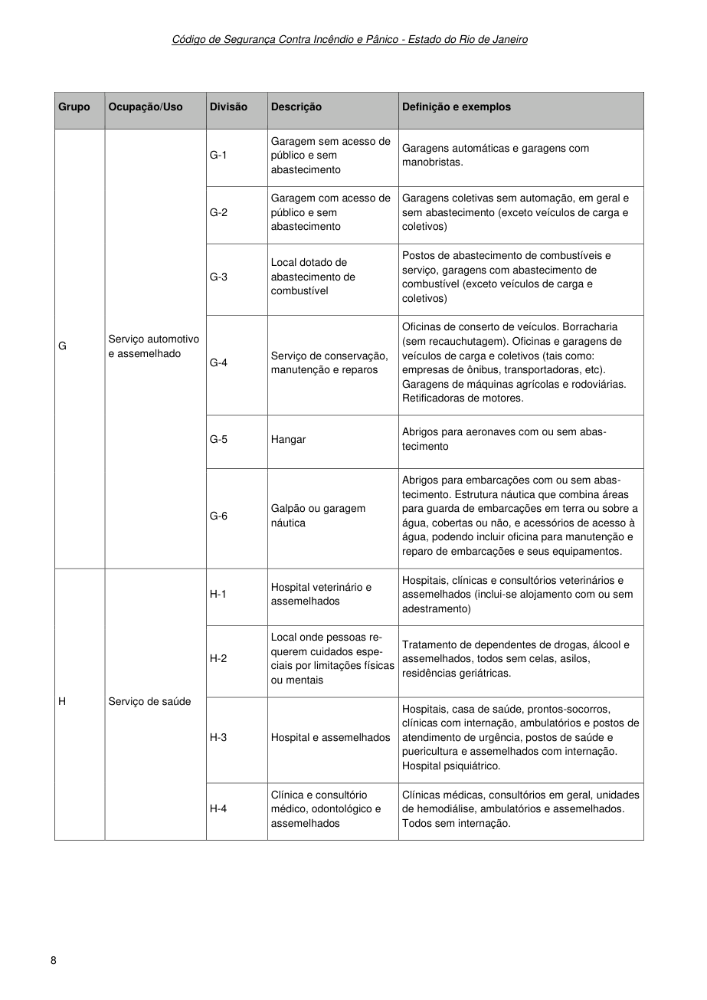

Código de Segurança Contra Incêndio e Pânico - Estado do Rio de Janeiro

### Tabelas extraídas (bruto, não usar para citação)
#### Tabela 1 da página

|  |  |  |  |  |
| --- | --- | --- | --- | --- |
| Grupo | Ocupação/Uso | Divisão | Descrição | Definição e exemplos |
|  |  |  |  |  |
| G | Serviço automotivo e assemelhado | G-1 | Garagem sem acesso de público e sem abastecimento | Garagens automáticas e garagens com manobristas. |
|  |  | G-2 | Garagem com acesso de público e sem abastecimento | Garagens coletivas sem automação, em geral e sem abastecimento (exceto veículos de carga e coletivos) |
|  |  | G-3 | Local dotado de abastecimento de combustível | Postos de abastecimento de combustíveis e serviço, garagens com abastecimento de combustível (exceto veículos de carga e coletivos) |
|  |  | G-4 | Serviço de conservação, manutenção e reparos | Oficinas de conserto de veículos. Borracharia (sem recauchutagem). Oficinas e garagens de veículos de carga e coletivos (tais como: empresas de ônibus, transportadoras, etc). Garagens de máquinas agrícolas e rodoviárias. Retificadoras de motores. |
|  |  | G-5 | Hangar | Abrigos para aeronaves com ou sem abastecimento |
|  |  | G-6 | Galpão ou garagem náutica | Abrigos para embarcações com ou sem abastecimento. Estrutura náutica que combina áreas para guarda de embarcações em terra ou sobre a água, cobertas ou não, e acessórios de acesso à água, podendo incluir oficina para manutenção e reparo de embarcações e seus equipamentos. |
| H | Serviço de saúde | H-1 | Hospital veterinário e assemelhados | Hospitais, clínicas e consultórios veterinários e assemelhados (inclui-se alojamento com ou sem adestramento) |
|  |  | H-2 | Local onde pessoas requerem cuidados especiais por limitações físicas ou mentais | Tratamento de dependentes de drogas, álcool e assemelhados, todos sem celas, asilos, residências geriátricas. |
|  |  | H-3 | Hospital e assemelhados | Hospitais, casa de saúde, prontos-socorros, clínicas com internação, ambulatórios e postos de atendimento de urgência, postos de saúde e puericultura e assemelhados com internação. Hospital psiquiátrico. |
|  |  | H-4 | Clínica e consultório médico, odontológico e assemelhados | Clínicas médicas, consultórios em geral, unidades de hemodiálise, ambulatórios e assemelhados. Todos sem internação. |

<!-- tabela-conferida: Tabela do Anexo A p8 -->
### Tabela do Anexo A — Classificação quanto à ocupação (página 8) (conferida)

| Grupo | Ocupação/Uso | Divisão | Descrição | Definição e exemplos |
| --- | --- | --- | --- | --- |
| G | Serviço automotivo e assemelhado | G-1 | Garagem sem acesso de público e sem abastecimento | Garagens automáticas e garagens com manobristas. |
| G | Serviço automotivo e assemelhado | G-2 | Garagem com acesso de público e sem abastecimento | Garagens coletivas sem automação, em geral e sem abastecimento (exceto veículos de carga e coletivos) |
| G | Serviço automotivo e assemelhado | G-3 | Local dotado de abastecimento de combustível | Postos de abastecimento de combustíveis e serviço, garagens com abastecimento de combustível (exceto veículos de carga e coletivos) |
| G | Serviço automotivo e assemelhado | G-4 | Serviço de conservação, manutenção e reparos | Oficinas de conserto de veículos. Borracharia (sem recauchutagem). Oficinas e garagens de veículos de carga e coletivos (tais como: empresas de ônibus, transportadoras, etc). Garagens de máquinas agrícolas e rodoviárias. Retificadoras de motores. |
| G | Serviço automotivo e assemelhado | G-5 | Hangar | Abrigos para aeronaves com ou sem abastecimento |
| G | Serviço automotivo e assemelhado | G-6 | Galpão ou garagem náutica | Abrigos para embarcações com ou sem abastecimento. Estrutura náutica que combina áreas para guarda de embarcações em terra ou sobre a água, cobertas ou não, e acessórios de acesso à água, podendo incluir oficina para manutenção e reparo de embarcações e seus equipamentos. |
| H | Serviço de saúde | H-1 | Hospital veterinário e assemelhados | Hospitais, clínicas e consultórios veterinários e assemelhados (inclui-se alojamento com ou sem adestramento) |
| H | Serviço de saúde | H-2 | Local onde pessoas requerem cuidados especiais por limitações físicas ou mentais | Tratamento de dependentes de drogas, álcool e assemelhados, todos sem celas, asilos, residências geriátricas. |
| H | Serviço de saúde | H-3 | Hospital e assemelhados | Hospitais, casa de saúde, prontos-socorros, clínicas com internação, ambulatórios e postos de atendimento de urgência, postos de saúde e puericultura e assemelhados com internação. Hospital psiquiátrico. |
| H | Serviço de saúde | H-4 | Clínica e consultório médico, odontológico e assemelhados | Clínicas médicas, consultórios em geral, unidades de hemodiálise, ambulatórios e assemelhados. Todos sem internação. |

Fonte: NT 1-04, página 8, Tabela do Anexo A; conferida em 2026-09-29 (visual + texto).
Classificação quanto à ocupação (NT 1-04, Anexo A), páginas 5 a 10; um arquivo por página. "^" = célula mesclada com a de cima (grupo e ocupação). Hifenização de fim de linha da imagem ("alo-jamentos", "iso-por") desfeita.
<!-- /tabela-conferida: Tabela do Anexo A p8 -->

---

## Página 9

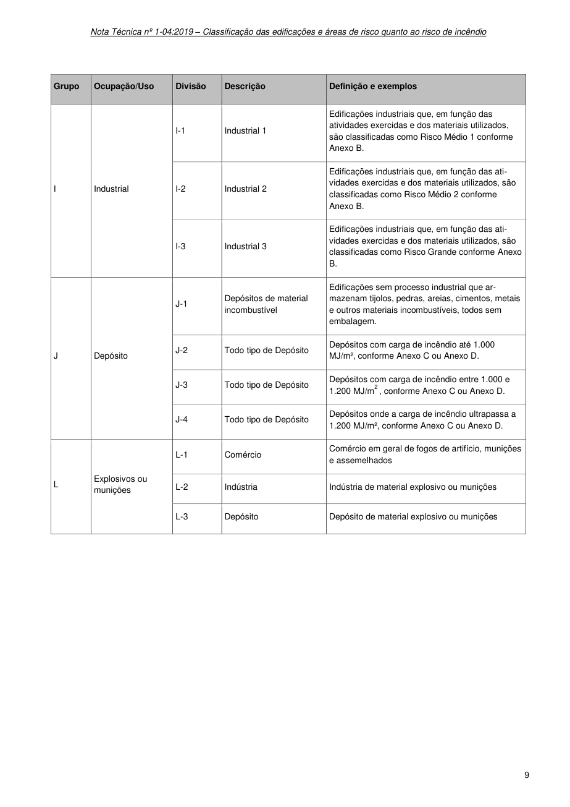

> Página sem texto extraível suficiente; consultar a representação visual ou o PDF oficial.

### Tabelas extraídas (bruto, não usar para citação)
#### Tabela 1 da página

|  | Ocupação/Uso |  | Descrição |  |
| --- | --- | --- | --- | --- |
| Grupo |  | Divisão |  | Definição e exemplos |
|  |  |  |  |  |
|  | Industrial |  | Industrial 1 | Edificações industriais que, em função das |
|  |  |  |  | atividades exercidas e dos materiais utilizados, |
|  |  | I-1 |  |  |
|  |  |  |  | são classificadas como Risco Médio 1 conforme |
|  |  |  |  | Anexo B. |
|  |  |  | Industrial 2 | Edificações industriais que, em função das ati- |
|  |  |  |  | vidades exercidas e dos materiais utilizados, são |
| I |  | I-2 |  |  |
|  |  |  |  | classificadas como Risco Médio 2 conforme |
|  |  |  |  | Anexo B. |
|  |  |  | Industrial 3 | Edificações industriais que, em função das ati- |
|  |  |  |  | vidades exercidas e dos materiais utilizados, são |
|  |  | I-3 |  |  |
|  |  |  |  | classificadas como Risco Grande conforme Anexo |
|  |  |  |  | B. |
|  | Depósito |  | Depósitos de material incombustível | Edificações sem processo industrial que ar- |
|  |  |  |  | mazenam tijolos, pedras, areias, cimentos, metais |
|  |  | J-1 |  |  |
|  |  |  |  | e outros materiais incombustíveis, todos sem |
|  |  |  |  | embalagem. |
|  |  |  | Todo tipo de Depósito | Depósitos com carga de incêndio até 1.000 |
|  |  | J-2 |  |  |
| J |  |  |  | MJ/m², conforme Anexo C ou Anexo D. |
|  |  |  |  |  |
|  |  |  | Todo tipo de Depósito | Depósitos com carga de incêndio entre 1.000 e |
|  |  | J-3 |  |  |
|  |  |  |  | 1.200 MJ/m2, conforme Anexo C ou Anexo D. |
|  |  |  |  |  |
|  |  |  | Todo tipo de Depósito | Depósitos onde a carga de incêndio ultrapassa a |
|  |  | J-4 |  |  |
|  |  |  |  | 1.200 MJ/m², conforme Anexo C ou Anexo D. |
|  |  |  |  |  |
|  |  |  | Comércio | Comércio em geral de fogos de artifício, munições |
|  |  | L-1 |  |  |
|  |  |  |  | e assemelhados |
|  |  |  |  |  |
| L | Explosivos ou munições | L-2 | Indústria | Indústria de material explosivo ou munições |
|  |  |  |  |  |
|  |  |  | Depósito |  |
|  |  | L-3 |  | Depósito de material explosivo ou munições |
|  |  |  |  |  |

---

## Página 10

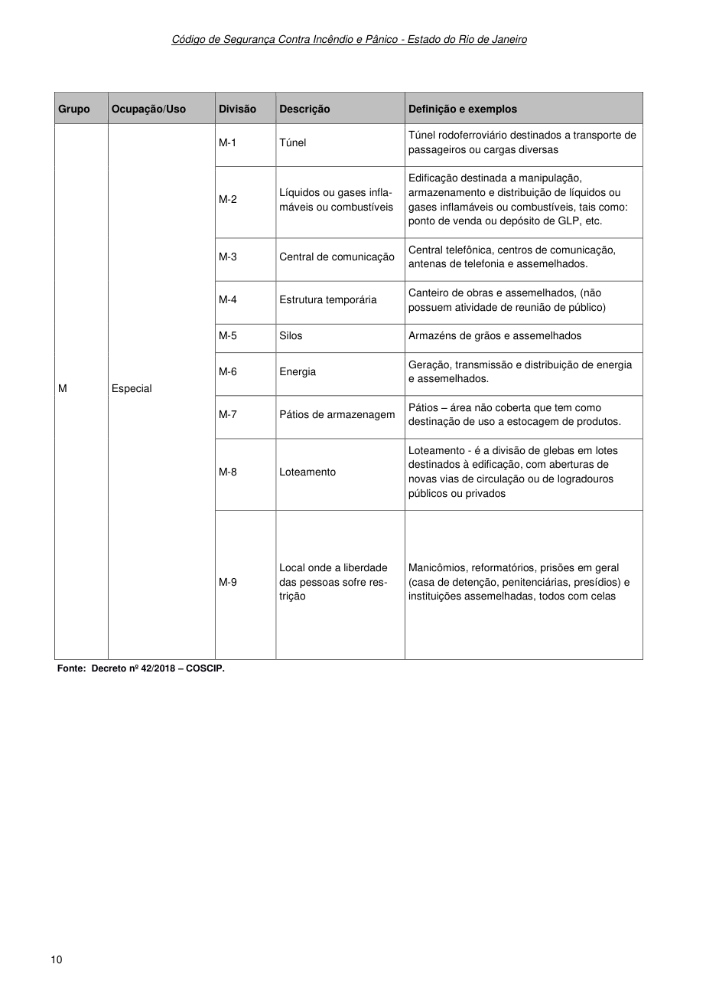

Código de Segurança Contra Incêndio e Pânico - Estado do Rio de Janeiro

Fonte: Decreto nº 42/2018 - COSCIP.

### Tabelas extraídas (bruto, não usar para citação)
#### Tabela 1 da página

| Grupo | Ocupação/Uso | Divisão | Descrição | Definição e exemplos |
| --- | --- | --- | --- | --- |
| M | Especial | M-1 | Túnel | Túnel rodoferroviário destinados a transporte de passageiros ou cargas diversas |
|  |  | M-2 | Líquidos ou gases inflamáveis ou combustíveis | Edificação destinada a manipulação, armazenamento e distribuição de líquidos ou gases inflamáveis ou combustíveis, tais como: ponto de venda ou depósito de GLP, etc. |
|  |  | M-3 | Central de comunicação | Central telefônica, centros de comunicação, antenas de telefonia e assemelhados. |
|  |  | M-4 | Estrutura temporária | Canteiro de obras e assemelhados, (não possuem atividade de reunião de público) |
|  |  | M-5 | Silos | Armazéns de grãos e assemelhados |
|  |  | M-6 | Energia | Geração, transmissão e distribuição de energia e assemelhados. |
|  |  | M-7 | Pátios de armazenagem | Pátios - área não coberta que tem como destinação de uso a estocagem de produtos. |
|  |  | M-8 | Loteamento | Loteamento - é a divisão de glebas em lotes destinados à edificação, com aberturas de novas vias de circulação ou de logradouros públicos ou privados |
|  |  | M-9 | Local onde a liberdade das pessoas sofre restrição | Manicômios, reformatórios, prisões em geral (casa de detenção, penitenciárias, presídios) e instituições assemelhadas, todos com celas |

<!-- tabela-conferida: Tabela do Anexo A p10 -->
### Tabela do Anexo A — Classificação quanto à ocupação (página 10) (conferida)

| Grupo | Ocupação/Uso | Divisão | Descrição | Definição e exemplos |
| --- | --- | --- | --- | --- |
| M | Especial | M-1 | Túnel | Túnel rodoferroviário destinados a transporte de passageiros ou cargas diversas |
| M | Especial | M-2 | Líquidos ou gases inflamáveis ou combustíveis | Edificação destinada a manipulação, armazenamento e distribuição de líquidos ou gases inflamáveis ou combustíveis, tais como: ponto de venda ou depósito de GLP, etc. |
| M | Especial | M-3 | Central de comunicação | Central telefônica, centros de comunicação, antenas de telefonia e assemelhados. |
| M | Especial | M-4 | Estrutura temporária | Canteiro de obras e assemelhados, (não possuem atividade de reunião de público) |
| M | Especial | M-5 | Silos | Armazéns de grãos e assemelhados |
| M | Especial | M-6 | Energia | Geração, transmissão e distribuição de energia e assemelhados. |
| M | Especial | M-7 | Pátios de armazenagem | Pátios – área não coberta que tem como destinação de uso a estocagem de produtos. |
| M | Especial | M-8 | Loteamento | Loteamento - é a divisão de glebas em lotes destinados à edificação, com aberturas de novas vias de circulação ou de logradouros públicos ou privados |
| M | Especial | M-9 | Local onde a liberdade das pessoas sofre restrição | Manicômios, reformatórios, prisões em geral (casa de detenção, penitenciárias, presídios) e instituições assemelhadas, todos com celas |

Fonte: NT 1-04, página 10, Tabela do Anexo A; conferida em 2026-09-29 (visual + texto).
Classificação quanto à ocupação (NT 1-04, Anexo A), páginas 5 a 10; um arquivo por página. "^" = célula mesclada com a de cima (grupo e ocupação). Hifenização de fim de linha da imagem ("alo-jamentos", "iso-por") desfeita.
Fonte indicada: Decreto nº 42/2018 – COSCIP.
<!-- /tabela-conferida: Tabela do Anexo A p10 -->

---

## Página 11

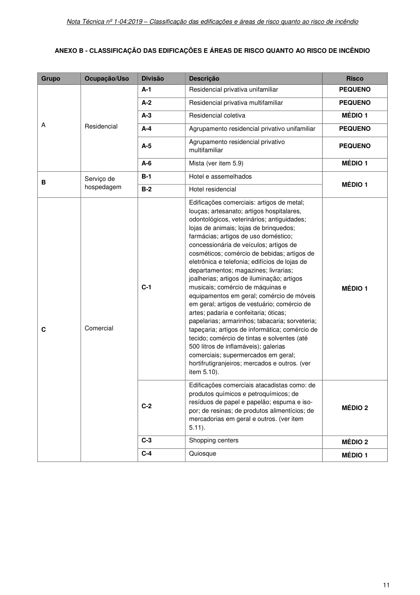

### ANEXO B - CLASSIFICAÇÃO DAS EDIFICAÇÕES E ÁREAS DE RISCO QUANTO AO RISCO DE INCÊNDIO

### Tabelas extraídas (bruto, não usar para citação)
#### Tabela 1 da página

|  | Grupo |  |  | Ocupação/Uso |  |  | Divisão |  |  | Descrição |  |  | Risco |  |
| --- | --- | --- | --- | --- | --- | --- | --- | --- | --- | --- | --- | --- | --- | --- |
| A |  |  | Residencial |  |  | A-1 |  |  | Residencial privativa unifamiliar |  |  | PEQUENO |  |  |
|  |  |  |  |  |  | A-2 |  |  | Residencial privativa multifamiliar |  |  | PEQUENO |  |  |
|  |  |  |  |  |  | A-3 |  |  | Residencial coletiva |  |  | MÉDIO 1 |  |  |
|  |  |  |  |  |  | A-4 |  |  | Agrupamento residencial privativo unifamiliar |  |  | PEQUENO |  |  |
|  |  |  |  |  |  | A-5 |  |  | Agrupamento residencial privativo multifamiliar |  |  | PEQUENO |  |  |
|  |  |  |  |  |  | A-6 |  |  | Mista (ver item 5.9) |  |  | MÉDIO 1 |  |  |
| B |  |  | Serviço de hospedagem |  |  | B-1 |  |  | Hotel e assemelhados |  |  | MÉDIO 1 |  |  |
|  |  |  |  |  |  | B-2 |  |  | Hotel residencial |  |  |  |  |  |
| C |  |  | Comercial |  |  | C-1 |  |  | Edificações comerciais: artigos de metal; louças; artesanato; artigos hospitalares, odontológicos, veterinários; antiguidades; lojas de animais; lojas de brinquedos; farmácias; artigos de uso doméstico; concessionária de veículos; artigos de cosméticos; comércio de bebidas; artigos de eletrônica e telefonia; edifícios de lojas de departamentos; magazines; livrarias; joalherias; artigos de iluminação; artigos musicais; comércio de máquinas e equipamentos em geral; comércio de móveis em geral; artigos de vestuário; comércio de artes; padaria e confeitaria; óticas; papelarias; armarinhos; tabacaria; sorveteria; tapeçaria; artigos de informática; comércio de tecido; comércio de tintas e solventes (até 500 litros de inflamáveis); galerias comerciais; supermercados em geral; hortifrutigranjeiros; mercados e outros. (ver item 5.10). |  |  | MÉDIO 1 |  |  |
|  |  |  |  |  |  | C-2 |  |  | Edificações comerciais atacadistas como: de produtos químicos e petroquímicos; de resíduos de papel e papelão; espuma e isopor; de resinas; de produtos alimentícios; de mercadorias em geral e outros. (ver item 5.11). |  |  | MÉDIO 2 |  |  |
|  |  |  |  |  |  | C-3 |  |  | Shopping centers |  |  | MÉDIO 2 |  |  |
|  |  |  |  |  |  | C-4 |  |  | Quiosque |  |  | MÉDIO 1 |  |  |

<!-- tabela-conferida: Tabela do Anexo B p11 -->
### Tabela do Anexo B — Classificação quanto ao risco de incêndio (página 11) (conferida)

| Grupo | Ocupação/Uso | Divisão | Descrição | Risco |
| --- | --- | --- | --- | --- |
| A | Residencial | A-1 | Residencial privativa unifamiliar | PEQUENO |
| A | Residencial | A-2 | Residencial privativa multifamiliar | PEQUENO |
| A | Residencial | A-3 | Residencial coletiva | MÉDIO 1 |
| A | Residencial | A-4 | Agrupamento residencial privativo unifamiliar | PEQUENO |
| A | Residencial | A-5 | Agrupamento residencial privativo multifamiliar | PEQUENO |
| A | Residencial | A-6 | Mista (ver item 5.9) | MÉDIO 1 |
| B | Serviço de hospedagem | B-1 | Hotel e assemelhados | MÉDIO 1 |
| B | Serviço de hospedagem | B-2 | Hotel residencial | MÉDIO 1 |
| C | Comercial | C-1 | Edificações comerciais: artigos de metal; louças; artesanato; artigos hospitalares, odontológicos, veterinários; antiguidades; lojas de animais; lojas de brinquedos; farmácias; artigos de uso doméstico; concessionária de veículos; artigos de cosméticos; comércio de bebidas; artigos de eletrônica e telefonia; edifícios de lojas de departamentos; magazines; livrarias; joalherias; artigos de iluminação; artigos musicais; comércio de máquinas e equipamentos em geral; comércio de móveis em geral; artigos de vestuário; comércio de artes; padaria e confeitaria; óticas; papelarias; armarinhos; tabacaria; sorveteria; tapeçaria; artigos de informática; comércio de tecido; comércio de tintas e solventes (até 500 litros de inflamáveis); galerias comerciais; supermercados em geral; hortifrutigranjeiros; mercados e outros. (ver item 5.10). | MÉDIO 1 |
| C | Comercial | C-2 | Edificações comerciais atacadistas como: de produtos químicos e petroquímicos; de resíduos de papel e papelão; espuma e isopor; de resinas; de produtos alimentícios; de mercadorias em geral e outros. (ver item 5.11). | MÉDIO 2 |
| C | Comercial | C-3 | Shopping centers | MÉDIO 2 |
| C | Comercial | C-4 | Quiosque | MÉDIO 1 |

Fonte: NT 1-04, página 11, Tabela do Anexo B; conferida em 2026-09-29 (visual + geometrica).
Classificação quanto ao risco de incêndio (NT 1-04, Anexo B), páginas 11 a 16; um arquivo por página. "^" na leitura visual = célula mesclada com a de cima (grupo, ocupação ou risco do bloco); na publicação cada linha repete o valor.
<!-- /tabela-conferida: Tabela do Anexo B p11 -->

---

## Página 12

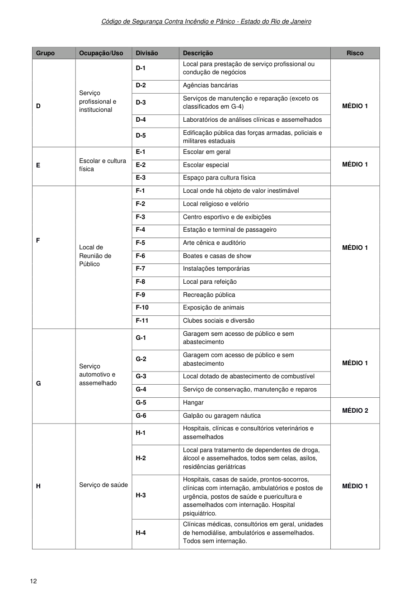

Código de Segurança Contra Incêndio e Pânico - Estado do Rio de Janeiro

### Tabelas extraídas (bruto, não usar para citação)
#### Tabela 1 da página

|  | Grupo |  |  | Ocupação/Uso |  |  | Divisão |  |  | Descrição |  |  | Risco |  |
| --- | --- | --- | --- | --- | --- | --- | --- | --- | --- | --- | --- | --- | --- | --- |
| D |  |  | Serviço profissional e institucional |  |  | D-1 |  |  | Local para prestação de serviço profissional ou condução de negócios |  |  | MÉDIO 1 |  |  |
|  |  |  |  |  |  | D-2 |  |  | Agências bancárias |  |  |  |  |  |
|  |  |  |  |  |  | D-3 |  |  | Serviços de manutenção e reparação (exceto os classificados em G-4) |  |  |  |  |  |
|  |  |  |  |  |  | D-4 |  |  | Laboratórios de análises clínicas e assemelhados |  |  |  |  |  |
|  |  |  |  |  |  | D-5 |  |  | Edificação pública das forças armadas, policiais e militares estaduais |  |  |  |  |  |
| E |  |  | Escolar e cultura física |  |  | E-1 |  |  | Escolar em geral |  |  | MÉDIO 1 |  |  |
|  |  |  |  |  |  | E-2 |  |  | Escolar especial |  |  |  |  |  |
|  |  |  |  |  |  | E-3 |  |  | Espaço para cultura física |  |  |  |  |  |
| F |  |  | Local de Reunião de Público |  |  | F-1 |  |  | Local onde há objeto de valor inestimável |  |  | MÉDIO 1 |  |  |
|  |  |  |  |  |  | F-2 |  |  | Local religioso e velório |  |  |  |  |  |
|  |  |  |  |  |  | F-3 |  |  | Centro esportivo e de exibições |  |  |  |  |  |
|  |  |  |  |  |  | F-4 |  |  | Estação e terminal de passageiro |  |  |  |  |  |
|  |  |  |  |  |  | F-5 |  |  | Arte cênica e auditório |  |  |  |  |  |
|  |  |  |  |  |  | F-6 |  |  | Boates e casas de show |  |  |  |  |  |
|  |  |  |  |  |  | F-7 |  |  | Instalações temporárias |  |  |  |  |  |
|  |  |  |  |  |  | F-8 |  |  | Local para refeição |  |  |  |  |  |
|  |  |  |  |  |  | F-9 |  |  | Recreação pública |  |  |  |  |  |
|  |  |  |  |  |  | F-10 |  |  | Exposição de animais |  |  |  |  |  |
|  |  |  |  |  |  | F-11 |  |  | Clubes sociais e diversão |  |  |  |  |  |
| G |  |  | Serviço automotivo e assemelhado |  |  | G-1 |  |  | Garagem sem acesso de público e sem abastecimento |  |  | MÉDIO 1 |  |  |
|  |  |  |  |  |  | G-2 |  |  | Garagem com acesso de público e sem abastecimento |  |  |  |  |  |
|  |  |  |  |  |  | G-3 |  |  | Local dotado de abastecimento de combustível |  |  |  |  |  |
|  |  |  |  |  |  | G-4 |  |  | Serviço de conservação, manutenção e reparos |  |  |  |  |  |
|  |  |  |  |  |  | G-5 |  |  | Hangar |  |  | MÉDIO 2 |  |  |
|  |  |  |  |  |  | G-6 |  |  | Galpão ou garagem náutica |  |  |  |  |  |
| H |  |  | Serviço de saúde |  |  | H-1 |  |  | Hospitais, clínicas e consultórios veterinários e assemelhados |  |  | MÉDIO 1 |  |  |
|  |  |  |  |  |  | H-2 |  |  | Local para tratamento de dependentes de droga, álcool e assemelhados, todos sem celas, asilos, residências geriátricas |  |  |  |  |  |
|  |  |  |  |  |  | H-3 |  |  | Hospitais, casas de saúde, prontos-socorros, clínicas com internação, ambulatórios e postos de urgência, postos de saúde e puericultura e assemelhados com internação. Hospital psiquiátrico. |  |  |  |  |  |
|  |  |  |  |  |  | H-4 |  |  | Clínicas médicas, consultórios em geral, unidades de hemodiálise, ambulatórios e assemelhados. Todos sem internação. |  |  |  |  |  |

<!-- tabela-conferida: Tabela do Anexo B p12 -->
### Tabela do Anexo B — Classificação quanto ao risco de incêndio (página 12) (conferida)

| Grupo | Ocupação/Uso | Divisão | Descrição | Risco |
| --- | --- | --- | --- | --- |
| D | Serviço profissional e institucional | D-1 | Local para prestação de serviço profissional ou condução de negócios | MÉDIO 1 |
| D | Serviço profissional e institucional | D-2 | Agências bancárias | MÉDIO 1 |
| D | Serviço profissional e institucional | D-3 | Serviços de manutenção e reparação (exceto os classificados em G-4) | MÉDIO 1 |
| D | Serviço profissional e institucional | D-4 | Laboratórios de análises clínicas e assemelhados | MÉDIO 1 |
| D | Serviço profissional e institucional | D-5 | Edificação pública das forças armadas, policiais e militares estaduais | MÉDIO 1 |
| E | Escolar e cultura física | E-1 | Escolar em geral | MÉDIO 1 |
| E | Escolar e cultura física | E-2 | Escolar especial | MÉDIO 1 |
| E | Escolar e cultura física | E-3 | Espaço para cultura física | MÉDIO 1 |
| F | Local de Reunião de Público | F-1 | Local onde há objeto de valor inestimável | MÉDIO 1 |
| F | Local de Reunião de Público | F-2 | Local religioso e velório | MÉDIO 1 |
| F | Local de Reunião de Público | F-3 | Centro esportivo e de exibições | MÉDIO 1 |
| F | Local de Reunião de Público | F-4 | Estação e terminal de passageiro | MÉDIO 1 |
| F | Local de Reunião de Público | F-5 | Arte cênica e auditório | MÉDIO 1 |
| F | Local de Reunião de Público | F-6 | Boates e casas de show | MÉDIO 1 |
| F | Local de Reunião de Público | F-7 | Instalações temporárias | MÉDIO 1 |
| F | Local de Reunião de Público | F-8 | Local para refeição | MÉDIO 1 |
| F | Local de Reunião de Público | F-9 | Recreação pública | MÉDIO 1 |
| F | Local de Reunião de Público | F-10 | Exposição de animais | MÉDIO 1 |
| F | Local de Reunião de Público | F-11 | Clubes sociais e diversão | MÉDIO 1 |
| G | Serviço automotivo e assemelhado | G-1 | Garagem sem acesso de público e sem abastecimento | MÉDIO 1 |
| G | Serviço automotivo e assemelhado | G-2 | Garagem com acesso de público e sem abastecimento | MÉDIO 1 |
| G | Serviço automotivo e assemelhado | G-3 | Local dotado de abastecimento de combustível | MÉDIO 1 |
| G | Serviço automotivo e assemelhado | G-4 | Serviço de conservação, manutenção e reparos | MÉDIO 1 |
| G | Serviço automotivo e assemelhado | G-5 | Hangar | MÉDIO 2 |
| G | Serviço automotivo e assemelhado | G-6 | Galpão ou garagem náutica | MÉDIO 2 |
| H | Serviço de saúde | H-1 | Hospitais, clínicas e consultórios veterinários e assemelhados | MÉDIO 1 |
| H | Serviço de saúde | H-2 | Local para tratamento de dependentes de droga, álcool e assemelhados, todos sem celas, asilos, residências geriátricas | MÉDIO 1 |
| H | Serviço de saúde | H-3 | Hospitais, casas de saúde, prontos-socorros, clínicas com internação, ambulatórios e postos de urgência, postos de saúde e puericultura e assemelhados com internação. Hospital psiquiátrico. | MÉDIO 1 |
| H | Serviço de saúde | H-4 | Clínicas médicas, consultórios em geral, unidades de hemodiálise, ambulatórios e assemelhados. Todos sem internação. | MÉDIO 1 |

Fonte: NT 1-04, página 12, Tabela do Anexo B; conferida em 2026-09-29 (visual + geometrica).
Classificação quanto ao risco de incêndio (NT 1-04, Anexo B), páginas 11 a 16; um arquivo por página. "^" na leitura visual = célula mesclada com a de cima (grupo, ocupação ou risco do bloco); na publicação cada linha repete o valor.
<!-- /tabela-conferida: Tabela do Anexo B p12 -->

---

## Página 13

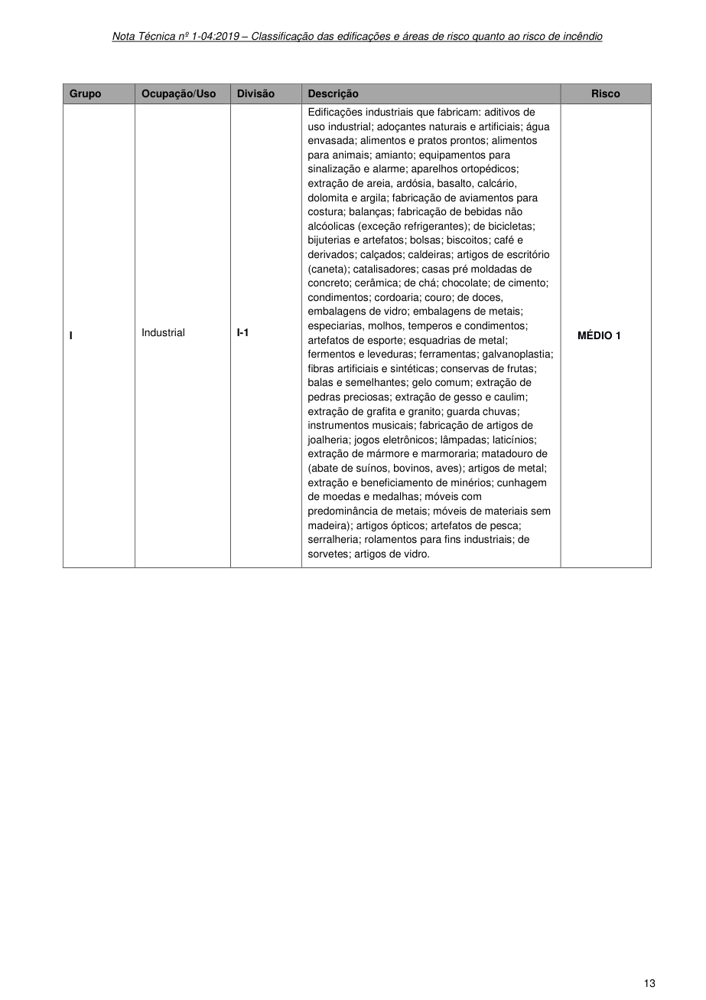

> Página sem texto extraível suficiente; consultar a representação visual ou o PDF oficial.

### Tabelas extraídas (bruto, não usar para citação)
#### Tabela 1 da página

|  | Grupo |  |  | Ocupação/Uso |  |  | Divisão |  |  | Descrição |  |  | Risco |  |
| --- | --- | --- | --- | --- | --- | --- | --- | --- | --- | --- | --- | --- | --- | --- |
| I |  |  | Industrial |  |  | I-1 |  |  | Edificações industriais que fabricam: aditivos de uso industrial; adoçantes naturais e artificiais; água envasada; alimentos e pratos prontos; alimentos para animais; amianto; equipamentos para sinalização e alarme; aparelhos ortopédicos; extração de areia, ardósia, basalto, calcário, dolomita e argila; fabricação de aviamentos para costura; balanças; fabricação de bebidas não alcóolicas (exceção refrigerantes); de bicicletas; bijuterias e artefatos; bolsas; biscoitos; café e derivados; calçados; caldeiras; artigos de escritório (caneta); catalisadores; casas pré moldadas de concreto; cerâmica; de chá; chocolate; de cimento; condimentos; cordoaria; couro; de doces, embalagens de vidro; embalagens de metais; especiarias, molhos, temperos e condimentos; artefatos de esporte; esquadrias de metal; fermentos e leveduras; ferramentas; galvanoplastia; fibras artificiais e sintéticas; conservas de frutas; balas e semelhantes; gelo comum; extração de pedras preciosas; extração de gesso e caulim; extração de grafita e granito; guarda chuvas; instrumentos musicais; fabricação de artigos de joalheria; jogos eletrônicos; lâmpadas; laticínios; extração de mármore e marmoraria; matadouro de (abate de suínos, bovinos, aves); artigos de metal; extração e beneficiamento de minérios; cunhagem de moedas e medalhas; móveis com predominância de metais; móveis de materiais sem madeira); artigos ópticos; artefatos de pesca; serralheria; rolamentos para fins industriais; de sorvetes; artigos de vidro. |  |  | MÉDIO 1 |  |  |

<!-- tabela-conferida: Tabela do Anexo B p13 -->
### Tabela do Anexo B — Classificação quanto ao risco de incêndio (página 13) (conferida)

| Grupo | Ocupação/Uso | Divisão | Descrição | Risco |
| --- | --- | --- | --- | --- |
| I | Industrial | I-1 | Edificações industriais que fabricam: aditivos de uso industrial; adoçantes naturais e artificiais; água envasada; alimentos e pratos prontos; alimentos para animais; amianto; equipamentos para sinalização e alarme; aparelhos ortopédicos; extração de areia, ardósia, basalto, calcário, dolomita e argila; fabricação de aviamentos para costura; balanças; fabricação de bebidas não alcóolicas (exceção refrigerantes); de bicicletas; bijuterias e artefatos; bolsas; biscoitos; café e derivados; calçados; caldeiras; artigos de escritório (caneta); catalisadores; casas pré moldadas de concreto; cerâmica; de chá; chocolate; de cimento; condimentos; cordoaria; couro; de doces, embalagens de vidro; embalagens de metais; especiarias, molhos, temperos e condimentos; artefatos de esporte; esquadrias de metal; fermentos e leveduras; ferramentas; galvanoplastia; fibras artificiais e sintéticas; conservas de frutas; balas e semelhantes; gelo comum; extração de pedras preciosas; extração de gesso e caulim; extração de grafita e granito; guarda chuvas; instrumentos musicais; fabricação de artigos de joalheria; jogos eletrônicos; lâmpadas; laticínios; extração de mármore e marmoraria; matadouro de (abate de suínos, bovinos, aves); artigos de metal; extração e beneficiamento de minérios; cunhagem de moedas e medalhas; móveis com predominância de metais; móveis de materiais sem madeira); artigos ópticos; artefatos de pesca; serralheria; rolamentos para fins industriais; de sorvetes; artigos de vidro. | MÉDIO 1 |

Fonte: NT 1-04, página 13, Tabela do Anexo B; conferida em 2026-09-29 (visual + geometrica).
Classificação quanto ao risco de incêndio (NT 1-04, Anexo B), páginas 11 a 16; um arquivo por página. "^" na leitura visual = célula mesclada com a de cima (grupo, ocupação ou risco do bloco); na publicação cada linha repete o valor.
<!-- /tabela-conferida: Tabela do Anexo B p13 -->

---

## Página 14

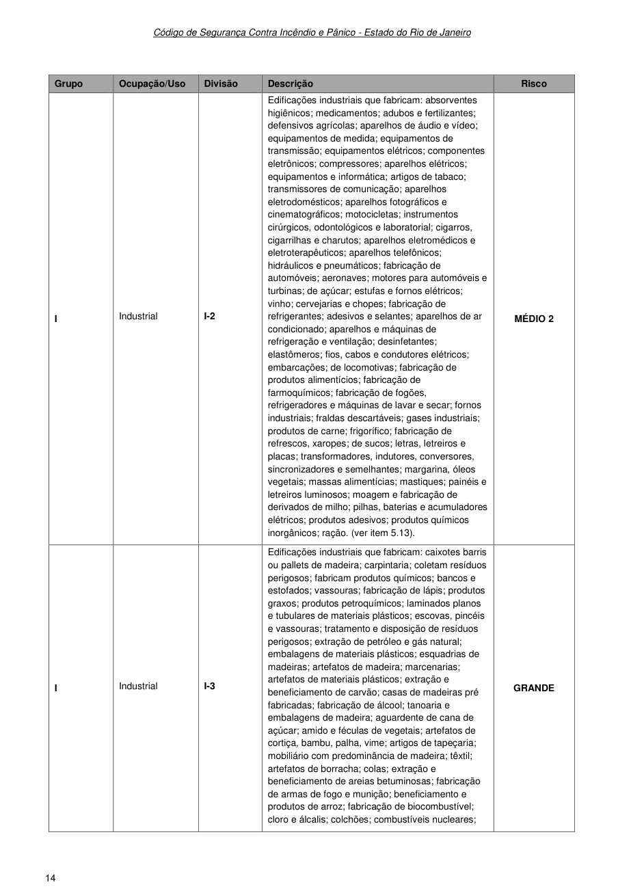

Código de Segurança Contra Incêndio e Pânico - Estado do Rio de Janeiro

### Tabelas extraídas (bruto, não usar para citação)
#### Tabela 1 da página

|  | Grupo |  |  | Ocupação/Uso |  |  | Divisão |  |  | Descrição |  |  | Risco |  |
| --- | --- | --- | --- | --- | --- | --- | --- | --- | --- | --- | --- | --- | --- | --- |
| I |  |  | Industrial |  |  | I-2 |  |  | Edificações industriais que fabricam: absorventes higiênicos; medicamentos; adubos e fertilizantes; defensivos agrícolas; aparelhos de áudio e vídeo; equipamentos de medida; equipamentos de transmissão; equipamentos elétricos; componentes eletrônicos; compressores; aparelhos elétricos; equipamentos e informática; artigos de tabaco; transmissores de comunicação; aparelhos eletrodomésticos; aparelhos fotográficos e cinematográficos; motocicletas; instrumentos cirúrgicos, odontológicos e laboratorial; cigarros, cigarrilhas e charutos; aparelhos eletromédicos e eletroterapêuticos; aparelhos telefônicos; hidráulicos e pneumáticos; fabricação de automóveis; aeronaves; motores para automóveis e turbinas; de açúcar; estufas e fornos elétricos; vinho; cervejarias e chopes; fabricação de refrigerantes; adesivos e selantes; aparelhos de ar condicionado; aparelhos e máquinas de refrigeração e ventilação; desinfetantes; elastômeros; fios, cabos e condutores elétricos; embarcações; de locomotivas; fabricação de produtos alimentícios; fabricação de farmoquímicos; fabricação de fogões, refrigeradores e máquinas de lavar e secar; fornos industriais; fraldas descartáveis; gases industriais; produtos de carne; frigorífico; fabricação de refrescos, xaropes; de sucos; letras, letreiros e placas; transformadores, indutores, conversores, sincronizadores e semelhantes; margarina, óleos vegetais; massas alimentícias; mastiques; painéis e letreiros luminosos; moagem e fabricação de derivados de milho; pilhas, baterias e acumuladores elétricos; produtos adesivos; produtos químicos inorgânicos; ração. (ver item 5.13). |  |  | MÉDIO 2 |  |  |
| I |  |  | Industrial |  |  | I-3 |  |  | Edificações industriais que fabricam: caixotes barris ou pallets de madeira; carpintaria; coletam resíduos perigosos; fabricam produtos químicos; bancos e estofados; vassouras; fabricação de lápis; produtos graxos; produtos petroquímicos; laminados planos e tubulares de materiais plásticos; escovas, pincéis e vassouras; tratamento e disposição de resíduos perigosos; extração de petróleo e gás natural; embalagens de materiais plásticos; esquadrias de madeiras; artefatos de madeira; marcenarias; artefatos de materiais plásticos; extração e beneficiamento de carvão; casas de madeiras pré fabricadas; fabricação de álcool; tanoaria e embalagens de madeira; aguardente de cana de açúcar; amido e féculas de vegetais; artefatos de cortiça, bambu, palha, vime; artigos de tapeçaria; mobiliário com predominância de madeira; têxtil; artefatos de borracha; colas; extração e beneficiamento de areias betuminosas; fabricação de armas de fogo e munição; beneficiamento e produtos de arroz; fabricação de biocombustível; cloro e álcalis; colchões; combustíveis nucleares; |  |  | GRANDE |  |  |

<!-- tabela-conferida: Tabela do Anexo B p14 -->
### Tabela do Anexo B — Classificação quanto ao risco de incêndio (página 14) (conferida)

| Grupo | Ocupação/Uso | Divisão | Descrição | Risco |
| --- | --- | --- | --- | --- |
| I | Industrial | I-2 | Edificações industriais que fabricam: absorventes higiênicos; medicamentos; adubos e fertilizantes; defensivos agrícolas; aparelhos de áudio e vídeo; equipamentos de medida; equipamentos de transmissão; equipamentos elétricos; componentes eletrônicos; compressores; aparelhos elétricos; equipamentos e informática; artigos de tabaco; transmissores de comunicação; aparelhos eletrodomésticos; aparelhos fotográficos e cinematográficos; motocicletas; instrumentos cirúrgicos, odontológicos e laboratorial; cigarros, cigarrilhas e charutos; aparelhos eletromédicos e eletroterapêuticos; aparelhos telefônicos; hidráulicos e pneumáticos; fabricação de automóveis; aeronaves; motores para automóveis e turbinas; de açúcar; estufas e fornos elétricos; vinho; cervejarias e chopes; fabricação de refrigerantes; adesivos e selantes; aparelhos de ar condicionado; aparelhos e máquinas de refrigeração e ventilação; desinfetantes; elastômeros; fios, cabos e condutores elétricos; embarcações; de locomotivas; fabricação de produtos alimentícios; fabricação de farmoquímicos; fabricação de fogões, refrigeradores e máquinas de lavar e secar; fornos industriais; fraldas descartáveis; gases industriais; produtos de carne; frigorífico; fabricação de refrescos, xaropes; de sucos; letras, letreiros e placas; transformadores, indutores, conversores, sincronizadores e semelhantes; margarina, óleos vegetais; massas alimentícias; mastiques; painéis e letreiros luminosos; moagem e fabricação de derivados de milho; pilhas, baterias e acumuladores elétricos; produtos adesivos; produtos químicos inorgânicos; ração. (ver item 5.13). | MÉDIO 2 |
| I | Industrial | I-3 | Edificações industriais que fabricam: caixotes barris ou pallets de madeira; carpintaria; coletam resíduos perigosos; fabricam produtos químicos; bancos e estofados; vassouras; fabricação de lápis; produtos graxos; produtos petroquímicos; laminados planos e tubulares de materiais plásticos; escovas, pincéis e vassouras; tratamento e disposição de resíduos perigosos; extração de petróleo e gás natural; embalagens de materiais plásticos; esquadrias de madeiras; artefatos de madeira; marcenarias; artefatos de materiais plásticos; extração e beneficiamento de carvão; casas de madeiras pré fabricadas; fabricação de álcool; tanoaria e embalagens de madeira; aguardente de cana de açúcar; amido e féculas de vegetais; artefatos de cortiça, bambu, palha, vime; artigos de tapeçaria; mobiliário com predominância de madeira; têxtil; artefatos de borracha; colas; extração e beneficiamento de areias betuminosas; fabricação de armas de fogo e munição; beneficiamento e produtos de arroz; fabricação de biocombustível; cloro e álcalis; colchões; combustíveis nucleares; | GRANDE |

Fonte: NT 1-04, página 14, Tabela do Anexo B; conferida em 2026-09-29 (visual + geometrica).
Classificação quanto ao risco de incêndio (NT 1-04, Anexo B), páginas 11 a 16; um arquivo por página. "^" na leitura visual = célula mesclada com a de cima (grupo, ocupação ou risco do bloco); na publicação cada linha repete o valor.
<!-- /tabela-conferida: Tabela do Anexo B p14 -->

---

## Página 15

> Página sem texto extraível suficiente; consultar a representação visual ou o PDF oficial.

### Tabelas extraídas (bruto, não usar para citação)
#### Tabela 1 da página

|  | Grupo |  |  | Ocupação/Uso |  |  | Divisão |  |  | Descrição |  |  | Risco |  |
| --- | --- | --- | --- | --- | --- | --- | --- | --- | --- | --- | --- | --- | --- | --- |
| I |  |  | Industrial |  |  | I-3 |  |  | (continuação) coquerias; equipamento bélico pesado; espumas; gráfica; impermeabilizantes, solventes e produtos afins; materiais plásticos; refino de óleos lubrificantes; papel e derivados; produtos derivados de petróleo; artigos de plásticos em geral; produtos de limpeza e polimento; ceras de polimento; plastificantes, resinas e fibras; resinas termofixas; resinas termoplásticas; sabões e detergentes sintéticos; tintas de impressão; tintas, vernizes, esmaltes e lacas; moagem e derivados de trigo; extração e beneficiamento de xisto; fabricação de óleos vegetais. (ver item 5.13). |  |  | GRANDE |  |  |

<!-- tabela-conferida: Tabela do Anexo B p15 -->
### Tabela do Anexo B — Classificação quanto ao risco de incêndio (página 15) (conferida)

| Grupo | Ocupação/Uso | Divisão | Descrição | Risco |
| --- | --- | --- | --- | --- |
| I | Industrial | I-3 | (continuação) coquerias; equipamento bélico pesado; espumas; gráfica; impermeabilizantes, solventes e produtos afins; materiais plásticos; refino de óleos lubrificantes; papel e derivados; produtos derivados de petróleo; artigos de plásticos em geral; produtos de limpeza e polimento; ceras de polimento; plastificantes, resinas e fibras; resinas termofixas; resinas termoplásticas; sabões e detergentes sintéticos; tintas de impressão; tintas, vernizes, esmaltes e lacas; moagem e derivados de trigo; extração e beneficiamento de xisto; fabricação de óleos vegetais. (ver item 5.13). | GRANDE |

Fonte: NT 1-04, página 15, Tabela do Anexo B; conferida em 2026-09-29 (visual + geometrica).
Classificação quanto ao risco de incêndio (NT 1-04, Anexo B), páginas 11 a 16; um arquivo por página. "^" na leitura visual = célula mesclada com a de cima (grupo, ocupação ou risco do bloco); na publicação cada linha repete o valor.
<!-- /tabela-conferida: Tabela do Anexo B p15 -->

---

## Página 16

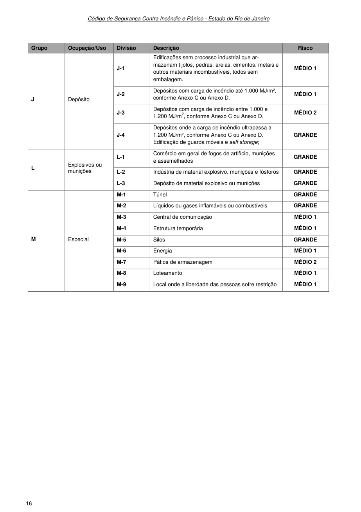

Código de Segurança Contra Incêndio e Pânico - Estado do Rio de Janeiro

### Tabelas extraídas (bruto, não usar para citação)
#### Tabela 1 da página

|  | Grupo |  |  | Ocupação/Uso |  |  | Divisão |  |  | Descrição |  |  | Risco |  |
| --- | --- | --- | --- | --- | --- | --- | --- | --- | --- | --- | --- | --- | --- | --- |
| J |  |  | Depósito |  |  | J-1 |  |  | Edificações sem processo industrial que armazenam tijolos, pedras, areias, cimentos, metais e outros materiais incombustíveis, todos sem embalagem. |  |  | MÉDIO 1 |  |  |
|  |  |  |  |  |  | J-2 |  |  | Depósitos com carga de incêndio até 1.000 MJ/m², conforme Anexo C ou Anexo D. |  |  | MÉDIO 1 |  |  |
|  |  |  |  |  |  | J-3 |  |  | Depósitos com carga de incêndio entre 1.000 e 1.200 MJ/m2, conforme Anexo C ou Anexo D. |  |  | MÉDIO 2 |  |  |
|  |  |  |  |  |  | J-4 |  |  | Depósitos onde a carga de incêndio ultrapassa a 1.200 MJ/m², conforme Anexo C ou Anexo D. Edificação de guarda móveis e self storage; |  |  | GRANDE |  |  |
| L |  |  | Explosivos ou munições |  |  | L-1 |  |  | Comércio em geral de fogos de artifício, munições e assemelhados |  |  | GRANDE |  |  |
|  |  |  |  |  |  | L-2 |  |  | Indústria de material explosivo, munições e fósforos |  |  | GRANDE |  |  |
|  |  |  |  |  |  | L-3 |  |  | Depósito de material explosivo ou munições |  |  | GRANDE |  |  |
| M |  |  | Especial |  |  | M-1 |  |  | Túnel |  |  | GRANDE |  |  |
|  |  |  |  |  |  | M-2 |  |  | Líquidos ou gases inflamáveis ou combustíveis |  |  | GRANDE |  |  |
|  |  |  |  |  |  | M-3 |  |  | Central de comunicação |  |  | MÉDIO 1 |  |  |
|  |  |  |  |  |  | M-4 |  |  | Estrutura temporária |  |  | MÉDIO 1 |  |  |
|  |  |  |  |  |  | M-5 |  |  | Silos |  |  | GRANDE |  |  |
|  |  |  |  |  |  | M-6 |  |  | Energia |  |  | MÉDIO 1 |  |  |
|  |  |  |  |  |  | M-7 |  |  | Pátios de armazenagem |  |  | MÉDIO 2 |  |  |
|  |  |  |  |  |  | M-8 |  |  | Loteamento |  |  | MÉDIO 1 |  |  |
|  |  |  |  |  |  | M-9 |  |  | Local onde a liberdade das pessoas sofre restrição |  |  | MÉDIO 1 |  |  |

<!-- tabela-conferida: Tabela do Anexo B p16 -->
### Tabela do Anexo B — Classificação quanto ao risco de incêndio (página 16) (conferida)

| Grupo | Ocupação/Uso | Divisão | Descrição | Risco |
| --- | --- | --- | --- | --- |
| J | Depósito | J-1 | Edificações sem processo industrial que armazenam tijolos, pedras, areias, cimentos, metais e outros materiais incombustíveis, todos sem embalagem. | MÉDIO 1 |
| J | Depósito | J-2 | Depósitos com carga de incêndio até 1.000 MJ/m², conforme Anexo C ou Anexo D. | MÉDIO 1 |
| J | Depósito | J-3 | Depósitos com carga de incêndio entre 1.000 e 1.200 MJ/m², conforme Anexo C ou Anexo D. | MÉDIO 2 |
| J | Depósito | J-4 | Depósitos onde a carga de incêndio ultrapassa a 1.200 MJ/m², conforme Anexo C ou Anexo D. Edificação de guarda móveis e self storage; | GRANDE |
| L | Explosivos ou munições | L-1 | Comércio em geral de fogos de artifício, munições e assemelhados | GRANDE |
| L | Explosivos ou munições | L-2 | Indústria de material explosivo, munições e fósforos | GRANDE |
| L | Explosivos ou munições | L-3 | Depósito de material explosivo ou munições | GRANDE |
| M | Especial | M-1 | Túnel | GRANDE |
| M | Especial | M-2 | Líquidos ou gases inflamáveis ou combustíveis | GRANDE |
| M | Especial | M-3 | Central de comunicação | MÉDIO 1 |
| M | Especial | M-4 | Estrutura temporária | MÉDIO 1 |
| M | Especial | M-5 | Silos | GRANDE |
| M | Especial | M-6 | Energia | MÉDIO 1 |
| M | Especial | M-7 | Pátios de armazenagem | MÉDIO 2 |
| M | Especial | M-8 | Loteamento | MÉDIO 1 |
| M | Especial | M-9 | Local onde a liberdade das pessoas sofre restrição | MÉDIO 1 |

Fonte: NT 1-04, página 16, Tabela do Anexo B; conferida em 2026-09-29 (visual + geometrica).
Classificação quanto ao risco de incêndio (NT 1-04, Anexo B), páginas 11 a 16; um arquivo por página. "^" na leitura visual = célula mesclada com a de cima (grupo, ocupação ou risco do bloco); na publicação cada linha repete o valor.
<!-- /tabela-conferida: Tabela do Anexo B p16 -->

---

## Página 17

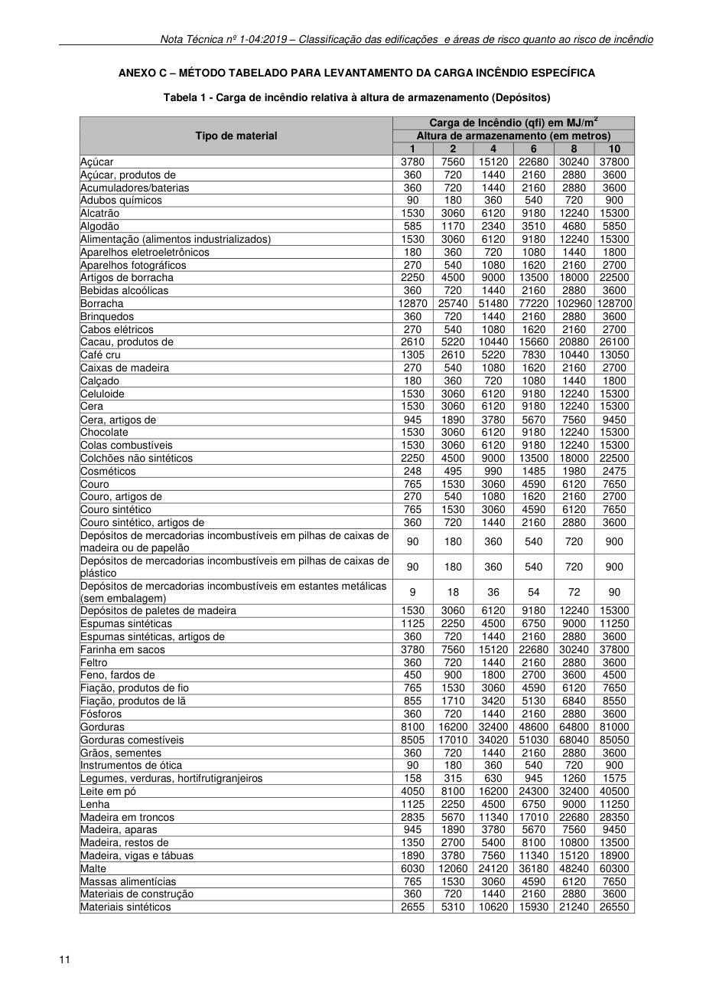

### ANEXO C - MÉTODO TABELADO PARA LEVANTAMENTO DA CARGA INCÊNDIO ESPECÍFICA

Tabela 1 - Carga de incêndio relativa à altura de armazenamento (Depósitos)

### Tabelas extraídas (bruto, não usar para citação)
#### Tabela 1 da página

|  | Carga de Incêndio (qfi) em MJ/m2 |  |  |  |  |  |
| --- | --- | --- | --- | --- | --- | --- |
| Tipo de material | Altura de armazenamento (em metros) |  |  |  |  |  |
|  | 1 | 2 | 4 | 6 | 8 | 10 |
| Açúcar | 3780 | 7560 | 15120 | 22680 | 30240 | 37800 |
| Açúcar, produtos de | 360 | 720 | 1440 | 2160 | 2880 | 3600 |
| Acumuladores/baterias | 360 | 720 | 1440 | 2160 | 2880 | 3600 |
| Adubos químicos | 90 | 180 | 360 | 540 | 720 | 900 |
| Alcatrão | 1530 | 3060 | 6120 | 9180 | 12240 | 15300 |
| Algodão | 585 | 1170 | 2340 | 3510 | 4680 | 5850 |
| Alimentação (alimentos industrializados) | 1530 | 3060 | 6120 | 9180 | 12240 | 15300 |
| Aparelhos eletroeletrônicos | 180 | 360 | 720 | 1080 | 1440 | 1800 |
| Aparelhos fotográficos | 270 | 540 | 1080 | 1620 | 2160 | 2700 |
| Artigos de borracha | 2250 | 4500 | 9000 | 13500 | 18000 | 22500 |
| Bebidas alcoólicas | 360 | 720 | 1440 | 2160 | 2880 | 3600 |
| Borracha | 12870 | 25740 | 51480 | 77220 | 102960 | 128700 |
| Brinquedos | 360 | 720 | 1440 | 2160 | 2880 | 3600 |
| Cabos elétricos | 270 | 540 | 1080 | 1620 | 2160 | 2700 |
| Cacau, produtos de | 2610 | 5220 | 10440 | 15660 | 20880 | 26100 |
| Café cru | 1305 | 2610 | 5220 | 7830 | 10440 | 13050 |
| Caixas de madeira | 270 | 540 | 1080 | 1620 | 2160 | 2700 |
| Calçado | 180 | 360 | 720 | 1080 | 1440 | 1800 |
| Celuloide | 1530 | 3060 | 6120 | 9180 | 12240 | 15300 |
| Cera | 1530 | 3060 | 6120 | 9180 | 12240 | 15300 |
| Cera, artigos de | 945 | 1890 | 3780 | 5670 | 7560 | 9450 |
| Chocolate | 1530 | 3060 | 6120 | 9180 | 12240 | 15300 |
| Colas combustíveis | 1530 | 3060 | 6120 | 9180 | 12240 | 15300 |
| Colchões não sintéticos | 2250 | 4500 | 9000 | 13500 | 18000 | 22500 |
| Cosméticos | 248 | 495 | 990 | 1485 | 1980 | 2475 |
| Couro | 765 | 1530 | 3060 | 4590 | 6120 | 7650 |
| Couro, artigos de | 270 | 540 | 1080 | 1620 | 2160 | 2700 |
| Couro sintético | 765 | 1530 | 3060 | 4590 | 6120 | 7650 |
| Couro sintético, artigos de | 360 | 720 | 1440 | 2160 | 2880 | 3600 |
| Depósitos de mercadorias incombustíveis em pilhas de caixas de madeira ou de papelão | 90 | 180 | 360 | 540 | 720 | 900 |
| Depósitos de mercadorias incombustíveis em pilhas de caixas de plástico | 90 | 180 | 360 | 540 | 720 | 900 |
| Depósitos de mercadorias incombustíveis em estantes metálicas (sem embalagem) | 9 | 18 | 36 | 54 | 72 | 90 |
| Depósitos de paletes de madeira | 1530 | 3060 | 6120 | 9180 | 12240 | 15300 |
| Espumas sintéticas | 1125 | 2250 | 4500 | 6750 | 9000 | 11250 |
| Espumas sintéticas, artigos de | 360 | 720 | 1440 | 2160 | 2880 | 3600 |
| Farinha em sacos | 3780 | 7560 | 15120 | 22680 | 30240 | 37800 |
| Feltro | 360 | 720 | 1440 | 2160 | 2880 | 3600 |
| Feno, fardos de | 450 | 900 | 1800 | 2700 | 3600 | 4500 |
| Fiação, produtos de fio | 765 | 1530 | 3060 | 4590 | 6120 | 7650 |
| Fiação, produtos de lã | 855 | 1710 | 3420 | 5130 | 6840 | 8550 |
| Fósforos | 360 | 720 | 1440 | 2160 | 2880 | 3600 |
| Gorduras | 8100 | 16200 | 32400 | 48600 | 64800 | 81000 |
| Gorduras comestíveis | 8505 | 17010 | 34020 | 51030 | 68040 | 85050 |
| Grãos, sementes | 360 | 720 | 1440 | 2160 | 2880 | 3600 |
| Instrumentos de ótica | 90 | 180 | 360 | 540 | 720 | 900 |
| Legumes, verduras, hortifrutigranjeiros | 158 | 315 | 630 | 945 | 1260 | 1575 |
| Leite em pó | 4050 | 8100 | 16200 | 24300 | 32400 | 40500 |
| Lenha | 1125 | 2250 | 4500 | 6750 | 9000 | 11250 |
| Madeira em troncos | 2835 | 5670 | 11340 | 17010 | 22680 | 28350 |
| Madeira, aparas | 945 | 1890 | 3780 | 5670 | 7560 | 9450 |
| Madeira, restos de | 1350 | 2700 | 5400 | 8100 | 10800 | 13500 |
| Madeira, vigas e tábuas | 1890 | 3780 | 7560 | 11340 | 15120 | 18900 |
| Malte | 6030 | 12060 | 24120 | 36180 | 48240 | 60300 |
| Massas alimentícias | 765 | 1530 | 3060 | 4590 | 6120 | 7650 |
| Materiais de construção | 360 | 720 | 1440 | 2160 | 2880 | 3600 |
| Materiais sintéticos | 2655 | 5310 | 10620 | 15930 | 21240 | 26550 |

<!-- tabela-conferida: Tabela 1 p17 -->
### Tabela 1 — Carga de incêndio relativa à altura de armazenamento (Depósitos), página 17 (conferida)

| Tipo de material | qfi (MJ/m²) — altura 1 m | qfi (MJ/m²) — altura 2 m | qfi (MJ/m²) — altura 4 m | qfi (MJ/m²) — altura 6 m | qfi (MJ/m²) — altura 8 m | qfi (MJ/m²) — altura 10 m |
| --- | --- | --- | --- | --- | --- | --- |
| Açúcar | 3780 | 7560 | 15120 | 22680 | 30240 | 37800 |
| Açúcar, produtos de | 360 | 720 | 1440 | 2160 | 2880 | 3600 |
| Acumuladores/baterias | 360 | 720 | 1440 | 2160 | 2880 | 3600 |
| Adubos químicos | 90 | 180 | 360 | 540 | 720 | 900 |
| Alcatrão | 1530 | 3060 | 6120 | 9180 | 12240 | 15300 |
| Algodão | 585 | 1170 | 2340 | 3510 | 4680 | 5850 |
| Alimentação (alimentos industrializados) | 1530 | 3060 | 6120 | 9180 | 12240 | 15300 |
| Aparelhos eletroeletrônicos | 180 | 360 | 720 | 1080 | 1440 | 1800 |
| Aparelhos fotográficos | 270 | 540 | 1080 | 1620 | 2160 | 2700 |
| Artigos de borracha | 2250 | 4500 | 9000 | 13500 | 18000 | 22500 |
| Bebidas alcoólicas | 360 | 720 | 1440 | 2160 | 2880 | 3600 |
| Borracha | 12870 | 25740 | 51480 | 77220 | 102960 | 128700 |
| Brinquedos | 360 | 720 | 1440 | 2160 | 2880 | 3600 |
| Cabos elétricos | 270 | 540 | 1080 | 1620 | 2160 | 2700 |
| Cacau, produtos de | 2610 | 5220 | 10440 | 15660 | 20880 | 26100 |
| Café cru | 1305 | 2610 | 5220 | 7830 | 10440 | 13050 |
| Caixas de madeira | 270 | 540 | 1080 | 1620 | 2160 | 2700 |
| Calçado | 180 | 360 | 720 | 1080 | 1440 | 1800 |
| Celuloide | 1530 | 3060 | 6120 | 9180 | 12240 | 15300 |
| Cera | 1530 | 3060 | 6120 | 9180 | 12240 | 15300 |
| Cera, artigos de | 945 | 1890 | 3780 | 5670 | 7560 | 9450 |
| Chocolate | 1530 | 3060 | 6120 | 9180 | 12240 | 15300 |
| Colas combustíveis | 1530 | 3060 | 6120 | 9180 | 12240 | 15300 |
| Colchões não sintéticos | 2250 | 4500 | 9000 | 13500 | 18000 | 22500 |
| Cosméticos | 248 | 495 | 990 | 1485 | 1980 | 2475 |
| Couro | 765 | 1530 | 3060 | 4590 | 6120 | 7650 |
| Couro, artigos de | 270 | 540 | 1080 | 1620 | 2160 | 2700 |
| Couro sintético | 765 | 1530 | 3060 | 4590 | 6120 | 7650 |
| Couro sintético, artigos de | 360 | 720 | 1440 | 2160 | 2880 | 3600 |
| Depósitos de mercadorias incombustíveis em pilhas de caixas de madeira ou de papelão | 90 | 180 | 360 | 540 | 720 | 900 |
| Depósitos de mercadorias incombustíveis em pilhas de caixas de plástico | 90 | 180 | 360 | 540 | 720 | 900 |
| Depósitos de mercadorias incombustíveis em estantes metálicas (sem embalagem) | 9 | 18 | 36 | 54 | 72 | 90 |
| Depósitos de paletes de madeira | 1530 | 3060 | 6120 | 9180 | 12240 | 15300 |
| Espumas sintéticas | 1125 | 2250 | 4500 | 6750 | 9000 | 11250 |
| Espumas sintéticas, artigos de | 360 | 720 | 1440 | 2160 | 2880 | 3600 |
| Farinha em sacos | 3780 | 7560 | 15120 | 22680 | 30240 | 37800 |
| Feltro | 360 | 720 | 1440 | 2160 | 2880 | 3600 |
| Feno, fardos de | 450 | 900 | 1800 | 2700 | 3600 | 4500 |
| Fiação, produtos de fio | 765 | 1530 | 3060 | 4590 | 6120 | 7650 |
| Fiação, produtos de lã | 855 | 1710 | 3420 | 5130 | 6840 | 8550 |
| Fósforos | 360 | 720 | 1440 | 2160 | 2880 | 3600 |
| Gorduras | 8100 | 16200 | 32400 | 48600 | 64800 | 81000 |
| Gorduras comestíveis | 8505 | 17010 | 34020 | 51030 | 68040 | 85050 |
| Grãos, sementes | 360 | 720 | 1440 | 2160 | 2880 | 3600 |
| Instrumentos de ótica | 90 | 180 | 360 | 540 | 720 | 900 |
| Legumes, verduras, hortifrutigranjeiros | 158 | 315 | 630 | 945 | 1260 | 1575 |
| Leite em pó | 4050 | 8100 | 16200 | 24300 | 32400 | 40500 |
| Lenha | 1125 | 2250 | 4500 | 6750 | 9000 | 11250 |
| Madeira em troncos | 2835 | 5670 | 11340 | 17010 | 22680 | 28350 |
| Madeira, aparas | 945 | 1890 | 3780 | 5670 | 7560 | 9450 |
| Madeira, restos de | 1350 | 2700 | 5400 | 8100 | 10800 | 13500 |
| Madeira, vigas e tábuas | 1890 | 3780 | 7560 | 11340 | 15120 | 18900 |
| Malte | 6030 | 12060 | 24120 | 36180 | 48240 | 60300 |
| Massas alimentícias | 765 | 1530 | 3060 | 4590 | 6120 | 7650 |
| Materiais de construção | 360 | 720 | 1440 | 2160 | 2880 | 3600 |
| Materiais sintéticos | 2655 | 5310 | 10620 | 15930 | 21240 | 26550 |

Fonte: NT 1-04, página 17, Tabela 1; conferida em 2026-09-29 (visual + geometrica).
Primeira parte da Tabela 1 do Anexo C da NT 1-04 (continua na página 18). Fonte indicada: ABNT NBR 14432.
Conferência aritmética (além dos dois caminhos): em cada linha a carga é proporcional à altura de armazenamento (valor em 2 m ÷ 2 × altura, arredondado).
<!-- /tabela-conferida: Tabela 1 p17 -->

---

## Página 18

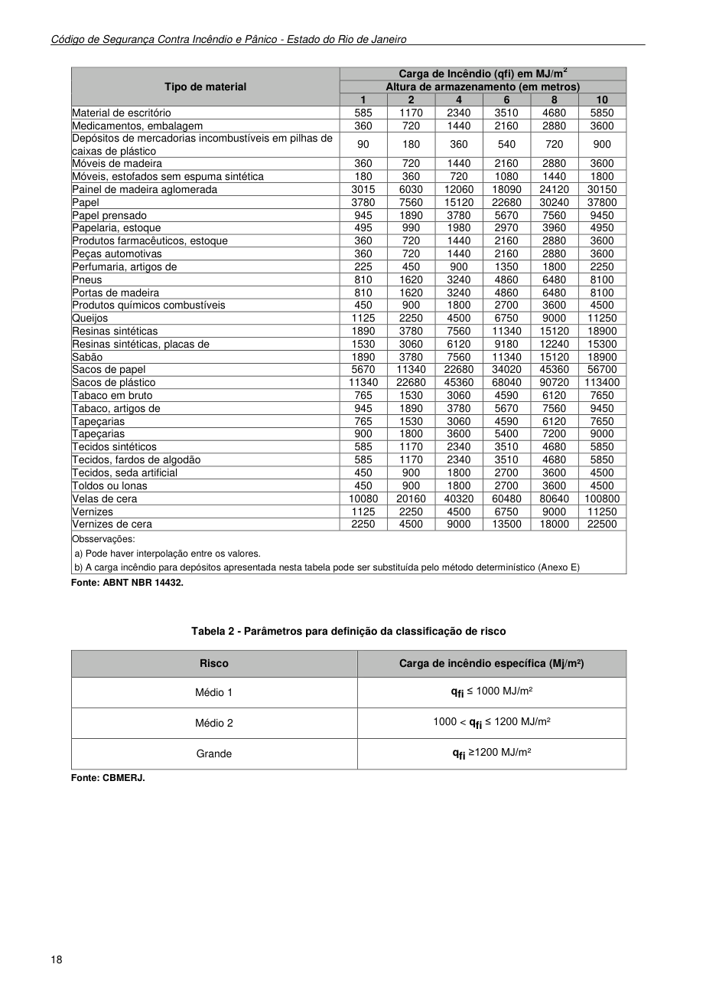

Código de Segurança Contra Incêndio e Pânico - Estado do Rio de Janeiro

Fonte: ABNT NBR 14432.

Tabela 2 - Parâmetros para definição da classificação de risco

Fonte: CBMERJ.

### Tabelas extraídas (bruto, não usar para citação)
#### Tabela 1 da página

|  | Carga de Incêndio (qfi) em MJ/m2 |  |  |  |  |  |
| --- | --- | --- | --- | --- | --- | --- |
| Tipo de material | Altura de armazenamento (em metros) |  |  |  |  |  |
|  | 1 | 2 | 4 | 6 | 8 | 10 |
| Material de escritório | 585 | 1170 | 2340 | 3510 | 4680 | 5850 |
| Medicamentos, embalagem | 360 | 720 | 1440 | 2160 | 2880 | 3600 |
| Depósitos de mercadorias incombustíveis em pilhas de caixas de plástico | 90 | 180 | 360 | 540 | 720 | 900 |
| Móveis de madeira | 360 | 720 | 1440 | 2160 | 2880 | 3600 |
| Móveis, estofados sem espuma sintética | 180 | 360 | 720 | 1080 | 1440 | 1800 |
| Painel de madeira aglomerada | 3015 | 6030 | 12060 | 18090 | 24120 | 30150 |
| Papel | 3780 | 7560 | 15120 | 22680 | 30240 | 37800 |
| Papel prensado | 945 | 1890 | 3780 | 5670 | 7560 | 9450 |
| Papelaria, estoque | 495 | 990 | 1980 | 2970 | 3960 | 4950 |
| Produtos farmacêuticos, estoque | 360 | 720 | 1440 | 2160 | 2880 | 3600 |
| Peças automotivas | 360 | 720 | 1440 | 2160 | 2880 | 3600 |
| Perfumaria, artigos de | 225 | 450 | 900 | 1350 | 1800 | 2250 |
| Pneus | 810 | 1620 | 3240 | 4860 | 6480 | 8100 |
| Portas de madeira | 810 | 1620 | 3240 | 4860 | 6480 | 8100 |
| Produtos químicos combustíveis | 450 | 900 | 1800 | 2700 | 3600 | 4500 |
| Queijos | 1125 | 2250 | 4500 | 6750 | 9000 | 11250 |
| Resinas sintéticas | 1890 | 3780 | 7560 | 11340 | 15120 | 18900 |
| Resinas sintéticas, placas de | 1530 | 3060 | 6120 | 9180 | 12240 | 15300 |
| Sabão | 1890 | 3780 | 7560 | 11340 | 15120 | 18900 |
| Sacos de papel | 5670 | 11340 | 22680 | 34020 | 45360 | 56700 |
| Sacos de plástico | 11340 | 22680 | 45360 | 68040 | 90720 | 113400 |
| Tabaco em bruto | 765 | 1530 | 3060 | 4590 | 6120 | 7650 |
| Tabaco, artigos de | 945 | 1890 | 3780 | 5670 | 7560 | 9450 |
| Tapeçarias | 765 | 1530 | 3060 | 4590 | 6120 | 7650 |
| Tapeçarias | 900 | 1800 | 3600 | 5400 | 7200 | 9000 |
| Tecidos sintéticos | 585 | 1170 | 2340 | 3510 | 4680 | 5850 |
| Tecidos, fardos de algodão | 585 | 1170 | 2340 | 3510 | 4680 | 5850 |
| Tecidos, seda artificial | 450 | 900 | 1800 | 2700 | 3600 | 4500 |
| Toldos ou lonas | 450 | 900 | 1800 | 2700 | 3600 | 4500 |
| Velas de cera | 10080 | 20160 | 40320 | 60480 | 80640 | 100800 |
| Vernizes | 1125 | 2250 | 4500 | 6750 | 9000 | 11250 |
| Vernizes de cera | 2250 | 4500 | 9000 | 13500 | 18000 | 22500 |
| Obsservações: a) Pode haver interpolação entre os valores. b) A carga incêndio para depósitos apresentada nesta tabela pode ser substituída pelo método determinístico (Anexo E) |  |  |  |  |  |  |

#### Tabela 2 da página

|  | Risco |  |  | Carga de incêndio específica (Mj/m²) |  |
| --- | --- | --- | --- | --- | --- |
| Médio 1 |  |  | qfi ≤ 1000 MJ/m² |  |  |
| Médio 2 |  |  | 1000 < qfi ≤ 1200 MJ/m² |  |  |
| Grande |  |  | qfi ≥1200 MJ/m² |  |  |

<!-- tabela-conferida: Tabela 1 p18 -->
### Tabela 1 — Carga de incêndio relativa à altura de armazenamento (Depósitos), página 18 (conferida)

| Tipo de material | qfi (MJ/m²) — altura 1 m | qfi (MJ/m²) — altura 2 m | qfi (MJ/m²) — altura 4 m | qfi (MJ/m²) — altura 6 m | qfi (MJ/m²) — altura 8 m | qfi (MJ/m²) — altura 10 m |
| --- | --- | --- | --- | --- | --- | --- |
| Material de escritório | 585 | 1170 | 2340 | 3510 | 4680 | 5850 |
| Medicamentos, embalagem | 360 | 720 | 1440 | 2160 | 2880 | 3600 |
| Depósitos de mercadorias incombustíveis em pilhas de caixas de plástico | 90 | 180 | 360 | 540 | 720 | 900 |
| Móveis de madeira | 360 | 720 | 1440 | 2160 | 2880 | 3600 |
| Móveis, estofados sem espuma sintética | 180 | 360 | 720 | 1080 | 1440 | 1800 |
| Painel de madeira aglomerada | 3015 | 6030 | 12060 | 18090 | 24120 | 30150 |
| Papel | 3780 | 7560 | 15120 | 22680 | 30240 | 37800 |
| Papel prensado | 945 | 1890 | 3780 | 5670 | 7560 | 9450 |
| Papelaria, estoque | 495 | 990 | 1980 | 2970 | 3960 | 4950 |
| Produtos farmacêuticos, estoque | 360 | 720 | 1440 | 2160 | 2880 | 3600 |
| Peças automotivas | 360 | 720 | 1440 | 2160 | 2880 | 3600 |
| Perfumaria, artigos de | 225 | 450 | 900 | 1350 | 1800 | 2250 |
| Pneus | 810 | 1620 | 3240 | 4860 | 6480 | 8100 |
| Portas de madeira | 810 | 1620 | 3240 | 4860 | 6480 | 8100 |
| Produtos químicos combustíveis | 450 | 900 | 1800 | 2700 | 3600 | 4500 |
| Queijos | 1125 | 2250 | 4500 | 6750 | 9000 | 11250 |
| Resinas sintéticas | 1890 | 3780 | 7560 | 11340 | 15120 | 18900 |
| Resinas sintéticas, placas de | 1530 | 3060 | 6120 | 9180 | 12240 | 15300 |
| Sabão | 1890 | 3780 | 7560 | 11340 | 15120 | 18900 |
| Sacos de papel | 5670 | 11340 | 22680 | 34020 | 45360 | 56700 |
| Sacos de plástico | 11340 | 22680 | 45360 | 68040 | 90720 | 113400 |
| Tabaco em bruto | 765 | 1530 | 3060 | 4590 | 6120 | 7650 |
| Tabaco, artigos de | 945 | 1890 | 3780 | 5670 | 7560 | 9450 |
| Tapeçarias | 765 | 1530 | 3060 | 4590 | 6120 | 7650 |
| Tapeçarias | 900 | 1800 | 3600 | 5400 | 7200 | 9000 |
| Tecidos sintéticos | 585 | 1170 | 2340 | 3510 | 4680 | 5850 |
| Tecidos, fardos de algodão | 585 | 1170 | 2340 | 3510 | 4680 | 5850 |
| Tecidos, seda artificial | 450 | 900 | 1800 | 2700 | 3600 | 4500 |
| Toldos ou lonas | 450 | 900 | 1800 | 2700 | 3600 | 4500 |
| Velas de cera | 10080 | 20160 | 40320 | 60480 | 80640 | 100800 |
| Vernizes | 1125 | 2250 | 4500 | 6750 | 9000 | 11250 |
| Vernizes de cera | 2250 | 4500 | 9000 | 13500 | 18000 | 22500 |

Fonte: NT 1-04, página 18, Tabela 1; conferida em 2026-09-29 (visual + geometrica).
Continuação da Tabela 1 do Anexo C. Fonte indicada: ABNT NBR 14432.
Conferência aritmética (além dos dois caminhos): em cada linha a carga é proporcional à altura de armazenamento (valor em 2 m ÷ 2 × altura, arredondado).
Observações da tabela (fora da comparação): a) pode haver interpolação entre os valores; b) a carga de incêndio para depósitos desta tabela pode ser substituída pelo método determinístico.
<!-- /tabela-conferida: Tabela 1 p18 -->

<!-- tabela-conferida: Tabela 2 p18 -->
### Tabela 2 — Parâmetros para definição da classificação de risco (conferida)

| Risco | Carga de incêndio específica (Mj/m²) |
| --- | --- |
| Médio 1 | qfi ≤ 1000 MJ/m² |
| Médio 2 | 1000 < qfi ≤ 1200 MJ/m² |
| Grande | qfi ≥1200 MJ/m² |

Fonte: NT 1-04, página 18, Tabela 2; conferida em 2026-09-29 (visual + geometrica).
Fonte indicada: CBMERJ.
<!-- /tabela-conferida: Tabela 2 p18 -->

---

## Página 19

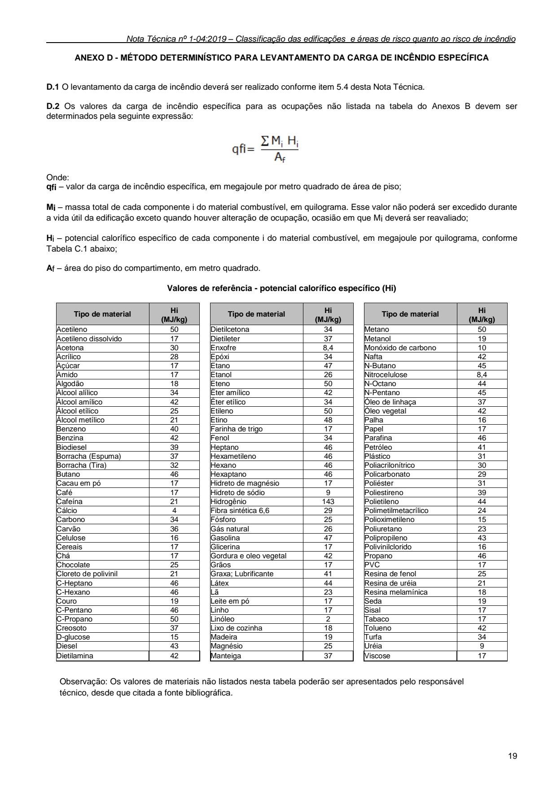

### ANEXO D - MÉTODO DETERMINÍSTICO PARA LEVANTAMENTO DA CARGA DE INCÊNDIO ESPECÍFICA

D.1 O levantamento da carga de incêndio deverá ser realizado conforme item 5.4 desta Nota Técnica.

D.2 Os valores da carga de incêndio específica para as ocupações não listada na tabela do Anexos B devem ser determinados pela seguinte expressão:

Onde: qfi - valor da carga de incêndio específica, em megajoule por metro quadrado de área de piso; Mi - massa total de cada componente i do material combustível, em quilograma. Esse valor não poderá ser excedido durante a vida útil da edificação exceto quando houver alteração de ocupação, ocasião em que Mi deverá ser reavaliado; Hi - potencial calorífico específico de cada componente i do material combustível, em megajoule por quilograma, conforme Tabela C.1 abaixo; Af - área do piso do compartimento, em metro quadrado.

Valores de referência - potencial calorífico específico (Hi)

Tipo de material Hi (MJ/kg) Acetileno 50 Dietilcetona 34 Metano 50 Acetileno dissolvido 17 Dietileter 37 Metanol 19 Acetona 30 Enxofre 8,4 Monóxido de carbono 10 Acrílico 28 Epóxi 34 Nafta 42 Açúcar 17 Etano 47 N-Butano 45 Amido 17 Etanol 26 Nitrocelulose 8,4 Algodão 18 Eteno 50 N-Octano 44 Álcool alílico 34 Éter amílico 42 N-Pentano 45 Álcool amílico 42 Éter etílico 34 Óleo de linhaça 37 Álcool etílico 25 Etileno 50 Óleo vegetal 42 Álcool metílico 21 Etino 48 Palha 16 Benzeno 40 Farinha de trigo 17 Papel 17 Benzina 42 Fenol 34 Parafina 46 Biodiesel 39 Heptano 46 Petróleo 41 Borracha (Espuma) 37 Hexametileno 46 Plástico 31 Borracha (Tira) 32 Hexano 46 Poliacrilonítrico 30 Butano 46 Hexaptano 46 Policarbonato 29 Cacau em pó 17 Hidreto de magnésio 17 Poliéster 31 Café 17 Hidreto de sódio 9 Poliestireno 39 Cafeína 21 Hidrogênio 143 Polietileno 44 Cálcio 4 Fibra sintética 6,6 29 Polimetilmetacrílico 24 Carbono 34 Fósforo 25 Polioximetileno 15 Carvão 36 Gás natural 26 Poliuretano 23 Celulose 16 Gasolina 47 Polipropileno 43 Cereais 17 Glicerina 17 Polivinilclorido 16 Chá 17 Gordura e oleo vegetal 42 Propano 46 Chocolate 25 Grãos 17 PVC 17 Cloreto de polivinil 21 Graxa; Lubrificante 41 Resina de fenol 25 C-Heptano 46 Látex 44 Resina de uréia 21 C-Hexano 46 Lã 23 Resina melamínica 18 Couro 19 Leite em pó 17 Seda 19 C-Pentano 46 Linho 17 Sisal 17 C-Propano 50 Linóleo 2 Tabaco 17 Creosoto 37 Lixo de cozinha 18 Tolueno 42 D-glucose 15 Madeira 19 Turfa 34 Diesel 43 Magnésio 25 Uréia 9 Dietilamina 42 Manteiga 37 Viscose 17

Observação: Os valores de materiais não listados nesta tabela poderão ser apresentados pelo responsável técnico, desde que citada a fonte bibliográfica.

### Tabelas extraídas (bruto, não usar para citação)
#### Tabela 1 da página

|  | Hi |
| --- | --- |
| Tipo de material |  |
|  | (MJ/kg) |
|  |  |
| Acetileno | 50 |
| Acetileno dissolvido | 17 |
| Acetona | 30 |
| Acrílico | 28 |
| Açúcar | 17 |
| Amido | 17 |
| Algodão | 18 |
| Álcool alílico | 34 |
| Álcool amílico | 42 |
| Álcool etílico | 25 |
| Álcool metílico | 21 |
| Benzeno | 40 |
| Benzina | 42 |
| Biodiesel | 39 |
| Borracha (Espuma) | 37 |
| Borracha (Tira) | 32 |
| Butano | 46 |
| Cacau em pó | 17 |
| Café | 17 |
| Cafeína | 21 |
| Cálcio | 4 |
| Carbono | 34 |
| Carvão | 36 |
| Celulose | 16 |
| Cereais | 17 |
| Chá | 17 |
| Chocolate | 25 |
| Cloreto de polivinil | 21 |
| C-Heptano | 46 |
| C-Hexano | 46 |
| Couro | 19 |
| C-Pentano | 46 |
| C-Propano | 50 |
| Creosoto | 37 |
| D-glucose | 15 |
| Diesel | 43 |
| Dietilamina | 42 |

#### Tabela 2 da página

|  | Hi |
| --- | --- |
| Tipo de material |  |
|  | (MJ/kg) |
|  |  |
| Dietilcetona | 34 |
| Dietileter | 37 |
| Enxofre | 8,4 |
| Epóxi | 34 |
| Etano | 47 |
| Etanol | 26 |
| Eteno | 50 |
| Éter amílico | 42 |
| Éter etílico | 34 |
| Etileno | 50 |
| Etino | 48 |
| Farinha de trigo | 17 |
| Fenol | 34 |
| Heptano | 46 |
| Hexametileno | 46 |
| Hexano | 46 |
| Hexaptano | 46 |
| Hidreto de magnésio | 17 |
| Hidreto de sódio | 9 |
| Hidrogênio | 143 |
| Fibra sintética 6,6 | 29 |
| Fósforo | 25 |
| Gás natural | 26 |
| Gasolina | 47 |
| Glicerina | 17 |
| Gordura e oleo vegetal | 42 |
| Grãos | 17 |
| Graxa; Lubrificante | 41 |
| Látex | 44 |
| Lã | 23 |
| Leite em pó | 17 |
| Linho | 17 |
| Linóleo | 2 |
| Lixo de cozinha | 18 |
| Madeira | 19 |
| Magnésio | 25 |
| Manteiga | 37 |

#### Tabela 3 da página

|  | Hi |
| --- | --- |
| Tipo de material |  |
|  | (MJ/kg) |
|  |  |
| Metano | 50 |
| Metanol | 19 |
| Monóxido de carbono | 10 |
| Nafta | 42 |
| N-Butano | 45 |
| Nitrocelulose | 8,4 |
| N-Octano | 44 |
| N-Pentano | 45 |
| Óleo de linhaça | 37 |
| Óleo vegetal | 42 |
| Palha | 16 |
| Papel | 17 |
| Parafina | 46 |
| Petróleo | 41 |
| Plástico | 31 |
| Poliacrilonítrico | 30 |
| Policarbonato | 29 |
| Poliéster | 31 |
| Poliestireno | 39 |
| Polietileno | 44 |
| Polimetilmetacrílico | 24 |
| Polioximetileno | 15 |
| Poliuretano | 23 |
| Polipropileno | 43 |
| Polivinilclorido | 16 |
| Propano | 46 |
| PVC | 17 |
| Resina de fenol | 25 |
| Resina de uréia | 21 |
| Resina melamínica | 18 |
| Seda | 19 |
| Sisal | 17 |
| Tabaco | 17 |
| Tolueno | 42 |
| Turfa | 34 |
| Uréia | 9 |
| Viscose | 17 |

<!-- tabela-conferida: Tabela do Anexo D (1/3) p19 -->
### Tabela do Anexo D (1/3) — Valores de referência — potencial calorífico específico (Hi), coluna 1 de 3 (conferida)

| Tipo de material | Hi (MJ/kg) |
| --- | --- |
| Acetileno | 50 |
| Acetileno dissolvido | 17 |
| Acetona | 30 |
| Acrílico | 28 |
| Açúcar | 17 |
| Amido | 17 |
| Algodão | 18 |
| Álcool alílico | 34 |
| Álcool amílico | 42 |
| Álcool etílico | 25 |
| Álcool metílico | 21 |
| Benzeno | 40 |
| Benzina | 42 |
| Biodiesel | 39 |
| Borracha (Espuma) | 37 |
| Borracha (Tira) | 32 |
| Butano | 46 |
| Cacau em pó | 17 |
| Café | 17 |
| Cafeína | 21 |
| Cálcio | 4 |
| Carbono | 34 |
| Carvão | 36 |
| Celulose | 16 |
| Cereais | 17 |
| Chá | 17 |
| Chocolate | 25 |
| Cloreto de polivinil | 21 |
| C-Heptano | 46 |
| C-Hexano | 46 |
| Couro | 19 |
| C-Pentano | 46 |
| C-Propano | 50 |
| Creosoto | 37 |
| D-glucose | 15 |
| Diesel | 43 |
| Dietilamina | 42 |

Fonte: NT 1-04, página 19, Tabela do Anexo D (1/3); conferida em 2026-09-29 (visual + texto).
A página traz três colunas lado a lado (Tipo de material | Hi); cada uma é um arquivo. Observação da página: valores de materiais não listados podem ser apresentados pelo responsável técnico, citada a fonte bibliográfica.
<!-- /tabela-conferida: Tabela do Anexo D (1/3) p19 -->

<!-- tabela-conferida: Tabela do Anexo D (2/3) p19 -->
### Tabela do Anexo D (2/3) — Valores de referência — potencial calorífico específico (Hi), coluna 2 de 3 (conferida)

| Tipo de material | Hi (MJ/kg) |
| --- | --- |
| Dietilcetona | 34 |
| Dietileter | 37 |
| Enxofre | 8,4 |
| Epóxi | 34 |
| Etano | 47 |
| Etanol | 26 |
| Eteno | 50 |
| Éter amílico | 42 |
| Éter etílico | 34 |
| Etileno | 50 |
| Etino | 48 |
| Farinha de trigo | 17 |
| Fenol | 34 |
| Heptano | 46 |
| Hexametileno | 46 |
| Hexano | 46 |
| Hexaptano | 46 |
| Hidreto de magnésio | 17 |
| Hidreto de sódio | 9 |
| Hidrogênio | 143 |
| Fibra sintética 6,6 | 29 |
| Fósforo | 25 |
| Gás natural | 26 |
| Gasolina | 47 |
| Glicerina | 17 |
| Gordura e oleo vegetal | 42 |
| Grãos | 17 |
| Graxa; Lubrificante | 41 |
| Látex | 44 |
| Lã | 23 |
| Leite em pó | 17 |
| Linho | 17 |
| Linóleo | 2 |
| Lixo de cozinha | 18 |
| Madeira | 19 |
| Magnésio | 25 |
| Manteiga | 37 |

Fonte: NT 1-04, página 19, Tabela do Anexo D (2/3); conferida em 2026-09-29 (visual + texto).
A página traz três colunas lado a lado (Tipo de material | Hi); cada uma é um arquivo. Observação da página: valores de materiais não listados podem ser apresentados pelo responsável técnico, citada a fonte bibliográfica.
<!-- /tabela-conferida: Tabela do Anexo D (2/3) p19 -->

<!-- tabela-conferida: Tabela do Anexo D (3/3) p19 -->
### Tabela do Anexo D (3/3) — Valores de referência — potencial calorífico específico (Hi), coluna 3 de 3 (conferida)

| Tipo de material | Hi (MJ/kg) |
| --- | --- |
| Metano | 50 |
| Metanol | 19 |
| Monóxido de carbono | 10 |
| Nafta | 42 |
| N-Butano | 45 |
| Nitrocelulose | 8,4 |
| N-Octano | 44 |
| N-Pentano | 45 |
| Óleo de linhaça | 37 |
| Óleo vegetal | 42 |
| Palha | 16 |
| Papel | 17 |
| Parafina | 46 |
| Petróleo | 41 |
| Plástico | 31 |
| Poliacrilonítrico | 30 |
| Policarbonato | 29 |
| Poliéster | 31 |
| Poliestireno | 39 |
| Polietileno | 44 |
| Polimetilmetacrílico | 24 |
| Polioximetileno | 15 |
| Poliuretano | 23 |
| Polipropileno | 43 |
| Polivinilclorido | 16 |
| Propano | 46 |
| PVC | 17 |
| Resina de fenol | 25 |
| Resina de uréia | 21 |
| Resina melamínica | 18 |
| Seda | 19 |
| Sisal | 17 |
| Tabaco | 17 |
| Tolueno | 42 |
| Turfa | 34 |
| Uréia | 9 |
| Viscose | 17 |

Fonte: NT 1-04, página 19, Tabela do Anexo D (3/3); conferida em 2026-09-29 (visual + texto).
A página traz três colunas lado a lado (Tipo de material | Hi); cada uma é um arquivo. Observação da página: valores de materiais não listados podem ser apresentados pelo responsável técnico, citada a fonte bibliográfica.
<!-- /tabela-conferida: Tabela do Anexo D (3/3) p19 -->

---

## Página 20

Código de Segurança Contra Incêndio e Pânico - Estado do Rio de Janeiro

### ANEXO E - EXEMPLO DE PLANILHA PARA CÁLCULO DA CARGA DE INCÊNDIO ESPECÍFICA

(Esse modelo deve ser utilizado apenas para depósito)

Observações: 1 - Constante da Tabela E 2 - Massa total de cada material multiplicado pelo potencial calorífico específico 3 - Somatória de todos os potenciais caloríficos considerados 4 - Total do potencial calorífico do pavimento dividido pela Área do piso do pavimento = (qfi)

### Tabelas extraídas (bruto, não usar para citação)
#### Tabela 1 da página

| Tipo do material existente na edificação por compartimento |  | Massa total de cada material Mi - (kg) |  | Potencial |  | Potencial calorífico por material² Mi x Hi = qi (MJ) |
| --- | --- | --- | --- | --- | --- | --- |
|  |  |  |  | calorífico |  |  |
|  |  |  |  | específico¹ |  |  |
|  |  |  |  | Hi - (MJ/kg) |  |  |
| 1 |  |  |  |  |  |  |
| 2 |  |  |  |  |  |  |
| 3 |  |  |  |  |  |  |
| 4 |  |  |  |  |  |  |
| 5 |  |  |  |  |  |  |
| 6 |  |  |  |  |  |  |
| 7 |  |  |  |  |  |  |

#### Tabela 2 da página

|  | Total do potencial calorífico do pavimento³ - qi (MJ) |  |  |
| --- | --- | --- | --- |
|  | ∑ MiHi |  |  |
|  | Área do piso do pavimento Af (m²) |  |  |
|  | Carga de incêndio específica do pavimento4 |  |  |
|  | qfi = ∑ MiHi |  |  |
|  | Af |  |  |
