# NT 1-07 - Atividades econômicas de baixo risco

> Conversão integral para consulta computacional. A numeração de página do PDF foi preservada. Quando houver tabela complexa, símbolo ou desenho, conferir também a representação visual indicada e o PDF oficial.

## Sumário por página

- [Página 1](#pagina-1)
- [Página 2](#pagina-2)
- [Página 3](#pagina-3)
- [Página 4](#pagina-4)
- [Página 5](#pagina-5)
- [Página 6](#pagina-6)
- [Página 7](#pagina-7)
- [Página 8](#pagina-8)
- [Página 9](#pagina-9)
- [Página 10](#pagina-10)
- [Página 11](#pagina-11)
- [Página 12](#pagina-12)
- [Página 13](#pagina-13)
- [Página 14](#pagina-14)
- [Página 15](#pagina-15)
- [Página 16](#pagina-16)
- [Página 17](#pagina-17)
- [Página 18](#pagina-18)
- [Página 19](#pagina-19)
- [Página 20](#pagina-20)
- [Página 21](#pagina-21)
- [Página 22](#pagina-22)
- [Página 23](#pagina-23)
- [Página 24](#pagina-24)
- [Página 25](#pagina-25)
- [Página 26](#pagina-26)
- [Página 27](#pagina-27)
- [Página 28](#pagina-28)
- [Página 29](#pagina-29)

---

## Página 1

Aprovada pela Portaria CBMERJ nº 1109, de 20 de maio de 2020 (DOERJ nº 093, de 26 de maio de 2020).

### SUMÁRIO

### 1 OBJETIVO

### 2 APLICAÇÃO

### 3 REFERÊNCIAS NORMATIVAS E BIBLIOGRÁFICAS

### 4 DEFINIÇÕES E CONCEITOS

### 5 INFORMAÇÕES PRELIMINARES

### 6 DISPENSA DE REGULARIZAÇÃO

### 7 MEDIDAS DE SEGURANÇA CONTRA INCÊNDIO E PÂNICO

### 8 FISCALIZAÇÃO

### ANEXOS

A - Relação de CNAEs passíveis de dispensa de regularização

### Tabelas extraídas

#### Tabela 1 da página

|  |  | NOTA |  |  | CBMERJ |  |
| --- | --- | --- | --- | --- | --- | --- |
|  |  | TÉCNICA |  |  | NT 1-07 |  |
|  | Versão: 01 29 páginas Vigência: 26/05/2020 |  |  |  |  |  |
|  | Atividades econômicas de baixo risco |  |  |  |  |  |

---

## Página 2

Corpo de Bombeiros Militar do Estado do Rio de Janeiro CBMERJ Praça da República, nº 45, Centro, Rio de Janeiro - RJ. CEP: 20.211-350. www.cbmerj.rj.gov.br Tel.: (+55 21) 2333-2362. http://www.cbmerj.rj.gov.br/notas-tecnicas

---

## Página 3

### 1 OBJETIVO

1.1 Atender ao disposto na Lei Federal nº 13.874, de 20 de setembro de 2019, que instituiu a Declaração de Direitos de Liberdade Econômica, estabelecendo normas de proteção à livre iniciativa e ao livre exercício de atividade econômica e disposições sobre a atuação do Estado como agente normativo e regulador.

1.2 Definir os parâmetros técnicos para classificação como baixo risco das atividades econômicas desenvolvidas em edificações e áreas de risco. Estes locais, quando classificados como baixo risco conforme esta NT, ficam dispensados de regularização no CBMERJ.

1.3 Assinalar as medidas de segurança contra incêndio e pânico que devem ser adotadas pelos responsáveis legais das edificações e áreas de risco que desenvolvem atividades econômicas, classificadas como baixo risco conforme esta NT.

### 2 APLICAÇÃO

2.1 Esta Nota Técnica aplica-se às edificações e áreas de risco que desenvolvem atividades econômicas, classificadas como de baixo risco conforme esta NT e, por conseguinte, dispensadas de documento de regularização.

### 3 REFERÊNCIAS NORMATIVAS E BIBLIOGRÁFICAS

As normas e bibliografias abaixo contêm disposições que estão relacionadas com esta Nota Técnica:

a) Lei Federal nº 11.598, de 3 de dezembro de 2007- Estabelece diretrizes e procedimentos para a simplificação e integração do processo de registro e legalização de empresários e de pessoas jurídicas, cria a Rede Nacional para a Simplificação do Registro e da Legalização de Empresas e Negócios REDESIM; altera a Lei nº 8.934, de 18 de novembro de 1994; revoga dispositivos do Decreto-Lei nº 1.715, de 22 de novembro de 1979, e das Leis nºs 7.711, de 22 de dezembro de 1988, 8.036, de 11 de maio de 1990, 8.212, de 24 de julho de 1991, e 8.906, de 4 de julho de 1994; e dá outras providências;

b) Lei Estadual nº 6.426, de 05 de abril de 2013 - Dispõe sobre as diretrizes e procedimentos para a simplificação e integração do processo de registro e legalização de empresários e de pessoas jurídicas no Estado do Rio de Janeiro;

c) Decreto-Lei nº 247, de 21 de julho de 1975 - Dispõe sobre segurança contra incêndio e pânico no âmbito do Estado do Rio de Janeiro;

d) Decreto Estadual nº 44.803, de 26 de maio de 2014 - Regulamenta o processo de legalização de empresários e sociedades empresariais em função do risco da atividade econômica e dá outras providências;

e) Decreto Estadual nº 42, de 17 de dezembro de 2018 - Regulamenta o Decreto-Lei nº 247, de 21 de julho de 1975, dispondo sobre o Código de Segurança Contra Incêndio e Pânico - COSCIP, no âmbito do estado do Rio de Janeiro;

f) Decreto Estadual nº 46.925, de 05 de fevereiro de 2020 - Altera o Decreto nº 42, de 17 de dezembro de 2018, que regulamenta o Decreto-Lei nº 247, de 21 de julho de 1975, dispondo sobre o Código de Segurança Contra Incêndio e Pânico - COSCIP, no âmbito do estado do rio de janeiro;

g) Resolução CGSIM nº 22, de 22 de junho de 2010 - Dispõe sobre regras a serem seguidas quanto às pesquisas prévias e à regulamentação da classificação de risco da atividade para a concessão do Alvará de Funcionamento Provisório ou Definitivo de empresários e de sociedades empresárias de qualquer porte, atividade econômica ou composição societária, no âmbito da Rede Nacional para a Simplificação do Registro e da Legalização de Empresas e Negócios - REDESIM;

h) Resolução CGSIM nº 24, de 10 de maio de 2011 - Altera o Anexo II da Resolução nº 22, de 22 de junho de 2010, que dispõe sobre regras a serem seguidas quanto às pesquisas prévias e à regulamentação da classificação de risco da atividade para a concessão do Alvará de Funcionamento Provisório ou Definitivo de empresários e de sociedades empresárias de qualquer porte, atividade econômica ou composição societária, no âmbito da Rede Nacional para a Simplificação do Registro e da Legalização de Empresas e Negócios - REDESIM;

i) Resolução CGSIM nº 29, de 29 de novembro de 2012 - Dispõe sobre recomendação da adoção de diretrizes para integração do processo de licenciamento pelos Corpos de Bombeiros Militares pertinente à prevenção contra incêndios e pânico à Rede Nacional para Simplificação do Registro e da Legalização de Empresas e Negócios - REDESIM e dá outras providências;

j) Resolução CGSIM nº 48, de 11 de outubro de 2018 -Dispõe sobre o procedimento especial para o registro e legalização do Microempreendedor Individual - MEI, por meio do Portal do Empreendedor;

k) Resolução CGSIM nº 51, de 11 de junho de 2019 - Versa sobre a definição de baixo risco para os fins da Medida Provisória nº 881, de 30 de abril de 2019;

l) Portaria CBMERJ nº 1071, 27 de agosto de 2019 - Aprova as Notas Técnicas do Corpo de Bombeiros Militar do Estado do Rio de Janeiro necessárias ao cumprimento do Decreto nº 42, de 17 de dezembro de 2018; e dá providências;

m) ABNT NBR 13434-3:2018 - Sinalização de segurança contra incêndio e pânico - Parte 3: Requisitos e métodos de ensaio;

---

## Página 4

n) ABNT NBR 10898:2013 - Sistema de iluminação de emergência;

o) ABNT NBR 5410:2008 - Instalações elétricas de baixa tensão.

### 4 DEFINIÇÕES E CONCEITOS

Para efeito desta Nota Técnica aplicam-se, além das definições constantes no Decreto Estadual nº 42/2018 - COSCIP e na NT 1-02 - Terminologia de segurança contra incêndio e pânico, as definições específicas desta seção.

4.1 Acesso: caminho a ser percorrido pelos usuários do pavimento ou do setor, constituindo a rota de saída para se alcançar uma escada, ou uma rampa, ou uma área de refúgio, ou descarga para saída do recinto. Os acessos podem ser constituídos por corredores, passagens, vestíbulos, balcões, varandas, terraços e similares.

4.2 Agente extintor: substância utilizada para a extinção de fogo.

4.3 Atividade econômica de baixo risco: é aquela que atende aos critérios previstos na seção 6 desta NT.

4.4 Autonomia do sistema de iluminação de emergência: tempo mínimo em que o sistema de iluminação de emergência em funcionamento assegura os níveis de iluminação exigidos no piso.

4.5 Bocel ou nariz do degrau: borda saliente do degrau sobre o espelho, arredondada inferiormente ou não.

4.6 Carga: quantidade de agente extintor contida no extintor de incêndio, medida em litro ou quilograma.

4.7 Capacidade extintora: medida do poder de extinção de fogo de um extintor, obtida em ensaio prático normatizado.

4.8 Certificado de Aprovação (CA): documento que certifica que as edificações e áreas de risco estão regularizadas, após a comprovação do cumprimento das medidas de segurança contra incêndio e pânico exigidas.

4.9 Certificado de Aprovação Assistido (CAA): documento expedido pelo Corpo de Bombeiros Militar para um local quando um profissional técnico declara o cumprimento das medidas de segurança contra incêndio e pânico. A existência deste documento significa que a edificação ou área de risco está regularizada junto ao Corpo de Bombeiros Militar do Estado de Rio de Janeiro.

4.10 Certificado de Aprovação Simplificado (CAS): documento expedido pelo Corpo de Bombeiros Militar para um local quando o responsável legal se compromete com as informações fornecidas e informa que cumpriu as medidas de segurança contra incêndio e pânico. Este documento é emitido para locais com pequeno

potencial de risco, classificados no risco diferenciado. Este documento reúne as medidas de segurança contra incêndio e pânico, os cuidados e restrições para o funcionamento do estabelecimento. Este documento significa que o imóvel, estabelecimento ou área de risco está regularizado no Corpo de Bombeiros Militar do Estado do Rio de Janeiro.

4.11 Corrimão: barra, cano ou peça similar, com superfície lisa, arredondada e contínua, localizada junto às paredes ou guardas de escadas, rampas ou passagens para as pessoas nelas se apoiarem ao subir, descer ou se deslocar.

4.12 Degrau: conjunto dos dois elementos, horizontal e vertical, de uma escada: piso e espelho. Piso é a superfície horizontal do degrau, e espelho é a superfície vertical entre um piso (degrau) e outro.

4.13 Descarga: parte da saída de emergência de uma edificação que fica entre a escada ou a rampa e o logradouro público ou área externa com acesso a este, podendo ser constituídos por corredores ou átrios cobertos ou a céu aberto.

4.14 Estabelecimentos: para efeitos desta NT, considera-se estabelecimento todo complexo de bens organizado, para exercício da atividade da empresa, por empresário, ou por sociedade empresária, em uma edificação ou partes desta (sala comercial, loja ou unidades autônomas).

4.15 Extintor de incêndio: aparelho de acionamento manual, constituído de recipiente e acessórios contendo o agente extintor destinado a combater princípios de incêndio.

4.16 Extintor portátil: extintor de incêndio que pode ser transportado manualmente, sendo que sua massa total não pode ultrapassar 20 kg.

4.17 Fogo classe A: fogo envolvendo materiais combustíveis sólidos, tais como madeiras, tecidos, papéis, borrachas, plásticos termoestáveis e outras fibras orgânicas, que queimam em superfície e profundidade, deixando resíduos.

4.18 Fogo classe B: fogo envolvendo líquidos e/ou gases inflamáveis ou combustíveis, plásticos e graxas que se liquefazem por ação do calor e queimam somente em superfície.

4.19 Fogo classe C: fogo envolvendo equipamentos energizados, fios, cabos, quadros elétricos e similares, onde deve se utilizar extintores não condutores de eletricidade para proteger seus operadores.

4.20 Guarda ou guarda-corpo: barreira protetora vertical, maciça ou não, delimitando as faces laterais abertas de escadas, rampas, patamares, terraços, balcões, galerias e assemelhados, servindo como proteção contra eventuais quedas de um nível para outro.

---

## Página 5

4.21 Lanço de escada: sucessão ininterrupta de degraus entre dois patamares sucessivos, nunca inferior a três degraus.

4.22 Largura do degrau (L): distância entre o bocel do degrau e a projeção do bocel do degrau imediatamente superior, medida horizontalmente sobre a linha de percurso da escada.

4.23 Nível ou pavimento de acesso: nível do terreno no ponto em que se atravessa a projeção da fachada ao se entrar na edificação.

4.24 Nível ou pavimento de descarga: parte da saída de emergência de uma edificação que fica entre a escada ou rampa e o logradouro público ou área externa com acesso a este.

4.25 Patamar: é a superfície horizontal mais alongada que os pisos (degraus). Servem como descanso ao subir uma escada que vence uma grande altura piso a piso.

4.26 Pavimento: parte de uma edificação situada entre a parte superior de um piso acabado e a parte superior do piso imediatamente superior, ou entre a parte superior de um piso acabado e o forro acima dele, se não houver outro piso acima.

4.27 População: número de pessoas para as quais uma edificação, ou parte dela, é projetada.

4.28 População fixa: população que permanece regularmente na edificação (residentes, funcionários, colaboradores, etc.), de acordo com os turnos de trabalho e natureza da ocupação.

4.29 População flutuante: população que não permanece regularmente na edificação. Deve ser considerado sempre o número máximo simultâneo de pessoas.

4.30 Princípio de incêndio: período inicial da queima de materiais, compostos químicos ou equipamentos, enquanto o incêndio é incipiente.

4.31 Produtos perigosos: substâncias químicas com potencial lesivo à saúde humana e ao meio ambiente.

4.32 Rampa: parte inclinada de uma rota de saída, que se destina a unir dois níveis de pavimento.

4.33 Regularização: é a obtenção dos Certificados ou Autorizações expedidos pelo CBMERJ para as edificações e áreas de risco, após a comprovação do cumprimento das medidas de segurança contra incêndio e pânico exigidas nos termos do COSCIP.

4.34 Responsável legal: pessoa responsável pela edificação ou área de risco ou evento. Trata-se do proprietário, síndico, administrador, locatário (no caso de local alugado) ou cessionário (no caso de cessão de um espaço). No caso de pessoa jurídica, um dos sócios poderá representar a empresa. A pessoa, física ou jurídica, poderá ser representada

por terceiros, desde que haja uma procuração outorgando tal competência.

4.35 Reunião de público: trata-se da expressão relacionada à concentração de pessoas em um determinado local por um período de tempo. São locais de reunião de público aqueles classificados no grupo F da Tabela 1 do Decreto 42/2018 - COSCIP, tais como: museus, lonas culturais, templos religiosos, arenas em geral, estádios, ginásio, estação e terminal de passageiro, teatros, auditórios, boates, casas noturnas, instalações temporárias, circos, parques temáticos, restaurantes, lanchonetes, bares, parques recreativos, exposição de animais, clubes sociais, casas de festa e similares.

4.36 Risco diferenciado: enquadramento de risco relativo a edificações e estabelecimentos cujas características e atividades econômicas desenvolvidas apresentam menor vulnerabilidade e menor grau de perigo à integridade física de pessoas, ao meio ambiente ou ao patrimônio, ensejando a regularização por meio de procedimento simplificado, sendo autodeclatório e não havendo necessidade de profissional técnico, conforme NT 1- 01 Procedimentos administrativos para regularização e fiscalização - Parte 1 - Regularização.

4.37 Saída de emergência, rota de saída ou saída: caminho contínuo, devidamente protegido e sinalizado, proporcionado por portas, corredores, “halls”, passagens externas, balcões, vestíbulos, escadas, rampas, conexões entre túneis paralelos ou outros dispositivos de saída, ou combinações desses, a ser percorrido pelo usuário em caso de emergência, de qualquer ponto da edificação, recinto de evento ou túnel, até atingir a via pública ou espaço aberto, com garantia de integridade física.

4.38 Saída horizontal: passagem de um edifício para outro por meio de porta corta-fogo, vestíbulo, passagem coberta, passadiço ou balcão.

4.39 Saída vertical: passagem de um pavimento para outro, por meio de elevador, escada ou rampa.

4.40 Sinalização de equipamentos: sinalização que visa indicar a localização e os tipos de equipamentos de combate a incêndio e alarme disponíveis no local.

4.41 Sinalização de orientação e salvamento: sinalização que visa indicar as rotas de saída e as ações necessárias para o seu acesso e uso adequado.

4.42 Unidade extintora: aparelho extintor de incêndio que atende a capacidade extintora mínima prevista nesta NT.

### 5 INFORMAÇÕES PRELIMINARES

5.1 A classificação de risco de determinada atividade econômica depende de fatores como as características arquitetônicas das edificações

---

## Página 6

ocupadas, a natureza da atividade econômica e os processos produtivos de bens e serviços, não necessariamente atrelados à atividade principal. Portanto, a presente Nota Técnica estabelece requisitos para que determinadas atividades econômicas sejam consideradas como de baixo risco, possibilitando seu exercício sem qualquer ato público de liberação praticado pelo CBMERJ.

5.2 As edificações e áreas de risco que desenvolvem atividades econômicas e não atendem aos requisitos para enquadramento de baixo risco desta NT, deverão ser regularizadas junto ao CBMERJ por meio do procedimento simplificado ou por meio da apresentação de Projeto de Segurança Contra Incêndio e Pânico - PSIP, nos termos da NT 1-01 - Procedimentos administrativos para regularização e fiscalização - Parte 1 - Regularização.

5.3 O local possuidor de Certificado de Aprovação (CA), Certificado de Aprovação Simplificado (CAS) ou Certificado de Aprovação Assistido (CAA) que passar por mudanças das características arquitetônicas, de tipo de ocupação ou de dados cadastrais que sejam incompatíveis com os constantes nos referidos certificados, não precisará iniciar um novo processo de regularização, caso atenda a todos os requisitos previstos na seção 6 desta NT.

5.4 É dever do responsável legal providenciar a adequação das edificações e áreas de risco às exigências estabelecidas no Decreto Estadual nº 42/2018 - COSCIP e nesta Nota Técnica do CBMERJ, mantendo as medidas de segurança contra incêndio e pânico em conformidade com a legislação vigente.

### 6 DISPENSA DE REGULARIZAÇÃO

6.1 É a liberação, sem qualquer ato público praticado pelo CBMERJ, das atividades econômicas desenvolvidas em edificações e áreas de risco, classificadas como baixo risco conforme esta NT, de modo à atender a Lei Federal nº 13.874, de 20 de setembro de 2019.

6.2 São consideradas atividades econômicas de baixo risco, para efeitos de dispensa de regularização junto ao CBMERJ, as desenvolvidas em edificações e áreas de risco que atendam a todos os seguintes critérios:

a) possuir área total construída (ATC) até 200 m²;

b) possuir até 02 pavimentos, sendo que o(s) mezanino(s) ou jirau(s) será(ão) computado(s) como pavimento(s);

c) não realizar atividades enquadradas como reunião de público, seja como atividade principal, secundária, subsidiária ou temporária;

d) possuir população de no máximo 100 pessoas, de forma permanente (população fixa) ou temporária (população flutuante);

e) não realizar atividade de posto de abastecimento de líquidos inflamáveis, combustíveis e/ou gás natural veicular (GNV);

f) não utilizar motogerador;

g) não possuir subestação elétrica;

h) não realizar atividades enquadradas nas divisões H-2 e H-3 da Tabela 1 do Decreto 42/2018 - COSCIP, cujo o público são pessoas que requerem cuidados especiais por limitações físicas ou mentais, tais como: asilos, residências geriátricas, hospitais, clínicas com internação, hospitais psiquiátricos e assemelhados;

i) não comercializar, armazenar ou manipular volume superior a 40 litros de líquidos inflamáveis e/ou combustíveis;

j) não utilizar, comercializar, manipular ou armazenar gás liquefeito de petróleo (GLP), gás natural (GN), bem como qualquer outro tipo de gás inflamável ou combustível;

k) não comercializar, armazenar ou manipular produtos perigosos, pirotécnicos, munições ou explosivos;

l) A Classificação Nacional de Atividades Econômicas - CNAE deve constar na relação de CNAEs passíveis de dispensa de regularização, vide Anexo A desta NT.

6.3 Quando a atividade for desenvolvida em lojas ou salas, componentes de uma edificação, é necessário que o prédio possua o Certificado de Aprovação e esteja isento de instalação de chuveiros automáticos.

6.4 Não se enquadram os túneis rodoviários ou ferroviários; antenas de telefonia; silos; instalações de transmissão de energia; e locais onde a liberdade das pessoas sofre restrição, como presídios e manicômios.

6.5 Estão dispensadas de regularização as atividades econômicas desenvolvidas em unidade exclusivamente residencial privativa, sem estocagem de matérias-primas e produtos acabados, sem recepção de público e que não utilizem, comercializem, armazenem ou manipulem materiais perigosos, pirotécnicos, inflamáveis, combustíveis, munições ou explosivos, excetuando-se o uso de gás natural ou GLP (fora da projeção da edificação e no pavimento térreo).

6.6 A classificação como baixo risco e a dispensa de regularização não exime o responsável legal pelo uso da edificação ou área de risco de adotar as medidas de segurança contra incêndio e pânico previstas no Decreto Estadual nº 42/2018 - COSCIP

---

## Página 7

e nesta NT.

6.7 Para confirmar se a empresa foi dispensada de documento do CBMERJ, o empresário ou seu representante consultará a resposta enviada pelo CBMERJ no sistema de registro de empresas, utilizado tanto pela Junta Comercial do Estado do Rio de Janeiro (JUCERJA) como pelo Registro Civil de Pessoas Jurídicas (RCPJ). Após o preenchimento da viabilidade, o CBMERJ realizará a análise das informações fornecidas na viabilidade e enviará, de forma automática, a resposta para o sistema de registro de empresas.

6.8 Caso a empresa já possua cadastro comercial, também será possível consultar se está dispensada de documento de regularização do CBMERJ. Basta preencher uma viabilidade solicitando “Insc. Bombeiro Militar” na página da JUCERJA ou do RCPJ. Caso seja dispensada, não será necessário qualquer documento de regularização e aparecerá uma resposta do CBMERJ informando que a empresa está dispensada de regularização. Esta mensagem ficará disponível no sistema de registro de empresas, utilizado tanto pela JUCERJA como pelo RCPJ.

### 7 MEDIDAS DE SEGURANÇA CONTRA INCÊNDIO E PÂNICO

7.1 Esta seção estabelece as medidas de segurança contra incêndio e pânico que devem ser adotadas pelos responsáveis legais das edificações e áreas de risco que desenvolvem atividades econômicas, classificadas como baixo risco, nos termos desta NT.

7.1.1 Estão isentas de adotar as medidas de segurança contra incêndio e pânico previstas nesta seção, as atividades econômicas desenvolvidas em unidade exclusivamente residencial privativa enquadradas em 6.5.

7.2 Os estabelecimentos do tipo quiosques e boxes, instalados em galerias ou circulações internas a uma edificação, estão dispensados da adoção das medidas de segurança contra incêndio e pânico previstas na seção 7 desta NT, desde que protegidas pelas medidas de segurança da edificação e observados os requisitos previstos na NT 4-01 - Quiosques e áreas para exposição ou venda de produtos e serviços.

7.3 A proteção contra incêndio nas instalações elétricas de baixa tensão deve atender ao disposto na ABNT NBR 5410.

7.3.1 A execução e manutenção das instalações elétricas deve ser realizada por profissional habilitado, com observância das normas aplicáveis, a fim de promover o funcionamento seguro e a redução do risco de incêndio.

7.4 Extintores portáteis

7.4.1 Os extintores são exigidos em função da

natureza do fogo, de acordo com o material combustível pertencente a uma das três classes:

a) fogo classe A: o aparelho extintor de incêndio deve atender a capacidade extintora mínima 2-A;

b) fogo classe B: o aparelho extintor de incêndio deve atender a capacidade extintora mínima 20-B;

c) fogo classe C: o aparelho extintor de incêndio deve atender a capacidade extintora mínima C.

7.4.2 Para edificações com área total construída inferior a 50 m² é exigida a instalação de uma única unidade extintora de pó ABC com carga mínima de 4 kg. O extintor de pó quimico - ABC poderá ser substituído por 02 extintores, sendo: 01 extintor de Água Pressurizada - AP-10 L e 01 extintor de Pó BC- 4 Kg (ou Gás Carbônico - CO₂-6 Kg).

7.4.3 Para edificações com área total construída de 50 m² a 200 m² é exigida a instalação de 02 unidades extintoras, sendo: 01 de Água Pressurizada - AP-10 L e 01 de Pó BC 4 Kg (ou Gás Carbônico - CO₂-6 Kg). Caso haja presença de líquido inflamável, até o limite aceitável de 40 litros, o extintor de Gás Carbônico - CO₂ não poderá ser escolhido.

7.4.4 O extintor de pó quimico - ABC com carga mínima de 4 kg poderá substituir qualquer tipo de unidade extintora mencionada em 7.4.3.

7.4.5 Os extintores devem possuir marca de conformidade concedida por órgão credenciado pelo Sistema Brasileiro de Certificação.

7.4.6 Para efeito de vistoria do Corpo de Bombeiros o prazo de validade/garantia de funcionamento dos extintores deve ser aquele estabelecido pelo fabricante e/ou da empresa de manutenção certificada pelo Sistema Brasileiro de Certificação.

7.4.7 Para a instalação dos extintores portáteis, devem ser observadas as seguintes exigências:

a) quando forem fixados em paredes ou colunas, os suportes devem resistir a três vezes a massa total do extintor;

b) quando forem fixados em parede, devem ser observadas as seguintes alturas de montagem:

− a posição da alça de manuseio não deve exceder 1,60 m do piso acabado,

− a parte inferior deve guardar distância de, no mínimo, 10 cm do piso acabado.

c) não devem ficar em contato direto com o piso;

7.4.8 O extintor deve ser instalado de maneira que:

a) haja menor probabilidade de o fogo bloquear seu acesso;

b) seja visível, para que todos os usuários fiquem familiarizados com a sua localização;

---

## Página 8

c) permaneça protegido contra intempéries e danos físicos em potencial;

d) não fique obstruído por pilhas de mercadorias ou qualquer outro material;

e) esteja junto ao acesso dos riscos;

f) sua remoção não seja dificultada por suporte, base, abrigo, etc;

g) não fique instalado em escadas.

Figura 1 - Posicionamento dos extintores

Fonte: Cartilha de Orientação - CBPMESP

7.4.9 Serão aceitos extintores com acabamento externo em material cromado, latão ou metal polido, desde que possuam marca de conformidade expedida por órgão credenciado pelo Sistema Brasileiro de Certificação (Inmetro).

7.4.10 Orientação aos usuários:

7.4.10.1 Caso utilize um extintor, mesmo que parcialmente, recomenda-se realizar a recarga do aparelho.

7.4.10.2 A responsabilidade por manter os extintores dentro do prazo de validade e distribuídos no estabelecimento é do proprietário, sócio ou responsável legal pelo estabelecimento. No rótulo do extintor, encontram-se as informações referentes à validade do mesmo.

7.4.10.3 Ao adquirir um extintor, verifique se o mesmo possui o selo do INMETRO e exija a Nota Fiscal do produto.

7.4.10.4 Antes de utilizar os extintores, identifique o que está queimando (classe do incêndio) e escolha o extintor correto de acordo com a classe.

7.4.10.5 A figura abaixo apresenta o correto uso dos aparelhos extintores.

Figura 2 - Utilização dos extintores

Fonte: Cartilha Simplificada sobre Extintores - CBMERJ

7.5 Sinalização de segurança

7.5.1 Será exigida a instalação de sinalização de segurança, composta por sinalização de orientação e salvamento e sinalização de equipamentos, conforme segue:

a) a sinalização de orientação e salvamento deve ser posicionada de modo que a distância de percurso de qualquer ponto da rota de saída até a sinalização seja de no máximo 7,5 m. Adicionalmente, esta sinalização também deve ser instalada de forma que no sentido de saída de qualquer ponto seja possível visualizar o ponto seguinte, distanciados entre si em no máximo 15,0 m. Deve ser instalada de modo que a sua base esteja no mínimo a 1,80 m do piso acabado; e

b) a sinalização de equipamentos de combate a incêndio deve estar a uma altura mínima de 1,80 m, medida do piso acabado à base da sinalização e imediatamente acima do equipamento sinalizado.

Figura 3 - Sinalização de Segurança

Fonte: ABNT NBR 13434

---

## Página 9

7.5.2 Todas as placas de sinalização devem atender os requisitos de desempenho estabelecidos na norma ABNT NBR13434-3, para que seja garantida sua integridade e legibilidade, a saber:

a) fotoluminescência;

b) não propagar chamas;

c) resistência a agentes químicos, lavagem e limpeza;

d) resistência à agua; e

e) resistência ao intemperismo.

7.5.3 Todas as placas de sinalização devem possuir, de forma legível, a identificação do fabricante (nome do fabricante ou marca registrada ou número do CNPJ - Cadastro Nacional da Pessoa Jurídica), além dos dados referente à fotoluminescência, conforme norma ABNT NBR 13434-3.

7.6 Iluminação de emergência

7.6.1 A iluminação de emergência deve ter intensidade suficiente para evitar acidentes e garantir a saída segura de pessoas do local em caso de emergência, assim como o controle das áreas pelas equipes de emergência.

7.6.2 Será exigida a instalação de iluminação de emergência, no mínimo, composta por conjunto de blocos autônomos com fonte de energia própria, conforme segue:

a) ser instalada nas escadas, halls de acesso às escadas, rampas, corredores e ao longo das demais rotas de saída;

b) nas escadas os blocos autônomos devem ser instalados no nível do pavimento e no nível do patamar intermediário, ressaltando o fato de que não poderá existir ponto de sombra;

c) nas lojas ou salas comerciais deve ser instalado no mínimo 01 bloco autônomo. O número total de blocos autonômos deve ser definido em função de 7.6.1;

d) em qualquer caso, os pontos de iluminação de emergência devem ser dispostos de forma que na direção da saída, entre cada ponto haja uma distancia máxima de 15m. Outro distanciamento entre pontos pode ser adotado, desde que atenda aos parâmetros da ABNT NBR 10898 Sistema de iluminação de emergência; e

e) todos os blocos autônomos devem atender os requisitos da norma NBR 10898.

7.6.3 O sistema de iluminação de emergência deverá garantir autonomia mínima de 1 hora de funcionamento.

7.6.4 Outros tipos de sistemas de iluminação de emergência não previstos em 7.6.2 poderão ser adotados desde que atendam os requisitos

estabelecidos na NT 2-06 - Iluminação de emergência.

7.7 Saídas de emergência

7.7.1 As saídas de emergência das edificações devem garantir o abandono de sua população, em caso de incêndio ou pânico, salvaguardando sua integridade física, e permitir o acesso de equipes de socorro para o combate ao fogo ou retirada de pessoas.

7.7.2 As saídas de emergência são dimensionadas em função do número de pessoas que ocupam a edificação, de forma permanente (população fixa), ou temporária (população flutuante).

7.7.3 A distância máxima a ser percorrida para atingir as portas de acesso às edificações e o acesso às escadas ou às portas das escadas (nos pavimentos) é de 35 m. Outras distâncias máximas podem ser adotadas, desde que atendam aos parâmetros da NT 2-08 - Saídas de Emergência em Edificações.

7.7.4 Acessos e descargas

7.7.4.1 As larguras dos acessos (corredores e passagens) e descargas são dimensionadas conforme o número de pessoas que as utilizam e são medidas no ponto mais estreito, a saber:

a) 0,80 m, quando forem utilizados por até 60 pessoas;

b) 1,20 m, quando forem utilizados por mais de 60 pessoas, limitando-se ao máximo de 100 pessoas.

7.7.4.2 A largura dos acessos e descargas deve ser medida em sua parte mais estreita, não sendo admitidas saliências de pilares e outros que promovam redução superior à 0,10 m nas larguras estabelecidas em 7.7.4.1.

7.7.5 Portas de saídas de emergência

7.7.5.1 São admitidas nas saídas de emergência dos pavimentos de descarga portas de correr com sistemas de abertura automática, desde que possuam dispositivo que, em caso de falta de energia, pane ou defeito de seu sistema, permaneçam abertas.

7.7.5.2 As dimensões mínimas do vão das portas devem ser as seguintes:

a) 0,80 m, nos ambientes com até 60 pessoas;

b) 1,10 m nos ambientes com mais de 60 pessoas, limitando-se ao máximo de 100 pessoas.

7.7.5.3 A largura ou o vão livre das portas, utilizadas nas rotas de saída, deve ser dimensionada como estabelecido em 7.7.5.2, admitindo-se uma redução no vão livre das portas em até 75 mm, para o marco e contramarco.

7.7.5.4 Se as portas dividirem corredores que

---

## Página 10

constituem rotas de saída, elas devem abrir no sentido do fluxo de saída.

7.7.5.5 Somente serão admitidas portas de enrolar ou de correr nas rotas de saída quando estas forem utilizadas somente como porta de segurança patrimonial da edificação, devendo permanecer aberta durante todo o horário de funcionamento e desde que haja placa indicativa de que as portas permanecerão abertas durante o funcionamento.

7.7.6 Rotas de saída vertical

7.7.6.1 Edificações com mais de um pavimento e sem saída direta ao exterior por todos os níveis devem ser dotadas de escadas ou rampas, as quais necessitam:

a) ser construídas em material incombustível e ter paredes com acabamento liso ou com texturas que não sejam abrasivas;

b) ser dotadas de guarda-corpos em seus lados abertos conforme 7.7.7.1;

c) ser dotadas de corrimãos em ambos os lados;

d) ter os pisos com condições antiderrapantes e permanecerem antiderrapantes com o uso;

e) estar permanentemente livres de obstáculos;

f) ter pé direito mínimo de 2,30 m;

g) possuir uma ventilação ou janela que poderá ser no nível do patamar intermediário ou no pavimento superior, com área mínima 0,40 m², direto para o exterior ou prisma interno de ventilação. No caso de salas e lojas comerciais, a ventilação considerada poderá ser a da área comum da edificação.

7.7.6.2 As larguras das escadas ou rampas são dimensionadas conforme o número de pessoas que a utilizam e são medidas no ponto mais estreito dos degraus ou patamares, excluindo os corrimãos, a saber:

a) 0,80 m, quando o pavimento superior possuir população de até 60 pessoas;

b) 1,20 m, quando o pavimento superior possuir população com mais de 60 pessoas, limitando-se ao máximo de 100 pessoas.

7.7.6.3 A construção dos degraus deve:

a) ter a altura h (ver Figura 4) compreendida entre 16 cm e 19 cm;

b) ter a largura b (ver Figura 4) dimensionada pela fórmula de Blondel: 63 cm ≤ (2h + b) ≤ 64 cm;

c) ser balanceados quando o lanço da escada for misto (escada em leque, com degraus retos e em leque), caso em que a medida do degrau (largura do degrau “b”) será feita segundo a linha de percurso (a 55 cm) e a parte mais estreita destes degraus em leque não tenham menos de 15 cm (ver Figura 5);

d) ter, num mesmo lanço, larguras e alturas iguais e, em lanços sucessivos de uma mesma escada, diferenças entre as alturas de degraus de, no máximo 0,5 cm;

e) ter bocel de 1,5 cm, no mínimo, ou, quando este inexistir, balanço da quina do degrau sobre o imediatamente inferior com este mesmo valor mínimo (ver Figura 4).

Figura 4 - Altura e largura dos degraus (escada com ou sem bocel)

Fonte: ABNT NBR 9077

Figura 5 - Escada com lanço misto e degraus balanceados permitida para acesso a jiraus e áreas restritas

Fonte: ABNT NBR 9077

7.7.6.4 O lanço mínimo deve ser de 03 degraus e o lanço máximo, entre dois patamares consecutivos, não deve ultrapassar 16 degraus.

7.7.6.5 O comprimento dos patamares deve ser no mínimo, igual à largura da escada quando há́ mudança de direção da escada sem degraus em leque.

7.7.6.6 É tolerável a existência de escadas em leque e em espiral em edificações anteriores à legislação vigente.

7.7.6.7 As caixas de escadas não podem ser utilizadas como depósitos, mesmo por curto espaço de tempo, nem para a localização de quaisquer móveis ou equipamentos, exceto os relacionados à sinalização e iluminação de segurança contra incêndios previstos especificamente nesta Nota

---

## Página 11

Técnica.

7.7.6.8 Nas caixas de escadas e rampas não podem existir aberturas para tubulações de lixo, para passagem para rede elétrica, centros de distribuição elétrica, armários para medidores de gás, dutos e assemelhados.

7.7.6.9 As escadas com degrau ingrauxido (leque), helicoidal (espiral) e de lanços retos, que atendam aos mezaninos e áreas privativas de qualquer edificação, desde que a população seja menor ou igual a 20 pessoas, consideradas como escadas de acesso restrito, devem:

a) ter altura da escada não superior a 3,70 m;

b) ter a largura mínima de 0,80 m;

c) ter os pisos em condições antiderrapantes e permaneçam antiderrapantes com o uso;

d) ser dotadas de corrimãos, atendendo ao prescrito em 7.7.7.2, bastando, porém, apenas um corrimão nas escadas com até 1,20 m de largura e dispensando-se corrimãos intermediários;

e) ser dotadas de guardas e corrimãos em seus lados abertos, conforme 7.7.7;

f) ter o dimensionamento dos degraus de forma balanceada, admitindo-se, porém, escadas mistas ou curvas (escadas em leque ou espiral).

7.7.7 Guardas e corrimãos

7.7.7.1 Guarda-corpos

7.7.7.1.1 Toda saída de emergência, corredores, balcões, terraços, mezaninos, galerias, patamares, escadas, rampas e outros, devem ser protegidos de ambos os lados por paredes ou guarda-corpos contínuos, sempre que houver qualquer desnível maior de 0,19 m, para evitar quedas.

7.7.7.1.2 A altura dos guarda-corpos, medida internamente, deve ser, no mínimo, de 1,10 m ao longo dos patamares, escadas, corredores, mezaninos e outros (Figura 6), podendo ser reduzida para até 92 cm nas escadas internas, quando medida verticalmente do topo da guarda a uma linha que una as pontas dos bocéis ou quinas dos degraus.

7.7.7.1.3 As guardas constituídas por balaustradas, grades, telas e assemelhados, isto é, as guardas vazadas, devem:

a) ter afastamento menor que 0,11 m entre balaústres verticais, longarinas intermediárias, grades, telas, vidros de segurança laminados ou aramados e outros;

b) ser isentas de aberturas, saliências, reentrâncias ou quaisquer elementos que possam enganchar em roupas;

c) ser constituídas por materiais não estilhaçáveis,

exigindo-se o uso de vidros aramados ou de segurança laminados.

Figura 6 - Dimensões de guardas e corrimãos

Fonte: ABNT NBR 9077

7.7.7.1.4 Os guarda-corpos de alvenaria ou concreto, as grades de balaustradas, as paredes, as esquadrias, as divisórias leves e outros elementos de construção que envolva as saídas de emergência devem ser projetados de forma a:

a) resistir a cargas transmitidas por corrimãos nelas fixados ou calculadas para resistir a uma força horizontal de 730 N/m aplicada a 1,05 m de altura, adotando-se a condição que conduzir a maiores tensões (ver figura 7);

b) ter seus painéis, longarinas, balaústres e assemelhados calculados para resistir a uma carga horizontal de 1,20 KPa (quilo pascal) aplicada à área bruta da guarda ou equivalente da qual façam parte; as reações devidas a este carregamento não precisam ser adicionadas às cargas especificadas na alínea precedente (ver Figura 7).

Figura 7 - Pormenores construtivos de instalação de guardas e cargas a que elas devem resistir

Fonte: ABNT NBR 9077

7.7.7.2 Corrimãos

7.7.7.2.1 Os corrimãos deverão ser adotados em ambos os lados das escadas ou rampas, devendo estar situados entre 0,70 m e 0,92 m acima do nível

---

## Página 12

do piso, sendo em escadas, esta medida tomada verticalmente da forma especificada em 7.7.7.1.2 (ver Figura 6).

7.7.7.2.2 Uma escada pode ter corrimãos em diversas alturas, além do corrimão principal na altura normal exigida. Em escolas, jardins-de-infância e assemelhados, se for o caso, deve haver corrimãos nas alturas indicadas para os respectivos usuários, além do corrimão principal.

7.7.7.2.3 Os corrimãos devem ser projetados de forma a poderem ser agarrado fácil e confortavelmente, permitindo um contínuo deslocamento da mão ao longo de toda a sua extensão, sem encontrar quaisquer obstruções, arestas ou soluções de continuidade. No caso de secção circular, seu diâmetro varia entre 38 mm e 65 mm (ver Figura 8).

7.7.7.2.4 Os corrimãos devem estar afastados 4 cm, no mínimo, das paredes ou guardas às quais forem fixados.

7.7.7.2.5 Os corrimãos devem ser fixados somente pela sua face inferior.

Figura 8 - Pormenores de corrimãos

Fonte: ABNT NBR 9077

7.7.7.2.6 Não são aceitáveis, em saídas de emergência, corrimãos construídos por elementos com arestas vivas, tábuas largas na horizontal e outros.

7.7.7.2.7 Para auxílio dos deficientes visuais, os corrimãos das escadas deverão ser contínuos, sem interrupção nos patamares, prolongando-se, sempre que for possível, pelo menos 0,30 m do início e término da escada com suas extremidades voltadas para a parede ou com solução alternativa.

7.7.7.2.8 Os corrimãos devem ser calculados para resistirem a uma carga de 900 N, aplicada em qualquer ponto deles, verticalmente de cima para baixo e horizontalmente em ambos os sentidos.

7.7.7.2.9 Pode-se dispensar o corrimão, desde que o guarda-corpo atenda também os preceitos do corrimão, conforme 7.7.7.2.3 e 7.7.7.2.6.

7.7.7.2.10 Escadas com mais de 2,40 m de largura

devem ter corrimão intermediário, no máximo, a cada 1,80 m. Os lanços determinados pelos corrimãos intermediários devem ter, no mínimo, 1,20 m de largura.

7.7.7.2.11 As extremidades dos corrimãos intermediários devem ser dotadas de balaústres ou outros dispositivos para evitar acidentes.

7.7.8 As saídas de emergência que não se enquadram nos requisitos estabelecidos nesta NT devem atender à NT 2-08 - Saídas de emergência em edificações.

### 8. FISCALIZAÇÃO

8.1 o CBMERJ poderá no exercício da função fiscalizadora, a qualquer tempo, vistoriar as edificações e áreas de risco que desenvolvem atividades econômicas, classificadas como baixo risco conforme esta NT.

8.2 Quando forem verificadas inconformidades na instalação ou manutenção das medidas de segurança contra incêndio e pânico nas edificações ou áreas de risco, habitadas ou em funcionamento, seu proprietário ou responsável legal será intimado a cumprir, em um prazo determinado, as exigências que constarão de uma notificação.

8.3 O não cumprimento da notificação no prazo estabelecido sujeitará o responsável pela atividade econômica de baixo risco às penalidades previstas no Decreto Estadual nº 42/2018 - COSCIP.

8.4 Em qualquer caso que seja configurado o perigo sério e iminente, o(a) Bombeiro Militar investido na função fiscalizadora poderá determinar a interdição imediata, parcial ou total, da edificação ou área e risco, conforme previsto no Art. 51 do Decreto Estadual nº 42/2018 - COSCIP.

8.5 A fiscalização das microempresas e das empresas de pequeno porte deverá ser prioritariamente orientadora, quando a atividade e características se enquadrarem no baixo risco conforme esta NT. Essa orientação poderá ser formalizada em uma notificação por escrito.

8.5.1 Será observado o critério de dupla visita para lavratura de autos de infração, salvo na ocorrência de reincidência, fraude, resistência ou embaraço à fiscalização.

8.5.2 Nos casos de reincidência, as multas serão aplicadas em dobro.

---

## Página 13

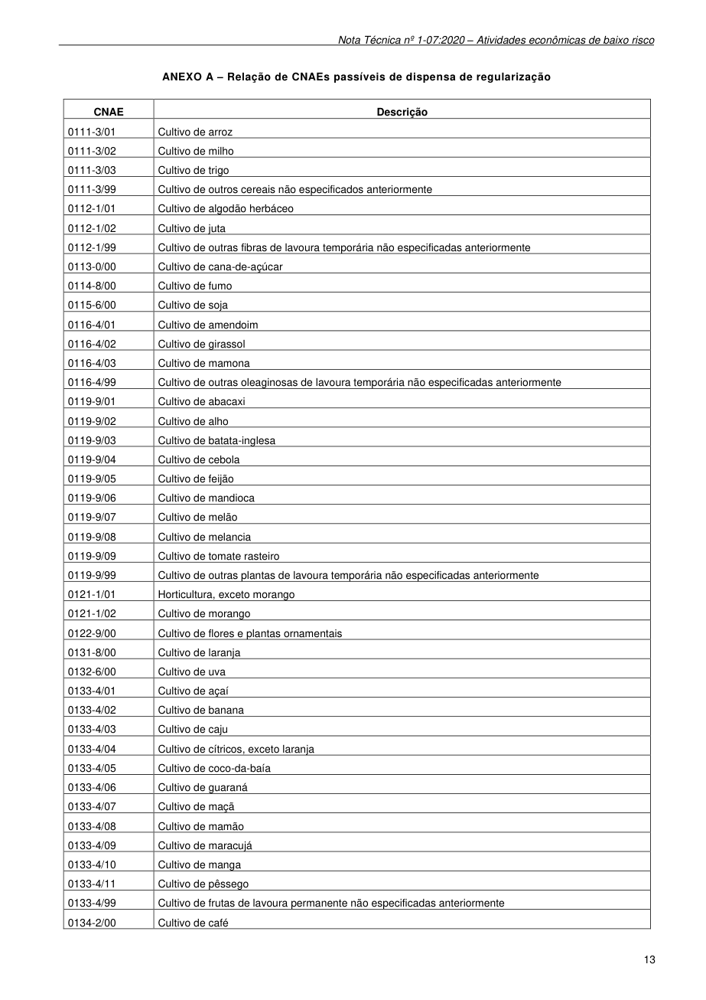

### ANEXO A - Relação de CNAEs passíveis de dispensa de regularização

### Tabelas extraídas

#### Tabela 1 da página

| CNAE | Descrição |
| --- | --- |
| 0111-3/01 | Cultivo de arroz |
| 0111-3/02 | Cultivo de milho |
| 0111-3/03 | Cultivo de trigo |
| 0111-3/99 | Cultivo de outros cereais não especificados anteriormente |
| 0112-1/01 | Cultivo de algodão herbáceo |
| 0112-1/02 | Cultivo de juta |
| 0112-1/99 | Cultivo de outras fibras de lavoura temporária não especificadas anteriormente |
| 0113-0/00 | Cultivo de cana-de-açúcar |
| 0114-8/00 | Cultivo de fumo |
| 0115-6/00 | Cultivo de soja |
| 0116-4/01 | Cultivo de amendoim |
| 0116-4/02 | Cultivo de girassol |
| 0116-4/03 | Cultivo de mamona |
| 0116-4/99 | Cultivo de outras oleaginosas de lavoura temporária não especificadas anteriormente |
| 0119-9/01 | Cultivo de abacaxi |
| 0119-9/02 | Cultivo de alho |
| 0119-9/03 | Cultivo de batata-inglesa |
| 0119-9/04 | Cultivo de cebola |
| 0119-9/05 | Cultivo de feijão |
| 0119-9/06 | Cultivo de mandioca |
| 0119-9/07 | Cultivo de melão |
| 0119-9/08 | Cultivo de melancia |
| 0119-9/09 | Cultivo de tomate rasteiro |
| 0119-9/99 | Cultivo de outras plantas de lavoura temporária não especificadas anteriormente |
| 0121-1/01 | Horticultura, exceto morango |
| 0121-1/02 | Cultivo de morango |
| 0122-9/00 | Cultivo de flores e plantas ornamentais |
| 0131-8/00 | Cultivo de laranja |
| 0132-6/00 | Cultivo de uva |
| 0133-4/01 | Cultivo de açaí |
| 0133-4/02 | Cultivo de banana |
| 0133-4/03 | Cultivo de caju |
| 0133-4/04 | Cultivo de cítricos, exceto laranja |
| 0133-4/05 | Cultivo de coco-da-baía |
| 0133-4/06 | Cultivo de guaraná |
| 0133-4/07 | Cultivo de maçã |
| 0133-4/08 | Cultivo de mamão |
| 0133-4/09 | Cultivo de maracujá |
| 0133-4/10 | Cultivo de manga |
| 0133-4/11 | Cultivo de pêssego |
| 0133-4/99 | Cultivo de frutas de lavoura permanente não especificadas anteriormente |
| 0134-2/00 | Cultivo de café |

---

## Página 14

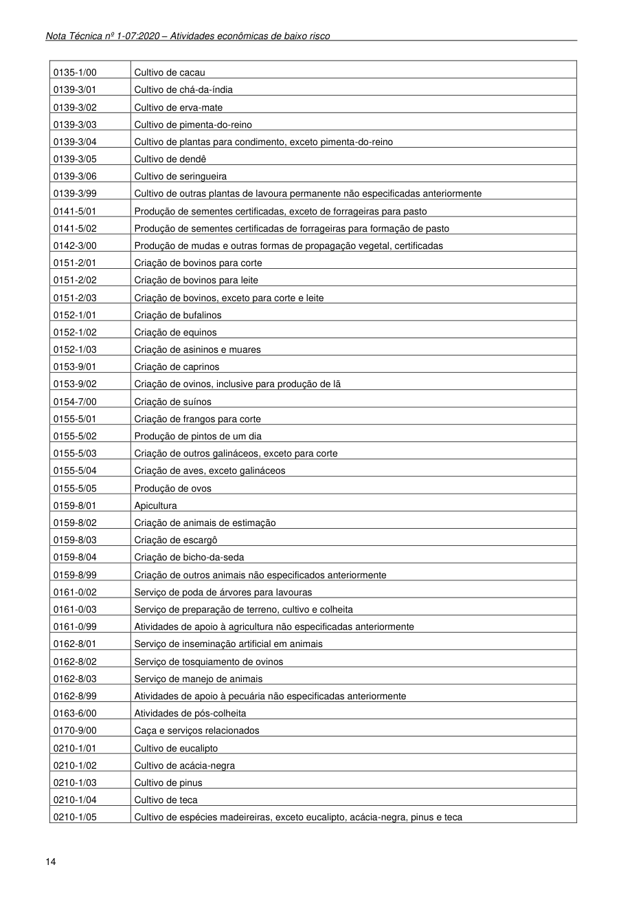

> Página sem texto extraível suficiente; consultar a representação visual ou o PDF oficial.

### Tabelas extraídas

#### Tabela 1 da página

| 0135-1/00 | Cultivo de cacau |
| --- | --- |
| 0139-3/01 | Cultivo de chá-da-índia |
| 0139-3/02 | Cultivo de erva-mate |
| 0139-3/03 | Cultivo de pimenta-do-reino |
| 0139-3/04 | Cultivo de plantas para condimento, exceto pimenta-do-reino |
| 0139-3/05 | Cultivo de dendê |
| 0139-3/06 | Cultivo de seringueira |
| 0139-3/99 | Cultivo de outras plantas de lavoura permanente não especificadas anteriormente |
| 0141-5/01 | Produção de sementes certificadas, exceto de forrageiras para pasto |
| 0141-5/02 | Produção de sementes certificadas de forrageiras para formação de pasto |
| 0142-3/00 | Produção de mudas e outras formas de propagação vegetal, certificadas |
| 0151-2/01 | Criação de bovinos para corte |
| 0151-2/02 | Criação de bovinos para leite |
| 0151-2/03 | Criação de bovinos, exceto para corte e leite |
| 0152-1/01 | Criação de bufalinos |
| 0152-1/02 | Criação de equinos |
| 0152-1/03 | Criação de asininos e muares |
| 0153-9/01 | Criação de caprinos |
| 0153-9/02 | Criação de ovinos, inclusive para produção de lã |
| 0154-7/00 | Criação de suínos |
| 0155-5/01 | Criação de frangos para corte |
| 0155-5/02 | Produção de pintos de um dia |
| 0155-5/03 | Criação de outros galináceos, exceto para corte |
| 0155-5/04 | Criação de aves, exceto galináceos |
| 0155-5/05 | Produção de ovos |
| 0159-8/01 | Apicultura |
| 0159-8/02 | Criação de animais de estimação |
| 0159-8/03 | Criação de escargô |
| 0159-8/04 | Criação de bicho-da-seda |
| 0159-8/99 | Criação de outros animais não especificados anteriormente |
| 0161-0/02 | Serviço de poda de árvores para lavouras |
| 0161-0/03 | Serviço de preparação de terreno, cultivo e colheita |
| 0161-0/99 | Atividades de apoio à agricultura não especificadas anteriormente |
| 0162-8/01 | Serviço de inseminação artificial em animais |
| 0162-8/02 | Serviço de tosquiamento de ovinos |
| 0162-8/03 | Serviço de manejo de animais |
| 0162-8/99 | Atividades de apoio à pecuária não especificadas anteriormente |
| 0163-6/00 | Atividades de pós-colheita |
| 0170-9/00 | Caça e serviços relacionados |
| 0210-1/01 | Cultivo de eucalipto |
| 0210-1/02 | Cultivo de acácia-negra |
| 0210-1/03 | Cultivo de pinus |
| 0210-1/04 | Cultivo de teca |
| 0210-1/05 | Cultivo de espécies madeireiras, exceto eucalipto, acácia-negra, pinus e teca |

---

## Página 15

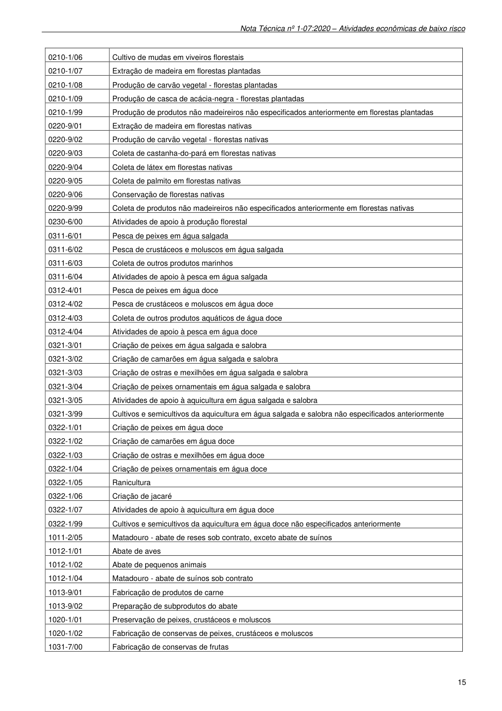

> Página sem texto extraível suficiente; consultar a representação visual ou o PDF oficial.

### Tabelas extraídas

#### Tabela 1 da página

| 0210-1/06 | Cultivo de mudas em viveiros florestais |
| --- | --- |
| 0210-1/07 | Extração de madeira em florestas plantadas |
| 0210-1/08 | Produção de carvão vegetal - florestas plantadas |
| 0210-1/09 | Produção de casca de acácia-negra - florestas plantadas |
| 0210-1/99 | Produção de produtos não madeireiros não especificados anteriormente em florestas plantadas |
| 0220-9/01 | Extração de madeira em florestas nativas |
| 0220-9/02 | Produção de carvão vegetal - florestas nativas |
| 0220-9/03 | Coleta de castanha-do-pará em florestas nativas |
| 0220-9/04 | Coleta de látex em florestas nativas |
| 0220-9/05 | Coleta de palmito em florestas nativas |
| 0220-9/06 | Conservação de florestas nativas |
| 0220-9/99 | Coleta de produtos não madeireiros não especificados anteriormente em florestas nativas |
| 0230-6/00 | Atividades de apoio à produção florestal |
| 0311-6/01 | Pesca de peixes em água salgada |
| 0311-6/02 | Pesca de crustáceos e moluscos em água salgada |
| 0311-6/03 | Coleta de outros produtos marinhos |
| 0311-6/04 | Atividades de apoio à pesca em água salgada |
| 0312-4/01 | Pesca de peixes em água doce |
| 0312-4/02 | Pesca de crustáceos e moluscos em água doce |
| 0312-4/03 | Coleta de outros produtos aquáticos de água doce |
| 0312-4/04 | Atividades de apoio à pesca em água doce |
| 0321-3/01 | Criação de peixes em água salgada e salobra |
| 0321-3/02 | Criação de camarões em água salgada e salobra |
| 0321-3/03 | Criação de ostras e mexilhões em água salgada e salobra |
| 0321-3/04 | Criação de peixes ornamentais em água salgada e salobra |
| 0321-3/05 | Atividades de apoio à aquicultura em água salgada e salobra |
| 0321-3/99 | Cultivos e semicultivos da aquicultura em água salgada e salobra não especificados anteriormente |
| 0322-1/01 | Criação de peixes em água doce |
| 0322-1/02 | Criação de camarões em água doce |
| 0322-1/03 | Criação de ostras e mexilhões em água doce |
| 0322-1/04 | Criação de peixes ornamentais em água doce |
| 0322-1/05 | Ranicultura |
| 0322-1/06 | Criação de jacaré |
| 0322-1/07 | Atividades de apoio à aquicultura em água doce |
| 0322-1/99 | Cultivos e semicultivos da aquicultura em água doce não especificados anteriormente |
| 1011-2/05 | Matadouro - abate de reses sob contrato, exceto abate de suínos |
| 1012-1/01 | Abate de aves |
| 1012-1/02 | Abate de pequenos animais |
| 1012-1/04 | Matadouro - abate de suínos sob contrato |
| 1013-9/01 | Fabricação de produtos de carne |
| 1013-9/02 | Preparação de subprodutos do abate |
| 1020-1/01 | Preservação de peixes, crustáceos e moluscos |
| 1020-1/02 | Fabricação de conservas de peixes, crustáceos e moluscos |
| 1031-7/00 | Fabricação de conservas de frutas |

---

## Página 16

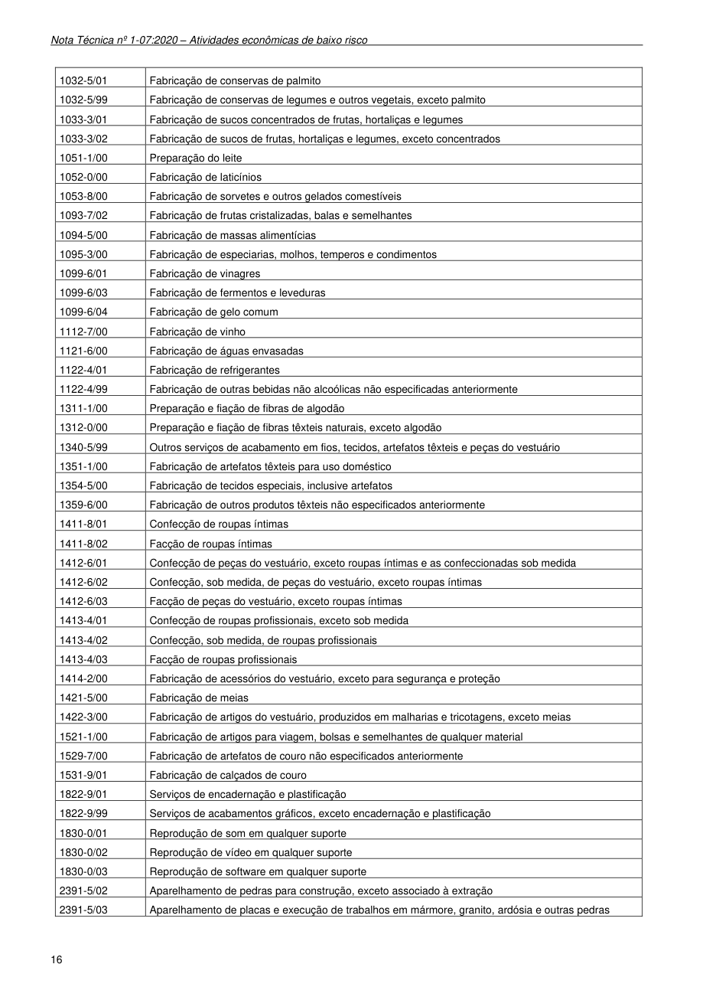

> Página sem texto extraível suficiente; consultar a representação visual ou o PDF oficial.

### Tabelas extraídas

#### Tabela 1 da página

| 1032-5/01 | Fabricação de conservas de palmito |
| --- | --- |
| 1032-5/99 | Fabricação de conservas de legumes e outros vegetais, exceto palmito |
| 1033-3/01 | Fabricação de sucos concentrados de frutas, hortaliças e legumes |
| 1033-3/02 | Fabricação de sucos de frutas, hortaliças e legumes, exceto concentrados |
| 1051-1/00 | Preparação do leite |
| 1052-0/00 | Fabricação de laticínios |
| 1053-8/00 | Fabricação de sorvetes e outros gelados comestíveis |
| 1093-7/02 | Fabricação de frutas cristalizadas, balas e semelhantes |
| 1094-5/00 | Fabricação de massas alimentícias |
| 1095-3/00 | Fabricação de especiarias, molhos, temperos e condimentos |
| 1099-6/01 | Fabricação de vinagres |
| 1099-6/03 | Fabricação de fermentos e leveduras |
| 1099-6/04 | Fabricação de gelo comum |
| 1112-7/00 | Fabricação de vinho |
| 1121-6/00 | Fabricação de águas envasadas |
| 1122-4/01 | Fabricação de refrigerantes |
| 1122-4/99 | Fabricação de outras bebidas não alcoólicas não especificadas anteriormente |
| 1311-1/00 | Preparação e fiação de fibras de algodão |
| 1312-0/00 | Preparação e fiação de fibras têxteis naturais, exceto algodão |
| 1340-5/99 | Outros serviços de acabamento em fios, tecidos, artefatos têxteis e peças do vestuário |
| 1351-1/00 | Fabricação de artefatos têxteis para uso doméstico |
| 1354-5/00 | Fabricação de tecidos especiais, inclusive artefatos |
| 1359-6/00 | Fabricação de outros produtos têxteis não especificados anteriormente |
| 1411-8/01 | Confecção de roupas íntimas |
| 1411-8/02 | Facção de roupas íntimas |
| 1412-6/01 | Confecção de peças do vestuário, exceto roupas íntimas e as confeccionadas sob medida |
| 1412-6/02 | Confecção, sob medida, de peças do vestuário, exceto roupas íntimas |
| 1412-6/03 | Facção de peças do vestuário, exceto roupas íntimas |
| 1413-4/01 | Confecção de roupas profissionais, exceto sob medida |
| 1413-4/02 | Confecção, sob medida, de roupas profissionais |
| 1413-4/03 | Facção de roupas profissionais |
| 1414-2/00 | Fabricação de acessórios do vestuário, exceto para segurança e proteção |
| 1421-5/00 | Fabricação de meias |
| 1422-3/00 | Fabricação de artigos do vestuário, produzidos em malharias e tricotagens, exceto meias |
| 1521-1/00 | Fabricação de artigos para viagem, bolsas e semelhantes de qualquer material |
| 1529-7/00 | Fabricação de artefatos de couro não especificados anteriormente |
| 1531-9/01 | Fabricação de calçados de couro |
| 1822-9/01 | Serviços de encadernação e plastificação |
| 1822-9/99 | Serviços de acabamentos gráficos, exceto encadernação e plastificação |
| 1830-0/01 | Reprodução de som em qualquer suporte |
| 1830-0/02 | Reprodução de vídeo em qualquer suporte |
| 1830-0/03 | Reprodução de software em qualquer suporte |
| 2391-5/02 | Aparelhamento de pedras para construção, exceto associado à extração |
| 2391-5/03 | Aparelhamento de placas e execução de trabalhos em mármore, granito, ardósia e outras pedras |

---

## Página 17

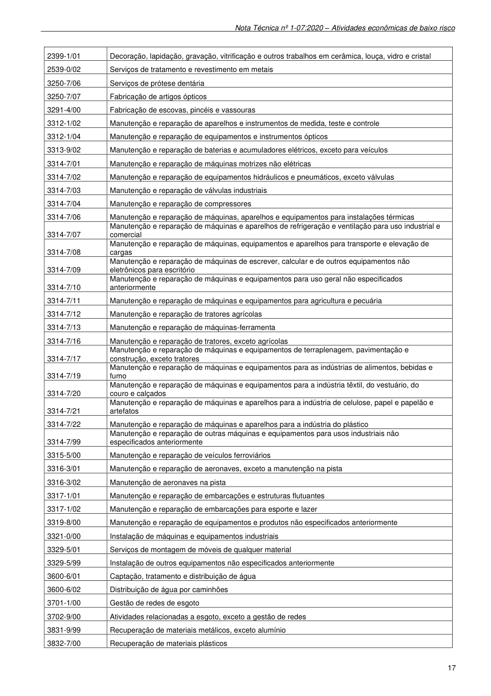

> Página sem texto extraível suficiente; consultar a representação visual ou o PDF oficial.

### Tabelas extraídas

#### Tabela 1 da página

| 2399-1/01 | Decoração, lapidação, gravação, vitrificação e outros trabalhos em cerâmica, louça, vidro e cristal |  |  |
| --- | --- | --- | --- |
| 2539-0/02 | Serviços de tratamento e revestimento em metais |  |  |
| 3250-7/06 | Serviços de prótese dentária |  |  |
| 3250-7/07 | Fabricação de artigos ópticos |  |  |
| 3291-4/00 | Fabricação de escovas, pincéis e vassouras |  |  |
| 3312-1/02 | Manutenção e reparação de aparelhos e instrumentos de medida, teste e controle |  |  |
| 3312-1/04 | Manutenção e reparação de equipamentos e instrumentos ópticos |  |  |
| 3313-9/02 | Manutenção e reparação de baterias e acumuladores elétricos, exceto para veículos |  |  |
| 3314-7/01 | Manutenção e reparação de máquinas motrizes não elétricas |  |  |
| 3314-7/02 | Manutenção e reparação de equipamentos hidráulicos e pneumáticos, exceto válvulas |  |  |
| 3314-7/03 | Manutenção e reparação de válvulas industriais |  |  |
| 3314-7/04 | Manutenção e reparação de compressores |  |  |
| 3314-7/06 | Manutenção e reparação de máquinas, aparelhos e equipamentos para instalações térmicas |  |  |
|  |  | Manutenção e reparação de máquinas, aparelhos e equipamentos para instalações térmicas |  |
| 3314-7/07 |  | Manutenção e reparação de máquinas e aparelhos de refrigeração e ventilação para uso industrial e |  |
|  |  | comercial |  |
| 3314-7/08 |  | Manutenção e reparação de máquinas, equipamentos e aparelhos para transporte e elevação de |  |
|  |  | cargas |  |
| 3314-7/09 |  | Manutenção e reparação de máquinas de escrever, calcular e de outros equipamentos não |  |
|  |  | eletrônicos para escritório |  |
| 3314-7/10 |  | Manutenção e reparação de máquinas e equipamentos para uso geral não especificados |  |
|  |  | anteriormente |  |
| 3314-7/11 | Manutenção e reparação de máquinas e equipamentos para agricultura e pecuária |  |  |
| 3314-7/12 | Manutenção e reparação de tratores agrícolas |  |  |
| 3314-7/13 | Manutenção e reparação de máquinas-ferramenta |  |  |
| 3314-7/16 | Manutenção e reparação de tratores, exceto agrícolas |  |  |
|  |  | Manutenção e reparação de tratores, exceto agrícolas |  |
| 3314-7/17 |  | Manutenção e reparação de máquinas e equipamentos de terraplenagem, pavimentação e |  |
|  |  | construção, exceto tratores |  |
| 3314-7/19 |  | Manutenção e reparação de máquinas e equipamentos para as indústrias de alimentos, bebidas e |  |
|  |  | fumo |  |
| 3314-7/20 |  | Manutenção e reparação de máquinas e equipamentos para a indústria têxtil, do vestuário, do |  |
|  |  | couro e calçados |  |
| 3314-7/21 |  | Manutenção e reparação de máquinas e aparelhos para a indústria de celulose, papel e papelão e |  |
|  |  | artefatos |  |
| 3314-7/22 | Manutenção e reparação de máquinas e aparelhos para a indústria do plástico |  |  |
|  |  | Manutenção e reparação de máquinas e aparelhos para a indústria do plástico |  |
| 3314-7/99 |  | Manutenção e reparação de outras máquinas e equipamentos para usos industriais não |  |
|  |  | especificados anteriormente |  |
| 3315-5/00 | Manutenção e reparação de veículos ferroviários |  |  |
| 3316-3/01 | Manutenção e reparação de aeronaves, exceto a manutenção na pista |  |  |
| 3316-3/02 | Manutenção de aeronaves na pista |  |  |
| 3317-1/01 | Manutenção e reparação de embarcações e estruturas flutuantes |  |  |
| 3317-1/02 | Manutenção e reparação de embarcações para esporte e lazer |  |  |
| 3319-8/00 | Manutenção e reparação de equipamentos e produtos não especificados anteriormente |  |  |
| 3321-0/00 | Instalação de máquinas e equipamentos industriais |  |  |
| 3329-5/01 | Serviços de montagem de móveis de qualquer material |  |  |
| 3329-5/99 | Instalação de outros equipamentos não especificados anteriormente |  |  |
| 3600-6/01 | Captação, tratamento e distribuição de água |  |  |
| 3600-6/02 | Distribuição de água por caminhões |  |  |
| 3701-1/00 | Gestão de redes de esgoto |  |  |
| 3702-9/00 | Atividades relacionadas a esgoto, exceto a gestão de redes |  |  |
| 3831-9/99 | Recuperação de materiais metálicos, exceto alumínio |  |  |
| 3832-7/00 | Recuperação de materiais plásticos |  |  |

---

## Página 18

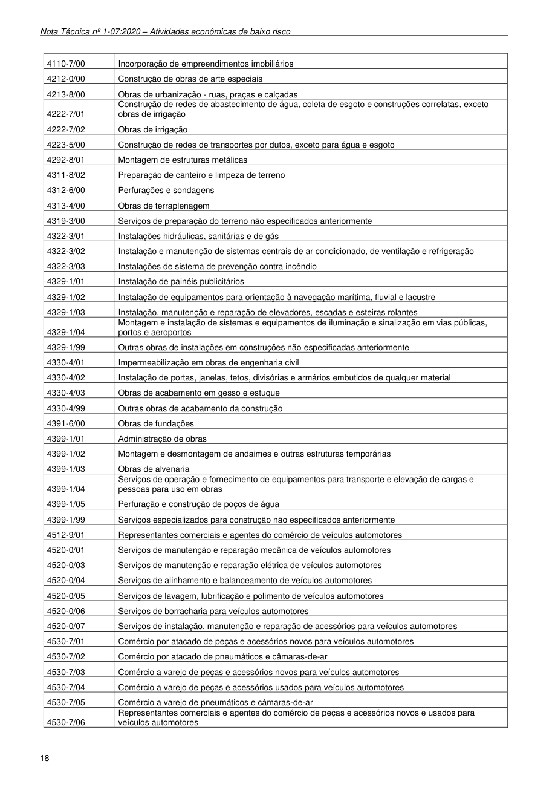

> Página sem texto extraível suficiente; consultar a representação visual ou o PDF oficial.

### Tabelas extraídas

#### Tabela 1 da página

| 4110-7/00 | Incorporação de empreendimentos imobiliários |  |  |
| --- | --- | --- | --- |
| 4212-0/00 | Construção de obras de arte especiais |  |  |
| 4213-8/00 | Obras de urbanização - ruas, praças e calçadas |  |  |
|  |  | Obras de urbanização - ruas, praças e calçadas |  |
| 4222-7/01 |  | Construção de redes de abastecimento de água, coleta de esgoto e construções correlatas, exceto |  |
|  |  | obras de irrigação |  |
| 4222-7/02 | Obras de irrigação |  |  |
| 4223-5/00 | Construção de redes de transportes por dutos, exceto para água e esgoto |  |  |
| 4292-8/01 | Montagem de estruturas metálicas |  |  |
| 4311-8/02 | Preparação de canteiro e limpeza de terreno |  |  |
| 4312-6/00 | Perfurações e sondagens |  |  |
| 4313-4/00 | Obras de terraplenagem |  |  |
| 4319-3/00 | Serviços de preparação do terreno não especificados anteriormente |  |  |
| 4322-3/01 | Instalações hidráulicas, sanitárias e de gás |  |  |
| 4322-3/02 | Instalação e manutenção de sistemas centrais de ar condicionado, de ventilação e refrigeração |  |  |
| 4322-3/03 | Instalações de sistema de prevenção contra incêndio |  |  |
| 4329-1/01 | Instalação de painéis publicitários |  |  |
| 4329-1/02 | Instalação de equipamentos para orientação à navegação marítima, fluvial e lacustre |  |  |
| 4329-1/03 | Instalação, manutenção e reparação de elevadores, escadas e esteiras rolantes |  |  |
|  |  | Instalação, manutenção e reparação de elevadores, escadas e esteiras rolantes |  |
| 4329-1/04 |  | Montagem e instalação de sistemas e equipamentos de iluminação e sinalização em vias públicas, |  |
|  |  | portos e aeroportos |  |
| 4329-1/99 | Outras obras de instalações em construções não especificadas anteriormente |  |  |
| 4330-4/01 | Impermeabilização em obras de engenharia civil |  |  |
| 4330-4/02 | Instalação de portas, janelas, tetos, divisórias e armários embutidos de qualquer material |  |  |
| 4330-4/03 | Obras de acabamento em gesso e estuque |  |  |
| 4330-4/99 | Outras obras de acabamento da construção |  |  |
| 4391-6/00 | Obras de fundações |  |  |
| 4399-1/01 | Administração de obras |  |  |
| 4399-1/02 | Montagem e desmontagem de andaimes e outras estruturas temporárias |  |  |
| 4399-1/03 | Obras de alvenaria |  |  |
|  |  | Obras de alvenaria |  |
| 4399-1/04 |  | Serviços de operação e fornecimento de equipamentos para transporte e elevação de cargas e |  |
|  |  | pessoas para uso em obras |  |
| 4399-1/05 | Perfuração e construção de poços de água |  |  |
| 4399-1/99 | Serviços especializados para construção não especificados anteriormente |  |  |
| 4512-9/01 | Representantes comerciais e agentes do comércio de veículos automotores |  |  |
| 4520-0/01 | Serviços de manutenção e reparação mecânica de veículos automotores |  |  |
| 4520-0/03 | Serviços de manutenção e reparação elétrica de veículos automotores |  |  |
| 4520-0/04 | Serviços de alinhamento e balanceamento de veículos automotores |  |  |
| 4520-0/05 | Serviços de lavagem, lubrificação e polimento de veículos automotores |  |  |
| 4520-0/06 | Serviços de borracharia para veículos automotores |  |  |
| 4520-0/07 | Serviços de instalação, manutenção e reparação de acessórios para veículos automotores |  |  |
| 4530-7/01 | Comércio por atacado de peças e acessórios novos para veículos automotores |  |  |
| 4530-7/02 | Comércio por atacado de pneumáticos e câmaras-de-ar |  |  |
| 4530-7/03 | Comércio a varejo de peças e acessórios novos para veículos automotores |  |  |
| 4530-7/04 | Comércio a varejo de peças e acessórios usados para veículos automotores |  |  |
| 4530-7/05 | Comércio a varejo de pneumáticos e câmaras-de-ar |  |  |
|  |  | Comércio a varejo de pneumáticos e câmaras-de-ar |  |
| 4530-7/06 |  | Representantes comerciais e agentes do comércio de peças e acessórios novos e usados para |  |
|  |  | veículos automotores |  |

---

## Página 19

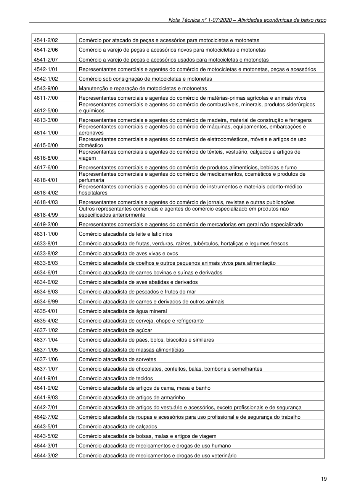

> Página sem texto extraível suficiente; consultar a representação visual ou o PDF oficial.

### Tabelas extraídas

#### Tabela 1 da página

| 4541-2/02 | Comércio por atacado de peças e acessórios para motocicletas e motonetas |  |  |
| --- | --- | --- | --- |
| 4541-2/06 | Comércio a varejo de peças e acessórios novos para motocicletas e motonetas |  |  |
| 4541-2/07 | Comércio a varejo de peças e acessórios usados para motocicletas e motonetas |  |  |
| 4542-1/01 | Representantes comerciais e agentes do comércio de motocicletas e motonetas, peças e acessórios |  |  |
| 4542-1/02 | Comércio sob consignação de motocicletas e motonetas |  |  |
| 4543-9/00 | Manutenção e reparação de motocicletas e motonetas |  |  |
| 4611-7/00 | Representantes comerciais e agentes do comércio de matérias-primas agrícolas e animais vivos |  |  |
|  |  | Representantes comerciais e agentes do comércio de matérias-primas agrícolas e animais vivos |  |
| 4612-5/00 |  | Representantes comerciais e agentes do comércio de combustíveis, minerais, produtos siderúrgicos |  |
|  |  | e químicos |  |
| 4613-3/00 | Representantes comerciais e agentes do comércio de madeira, material de construção e ferragens |  |  |
|  |  | Representantes comerciais e agentes do comércio de madeira, material de construção e ferragens |  |
| 4614-1/00 |  | Representantes comerciais e agentes do comércio de máquinas, equipamentos, embarcações e |  |
|  |  | aeronaves |  |
| 4615-0/00 |  | Representantes comerciais e agentes do comércio de eletrodomésticos, móveis e artigos de uso |  |
|  |  | doméstico |  |
| 4616-8/00 |  | Representantes comerciais e agentes do comércio de têxteis, vestuário, calçados e artigos de |  |
|  |  | viagem |  |
| 4617-6/00 | Representantes comerciais e agentes do comércio de produtos alimentícios, bebidas e fumo |  |  |
|  |  | Representantes comerciais e agentes do comércio de produtos alimentícios, bebidas e fumo |  |
| 4618-4/01 |  | Representantes comerciais e agentes do comércio de medicamentos, cosméticos e produtos de |  |
|  |  | perfumaria |  |
| 4618-4/02 |  | Representantes comerciais e agentes do comércio de instrumentos e materiais odonto-médico |  |
|  |  | hospitalares |  |
| 4618-4/03 | Representantes comerciais e agentes do comércio de jornais, revistas e outras publicações |  |  |
|  |  | Representantes comerciais e agentes do comércio de jornais, revistas e outras publicações |  |
| 4618-4/99 |  | Outros representantes comerciais e agentes do comércio especializado em produtos não |  |
|  |  | especificados anteriormente |  |
| 4619-2/00 | Representantes comerciais e agentes do comércio de mercadorias em geral não especializado |  |  |
| 4631-1/00 | Comércio atacadista de leite e laticínios |  |  |
| 4633-8/01 | Comércio atacadista de frutas, verduras, raízes, tubérculos, hortaliças e legumes frescos |  |  |
| 4633-8/02 | Comércio atacadista de aves vivas e ovos |  |  |
| 4633-8/03 | Comércio atacadista de coelhos e outros pequenos animais vivos para alimentação |  |  |
| 4634-6/01 | Comércio atacadista de carnes bovinas e suínas e derivados |  |  |
| 4634-6/02 | Comércio atacadista de aves abatidas e derivados |  |  |
| 4634-6/03 | Comércio atacadista de pescados e frutos do mar |  |  |
| 4634-6/99 | Comércio atacadista de carnes e derivados de outros animais |  |  |
| 4635-4/01 | Comércio atacadista de água mineral |  |  |
| 4635-4/02 | Comércio atacadista de cerveja, chope e refrigerante |  |  |
| 4637-1/02 | Comércio atacadista de açúcar |  |  |
| 4637-1/04 | Comércio atacadista de pães, bolos, biscoitos e similares |  |  |
| 4637-1/05 | Comércio atacadista de massas alimentícias |  |  |
| 4637-1/06 | Comércio atacadista de sorvetes |  |  |
| 4637-1/07 | Comércio atacadista de chocolates, confeitos, balas, bombons e semelhantes |  |  |
| 4641-9/01 | Comércio atacadista de tecidos |  |  |
| 4641-9/02 | Comércio atacadista de artigos de cama, mesa e banho |  |  |
| 4641-9/03 | Comércio atacadista de artigos de armarinho |  |  |
| 4642-7/01 | Comércio atacadista de artigos do vestuário e acessórios, exceto profissionais e de segurança |  |  |
| 4642-7/02 | Comércio atacadista de roupas e acessórios para uso profissional e de segurança do trabalho |  |  |
| 4643-5/01 | Comércio atacadista de calçados |  |  |
| 4643-5/02 | Comércio atacadista de bolsas, malas e artigos de viagem |  |  |
| 4644-3/01 | Comércio atacadista de medicamentos e drogas de uso humano |  |  |
| 4644-3/02 | Comércio atacadista de medicamentos e drogas de uso veterinário |  |  |

---

## Página 20

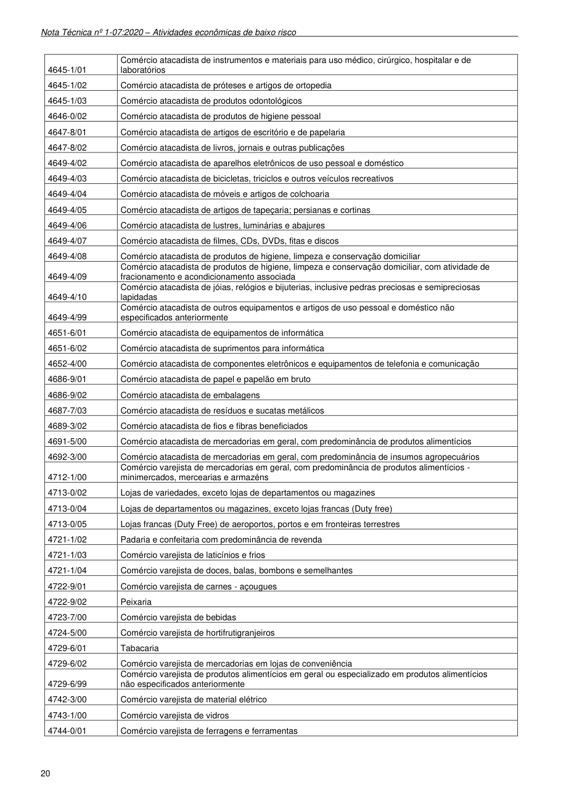

> Página sem texto extraível suficiente; consultar a representação visual ou o PDF oficial.

### Tabelas extraídas

#### Tabela 1 da página

| 4645-1/01 |  | Comércio atacadista de instrumentos e materiais para uso médico, cirúrgico, hospitalar e de |  |
| --- | --- | --- | --- |
|  |  | laboratórios |  |
| 4645-1/02 | Comércio atacadista de próteses e artigos de ortopedia |  |  |
| 4645-1/03 | Comércio atacadista de produtos odontológicos |  |  |
| 4646-0/02 | Comércio atacadista de produtos de higiene pessoal |  |  |
| 4647-8/01 | Comércio atacadista de artigos de escritório e de papelaria |  |  |
| 4647-8/02 | Comércio atacadista de livros, jornais e outras publicações |  |  |
| 4649-4/02 | Comércio atacadista de aparelhos eletrônicos de uso pessoal e doméstico |  |  |
| 4649-4/03 | Comércio atacadista de bicicletas, triciclos e outros veículos recreativos |  |  |
| 4649-4/04 | Comércio atacadista de móveis e artigos de colchoaria |  |  |
| 4649-4/05 | Comércio atacadista de artigos de tapeçaria; persianas e cortinas |  |  |
| 4649-4/06 | Comércio atacadista de lustres, luminárias e abajures |  |  |
| 4649-4/07 | Comércio atacadista de filmes, CDs, DVDs, fitas e discos |  |  |
| 4649-4/08 | Comércio atacadista de produtos de higiene, limpeza e conservação domiciliar |  |  |
|  |  | Comércio atacadista de produtos de higiene, limpeza e conservação domiciliar |  |
| 4649-4/09 |  | Comércio atacadista de produtos de higiene, limpeza e conservação domiciliar, com atividade de |  |
|  |  | fracionamento e acondicionamento associada |  |
| 4649-4/10 |  | Comércio atacadista de jóias, relógios e bijuterias, inclusive pedras preciosas e semipreciosas |  |
|  |  | lapidadas |  |
| 4649-4/99 |  | Comércio atacadista de outros equipamentos e artigos de uso pessoal e doméstico não |  |
|  |  | especificados anteriormente |  |
| 4651-6/01 | Comércio atacadista de equipamentos de informática |  |  |
| 4651-6/02 | Comércio atacadista de suprimentos para informática |  |  |
| 4652-4/00 | Comércio atacadista de componentes eletrônicos e equipamentos de telefonia e comunicação |  |  |
| 4686-9/01 | Comércio atacadista de papel e papelão em bruto |  |  |
| 4686-9/02 | Comércio atacadista de embalagens |  |  |
| 4687-7/03 | Comércio atacadista de resíduos e sucatas metálicos |  |  |
| 4689-3/02 | Comércio atacadista de fios e fibras beneficiados |  |  |
| 4691-5/00 | Comércio atacadista de mercadorias em geral, com predominância de produtos alimentícios |  |  |
| 4692-3/00 | Comércio atacadista de mercadorias em geral, com predominância de insumos agropecuários |  |  |
|  |  | Comércio atacadista de mercadorias em geral, com predominância de insumos agropecuários |  |
| 4712-1/00 |  | Comércio varejista de mercadorias em geral, com predominância de produtos alimentícios - |  |
|  |  | minimercados, mercearias e armazéns |  |
| 4713-0/02 | Lojas de variedades, exceto lojas de departamentos ou magazines |  |  |
| 4713-0/04 | Lojas de departamentos ou magazines, exceto lojas francas (Duty free) |  |  |
| 4713-0/05 | Lojas francas (Duty Free) de aeroportos, portos e em fronteiras terrestres |  |  |
| 4721-1/02 | Padaria e confeitaria com predominância de revenda |  |  |
| 4721-1/03 | Comércio varejista de laticínios e frios |  |  |
| 4721-1/04 | Comércio varejista de doces, balas, bombons e semelhantes |  |  |
| 4722-9/01 | Comércio varejista de carnes - açougues |  |  |
| 4722-9/02 | Peixaria |  |  |
| 4723-7/00 | Comércio varejista de bebidas |  |  |
| 4724-5/00 | Comércio varejista de hortifrutigranjeiros |  |  |
| 4729-6/01 | Tabacaria |  |  |
| 4729-6/02 | Comércio varejista de mercadorias em lojas de conveniência |  |  |
|  |  | Comércio varejista de mercadorias em lojas de conveniência |  |
| 4729-6/99 |  | Comércio varejista de produtos alimentícios em geral ou especializado em produtos alimentícios |  |
|  |  | não especificados anteriormente |  |
| 4742-3/00 | Comércio varejista de material elétrico |  |  |
| 4743-1/00 | Comércio varejista de vidros |  |  |
| 4744-0/01 | Comércio varejista de ferragens e ferramentas |  |  |

---

## Página 21

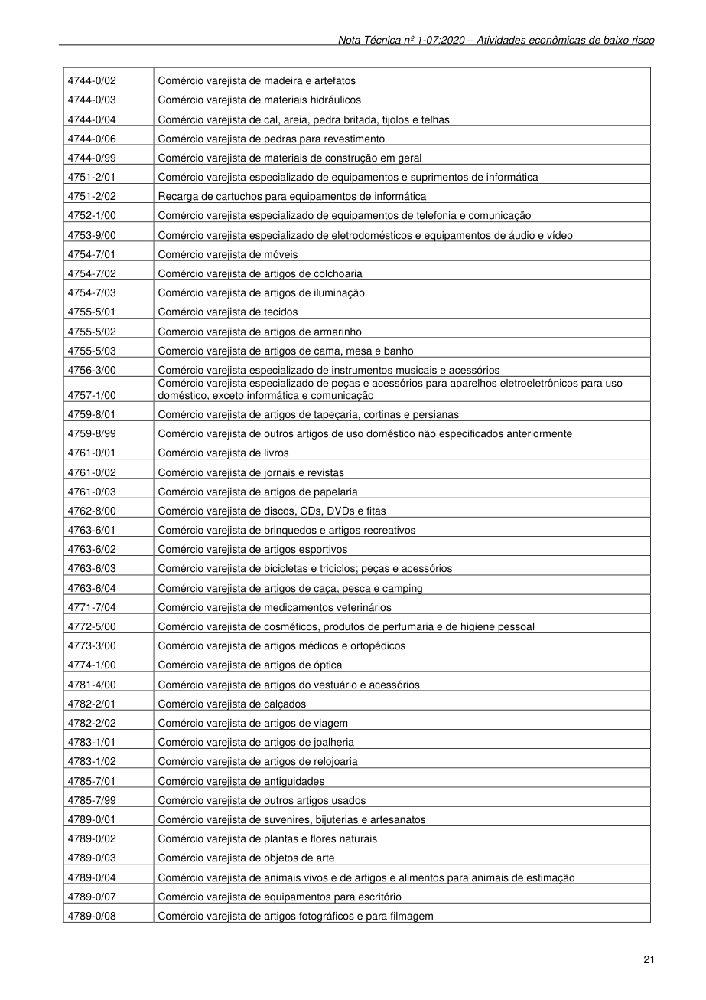

> Página sem texto extraível suficiente; consultar a representação visual ou o PDF oficial.

### Tabelas extraídas

#### Tabela 1 da página

| 4744-0/02 | Comércio varejista de madeira e artefatos |  |  |
| --- | --- | --- | --- |
| 4744-0/03 | Comércio varejista de materiais hidráulicos |  |  |
| 4744-0/04 | Comércio varejista de cal, areia, pedra britada, tijolos e telhas |  |  |
| 4744-0/06 | Comércio varejista de pedras para revestimento |  |  |
| 4744-0/99 | Comércio varejista de materiais de construção em geral |  |  |
| 4751-2/01 | Comércio varejista especializado de equipamentos e suprimentos de informática |  |  |
| 4751-2/02 | Recarga de cartuchos para equipamentos de informática |  |  |
| 4752-1/00 | Comércio varejista especializado de equipamentos de telefonia e comunicação |  |  |
| 4753-9/00 | Comércio varejista especializado de eletrodomésticos e equipamentos de áudio e vídeo |  |  |
| 4754-7/01 | Comércio varejista de móveis |  |  |
| 4754-7/02 | Comércio varejista de artigos de colchoaria |  |  |
| 4754-7/03 | Comércio varejista de artigos de iluminação |  |  |
| 4755-5/01 | Comércio varejista de tecidos |  |  |
| 4755-5/02 | Comercio varejista de artigos de armarinho |  |  |
| 4755-5/03 | Comercio varejista de artigos de cama, mesa e banho |  |  |
| 4756-3/00 | Comércio varejista especializado de instrumentos musicais e acessórios |  |  |
|  |  | Comércio varejista especializado de instrumentos musicais e acessórios |  |
| 4757-1/00 |  | Comércio varejista especializado de peças e acessórios para aparelhos eletroeletrônicos para uso |  |
|  |  | doméstico, exceto informática e comunicação |  |
| 4759-8/01 | Comércio varejista de artigos de tapeçaria, cortinas e persianas |  |  |
| 4759-8/99 | Comércio varejista de outros artigos de uso doméstico não especificados anteriormente |  |  |
| 4761-0/01 | Comércio varejista de livros |  |  |
| 4761-0/02 | Comércio varejista de jornais e revistas |  |  |
| 4761-0/03 | Comércio varejista de artigos de papelaria |  |  |
| 4762-8/00 | Comércio varejista de discos, CDs, DVDs e fitas |  |  |
| 4763-6/01 | Comércio varejista de brinquedos e artigos recreativos |  |  |
| 4763-6/02 | Comércio varejista de artigos esportivos |  |  |
| 4763-6/03 | Comércio varejista de bicicletas e triciclos; peças e acessórios |  |  |
| 4763-6/04 | Comércio varejista de artigos de caça, pesca e camping |  |  |
| 4771-7/04 | Comércio varejista de medicamentos veterinários |  |  |
| 4772-5/00 | Comércio varejista de cosméticos, produtos de perfumaria e de higiene pessoal |  |  |
| 4773-3/00 | Comércio varejista de artigos médicos e ortopédicos |  |  |
| 4774-1/00 | Comércio varejista de artigos de óptica |  |  |
| 4781-4/00 | Comércio varejista de artigos do vestuário e acessórios |  |  |
| 4782-2/01 | Comércio varejista de calçados |  |  |
| 4782-2/02 | Comércio varejista de artigos de viagem |  |  |
| 4783-1/01 | Comércio varejista de artigos de joalheria |  |  |
| 4783-1/02 | Comércio varejista de artigos de relojoaria |  |  |
| 4785-7/01 | Comércio varejista de antiguidades |  |  |
| 4785-7/99 | Comércio varejista de outros artigos usados |  |  |
| 4789-0/01 | Comércio varejista de suvenires, bijuterias e artesanatos |  |  |
| 4789-0/02 | Comércio varejista de plantas e flores naturais |  |  |
| 4789-0/03 | Comércio varejista de objetos de arte |  |  |
| 4789-0/04 | Comércio varejista de animais vivos e de artigos e alimentos para animais de estimação |  |  |
| 4789-0/07 | Comércio varejista de equipamentos para escritório |  |  |
| 4789-0/08 | Comércio varejista de artigos fotográficos e para filmagem |  |  |

---

## Página 22

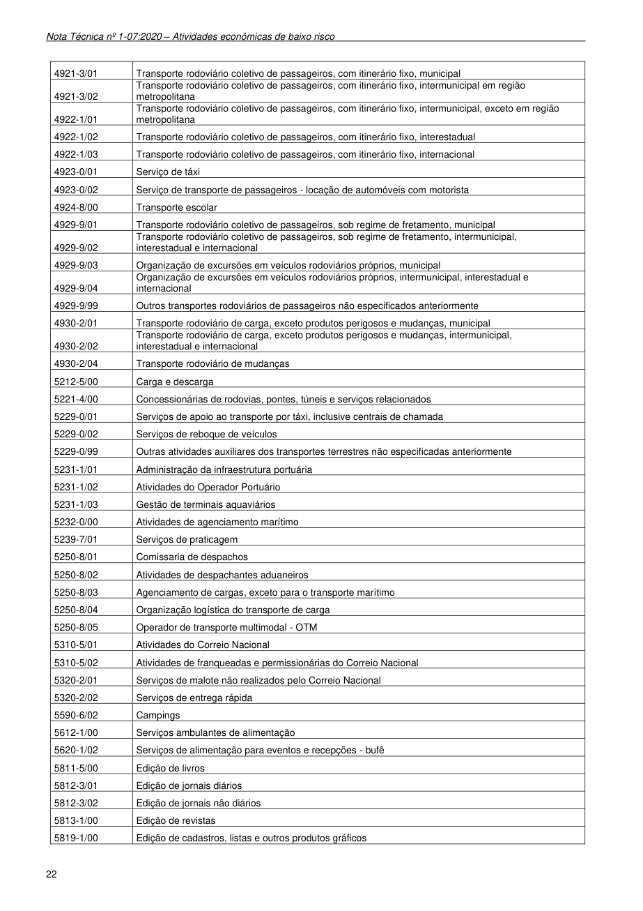

> Página sem texto extraível suficiente; consultar a representação visual ou o PDF oficial.

### Tabelas extraídas

#### Tabela 1 da página

| 4921-3/01 | Transporte rodoviário coletivo de passageiros, com itinerário fixo, municipal |  |  |
| --- | --- | --- | --- |
|  |  | Transporte rodoviário coletivo de passageiros, com itinerário fixo, municipal |  |
| 4921-3/02 |  | Transporte rodoviário coletivo de passageiros, com itinerário fixo, intermunicipal em região |  |
|  |  | metropolitana |  |
| 4922-1/01 |  | Transporte rodoviário coletivo de passageiros, com itinerário fixo, intermunicipal, exceto em região |  |
|  |  | metropolitana |  |
| 4922-1/02 | Transporte rodoviário coletivo de passageiros, com itinerário fixo, interestadual |  |  |
| 4922-1/03 | Transporte rodoviário coletivo de passageiros, com itinerário fixo, internacional |  |  |
| 4923-0/01 | Serviço de táxi |  |  |
| 4923-0/02 | Serviço de transporte de passageiros - locação de automóveis com motorista |  |  |
| 4924-8/00 | Transporte escolar |  |  |
| 4929-9/01 | Transporte rodoviário coletivo de passageiros, sob regime de fretamento, municipal |  |  |
|  |  | Transporte rodoviário coletivo de passageiros, sob regime de fretamento, municipal |  |
| 4929-9/02 |  | Transporte rodoviário coletivo de passageiros, sob regime de fretamento, intermunicipal, |  |
|  |  | interestadual e internacional |  |
| 4929-9/03 | Organização de excursões em veículos rodoviários próprios, municipal |  |  |
|  |  | Organização de excursões em veículos rodoviários próprios, municipal |  |
| 4929-9/04 |  | Organização de excursões em veículos rodoviários próprios, intermunicipal, interestadual e |  |
|  |  | internacional |  |
| 4929-9/99 | Outros transportes rodoviários de passageiros não especificados anteriormente |  |  |
| 4930-2/01 | Transporte rodoviário de carga, exceto produtos perigosos e mudanças, municipal |  |  |
|  |  | Transporte rodoviário de carga, exceto produtos perigosos e mudanças, municipal |  |
| 4930-2/02 |  | Transporte rodoviário de carga, exceto produtos perigosos e mudanças, intermunicipal, |  |
|  |  | interestadual e internacional |  |
| 4930-2/04 | Transporte rodoviário de mudanças |  |  |
| 5212-5/00 | Carga e descarga |  |  |
| 5221-4/00 | Concessionárias de rodovias, pontes, túneis e serviços relacionados |  |  |
| 5229-0/01 | Serviços de apoio ao transporte por táxi, inclusive centrais de chamada |  |  |
| 5229-0/02 | Serviços de reboque de veículos |  |  |
| 5229-0/99 | Outras atividades auxiliares dos transportes terrestres não especificadas anteriormente |  |  |
| 5231-1/01 | Administração da infraestrutura portuária |  |  |
| 5231-1/02 | Atividades do Operador Portuário |  |  |
| 5231-1/03 | Gestão de terminais aquaviários |  |  |
| 5232-0/00 | Atividades de agenciamento marítimo |  |  |
| 5239-7/01 | Serviços de praticagem |  |  |
| 5250-8/01 | Comissaria de despachos |  |  |
| 5250-8/02 | Atividades de despachantes aduaneiros |  |  |
| 5250-8/03 | Agenciamento de cargas, exceto para o transporte marítimo |  |  |
| 5250-8/04 | Organização logística do transporte de carga |  |  |
| 5250-8/05 | Operador de transporte multimodal - OTM |  |  |
| 5310-5/01 | Atividades do Correio Nacional |  |  |
| 5310-5/02 | Atividades de franqueadas e permissionárias do Correio Nacional |  |  |
| 5320-2/01 | Serviços de malote não realizados pelo Correio Nacional |  |  |
| 5320-2/02 | Serviços de entrega rápida |  |  |
| 5590-6/02 | Campings |  |  |
| 5612-1/00 | Serviços ambulantes de alimentação |  |  |
| 5620-1/02 | Serviços de alimentação para eventos e recepções - bufê |  |  |
| 5811-5/00 | Edição de livros |  |  |
| 5812-3/01 | Edição de jornais diários |  |  |
| 5812-3/02 | Edição de jornais não diários |  |  |
| 5813-1/00 | Edição de revistas |  |  |
| 5819-1/00 | Edição de cadastros, listas e outros produtos gráficos |  |  |

---

## Página 23

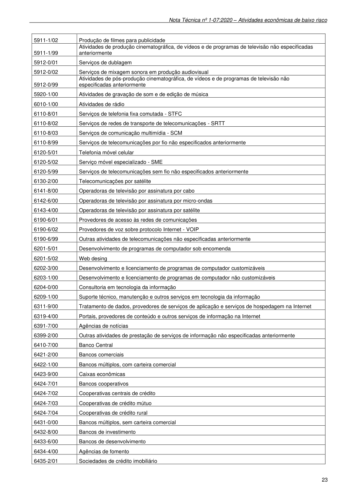

> Página sem texto extraível suficiente; consultar a representação visual ou o PDF oficial.

### Tabelas extraídas

#### Tabela 1 da página

| 5911-1/02 | Produção de filmes para publicidade |  |  |
| --- | --- | --- | --- |
|  |  | Produção de filmes para publicidade |  |
| 5911-1/99 |  | Atividades de produção cinematográfica, de vídeos e de programas de televisão não especificadas |  |
|  |  | anteriormente |  |
| 5912-0/01 | Serviços de dublagem |  |  |
| 5912-0/02 | Serviços de mixagem sonora em produção audiovisual |  |  |
|  |  | Serviços de mixagem sonora em produção audiovisual |  |
| 5912-0/99 |  | Atividades de pós-produção cinematográfica, de vídeos e de programas de televisão não |  |
|  |  | especificadas anteriormente |  |
| 5920-1/00 | Atividades de gravação de som e de edição de música |  |  |
| 6010-1/00 | Atividades de rádio |  |  |
| 6110-8/01 | Serviços de telefonia fixa comutada - STFC |  |  |
| 6110-8/02 | Serviços de redes de transporte de telecomunicações - SRTT |  |  |
| 6110-8/03 | Serviços de comunicação multimídia - SCM |  |  |
| 6110-8/99 | Serviços de telecomunicações por fio não especificados anteriormente |  |  |
| 6120-5/01 | Telefonia móvel celular |  |  |
| 6120-5/02 | Serviço móvel especializado - SME |  |  |
| 6120-5/99 | Serviços de telecomunicações sem fio não especificados anteriormente |  |  |
| 6130-2/00 | Telecomunicações por satélite |  |  |
| 6141-8/00 | Operadoras de televisão por assinatura por cabo |  |  |
| 6142-6/00 | Operadoras de televisão por assinatura por micro-ondas |  |  |
| 6143-4/00 | Operadoras de televisão por assinatura por satélite |  |  |
| 6190-6/01 | Provedores de acesso às redes de comunicações |  |  |
| 6190-6/02 | Provedores de voz sobre protocolo Internet - VOIP |  |  |
| 6190-6/99 | Outras atividades de telecomunicações não especificadas anteriormente |  |  |
| 6201-5/01 | Desenvolvimento de programas de computador sob encomenda |  |  |
| 6201-5/02 | Web desing |  |  |
| 6202-3/00 | Desenvolvimento e licenciamento de programas de computador customizáveis |  |  |
| 6203-1/00 | Desenvolvimento e licenciamento de programas de computador não customizáveis |  |  |
| 6204-0/00 | Consultoria em tecnologia da informação |  |  |
| 6209-1/00 | Suporte técnico, manutenção e outros serviços em tecnologia da informação |  |  |
| 6311-9/00 | Tratamento de dados, provedores de serviços de aplicação e serviços de hospedagem na Internet |  |  |
| 6319-4/00 | Portais, provedores de conteúdo e outros serviços de informação na Internet |  |  |
| 6391-7/00 | Agências de notícias |  |  |
| 6399-2/00 | Outras atividades de prestação de serviços de informação não especificadas anteriormente |  |  |
| 6410-7/00 | Banco Central |  |  |
| 6421-2/00 | Bancos comerciais |  |  |
| 6422-1/00 | Bancos múltiplos, com carteira comercial |  |  |
| 6423-9/00 | Caixas econômicas |  |  |
| 6424-7/01 | Bancos cooperativos |  |  |
| 6424-7/02 | Cooperativas centrais de crédito |  |  |
| 6424-7/03 | Cooperativas de crédito mútuo |  |  |
| 6424-7/04 | Cooperativas de crédito rural |  |  |
| 6431-0/00 | Bancos múltiplos, sem carteira comercial |  |  |
| 6432-8/00 | Bancos de investimento |  |  |
| 6433-6/00 | Bancos de desenvolvimento |  |  |
| 6434-4/00 | Agências de fomento |  |  |
| 6435-2/01 | Sociedades de crédito imobiliário |  |  |

---

## Página 24

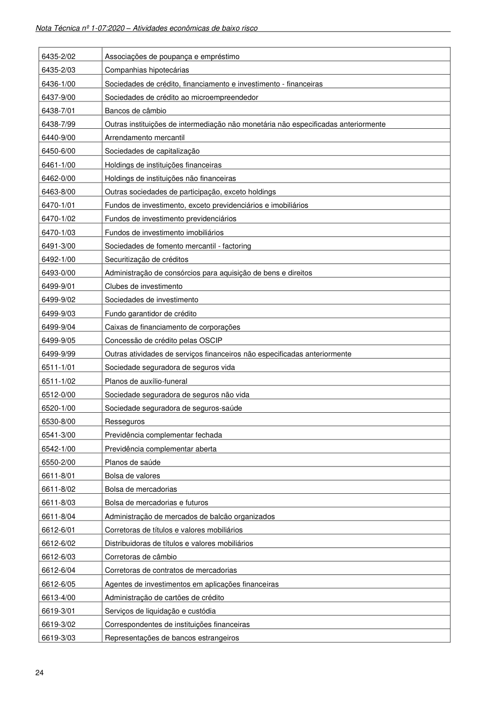

> Página sem texto extraível suficiente; consultar a representação visual ou o PDF oficial.

### Tabelas extraídas

#### Tabela 1 da página

| 6435-2/02 | Associações de poupança e empréstimo |
| --- | --- |
| 6435-2/03 | Companhias hipotecárias |
| 6436-1/00 | Sociedades de crédito, financiamento e investimento - financeiras |
| 6437-9/00 | Sociedades de crédito ao microempreendedor |
| 6438-7/01 | Bancos de câmbio |
| 6438-7/99 | Outras instituições de intermediação não monetária não especificadas anteriormente |
| 6440-9/00 | Arrendamento mercantil |
| 6450-6/00 | Sociedades de capitalização |
| 6461-1/00 | Holdings de instituições financeiras |
| 6462-0/00 | Holdings de instituições não financeiras |
| 6463-8/00 | Outras sociedades de participação, exceto holdings |
| 6470-1/01 | Fundos de investimento, exceto previdenciários e imobiliários |
| 6470-1/02 | Fundos de investimento previdenciários |
| 6470-1/03 | Fundos de investimento imobiliários |
| 6491-3/00 | Sociedades de fomento mercantil - factoring |
| 6492-1/00 | Securitização de créditos |
| 6493-0/00 | Administração de consórcios para aquisição de bens e direitos |
| 6499-9/01 | Clubes de investimento |
| 6499-9/02 | Sociedades de investimento |
| 6499-9/03 | Fundo garantidor de crédito |
| 6499-9/04 | Caixas de financiamento de corporações |
| 6499-9/05 | Concessão de crédito pelas OSCIP |
| 6499-9/99 | Outras atividades de serviços financeiros não especificadas anteriormente |
| 6511-1/01 | Sociedade seguradora de seguros vida |
| 6511-1/02 | Planos de auxílio-funeral |
| 6512-0/00 | Sociedade seguradora de seguros não vida |
| 6520-1/00 | Sociedade seguradora de seguros-saúde |
| 6530-8/00 | Resseguros |
| 6541-3/00 | Previdência complementar fechada |
| 6542-1/00 | Previdência complementar aberta |
| 6550-2/00 | Planos de saúde |
| 6611-8/01 | Bolsa de valores |
| 6611-8/02 | Bolsa de mercadorias |
| 6611-8/03 | Bolsa de mercadorias e futuros |
| 6611-8/04 | Administração de mercados de balcão organizados |
| 6612-6/01 | Corretoras de títulos e valores mobiliários |
| 6612-6/02 | Distribuidoras de títulos e valores mobiliários |
| 6612-6/03 | Corretoras de câmbio |
| 6612-6/04 | Corretoras de contratos de mercadorias |
| 6612-6/05 | Agentes de investimentos em aplicações financeiras |
| 6613-4/00 | Administração de cartões de crédito |
| 6619-3/01 | Serviços de liquidação e custódia |
| 6619-3/02 | Correspondentes de instituições financeiras |
| 6619-3/03 | Representações de bancos estrangeiros |

---

## Página 25

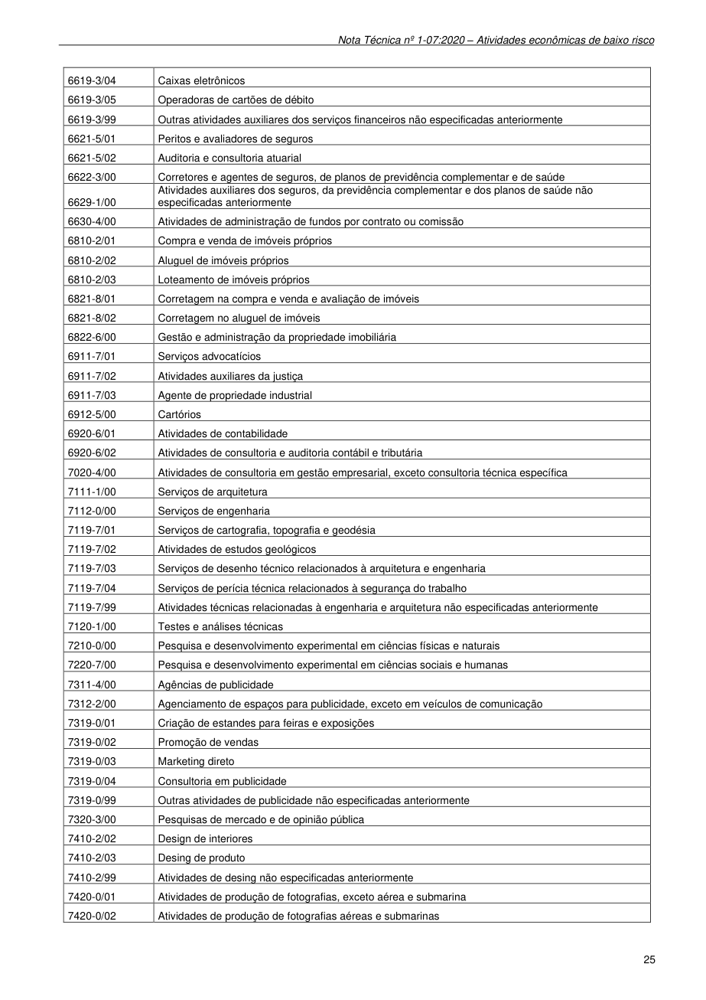

> Página sem texto extraível suficiente; consultar a representação visual ou o PDF oficial.

### Tabelas extraídas

#### Tabela 1 da página

| 6619-3/04 | Caixas eletrônicos |  |  |
| --- | --- | --- | --- |
| 6619-3/05 | Operadoras de cartões de débito |  |  |
| 6619-3/99 | Outras atividades auxiliares dos serviços financeiros não especificadas anteriormente |  |  |
| 6621-5/01 | Peritos e avaliadores de seguros |  |  |
| 6621-5/02 | Auditoria e consultoria atuarial |  |  |
| 6622-3/00 | Corretores e agentes de seguros, de planos de previdência complementar e de saúde |  |  |
|  |  | Corretores e agentes de seguros, de planos de previdência complementar e de saúde |  |
| 6629-1/00 |  | Atividades auxiliares dos seguros, da previdência complementar e dos planos de saúde não |  |
|  |  | especificadas anteriormente |  |
| 6630-4/00 | Atividades de administração de fundos por contrato ou comissão |  |  |
| 6810-2/01 | Compra e venda de imóveis próprios |  |  |
| 6810-2/02 | Aluguel de imóveis próprios |  |  |
| 6810-2/03 | Loteamento de imóveis próprios |  |  |
| 6821-8/01 | Corretagem na compra e venda e avaliação de imóveis |  |  |
| 6821-8/02 | Corretagem no aluguel de imóveis |  |  |
| 6822-6/00 | Gestão e administração da propriedade imobiliária |  |  |
| 6911-7/01 | Serviços advocatícios |  |  |
| 6911-7/02 | Atividades auxiliares da justiça |  |  |
| 6911-7/03 | Agente de propriedade industrial |  |  |
| 6912-5/00 | Cartórios |  |  |
| 6920-6/01 | Atividades de contabilidade |  |  |
| 6920-6/02 | Atividades de consultoria e auditoria contábil e tributária |  |  |
| 7020-4/00 | Atividades de consultoria em gestão empresarial, exceto consultoria técnica específica |  |  |
| 7111-1/00 | Serviços de arquitetura |  |  |
| 7112-0/00 | Serviços de engenharia |  |  |
| 7119-7/01 | Serviços de cartografia, topografia e geodésia |  |  |
| 7119-7/02 | Atividades de estudos geológicos |  |  |
| 7119-7/03 | Serviços de desenho técnico relacionados à arquitetura e engenharia |  |  |
| 7119-7/04 | Serviços de perícia técnica relacionados à segurança do trabalho |  |  |
| 7119-7/99 | Atividades técnicas relacionadas à engenharia e arquitetura não especificadas anteriormente |  |  |
| 7120-1/00 | Testes e análises técnicas |  |  |
| 7210-0/00 | Pesquisa e desenvolvimento experimental em ciências físicas e naturais |  |  |
| 7220-7/00 | Pesquisa e desenvolvimento experimental em ciências sociais e humanas |  |  |
| 7311-4/00 | Agências de publicidade |  |  |
| 7312-2/00 | Agenciamento de espaços para publicidade, exceto em veículos de comunicação |  |  |
| 7319-0/01 | Criação de estandes para feiras e exposições |  |  |
| 7319-0/02 | Promoção de vendas |  |  |
| 7319-0/03 | Marketing direto |  |  |
| 7319-0/04 | Consultoria em publicidade |  |  |
| 7319-0/99 | Outras atividades de publicidade não especificadas anteriormente |  |  |
| 7320-3/00 | Pesquisas de mercado e de opinião pública |  |  |
| 7410-2/02 | Design de interiores |  |  |
| 7410-2/03 | Desing de produto |  |  |
| 7410-2/99 | Atividades de desing não especificadas anteriormente |  |  |
| 7420-0/01 | Atividades de produção de fotografias, exceto aérea e submarina |  |  |
| 7420-0/02 | Atividades de produção de fotografias aéreas e submarinas |  |  |

---

## Página 26

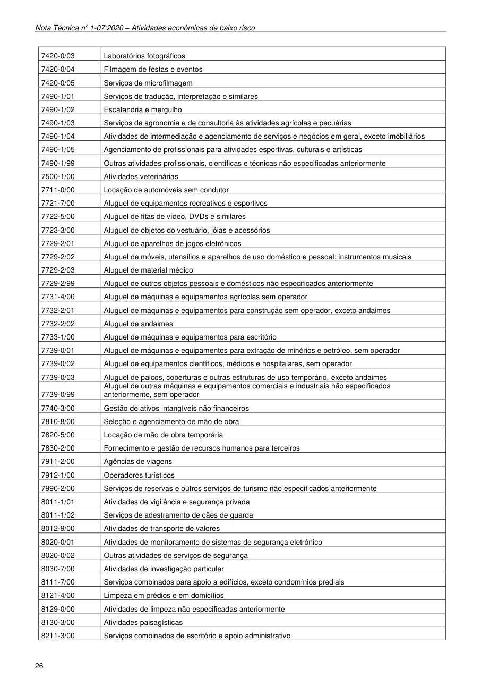

> Página sem texto extraível suficiente; consultar a representação visual ou o PDF oficial.

### Tabelas extraídas

#### Tabela 1 da página

| 7420-0/03 | Laboratórios fotográficos |  |  |
| --- | --- | --- | --- |
| 7420-0/04 | Filmagem de festas e eventos |  |  |
| 7420-0/05 | Serviços de microfilmagem |  |  |
| 7490-1/01 | Serviços de tradução, interpretação e similares |  |  |
| 7490-1/02 | Escafandria e mergulho |  |  |
| 7490-1/03 | Serviços de agronomia e de consultoria às atividades agrícolas e pecuárias |  |  |
| 7490-1/04 | Atividades de intermediação e agenciamento de serviços e negócios em geral, exceto imobiliários |  |  |
| 7490-1/05 | Agenciamento de profissionais para atividades esportivas, culturais e artísticas |  |  |
| 7490-1/99 | Outras atividades profissionais, científicas e técnicas não especificadas anteriormente |  |  |
| 7500-1/00 | Atividades veterinárias |  |  |
| 7711-0/00 | Locação de automóveis sem condutor |  |  |
| 7721-7/00 | Aluguel de equipamentos recreativos e esportivos |  |  |
| 7722-5/00 | Aluguel de fitas de vídeo, DVDs e similares |  |  |
| 7723-3/00 | Aluguel de objetos do vestuário, jóias e acessórios |  |  |
| 7729-2/01 | Aluguel de aparelhos de jogos eletrônicos |  |  |
| 7729-2/02 | Aluguel de móveis, utensílios e aparelhos de uso doméstico e pessoal; instrumentos musicais |  |  |
| 7729-2/03 | Aluguel de material médico |  |  |
| 7729-2/99 | Aluguel de outros objetos pessoais e domésticos não especificados anteriormente |  |  |
| 7731-4/00 | Aluguel de máquinas e equipamentos agrícolas sem operador |  |  |
| 7732-2/01 | Aluguel de máquinas e equipamentos para construção sem operador, exceto andaimes |  |  |
| 7732-2/02 | Aluguel de andaimes |  |  |
| 7733-1/00 | Aluguel de máquinas e equipamentos para escritório |  |  |
| 7739-0/01 | Aluguel de máquinas e equipamentos para extração de minérios e petróleo, sem operador |  |  |
| 7739-0/02 | Aluguel de equipamentos científicos, médicos e hospitalares, sem operador |  |  |
| 7739-0/03 | Aluguel de palcos, coberturas e outras estruturas de uso temporário, exceto andaimes |  |  |
|  |  | Aluguel de palcos, coberturas e outras estruturas de uso temporário, exceto andaimes |  |
| 7739-0/99 |  | Aluguel de outras máquinas e equipamentos comerciais e industriais não especificados |  |
|  |  | anteriormente, sem operador |  |
| 7740-3/00 | Gestão de ativos intangíveis não financeiros |  |  |
| 7810-8/00 | Seleção e agenciamento de mão de obra |  |  |
| 7820-5/00 | Locação de mão de obra temporária |  |  |
| 7830-2/00 | Fornecimento e gestão de recursos humanos para terceiros |  |  |
| 7911-2/00 | Agências de viagens |  |  |
| 7912-1/00 | Operadores turísticos |  |  |
| 7990-2/00 | Serviços de reservas e outros serviços de turismo não especificados anteriormente |  |  |
| 8011-1/01 | Atividades de vigilância e segurança privada |  |  |
| 8011-1/02 | Serviços de adestramento de cães de guarda |  |  |
| 8012-9/00 | Atividades de transporte de valores |  |  |
| 8020-0/01 | Atividades de monitoramento de sistemas de segurança eletrônico |  |  |
| 8020-0/02 | Outras atividades de serviços de segurança |  |  |
| 8030-7/00 | Atividades de investigação particular |  |  |
| 8111-7/00 | Serviços combinados para apoio a edifícios, exceto condomínios prediais |  |  |
| 8121-4/00 | Limpeza em prédios e em domicílios |  |  |
| 8129-0/00 | Atividades de limpeza não especificadas anteriormente |  |  |
| 8130-3/00 | Atividades paisagísticas |  |  |
| 8211-3/00 | Serviços combinados de escritório e apoio administrativo |  |  |

---

## Página 27

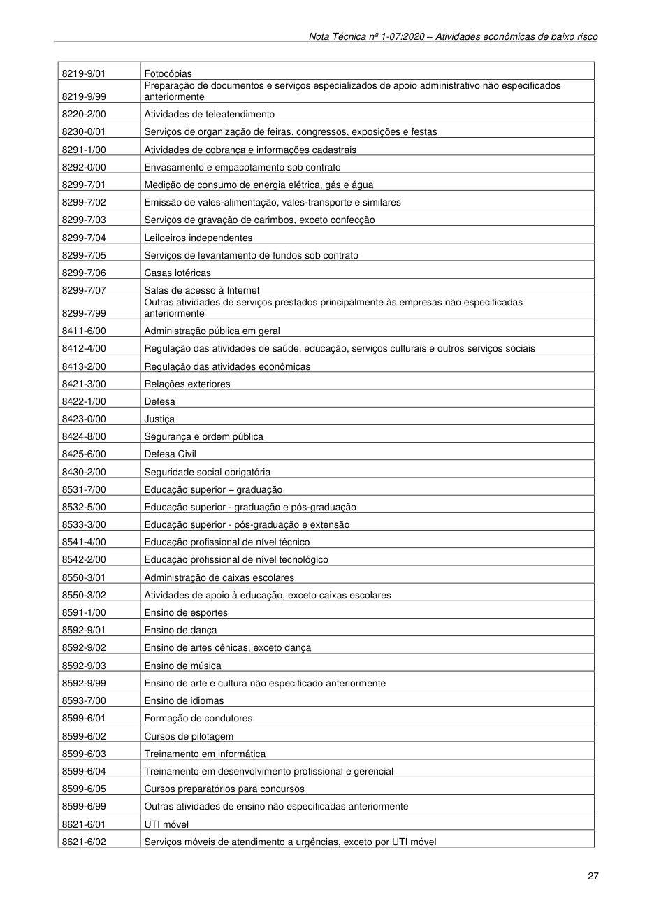

> Página sem texto extraível suficiente; consultar a representação visual ou o PDF oficial.

### Tabelas extraídas

#### Tabela 1 da página

| 8219-9/01 | Fotocópias |  |  |
| --- | --- | --- | --- |
|  |  | Fotocópias |  |
| 8219-9/99 |  | Preparação de documentos e serviços especializados de apoio administrativo não especificados |  |
|  |  | anteriormente |  |
| 8220-2/00 | Atividades de teleatendimento |  |  |
| 8230-0/01 | Serviços de organização de feiras, congressos, exposições e festas |  |  |
| 8291-1/00 | Atividades de cobrança e informações cadastrais |  |  |
| 8292-0/00 | Envasamento e empacotamento sob contrato |  |  |
| 8299-7/01 | Medição de consumo de energia elétrica, gás e água |  |  |
| 8299-7/02 | Emissão de vales-alimentação, vales-transporte e similares |  |  |
| 8299-7/03 | Serviços de gravação de carimbos, exceto confecção |  |  |
| 8299-7/04 | Leiloeiros independentes |  |  |
| 8299-7/05 | Serviços de levantamento de fundos sob contrato |  |  |
| 8299-7/06 | Casas lotéricas |  |  |
| 8299-7/07 | Salas de acesso à Internet |  |  |
|  |  | Salas de acesso à Internet |  |
| 8299-7/99 |  | Outras atividades de serviços prestados principalmente às empresas não especificadas |  |
|  |  | anteriormente |  |
| 8411-6/00 | Administração pública em geral |  |  |
| 8412-4/00 | Regulação das atividades de saúde, educação, serviços culturais e outros serviços sociais |  |  |
| 8413-2/00 | Regulação das atividades econômicas |  |  |
| 8421-3/00 | Relações exteriores |  |  |
| 8422-1/00 | Defesa |  |  |
| 8423-0/00 | Justiça |  |  |
| 8424-8/00 | Segurança e ordem pública |  |  |
| 8425-6/00 | Defesa Civil |  |  |
| 8430-2/00 | Seguridade social obrigatória |  |  |
| 8531-7/00 | Educação superior - graduação |  |  |
| 8532-5/00 | Educação superior - graduação e pós-graduação |  |  |
| 8533-3/00 | Educação superior - pós-graduação e extensão |  |  |
| 8541-4/00 | Educação profissional de nível técnico |  |  |
| 8542-2/00 | Educação profissional de nível tecnológico |  |  |
| 8550-3/01 | Administração de caixas escolares |  |  |
| 8550-3/02 | Atividades de apoio à educação, exceto caixas escolares |  |  |
| 8591-1/00 | Ensino de esportes |  |  |
| 8592-9/01 | Ensino de dança |  |  |
| 8592-9/02 | Ensino de artes cênicas, exceto dança |  |  |
| 8592-9/03 | Ensino de música |  |  |
| 8592-9/99 | Ensino de arte e cultura não especificado anteriormente |  |  |
| 8593-7/00 | Ensino de idiomas |  |  |
| 8599-6/01 | Formação de condutores |  |  |
| 8599-6/02 | Cursos de pilotagem |  |  |
| 8599-6/03 | Treinamento em informática |  |  |
| 8599-6/04 | Treinamento em desenvolvimento profissional e gerencial |  |  |
| 8599-6/05 | Cursos preparatórios para concursos |  |  |
| 8599-6/99 | Outras atividades de ensino não especificadas anteriormente |  |  |
| 8621-6/01 | UTI móvel |  |  |
| 8621-6/02 | Serviços móveis de atendimento a urgências, exceto por UTI móvel |  |  |

---

## Página 28

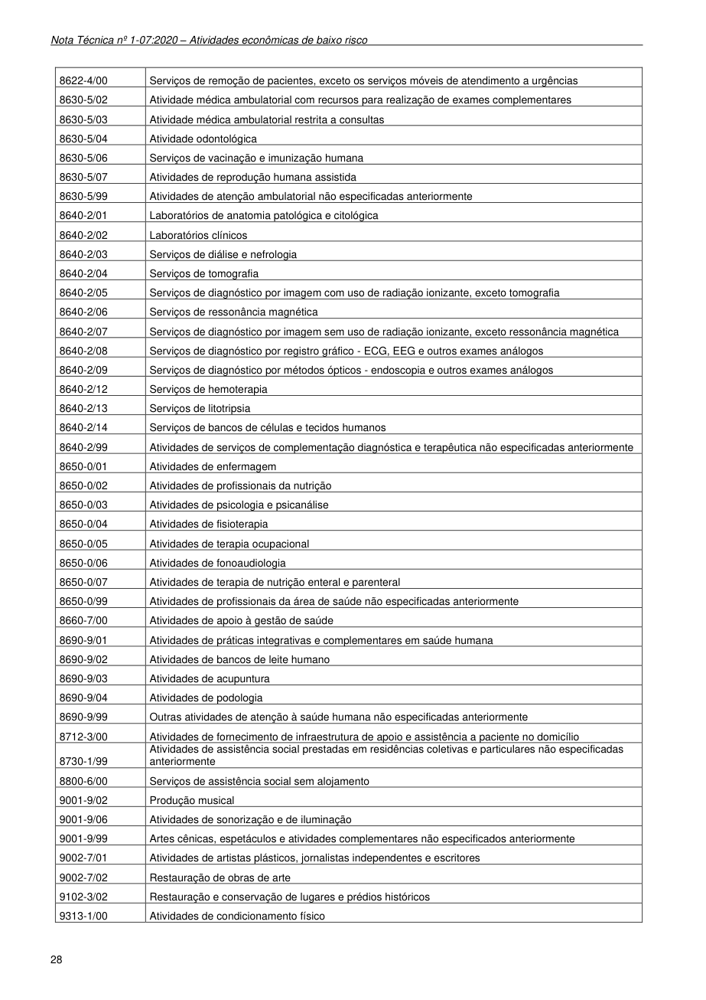

> Página sem texto extraível suficiente; consultar a representação visual ou o PDF oficial.

### Tabelas extraídas

#### Tabela 1 da página

| 8622-4/00 | Serviços de remoção de pacientes, exceto os serviços móveis de atendimento a urgências |  |  |
| --- | --- | --- | --- |
| 8630-5/02 | Atividade médica ambulatorial com recursos para realização de exames complementares |  |  |
| 8630-5/03 | Atividade médica ambulatorial restrita a consultas |  |  |
| 8630-5/04 | Atividade odontológica |  |  |
| 8630-5/06 | Serviços de vacinação e imunização humana |  |  |
| 8630-5/07 | Atividades de reprodução humana assistida |  |  |
| 8630-5/99 | Atividades de atenção ambulatorial não especificadas anteriormente |  |  |
| 8640-2/01 | Laboratórios de anatomia patológica e citológica |  |  |
| 8640-2/02 | Laboratórios clínicos |  |  |
| 8640-2/03 | Serviços de diálise e nefrologia |  |  |
| 8640-2/04 | Serviços de tomografia |  |  |
| 8640-2/05 | Serviços de diagnóstico por imagem com uso de radiação ionizante, exceto tomografia |  |  |
| 8640-2/06 | Serviços de ressonância magnética |  |  |
| 8640-2/07 | Serviços de diagnóstico por imagem sem uso de radiação ionizante, exceto ressonância magnética |  |  |
| 8640-2/08 | Serviços de diagnóstico por registro gráfico - ECG, EEG e outros exames análogos |  |  |
| 8640-2/09 | Serviços de diagnóstico por métodos ópticos - endoscopia e outros exames análogos |  |  |
| 8640-2/12 | Serviços de hemoterapia |  |  |
| 8640-2/13 | Serviços de litotripsia |  |  |
| 8640-2/14 | Serviços de bancos de células e tecidos humanos |  |  |
| 8640-2/99 | Atividades de serviços de complementação diagnóstica e terapêutica não especificadas anteriormente |  |  |
| 8650-0/01 | Atividades de enfermagem |  |  |
| 8650-0/02 | Atividades de profissionais da nutrição |  |  |
| 8650-0/03 | Atividades de psicologia e psicanálise |  |  |
| 8650-0/04 | Atividades de fisioterapia |  |  |
| 8650-0/05 | Atividades de terapia ocupacional |  |  |
| 8650-0/06 | Atividades de fonoaudiologia |  |  |
| 8650-0/07 | Atividades de terapia de nutrição enteral e parenteral |  |  |
| 8650-0/99 | Atividades de profissionais da área de saúde não especificadas anteriormente |  |  |
| 8660-7/00 | Atividades de apoio à gestão de saúde |  |  |
| 8690-9/01 | Atividades de práticas integrativas e complementares em saúde humana |  |  |
| 8690-9/02 | Atividades de bancos de leite humano |  |  |
| 8690-9/03 | Atividades de acupuntura |  |  |
| 8690-9/04 | Atividades de podologia |  |  |
| 8690-9/99 | Outras atividades de atenção à saúde humana não especificadas anteriormente |  |  |
| 8712-3/00 | Atividades de fornecimento de infraestrutura de apoio e assistência a paciente no domicílio |  |  |
|  |  | Atividades de fornecimento de infraestrutura de apoio e assistência a paciente no domicílio |  |
| 8730-1/99 |  | Atividades de assistência social prestadas em residências coletivas e particulares não especificadas |  |
|  |  | anteriormente |  |
| 8800-6/00 | Serviços de assistência social sem alojamento |  |  |
| 9001-9/02 | Produção musical |  |  |
| 9001-9/06 | Atividades de sonorização e de iluminação |  |  |
| 9001-9/99 | Artes cênicas, espetáculos e atividades complementares não especificados anteriormente |  |  |
| 9002-7/01 | Atividades de artistas plásticos, jornalistas independentes e escritores |  |  |
| 9002-7/02 | Restauração de obras de arte |  |  |
| 9102-3/02 | Restauração e conservação de lugares e prédios históricos |  |  |
| 9313-1/00 | Atividades de condicionamento físico |  |  |

---

## Página 29

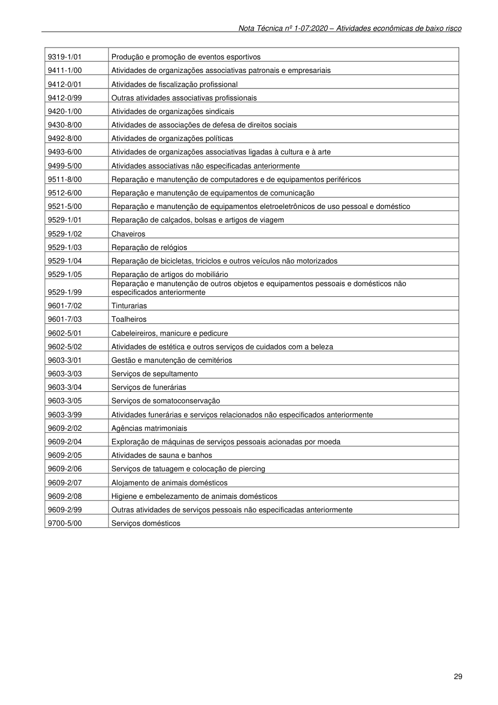

> Página sem texto extraível suficiente; consultar a representação visual ou o PDF oficial.

### Tabelas extraídas

#### Tabela 1 da página

| 9319-1/01 | Produção e promoção de eventos esportivos |  |  |
| --- | --- | --- | --- |
| 9411-1/00 | Atividades de organizações associativas patronais e empresariais |  |  |
| 9412-0/01 | Atividades de fiscalização profissional |  |  |
| 9412-0/99 | Outras atividades associativas profissionais |  |  |
| 9420-1/00 | Atividades de organizações sindicais |  |  |
| 9430-8/00 | Atividades de associações de defesa de direitos sociais |  |  |
| 9492-8/00 | Atividades de organizações políticas |  |  |
| 9493-6/00 | Atividades de organizações associativas ligadas à cultura e à arte |  |  |
| 9499-5/00 | Atividades associativas não especificadas anteriormente |  |  |
| 9511-8/00 | Reparação e manutenção de computadores e de equipamentos periféricos |  |  |
| 9512-6/00 | Reparação e manutenção de equipamentos de comunicação |  |  |
| 9521-5/00 | Reparação e manutenção de equipamentos eletroeletrônicos de uso pessoal e doméstico |  |  |
| 9529-1/01 | Reparação de calçados, bolsas e artigos de viagem |  |  |
| 9529-1/02 | Chaveiros |  |  |
| 9529-1/03 | Reparação de relógios |  |  |
| 9529-1/04 | Reparação de bicicletas, triciclos e outros veículos não motorizados |  |  |
| 9529-1/05 | Reparação de artigos do mobiliário |  |  |
|  |  | Reparação de artigos do mobiliário |  |
| 9529-1/99 |  | Reparação e manutenção de outros objetos e equipamentos pessoais e domésticos não |  |
|  |  | especificados anteriormente |  |
| 9601-7/02 | Tinturarias |  |  |
| 9601-7/03 | Toalheiros |  |  |
| 9602-5/01 | Cabeleireiros, manicure e pedicure |  |  |
| 9602-5/02 | Atividades de estética e outros serviços de cuidados com a beleza |  |  |
| 9603-3/01 | Gestão e manutenção de cemitérios |  |  |
| 9603-3/03 | Serviços de sepultamento |  |  |
| 9603-3/04 | Serviços de funerárias |  |  |
| 9603-3/05 | Serviços de somatoconservação |  |  |
| 9603-3/99 | Atividades funerárias e serviços relacionados não especificados anteriormente |  |  |
| 9609-2/02 | Agências matrimoniais |  |  |
| 9609-2/04 | Exploração de máquinas de serviços pessoais acionadas por moeda |  |  |
| 9609-2/05 | Atividades de sauna e banhos |  |  |
| 9609-2/06 | Serviços de tatuagem e colocação de piercing |  |  |
| 9609-2/07 | Alojamento de animais domésticos |  |  |
| 9609-2/08 | Higiene e embelezamento de animais domésticos |  |  |
| 9609-2/99 | Outras atividades de serviços pessoais não especificadas anteriormente |  |  |
| 9700-5/00 | Serviços domésticos |  |  |
