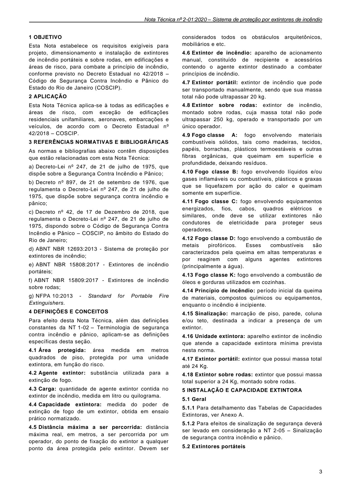
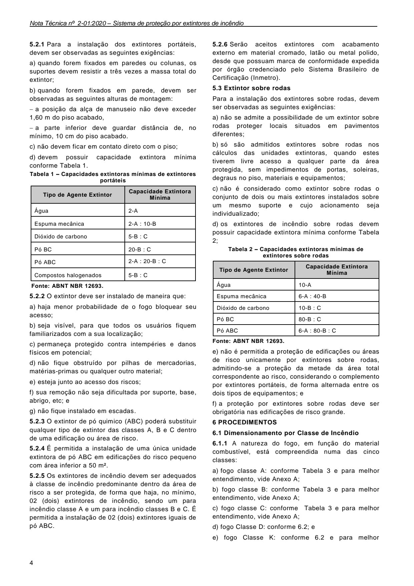
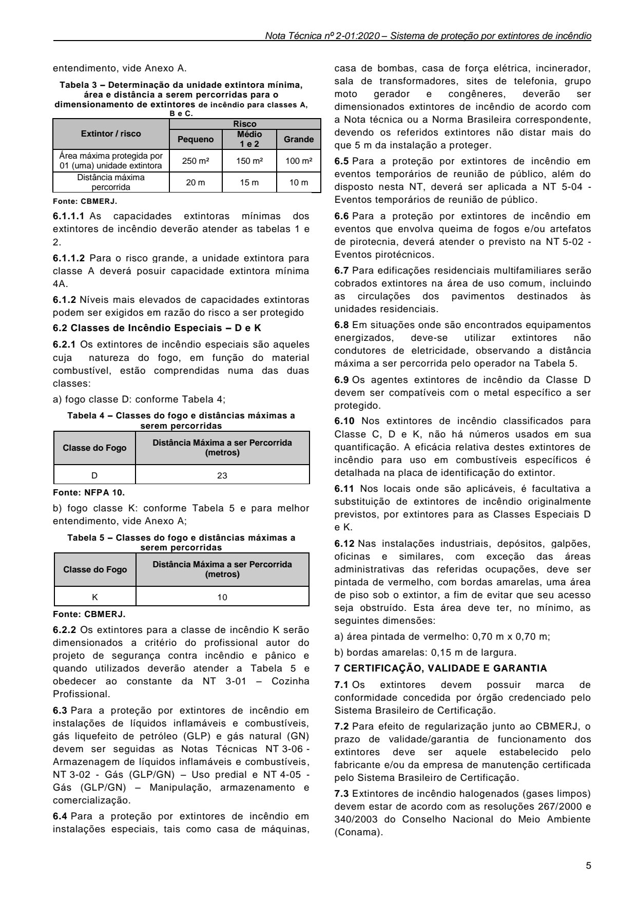
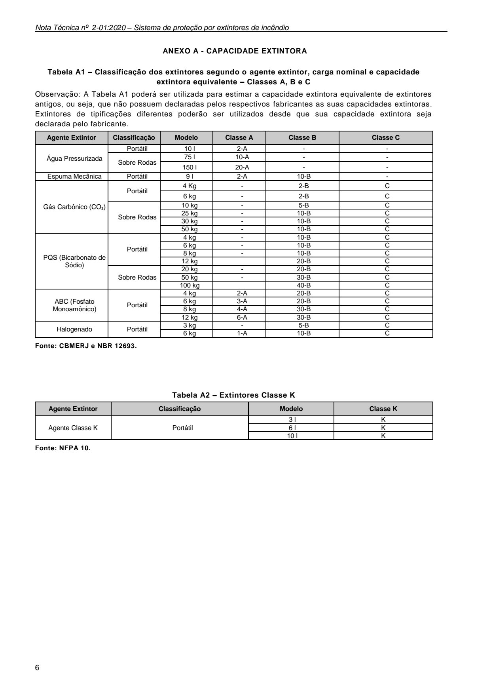

# NT 2-01 - Sistema de proteção por extintores de incêndio

> Conversão integral para consulta computacional. A numeração de página do PDF foi preservada. Quando houver tabela complexa, símbolo ou desenho, conferir também a representação visual indicada e o PDF oficial.

## Sumário por página

- [Página 1](#pagina-1)
- [Página 2](#pagina-2)
- [Página 3](#pagina-3)
- [Página 4](#pagina-4)
- [Página 5](#pagina-5)
- [Página 6](#pagina-6)

---

## Página 1

Aprovada pela Portaria CBMERJ nº 1120, de 22 de setembro de 2020 (DOERJ nº 179, de 28.09.2020).

### SUMÁRIO

### 1 OBJETIVO

### 2 APLICAÇÃO

### 3 REFERÊNCIAS NORMATIVAS E BIBLIOGRÁFICAS

### 4 DEFINIÇÕES E CONCEITOS

### 5 INSTALAÇÃO E CAPACIDADE EXTINTORA

### 6 PROCEDIMENTOS

### 7 CERTIFICAÇÃO, VALIDADE E GARANTIA

### ANEXOS

A - Capacidade extintora

### Tabelas extraídas (bruto, não usar para citação)
#### Tabela 1 da página

|  |  | NOTA |  |  | CBMERJ |  |
| --- | --- | --- | --- | --- | --- | --- |
|  |  | TÉCNICA |  |  | NT 2-01 |  |
|  | Versão: 02 06 páginas Vigência: 28/09/2020 |  |  |  |  |  |
|  | Sistema de proteção por extintores de incêndio |  |  |  |  |  |

---

## Página 2

Corpo de Bombeiros Militar do Estado do Rio de Janeiro CBMERJ Praça da República, nº 45, Centro, Rio de Janeiro - RJ. CEP: 20.211-350. www.cbmerj.rj.gov.br Tel.: (+55 21) 2333-2362. http://www.cbmerj.rj.gov.br/notas-tecnicas

---

## Página 3

### 1 OBJETIVO

Esta Nota estabelece os requisitos exigíveis para projeto, dimensionamento e instalação de extintores de incêndio portáteis e sobre rodas, em edificações e áreas de risco, para combate a princípio de incêndio, conforme previsto no Decreto Estadual no 42/2018 - Código de Segurança Contra Incêndio e Pânico do Estado do Rio de Janeiro (COSCIP).

### 2 APLICAÇÃO

Esta Nota Técnica aplica-se à todas as edificações e áreas de risco, com exceção de edificações residenciais unifamiliares, aeronaves, embarcações e veículos, de acordo com o Decreto Estadual nº 42/2018 - COSCIP.

### 3 REFERÊNCIAS NORMATIVAS E BIBLIOGRÁFICAS

As normas e bibliografias abaixo contêm disposições que estão relacionadas com esta Nota Técnica:

a) Decreto-Lei nº 247, de 21 de julho de 1975, que dispõe sobre a Segurança Contra Incêndio e Pânico;

b) Decreto nº 897, de 21 de setembro de 1976, que regulamenta o Decreto-Lei nº 247, de 21 de julho de 1975, que dispõe sobre segurança contra incêndio e pânico;

c) Decreto nº 42, de 17 de Dezembro de 2018, que regulamenta o Decreto-Lei nº 247, de 21 de julho de 1975, dispondo sobre o Código de Segurança Contra Incêndio e Pânico - COSCIP, no âmbito do Estado do Rio de Janeiro;

d) ABNT NBR 12693:2013 - Sistema de proteção por extintores de incêndio;

e) ABNT NBR 15808:2017 - Extintores de incêndio portáteis;

f) ABNT NBR 15809:2017 - Extintores de incêndio sobre rodas;

g) NFPA 10:2013 - Standard for Portable Fire Extinguishers.

### 4 DEFINIÇÕES E CONCEITOS

Para efeito desta Nota Técnica, além das definições constantes da NT 1-02 - Terminologia de segurança contra incêndio e pânico, aplicam-se as definições específicas desta seção.

4.1 Área protegida: área medida em metros quadrados de piso, protegida por uma unidade extintora, em função do risco.

4.2 Agente extintor: substância utilizada para a extinção de fogo.

4.3 Carga: quantidade de agente extintor contida no extintor de incêndio, medida em litro ou quilograma.

4.4 Capacidade extintora: medida do poder de extinção de fogo de um extintor, obtida em ensaio prático normatizado.

4.5 Distância máxima a ser percorrida: distância máxima real, em metros, a ser percorrida por um operador, do ponto de fixação do extintor a qualquer ponto da área protegida pelo extintor. Devem ser

considerados todos os obstáculos arquitetônicos, mobiliários e etc.

4.6 Extintor de incêndio: aparelho de acionamento manual, constituído de recipiente e acessórios contendo o agente extintor destinado a combater princípios de incêndio.

4.7 Extintor portátil: extintor de incêndio que pode ser transportado manualmente, sendo que sua massa total não pode ultrapassar 20 kg.

4.8 Extintor sobre rodas: extintor de incêndio, montado sobre rodas, cuja massa total não pode ultrapassar 250 kg, operado e transportado por um único operador.

4.9 Fogo classe A: fogo envolvendo materiais combustíveis sólidos, tais como madeiras, tecidos, papéis, borrachas, plásticos termoestáveis e outras fibras orgânicas, que queimam em superfície e profundidade, deixando resíduos.

4.10 Fogo classe B: fogo envolvendo líquidos e/ou gases inflamáveis ou combustíveis, plásticos e graxas que se liquefazem por ação do calor e queimam somente em superfície.

4.11 Fogo classe C: fogo envolvendo equipamentos energizados, fios, cabos, quadros elétricos e similares, onde deve se utilizar extintores não condutores de eletricidade para proteger seus operadores.

4.12 Fogo classe D: fogo envolvendo a combustão de metais pirofóricos. Esses combustíveis são caracterizados pela queima em altas temperaturas e por reagirem com alguns agentes extintores (principalmente a água).

4.13 Fogo classe K: fogo envolvendo a combustão de óleos e gorduras utilizados em cozinhas.

4.14 Princípio de incêndio: período inicial da queima de materiais, compostos químicos ou equipamentos, enquanto o incêndio é incipiente.

4.15 Sinalização: marcação de piso, parede, coluna e/ou teto, destinada a indicar a presença de um extintor.

4.16 Unidade extintora: aparelho extintor de incêndio que atende a capacidade extintora mínima prevista nesta norma.

4.17 Extintor portátil: extintor que possui massa total até 24 Kg.

### 5 INSTALAÇÃO E CAPACIDADE EXTINTORA

5.1 Geral

5.1.1 Para detalhamento das Tabelas de Capacidades Extintoras, ver Anexo A.

5.1.2 Para efeitos de sinalização de segurança deverá ser levado em consideração a NT 2-05 - Sinalização de segurança contra incêndio e pânico.

5.2 Extintores portáteis

### Tabelas extraídas (bruto, não usar para citação)
#### Tabela 1 da página

| 4.18 | Extintor sobre rodas: extintor que possui massa |  |
| --- | --- | --- |
| total superior a 24 Kg, montado sobre rodas. |  |  |

---

## Página 4

5.2.1 Para a instalação dos extintores portáteis, devem ser observadas as seguintes exigências:

a) quando forem fixados em paredes ou colunas, os suportes devem resistir a três vezes a massa total do extintor;

b) quando forem fixados em parede, devem ser observadas as seguintes alturas de montagem:

 a posição da alça de manuseio não deve exceder 1,60 m do piso acabado,

 a parte inferior deve guardar distância de, no mínimo, 10 cm do piso acabado.

c) não devem ficar em contato direto com o piso;

d) devem possuir capacidade extintora mínima conforme Tabela 1.

Tabela 1 - Capacidades extintoras mínimas de extintores

portáteis

Fonte: ABNT NBR 12693.

5.2.2 O extintor deve ser instalado de maneira que:

a) haja menor probabilidade de o fogo bloquear seu acesso;

b) seja visível, para que todos os usuários fiquem familiarizados com a sua localização;

c) permaneça protegido contra intempéries e danos físicos em potencial;

d) não fique obstruído por pilhas de mercadorias, matérias-primas ou qualquer outro material;

e) esteja junto ao acesso dos riscos;

f) sua remoção não seja dificultada por suporte, base, abrigo, etc; e

g) não fique instalado em escadas.

5.2.3 O extintor de pó quimico (ABC) poderá substituir qualquer tipo de extintor das classes A, B e C dentro de uma edificação ou área de risco.

5.2.4 É permitida a instalação de uma única unidade extintora de pó ABC em edificações do risco pequeno com área inferior a 50 m².

5.2.5 Os extintores de incêndio devem ser adequados à classe de incêndio predominante dentro da área de risco a ser protegida, de forma que haja, no mínimo, 02 (dois) extintores de incêndio, sendo um para incêndio classe A e um para incêndio classes B e C. É permitida a instalação de 02 (dois) extintores iguais de pó ABC.

5.2.6 Serão aceitos extintores com acabamento externo em material cromado, latão ou metal polido, desde que possuam marca de conformidade expedida por órgão credenciado pelo Sistema Brasileiro de Certificação (Inmetro).

5.3 Extintor sobre rodas

Para a instalação dos extintores sobre rodas, devem ser observadas as seguintes exigências:

a) não se admite a possibilidade de um extintor sobre rodas proteger locais situados em pavimentos diferentes;

b) só são admitidos extintores sobre rodas nos cálculos das unidades extintoras, quando estes tiverem livre acesso a qualquer parte da área protegida, sem impedimentos de portas, soleiras, degraus no piso, materiais e equipamentos;

c) não é considerado como extintor sobre rodas o conjunto de dois ou mais extintores instalados sobre um mesmo suporte e cujo acionamento seja individualizado;

d) os extintores de incêndio sobre rodas devem possuir capacidade extintora mínima conforme Tabela 2;

Tabela 2 - Capacidades extintoras mínimas de

extintores sobre rodas

Fonte: ABNT NBR 12693.

e) não é permitida a proteção de edificações ou áreas de risco unicamente por extintores sobre rodas, admitindo-se a proteção da metade da área total correspondente ao risco, considerando o complemento por extintores portáteis, de forma alternada entre os dois tipos de equipamentos; e

f) a proteção por extintores sobre rodas deve ser obrigatória nas edificações de risco grande.

### 6 PROCEDIMENTOS

6.1 Dimensionamento por Classe de Incêndio

6.1.1 A natureza do fogo, em função do material combustível, está compreendida numa das cinco classes:

a) fogo classe A: conforme Tabela 3 e para melhor entendimento, vide Anexo A;

### Tabelas extraídas (bruto, não usar para citação)
#### Tabela 1 da página

| Tipo de Agente Extintor |  | Capacidade Extintora |  |
| --- | --- | --- | --- |
|  |  | Mínima |  |
| Água | 2-A |  |  |
| Espuma mecânica | 2-A: 10-B |  |  |
| Dióxido de carbono | 5-B: C |  |  |
| Pó BC | 20-B: C |  |  |
| Pó ABC | 2-A: 20-B: C |  |  |
| Compostos halogenados | 5-B: C |  |  |

#### Tabela 2 da página

| Tipo de Agente Extintor |  | Capacidade Extintora |  |
| --- | --- | --- | --- |
|  |  | Mínima |  |
| Água | 10-A |  |  |
| Espuma mecânica | 6-A: 40-B |  |  |
| Dióxido de carbono | 10-B: C |  |  |
| Pó BC | 80-B: C |  |  |
| Pó ABC | 6-A: 80-B: C |  |  |

#### Tabela 3 da página

| b) fogo classe B: conforme Tabela 3 e para melhor |  |
| --- | --- |
| entendimento, vide Anexo A; |  |
| c) fogo classe C: conforme Tabela 3 e para melhor |  |
| entendimento, vide Anexo A; |  |
| d) fogo Classe D: conforme 6.2; e |  |
| e) fogo Classe K: conforme 6.2 e para melhor |  |

<!-- tabela-conferida: Tabela 1 p4 -->
### Tabela 1 — Capacidades extintoras mínimas de extintores portáteis (conferida)

| Tipo de Agente Extintor | Capacidade Extintora Mínima |
| --- | --- |
| Água | 2-A |
| Espuma mecânica | 2-A : 10-B |
| Dióxido de carbono | 5-B : C |
| Pó BC | 20-B : C |
| Pó ABC | 2-A : 20-B : C |
| Compostos halogenados | 5-B : C |

Fonte: NT 2-01, página 4, Tabela 1; conferida em 2026-09-29 (visual + geometrica).
Fonte: ABNT NBR 12693.
<!-- /tabela-conferida: Tabela 1 p4 -->

<!-- tabela-conferida: Tabela 2 p4 -->
### Tabela 2 — Capacidades extintoras mínimas de extintores sobre rodas (conferida)

| Tipo de Agente Extintor | Capacidade Extintora Mínima |
| --- | --- |
| Água | 10-A |
| Espuma mecânica | 6-A : 40-B |
| Dióxido de carbono | 10-B : C |
| Pó BC | 80-B : C |
| Pó ABC | 6-A : 80-B : C |

Fonte: NT 2-01, página 4, Tabela 2; conferida em 2026-09-29 (visual + geometrica).
Fonte: ABNT NBR 12693.
<!-- /tabela-conferida: Tabela 2 p4 -->

---

## Página 5

6.2 Classes de Incêndio Especiais - D e K

6.2.1 Os extintores de incêndio especiais são aqueles cuja natureza do fogo, em função do material combustível, estão comprendidas numa das duas classes:

6.3 Para a proteção por extintores de incêndio em instalações de líquidos inflamáveis e combustíveis, gás liquefeito de petróleo (GLP) e gás natural (GN) devem ser seguidas as Notas Técnicas NT 3-06 - Armazenagem de líquidos inflamáveis e combustíveis, NT 3-02 - Gás (GLP/GN) - Uso predial e NT 4-05 - Gás (GLP/GN) - Manipulação, armazenamento e comercialização.

6.4 Para a proteção por extintores de incêndio em instalações especiais, tais como casa de máquinas,

casa de bombas, casa de força elétrica, incinerador, sala de transformadores, sites de telefonia, grupo moto gerador e congêneres, deverão ser dimensionados extintores de incêndio de acordo com a Nota técnica ou a Norma Brasileira correspondente, devendo os referidos extintores não distar mais do que 5 m da instalação a proteger.

6.5 Para a proteção por extintores de incêndio em eventos temporários de reunião de público, além do disposto nesta NT, deverá ser aplicada a NT 5-04 - Eventos temporários de reunião de público.

6.6 Para a proteção por extintores de incêndio em eventos que envolva queima de fogos e/ou artefatos de pirotecnia, deverá atender o previsto na NT 5-02 - Eventos pirotécnicos.

6.7 Para edificações residenciais multifamiliares serão cobrados extintores na área de uso comum, incluindo as circulações dos pavimentos destinados às unidades residenciais.

6.8 Em situações onde são encontrados equipamentos energizados, deve-se utilizar extintores não condutores de eletricidade, observando a distância máxima a ser percorrida pelo operador na Tabela 5.

6.9 Os agentes extintores de incêndio da Classe D devem ser compatíveis com o metal específico a ser protegido.

6.11 Nos locais onde são aplicáveis, é facultativa a substituição de extintores de incêndio originalmente previstos, por extintores para as Classes Especiais D e K.

6.12 Nas instalações industriais, depósitos, galpões, oficinas e similares, com exceção das áreas administrativas das referidas ocupações, deve ser pintada de vermelho, com bordas amarelas, uma área de piso sob o extintor, a fim de evitar que seu acesso seja obstruído. Esta área deve ter, no mínimo, as seguintes dimensões:

a) área pintada de vermelho: 0,70 m x 0,70 m;

b) bordas amarelas: 0,15 m de largura.

### 7 CERTIFICAÇÃO, VALIDADE E GARANTIA

7.1 Os extintores devem possuir marca de conformidade concedida por órgão credenciado pelo Sistema Brasileiro de Certificação.

7.3 Extintores de incêndio halogenados (gases limpos) devem estar de acordo com as resoluções 267/2000 e 340/2003 do Conselho Nacional do Meio Ambiente (Conama).

### Tabelas extraídas (bruto, não usar para citação)
#### Tabela 1 da página

| entendimento, vide Anexo A. |  |  |  |  |  |  |  |  |  |
| --- | --- | --- | --- | --- | --- | --- | --- | --- | --- |
| Tabela 3 - Determinação da unidade extintora mínima, |  |  |  |  |  |  |  |  |  |
| área e distância a serem percorridas para o |  |  |  |  |  |  |  |  |  |
| dimensionamento de extintores de incêndio para classes A, |  |  |  |  |  |  |  |  |  |
| B e C. |  |  |  |  |  |  |  |  |  |
| Extintor / risco |  |  | Risco |  |  |  |  |  |  |
|  |  | Pequeno |  |  | Médio |  | Grande |  |  |
|  |  |  |  |  | 1 e 2 |  |  |  |  |
| Área máxima protegida por 01 (uma) unidade extintora |  | 250 m² |  | 150 m² |  |  | 100 m² |  |  |
| Distância máxima percorrida |  | 20 m |  | 15 m |  |  | 10 m |  |  |
| Fonte: CBMERJ. |  |  |  |  |  |  |  |  |  |
| 6.1.1.1 As capacidades extintoras mínimas dos |  |  |  |  |  |  |  |  |  |
| extintores de incêndio deverão atender as tabelas 1 e |  |  |  |  |  |  |  |  |  |
| 2. |  |  |  |  |  |  |  |  |  |
| 6.1.1.2 Para o risco grande, a unidade extintora para |  |  |  |  |  |  |  |  |  |
| classe A deverá posuir capacidade extintora mínima |  |  |  |  |  |  |  |  |  |
| 4A. |  |  |  |  |  |  |  |  |  |
| 6.1.2 Níveis mais elevados de capacidades extintoras |  |  |  |  |  |  |  |  |  |
| podem ser exigidos em razão do risco a ser protegido |  |  |  |  |  |  |  |  |  |

#### Tabela 2 da página

| a) fogo classe D: conforme Tabela 4; |  |  |
| --- | --- | --- |
| Tabela 4 - Classes do fogo e distâncias máximas a |  |  |
| serem percorridas |  |  |
| Classe do Fogo |  | Distância Máxima a ser Percorrida (metros) |
| D |  | 23 |
| Fonte: NFPA 10. |  |  |
| b) fogo classe K: conforme Tabela 5 e para melhor |  |  |
| entendimento, vide Anexo A; |  |  |
| Tabela 5 - Classes do fogo e distâncias máximas a |  |  |
| serem percorridas |  |  |
| Classe do Fogo |  | Distância Máxima a ser Percorrida (metros) |
| K |  | 10 |
| Fonte: CBMERJ. |  |  |
| 6.2.2 Os extintores para a classe de incêndio K serão |  |  |
| dimensionados a critério do profissional autor do |  |  |
| projeto de segurança contra incêndio e pânico e |  |  |
| quando utilizados deverão atender a Tabela 5 e |  |  |
| obedecer ao constante da NT 3-01 - Cozinha |  |  |
| Profissional. |  |  |

#### Tabela 3 da página

| 6.10 Nos extintores de incêndio classificados para |  |
| --- | --- |
| Classe C, D e K, não há números usados em sua |  |
| quantificação. A eficácia relativa destes extintores de |  |
| incêndio para uso em combustíveis específicos é |  |
| detalhada na placa de identificação do extintor. |  |

#### Tabela 4 da página

| 7.2 | Para efeito de regularização junto ao CBMERJ, o |  |
| --- | --- | --- |
| prazo de validade/garantia de funcionamento dos |  |  |
| extintores deve ser aquele estabelecido pelo |  |  |
| fabricante e/ou da empresa de manutenção certificada |  |  |
| pelo Sistema Brasileiro de Certificação. |  |  |

<!-- tabela-conferida: Tabela 3 p5 -->
### Tabela 3 — Determinação da unidade extintora mínima, área e distância a serem percorridas para o dimensionamento de extintores de incêndio para classes A, B e C (conferida)

| Extintor / risco | Risco pequeno | Risco médio 1 e 2 | Risco grande |
| --- | --- | --- | --- |
| Área máxima protegida por 01 (uma) unidade extintora | 250 m² | 150 m² | 100 m² |
| Distância máxima percorrida | 20 m | 15 m | 10 m |

Fonte: NT 2-01, página 5, Tabela 3; conferida em 2026-09-29 (visual + geometrica).
Fonte: CBMERJ.
"Risco" é célula mesclada sobre Pequeno, Médio 1 e 2 e Grande; "Extintor / risco" ocupa as duas linhas do cabeçalho.
<!-- /tabela-conferida: Tabela 3 p5 -->

<!-- tabela-conferida: Tabela 4 p5 -->
### Tabela 4 — Classes do fogo e distâncias máximas a serem percorridas (conferida)

| Classe do Fogo | Distância Máxima a ser Percorrida (metros) |
| --- | --- |
| D | 23 |

Fonte: NT 2-01, página 5, Tabela 4; conferida em 2026-09-29 (visual + geometrica).
Fonte: NFPA 10.
<!-- /tabela-conferida: Tabela 4 p5 -->

<!-- tabela-conferida: Tabela 5 p5 -->
### Tabela 5 — Classes do fogo e distâncias máximas a serem percorridas (conferida)

| Classe do Fogo | Distância Máxima a ser Percorrida (metros) |
| --- | --- |
| K | 10 |

Fonte: NT 2-01, página 5, Tabela 5; conferida em 2026-09-29 (visual + geometrica).
Fonte: CBMERJ.
<!-- /tabela-conferida: Tabela 5 p5 -->

---

## Página 6

Tabela A2 - Extintores Classe K

Fonte: NFPA 10.

### Tabelas extraídas (bruto, não usar para citação)
#### Tabela 1 da página

| ANEXO A - CAPACIDADE EXTINTORA |  |  |  |  |  |
| --- | --- | --- | --- | --- | --- |
| Tabela A1 - Classificação dos extintores segundo o agente extintor, carga nominal e capacidade |  |  |  |  |  |
| extintora equivalente - Classes A, B e C |  |  |  |  |  |
| Observação: A Tabela A1 poderá ser utilizada para estimar a capacidade extintora equivalente de extintores |  |  |  |  |  |
| antigos, ou seja, que não possuem declaradas pelos respectivos fabricantes as suas capacidades extintoras. |  |  |  |  |  |
| Extintores de tipificações diferentes poderão ser utilizados desde que sua capacidade extintora seja |  |  |  |  |  |
| declarada pelo fabricante. |  |  |  |  |  |
|  |  |  |  |  |  |
| Agente Extintor | Classificação | Modelo | Classe A | Classe B | Classe C |
|  | Portátil | 10 l | 2-A | - | - |
| Água Pressurizada |  | 75 l | 10-A | - | - |
|  | Sobre Rodas | 150 l | 20-A | - | - |
|  |  |  |  |  |  |
| Espuma Mecânica | Portátil | 9 l | 2-A | 10-B | - |
|  |  | 4 Kg | - | 2-B | C |
|  | Portátil | 6 kg | - | 2-B | C |
| Gás Carbônico (CO₂) |  | 10 kg | - | 5-B | C |
|  | Sobre Rodas | 25 kg | - | 10-B | C |
|  |  | 30 kg | - | 10-B | C |
|  |  |  |  |  |  |
|  |  | 50 kg | - | 10-B | C |
|  |  | 4 kg | - | 10-B | C |
|  |  | 6 kg | - | 10-B | C |
|  | Portátil |  |  |  |  |
|  |  | 8 kg | - | 10-B | C |
| PQS (Bicarbonato de |  |  |  |  |  |
|  |  | 12 kg |  | 20-B | C |
| Sódio) |  |  |  |  |  |
|  |  | 20 kg | - | 20-B | C |
|  |  |  |  |  |  |
|  | Sobre Rodas | 50 kg | - | 30-B | C |
|  |  | 100 kg |  | 40-B | C |
|  |  | 4 kg | 2-A | 20-B | C |
| ABC (Fosfato |  | 6 kg | 3-A | 20-B | C |
|  | Portátil |  |  |  |  |
| Monoamônico) |  | 8 kg | 4-A | 30-B | C |
|  |  |  |  |  |  |
|  |  | 12 kg | 6-A | 30-B | C |
|  |  | 3 kg | - | 5-B | C |
| Halogenado | Portátil |  |  |  |  |
|  |  | 6 kg | 1-A | 10-B | C |
|  |  |  |  |  |  |
|  |  |  |  |  |  |
| Fonte: CBMERJ e NBR 12693. |  |  |  |  |  |

#### Tabela 2 da página

| Agente Extintor | Classificação | Modelo | Classe K |
| --- | --- | --- | --- |
|  | Portátil | 3 l | K |
| Agente Classe K |  | 6 l | K |
|  |  | 10 l | K |
