# NT 2-02 - Sistemas de hidrantes e de mangotinhos para combate a incêndio

> Conversão integral para consulta computacional. A numeração de página do PDF foi preservada. Quando houver tabela complexa, símbolo ou desenho, conferir também a representação visual indicada e o PDF oficial.

## Sumário por página

- [Página 1](#pagina-1)
- [Página 2](#pagina-2)
- [Página 3](#pagina-3)
- [Página 4](#pagina-4)
- [Página 5](#pagina-5)
- [Página 6](#pagina-6)
- [Página 7](#pagina-7)
- [Página 8](#pagina-8)
- [Página 9](#pagina-9)
- [Página 10](#pagina-10)
- [Página 11](#pagina-11)
- [Página 12](#pagina-12)
- [Página 13](#pagina-13)
- [Página 14](#pagina-14)
- [Página 15](#pagina-15)
- [Página 16](#pagina-16)
- [Página 17](#pagina-17)
- [Página 18](#pagina-18)
- [Página 19](#pagina-19)
- [Página 20](#pagina-20)
- [Página 21](#pagina-21)

---

## Página 1

Aprovada pela Portaria CBMERJ nº 1071, de 27 de agosto de 2019 (DOERJ nº 167, de 04.09.2019). Alterada pela Portaria CBMERJ nº 1120, de 22 de setembro de 2020 (DOERJ nº 179, de 28.09.2020). Alterada pela Portaria CBMERJ nº 1317, de 10 de dezembro de 2025 (DOERJ nº 229, de 12.12.2025).

### SUMÁRIO

### 1 OBJETIVO

### 2 APLICAÇÃO

### 3 REFERÊNCIAS NORMATIVAS E BIBLIOGRÁFICAS

### 4 DEFINIÇÕES E CONCEITOS

### 5 PROCEDIMENTOS

### ANEXOS

A - Dos mananciais e reservatórios de abastecimento

B - Modelo de planilha de cálculo

C - Modelo de Termo de compromisso

### Tabelas extraídas (bruto, não usar para citação)
#### Tabela 1 da página

|  |  | NOTA |  |  | CBMERJ |  |
| --- | --- | --- | --- | --- | --- | --- |
|  |  | TÉCNICA |  |  | NT 2-02 |  |
|  | 1ª Edição 21 páginas Vigência: 04/09/2019 |  |  |  |  |  |
|  | Sistemas de hidrantes e de mangotinhos para combate a incêndio |  |  |  |  |  |

---

## Página 2

Corpo de Bombeiros Militar do Estado do Rio de Janeiro CBMERJ Praça da República, nº 45, Centro, Rio de Janeiro - RJ. CEP: 20.211-350. www.cbmerj.rj.gov.br http://www.cbmerj.rj.gov.br/notas-tecnicas

---

## Página 3

### 1 OBJETIVO

Fixar as condições necessárias exigíveis para dimensionamento, instalação, manutenção, aceitação/aprovação e manuseio, bem como as características, dos componentes de sistemas de hidrantes e/ou de mangotinhos para uso exclusivo de combate a incêndio em edificações conforme previsto no Decreto Estadual no 42/2018 - Código de Segurança Contra Incêndio e Pânico do Estado do Rio de Janeiro (COSCIP).

### 2 APLICAÇÃO

2.1 Esta Nota Técnica (NT) aplica-se a todas as edificações em que sejam necessárias as instalações de sistemas de hidrantes e/ou de mangotinhos para combate a incêndio, conforme previsto no Decreto Estadual nº 42/2018 - COSCIP.

2.2 A presente Nota Técnica não se aplica a indústrias petroquímicas, refinarias de petróleo, terminais e base de distribuição de derivados de petróleo e instalações de armazenagem de líquidos e gases combustíveis e inflamáveis no tocante exclusivamente aos parâmetros de pressão e vazão dos tanques aéreos e/ou enterrados. No entanto, as áreas comerciais e industriais das referidas edificações ficam sujeitas às exigências previstas nesta NT.

### 3 REFERÊNCIAS NORMATIVAS E BIBLIOGRÁFICAS

As normas e bibliografias abaixo contêm disposições que estão relacionadas com esta Nota Técnica:

a) Decreto n° 42, de 17 de dezembro de 2018 que regulamenta o Decreto-Lei nº 247, de 21 de julho de 1975, dispondo sobre o Código de Segurança Contra Incêndio e Pânico - COSCIP, no âmbito do Estado do Rio de Janeiro;

b) ABNT NBR 5410:2008 - Instalações elétricas de baixa tensão;

c) ABNT NBR 5580:2015 - Tubo de aço-carbono para usos comuns na condução de fluídos - Especificação;

d) ABNT NBR 5590:2017 - Tubo de aço-carbono com ou sem costura, pretos ou galvanizados por imersão a quente, para condução de fluídos - Especificação;

e) ABNT NBR 5626:1998 - Instalação predial de água fria;

f) ABNT NBR 6414:2000/NM-ISO7.1 - Rosca para tubos onde a vedação é feita pela rosca - Designação, dimensões e tolerâncias - Padronização;

g) ABNT NBR 6925:2016 - Conexão de ferro fundido maleável, de classes 150 e 300, com rosca NPT, para tubulação;

h) ABNT NBR 6943:2016 - Conexão de ferro maleável para tubulações - Classe 10 - Especificações;

i) ABNT NBR 10897:2014 - Proteção contra incêndio por chuveiro automático - Procedimento;

j) ABNT NBR 11720:2010 - Conexão para unir tubos de cobre por soldagem ou brasagem capilar - Especificações;

k) ABNT NBR 11861:1998 - Mangueira de incêndio - Requisitos e métodos de ensaio;

l) ABNT NBR 12779:2009 - Inspeção, manutenção e cuidados em mangueiras de incêndio - Procedimento;

m) ABNT NBR 12912:1995 - Rosca NPT para tubos - Dimensões - Padronização;

n) ABNT NBR 13206:2010 - Tubo de cobre leve, médio e pesado sem costura, para condução de água e outros fluídos - Especificação;

o) ABNT NBR 13714:2000 - Sistemas de hidrantes e de mangotinhos para combate a incêndio;

p) ABNT NBR 14105:2015 - Medidores de pressão;

q) ABNT NBR 14349:1999 - União para mangueira de incêndio;

r) ABNT NBR 14870:2013 - Esguichos de jato regulável para combate a incêndio - Parte 1: Esguicho básico de jato regulável;

s) ABNT NBR 16021:2011 - Válvulas e acessórios para hidrante - Requisitos e métodos de ensaio;

t) Fundamentos de Física 1 - Mecânica - 10ª Edição, 2016, Halliday, David; Resnick, Robert; Walker, Jearl.

### 4 DEFINIÇÕES E CONCEITOS

Para efeito desta Nota Técnica, além das definições constantes da NT 1-02 - Terminologia de segurança contra incêndio e pânico, aplicam-se as definições específicas desta seção.

4.1 Abrigo de mangueiras: compartimento destinado exclusivamente ao acondicionamento de hidrante e de equipamentos de combate a incêndio.

4.2 Barrilete: tubulação que se origina de um reservatório superior e que possui a função de alimentar todos os ramais existentes através das suas colunas de distribuição.

4.3 Canalização preventiva: tubulação em ferro fundido, ferro galvanizado, aço carbono ou cobre com diâmetro nominal mínimo de 50mm (2”), destinados a conduzir a água para alimentar os equipamentos de combate a incêndio.

4.4 Carretel axial: dispositivo rígido destinado ao enrolamento de mangueiras semirrígidas.

4.5 Casa de máquina de incêndio (CMI): compartimento destinado especificamente ao abrigo de bombas de incêndio e demais apetrechos complementares ao seu funcionamento, não se admitindo o uso para circulação de pessoas ou qualquer outro fim.

4.6 Castelo d’água: reservatório d’água elevado e localizado, geralmente, fora da projeção da

---

## Página 4

construção, destinado a abastecer uma edificação ou agrupamento de edificações.

4.7 Central de espuma: local onde se situam as bombas, aparelhos dosadores e/ou geradores de espuma, suprimento de espuma, registros de controle etc., destinados a pôr em funcionamento o sistema de espuma para instalação fixa.

4.8 CPVC (policloreto de vinila clorado): tubulação em policloreto de vinila clorado destinados a conduzir a água para alimentar os equipamentos de combate a incêndio.

4.9 Eletrobomba: bomba centrifuga de pressurização com acionamento elétrico.

4.10 Eletrobomba jockey: bomba centrifuga com acionamento elétrico que tem a função de manter o sistema pressurizado, compensando pequenos vazamentos.

4.11 Esguicho regulável básico: esguicho de jato regulável em que a vazão de lançamento se dá a uma pressão determinada pelo ajuste da forma do jato.

4.12 Hidrante (tomada de incêndio): ponto de tomada d’água provido de registro de manobra e união tipo engate rápido.

4.13 Hidrante de recalque (hidrante de passeio ou de fachada): dispositivo instalado na canalização ou rede preventiva, destinado a utilização pelas viaturas do Corpo de Bombeiros.

4.14 Mangueira de incêndio: condutor flexível de combate a incêndio, dotado de uniões para conduzir água do hidrante ao esguicho.

4.15 Mangotinho: ponto de tomada de água onde existe uma saída contendo válvula de abertura rápida, adaptador, mangueira semirrígida, esguicho regulável, válvula e carretel.

4.16 Motobomba: bomba centrifuga de pressurização acionada por motor à explosão.

4.17 NPSH (net positive suction head): pressão mínima exigida na entrada da bomba para evitar a cavitação.

4.18 Pavimento Técnico: pavimento de uma edificação, destinado a abrigar máquinas, piso técnico e elevadores, caixas de água, circulação vertical ou qualquer equipamento, sendo vedada a sua utilização para qualquer fim de ocupação humana permanente.

4.18 Porta corta-fogo leve: porta resistente ao fogo utilizada com a finalidade de garantir proteção contra incêndios impedindo a passagem de fogo ou fumaça entre compartimentos. Deve atender as exigências de resistência mecânica, estanqueidade e isolamento térmico, contidos na NBR 11.742.

4.19 Rede de espuma: instalação hidráulica de combate a incêndio que atua, mediante comando,

para lançamento de espuma.

4.20 Rede preventiva: tubulação em ferro fundido, ferro galvanizado, aço carbono ou cobre com diâmetro nominal mínimo de 75 mm (3”), destinados a conduzir a água para alimentar os equipamentos de combate a incêndio.

4.21 Registro de tubulação: registro destinado a abrir e fechar o hidrante.

4.22 Reserva técnica de incêndio (RTI): volume d’água do reservatório, previsto para combate a incêndio.

4.23 Reservatório: compartimento destinado ao armazenamento d’água.

4.24 Shaft: área específica em uma construção onde passam várias tubulações aparentes, do tipo água, elétrica, esgoto e incêndio.

4.25 Sistema preventivo: sistema de combate a incêndio composto por bombas de incêndio, tubulação, hidrantes, mangotinhos, reservatórios para incêndio, mangueiras e esguichos.

4.26 Tubulação: conjunto de tubos, conexões e outros acessórios destinados a conduzir a água desde a reserva técnica de incêndio até os hidrantes ou mangotinhos.

4.27 União tipo engate rápido (junta storz): conexão giratória destinada ao acoplamento de equipamentos por encaixe de 1/4 de volta.

4.28 Válvula: acessório de tubulação destinado a controlar ou bloquear o fluxo de água no interior das tubulações.

4.29 Válvula de bloqueio: registro instalado na rede de alimentação dos hidrantes para fechamento, em caso de reparo.

### 5 PROCEDIMENTOS

5.1 Requisitos gerais

5.1.1 Os sistemas de combate a incêndio serão classificados em: risco pequeno (mangotinho), risco pequeno (canalização preventiva), risco médio 1 (canalização preventiva), risco médio 2 (rede preventiva) e risco grande (rede preventiva), conforme Tabela 1.

5.1.2 Todos os ábacos, tabelas e outras referências técnicas utilizadas no dimensionamento devem ser relacionados no memorial descritivo e apresentados na juntada do processo para aprovação do projeto de segurança contra incêndio e pânico.

5.1.3 Deverão ser adotadas para o dimensionamento do sistema preventivo, além dos valores estipulados na Tabela 01, as perdas de carga nas mangueiras de incêndio, tendo como premissas as vazões indicadas na tabela supracitada, bem como as pressões necessárias para que os jatos d’água atinjam a

---

## Página 5

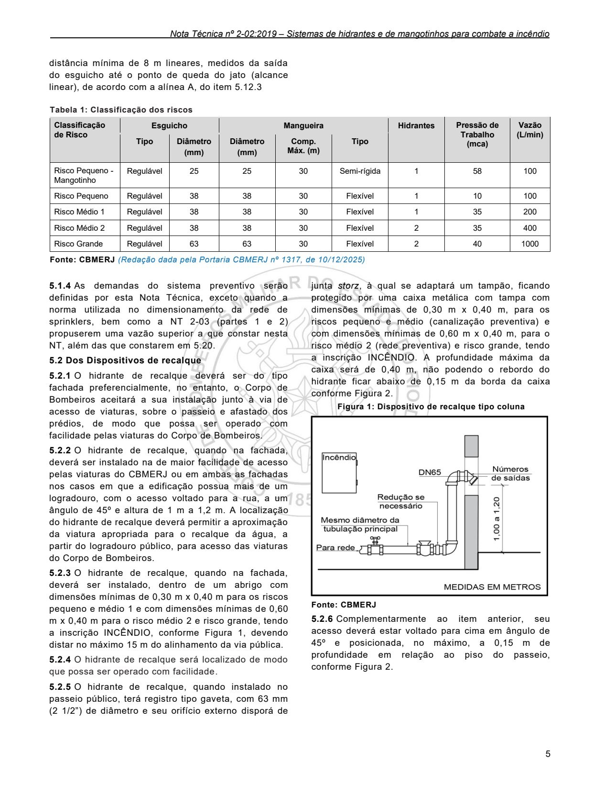

Fonte: CBMERJ (Redação dada pela Portaria CBMERJ nº 1317, de 10/12/2025)

distância mínima de 8 m lineares, medidos da saída do esguicho até o ponto de queda do jato (alcance linear), de acordo com a alínea A, do item 5.12.3

Tabela 1: Classificação dos riscos

5.1.4 As demandas do sistema preventivo serão definidas por esta Nota Técnica, exceto quando a norma utilizada no dimensionamento da rede de sprinklers, bem como a NT 2-03 (partes 1 e 2) propuserem uma vazão superior a que constar nesta NT, além das que constarem em 5.20.

5.2 Dos Dispositivos de recalque

5.2.1 O hidrante de recalque deverá ser do tipo fachada preferencialmente, no entanto, o Corpo de Bombeiros aceitará a sua instalação junto à via de acesso de viaturas, sobre o passeio e afastado dos prédios, de modo que possa ser operado com facilidade pelas viaturas do Corpo de Bombeiros.

5.2.2 O hidrante de recalque, quando na fachada, deverá ser instalado na de maior facilidade de acesso pelas viaturas do CBMERJ ou em ambas as fachadas nos casos em que a edificação possua mais de um logradouro, com o acesso voltado para a rua, a um ângulo de 45º e altura de 1 m a 1,2 m. A localização do hidrante de recalque deverá permitir a aproximação da viatura apropriada para o recalque da água, a partir do logradouro público, para acesso das viaturas do Corpo de Bombeiros.

5.2.3 O hidrante de recalque, quando na fachada, deverá ser instalado, dentro de um abrigo com dimensões mínimas de 0,30 m x 0,40 m para os riscos pequeno e médio 1 e com dimensões mínimas de 0,60 m x 0,40 m para o risco médio 2 e risco grande, tendo a inscrição INCÊNDIO, conforme Figura 1, devendo distar no máximo 15 m do alinhamento da via pública.

5.2.4 O hidrante de recalque será localizado de modo que possa ser operado com facilidade.

5.2.5 O hidrante de recalque, quando instalado no passeio público, terá registro tipo gaveta, com 63 mm (2 1/2”) de diâmetro e seu orifício externo disporá de

junta storz, à qual se adaptará um tampão, ficando protegido por uma caixa metálica com tampa com dimensões mínimas de 0,30 m x 0,40 m, para os riscos pequeno e médio (canalização preventiva) e com dimensões mínimas de 0,60 m x 0,40 m, para o risco médio 2 (rede preventiva) e risco grande, tendo a inscrição INCÊNDIO. A profundidade máxima da caixa será de 0,40 m, não podendo o rebordo do hidrante ficar abaixo de 0,15 m da borda da caixa conforme Figura 2.

Figura 1: Dispositivo de recalque tipo coluna

Fonte: CBMERJ

5.2.6 Complementarmente ao item anterior, seu acesso deverá estar voltado para cima em ângulo de 45º e posicionada, no máximo, a 0,15 m de profundidade em relação ao piso do passeio, conforme Figura 2.

### Tabelas extraídas (bruto, não usar para citação)
#### Tabela 1 da página

| Classificação | Esguicho |  | Mangueira |  |  | Hidrantes | Pressão de | Vazão |
| --- | --- | --- | --- | --- | --- | --- | --- | --- |
| de Risco | Tipo | Diâmetro | Diâmetro | Comp. | Tipo |  | Trabalho | (L/min) |
|  |  |  |  |  |  |  | (mca) |  |
|  |  | (mm) | (mm) | Máx. (m) |  |  |  |  |
| Risco Pequeno - Mangotinho | Regulável | 25 | 25 | 30 | Semi-rígida | 1 | 58 | 100 |
| Risco Pequeno | Regulável | 38 | 38 | 30 | Flexível | 1 | 10 | 100 |
| Risco Médio 1 | Regulável | 38 | 38 | 30 | Flexível | 1 | 35 | 200 |
| Risco Médio 2 | Regulável | 38 | 38 | 30 | Flexível | 2 | 35 | 400 |
| Risco Grande | Regulável | 63 | 63 | 30 | Flexível | 2 | 40 | 1000 |

<!-- tabela-conferida: Tabela 1 p5 -->
### Tabela 1 — Classificação dos riscos (conferida)

| Classificação de risco | Esguicho — tipo | Esguicho — diâmetro (mm) | Mangueira — diâmetro (mm) | Mangueira — comprimento máx. (m) | Mangueira — tipo | Hidrantes | Pressão de trabalho (mca) | Vazão (L/min) |
| --- | --- | --- | --- | --- | --- | --- | --- | --- |
| Risco Pequeno - Mangotinho | Regulável | 25 | 25 | 30 | Semi-rígida | 1 | 58 | 100 |
| Risco Pequeno | Regulável | 38 | 38 | 30 | Flexível | 1 | 10 | 100 |
| Risco Médio 1 | Regulável | 38 | 38 | 30 | Flexível | 1 | 35 | 200 |
| Risco Médio 2 | Regulável | 38 | 38 | 30 | Flexível | 2 | 35 | 400 |
| Risco Grande | Regulável | 63 | 63 | 30 | Flexível | 2 | 40 | 1000 |

Fonte: NT 2-02, página 5, Tabela 1; conferida em 2026-09-29 (visual + texto).
Na imagem: "Fonte: CBMERJ (Redação dada pela Portaria CBMERJ nº 1317, de 10/12/2025)". O cabeçalho em dois níveis (Esguicho: tipo e diâmetro; Mangueira: diâmetro, comprimento e tipo) foi achatado por coluna.
<!-- /tabela-conferida: Tabela 1 p5 -->

---

## Página 6

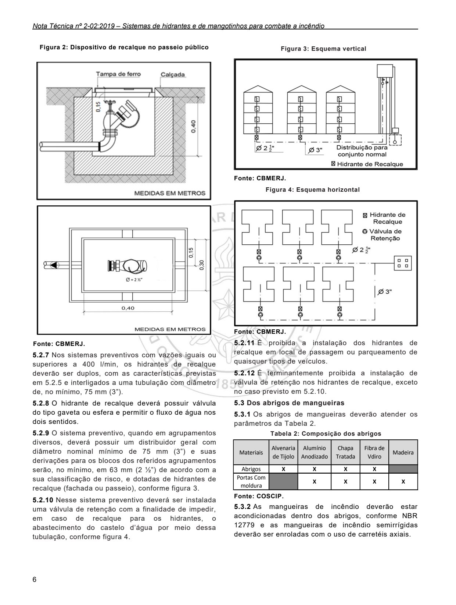

Figura 2: Dispositivo de recalque no passeio público

= 2 ½”

Fonte: CBMERJ.

5.2.7 Nos sistemas preventivos com vazões iguais ou superiores a 400 l/min, os hidrantes de recalque deverão ser duplos, com as características previstas em 5.2.5 e interligados a uma tubulação com diâmetro de, no mínimo, 75 mm (3”).

5.2.8 O hidrante de recalque deverá possuir válvula do tipo gaveta ou esfera e permitir o fluxo de água nos dois sentidos.

5.2.9 O sistema preventivo, quando em agrupamentos diversos, deverá possuir um distribuidor geral com diâmetro nominal mínimo de 75 mm (3”) e suas derivações para os blocos dos referidos agrupamentos serão, no mínimo, em 63 mm (2 ½”) de acordo com a sua classificação de risco, e dotadas de hidrantes de recalque (fachada ou passeio), conforme figura 3.

5.2.10 Nesse sistema preventivo deverá ser instalada uma válvula de retenção com a finalidade de impedir, em caso de recalque para os hidrantes, o abastecimento do castelo d’água por meio dessa tubulação, conforme figura 4.

Figura 3: Esquema vertical

Fonte: CBMERJ.

Figura 4: Esquema horizontal

Fonte: CBMERJ.

5.2.11 É proibida a instalação dos hidrantes de recalque em local de passagem ou parqueamento de quaisquer tipos de veículos.

5.2.12 É terminantemente proibida a instalação de válvula de retenção nos hidrantes de recalque, exceto no caso previsto em 5.2.10.

5.3 Dos abrigos de mangueiras

5.3.1 Os abrigos de mangueiras deverão atender os parâmetros da Tabela 2.

Tabela 2: Composição dos abrigos

Fonte: COSCIP.

5.3.2 As mangueiras de incêndio deverão estar acondicionadas dentro dos abrigos, conforme NBR 12779 e as mangueiras de incêndio semirrígidas deverão ser enroladas com o uso de carretéis axiais.

### Tabelas extraídas (bruto, não usar para citação)
#### Tabela 1 da página

| Materiais | Alvenaria de Tijolo | Alumínio Anodizado | Chapa Tratada | Fibra de Vdiro | Madeira |
| --- | --- | --- | --- | --- | --- |
| Abrigos | X | X | X | X |  |
| Portas Com moldura |  | X | X | X | X |

<!-- tabela-conferida: Tabela 2 p6 -->
### Tabela 2 — Composição dos abrigos (conferida)

| Materiais | Alvenaria de Tijolo | Alumínio Anodizado | Chapa Tratada | Fibra de Vdiro | Madeira |
| --- | --- | --- | --- | --- | --- |
| Abrigos | X | X | X | X |  |
| Portas Com moldura |  | X | X | X | X |

Fonte: NT 2-02, página 6, Tabela 2; conferida em 2026-09-29 (visual + texto).
Células em branco = fundo cinza na imagem (material não previsto para aquele elemento). Fonte indicada: COSCIP.
<!-- /tabela-conferida: Tabela 2 p6 -->

---

## Página 7

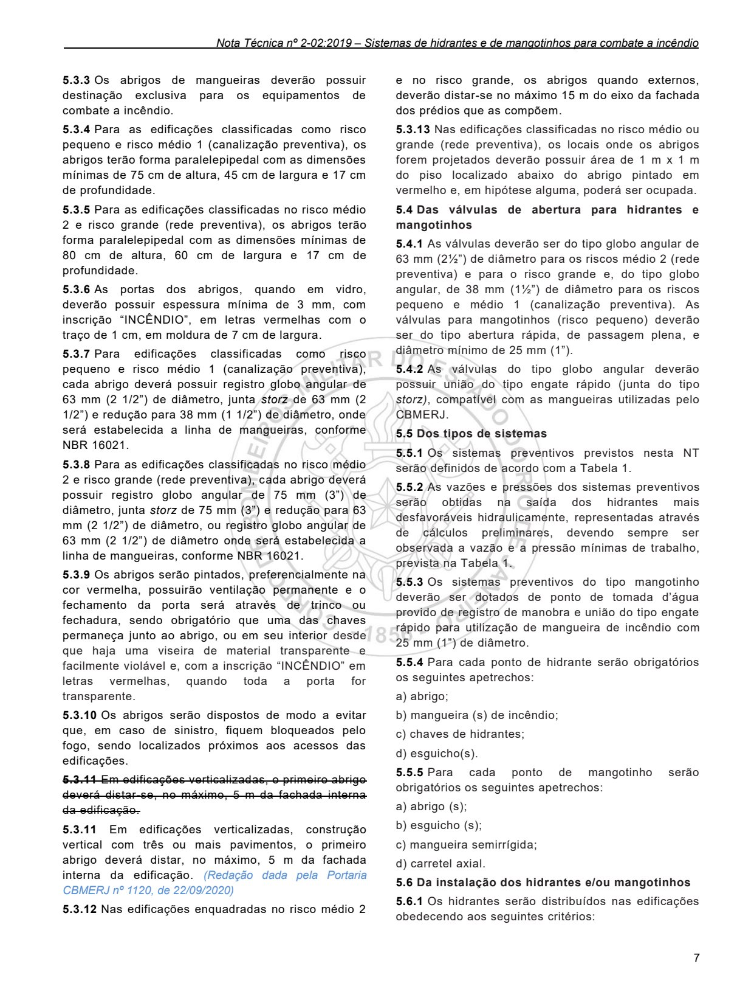

5.3.3 Os abrigos de mangueiras deverão possuir destinação exclusiva para os equipamentos de combate a incêndio.

5.3.4 Para as edificações classificadas como risco pequeno e risco médio 1 (canalização preventiva), os abrigos terão forma paralelepipedal com as dimensões mínimas de 75 cm de altura, 45 cm de largura e 17 cm de profundidade.

5.3.5 Para as edificações classificadas no risco médio 2 e risco grande (rede preventiva), os abrigos terão forma paralelepipedal com as dimensões mínimas de 80 cm de altura, 60 cm de largura e 17 cm de profundidade.

5.3.6 As portas dos abrigos, quando em vidro, deverão possuir espessura mínima de 3 mm, com inscrição “INCÊNDIO”, em letras vermelhas com o traço de 1 cm, em moldura de 7 cm de largura.

5.3.7 Para edificações classificadas como risco pequeno e risco médio 1 (canalização preventiva), cada abrigo deverá possuir registro globo angular de 63 mm (2 1/2”) de diâmetro, junta storz de 63 mm (2 1/2”) e redução para 38 mm (1 1/2”) de diâmetro, onde será estabelecida a linha de mangueiras, conforme NBR 16021.

5.3.8 Para as edificações classificadas no risco médio 2 e risco grande (rede preventiva), cada abrigo deverá possuir registro globo angular de 75 mm (3”) de diâmetro, junta storz de 75 mm (3”) e redução para 63 mm (2 1/2”) de diâmetro, ou registro globo angular de 63 mm (2 1/2”) de diâmetro onde será estabelecida a linha de mangueiras, conforme NBR 16021.

5.3.9 Os abrigos serão pintados, preferencialmente na cor vermelha, possuirão ventilação permanente e o fechamento da porta será através de trinco ou fechadura, sendo obrigatório que uma das chaves permaneça junto ao abrigo, ou em seu interior desde que haja uma viseira de material transparente e facilmente violável e, com a inscrição “INCÊNDIO” em letras vermelhas, quando toda a porta for transparente.

5.3.10 Os abrigos serão dispostos de modo a evitar que, em caso de sinistro, fiquem bloqueados pelo fogo, sendo localizados próximos aos acessos das edificações.

5.3.11 Em edificações verticalizadas, o primeiro abrigo deverá distar-se, no máximo, 5 m da fachada interna da edificação.

5.3.11 Em edificações verticalizadas, construção vertical com três ou mais pavimentos, o primeiro abrigo deverá distar, no máximo, 5 m da fachada interna da edificação. (Redação dada pela Portaria CBMERJ nº 1120, de 22/09/2020)

5.3.12 Nas edificações enquadradas no risco médio 2

e no risco grande, os abrigos quando externos, deverão distar-se no máximo 15 m do eixo da fachada dos prédios que as compõem.

5.3.13 Nas edificações classificadas no risco médio ou grande (rede preventiva), os locais onde os abrigos forem projetados deverão possuir área de 1 m x 1 m do piso localizado abaixo do abrigo pintado em vermelho e, em hipótese alguma, poderá ser ocupada.

5.4 Das válvulas de abertura para hidrantes e mangotinhos

5.4.1 As válvulas deverão ser do tipo globo angular de 63 mm (2½”) de diâmetro para os riscos médio 2 (rede preventiva) e para o risco grande e, do tipo globo angular, de 38 mm (1½”) de diâmetro para os riscos pequeno e médio 1 (canalização preventiva). As válvulas para mangotinhos (risco pequeno) deverão ser do tipo abertura rápida, de passagem plena, e diâmetro mínimo de 25 mm (1”).

5.4.2 As válvulas do tipo globo angular deverão possuir união do tipo engate rápido (junta do tipo storz), compatível com as mangueiras utilizadas pelo CBMERJ.

5.5 Dos tipos de sistemas

5.5.1 Os sistemas preventivos previstos nesta NT serão definidos de acordo com a Tabela 1.

5.5.2 As vazões e pressões dos sistemas preventivos serão obtidas na saída dos hidrantes mais desfavoráveis hidraulicamente, representadas através de cálculos preliminares, devendo sempre ser observada a vazão e a pressão mínimas de trabalho, prevista na Tabela 1.

5.5.3 Os sistemas preventivos do tipo mangotinho deverão ser dotados de ponto de tomada d’água provido de registro de manobra e união do tipo engate rápido para utilização de mangueira de incêndio com 25 mm (1”) de diâmetro.

5.5.4 Para cada ponto de hidrante serão obrigatórios os seguintes apetrechos:

a) abrigo;

b) mangueira (s) de incêndio;

c) chaves de hidrantes;

d) esguicho(s).

5.5.5 Para cada ponto de mangotinho serão obrigatórios os seguintes apetrechos:

a) abrigo (s);

b) esguicho (s);

c) mangueira semirrígida;

d) carretel axial.

5.6 Da instalação dos hidrantes e/ou mangotinhos

5.6.1 Os hidrantes serão distribuídos nas edificações obedecendo aos seguintes critérios:

---

## Página 8

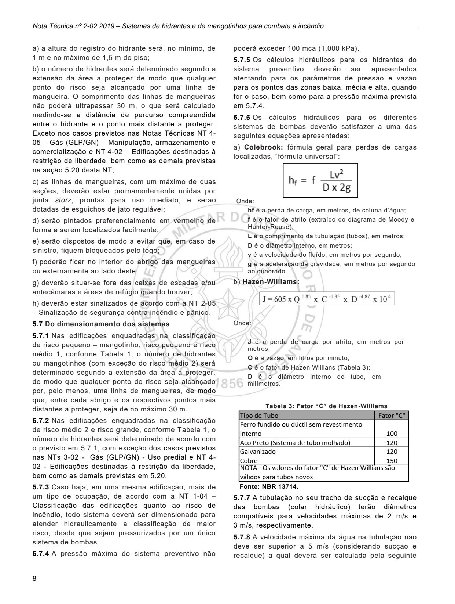

a) a altura do registro do hidrante será, no mínimo, de 1 m e no máximo de 1,5 m do piso;

b) o número de hidrantes será determinado segundo a extensão da área a proteger de modo que qualquer ponto do risco seja alcançado por uma linha de mangueira. O comprimento das linhas de mangueiras não poderá ultrapassar 30 m, o que será calculado medindo-se a distância de percurso compreendida entre o hidrante e o ponto mais distante a proteger. Exceto nos casos previstos nas Notas Técnicas NT 4- 05 - Gás (GLP/GN) - Manipulação, armazenamento e comercialização e NT 4-02 - Edificações destinadas à restrição de liberdade, bem como as demais previstas na seção 5.20 desta NT;

c) as linhas de mangueiras, com um máximo de duas seções, deverão estar permanentemente unidas por junta storz, prontas para uso imediato, e serão dotadas de esguichos de jato regulável;

d) serão pintados preferencialmente em vermelho de forma a serem localizados facilmente;

e) serão dispostos de modo a evitar que, em caso de sinistro, fiquem bloqueados pelo fogo;

f) poderão ficar no interior do abrigo das mangueiras ou externamente ao lado deste;

g) deverão situar-se fora das caixas de escadas e/ou antecâmaras e áreas de refúgio quando houver;

h) deverão estar sinalizados de acordo com a NT 2-05 - Sinalização de segurança contra incêndio e pânico.

5.7 Do dimensionamento dos sistemas

5.7.1 Nas edificações enquadradas na classificação de risco pequeno - mangotinho, risco pequeno e risco médio 1, conforme Tabela 1, o número de hidrantes ou mangotinhos (com exceção do risco médio 2) será determinado segundo a extensão da área a proteger, de modo que qualquer ponto do risco seja alcançado por, pelo menos, uma linha de mangueiras, de modo que, entre cada abrigo e os respectivos pontos mais distantes a proteger, seja de no máximo 30 m.

5.7.2 Nas edificações enquadradas na classificação de risco médio 2 e risco grande, conforme Tabela 1, o número de hidrantes será determinado de acordo com o previsto em 5.7.1, com exceção dos casos previstos nas NTs 3-02 - Gás (GLP/GN) - Uso predial e NT 4- 02 - Edificações destinadas à restrição da liberdade, bem como as demais previstas em 5.20.

5.7.3 Caso haja, em uma mesma edificação, mais de um tipo de ocupação, de acordo com a NT 1-04 - Classificação das edificações quanto ao risco de incêndio, todo sistema deverá ser dimensionado para atender hidraulicamente a classificação de maior risco, desde que sejam pressurizados por um único sistema de bombas.

5.7.4 A pressão máxima do sistema preventivo não

poderá exceder 100 mca (1.000 kPa).

5.7.5 Os cálculos hidráulicos para os hidrantes do sistema preventivo deverão ser apresentados atentando para os parâmetros de pressão e vazão para os pontos das zonas baixa, média e alta, quando for o caso, bem como para a pressão máxima prevista em 5.7.4.

5.7.6 Os cálculos hidráulicos para os diferentes sistemas de bombas deverão satisfazer a uma das seguintes equações apresentadas:

a) Colebrook: fórmula geral para perdas de cargas localizadas, “fórmula universal”:

Onde:

hf é a perda de carga, em metros, de coluna d’água;

f é o fator de atrito (extraído do diagrama de Moody e Hunter-Rouse);

L é o comprimento da tubulação (tubos), em metros;

D é o diâmetro interno, em metros;

v é a velocidade do fluído, em metros por segundo;

g é a aceleração da gravidade, em metros por segundo ao quadrado.

b) Hazen-Williams:

Onde:

J é a perda de carga por atrito, em metros por metros;

Q é a vazão, em litros por minuto;

C é o fator de Hazen Willians (Tabela 3);

D é o diâmetro interno do tubo, em milímetros.

Tabela 3: Fator “C” de Hazen-Williams

Fonte: NBR 13714.

5.7.7 A tubulação no seu trecho de sucção e recalque das bombas (colar hidráulico) terão diâmetros compatíveis para velocidades máximas de 2 m/s e 3 m/s, respectivamente.

5.7.8 A velocidade máxima da água na tubulação não deve ser superior a 5 m/s (considerando sucção e recalque) a qual deverá ser calculada pela seguinte

### Tabelas extraídas (bruto, não usar para citação)
#### Tabela 1 da página

| Tipo de Tubo | Fator "C" |
| --- | --- |
| Ferro fundido ou dúctil sem revestimento interno | 100 |
| Aço Preto (Sistema de tubo molhado) | 120 |
| Galvanizado | 120 |
| Cobre | 150 |
| NOTA - Os valores do fator "C" de Hazen Willians são válidos para tubos novos |  |

<!-- tabela-conferida: Tabela 3 p8 -->
### Tabela 3 — Fator "C" de Hazen-Williams (conferida)

| Tipo de Tubo | Fator "C" |
| --- | --- |
| Ferro fundido ou dúctil sem revestimento interno | 100 |
| Aço Preto (Sistema de tubo molhado) | 120 |
| Galvanizado | 120 |
| Cobre | 150 |

Fonte: NT 2-02, página 8, Tabela 3; conferida em 2026-09-29 (visual + texto).
Nota da tabela (fora da comparação): "Os valores do fator \"C\" de Hazen Willians são válidos para tubos novos". Fonte indicada: NBR 13714.
<!-- /tabela-conferida: Tabela 3 p8 -->

---

## Página 9

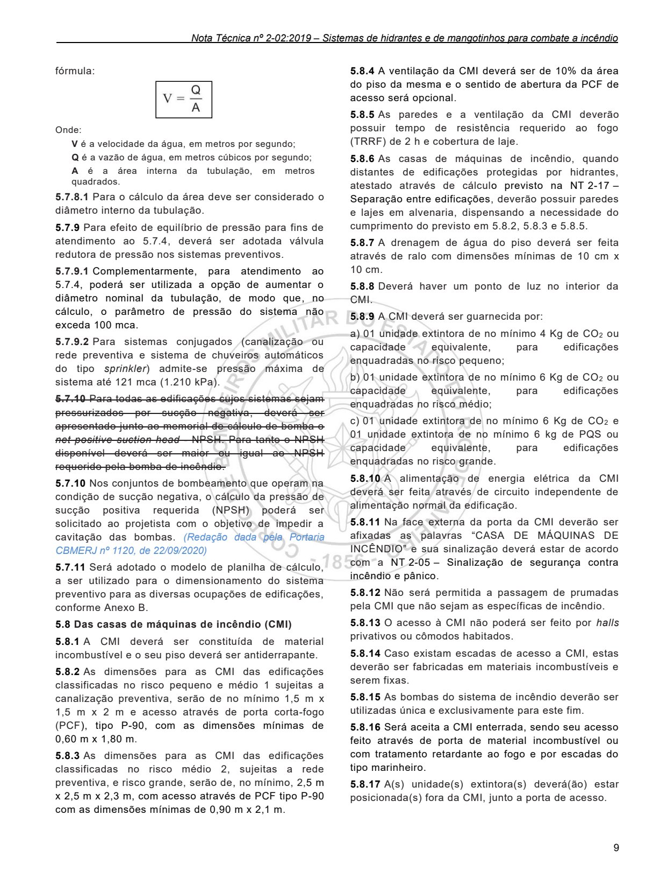

fórmula:

Onde:

V é a velocidade da água, em metros por segundo;

Q é a vazão de água, em metros cúbicos por segundo;

A é a área interna da tubulação, em metros quadrados.

5.7.8.1 Para o cálculo da área deve ser considerado o diâmetro interno da tubulação.

5.7.9 Para efeito de equilíbrio de pressão para fins de atendimento ao 5.7.4, deverá ser adotada válvula redutora de pressão nos sistemas preventivos.

5.7.9.1 Complementarmente, para atendimento ao 5.7.4, poderá ser utilizada a opção de aumentar o diâmetro nominal da tubulação, de modo que, no cálculo, o parâmetro de pressão do sistema não exceda 100 mca.

5.7.9.2 Para sistemas conjugados (canalização ou rede preventiva e sistema de chuveiros automáticos do tipo sprinkler) admite-se pressão máxima de sistema até 121 mca (1.210 kPa).

5.7.10 Para todas as edificações cujos sistemas sejam pressurizados por sucção negativa, deverá ser apresentado junto ao memorial de cálculo de bomba o net positive suction head - NPSH. Para tanto o NPSH disponível deverá ser maior ou igual ao NPSH requerido pela bomba de incêndio.

5.7.10 Nos conjuntos de bombeamento que operam na condição de sucção negativa, o cálculo da pressão de sucção positiva requerida (NPSH) poderá ser solicitado ao projetista com o objetivo de impedir a cavitação das bombas. (Redação dada pela Portaria CBMERJ nº 1120, de 22/09/2020)

5.7.11 Será adotado o modelo de planilha de cálculo, a ser utilizado para o dimensionamento do sistema preventivo para as diversas ocupações de edificações, conforme Anexo B.

5.8 Das casas de máquinas de incêndio (CMI)

5.8.1 A CMI deverá ser constituída de material incombustível e o seu piso deverá ser antiderrapante.

5.8.2 As dimensões para as CMI das edificações classificadas no risco pequeno e médio 1 sujeitas a canalização preventiva, serão de no mínimo 1,5 m x 1,5 m x 2 m e acesso através de porta corta-fogo (PCF), tipo P-90, com as dimensões mínimas de 0,60 m x 1,80 m.

5.8.3 As dimensões para as CMI das edificações classificadas no risco médio 2, sujeitas a rede preventiva, e risco grande, serão de, no mínimo, 2,5 m x 2,5 m x 2,3 m, com acesso através de PCF tipo P-90 com as dimensões mínimas de 0,90 m x 2,1 m.

5.8.4 A ventilação da CMI deverá ser de 10% da área do piso da mesma e o sentido de abertura da PCF de acesso será opcional.

5.8.5 As paredes e a ventilação da CMI deverão possuir tempo de resistência requerido ao fogo (TRRF) de 2 h e cobertura de laje.

5.8.6 As casas de máquinas de incêndio, quando distantes de edificações protegidas por hidrantes, atestado através de cálculo previsto na NT 2-17 - Separação entre edificações, deverão possuir paredes e lajes em alvenaria, dispensando a necessidade do cumprimento do previsto em 5.8.2, 5.8.3 e 5.8.5.

5.8.7 A drenagem de água do piso deverá ser feita através de ralo com dimensões mínimas de 10 cm x 10 cm.

5.8.8 Deverá haver um ponto de luz no interior da CMI.

5.8.9 A CMI deverá ser guarnecida por:

a) 01 unidade extintora de no mínimo 4 Kg de CO2 ou capacidade equivalente, para edificações enquadradas no risco pequeno;

b) 01 unidade extintora de no mínimo 6 Kg de CO2 ou capacidade equivalente, para edificações enquadradas no risco médio;

c) 01 unidade extintora de no mínimo 6 Kg de CO2 e 01 unidade extintora de no mínimo 6 kg de PQS ou capacidade equivalente, para edificações enquadradas no risco grande.

5.8.10 A alimentação de energia elétrica da CMI deverá ser feita através de circuito independente de alimentação normal da edificação.

5.8.11 Na face externa da porta da CMI deverão ser afixadas as palavras “CASA DE MÁQUINAS DE INCÊNDIO” e sua sinalização deverá estar de acordo com a NT 2-05 - Sinalização de segurança contra incêndio e pânico.

5.8.12 Não será permitida a passagem de prumadas pela CMI que não sejam as específicas de incêndio.

5.8.13 O acesso à CMI não poderá ser feito por halls privativos ou cômodos habitados.

5.8.14 Caso existam escadas de acesso a CMI, estas deverão ser fabricadas em materiais incombustíveis e serem fixas.

5.8.15 As bombas do sistema de incêndio deverão ser utilizadas única e exclusivamente para este fim.

5.8.16 Será aceita a CMI enterrada, sendo seu acesso feito através de porta de material incombustível ou com tratamento retardante ao fogo e por escadas do tipo marinheiro.

5.8.17 A(s) unidade(s) extintora(s) deverá(ão) estar posicionada(s) fora da CMI, junto a porta de acesso.

---

## Página 10

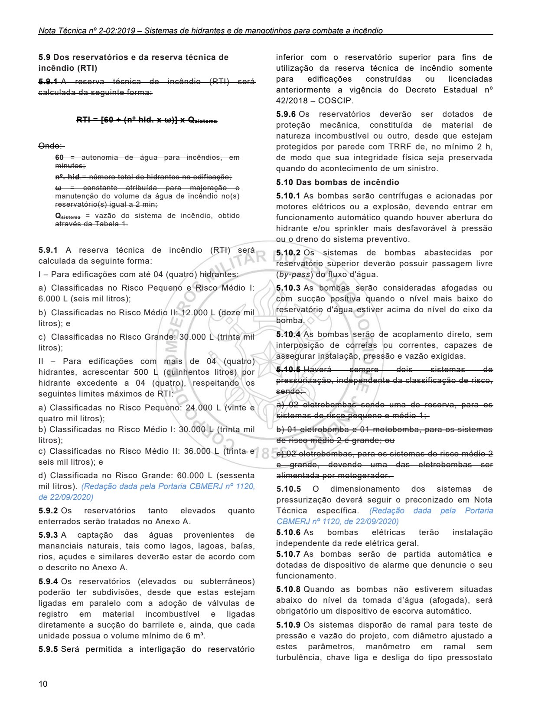

5.9 Dos reservatórios e da reserva técnica de incêndio (RTI)

5.9.1 A reserva técnica de incêndio (RTI) será calculada da seguinte forma:

RTI = [60 + (nº hid. x ω)] x Qsistema

Onde:

60 = autonomia de água para incêndios, em minutos;

nº. hid.= número total de hidrantes na edificação;

ω = constante atribuída para majoração e manutenção do volume da água de incêndio no(s) reservatório(s) igual a 2 min;

Qsistema = vazão do sistema de incêndio, obtido através da Tabela 1.

5.9.1 A reserva técnica de incêndio (RTI) será calculada da seguinte forma:

I - Para edificações com até 04 (quatro) hidrantes:

a) Classificadas no Risco Pequeno e Risco Médio I: 6.000 L (seis mil litros);

b) Classificadas no Risco Médio II: 12.000 L (doze mil litros); e

c) Classificadas no Risco Grande: 30.000 L (trinta mil litros);

II - Para edificações com mais de 04 (quatro) hidrantes, acrescentar 500 L (quinhentos litros) por hidrante excedente a 04 (quatro), respeitando os seguintes limites máximos de RTI:

a) Classificadas no Risco Pequeno: 24.000 L (vinte e quatro mil litros); b) Classificadas no Risco Médio I: 30.000 L (trinta mil litros); c) Classificadas no Risco Médio II: 36.000 L (trinta e seis mil litros); e

d) Classificada no Risco Grande: 60.000 L (sessenta mil litros). (Redação dada pela Portaria CBMERJ nº 1120, de 22/09/2020)

5.9.2 Os reservatórios tanto elevados quanto enterrados serão tratados no Anexo A.

5.9.3 A captação das águas provenientes de mananciais naturais, tais como lagos, lagoas, baías, rios, açudes e similares deverão estar de acordo com o descrito no Anexo A.

5.9.4 Os reservatórios (elevados ou subterrâneos) poderão ter subdivisões, desde que estas estejam ligadas em paralelo com a adoção de válvulas de registro em material incombustível e ligadas diretamente a sucção do barrilete e, ainda, que cada unidade possua o volume mínimo de 6 m³.

5.9.5 Será permitida a interligação do reservatório

inferior com o reservatório superior para fins de utilização da reserva técnica de incêndio somente para edificações construídas ou licenciadas anteriormente a vigência do Decreto Estadual nº 42/2018 - COSCIP.

5.9.6 Os reservatórios deverão ser dotados de proteção mecânica, constituída de material de natureza incombustível ou outro, desde que estejam protegidos por parede com TRRF de, no mínimo 2 h, de modo que sua integridade física seja preservada quando do acontecimento de um sinistro.

5.10 Das bombas de incêndio

5.10.1 As bombas serão centrífugas e acionadas por motores elétricos ou a explosão, devendo entrar em funcionamento automático quando houver abertura do hidrante e/ou sprinkler mais desfavorável à pressão ou o dreno do sistema preventivo.

5.10.2 Os sistemas de bombas abastecidas por reservatório superior deverão possuir passagem livre (by-pass) do fluxo d'água.

5.10.3 As bombas serão consideradas afogadas ou com sucção positiva quando o nível mais baixo do reservatório d'água estiver acima do nível do eixo da bomba.

5.10.4 As bombas serão de acoplamento direto, sem interposição de correias ou correntes, capazes de assegurar instalação, pressão e vazão exigidas.

5.10.5 Haverá sempre dois sistemas de pressurização, independente da classificação de risco, sendo:

a) 02 eletrobombas sendo uma de reserva, para os sistemas de risco pequeno e médio 1;

b) 01 eletrobomba e 01 motobomba, para os sistemas de risco médio 2 e grande; ou

c) 02 eletrobombas, para os sistemas de risco médio 2 e grande, devendo uma das eletrobombas ser alimentada por motogerador.

5.10.5 O dimensionamento dos sistemas de pressurização deverá seguir o preconizado em Nota Técnica específica. (Redação dada pela Portaria CBMERJ nº 1120, de 22/09/2020) 5.10.6 As bombas elétricas terão instalação independente da rede elétrica geral. 5.10.7 As bombas serão de partida automática e dotadas de dispositivo de alarme que denuncie o seu funcionamento.

5.10.8 Quando as bombas não estiverem situadas abaixo do nível da tomada d’água (afogada), será obrigatório um dispositivo de escorva automático.

5.10.9 Os sistemas disporão de ramal para teste de pressão e vazão do projeto, com diâmetro ajustado a estes parâmetros, manômetro em ramal sem turbulência, chave liga e desliga do tipo pressostato

---

## Página 11

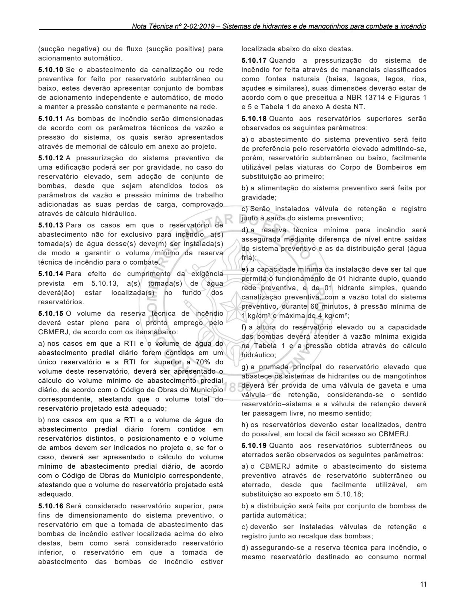

(sucção negativa) ou de fluxo (sucção positiva) para acionamento automático.

5.10.10 Se o abastecimento da canalização ou rede preventiva for feito por reservatório subterrâneo ou baixo, estes deverão apresentar conjunto de bombas de acionamento independente e automático, de modo a manter a pressão constante e permanente na rede.

5.10.11 As bombas de incêndio serão dimensionadas de acordo com os parâmetros técnicos de vazão e pressão do sistema, os quais serão apresentados através de memorial de cálculo em anexo ao projeto.

5.10.12 A pressurização do sistema preventivo de uma edificação poderá ser por gravidade, no caso do reservatório elevado, sem adoção de conjunto de bombas, desde que sejam atendidos todos os parâmetros de vazão e pressão mínima de trabalho adicionadas as suas perdas de carga, comprovado através de cálculo hidráulico.

5.10.13 Para os casos em que o reservatório de abastecimento não for exclusivo para incêndio, a(s) tomada(s) de água desse(s) deve(m) ser instalada(s) de modo a garantir o volume mínimo da reserva técnica de incêndio para o combate.

5.10.14 Para efeito de cumprimento da exigência prevista em 5.10.13, a(s) tomada(s) de água deverá(ão) estar localizada(s) no fundo dos reservatórios.

5.10.15 O volume da reserva técnica de incêndio deverá estar pleno para o pronto emprego pelo CBMERJ, de acordo com os itens abaixo:

a) nos casos em que a RTI e o volume de água do abastecimento predial diário forem contidos em um único reservatório e a RTI for superior a 70% do volume deste reservatório, deverá ser apresentado o cálculo do volume mínimo de abastecimento predial diário, de acordo com o Código de Obras do Município correspondente, atestando que o volume total do reservatório projetado está adequado;

b) nos casos em que a RTI e o volume de água do abastecimento predial diário forem contidos em reservatórios distintos, o posicionamento e o volume de ambos devem ser indicados no projeto e, se for o caso, deverá ser apresentado o cálculo do volume mínimo de abastecimento predial diário, de acordo com o Código de Obras do Município correspondente, atestando que o volume do reservatório projetado está adequado.

5.10.16 Será considerado reservatório superior, para fins de dimensionamento do sistema preventivo, o reservatório em que a tomada de abastecimento das bombas de incêndio estiver localizada acima do eixo destas, bem como será considerado reservatório inferior, o reservatório em que a tomada de abastecimento das bombas de incêndio estiver

localizada abaixo do eixo destas.

5.10.17 Quando a pressurização do sistema de incêndio for feita através de mananciais classificados como fontes naturais (baias, lagoas, lagos, rios, açudes e similares), suas dimensões deverão estar de acordo com o que preceitua a NBR 13714 e Figuras 1 e 5 e Tabela 1 do anexo A desta NT.

5.10.18 Quanto aos reservatórios superiores serão observados os seguintes parâmetros:

a) o abastecimento do sistema preventivo será feito de preferência pelo reservatório elevado admitindo-se, porém, reservatório subterrâneo ou baixo, facilmente utilizável pelas viaturas do Corpo de Bombeiros em substituição ao primeiro;

b) a alimentação do sistema preventivo será feita por gravidade;

c) Serão instalados válvula de retenção e registro junto à saída do sistema preventivo;

d) a reserva técnica mínima para incêndio será assegurada mediante diferença de nível entre saídas do sistema preventivo e as da distribuição geral (água fria);

e) a capacidade mínima da instalação deve ser tal que permita o funcionamento de 01 hidrante duplo, quando rede preventiva, e de 01 hidrante simples, quando canalização preventiva, com a vazão total do sistema preventivo, durante 60 minutos, à pressão mínima de 1 kg/cm² e máxima de 4 kg/cm²;

f) a altura do reservatório elevado ou a capacidade das bombas deverá atender à vazão mínima exigida na Tabela 1 e a pressão obtida através do cálculo hidráulico;

g) a prumada principal do reservatório elevado que abastece os sistemas de hidrantes ou de mangotinhos deverá ser provida de uma válvula de gaveta e uma válvula de retenção, considerando-se o sentido reservatório-sistema e a válvula de retenção deverá ter passagem livre, no mesmo sentido;

h) os reservatórios deverão estar localizados, dentro do possível, em local de fácil acesso ao CBMERJ.

5.10.19 Quanto aos reservatórios subterrâneos ou aterrados serão observados os seguintes parâmetros:

a) o CBMERJ admite o abastecimento do sistema preventivo através de reservatório subterrâneo ou aterrado, desde que facilmente utilizável, em substituição ao exposto em 5.10.18;

b) a distribuição será feita por conjunto de bombas de partida automática;

c) deverão ser instaladas válvulas de retenção e registro junto ao recalque das bombas;

d) assegurando-se a reserva técnica para incêndio, o mesmo reservatório destinado ao consumo normal

---

## Página 12

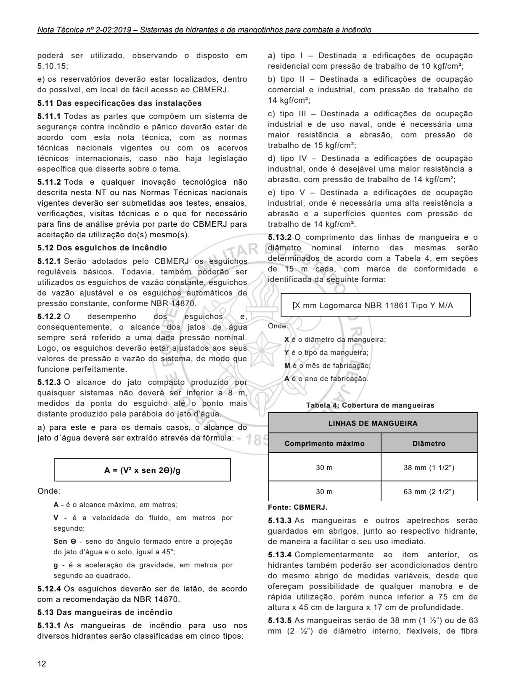

poderá ser utilizado, observando o disposto em 5.10.15;

e) os reservatórios deverão estar localizados, dentro do possível, em local de fácil acesso ao CBMERJ.

5.11 Das especificações das instalações

5.11.1 Todas as partes que compõem um sistema de segurança contra incêndio e pânico deverão estar de acordo com esta nota técnica, com as normas técnicas nacionais vigentes ou com os acervos técnicos internacionais, caso não haja legislação específica que disserte sobre o tema.

5.11.2 Toda e qualquer inovação tecnológica não descrita nesta NT ou nas Normas Técnicas nacionais vigentes deverão ser submetidas aos testes, ensaios, verificações, visitas técnicas e o que for necessário para fins de análise prévia por parte do CBMERJ para aceitação da utilização do(s) mesmo(s).

5.12 Dos esguichos de incêndio

5.12.1 Serão adotados pelo CBMERJ os esguichos reguláveis básicos. Todavia, também poderão ser utilizados os esguichos de vazão constante, esguichos de vazão ajustável e os esguichos automáticos de pressão constante, conforme NBR 14870.

5.12.2 O desempenho dos esguichos e, consequentemente, o alcance dos jatos de água sempre será referido a uma dada pressão nominal. Logo, os esguichos deverão estar ajustados aos seus valores de pressão e vazão do sistema, de modo que funcione perfeitamente.

5.12.3 O alcance do jato compacto produzido por quaisquer sistemas não deverá ser inferior a 8 m, medidos da ponta do esguicho até o ponto mais distante produzido pela parábola do jato d’água.

a) para este e para os demais casos, o alcance do jato d´água deverá ser extraído através da fórmula:

A = (V² x sen 2Ɵ)/g

Onde:

A - é o alcance máximo, em metros;

V - é a velocidade do fluido, em metros por segundo;

Sen Ɵ - seno do ângulo formado entre a projeção do jato d’água e o solo, igual a 45°;

g - é a aceleração da gravidade, em metros por segundo ao quadrado.

5.12.4 Os esguichos deverão ser de latão, de acordo com a recomendação da NBR 14870.

5.13 Das mangueiras de incêndio

5.13.1 As mangueiras de incêndio para uso nos diversos hidrantes serão classificadas em cinco tipos:

a) tipo I - Destinada a edificações de ocupação residencial com pressão de trabalho de 10 kgf/cm²;

b) tipo II - Destinada a edificações de ocupação comercial e industrial, com pressão de trabalho de 14 kgf/cm²;

c) tipo III - Destinada a edificações de ocupação industrial e de uso naval, onde é necessária uma maior resistência a abrasão, com pressão de trabalho de 15 kgf/cm²;

d) tipo IV - Destinada a edificações de ocupação industrial, onde é desejável uma maior resistência a abrasão, com pressão de trabalho de 14 kgf/cm²;

e) tipo V - Destinada a edificações de ocupação industrial, onde é necessária uma alta resistência a abrasão e a superfícies quentes com pressão de trabalho de 14 kgf/cm².

5.13.2 O comprimento das linhas de mangueira e o diâmetro nominal interno das mesmas serão determinados de acordo com a Tabela 4, em seções de 15 m cada, com marca de conformidade e identificada da seguinte forma:

[X mm Logomarca NBR 11861 Tipo Y M/A

Onde:

X é o diâmetro da mangueira;

Y é o tipo da mangueira;

M é o mês de fabricação;

A é o ano de fabricação.

Tabela 4: Cobertura de mangueiras

Fonte: CBMERJ.

5.13.3 As mangueiras e outros apetrechos serão guardados em abrigos, junto ao respectivo hidrante, de maneira a facilitar o seu uso imediato.

5.13.4 Complementarmente ao item anterior, os hidrantes também poderão ser acondicionados dentro do mesmo abrigo de medidas variáveis, desde que ofereçam possibilidade de qualquer manobra e de rápida utilização, porém nunca inferior a 75 cm de altura x 45 cm de largura x 17 cm de profundidade.

5.13.5 As mangueiras serão de 38 mm (1 ½”) ou de 63 mm (2 ½”) de diâmetro interno, flexíveis, de fibra

### Tabelas extraídas (bruto, não usar para citação)
#### Tabela 1 da página

| LINHAS DE MANGUEIRA |  |
| --- | --- |
| Comprimento máximo | Diâmetro |
|  |  |
| 30 m | 38 mm (1 1/2”) |
|  |  |
| 30 m | 63 mm (2 1/2”) |

<!-- tabela-conferida: Tabela 4 p12 -->
### Tabela 4 — Cobertura de mangueiras (conferida)

| Linhas de mangueira — comprimento máximo | Linhas de mangueira — diâmetro |
| --- | --- |
| 30 m | 38 mm (1 1/2”) |
| 30 m | 63 mm (2 1/2”) |

Fonte: NT 2-02, página 12, Tabela 4; conferida em 2026-09-29 (visual + texto).
Fonte indicada: CBMERJ. Seções de 15 m (5.13.2).
<!-- /tabela-conferida: Tabela 4 p12 -->

---

## Página 13

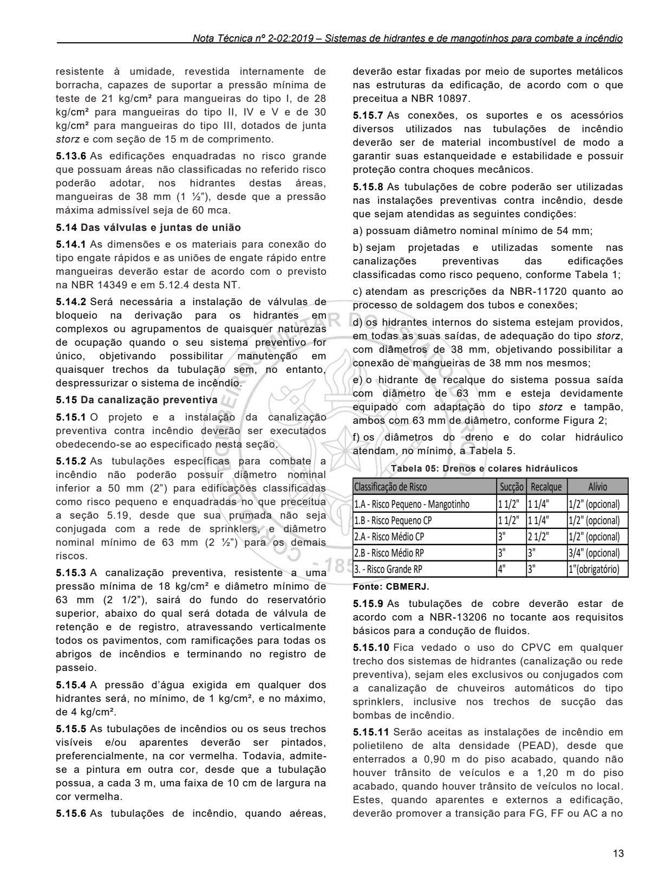

resistente à umidade, revestida internamente de borracha, capazes de suportar a pressão mínima de teste de 21 kg/cm² para mangueiras do tipo I, de 28 kg/cm² para mangueiras do tipo II, IV e V e de 30 kg/cm² para mangueiras do tipo III, dotados de junta storz e com seção de 15 m de comprimento.

5.13.6 As edificações enquadradas no risco grande que possuam áreas não classificadas no referido risco poderão adotar, nos hidrantes destas áreas, mangueiras de 38 mm (1 ½”), desde que a pressão máxima admissível seja de 60 mca.

5.14 Das válvulas e juntas de união

5.14.1 As dimensões e os materiais para conexão do tipo engate rápidos e as uniões de engate rápido entre mangueiras deverão estar de acordo com o previsto na NBR 14349 e em 5.12.4 desta NT.

5.14.2 Será necessária a instalação de válvulas de bloqueio na derivação para os hidrantes em complexos ou agrupamentos de quaisquer naturezas de ocupação quando o seu sistema preventivo for único, objetivando possibilitar manutenção em quaisquer trechos da tubulação sem, no entanto, despressurizar o sistema de incêndio.

5.15 Da canalização preventiva

5.15.1 O projeto e a instalação da canalização preventiva contra incêndio deverão ser executados obedecendo-se ao especificado nesta seção.

5.15.2 As tubulações específicas para combate a incêndio não poderão possuir diâmetro nominal inferior a 50 mm (2”) para edificações classificadas como risco pequeno e enquadradas no que preceitua a seção 5.19, desde que sua prumada não seja conjugada com a rede de sprinklers, e diâmetro nominal mínimo de 63 mm (2 ½”) para os demais riscos.

5.15.3 A canalização preventiva, resistente a uma pressão mínima de 18 kg/cm² e diâmetro mínimo de 63 mm (2 1/2”), sairá do fundo do reservatório superior, abaixo do qual será dotada de válvula de retenção e de registro, atravessando verticalmente todos os pavimentos, com ramificações para todas os abrigos de incêndios e terminando no registro de passeio.

5.15.4 A pressão d’água exigida em qualquer dos hidrantes será, no mínimo, de 1 kg/cm², e no máximo, de 4 kg/cm².

5.15.5 As tubulações de incêndios ou os seus trechos visíveis e/ou aparentes deverão ser pintados, preferencialmente, na cor vermelha. Todavia, admitese a pintura em outra cor, desde que a tubulação possua, a cada 3 m, uma faixa de 10 cm de largura na cor vermelha.

5.15.6 As tubulações de incêndio, quando aéreas,

deverão estar fixadas por meio de suportes metálicos nas estruturas da edificação, de acordo com o que preceitua a NBR 10897.

5.15.7 As conexões, os suportes e os acessórios diversos utilizados nas tubulações de incêndio deverão ser de material incombustível de modo a garantir suas estanqueidade e estabilidade e possuir proteção contra choques mecânicos.

5.15.8 As tubulações de cobre poderão ser utilizadas nas instalações preventivas contra incêndio, desde que sejam atendidas as seguintes condições:

a) possuam diâmetro nominal mínimo de 54 mm;

b) sejam projetadas e utilizadas somente nas canalizações preventivas das edificações classificadas como risco pequeno, conforme Tabela 1;

c) atendam as prescrições da NBR-11720 quanto ao processo de soldagem dos tubos e conexões;

d) os hidrantes internos do sistema estejam providos, em todas as suas saídas, de adequação do tipo storz, com diâmetros de 38 mm, objetivando possibilitar a conexão de mangueiras de 38 mm nos mesmos;

e) o hidrante de recalque do sistema possua saída com diâmetro de 63 mm e esteja devidamente equipado com adaptação do tipo storz e tampão, ambos com 63 mm de diâmetro, conforme Figura 2;

f) os diâmetros do dreno e do colar hidráulico atendam, no mínimo, a Tabela 5.

Tabela 05: Drenos e colares hidráulicos

Fonte: CBMERJ.

5.15.9 As tubulações de cobre deverão estar de acordo com a NBR-13206 no tocante aos requisitos básicos para a condução de fluidos.

5.15.10 Fica vedado o uso do CPVC em qualquer trecho dos sistemas de hidrantes (canalização ou rede preventiva), sejam eles exclusivos ou conjugados com a canalização de chuveiros automáticos do tipo sprinklers, inclusive nos trechos de sucção das bombas de incêndio.

5.15.11 Serão aceitas as instalações de incêndio em polietileno de alta densidade (PEAD), desde que enterrados a 0,90 m do piso acabado, quando não houver trânsito de veículos e a 1,20 m do piso acabado, quando houver trânsito de veículos no local. Estes, quando aparentes e externos a edificação, deverão promover a transição para FG, FF ou AC a no

### Tabelas extraídas (bruto, não usar para citação)
#### Tabela 1 da página

| Classificação de Risco | Sucção | Recalque | Alívio |
| --- | --- | --- | --- |
| 1.A - Risco Pequeno - Mangotinho | 1 1/2" | 1 1/4" | 1/2" (opcional) |
| 1.B - Risco Pequeno CP 2.A - Risco Médio CP | 1 1/2" 3" | 1 1/4" 2 1/2" | 1/2" (opcional) 1/2" (opcional) |
| 2.B - Risco Médio RP 3. - Risco Grande RP | 3" 4" | 3" 3" | 3/4" (opcional) 1"(obrigatório) |

---

## Página 14

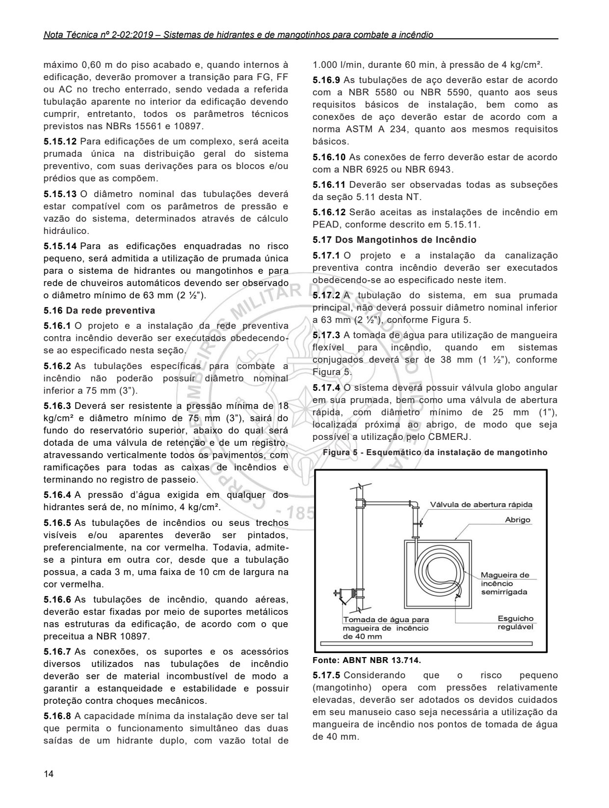

máximo 0,60 m do piso acabado e, quando internos à edificação, deverão promover a transição para FG, FF ou AC no trecho enterrado, sendo vedada a referida tubulação aparente no interior da edificação devendo cumprir, entretanto, todos os parâmetros técnicos previstos nas NBRs 15561 e 10897.

5.15.12 Para edificações de um complexo, será aceita prumada única na distribuição geral do sistema preventivo, com suas derivações para os blocos e/ou prédios que as compõem.

5.15.13 O diâmetro nominal das tubulações deverá estar compatível com os parâmetros de pressão e vazão do sistema, determinados através de cálculo hidráulico.

5.15.14 Para as edificações enquadradas no risco pequeno, será admitida a utilização de prumada única para o sistema de hidrantes ou mangotinhos e para rede de chuveiros automáticos devendo ser observado o diâmetro mínimo de 63 mm (2 ½”).

5.16 Da rede preventiva

5.16.1 O projeto e a instalação da rede preventiva contra incêndio deverão ser executados obedecendose ao especificado nesta seção.

5.16.2 As tubulações específicas para combate a incêndio não poderão possuir diâmetro nominal inferior a 75 mm (3”).

5.16.3 Deverá ser resistente a pressão mínima de 18 kg/cm² e diâmetro mínimo de 75 mm (3”), sairá do fundo do reservatório superior, abaixo do qual será dotada de uma válvula de retenção e de um registro, atravessando verticalmente todos os pavimentos, com ramificações para todas as caixas de incêndios e terminando no registro de passeio.

5.16.4 A pressão d’água exigida em qualquer dos hidrantes será de, no mínimo, 4 kg/cm².

5.16.5 As tubulações de incêndios ou seus trechos visíveis e/ou aparentes deverão ser pintados, preferencialmente, na cor vermelha. Todavia, admitese a pintura em outra cor, desde que a tubulação possua, a cada 3 m, uma faixa de 10 cm de largura na cor vermelha.

5.16.6 As tubulações de incêndio, quando aéreas, deverão estar fixadas por meio de suportes metálicos nas estruturas da edificação, de acordo com o que preceitua a NBR 10897.

5.16.7 As conexões, os suportes e os acessórios diversos utilizados nas tubulações de incêndio deverão ser de material incombustível de modo a garantir a estanqueidade e estabilidade e possuir proteção contra choques mecânicos.

5.16.8 A capacidade mínima da instalação deve ser tal que permita o funcionamento simultâneo das duas saídas de um hidrante duplo, com vazão total de

1.000 l/min, durante 60 min, à pressão de 4 kg/cm².

5.16.9 As tubulações de aço deverão estar de acordo com a NBR 5580 ou NBR 5590, quanto aos seus requisitos básicos de instalação, bem como as conexões de aço deverão estar de acordo com a norma ASTM A 234, quanto aos mesmos requisitos básicos.

5.16.10 As conexões de ferro deverão estar de acordo com a NBR 6925 ou NBR 6943.

5.16.11 Deverão ser observadas todas as subseções da seção 5.11 desta NT.

5.16.12 Serão aceitas as instalações de incêndio em PEAD, conforme descrito em 5.15.11.

5.17 Dos Mangotinhos de Incêndio

5.17.1 O projeto e a instalação da canalização preventiva contra incêndio deverão ser executados obedecendo-se ao especificado neste item.

5.17.2 A tubulação do sistema, em sua prumada principal, não deverá possuir diâmetro nominal inferior a 63 mm (2 ½”), conforme Figura 5.

5.17.3 A tomada de água para utilização de mangueira flexível para incêndio, quando em sistemas conjugados deverá ser de 38 mm (1 ½”), conforme Figura 5.

5.17.4 O sistema deverá possuir válvula globo angular em sua prumada, bem como uma válvula de abertura rápida, com diâmetro mínimo de 25 mm (1”), localizada próxima ao abrigo, de modo que seja possível a utilização pelo CBMERJ.

Figura 5 - Esquemático da instalação de mangotinho

Fonte: ABNT NBR 13.714.

5.17.5 Considerando que o risco pequeno (mangotinho) opera com pressões relativamente elevadas, deverão ser adotados os devidos cuidados em seu manuseio caso seja necessária a utilização da mangueira de incêndio nos pontos de tomada de água de 40 mm.

---

## Página 15

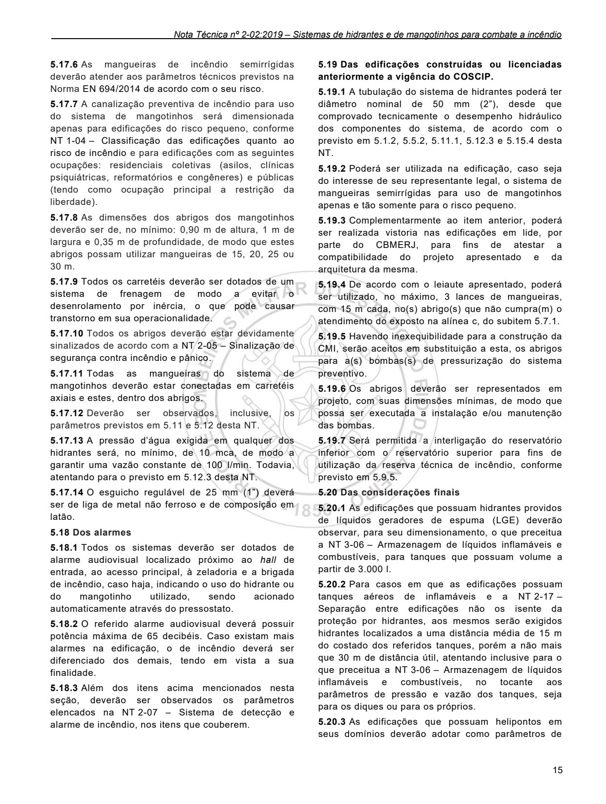

5.17.6 As mangueiras de incêndio semirrígidas deverão atender aos parâmetros técnicos previstos na Norma EN 694/2014 de acordo com o seu risco.

5.17.7 A canalização preventiva de incêndio para uso do sistema de mangotinhos será dimensionada apenas para edificações do risco pequeno, conforme NT 1-04 - Classificação das edificações quanto ao risco de incêndio e para edificações com as seguintes ocupações: residenciais coletivas (asilos, clínicas psiquiátricas, reformatórios e congêneres) e públicas (tendo como ocupação principal a restrição da liberdade).

5.17.8 As dimensões dos abrigos dos mangotinhos deverão ser de, no mínimo: 0,90 m de altura, 1 m de largura e 0,35 m de profundidade, de modo que estes abrigos possam utilizar mangueiras de 15, 20, 25 ou 30 m.

5.17.9 Todos os carretéis deverão ser dotados de um sistema de frenagem de modo a evitar o desenrolamento por inércia, o que pode causar transtorno em sua operacionalidade.

5.17.10 Todos os abrigos deverão estar devidamente sinalizados de acordo com a NT 2-05 - Sinalização de segurança contra incêndio e pânico.

5.17.11 Todas as mangueiras do sistema de mangotinhos deverão estar conectadas em carretéis axiais e estes, dentro dos abrigos.

5.17.12 Deverão ser observados, inclusive, os parâmetros previstos em 5.11 e 5.12 desta NT.

5.17.13 A pressão d’água exigida em qualquer dos hidrantes será, no mínimo, de 10 mca, de modo a garantir uma vazão constante de 100 l/min. Todavia, atentando para o previsto em 5.12.3 desta NT.

5.17.14 O esguicho regulável de 25 mm (1”) deverá ser de liga de metal não ferroso e de composição em latão.

5.18 Dos alarmes

5.18.1 Todos os sistemas deverão ser dotados de alarme audiovisual localizado próximo ao hall de entrada, ao acesso principal, à zeladoria e a brigada de incêndio, caso haja, indicando o uso do hidrante ou do mangotinho utilizado, sendo acionado automaticamente através do pressostato.

5.18.2 O referido alarme audiovisual deverá possuir potência máxima de 65 decibéis. Caso existam mais alarmes na edificação, o de incêndio deverá ser diferenciado dos demais, tendo em vista a sua finalidade.

5.18.3 Além dos itens acima mencionados nesta seção, deverão ser observados os parâmetros elencados na NT 2-07 - Sistema de detecção e alarme de incêndio, nos itens que couberem.

5.19 Das edificações construídas ou licenciadas anteriormente a vigência do COSCIP.

5.19.1 A tubulação do sistema de hidrantes poderá ter diâmetro nominal de 50 mm (2”), desde que comprovado tecnicamente o desempenho hidráulico dos componentes do sistema, de acordo com o previsto em 5.1.2, 5.5.2, 5.11.1, 5.12.3 e 5.15.4 desta NT.

5.19.2 Poderá ser utilizada na edificação, caso seja do interesse de seu representante legal, o sistema de mangueiras semirrígidas para uso de mangotinhos apenas e tão somente para o risco pequeno.

5.19.3 Complementarmente ao item anterior, poderá ser realizada vistoria nas edificações em lide, por parte do CBMERJ, para fins de atestar a compatibilidade do projeto apresentado e da arquitetura da mesma.

5.19.4 De acordo com o leiaute apresentado, poderá ser utilizado, no máximo, 3 lances de mangueiras, com 15 m cada, no(s) abrigo(s) que não cumpra(m) o atendimento do exposto na alínea c, do subitem 5.7.1.

5.19.5 Havendo inexequibilidade para a construção da CMI, serão aceitos em substituição a esta, os abrigos para a(s) bombas(s) de pressurização do sistema preventivo.

5.19.6 Os abrigos deverão ser representados em projeto, com suas dimensões mínimas, de modo que possa ser executada a instalação e/ou manutenção das bombas.

5.19.7 Será permitida a interligação do reservatório inferior com o reservatório superior para fins de utilização da reserva técnica de incêndio, conforme previsto em 5.9.5.

5.20 Das considerações finais

5.20.1 As edificações que possuam hidrantes providos de líquidos geradores de espuma (LGE) deverão observar, para seu dimensionamento, o que preceitua a NT 3-06 - Armazenagem de líquidos inflamáveis e combustíveis, para tanques que possuam volume a partir de 3.000 l.

5.20.2 Para casos em que as edificações possuam tanques aéreos de inflamáveis e a NT 2-17 - Separação entre edificações não os isente da proteção por hidrantes, aos mesmos serão exigidos hidrantes localizados a uma distância média de 15 m do costado dos referidos tanques, porém a não mais que 30 m de distância útil, atentando inclusive para o que preceitua a NT 3-06 - Armazenagem de líquidos inflamáveis e combustíveis, no tocante aos parâmetros de pressão e vazão dos tanques, seja para os diques ou para os próprios.

5.20.3 As edificações que possuam helipontos em seus domínios deverão adotar como parâmetros de

---

## Página 16

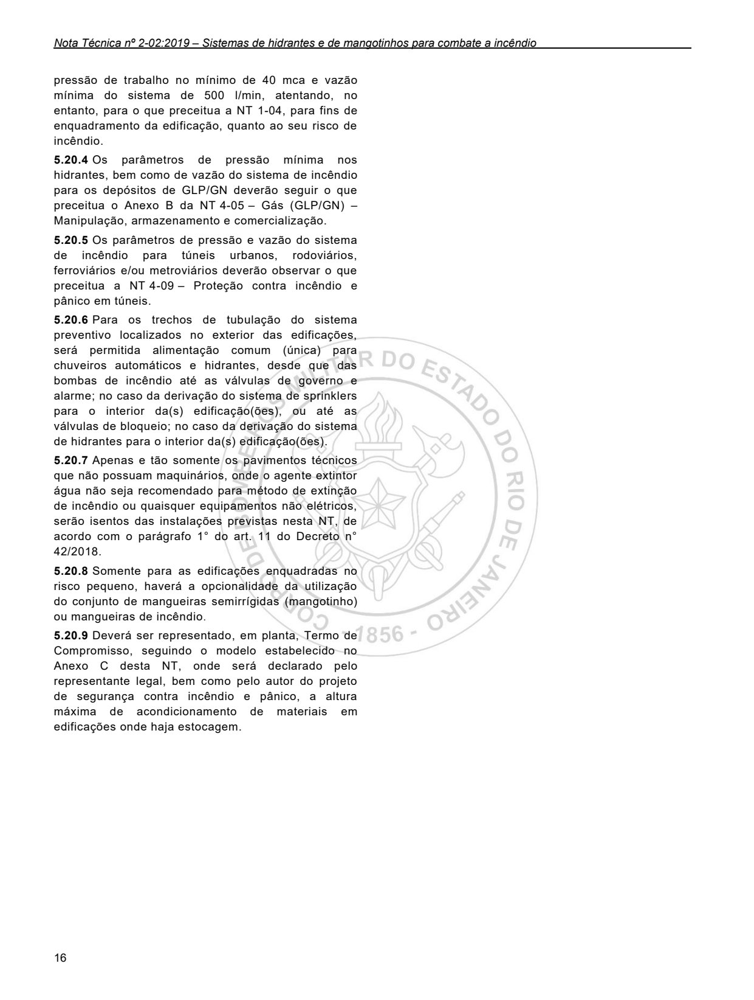

pressão de trabalho no mínimo de 40 mca e vazão mínima do sistema de 500 l/min, atentando, no entanto, para o que preceitua a NT 1-04, para fins de enquadramento da edificação, quanto ao seu risco de incêndio.

5.20.4 Os parâmetros de pressão mínima nos hidrantes, bem como de vazão do sistema de incêndio para os depósitos de GLP/GN deverão seguir o que preceitua o Anexo B da NT 4-05 - Gás (GLP/GN) - Manipulação, armazenamento e comercialização.

5.20.5 Os parâmetros de pressão e vazão do sistema de incêndio para túneis urbanos, rodoviários, ferroviários e/ou metroviários deverão observar o que preceitua a NT 4-09 - Proteção contra incêndio e pânico em túneis.

5.20.6 Para os trechos de tubulação do sistema preventivo localizados no exterior das edificações, será permitida alimentação comum (única) para chuveiros automáticos e hidrantes, desde que das bombas de incêndio até as válvulas de governo e alarme; no caso da derivação do sistema de sprinklers para o interior da(s) edificação(ões), ou até as válvulas de bloqueio; no caso da derivação do sistema de hidrantes para o interior da(s) edificação(ões).

5.20.7 Apenas e tão somente os pavimentos técnicos que não possuam maquinários, onde o agente extintor água não seja recomendado para método de extinção de incêndio ou quaisquer equipamentos não elétricos, serão isentos das instalações previstas nesta NT, de acordo com o parágrafo 1° do art. 11 do Decreto n° 42/2018.

5.20.8 Somente para as edificações enquadradas no risco pequeno, haverá a opcionalidade da utilização do conjunto de mangueiras semirrígidas (mangotinho) ou mangueiras de incêndio.

5.20.9 Deverá ser representado, em planta, Termo de Compromisso, seguindo o modelo estabelecido no Anexo C desta NT, onde será declarado pelo representante legal, bem como pelo autor do projeto de segurança contra incêndio e pânico, a altura máxima de acondicionamento de materiais em edificações onde haja estocagem.

---

## Página 17

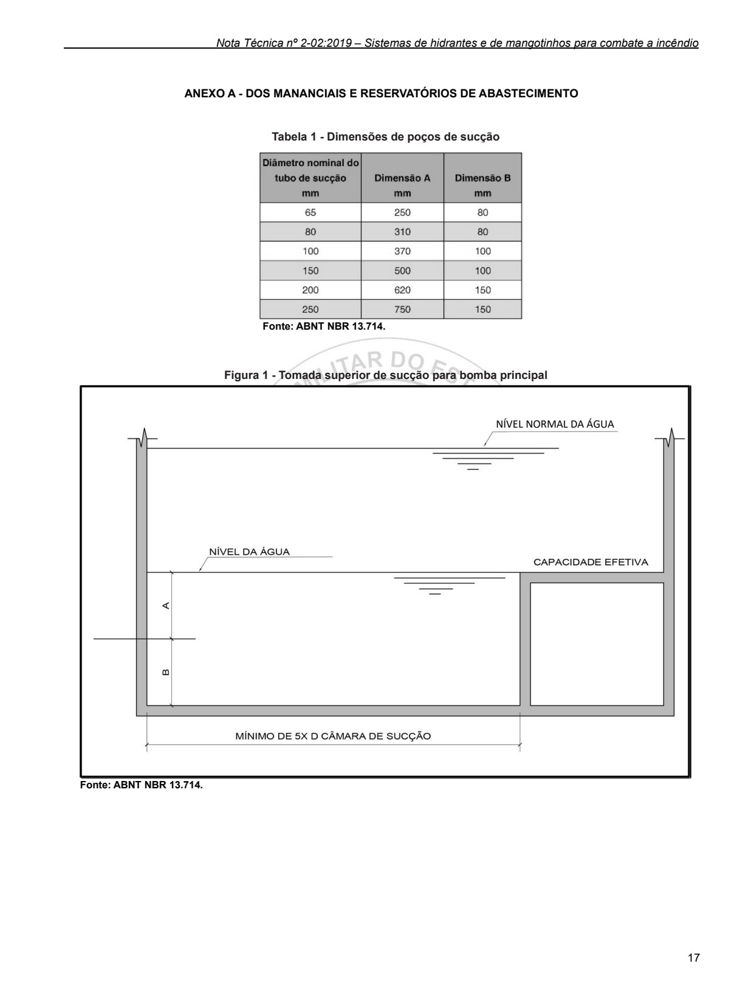

### ANEXO A - DOS MANANCIAIS E RESERVATÓRIOS DE ABASTECIMENTO

Tabela 1 - Dimensões de poços de sucção

Fonte: ABNT NBR 13.714.

Figura 1 - Tomada superior de sucção para bomba principal

### NÍVEL NORMAL DA ÁGUA

Fonte: ABNT NBR 13.714.

---

## Página 18

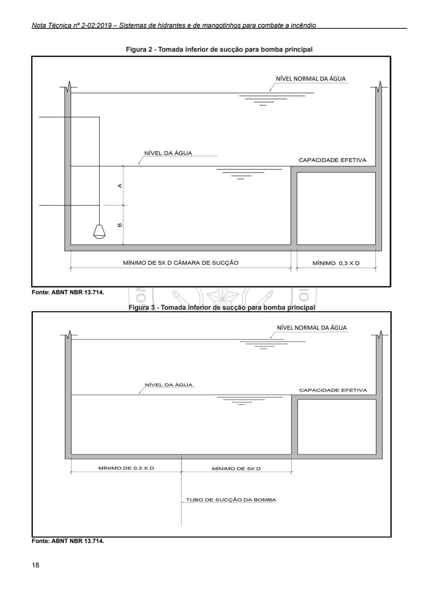

Figura 2 - Tomada inferior de sucção para bomba principal

### NÍVEL NORMAL DA ÁGUA

Fonte: ABNT NBR 13.714.

Figura 3 - Tomada inferior de sucção para bomba principal

### NÍVEL NORMAL DA ÁGUA

Fonte: ABNT NBR 13.714.

---

## Página 19

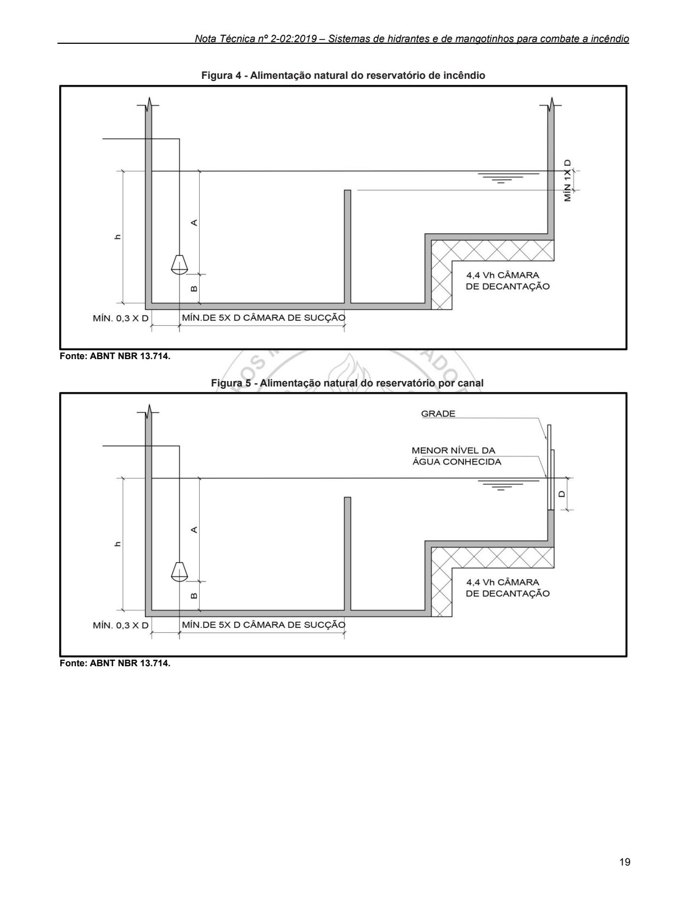

Figura 4 - Alimentação natural do reservatório de incêndio

Fonte: ABNT NBR 13.714.

Figura 5 - Alimentação natural do reservatório por canal

Fonte: ABNT NBR 13.714.

---

## Página 20

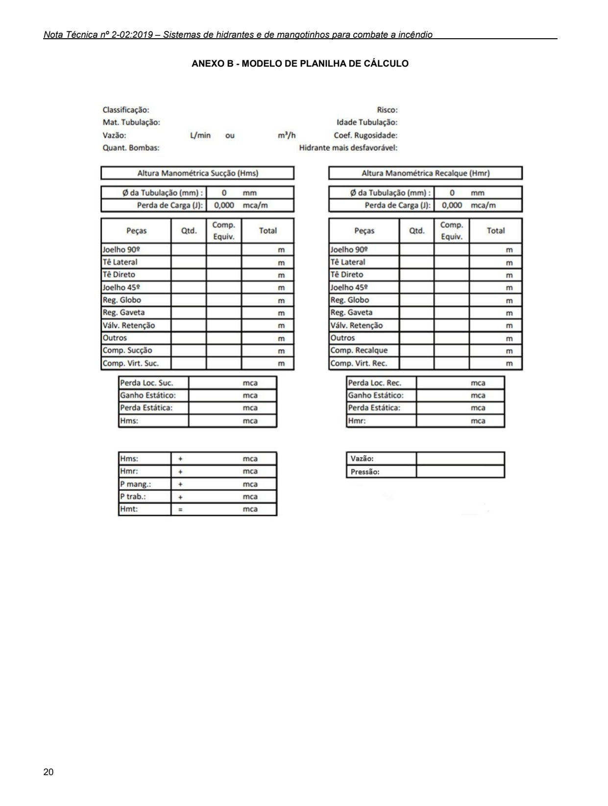

### ANEXO B - MODELO DE PLANILHA DE CÁLCULO

---

## Página 21

### ANEXO C - MODELO DE TERMO DE COMPROMISSO

### TERMO DE COMPROMISSO

(Declaração do responsável legal pelo uso da edificação/estabelecimento e do autor do projeto de segurança contra incêndio e pânico, para a aprovação da mesma, no tocante a altura de estocagem dos materiais acondicionados, conforme item 5.20.7 da NT nº 2-02:2017 - Sistemas de hidrantes e de mangotinhos para combate a incêndio)

Os abaixo assinados: 1) _______________________________________________________________________________________, responsável (nome completo, número do CPF ou da cédula de identificação) legal pelo uso da edificação situada ____________________________________________________________________

(endereço), sob o CPF/CNPJ ________________________________;

2) ____________________________________________________________________________________________, autor

(nome completo, habilitação e número de registro junto ao CREA ou CAU) do projeto de segurança contra incêndio da edificação/estabelecimento;

declaram, sob as penas das leis e dos regulamentos vigentes, sujeitando-se, no caso de descumprimento, às

sanções previstas, que a edificação em tela não possuirá altura de estocagem superior a 3,50 m (três metros e cinqüenta

centímetros).

Rio de Janeiro, ____ de _________________ de ________

_______________________________________________________________

### (RESPONSÁVEL PELO USO DA EDIFICAÇÃO/ESTABELECIMENTO)

_____________________________________________________________

### (AUTOR DO PROJETO DE SEGURANÇA CONTRA INCÊNDIO E PÂNICO)
