# NT 2-03 - Parte 2 - Sistemas de chuveiros automáticos / sprinklers - Áreas de armazenamento

> Conversão integral para consulta computacional. A numeração de página do PDF foi preservada. Quando houver tabela complexa, símbolo ou desenho, conferir também a representação visual indicada e o PDF oficial.

## Sumário por página

- [Página 1](#pagina-1)
- [Página 2](#pagina-2)
- [Página 3](#pagina-3)
- [Página 4](#pagina-4)
- [Página 5](#pagina-5)
- [Página 6](#pagina-6)
- [Página 7](#pagina-7)
- [Página 8](#pagina-8)
- [Página 9](#pagina-9)
- [Página 10](#pagina-10)
- [Página 11](#pagina-11)
- [Página 12](#pagina-12)
- [Página 13](#pagina-13)
- [Página 14](#pagina-14)
- [Página 15](#pagina-15)
- [Página 16](#pagina-16)
- [Página 17](#pagina-17)
- [Página 18](#pagina-18)
- [Página 19](#pagina-19)
- [Página 20](#pagina-20)
- [Página 21](#pagina-21)
- [Página 22](#pagina-22)

---

## Página 1

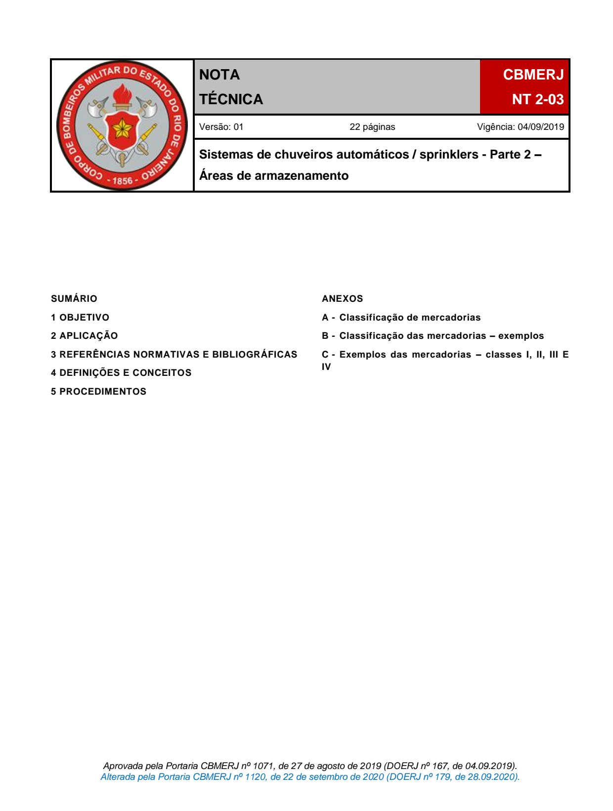

Aprovada pela Portaria CBMERJ nº 1071, de 27 de agosto de 2019 (DOERJ nº 167, de 04.09.2019). Alterada pela Portaria CBMERJ nº 1120, de 22 de setembro de 2020 (DOERJ nº 179, de 28.09.2020).

### SUMÁRIO

### 1 OBJETIVO

### 2 APLICAÇÃO

### 3 REFERÊNCIAS NORMATIVAS E BIBLIOGRÁFICAS

### 4 DEFINIÇÕES E CONCEITOS

### 5 PROCEDIMENTOS

### ANEXOS

A - Classificação de mercadorias

B - Classificação das mercadorias - exemplos

C - Exemplos das mercadorias - classes I, II, III E IV

### Tabelas extraídas

#### Tabela 1 da página

|  |  | NOTA |  |  | CBMERJ |  |
| --- | --- | --- | --- | --- | --- | --- |
|  |  | TÉCNICA |  |  | NT 2-03 |  |
|  | Versão: 01 22 páginas Vigência: 04/09/2019 |  |  |  |  |  |
|  | Sistemas de chuveiros automáticos / sprinklers - Parte 2 - Áreas de armazenamento |  |  |  |  |  |

---

## Página 2

Corpo de Bombeiros Militar do Estado do Rio de Janeiro CBMERJ Praça da República, nº 45, Centro, Rio de Janeiro - RJ. CEP: 20.211-350. www.cbmerj.rj.gov.br

http://www.cbmerj.rj.gov.br/notas-tecnicas

---

## Página 3

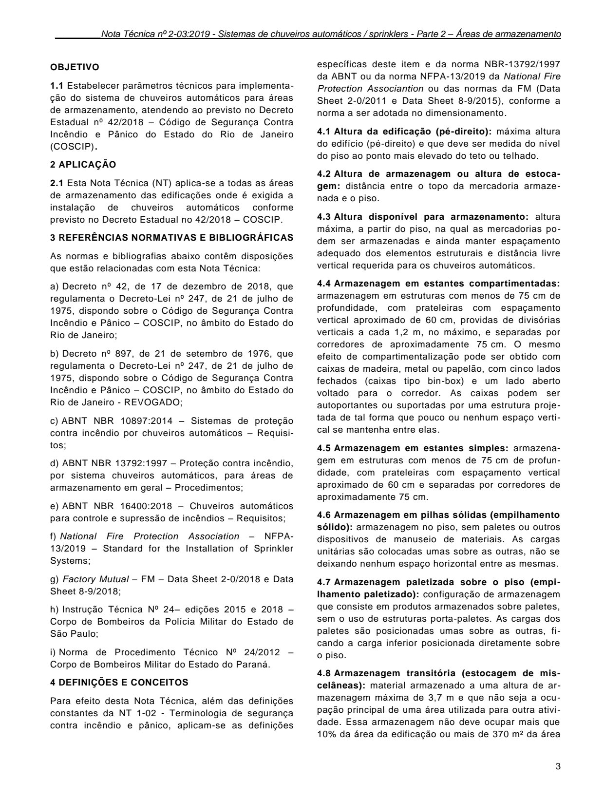

### OBJETIVO

1.1 Estabelecer parâmetros técnicos para implementação do sistema de chuveiros automáticos para áreas de armazenamento, atendendo ao previsto no Decreto Estadual nº 42/2018 - Código de Segurança Contra Incêndio e Pânico do Estado do Rio de Janeiro (COSCIP).

### 2 APLICAÇÃO

2.1 Esta Nota Técnica (NT) aplica-se a todas as áreas de armazenamento das edificações onde é exigida a instalação de chuveiros automáticos conforme previsto no Decreto Estadual no 42/2018 - COSCIP.

### 3 REFERÊNCIAS NORMATIVAS E BIBLIOGRÁFICAS

As normas e bibliografias abaixo contêm disposições que estão relacionadas com esta Nota Técnica:

a) Decreto nº 42, de 17 de dezembro de 2018, que regulamenta o Decreto-Lei nº 247, de 21 de julho de 1975, dispondo sobre o Código de Segurança Contra Incêndio e Pânico - COSCIP, no âmbito do Estado do Rio de Janeiro;

b) Decreto nº 897, de 21 de setembro de 1976, que regulamenta o Decreto-Lei nº 247, de 21 de julho de 1975, dispondo sobre o Código de Segurança Contra Incêndio e Pânico - COSCIP, no âmbito do Estado do Rio de Janeiro - REVOGADO;

c) ABNT NBR 10897:2014 - Sistemas de proteção contra incêndio por chuveiros automáticos - Requisitos;

d) ABNT NBR 13792:1997 - Proteção contra incêndio, por sistema chuveiros automáticos, para áreas de armazenamento em geral - Procedimentos;

e) ABNT NBR 16400:2018 - Chuveiros automáticos para controle e supressão de incêndios - Requisitos;

f) National Fire Protection Association - NFPA- 13/2019 - Standard for the Installation of Sprinkler Systems;

g) Factory Mutual - FM - Data Sheet 2-0/2018 e Data Sheet 8-9/2018;

h) Instrução Técnica Nº 24- edições 2015 e 2018 - Corpo de Bombeiros da Polícia Militar do Estado de São Paulo;

i) Norma de Procedimento Técnico Nº 24/2012 - Corpo de Bombeiros Militar do Estado do Paraná.

### 4 DEFINIÇÕES E CONCEITOS

Para efeito desta Nota Técnica, além das definições constantes da NT 1-02 - Terminologia de segurança contra incêndio e pânico, aplicam-se as definições

específicas deste item e da norma NBR-13792/1997 da ABNT ou da norma NFPA-13/2019 da National Fire Protection Associantion ou das normas da FM (Data Sheet 2-0/2011 e Data Sheet 8-9/2015), conforme a norma a ser adotada no dimensionamento.

4.1 Altura da edificação (pé-direito): máxima altura do edifício (pé-direito) e que deve ser medida do nível do piso ao ponto mais elevado do teto ou telhado.

4.2 Altura de armazenagem ou altura de estocagem: distância entre o topo da mercadoria armazenada e o piso.

4.3 Altura disponível para armazenamento: altura máxima, a partir do piso, na qual as mercadorias podem ser armazenadas e ainda manter espaçamento adequado dos elementos estruturais e distância livre vertical requerida para os chuveiros automáticos.

4.4 Armazenagem em estantes compartimentadas: armazenagem em estruturas com menos de 75 cm de profundidade, com prateleiras com espaçamento vertical aproximado de 60 cm, providas de divisórias verticais a cada 1,2 m, no máximo, e separadas por corredores de aproximadamente 75 cm. O mesmo efeito de compartimentalização pode ser obtido com caixas de madeira, metal ou papelão, com cinco lados fechados (caixas tipo bin-box) e um lado aberto voltado para o corredor. As caixas podem ser autoportantes ou suportadas por uma estrutura projetada de tal forma que pouco ou nenhum espaço vertical se mantenha entre elas.

4.5 Armazenagem em estantes simples: armazenagem em estruturas com menos de 75 cm de profundidade, com prateleiras com espaçamento vertical aproximado de 60 cm e separadas por corredores de aproximadamente 75 cm.

4.6 Armazenagem em pilhas sólidas (empilhamento sólido): armazenagem no piso, sem paletes ou outros dispositivos de manuseio de materiais. As cargas unitárias são colocadas umas sobre as outras, não se deixando nenhum espaço horizontal entre as mesmas.

4.7 Armazenagem paletizada sobre o piso (empilhamento paletizado): configuração de armazenagem que consiste em produtos armazenados sobre paletes, sem o uso de estruturas porta-paletes. As cargas dos paletes são posicionadas umas sobre as outras, ficando a carga inferior posicionada diretamente sobre o piso.

4.8 Armazenagem transitória (estocagem de miscelâneas): material armazenado a uma altura de armazenagem máxima de 3,7 m e que não seja a ocupação principal de uma área utilizada para outra atividade. Essa armazenagem não deve ocupar mais que 10% da área da edificação ou mais de 370 m² da área

---

## Página 4

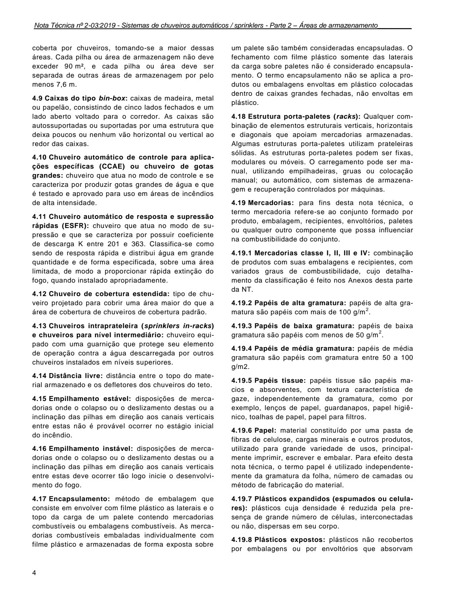

coberta por chuveiros, tomando-se a maior dessas áreas. Cada pilha ou área de armazenagem não deve exceder 90 m², e cada pilha ou área deve ser separada de outras áreas de armazenagem por pelo menos 7,6 m.

4.9 Caixas do tipo bin-box: caixas de madeira, metal ou papelão, consistindo de cinco lados fechados e um lado aberto voltado para o corredor. As caixas são autossuportadas ou suportadas por uma estrutura que deixa poucos ou nenhum vão horizontal ou vertical ao redor das caixas.

4.10 Chuveiro automático de controle para aplicações específicas (CCAE) ou chuveiro de gotas grandes: chuveiro que atua no modo de controle e se caracteriza por produzir gotas grandes de água e que é testado e aprovado para uso em áreas de incêndios de alta intensidade.

4.11 Chuveiro automático de resposta e supressão rápidas (ESFR): chuveiro que atua no modo de supressão e que se caracteriza por possuir coeficiente de descarga K entre 201 e 363. Classifica-se como sendo de resposta rápida e distribui água em grande quantidade e de forma especificada, sobre uma área limitada, de modo a proporcionar rápida extinção do fogo, quando instalado apropriadamente.

4.12 Chuveiro de cobertura estendida: tipo de chuveiro projetado para cobrir uma área maior do que a área de cobertura de chuveiros de cobertura padrão.

4.13 Chuveiros intraprateleira (sprinklers in-racks) e chuveiros para nível intermediário: chuveiro equipado com uma guarnição que protege seu elemento de operação contra a água descarregada por outros chuveiros instalados em níveis superiores.

4.14 Distância livre: distância entre o topo do material armazenado e os defletores dos chuveiros do teto.

4.15 Empilhamento estável: disposições de mercadorias onde o colapso ou o deslizamento destas ou a inclinação das pilhas em direção aos canais verticais entre estas não é provável ocorrer no estágio inicial do incêndio.

4.16 Empilhamento instável: disposições de mercadorias onde o colapso ou o deslizamento destas ou a inclinação das pilhas em direção aos canais verticais entre estas deve ocorrer tão logo inicie o desenvolvimento do fogo.

4.17 Encapsulamento: método de embalagem que consiste em envolver com filme plástico as laterais e o topo da carga de um palete contendo mercadorias combustíveis ou embalagens combustíveis. As mercadorias combustíveis embaladas individualmente com filme plástico e armazenadas de forma exposta sobre

um palete são também consideradas encapsuladas. O fechamento com filme plástico somente das laterais da carga sobre paletes não é considerado encapsulamento. O termo encapsulamento não se aplica a produtos ou embalagens envoltas em plástico colocadas dentro de caixas grandes fechadas, não envoltas em plástico.

4.18 Estrutura porta-paletes (racks): Qualquer combinação de elementos estruturais verticais, horizontais e diagonais que apoiam mercadorias armazenadas. Algumas estruturas porta-paletes utilizam prateleiras sólidas. As estruturas porta-paletes podem ser fixas, modulares ou móveis. O carregamento pode ser manual, utilizando empilhadeiras, gruas ou colocação manual; ou automático, com sistemas de armazenagem e recuperação controlados por máquinas.

4.19 Mercadorias: para fins desta nota técnica, o termo mercadoria refere-se ao conjunto formado por produto, embalagem, recipientes, envoltórios, paletes ou qualquer outro componente que possa influenciar na combustibilidade do conjunto.

4.19.1 Mercadorias classe I, II, III e IV: combinação de produtos com suas embalagens e recipientes, com variados graus de combustibilidade, cujo detalhamento da classificação é feito nos Anexos desta parte da NT.

4.19.2 Papéis de alta gramatura: papéis de alta gramatura são papéis com mais de 100 g/m2.

4.19.3 Papéis de baixa gramatura: papéis de baixa gramatura são papéis com menos de 50 g/m2.

4.19.4 Papéis de média gramatura: papéis de média gramatura são papéis com gramatura entre 50 a 100 g/m2.

4.19.5 Papéis tissue: papéis tissue são papéis macios e absorventes, com textura característica de gaze, independentemente da gramatura, como por exemplo, lenços de papel, guardanapos, papel higiênico, toalhas de papel, papel para filtros.

4.19.6 Papel: material constituído por uma pasta de fibras de celulose, cargas minerais e outros produtos, utilizado para grande variedade de usos, principalmente imprimir, escrever e embalar. Para efeito desta nota técnica, o termo papel é utilizado independentemente da gramatura da folha, número de camadas ou método de fabricação do material.

4.19.7 Plásticos expandidos (espumados ou celulares): plásticos cuja densidade é reduzida pela presença de grande número de células, interconectadas ou não, dispersas em seu corpo.

4.19.8 Plásticos expostos: plásticos não recobertos por embalagens ou por envoltórios que absorvam

---

## Página 5

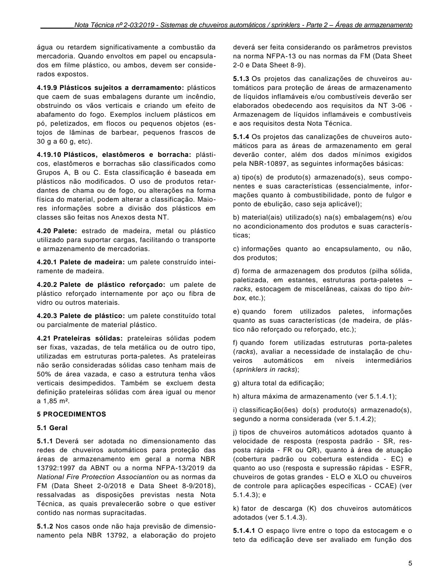

água ou retardem significativamente a combustão da mercadoria. Quando envoltos em papel ou encapsulados em filme plástico, ou ambos, devem ser considerados expostos.

4.19.9 Plásticos sujeitos a derramamento: plásticos que caem de suas embalagens durante um incêndio, obstruindo os vãos verticais e criando um efeito de abafamento do fogo. Exemplos incluem plásticos em pó, peletizados, em flocos ou pequenos objetos (estojos de lâminas de barbear, pequenos frascos de 30 g a 60 g, etc).

4.19.10 Plásticos, elastômeros e borracha: plásticos, elastômeros e borrachas são classificados como Grupos A, B ou C. Esta classificação é baseada em plásticos não modificados. O uso de produtos retardantes de chama ou de fogo, ou alterações na forma física do material, podem alterar a classificação. Maiores informações sobre a divisão dos plásticos em classes são feitas nos Anexos desta NT.

4.20 Palete: estrado de madeira, metal ou plástico utilizado para suportar cargas, facilitando o transporte e armazenamento de mercadorias.

4.20.1 Palete de madeira: um palete construído inteiramente de madeira.

4.20.2 Palete de plástico reforçado: um palete de plástico reforçado internamente por aço ou fibra de vidro ou outros materiais.

4.20.3 Palete de plástico: um palete constituído total ou parcialmente de material plástico.

4.21 Prateleiras sólidas: prateleiras sólidas podem ser fixas, vazadas, de tela metálica ou de outro tipo, utilizadas em estruturas porta-paletes. As prateleiras não serão consideradas sólidas caso tenham mais de 50% de área vazada, e caso a estrutura tenha vãos verticais desimpedidos. Também se excluem desta definição prateleiras sólidas com área igual ou menor a 1,85 m².

### 5 PROCEDIMENTOS

5.1 Geral

5.1.1 Deverá ser adotada no dimensionamento das redes de chuveiros automáticos para proteção das áreas de armazenamento em geral a norma NBR 13792:1997 da ABNT ou a norma NFPA-13/2019 da National Fire Protection Associantion ou as normas da FM (Data Sheet 2-0/2018 e Data Sheet 8-9/2018), ressalvadas as disposições previstas nesta Nota Técnica, as quais prevalecerão sobre o que estiver contido nas normas supracitadas.

5.1.2 Nos casos onde não haja previsão de dimensionamento pela NBR 13792, a elaboração do projeto

deverá ser feita considerando os parâmetros previstos na norma NFPA-13 ou nas normas da FM (Data Sheet 2-0 e Data Sheet 8-9).

5.1.3 Os projetos das canalizações de chuveiros automáticos para proteção de áreas de armazenamento de líquidos inflamáveis e/ou combustíveis deverão ser elaborados obedecendo aos requisitos da NT 3-06 - Armazenagem de líquidos inflamáveis e combustíveis e aos requisitos desta Nota Técnica.

5.1.4 Os projetos das canalizações de chuveiros automáticos para as áreas de armazenamento em geral deverão conter, além dos dados mínimos exigidos pela NBR-10897, as seguintes informações básicas:

a) tipo(s) de produto(s) armazenado(s), seus componentes e suas características (essencialmente, informações quanto à combustibilidade, ponto de fulgor e ponto de ebulição, caso seja aplicável);

b) material(ais) utilizado(s) na(s) embalagem(ns) e/ou no acondicionamento dos produtos e suas características;

c) informações quanto ao encapsulamento, ou não, dos produtos;

d) forma de armazenagem dos produtos (pilha sólida, paletizada, em estantes, estruturas porta-paletes - racks, estocagem de miscelâneas, caixas do tipo binbox, etc.);

e) quando forem utilizados paletes, informações quanto as suas características (de madeira, de plástico não reforçado ou reforçado, etc.);

f) quando forem utilizadas estruturas porta-paletes (racks), avaliar a necessidade de instalação de chuveiros automáticos em níveis intermediários (sprinklers in racks);

g) altura total da edificação;

h) altura máxima de armazenamento (ver 5.1.4.1);

i) classificação(ões) do(s) produto(s) armazenado(s), segundo a norma considerada (ver 5.1.4.2);

j) tipos de chuveiros automáticos adotados quanto à velocidade de resposta (resposta padrão - SR, resposta rápida - FR ou QR), quanto à área de atuação (cobertura padrão ou cobertura estendida - EC) e quanto ao uso (resposta e supressão rápidas - ESFR, chuveiros de gotas grandes - ELO e XLO ou chuveiros de controle para aplicações específicas - CCAE) (ver 5.1.4.3); e

k) fator de descarga (K) dos chuveiros automáticos adotados (ver 5.1.4.3).

5.1.4.1 O espaço livre entre o topo da estocagem e o teto da edificação deve ser avaliado em função dos

---

## Página 6

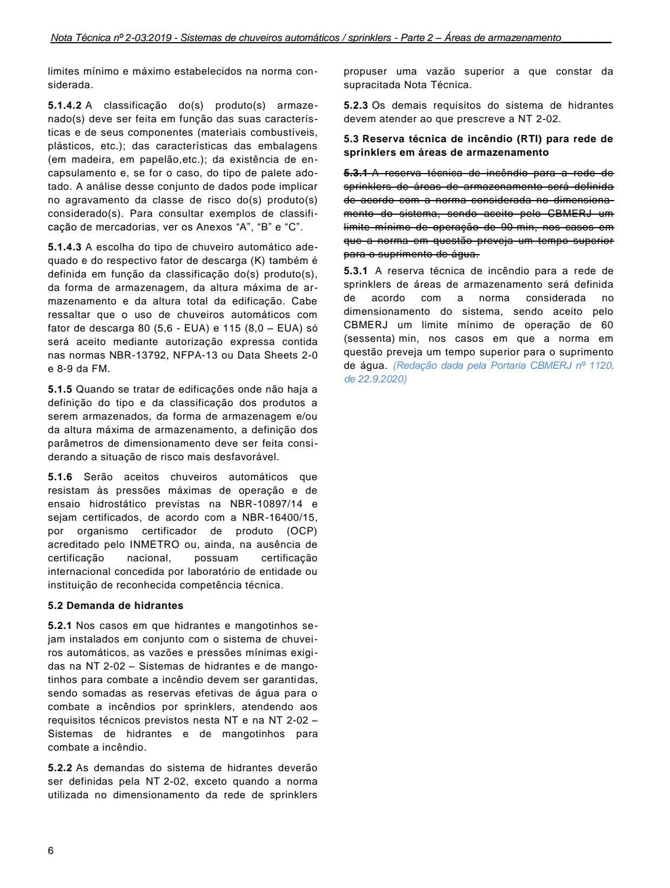

limites mínimo e máximo estabelecidos na norma considerada.

5.1.4.2 A classificação do(s) produto(s) armazenado(s) deve ser feita em função das suas características e de seus componentes (materiais combustíveis, plásticos, etc.); das características das embalagens (em madeira, em papelão,etc.); da existência de encapsulamento e, se for o caso, do tipo de palete adotado. A análise desse conjunto de dados pode implicar no agravamento da classe de risco do(s) produto(s) considerado(s). Para consultar exemplos de classificação de mercadorias, ver os Anexos “A”, “B” e “C”.

5.1.4.3 A escolha do tipo de chuveiro automático adequado e do respectivo fator de descarga (K) também é definida em função da classificação do(s) produto(s), da forma de armazenagem, da altura máxima de armazenamento e da altura total da edificação. Cabe ressaltar que o uso de chuveiros automáticos com fator de descarga 80 (5,6 - EUA) e 115 (8,0 - EUA) só será aceito mediante autorização expressa contida nas normas NBR-13792, NFPA-13 ou Data Sheets 2-0 e 8-9 da FM.

5.1.5 Quando se tratar de edificações onde não haja a definição do tipo e da classificação dos produtos a serem armazenados, da forma de armazenagem e/ou da altura máxima de armazenamento, a definição dos parâmetros de dimensionamento deve ser feita considerando a situação de risco mais desfavorável.

5.1.6 Serão aceitos chuveiros automáticos que resistam às pressões máximas de operação e de ensaio hidrostático previstas na NBR-10897/14 e sejam certificados, de acordo com a NBR-16400/15, por organismo certificador de produto (OCP) acreditado pelo INMETRO ou, ainda, na ausência de certificação nacional, possuam certificação internacional concedida por laboratório de entidade ou instituição de reconhecida competência técnica.

5.2 Demanda de hidrantes

5.2.1 Nos casos em que hidrantes e mangotinhos sejam instalados em conjunto com o sistema de chuveiros automáticos, as vazões e pressões mínimas exigidas na NT 2-02 - Sistemas de hidrantes e de mangotinhos para combate a incêndio devem ser garantidas, sendo somadas as reservas efetivas de água para o combate a incêndios por sprinklers, atendendo aos requisitos técnicos previstos nesta NT e na NT 2-02 - Sistemas de hidrantes e de mangotinhos para combate a incêndio.

5.2.2 As demandas do sistema de hidrantes deverão ser definidas pela NT 2-02, exceto quando a norma utilizada no dimensionamento da rede de sprinklers

propuser uma vazão superior a que constar da supracitada Nota Técnica.

5.2.3 Os demais requisitos do sistema de hidrantes devem atender ao que prescreve a NT 2-02.

5.3 Reserva técnica de incêndio (RTI) para rede de sprinklers em áreas de armazenamento

5.3.1 A reserva técnica de incêndio para a rede de sprinklers de áreas de armazenamento será definida de acordo com a norma considerada no dimensionamento do sistema, sendo aceito pelo CBMERJ um limite mínimo de operação de 90 min, nos casos em que a norma em questão preveja um tempo superior para o suprimento de água.

5.3.1 A reserva técnica de incêndio para a rede de sprinklers de áreas de armazenamento será definida de acordo com a norma considerada no dimensionamento do sistema, sendo aceito pelo CBMERJ um limite mínimo de operação de 60 (sessenta) min, nos casos em que a norma em questão preveja um tempo superior para o suprimento de água. (Redação dada pela Portaria CBMERJ nº 1120, de 22.9.2020)

---

## Página 7

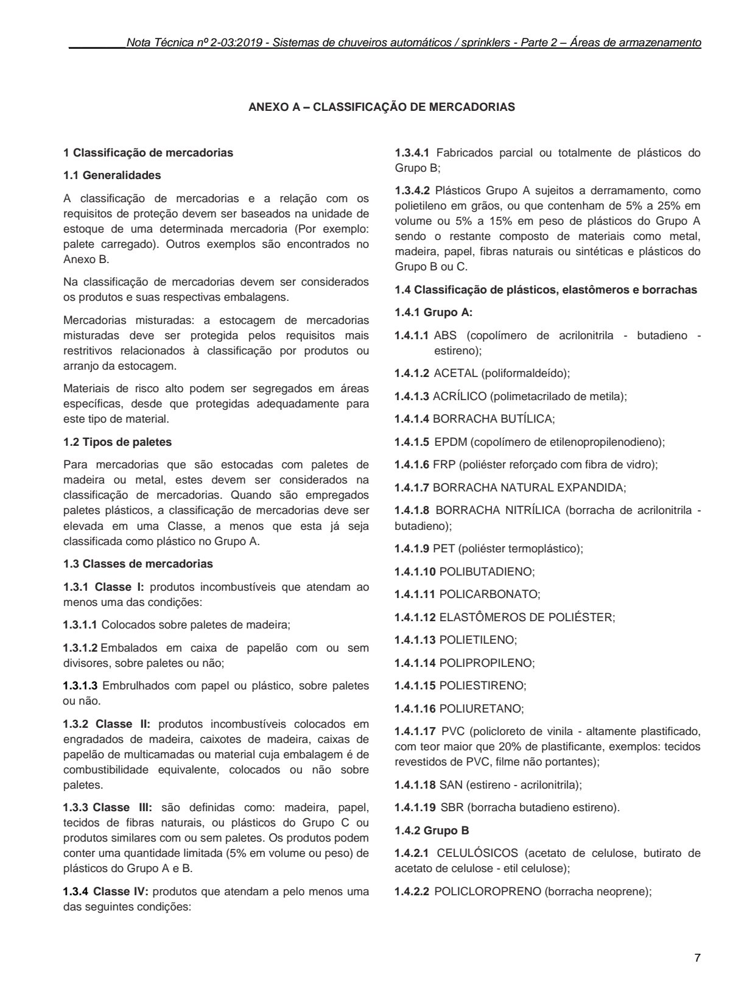

### ANEXO A - CLASSIFICAÇÃO DE MERCADORIAS

1 Classificação de mercadorias

1.1 Generalidades

A classificação de mercadorias e a relação com os requisitos de proteção devem ser baseados na unidade de estoque de uma determinada mercadoria (Por exemplo: palete carregado). Outros exemplos são encontrados no Anexo B.

Na classificação de mercadorias devem ser considerados os produtos e suas respectivas embalagens.

Mercadorias misturadas: a estocagem de mercadorias misturadas deve ser protegida pelos requisitos mais restritivos relacionados à classificação por produtos ou arranjo da estocagem.

Materiais de risco alto podem ser segregados em áreas específicas, desde que protegidas adequadamente para este tipo de material.

1.2 Tipos de paletes

Para mercadorias que são estocadas com paletes de madeira ou metal, estes devem ser considerados na classificação de mercadorias. Quando são empregados paletes plásticos, a classificação de mercadorias deve ser elevada em uma Classe, a menos que esta já seja classificada como plástico no Grupo A.

1.3 Classes de mercadorias

1.3.1 Classe I: produtos incombustíveis que atendam ao menos uma das condições:

1.3.1.1 Colocados sobre paletes de madeira;

1.3.1.2 Embalados em caixa de papelão com ou sem divisores, sobre paletes ou não;

1.3.1.3 Embrulhados com papel ou plástico, sobre paletes ou não.

1.3.2 Classe II: produtos incombustíveis colocados em engradados de madeira, caixotes de madeira, caixas de papelão de multicamadas ou material cuja embalagem é de combustibilidade equivalente, colocados ou não sobre paletes.

1.3.3 Classe III: são definidas como: madeira, papel, tecidos de fibras naturais, ou plásticos do Grupo C ou produtos similares com ou sem paletes. Os produtos podem conter uma quantidade limitada (5% em volume ou peso) de plásticos do Grupo A e B.

1.3.4 Classe IV: produtos que atendam a pelo menos uma das seguintes condições:

1.3.4.1 Fabricados parcial ou totalmente de plásticos do Grupo B;

1.3.4.2 Plásticos Grupo A sujeitos a derramamento, como polietileno em grãos, ou que contenham de 5% a 25% em volume ou 5% a 15% em peso de plásticos do Grupo A sendo o restante composto de materiais como metal, madeira, papel, fibras naturais ou sintéticas e plásticos do Grupo B ou C.

1.4 Classificação de plásticos, elastômeros e borrachas

1.4.1 Grupo A:

1.4.1.1 ABS (copolímero de acrilonitrila - butadieno -

estireno);

1.4.1.2 ACETAL (poliformaldeído);

1.4.1.3 ACRÍLICO (polimetacrilado de metila);

### 1.4.1.4 BORRACHA BUTÍLICA;

1.4.1.5 EPDM (copolímero de etilenopropilenodieno);

1.4.1.6 FRP (poliéster reforçado com fibra de vidro);

### 1.4.1.7 BORRACHA NATURAL EXPANDIDA;

1.4.1.8 BORRACHA NITRÍLICA (borracha de acrilonitrila - butadieno);

1.4.1.9 PET (poliéster termoplástico);

### 1.4.1.10 POLIBUTADIENO;

### 1.4.1.11 POLICARBONATO;

### 1.4.1.12 ELASTÔMEROS DE POLIÉSTER;

### 1.4.1.13 POLIETILENO;

### 1.4.1.14 POLIPROPILENO;

### 1.4.1.15 POLIESTIRENO;

### 1.4.1.16 POLIURETANO;

1.4.1.17 PVC (policloreto de vinila - altamente plastificado, com teor maior que 20% de plastificante, exemplos: tecidos revestidos de PVC, filme não portantes);

1.4.1.18 SAN (estireno - acrilonitrila);

1.4.1.19 SBR (borracha butadieno estireno).

1.4.2 Grupo B

1.4.2.1 CELULÓSICOS (acetato de celulose, butirato de acetato de celulose - etil celulose);

1.4.2.2 POLICLOROPRENO (borracha neoprene);

---

## Página 8

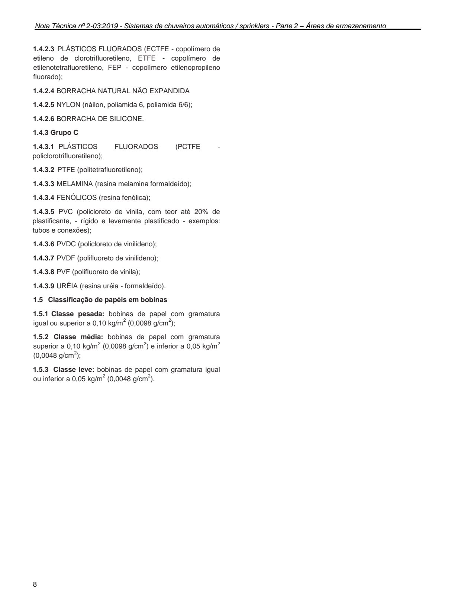

1.4.2.3 PLÁSTICOS FLUORADOS (ECTFE - copolímero de etileno de clorotrifluoretileno, ETFE - copolímero de etilenotetrafluoretileno, FEP - copolímero etilenopropileno fluorado);

### 1.4.2.4 BORRACHA NATURAL NÃO EXPANDIDA

1.4.2.5 NYLON (náilon, poliamida 6, poliamida 6/6);

### 1.4.2.6 BORRACHA DE SILICONE.

1.4.3 Grupo C

1.4.3.1 PLÁSTICOS FLUORADOS (PCTFE - policlorotrifluoretileno);

1.4.3.2 PTFE (politetrafluoretileno);

1.4.3.3 MELAMINA (resina melamina formaldeído);

1.4.3.4 FENÓLICOS (resina fenólica);

1.4.3.5 PVC (policloreto de vinila, com teor até 20% de plastificante, - rígido e levemente plastificado - exemplos: tubos e conexões);

1.4.3.6 PVDC (policloreto de vinilideno);

1.4.3.7 PVDF (polifluoreto de vinilideno);

1.4.3.8 PVF (polifluoreto de vinila);

1.4.3.9 URÉIA (resina uréia - formaldeído).

1.5 Classificação de papéis em bobinas

1.5.1 Classe pesada: bobinas de papel com gramatura igual ou superior a 0,10 kg/m2 (0,0098 g/cm2);

1.5.2 Classe média: bobinas de papel com gramatura superior a 0,10 kg/m2 (0,0098 g/cm2) e inferior a 0,05 kg/m2 (0,0048 g/cm2);

1.5.3 Classe leve: bobinas de papel com gramatura igual ou inferior a 0,05 kg/m2 (0,0048 g/cm2).

---

## Página 9

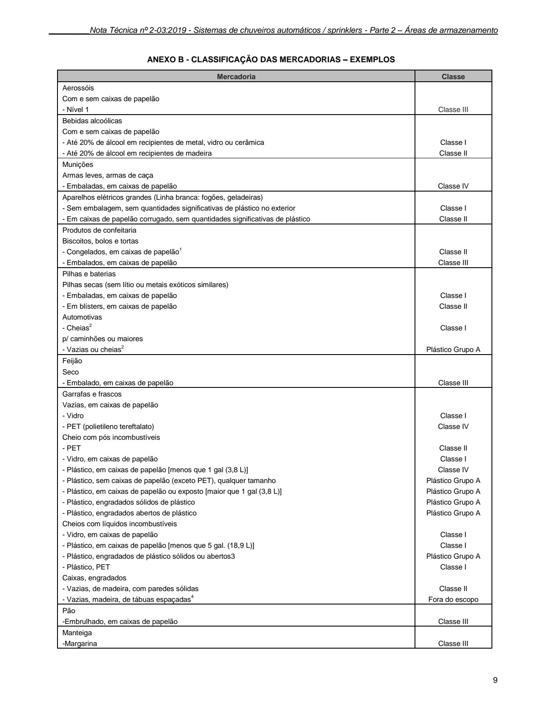

### ANEXO B - CLASSIFICAÇÃO DAS MERCADORIAS - EXEMPLOS

### Tabelas extraídas

#### Tabela 1 da página

|  | Mercadoria |  |  | Classe |  |
| --- | --- | --- | --- | --- | --- |
| Aerossóis Com e sem caixas de papelão - Nível 1 |  |  | Classe III |  |  |
| Bebidas alcoólicas Com e sem caixas de papelão - Até 20% de álcool em recipientes de metal, vidro ou cerâmica - Até 20% de álcool em recipientes de madeira |  |  | Classe I Classe II |  |  |
| Munições Armas leves, armas de caça - Embaladas, em caixas de papelão |  |  | Classe IV |  |  |
| Aparelhos elétricos grandes (Linha branca: fogões, geladeiras) - Sem embalagem, sem quantidades significativas de plástico no exterior - Em caixas de papelão corrugado, sem quantidades significativas de plástico |  |  | Classe I Classe II |  |  |
| Produtos de confeitaria Biscoitos, bolos e tortas - Congelados, em caixas de papelão1 - Embalados, em caixas de papelão |  |  | Classe II Classe III |  |  |
| Pilhas e baterias Pilhas secas (sem lítio ou metais exóticos similares) - Embaladas, em caixas de papelão - Em blísters, em caixas de papelão Automotivas - Cheias2 p/ caminhões ou maiores - Vazias ou cheias2 |  |  | Classe I Classe II Classe I Plástico Grupo A |  |  |
| Feijão Seco - Embalado, em caixas de papelão |  |  | Classe III |  |  |
| Garrafas e frascos Vazias, em caixas de papelão - Vidro - PET (polietileno tereftalato) Cheio com pós incombustíveis - PET - Vidro, em caixas de papelão - Plástico, em caixas de papelão [menos que 1 gal (3,8 L)] - Plástico, sem caixas de papelão (exceto PET), qualquer tamanho - Plástico, em caixas de papelão ou exposto [maior que 1 gal (3,8 L)] - Plástico, engradados sólidos de plástico - Plástico, engradados abertos de plástico Cheios com líquidos incombustíveis - Vidro, em caixas de papelão - Plástico, em caixas de papelão [menos que 5 gal. (18,9 L)] - Plástico, engradados de plástico sólidos ou abertos3 - Plástico, PET Caixas, engradados - Vazias, de madeira, com paredes sólidas - Vazias, madeira, de tábuas espaçadas4 |  |  | Classe I Classe IV Classe II Classe I Classe IV Plástico Grupo A Plástico Grupo A Plástico Grupo A Plástico Grupo A Classe I Classe I Plástico Grupo A Classe I Classe II Fora do escopo |  |  |
| Pão -Embrulhado, em caixas de papelão |  |  | Classe III |  |  |
| Manteiga -Margarina |  |  | Classe III |  |  |

---

## Página 10

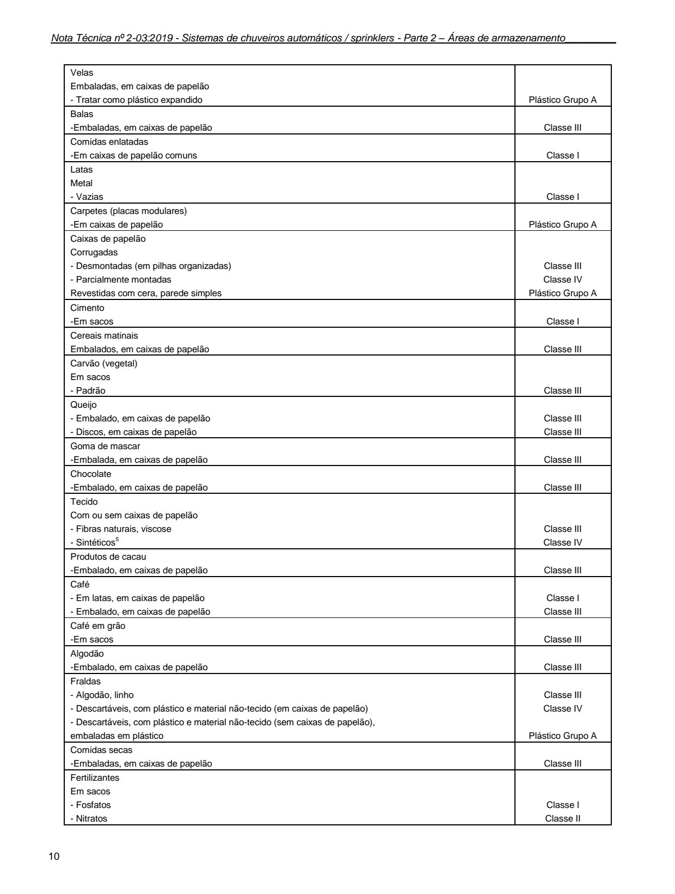

> Página sem texto extraível suficiente; consultar a representação visual ou o PDF oficial.

### Tabelas extraídas

#### Tabela 1 da página

| Velas Embaladas, em caixas de papelão - Tratar como plástico expandido | Plástico Grupo A |
| --- | --- |
| Balas -Embaladas, em caixas de papelão | Classe III |
| Comidas enlatadas -Em caixas de papelão comuns | Classe I |
| Latas Metal - Vazias | Classe I |
| Carpetes (placas modulares) -Em caixas de papelão | Plástico Grupo A |
| Caixas de papelão Corrugadas - Desmontadas (em pilhas organizadas) - Parcialmente montadas Revestidas com cera, parede simples | Classe III Classe IV Plástico Grupo A |
| Cimento -Em sacos | Classe I |
| Cereais matinais Embalados, em caixas de papelão | Classe III |
| Carvão (vegetal) Em sacos - Padrão | Classe III |
| Queijo - Embalado, em caixas de papelão - Discos, em caixas de papelão | Classe III Classe III |
| Goma de mascar -Embalada, em caixas de papelão | Classe III |
| Chocolate -Embalado, em caixas de papelão | Classe III |
| Tecido Com ou sem caixas de papelão - Fibras naturais, viscose - Sintéticos5 | Classe III Classe IV |
| Produtos de cacau -Embalado, em caixas de papelão | Classe III |
| Café - Em latas, em caixas de papelão - Embalado, em caixas de papelão | Classe I Classe III |
| Café em grão -Em sacos | Classe III |
| Algodão -Embalado, em caixas de papelão | Classe III |
| Fraldas - Algodão, linho - Descartáveis, com plástico e material não-tecido (em caixas de papelão) - Descartáveis, com plástico e material não-tecido (sem caixas de papelão), embaladas em plástico | Classe III Classe IV Plástico Grupo A |
| Comidas secas -Embaladas, em caixas de papelão | Classe III |
| Fertilizantes Em sacos - Fosfatos - Nitratos | Classe I Classe II |

---

## Página 11

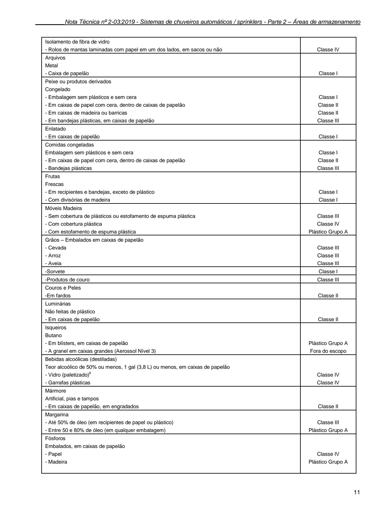

> Página sem texto extraível suficiente; consultar a representação visual ou o PDF oficial.

### Tabelas extraídas

#### Tabela 1 da página

| Isolamento de fibra de vidro - Rolos de mantas laminadas com papel em um dos lados, em sacos ou não | Classe IV |
| --- | --- |
| Arquivos Metal - Caixa de papelão | Classe I |
| Peixe ou produtos derivados Congelado - Embalagem sem plásticos e sem cera - Em caixas de papel com cera, dentro de caixas de papelão - Em caixas de madeira ou barricas - Em bandejas plásticas, em caixas de papelão | Classe I Classe II Classe II Classe III |
| Enlatado - Em caixas de papelão | Classe I |
| Comidas congeladas Embalagem sem plásticos e sem cera - Em caixas de papel com cera, dentro de caixas de papelão - Bandejas plásticas | Classe I Classe II Classe III |
| Frutas Frescas - Em recipientes e bandejas, exceto de plástico - Com divisórias de madeira | Classe I Classe I |
| Móveis Madeira - Sem cobertura de plásticos ou estofamento de espuma plástica - Com cobertura plástica - Com estofamento de espuma plástica | Classe III Classe IV Plástico Grupo A |
| Grãos - Embalados em caixas de papelão - Cevada - Arroz - Aveia | Classe III Classe III Classe III |
| -Sorvete | Classe I |
| -Produtos de couro | Classe III |
| Couros e Peles -Em fardos | Classe II |
| Luminárias Não feitas de plástico - Em caixas de papelão | Classe II |
| Isqueiros Butano - Em blísters, em caixas de papelão - A granel em caixas grandes (Aerossol Nível 3) | Plástico Grupo A Fora do escopo |
| Bebidas alcoólicas (destiladas) Teor alcoólico de 50% ou menos, 1 gal (3,8 L) ou menos, em caixas de papelão - Vidro (paletizado)6 - Garrafas plásticas | Classe IV Classe IV |
| Mármore Artificial, pias e tampos - Em caixas de papelão, em engradados | Classe II |
| Margarina - Até 50% de óleo (em recipientes de papel ou plástico) - Entre 50 e 80% de óleo (em qualquer embalagem) | Classe III Plástico Grupo A |
| Fósforos Embalados, em caixas de papelão - Papel - Madeira | Classe IV Plástico Grupo A |

---

## Página 12

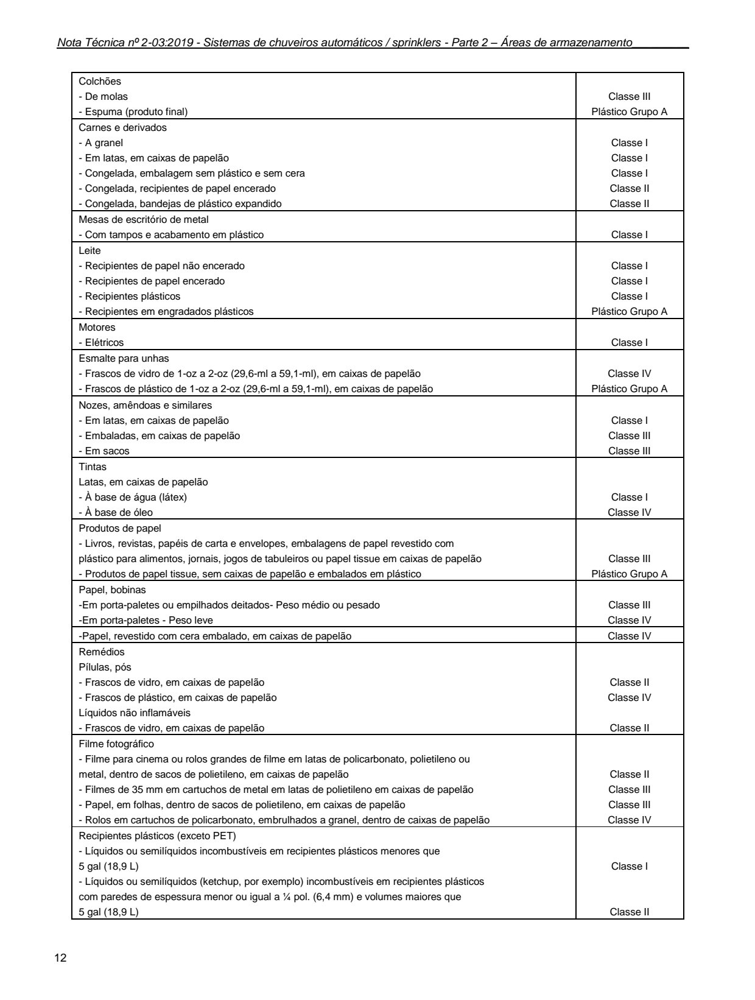

> Página sem texto extraível suficiente; consultar a representação visual ou o PDF oficial.

### Tabelas extraídas

#### Tabela 1 da página

| Colchões - De molas - Espuma (produto final) | Classe III Plástico Grupo A |
| --- | --- |
| Carnes e derivados - A granel - Em latas, em caixas de papelão - Congelada, embalagem sem plástico e sem cera - Congelada, recipientes de papel encerado - Congelada, bandejas de plástico expandido | Classe I Classe I Classe I Classe II Classe II |
| Mesas de escritório de metal - Com tampos e acabamento em plástico | Classe I |
| Leite - Recipientes de papel não encerado - Recipientes de papel encerado - Recipientes plásticos - Recipientes em engradados plásticos | Classe I Classe I Classe I Plástico Grupo A |
| Motores - Elétricos | Classe I |
| Esmalte para unhas - Frascos de vidro de 1-oz a 2-oz (29,6-ml a 59,1-ml), em caixas de papelão - Frascos de plástico de 1-oz a 2-oz (29,6-ml a 59,1-ml), em caixas de papelão | Classe IV Plástico Grupo A |
| Nozes, amêndoas e similares - Em latas, em caixas de papelão - Embaladas, em caixas de papelão - Em sacos | Classe I Classe III Classe III |
| Tintas Latas, em caixas de papelão - À base de água (látex) - À base de óleo | Classe I Classe IV |
| Produtos de papel - Livros, revistas, papéis de carta e envelopes, embalagens de papel revestido com plástico para alimentos, jornais, jogos de tabuleiros ou papel tissue em caixas de papelão - Produtos de papel tissue, sem caixas de papelão e embalados em plástico | Classe III Plástico Grupo A |
| Papel, bobinas -Em porta-paletes ou empilhados deitados- Peso médio ou pesado -Em porta-paletes - Peso leve | Classe III Classe IV |
| -Papel, revestido com cera embalado, em caixas de papelão | Classe IV |
| Remédios Pílulas, pós - Frascos de vidro, em caixas de papelão - Frascos de plástico, em caixas de papelão Líquidos não inflamáveis - Frascos de vidro, em caixas de papelão | Classe II Classe IV Classe II |
| Filme fotográfico - Filme para cinema ou rolos grandes de filme em latas de policarbonato, polietileno ou metal, dentro de sacos de polietileno, em caixas de papelão - Filmes de 35 mm em cartuchos de metal em latas de polietileno em caixas de papelão - Papel, em folhas, dentro de sacos de polietileno, em caixas de papelão - Rolos em cartuchos de policarbonato, embrulhados a granel, dentro de caixas de papelão | Classe II Classe III Classe III Classe IV |
| Recipientes plásticos (exceto PET) - Líquidos ou semilíquidos incombustíveis em recipientes plásticos menores que 5 gal (18,9 L) - Líquidos ou semilíquidos (ketchup, por exemplo) incombustíveis em recipientes plásticos com paredes de espessura menor ou igual a ¼ pol. (6,4 mm) e volumes maiores que 5 gal (18,9 L) | Classe I Classe II |

---

## Página 13

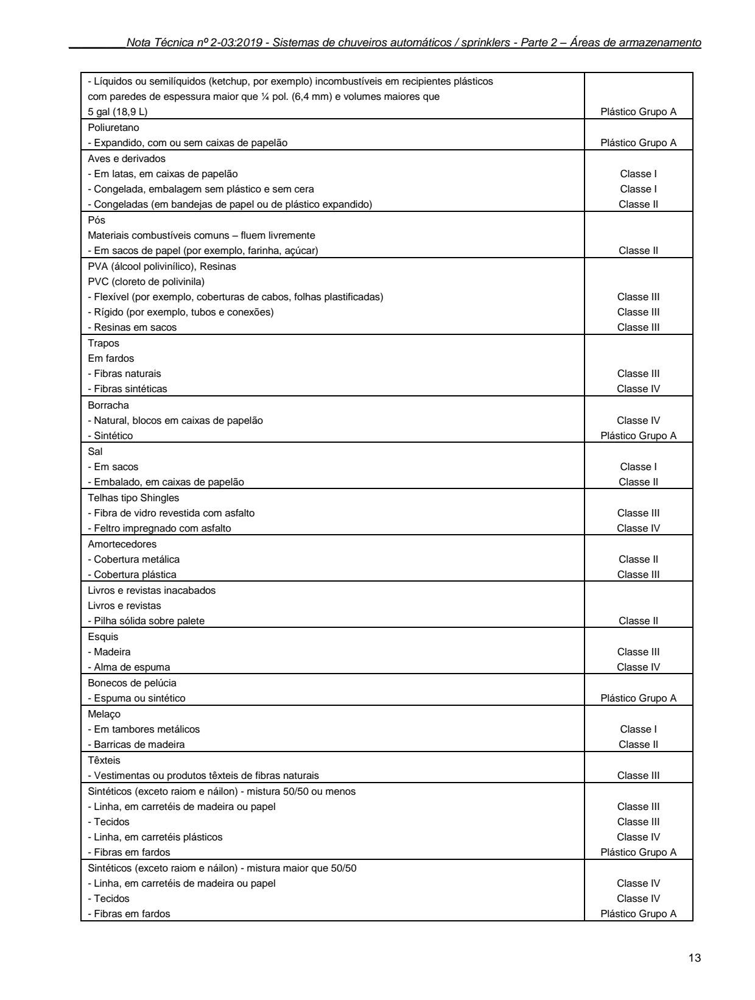

> Página sem texto extraível suficiente; consultar a representação visual ou o PDF oficial.

### Tabelas extraídas

#### Tabela 1 da página

| - Líquidos ou semilíquidos (ketchup, por exemplo) incombustíveis em recipientes plásticos com paredes de espessura maior que ¼ pol. (6,4 mm) e volumes maiores que 5 gal (18,9 L) | Plástico Grupo A |
| --- | --- |
| Poliuretano - Expandido, com ou sem caixas de papelão | Plástico Grupo A |
| Aves e derivados - Em latas, em caixas de papelão - Congelada, embalagem sem plástico e sem cera - Congeladas (em bandejas de papel ou de plástico expandido) | Classe I Classe I Classe II |
| Pós Materiais combustíveis comuns - fluem livremente - Em sacos de papel (por exemplo, farinha, açúcar) | Classe II |
| PVA (álcool polivinílico), Resinas PVC (cloreto de polivinila) - Flexível (por exemplo, coberturas de cabos, folhas plastificadas) - Rígido (por exemplo, tubos e conexões) - Resinas em sacos | Classe III Classe III Classe III |
| Trapos Em fardos - Fibras naturais - Fibras sintéticas | Classe III Classe IV |
| Borracha - Natural, blocos em caixas de papelão - Sintético | Classe IV Plástico Grupo A |
| Sal - Em sacos - Embalado, em caixas de papelão | Classe I Classe II |
| Telhas tipo Shingles - Fibra de vidro revestida com asfalto - Feltro impregnado com asfalto | Classe III Classe IV |
| Amortecedores - Cobertura metálica - Cobertura plástica | Classe II Classe III |
| Livros e revistas inacabados Livros e revistas - Pilha sólida sobre palete | Classe II |
| Esquis - Madeira - Alma de espuma | Classe III Classe IV |
| Bonecos de pelúcia - Espuma ou sintético | Plástico Grupo A |
| Melaço - Em tambores metálicos - Barricas de madeira | Classe I Classe II |
| Têxteis - Vestimentas ou produtos têxteis de fibras naturais | Classe III |
| Sintéticos (exceto raiom e náilon) - mistura 50/50 ou menos - Linha, em carretéis de madeira ou papel - Tecidos - Linha, em carretéis plásticos - Fibras em fardos | Classe III Classe III Classe IV Plástico Grupo A |
| Sintéticos (exceto raiom e náilon) - mistura maior que 50/50 - Linha, em carretéis de madeira ou papel - Tecidos - Fibras em fardos | Classe IV Classe IV Plástico Grupo A |

---

## Página 14

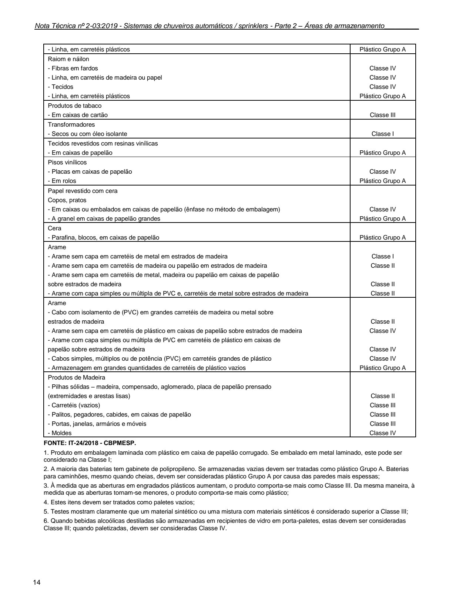

### FONTE: IT-24/2018 - CBPMESP.

1. Produto em embalagem laminada com plástico em caixa de papelão corrugado. Se embalado em metal laminado, este pode ser considerado na Classe I;

2. A maioria das baterias tem gabinete de polipropileno. Se armazenadas vazias devem ser tratadas como plástico Grupo A. Baterias para caminhões, mesmo quando cheias, devem ser consideradas plástico Grupo A por causa das paredes mais espessas;

3. À medida que as aberturas em engradados plásticos aumentam, o produto comporta-se mais como Classe III. Da mesma maneira, à medida que as aberturas tornam-se menores, o produto comporta-se mais como plástico;

4. Estes itens devem ser tratados como paletes vazios;

5. Testes mostram claramente que um material sintético ou uma mistura com materiais sintéticos é considerado superior a Classe III;

6. Quando bebidas alcoólicas destiladas são armazenadas em recipientes de vidro em porta-paletes, estas devem ser consideradas Classe III; quando paletizadas, devem ser consideradas Classe IV.

### Tabelas extraídas

#### Tabela 1 da página

| - Linha, em carretéis plásticos | Plástico Grupo A |
| --- | --- |
| Raiom e náilon - Fibras em fardos - Linha, em carretéis de madeira ou papel - Tecidos - Linha, em carretéis plásticos | Classe IV Classe IV Classe IV Plástico Grupo A |
| Produtos de tabaco - Em caixas de cartão | Classe III |
| Transformadores - Secos ou com óleo isolante | Classe I |
| Tecidos revestidos com resinas vinílicas - Em caixas de papelão | Plástico Grupo A |
| Pisos vinílicos - Placas em caixas de papelão - Em rolos | Classe IV Plástico Grupo A |
| Papel revestido com cera Copos, pratos - Em caixas ou embalados em caixas de papelão (ênfase no método de embalagem) - A granel em caixas de papelão grandes | Classe IV Plástico Grupo A |
| Cera - Parafina, blocos, em caixas de papelão | Plástico Grupo A |
| Arame - Arame sem capa em carretéis de metal em estrados de madeira - Arame sem capa em carretéis de madeira ou papelão em estrados de madeira - Arame sem capa em carretéis de metal, madeira ou papelão em caixas de papelão sobre estrados de madeira - Arame com capa simples ou múltipla de PVC e, carretéis de metal sobre estrados de madeira | Classe I Classe II Classe II Classe II |
| Arame - Cabo com isolamento de (PVC) em grandes carretéis de madeira ou metal sobre estrados de madeira - Arame sem capa em carretéis de plástico em caixas de papelão sobre estrados de madeira - Arame com capa simples ou múltipla de PVC em carretéis de plástico em caixas de papelão sobre estrados de madeira - Cabos simples, múltiplos ou de potência (PVC) em carretéis grandes de plástico - Armazenagem em grandes quantidades de carretéis de plástico vazios | Classe II Classe IV Classe IV Classe IV Plástico Grupo A |
| Produtos de Madeira - Pilhas sólidas - madeira, compensado, aglomerado, placa de papelão prensado (extremidades e arestas lisas) - Carretéis (vazios) - Palitos, pegadores, cabides, em caixas de papelão - Portas, janelas, armários e móveis - Moldes | Classe II Classe III Classe III Classe III Classe IV |

---

## Página 15

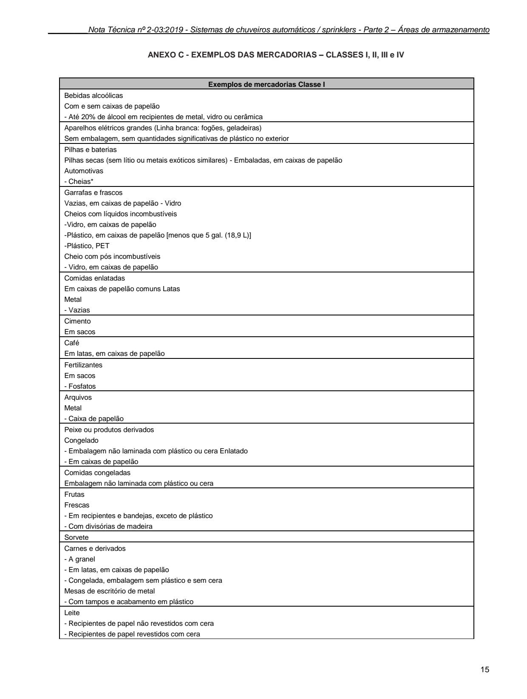

### ANEXO C - EXEMPLOS DAS MERCADORIAS - CLASSES I, II, III e IV

### Tabelas extraídas

#### Tabela 1 da página

|  | Exemplos de mercadorias Classe I |  |
| --- | --- | --- |
| Bebidas alcoólicas Com e sem caixas de papelão - Até 20% de álcool em recipientes de metal, vidro ou cerâmica |  |  |
| Aparelhos elétricos grandes (Linha branca: fogões, geladeiras) Sem embalagem, sem quantidades significativas de plástico no exterior |  |  |
| Pilhas e baterias Pilhas secas (sem lítio ou metais exóticos similares) - Embaladas, em caixas de papelão Automotivas - Cheias* |  |  |
| Garrafas e frascos Vazias, em caixas de papelão - Vidro Cheios com líquidos incombustíveis - Vidro, em caixas de papelão - Plástico, em caixas de papelão [menos que 5 gal. (18,9 L)] - Plástico, PET Cheio com pós incombustíveis - Vidro, em caixas de papelão |  |  |
| Comidas enlatadas Em caixas de papelão comuns Latas Metal - Vazias |  |  |
| Cimento Em sacos |  |  |
| Café Em latas, em caixas de papelão |  |  |
| Fertilizantes Em sacos - Fosfatos |  |  |
| Arquivos Metal - Caixa de papelão |  |  |
| Peixe ou produtos derivados Congelado - Embalagem não laminada com plástico ou cera Enlatado - Em caixas de papelão |  |  |
| Comidas congeladas Embalagem não laminada com plástico ou cera |  |  |
| Frutas Frescas - Em recipientes e bandejas, exceto de plástico - Com divisórias de madeira |  |  |
| Sorvete |  |  |
| Carnes e derivados - A granel - Em latas, em caixas de papelão - Congelada, embalagem sem plástico e sem cera Mesas de escritório de metal - Com tampos e acabamento em plástico |  |  |
| Leite - Recipientes de papel não revestidos com cera - Recipientes de papel revestidos com cera |  |  |

---

## Página 16

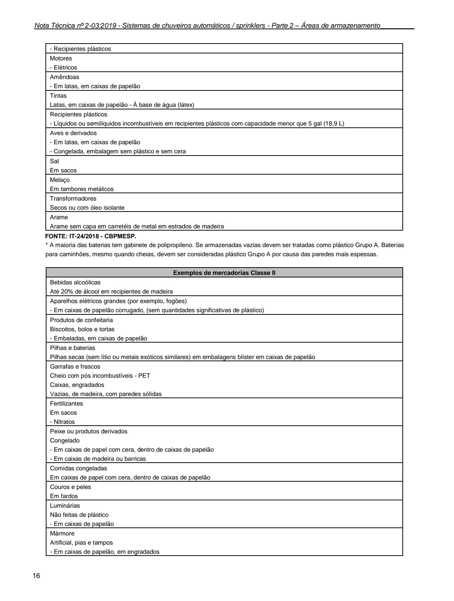

- Recipientes plásticos

Motores - Elétricos

Amêndoas - Em latas, em caixas de papelão

Tintas Latas, em caixas de papelão - À base de água (látex)

Recipientes plásticos - Líquidos ou semilíquidos incombustíveis em recipientes plásticos com capacidade menor que 5 gal (18,9 L)

Aves e derivados - Em latas, em caixas de papelão - Congelada, embalagem sem plástico e sem cera

Sal Em sacos

Melaço Em tambores metálicos

Transformadores Secos ou com óleo isolante

Arame Arame sem capa em carretéis de metal em estrados de madeira

### FONTE: IT-24/2018 - CBPMESP.

* A maioria das baterias tem gabinete de polipropileno. Se armazenadas vazias devem ser tratadas como plástico Grupo A. Baterias para caminhões, mesmo quando cheias, devem ser consideradas plástico Grupo A por causa das paredes mais espessas.

### Tabelas extraídas

#### Tabela 1 da página

|  | Exemplos de mercadorias Classe II |  |
| --- | --- | --- |
| Bebidas alcoólicas Até 20% de álcool em recipientes de madeira |  |  |
| Aparelhos elétricos grandes (por exemplo, fogões) - Em caixas de papelão corrugado, (sem quantidades significativas de plástico) |  |  |
| Produtos de confeitaria Biscoitos, bolos e tortas - Embaladas, em caixas de papelão |  |  |
| Pilhas e baterias Pilhas secas (sem lítio ou metais exóticos similares) em embalagens blíster em caixas de papelão |  |  |
| Garrafas e frascos Cheio com pós incombustíveis - PET Caixas, engradados Vazias, de madeira, com paredes sólidas |  |  |
| Fertilizantes Em sacos - Nitratos |  |  |
| Peixe ou produtos derivados Congelado - Em caixas de papel com cera, dentro de caixas de papelão - Em caixas de madeira ou barricas |  |  |
| Comidas congeladas Em caixas de papel com cera, dentro de caixas de papelão |  |  |
| Couros e peles Em fardos |  |  |
| Luminárias Não feitas de plástico - Em caixas de papelão |  |  |
| Mármore Artificial, pias e tampos - Em caixas de papelão, em engradados |  |  |

---

## Página 17

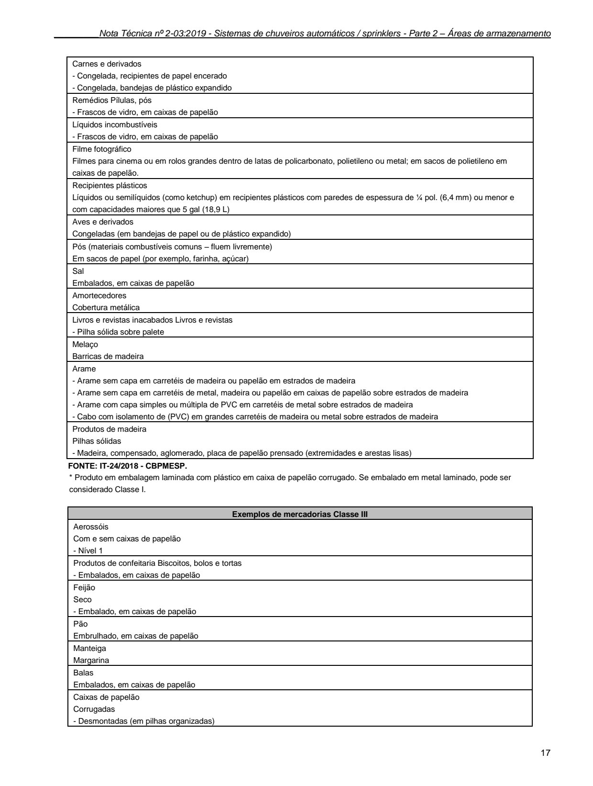

Carnes e derivados - Congelada, recipientes de papel encerado - Congelada, bandejas de plástico expandido

Remédios Pílulas, pós - Frascos de vidro, em caixas de papelão

Líquidos incombustíveis - Frascos de vidro, em caixas de papelão

Filme fotográfico Filmes para cinema ou em rolos grandes dentro de latas de policarbonato, polietileno ou metal; em sacos de polietileno em caixas de papelão.

Recipientes plásticos Líquidos ou semilíquidos (como ketchup) em recipientes plásticos com paredes de espessura de ¼ pol. (6,4 mm) ou menor e com capacidades maiores que 5 gal (18,9 L)

Aves e derivados Congeladas (em bandejas de papel ou de plástico expandido)

Pós (materiais combustíveis comuns - fluem livremente) Em sacos de papel (por exemplo, farinha, açúcar)

Sal Embalados, em caixas de papelão

Amortecedores Cobertura metálica

Livros e revistas inacabados Livros e revistas - Pilha sólida sobre palete

Melaço Barricas de madeira

Arame - Arame sem capa em carretéis de madeira ou papelão em estrados de madeira - Arame sem capa em carretéis de metal, madeira ou papelão em caixas de papelão sobre estrados de madeira - Arame com capa simples ou múltipla de PVC em carretéis de metal sobre estrados de madeira - Cabo com isolamento de (PVC) em grandes carretéis de madeira ou metal sobre estrados de madeira

Produtos de madeira Pilhas sólidas - Madeira, compensado, aglomerado, placa de papelão prensado (extremidades e arestas lisas)

### FONTE: IT-24/2018 - CBPMESP.

* Produto em embalagem laminada com plástico em caixa de papelão corrugado. Se embalado em metal laminado, pode ser considerado Classe I.

### Tabelas extraídas

#### Tabela 1 da página

|  | Exemplos de mercadorias Classe III |  |
| --- | --- | --- |
| Aerossóis Com e sem caixas de papelão - Nível 1 |  |  |
| Produtos de confeitaria Biscoitos, bolos e tortas - Embalados, em caixas de papelão |  |  |
| Feijão Seco - Embalado, em caixas de papelão |  |  |
| Pão Embrulhado, em caixas de papelão |  |  |
| Manteiga Margarina |  |  |
| Balas Embalados, em caixas de papelão |  |  |
| Caixas de papelão Corrugadas - Desmontadas (em pilhas organizadas) |  |  |

---

## Página 18

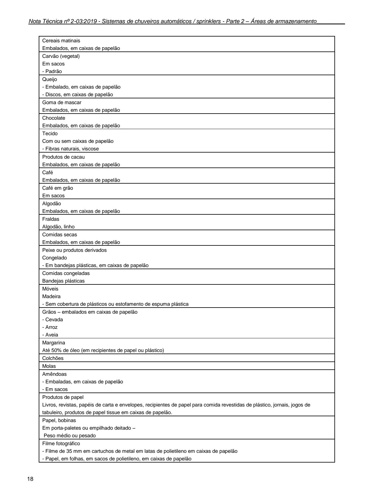

Cereais matinais Embalados, em caixas de papelão

Carvão (vegetal) Em sacos - Padrão

Queijo - Embalado, em caixas de papelão - Discos, em caixas de papelão

Goma de mascar Embalados, em caixas de papelão

Chocolate Embalados, em caixas de papelão

Tecido Com ou sem caixas de papelão - Fibras naturais, viscose

Produtos de cacau Embalados, em caixas de papelão

Café Embalados, em caixas de papelão

Café em grão Em sacos

Algodão Embalados, em caixas de papelão

Fraldas Algodão, linho

Comidas secas Embalados, em caixas de papelão

Peixe ou produtos derivados Congelado - Em bandejas plásticas, em caixas de papelão

Comidas congeladas Bandejas plásticas

Móveis Madeira - Sem cobertura de plásticos ou estofamento de espuma plástica

Grãos - embalados em caixas de papelão - Cevada - Arroz - Aveia

Margarina Até 50% de óleo (em recipientes de papel ou plástico)

Colchões

Molas

Amêndoas - Embaladas, em caixas de papelão - Em sacos

Produtos de papel Livros, revistas, papéis de carta e envelopes, recipientes de papel para comida revestidas de plástico, jornais, jogos de tabuleiro, produtos de papel tissue em caixas de papelão.

Papel, bobinas Em porta-paletes ou empilhado deitado - Peso médio ou pesado

Filme fotográfico - Filme de 35 mm em cartuchos de metal em latas de polietileno em caixas de papelão - Papel, em folhas, em sacos de polietileno, em caixas de papelão

---

## Página 19

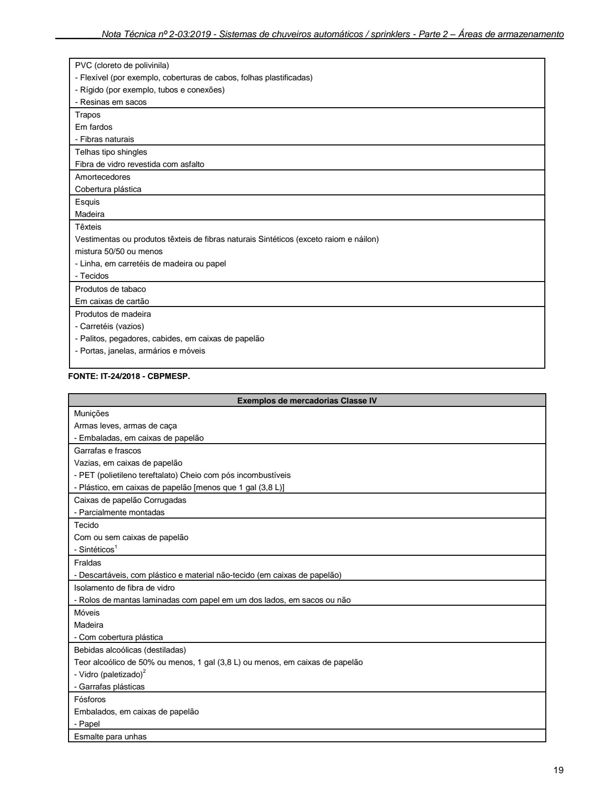

PVC (cloreto de polivinila) - Flexível (por exemplo, coberturas de cabos, folhas plastificadas) - Rígido (por exemplo, tubos e conexões) - Resinas em sacos

Trapos Em fardos - Fibras naturais

Telhas tipo shingles Fibra de vidro revestida com asfalto

Amortecedores Cobertura plástica

Esquis Madeira

Têxteis Vestimentas ou produtos têxteis de fibras naturais Sintéticos (exceto raiom e náilon) mistura 50/50 ou menos - Linha, em carretéis de madeira ou papel - Tecidos

Produtos de tabaco Em caixas de cartão

Produtos de madeira - Carretéis (vazios) - Palitos, pegadores, cabides, em caixas de papelão - Portas, janelas, armários e móveis

### FONTE: IT-24/2018 - CBPMESP.

### Tabelas extraídas

#### Tabela 1 da página

|  | Exemplos de mercadorias Classe IV |  |
| --- | --- | --- |
| Munições Armas leves, armas de caça - Embaladas, em caixas de papelão |  |  |
| Garrafas e frascos Vazias, em caixas de papelão - PET (polietileno tereftalato) Cheio com pós incombustíveis - Plástico, em caixas de papelão [menos que 1 gal (3,8 L)] |  |  |
| Caixas de papelão Corrugadas - Parcialmente montadas |  |  |
| Tecido Com ou sem caixas de papelão - Sintéticos1 |  |  |
| Fraldas - Descartáveis, com plástico e material não-tecido (em caixas de papelão) |  |  |
| Isolamento de fibra de vidro - Rolos de mantas laminadas com papel em um dos lados, em sacos ou não |  |  |
| Móveis Madeira - Com cobertura plástica |  |  |
| Bebidas alcoólicas (destiladas) Teor alcoólico de 50% ou menos, 1 gal (3,8 L) ou menos, em caixas de papelão - Vidro (paletizado)2 - Garrafas plásticas |  |  |
| Fósforos Embalados, em caixas de papelão - Papel |  |  |
| Esmalte para unhas |  |  |

---

## Página 20

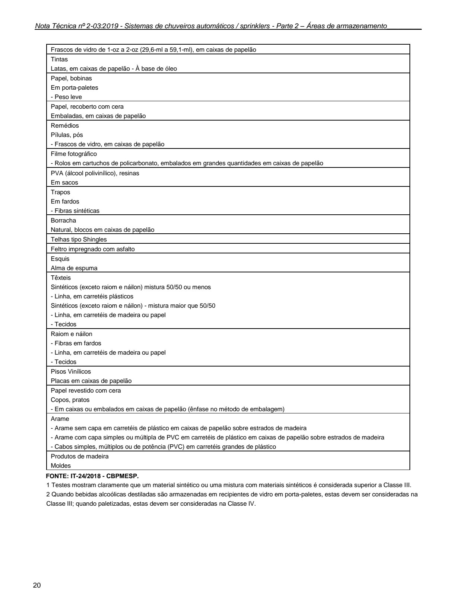

Frascos de vidro de 1-oz a 2-oz (29,6-ml a 59,1-ml), em caixas de papelão

Tintas Latas, em caixas de papelão - À base de óleo

Papel, bobinas Em porta-paletes - Peso leve

Papel, recoberto com cera Embaladas, em caixas de papelão

Remédios Pílulas, pós - Frascos de vidro, em caixas de papelão

Filme fotográfico - Rolos em cartuchos de policarbonato, embalados em grandes quantidades em caixas de papelão

PVA (álcool polivinílico), resinas Em sacos

Trapos Em fardos - Fibras sintéticas

Borracha Natural, blocos em caixas de papelão

Telhas tipo Shingles

Feltro impregnado com asfalto

Esquis Alma de espuma

Têxteis Sintéticos (exceto raiom e náilon) mistura 50/50 ou menos - Linha, em carretéis plásticos Sintéticos (exceto raiom e náilon) - mistura maior que 50/50 - Linha, em carretéis de madeira ou papel - Tecidos

Raiom e náilon - Fibras em fardos - Linha, em carretéis de madeira ou papel - Tecidos

Pisos Vinílicos Placas em caixas de papelão

Papel revestido com cera Copos, pratos - Em caixas ou embalados em caixas de papelão (ênfase no método de embalagem)

Arame - Arame sem capa em carretéis de plástico em caixas de papelão sobre estrados de madeira - Arame com capa simples ou múltipla de PVC em carretéis de plástico em caixas de papelão sobre estrados de madeira - Cabos simples, múltiplos ou de potência (PVC) em carretéis grandes de plástico

Produtos de madeira Moldes

### FONTE: IT-24/2018 - CBPMESP.

1 Testes mostram claramente que um material sintético ou uma mistura com materiais sintéticos é considerada superior a Classe III. 2 Quando bebidas alcoólicas destiladas são armazenadas em recipientes de vidro em porta-paletes, estas devem ser consideradas na Classe III; quando paletizadas, estas devem ser consideradas na Classe IV.

---

## Página 21

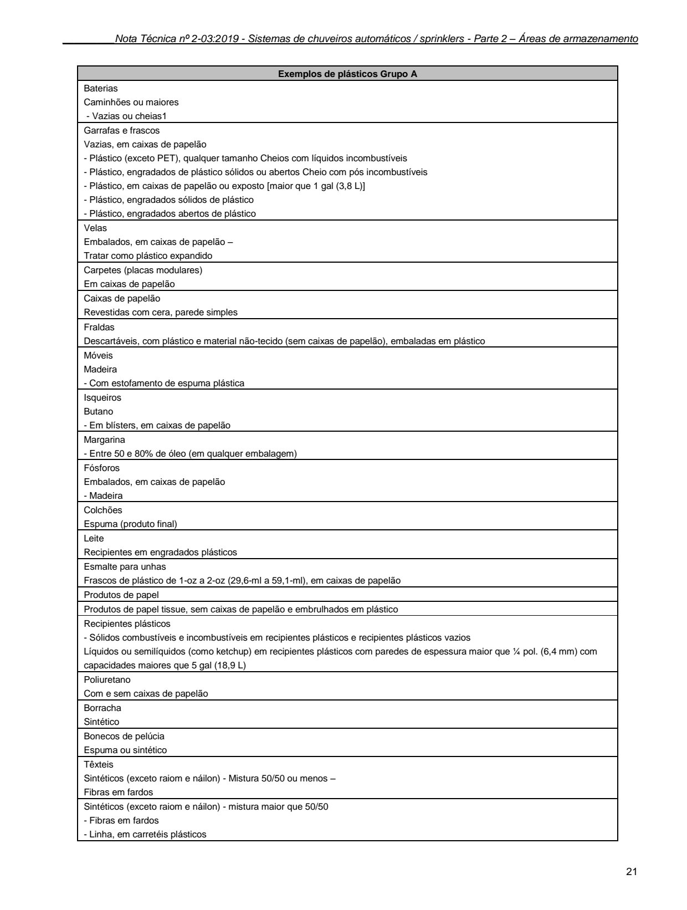

> Página sem texto extraível suficiente; consultar a representação visual ou o PDF oficial.

### Tabelas extraídas

#### Tabela 1 da página

|  | Exemplos de plásticos Grupo A |  |
| --- | --- | --- |
| Baterias Caminhões ou maiores - Vazias ou cheias1 |  |  |
| Garrafas e frascos Vazias, em caixas de papelão - Plástico (exceto PET), qualquer tamanho Cheios com líquidos incombustíveis - Plástico, engradados de plástico sólidos ou abertos Cheio com pós incombustíveis - Plástico, em caixas de papelão ou exposto [maior que 1 gal (3,8 L)] - Plástico, engradados sólidos de plástico - Plástico, engradados abertos de plástico |  |  |
| Velas Embalados, em caixas de papelão - Tratar como plástico expandido |  |  |
| Carpetes (placas modulares) Em caixas de papelão |  |  |
| Caixas de papelão Revestidas com cera, parede simples |  |  |
| Fraldas Descartáveis, com plástico e material não-tecido (sem caixas de papelão), embaladas em plástico |  |  |
| Móveis Madeira - Com estofamento de espuma plástica |  |  |
| Isqueiros Butano - Em blísters, em caixas de papelão |  |  |
| Margarina - Entre 50 e 80% de óleo (em qualquer embalagem) |  |  |
| Fósforos Embalados, em caixas de papelão - Madeira |  |  |
| Colchões Espuma (produto final) |  |  |
| Leite Recipientes em engradados plásticos |  |  |
| Esmalte para unhas Frascos de plástico de 1-oz a 2-oz (29,6-ml a 59,1-ml), em caixas de papelão |  |  |
| Produtos de papel |  |  |
| Produtos de papel tissue, sem caixas de papelão e embrulhados em plástico |  |  |
| Recipientes plásticos - Sólidos combustíveis e incombustíveis em recipientes plásticos e recipientes plásticos vazios Líquidos ou semilíquidos (como ketchup) em recipientes plásticos com paredes de espessura maior que ¼ pol. (6,4 mm) com capacidades maiores que 5 gal (18,9 L) |  |  |
| Poliuretano Com e sem caixas de papelão |  |  |
| Borracha Sintético |  |  |
| Bonecos de pelúcia Espuma ou sintético |  |  |
| Têxteis Sintéticos (exceto raiom e náilon) - Mistura 50/50 ou menos - Fibras em fardos |  |  |
| Sintéticos (exceto raiom e náilon) - mistura maior que 50/50 - Fibras em fardos - Linha, em carretéis plásticos |  |  |

---

## Página 22

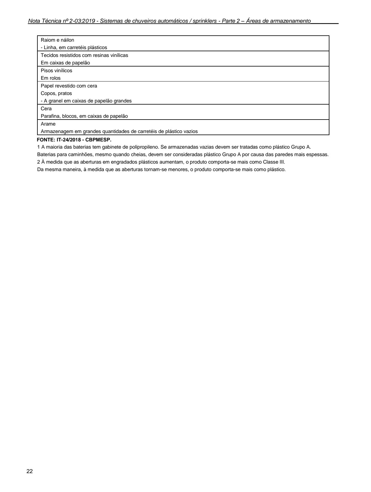

Raiom e náilon - Linha, em carretéis plásticos

Tecidos resistidos com resinas vinílicas Em caixas de papelão

Pisos vinílicos Em rolos

Papel revestido com cera Copos, pratos - A granel em caixas de papelão grandes

Cera Parafina, blocos, em caixas de papelão

Arame Armazenagem em grandes quantidades de carretéis de plástico vazios

### FONTE: IT-24/2018 - CBPMESP.

1 A maioria das baterias tem gabinete de polipropileno. Se armazenadas vazias devem ser tratadas como plástico Grupo A. Baterias para caminhões, mesmo quando cheias, devem ser consideradas plástico Grupo A por causa das paredes mais espessas. 2 À medida que as aberturas em engradados plásticos aumentam, o produto comporta-se mais como Classe III. Da mesma maneira, à medida que as aberturas tornam-se menores, o produto comporta-se mais como plástico.
