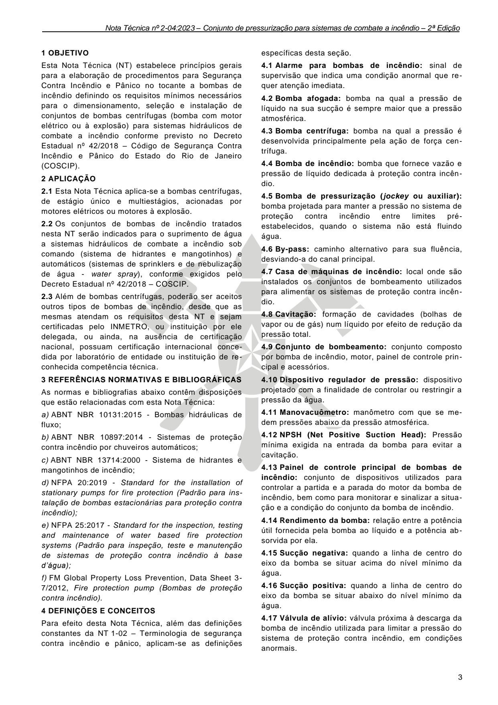
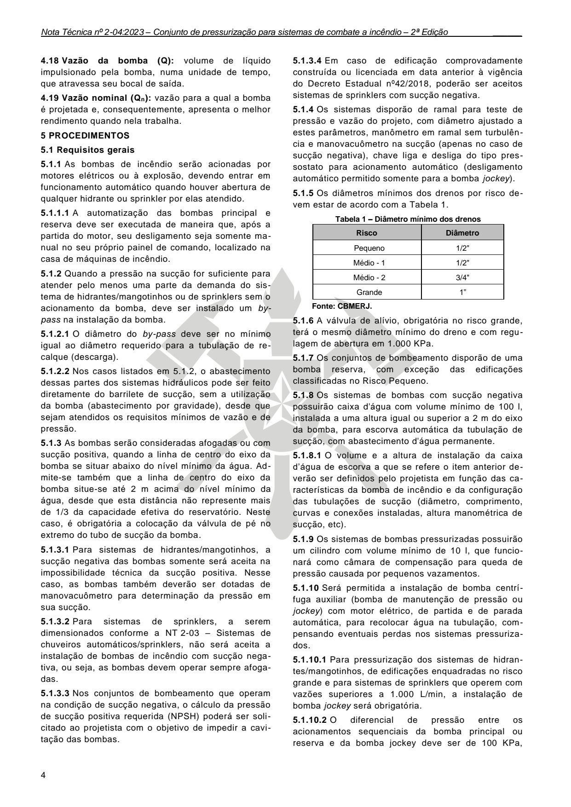
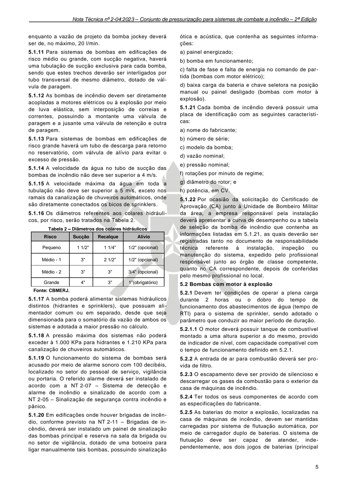
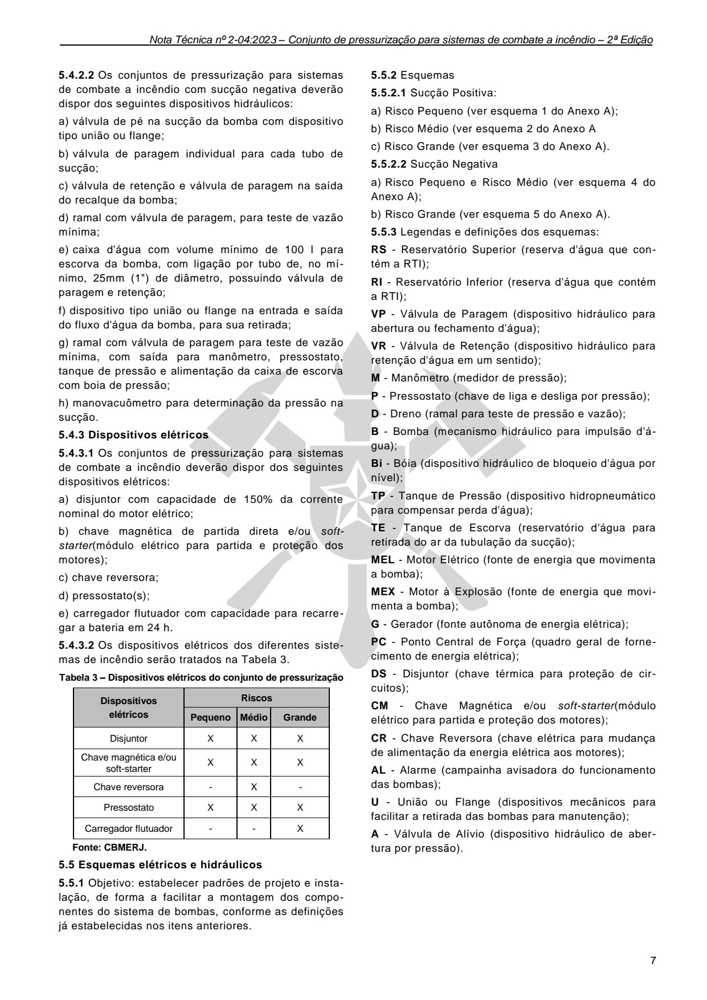
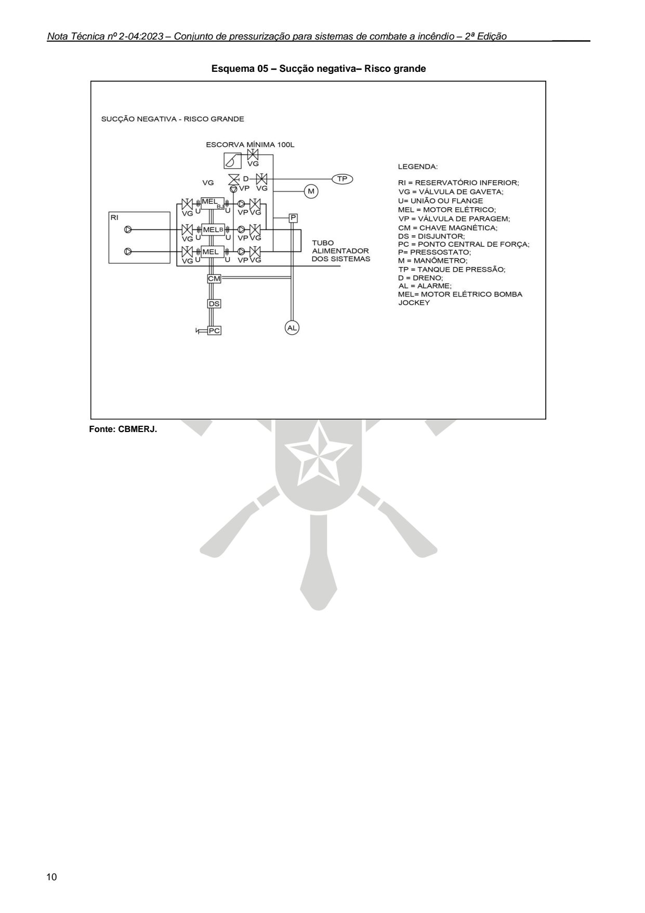

# NT 2-04 - Conjunto de pressurização para sistemas de combate a incêndio

> Conversão integral para consulta computacional. A numeração de página do PDF foi preservada. Quando houver tabela complexa, símbolo ou desenho, conferir também a representação visual indicada e o PDF oficial.

## Sumário por página

- [Página 1](#pagina-1)
- [Página 2](#pagina-2)
- [Página 3](#pagina-3)
- [Página 4](#pagina-4)
- [Página 5](#pagina-5)
- [Página 6](#pagina-6)
- [Página 7](#pagina-7)
- [Página 8](#pagina-8)
- [Página 9](#pagina-9)
- [Página 10](#pagina-10)

---

## Página 1

### NT 2-04

### N O T A T É C N I C A 2 - 0 4

C o n j u n t o d e p r e s s u r i z a ç ã o p a r a s i s t e m a s d e

c o m b a t e a i n c ê n d i o

2 0 2 3

---

## Página 2

NOTA TÉCNICA Nº 2-04:2023

Conjunto de pressurização para sistemas de combate a incêndio - 2ª Edição

Aprovada pela Portaria CBMERJ nº 1239, de 22 de novembro de 2023 (DOERJ nº 216, de 24.11.2023).

Publicada no Boletim da SEDEC/CBMERJ nº XX, de XX de XX de 2023.

### SUMÁRIO

### 1 OBJETIVO

### 2 APLICAÇÃO

### 3 REFERÊNCIAS NORMATIVAS E BIBLIOGRÁFICAS

### 4 DEFINIÇÕES E CONCEITOS

### 5 PROCEDIMENTOS

Publicações:

Vigência: 24/12/2023.

2ª Edição.

10 páginas.

Corpo de Bombeiros Militar do Estado do Rio de Janeiro CBMERJ Praça da República, nº 45, Centro, Rio de Janeiro - RJ. CEP: 20.211-350. www.cbmerj.rj.gov.br

http://www.cbmerj.rj.gov.br/notas-tecnicas

### ANEXOS

A - Esquemas elétricos e hidráulicos

---

## Página 3

### 1 OBJETIVO

Esta Nota Técnica (NT) estabelece princípios gerais para a elaboração de procedimentos para Segurança Contra Incêndio e Pânico no tocante a bombas de incêndio definindo os requisitos mínimos necessários para o dimensionamento, seleção e instalação de conjuntos de bombas centrífugas (bomba com motor elétrico ou à explosão) para sistemas hidráulicos de combate a incêndio conforme previsto no Decreto Estadual nº 42/2018 - Código de Segurança Contra Incêndio e Pânico do Estado do Rio de Janeiro (COSCIP).

### 2 APLICAÇÃO

2.1 Esta Nota Técnica aplica-se a bombas centrífugas, de estágio único e multiestágios, acionadas por motores elétricos ou motores à explosão.

2.2 Os conjuntos de bombas de incêndio tratados nesta NT serão indicados para o suprimento de água a sistemas hidráulicos de combate a incêndio sob comando (sistema de hidrantes e mangotinhos) e automáticos (sistemas de sprinklers e de nebulização de água - water spray), conforme exigidos pelo Decreto Estadual nº 42/2018 - COSCIP.

2.3 Além de bombas centrífugas, poderão ser aceitos outros tipos de bombas de incêndio, desde que as mesmas atendam os requisitos desta NT e sejam certificadas pelo INMETRO, ou instituição por ele delegada, ou ainda, na ausência de certificação nacional, possuam certificação internacional concedida por laboratório de entidade ou instituição de reconhecida competência técnica.

### 3 REFERÊNCIAS NORMATIVAS E BIBLIOGRÁFICAS

As normas e bibliografias abaixo contêm disposições que estão relacionadas com esta Nota Técnica:

a) ABNT NBR 10131:2015 - Bombas hidráulicas de fluxo;

b) ABNT NBR 10897:2014 - Sistemas de proteção contra incêndio por chuveiros automáticos;

c) ABNT NBR 13714:2000 - Sistema de hidrantes e mangotinhos de incêndio;

d) NFPA 20:2019 - Standard for the installation of stationary pumps for fire protection (Padrão para instalação de bombas estacionárias para proteção contra incêndio);

e) NFPA 25:2017 - Standard for the inspection, testing and maintenance of water based fire protection systems (Padrão para inspeção, teste e manutenção de sistemas de proteção contra incêndio à base d’água);

f) FM Global Property Loss Prevention, Data Sheet 3- 7/2012, Fire protection pump (Bombas de proteção contra incêndio).

### 4 DEFINIÇÕES E CONCEITOS

Para efeito desta Nota Técnica, além das definições constantes da NT 1-02 - Terminologia de segurança contra incêndio e pânico, aplicam-se as definições

específicas desta seção.

4.1 Alarme para bombas de incêndio: sinal de supervisão que indica uma condição anormal que requer atenção imediata.

4.3 Bomba centrífuga: bomba na qual a pressão é desenvolvida principalmente pela ação de força centrífuga.

4.4 Bomba de incêndio: bomba que fornece vazão e pressão de líquido dedicada à proteção contra incêndio.

4.5 Bomba de pressurização (jockey ou auxiliar): bomba projetada para manter a pressão no sistema de proteção contra incêndio entre limites préestabelecidos, quando o sistema não está fluindo água.

4.6 By-pass: caminho alternativo para sua fluência, desviando-a do canal principal.

4.7 Casa de máquinas de incêndio: local onde são instalados os conjuntos de bombeamento utilizados para alimentar os sistemas de proteção contra incêndio.

4.9 Conjunto de bombeamento: conjunto composto por bomba de incêndio, motor, painel de controle principal e acessórios.

4.10 Dispositivo regulador de pressão: dispositivo projetado com a finalidade de controlar ou restringir a pressão da água.

4.11 Manovacuômetro: manômetro com que se medem pressões abaixo da pressão atmosférica.

4.13 Painel de controle principal de bombas de incêndio: conjunto de dispositivos utilizados para controlar a partida e a parada do motor da bomba de incêndio, bem como para monitorar e sinalizar a situação e a condição do conjunto da bomba de incêndio.

4.14 Rendimento da bomba: relação entre a potência útil fornecida pela bomba ao líquido e a potência absorvida por ela.

4.15 Sucção negativa: quando a linha de centro do eixo da bomba se situar acima do nível mínimo da água.

4.16 Sucção positiva: quando a linha de centro do eixo da bomba se situar abaixo do nível mínimo da água.

4.17 Válvula de alívio: válvula próxima à descarga da bomba de incêndio utilizada para limitar a pressão do sistema de proteção contra incêndio, em condições anormais.

### Tabelas extraídas (bruto, não usar para citação)
#### Tabela 1 da página

|  | bomba na qual a pressão de |
| --- | --- |
| líquido na sua sucção é sempre maior que a pressão |  |
| atmosférica. |  |

#### Tabela 2 da página

|  | ormação de cavidades (bolhas de |
| --- | --- |
| vapor ou de gás) num líquido por efeito de redução da |  |
| pressão total. |  |

#### Tabela 3 da página

|  | NPSH (Net Positive Suction Head): Pressão |
| --- | --- |
| mínima exigida na entrada da bomba para evitar a |  |
| cavitação. |  |

---

## Página 4

4.18 Vazão da bomba (Q): volume de líquido impulsionado pela bomba, numa unidade de tempo, que atravessa seu bocal de saída.

4.19 Vazão nominal (Qn): vazão para a qual a bomba é projetada e, consequentemente, apresenta o melhor rendimento quando nela trabalha.

### 5 PROCEDIMENTOS

5.1 Requisitos gerais

5.1.1 As bombas de incêndio serão acionadas por motores elétricos ou à explosão, devendo entrar em funcionamento automático quando houver abertura de qualquer hidrante ou sprinkler por elas atendido.

5.1.1.1 A automatização das bombas principal e reserva deve ser executada de maneira que, após a partida do motor, seu desligamento seja somente manual no seu próprio painel de comando, localizado na casa de máquinas de incêndio.

5.1.2 Quando a pressão na sucção for suficiente para atender pelo menos uma parte da demanda do sistema de hidrantes/mangotinhos ou de sprinklers sem o acionamento da bomba, deve ser instalado um bypass na instalação da bomba.

5.1.2.1 O diâmetro do by-pass deve ser no mínimo igual ao diâmetro requerido para a tubulação de recalque (descarga).

5.1.2.2 Nos casos listados em 5.1.2, o abastecimento dessas partes dos sistemas hidráulicos pode ser feito diretamente do barrilete de sucção, sem a utilização da bomba (abastecimento por gravidade), desde que sejam atendidos os requisitos mínimos de vazão e de pressão.

5.1.3 As bombas serão consideradas afogadas ou com sucção positiva, quando a linha de centro do eixo da bomba se situar abaixo do nível mínimo da água. Admite-se também que a linha de centro do eixo da bomba situe-se até 2 m acima do nível mínimo da água, desde que esta distância não represente mais de 1/3 da capacidade efetiva do reservatório. Neste caso, é obrigatória a colocação da válvula de pé no extremo do tubo de sucção da bomba.

5.1.3.1 Para sistemas de hidrantes/mangotinhos, a sucção negativa das bombas somente será aceita na impossibilidade técnica da sucção positiva. Nesse caso, as bombas também deverão ser dotadas de manovacuômetro para determinação da pressão em sua sucção.

5.1.3.2 Para sistemas de sprinklers, a serem dimensionados conforme a NT 2-03 - Sistemas de chuveiros automáticos/sprinklers, não será aceita a instalação de bombas de incêndio com sucção negativa, ou seja, as bombas devem operar sempre afogadas.

5.1.3.3 Nos conjuntos de bombeamento que operam na condição de sucção negativa, o cálculo da pressão de sucção positiva requerida (NPSH) poderá ser solicitado ao projetista com o objetivo de impedir a cavitação das bombas.

5.1.3.4 Em caso de edificação comprovadamente construída ou licenciada em data anterior à vigência do Decreto Estadual nº42/2018, poderão ser aceitos sistemas de sprinklers com sucção negativa.

5.1.4 Os sistemas disporão de ramal para teste de pressão e vazão do projeto, com diâmetro ajustado a estes parâmetros, manômetro em ramal sem turbulência e manovacuômetro na sucção (apenas no caso de sucção negativa), chave liga e desliga do tipo pressostato para acionamento automático (desligamento automático permitido somente para a bomba jockey).

5.1.5 Os diâmetros mínimos dos drenos por risco devem estar de acordo com a Tabela 1.

Tabela 1 - Diâmetro mínimo dos drenos

Fonte: CBMERJ.

5.1.6 A válvula de alívio, obrigatória no risco grande, terá o mesmo diâmetro mínimo do dreno e com regulagem de abertura em 1.000 KPa.

5.1.7 Os conjuntos de bombeamento disporão de uma bomba reserva, com exceção das edificações classificadas no Risco Pequeno.

5.1.8 Os sistemas de bombas com sucção negativa possuirão caixa d'água com volume mínimo de 100 l, instalada a uma altura igual ou superior a 2 m do eixo da bomba, para escorva automática da tubulação de sucção, com abastecimento d'água permanente.

5.1.8.1 O volume e a altura de instalação da caixa d’água de escorva a que se refere o item anterior deverão ser definidos pelo projetista em função das características da bomba de incêndio e da configuração das tubulações de sucção (diâmetro, comprimento, curvas e conexões instaladas, altura manométrica de sucção, etc).

5.1.9 Os sistemas de bombas pressurizadas possuirão um cilindro com volume mínimo de 10 l, que funcionará como câmara de compensação para queda de pressão causada por pequenos vazamentos.

5.1.10 Será permitida a instalação de bomba centrífuga auxiliar (bomba de manutenção de pressão ou jockey) com motor elétrico, de partida e de parada automática, para recolocar água na tubulação, compensando eventuais perdas nos sistemas pressurizados.

5.1.10.1 Para pressurização dos sistemas de hidrantes/mangotinhos, de edificações enquadradas no risco grande e para sistemas de sprinklers que operem com vazões superiores a 1.000 L/min, a instalação de bomba jockey será obrigatória.

5.1.10.2 O diferencial de pressão entre os acionamentos sequenciais da bomba principal ou reserva e da bomba jockey deve ser de 100 KPa,

### Tabelas extraídas (bruto, não usar para citação)
#### Tabela 1 da página

| Risco | Diâmetro |
| --- | --- |
| Pequeno | 1/2" |
| Médio - 1 | 1/2" |
| Médio - 2 | 3/4" |
| Grande | 1” |

---

## Página 5

enquanto a vazão de projeto da bomba jockey deverá ser de, no máximo, 20 l/min.

5.1.11 Para sistemas de bombas em edificações de risco médio ou grande, com sucção negativa, haverá uma tubulação de sucção exclusiva para cada bomba, sendo que estes trechos deverão ser interligados por tubo transversal de mesmo diâmetro, dotado de válvula de paragem.

5.1.12 As bombas de incêndio devem ser diretamente acopladas a motores elétricos ou à explosão por meio de luva elástica, sem interposição de correias e correntes, possuindo a montante uma válvula de paragem e a jusante uma válvula de retenção e outra de paragem.

5.1.13 Para sistemas de bombas em edificações de risco grande haverá um tubo de descarga para retorno no reservatório, com válvula de alívio para evitar o excesso de pressão.

5.1.14 A velocidade da água no tubo de sucção das bombas de incêndio não deve ser superior a 4 m/s.

5.1.15 A velocidade máxima da água em toda a tubulação não deve ser superior a 5 m/s, exceto nos ramais da canalização de chuveiros automáticos, onde são diretamente conectados os bicos de sprinklers.

5.1.16 Os diâmetros referentes aos colares hidráulicos, por risco, serão tratados na Tabela 2.

Tabela 2 - Diâmetros dos colares hidráulicos

Fonte: CBMERJ.

5.1.17 A bomba poderá alimentar sistemas hidráulicos distintos (hidrantes e sprinklers), que possuam alimentador comum ou em separado, desde que seja dimensionada para o somatório da vazão de ambos os sistemas e adotada a maior pressão no cálculo.

5.1.18 A pressão máxima dos sistemas não poderá exceder à 1.000 KPa para hidrantes e 1.210 KPa para canalização de chuveiros automáticos.

5.1.19 O funcionamento do sistema de bombas será acusado por meio de alarme sonoro com 100 decibéis, localizado no setor do pessoal de serviço, vigilância ou portaria. O referido alarme deverá ser instalado de acordo com a NT 2-07 - Sistema de detecção e alarme de incêndio e sinalizado de acordo com a NT 2-05 - Sinalização de segurança contra incêndio e pânico.

5.1.20 Em edificações onde houver brigadas de incêndio, conforme previsto na NT 2-11 - Brigadas de incêndio, deverá ser instalado um painel de sinalização das bombas principal e reserva na sala da brigada ou no setor de vigilância, dotado de uma botoeira para ligar manualmente tais bombas, possuindo sinalização

ótica e acústica, que contenha as seguintes informações:

a) painel energizado;

b) bomba em funcionamento;

c) falta de fase e falta de energia no comando de partida (bombas com motor elétrico);

d) baixa carga da bateria e chave seletora na posição manual ou painel desligado (bombas com motor à explosão).

5.1.21 Cada bomba de incêndio deverá possuir uma placa de identificação com as seguintes características:

a) nome do fabricante;

b) número de série;

c) modelo da bomba;

d) vazão nominal;

e) pressão nominal;

f) rotações por minuto de regime;

g) diâmetro do rotor; e

h) potência, em CV.

5.1.22 Por ocasião da solicitação do Certificado de Aprovação (CA) junto à Unidade de Bombeiro Militar da área, a empresa responsável pela instalação deverá apresentar a curva de desempenho ou a tabela de seleção da bomba de incêndio que contenha as informações listadas em 5.1.21, as quais deverão ser registradas tanto no documento de responsabilidade técnica referente à instalação, inspeção ou manutenção do sistema, expedido pelo profissional responsável junto ao órgão de classe competente, quanto no CA correspondente, depois de conferidas pelo mesmo profissional no local.

5.2 Bombas com motor à explosão

5.2.1 Devem ter condições de operar a plena carga durante 2 horas ou o dobro do tempo de funcionamento dos abastecimentos de água (tempo de RTI) para o sistema de sprinkler, sendo adotado o parâmetro que conduzir ao maior período de duração.

5.2.1.1 O motor deverá possuir tanque de combustível montado a uma altura superior a do mesmo, provido de indicador de nível, com capacidade compatível com o tempo de funcionamento definido em 5.2.1.

5.2.2 A entrada de ar para combustão deverá ser provida de filtro.

5.2.3 O escapamento deve ser provido de silencioso e descarregar os gases da combustão para o exterior da casa de máquinas de incêndio.

5.2.4 Ter todos os seus componentes de acordo com as especificações do fabricante.

5.2.5 As baterias do motor a explosão, localizadas na casa de máquinas de incêndio, devem ser mantidas carregadas por sistema de flutuação automática, por meio de carregador duplo de baterias. O sistema de flutuação deve ser capaz de atender, independentemente, aos dois jogos de baterias (principal

### Tabelas extraídas (bruto, não usar para citação)
#### Tabela 1 da página

| Risco | Sucção | Recalque | Alívio |
| --- | --- | --- | --- |
| Pequeno | 1 1/2" | 1 1/4" | 1/2" (opcional) |
| Médio - 1 | 3" | 2 1/2" | 1/2" (opcional) |
| Médio - 2 | 3" | 3" | 3/4" (opcional) |
| Grande | 4" | 3" | 1"(obrigatório) |

---

## Página 6

e reserva).

5.2.5.1 Complementarmente, as baterias deverão possuir, no mínimo, capacidade para 10 partidas com 10 segundos de duração cada.

5.2.6 Um painel de comando deve ser instalado no interior da casa de máquinas de incêndio, indicando bomba em funcionamento e sistema automático desligado (chave seletora na posição manual).

5.3 Bombas com motor elétrico

5.3.1 O circuito elétrico dos motores deve estar de acordo com a norma NBR-5410 da ABNT.

5.3.2 Os cabos alimentadores do quadro de comando deverão ser dimensionados pela capacidade de corrente e queda de tensão.

5.3.3 Toda fiação elétrica de alimentação do motor da bomba de incêndio deverá ser protegida contra danos mecânicos e químicos, fogo e umidade.

5.3.4 As bombas de incêndio deverão possuir circuito de alimentação dedicado e de funcionamento contínuo, independente da alimentação geral da edificação, de forma a permitir o desligamento completo da energia elétrica, sem prejuízo do funcionamento do motor da bomba de incêndio.

5.3.5 As chaves elétricas de alimentação das bombas de incêndio devem ser sinalizadas com a inscrição “ALIMENTAÇÃO DA BOMBA DE INCÊNDIO - NÃO DESLIGUE”, em letras não menores que 25 mm de fonte.

5.3.6 A entrada de força para a edificação a ser protegida deve ser dimensionada para suportar o funcionamento das bombas de incêndio em conjunto com os demais componentes elétricos da edificação, a plena carga.

5.3.6.1 Quando da ausência ou insuficiência de suprimento de energia elétrica da concessionária na localidade onde se situa a edificação, as bombas de incêndio acionadas por motor elétrico deverão ser alimentadas por um motogerador de energia elétrica que as supra ou substituídas por bombas de incêndio com motor à explosão.

5.3.7 Quando for previsto motogerador de energia elétrica para o suprimento das bombas de incêndio, seja ele exclusivo ou não, o mesmo deverá ser dimensionado para atender uma potência equivalente a 1,5 vezes a potência consumida pelos motores elétricos das bombas, além de suprir simultaneamente todas as outras cargas que porventura sejam por ele operadas. Quando não se tratar de motogerador de uso exclusivo, o disposto em 5.3.4 também deve ser atendido para as bombas de incêndio e demais equipamentos por ele suportados.

5.3.8 Os disjuntores do quadro de distribuição e comando possuirão corrente nominal não inferior a 150% da corrente nominal do motor da bomba em plena carga.

5.3.9 O painel de comando para proteção e partida automática do motor elétrico da bomba de incêndio

deve ser selecionado de acordo com a potência em CV do motor. Este painel deve ser localizado o mais próximo possível do motor da bomba de incêndio e convenientemente protegido contra respingos de água e penetração de poeira.

5.4 Componentes do sistema

5.4.1 Quanto aos riscos

5.4.1.1 Risco pequeno e risco médio (1 e 2):

a) para sistemas de hidrantes e sprinklers com alimentador hidráulico independente, poderão ser utilizadas duas bombas com motor elétrico para cada sistema, sendo uma reserva (opcional para o risco pequeno), com potência dimensionada para as vazões e pressões individuais de projeto;

b) para sistemas de hidrantes e sprinklers com alimentador hidráulico independente, poderá ser utilizada uma bomba principal com motor elétrico para cada sistema, com potência dimensionada para as vazões e pressões individuais de projeto, além de mais uma bomba com motor elétrico como reserva dos dois sistemas (opcional para o risco pequeno), com potência dimensionada para a vazão acumulada e maior pressão de projeto; ou

c) para sistemas de hidrantes e sprinklers interligados, com alimentador hidráulico único, serão utilizadas duas bombas com motor elétrico com potência dimensionada para as vazões acumuladas e maior pressão de projeto, sendo uma como reserva (opcional para o risco pequeno).

5.4.1.2 Risco grande:

a) especificação conforme 5.4.1.1, sendo que a bomba de reserva com motor elétrico será substituída por conjunto constituído por uma bomba com motor elétrico e um gerador, atendendo os requisitos da subseção 5.3.7, ou por uma bomba acionada por motor à explosão;

b) será obrigatória a adoção de bomba de pressurização ou jockey nessa classificação de risco.

5.4.2 Dispositivos hidráulicos

5.4.2.1 Os conjuntos de pressurização para sistemas de combate a incêndio com sucção positiva deverão dispor dos seguintes dispositivos hidráulicos mínimos:

a) válvula de paragem na saída do reservatório superior;

b) válvula de retenção impedindo o retorno d'água;

c) derivação para sucção das bombas com válvula de paragem para cada bomba;

d) passagem direta do fluxo d'água (by-pass);

e) válvula de retenção e válvula de paragem na saída do recalque de cada bomba;

f) ramal com válvula de paragem para teste de vazão mínima;

g) pressostato(s);

h) dispositivo tipo união ou flange na entrada e saída do fluxo d'água da bomba, para sua retirada.

---

## Página 7

5.4.2.2 Os conjuntos de pressurização para sistemas de combate a incêndio com sucção negativa deverão dispor dos seguintes dispositivos hidráulicos:

a) válvula de pé na sucção da bomba com dispositivo tipo união ou flange;

b) válvula de paragem individual para cada tubo de sucção;

c) válvula de retenção e válvula de paragem na saída do recalque da bomba;

d) ramal com válvula de paragem, para teste de vazão mínima;

e) caixa d'água com volume mínimo de 100 l para escorva da bomba, com ligação por tubo de, no mínimo, 25mm (1") de diâmetro, possuindo válvula de paragem e retenção;

f) dispositivo tipo união ou flange na entrada e saída do fluxo d'água da bomba, para sua retirada;

g) ramal com válvula de paragem para teste de vazão mínima, com saída para manômetro, pressostato, tanque de pressão e alimentação da caixa de escorva com boia de pressão;

h) manovacuômetro para determinação da pressão na sucção.

5.4.3 Dispositivos elétricos

5.4.3.1 Os conjuntos de pressurização para sistemas de combate a incêndio deverão dispor dos seguintes dispositivos elétricos:

a) disjuntor com capacidade de 150% da corrente nominal do motor elétrico;

b) chave magnética de partida direta e/ou softstarter(módulo elétrico para partida e proteção dos motores);

c) chave reversora;

d) pressostato(s);

e) carregador flutuador com capacidade para recarregar a bateria em 24 h.

5.4.3.2 Os dispositivos elétricos dos diferentes sistemas de incêndio serão tratados na Tabela 3.

Tabela 3 - Dispositivos elétricos do conjunto de pressurização

Fonte: CBMERJ.

5.5 Esquemas elétricos e hidráulicos

5.5.1 Objetivo: estabelecer padrões de projeto e instalação, de forma a facilitar a montagem dos componentes do sistema de bombas, conforme as definições já estabelecidas nos itens anteriores.

5.5.2 Esquemas

5.5.2.1 Sucção Positiva:

a) Risco Pequeno (ver esquema 1 do Anexo A);

b) Risco Médio (ver esquema 2 do Anexo A

c) Risco Grande (ver esquema 3 do Anexo A).

5.5.2.2 Sucção Negativa

a) Risco Pequeno e Risco Médio (ver esquema 4 do Anexo A);

b) Risco Grande (ver esquema 5 do Anexo A).

5.5.3 Legendas e definições dos esquemas:

RS - Reservatório Superior (reserva d'água que contém a RTI);

RI - Reservatório Inferior (reserva d'água que contém a RTI);

VP - Válvula de Paragem (dispositivo hidráulico para abertura ou fechamento d'água);

VR - Válvula de Retenção (dispositivo hidráulico para retenção d'água em um sentido);

M - Manômetro (medidor de pressão);

P - Pressostato (chave de liga e desliga por pressão);

D - Dreno (ramal para teste de pressão e vazão);

B - Bomba (mecanismo hidráulico para impulsão d'água);

Bi - Bóia (dispositivo hidráulico de bloqueio d'água por nível);

TP - Tanque de Pressão (dispositivo hidropneumático para compensar perda d'água);

TE - Tanque de Escorva (reservatório d'água para retirada do ar da tubulação da sucção);

MEL - Motor Elétrico (fonte de energia que movimenta a bomba);

MEX - Motor à Explosão (fonte de energia que movimenta a bomba);

G - Gerador (fonte autônoma de energia elétrica);

PC - Ponto Central de Força (quadro geral de fornecimento de energia elétrica);

DS - Disjuntor (chave térmica para proteção de circuitos);

CM - Chave Magnética e/ou soft-starter(módulo elétrico para partida e proteção dos motores);

CR - Chave Reversora (chave elétrica para mudança de alimentação da energia elétrica aos motores);

AL - Alarme (campainha avisadora do funcionamento das bombas);

U - União ou Flange (dispositivos mecânicos para facilitar a retirada das bombas para manutenção);

A - Válvula de Alívio (dispositivo hidráulico de abertura por pressão).

### Tabelas extraídas (bruto, não usar para citação)
#### Tabela 1 da página

| Dispositivos | Riscos |  |  |
| --- | --- | --- | --- |
| elétricos | Pequeno | Médio | Grande |
| Disjuntor | X | X | X |
| Chave magnética e/ou soft-starter | X | X | X |
| Chave reversora | - | X | - |
| Pressostato | X | X | X |
| Carregador flutuador | - | - | X |

---

## Página 8

### ANEXO A - ESQUEMAS ELÉTRICOS E HIDRÁULICOS

Esquema 01 - Sucção positiva - Risco pequeno

Observação: A instalação de bomba de incêndio reserva é opcional para edificações enquadradas no risco pequeno. Fonte: CBMERJ.

Esquema 02 - Sucção positiva - Risco médio

Fonte: CBMERJ.

---

## Página 9

Esquema 03 - Sucção positiva - Risco grande

Fonte: CBMERJ.

Esquema 04 - Sucção negativa - Risco pequeno e Risco médio

Observação: A instalação de bomba de incêndio reserva é opcional para edificações enquadradas no risco pequeno. Fonte: CBMERJ.

---

## Página 10

Esquema 05 - Sucção negativa- Risco grande

Fonte: CBMERJ.
