# NT 2-05 - Sinalização de segurança contra incêndio e pânico

> Conversão integral para consulta computacional. A numeração de página do PDF foi preservada. Quando houver tabela complexa, símbolo ou desenho, conferir também a representação visual indicada e o PDF oficial.

## Sumário por página

- [Página 1](#pagina-1)
- [Página 2](#pagina-2)
- [Página 3](#pagina-3)
- [Página 4](#pagina-4)
- [Página 5](#pagina-5)
- [Página 6](#pagina-6)
- [Página 7](#pagina-7)
- [Página 8](#pagina-8)
- [Página 9](#pagina-9)
- [Página 10](#pagina-10)
- [Página 11](#pagina-11)
- [Página 12](#pagina-12)
- [Página 13](#pagina-13)
- [Página 14](#pagina-14)
- [Página 15](#pagina-15)
- [Página 16](#pagina-16)
- [Página 17](#pagina-17)
- [Página 18](#pagina-18)

---

## Página 1

### NT 2-05

### N O T A T É C N I C A 2 - 0 5

S i n a l i z a ç ã o d e s e g u r a n ç a c o n t r a i n c ê n d i o

e p â n i c o

2 0 2 3

---

## Página 2

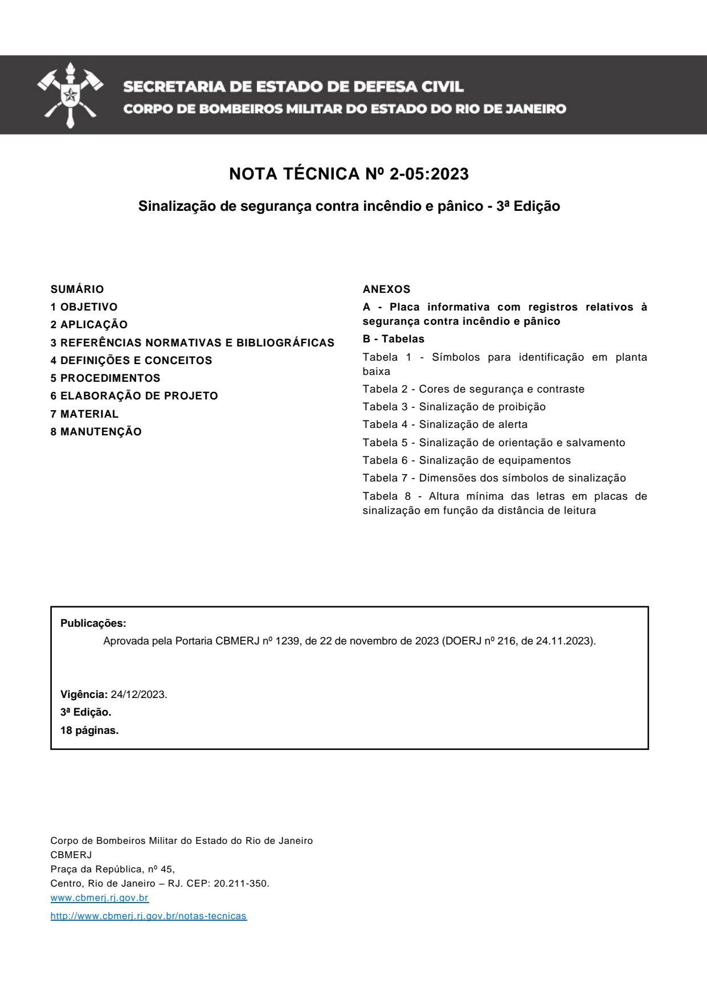

NOTA TÉCNICA Nº 2-05:2023

Sinalização de segurança contra incêndio e pânico - 3ª Edição

Aprovada pela Portaria CBMERJ nº 1239, de 22 de novembro de 2023 (DOERJ nº 216, de 24.11.2023).

Publicada no Boletim da SEDEC/CBMERJ nº XX, de XX de XX de 2023.

### SUMÁRIO

### 1 OBJETIVO

### 2 APLICAÇÃO

### 3 REFERÊNCIAS NORMATIVAS E BIBLIOGRÁFICAS

### 4 DEFINIÇÕES E CONCEITOS

### 5 PROCEDIMENTOS

### 6 ELABORAÇÃO DE PROJETO

### 7 MATERIAL

### 8 MANUTENÇÃO

Publicações:

Vigência: 24/12/2023.

3ª Edição.

18 páginas.

Corpo de Bombeiros Militar do Estado do Rio de Janeiro CBMERJ Praça da República, nº 45, Centro, Rio de Janeiro - RJ. CEP: 20.211-350. www.cbmerj.rj.gov.br

http://www.cbmerj.rj.gov.br/notas-tecnicas

### ANEXOS

A - Placa informativa com registros relativos à segurança contra incêndio e pânico

B - Tabelas

Tabela 1 - Símbolos para identificação em planta baixa

Tabela 2 - Cores de segurança e contraste

Tabela 3 - Sinalização de proibição

Tabela 4 - Sinalização de alerta

Tabela 5 - Sinalização de orientação e salvamento

Tabela 6 - Sinalização de equipamentos

Tabela 7 - Dimensões dos símbolos de sinalização

Tabela 8 - Altura mínima das letras em placas de sinalização em função da distância de leitura

---

## Página 3

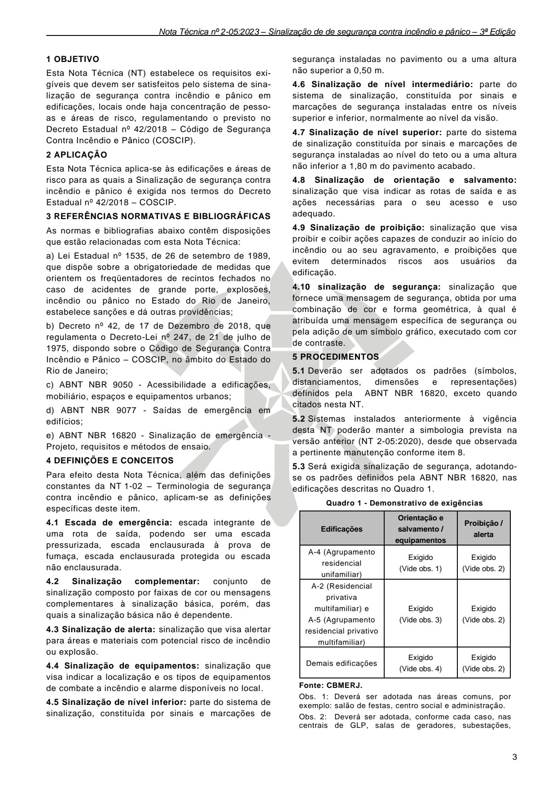

### 1 OBJETIVO

Esta Nota Técnica (NT) estabelece os requisitos exigíveis que devem ser satisfeitos pelo sistema de sinalização de segurança contra incêndio e pânico em edificações, locais onde haja concentração de pessoas e áreas de risco, regulamentando o previsto no Decreto Estadual nº 42/2018 - Código de Segurança Contra Incêndio e Pânico (COSCIP).

### 2 APLICAÇÃO

Esta Nota Técnica aplica-se às edificações e áreas de risco para as quais a Sinalização de segurança contra incêndio e pânico é exigida nos termos do Decreto Estadual nº 42/2018 - COSCIP.

### 3 REFERÊNCIAS NORMATIVAS E BIBLIOGRÁFICAS

As normas e bibliografias abaixo contêm disposições que estão relacionadas com esta Nota Técnica:

a) Lei Estadual nº 1535, de 26 de setembro de 1989, que dispõe sobre a obrigatoriedade de medidas que orientem os freqüentadores de recintos fechados no caso de acidentes de grande porte, explosões, incêndio ou pânico no Estado do Rio de Janeiro, estabelece sanções e dá outras providências;

b) Decreto nº 42, de 17 de Dezembro de 2018, que regulamenta o Decreto-Lei nº 247, de 21 de julho de 1975, dispondo sobre o Código de Segurança Contra Incêndio e Pânico - COSCIP, no âmbito do Estado do Rio de Janeiro;

c) ABNT NBR 9050 - Acessibilidade a edificações, mobiliário, espaços e equipamentos urbanos;

d) ABNT NBR 9077 - Saídas de emergência em edifícios;

e) ABNT NBR 16820 - Sinalização de emergência - Projeto, requisitos e métodos de ensaio.

### 4 DEFINIÇÕES E CONCEITOS

Para efeito desta Nota Técnica, além das definições constantes da NT 1-02 - Terminologia de segurança contra incêndio e pânico, aplicam-se as definições específicas deste item.

4.1 Escada de emergência: escada integrante de uma rota de saída, podendo ser uma escada pressurizada, escada enclausurada à prova de fumaça, escada enclausurada protegida ou escada não enclausurada.

4.2 Sinalização complementar: conjunto de sinalização composto por faixas de cor ou mensagens complementares à sinalização básica, porém, das quais a sinalização básica não é dependente.

4.3 Sinalização de alerta: sinalização que visa alertar para áreas e materiais com potencial risco de incêndio ou explosão.

4.4 Sinalização de equipamentos: sinalização que visa indicar a localização e os tipos de equipamentos de combate a incêndio e alarme disponíveis no local.

4.5 Sinalização de nível inferior: parte do sistema de sinalização, constituída por sinais e marcações de

segurança instaladas no pavimento ou a uma altura não superior a 0,50 m.

4.6 Sinalização de nível intermediário: parte do sistema de sinalização, constituída por sinais e marcações de segurança instaladas entre os níveis superior e inferior, normalmente ao nível da visão.

4.7 Sinalização de nível superior: parte do sistema de sinalização constituída por sinais e marcações de segurança instaladas ao nível do teto ou a uma altura não inferior a 1,80 m do pavimento acabado.

4.8 Sinalização de orientação e salvamento: sinalização que visa indicar as rotas de saída e as ações necessárias para o seu acesso e uso adequado.

4.9 Sinalização de proibição: sinalização que visa proibir e coibir ações capazes de conduzir ao início do incêndio ou ao seu agravamento, e proibições que evitem determinados riscos aos usuários da edificação.

4.10 sinalização de segurança: sinalização que fornece uma mensagem de segurança, obtida por uma combinação de cor e forma geométrica, à qual é atribuída uma mensagem específica de segurança ou pela adição de um símbolo gráfico, executado com cor de contraste.

### 5 PROCEDIMENTOS

5.1 Deverão ser adotados os padrões (símbolos, distanciamentos, dimensões e representações) definidos pela ABNT NBR 16820, exceto quando citados nesta NT.

5.2 Sistemas instalados anteriormente à vigência desta NT poderão manter a simbologia prevista na versão anterior (NT 2-05:2020), desde que observada a pertinente manutenção conforme item 8.

5.3 Será exigida sinalização de segurança, adotandose os padrões definidos pela ABNT NBR 16820, nas edificações descritas no Quadro 1.

Quadro 1 - Demonstrativo de exigências

Fonte: CBMERJ.

Obs. 1: Deverá ser adotada nas áreas comuns, por exemplo: salão de festas, centro social e administração.

Obs. 2: Deverá ser adotada, conforme cada caso, nas centrais de GLP, salas de geradores, subestações,

### Tabelas extraídas

#### Tabela 1 da página

| Edificações |  | Orientação e |  | Proibição / alerta |
| --- | --- | --- | --- | --- |
|  |  | salvamento / |  |  |
|  |  | equipamentos |  |  |
| A-4 (Agrupamento residencial unifamiliar) | Exigido (Vide obs. 1) |  |  | Exigido (Vide obs. 2) |
| A-2 (Residencial privativa multifamiliar) e A-5 (Agrupamento residencial privativo multifamiliar) | Exigido (Vide obs. 3) |  |  | Exigido (Vide obs. 2) |
| Demais edificações | Exigido (Vide obs. 4) |  |  | Exigido (Vide obs. 2) |

---

## Página 4

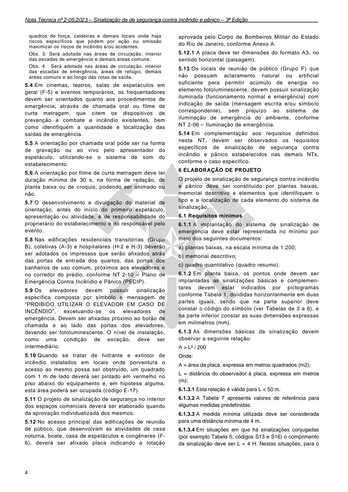

quadros de força, caldeiras e demais locais onde haja riscos específicos que podem por ação ou omissão maximizar os riscos de incêndio e/ou acidentes.

Obs. 3: Será adotada nas áreas de circulação, interior das escadas de emergência e demais áreas comuns.

Obs. 4: Será adotada nas áreas de circulação, interior das escadas de emergência, áreas de refúgio, demais áreas comuns e ao longo das rotas de saída.

5.4 Em cinemas, teatros, salas de espetáculos em geral (F-5) e eventos temporários, os frequentadores devem ser orientados quanto aos procedimentos de emergência, através de chamada oral ou filme de curta metragem, que citem os dispositivos de prevenção e combate a incêndio existentes, bem como identifiquem a quantidade e localização das saídas de emergência.

5.5 A orientação por chamada oral pode ser na forma de gravação ou ao vivo pelo apresentador do espetáculo, utilizando-se o sistema de som do estabelecimento.

5.6 A orientação por filme de curta metragem deve ter duração mínima de 30 s, na forma de redação, de planta baixa ou de croquis, podendo ser animado ou não.

5.7 O desenvolvimento e divulgação do material de orientação, antes do início do primeiro espetáculo, apresentação ou atividade, é de responsabilidade do proprietário do estabelecimento e do responsável pelo evento.

5.8 Nas edificações residenciais transitórias (Grupo B), coletivas (A-3) e hospitalares (H-2 e H-3) deverão ser adotados os impressos que serão afixados atrás das portas de entrada dos quartos, das portas dos banheiros de uso comum, próximos aos elevadores e no corredor do prédio, conforme NT 2-10 - Plano de Emergência Contra Incêndio e Pânico (PECIP).

5.9 Os elevadores devem possuir sinalização específica composta por símbolo e mensagem de “PROIBIDO UTILIZAR O ELEVADOR EM CASO DE INCÊNDIO”, excetuando-se os elevadores de emergência. Devem ser afixadas próximo ao botão de chamada e ao lado das portas dos elevadores, devendo ser fotoluminescente. O nível de instalação, como uma condição de exceção, deve ser intermediário.

5.10 Quando se tratar de hidrante e extintor de incêndio instalados em locais onde porventura o acesso ao mesmo possa ser obstruído, um quadrado com 1 m de lado deverá ser pintado em vermelho no piso abaixo do equipamento e, em hipótese alguma, esta área poderá ser ocupada (código E-17).

5.11 O projeto de sinalização de segurança no interior dos espaços comerciais deverá ser elaborado quando da aprovação individualizada dos mesmos.

5.12 No acesso principal das edificações de reunião de público, que desenvolvam as atividades de casa noturna, boate, casa de espetáculos e congêneres (F- 6), deverá ser afixado placa indicando a lotação

aprovada pelo Corpo de Bombeiros Militar do Estado do Rio de Janeiro, conforme Anexo A.

5.12.1 A placa deve ter dimensões do formato A3, no sentido horizontal (paisagem).

5.13 Os locais de reunião de público (Grupo F) que não possuam aclaramento natural ou artificial suficiente para permitir acúmulo de energia no elemento fotoluminescente, devem possuir sinalização iluminada (funcionamento normal e emergência) com indicação de saída (mensagem escrita e/ou símbolo correspondente), sem prejuízo ao sistema de iluminação de emergência do ambiente, conforme NT 2-06 - Iluminação de emergência.

5.14 Em complementação aos requisitos definidos nesta NT, devem ser observados os requisitos específicos de sinalização de segurança contra incêndio e pânico estabelecidos nas demais NTs, conforme o caso específico.

### 6 ELABORAÇÃO DE PROJETO

O projeto de sinalização de segurança contra incêndio e pânico deve ser constituído por plantas baixas, memorial descritivo e elementos que identifiquem o tipo e a localização de cada elemento do sistema de sinalização.

6.1 Requisitos mínimos

6.1.1 A implantação do sistema de sinalização de emergência deve estar representada no mínimo por meio dos seguintes documentos:

a) plantas baixas, na escala mínima de 1:200;

b) memorial descritivo;

c) quadro quantitativo (quadro resumo).

6.1.2 Em planta baixa, os pontos onde devem ser implantadas as sinalizações básicas e complementares devem estar indicados por pictogramas conforme Tabela 1, divididas horizontalmente em duas partes iguais, sendo que na parte superior deve constar o código do símbolo (ver Tabelas de 3 a 6), e na parte inferior constar as suas dimensões expressas em milímetros (mm).

6.1.3 As dimensões básicas da sinalização devem observar a seguinte relação:

### A > L² / 200

Onde:

A = área da placa, expressa em metros quadrados (m2);

L = distância do observador à placa, expressa em metros (m);

6.1.3.1 Esta relação é válida para L < 50 m.

6.1.3.2 A Tabela 7 apresenta valores de referência para algumas medidas predefinidas.

6.1.3.3 A medida mínima utilizada deve ser considerada para uma distância mínima de 4 m.

6.1.3.4 Em situações em que há sinalizações conjugadas (por exemplo Tabela 5, códigos S13 e S16) o comprimento da sinalização deve ser L = 4 H. Nestas situações, para o

---

## Página 5

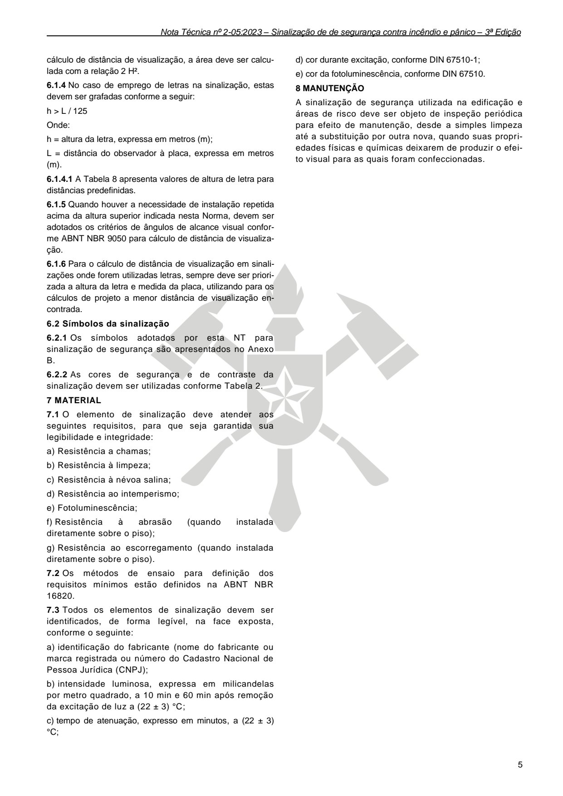

cálculo de distância de visualização, a área deve ser calculada com a relação 2 H².

6.1.4 No caso de emprego de letras na sinalização, estas devem ser grafadas conforme a seguir:

h > L / 125

Onde:

h = altura da letra, expressa em metros (m);

L = distância do observador à placa, expressa em metros (m).

6.1.4.1 A Tabela 8 apresenta valores de altura de letra para distâncias predefinidas.

6.1.5 Quando houver a necessidade de instalação repetida acima da altura superior indicada nesta Norma, devem ser adotados os critérios de ângulos de alcance visual conforme ABNT NBR 9050 para cálculo de distância de visualização.

6.1.6 Para o cálculo de distância de visualização em sinalizações onde forem utilizadas letras, sempre deve ser priorizada a altura da letra e medida da placa, utilizando para os cálculos de projeto a menor distância de visualização encontrada.

6.2 Símbolos da sinalização

6.2.1 Os símbolos adotados por esta NT para sinalização de segurança são apresentados no Anexo B.

6.2.2 As cores de segurança e de contraste da sinalização devem ser utilizadas conforme Tabela 2.

### 7 MATERIAL

7.1 O elemento de sinalização deve atender aos seguintes requisitos, para que seja garantida sua legibilidade e integridade:

a) Resistência a chamas;

b) Resistência à limpeza;

c) Resistência à névoa salina;

d) Resistência ao intemperismo;

e) Fotoluminescência;

f) Resistência à abrasão (quando instalada diretamente sobre o piso);

g) Resistência ao escorregamento (quando instalada diretamente sobre o piso).

7.2 Os métodos de ensaio para definição dos requisitos mínimos estão definidos na ABNT NBR 16820.

7.3 Todos os elementos de sinalização devem ser identificados, de forma legível, na face exposta, conforme o seguinte:

a) identificação do fabricante (nome do fabricante ou marca registrada ou número do Cadastro Nacional de Pessoa Jurídica (CNPJ);

b) intensidade luminosa, expressa em milicandelas por metro quadrado, a 10 min e 60 min após remoção da excitação de luz a (22 ± 3) °C;

c) tempo de atenuação, expresso em minutos, a (22 ± 3) °C;

d) cor durante excitação, conforme DIN 67510-1;

e) cor da fotoluminescência, conforme DIN 67510.

### 8 MANUTENÇÃO

A sinalização de segurança utilizada na edificação e áreas de risco deve ser objeto de inspeção periódica para efeito de manutenção, desde a simples limpeza até a substituição por outra nova, quando suas propriedades físicas e químicas deixarem de produzir o efeito visual para as quais foram confeccionadas.

---

## Página 6

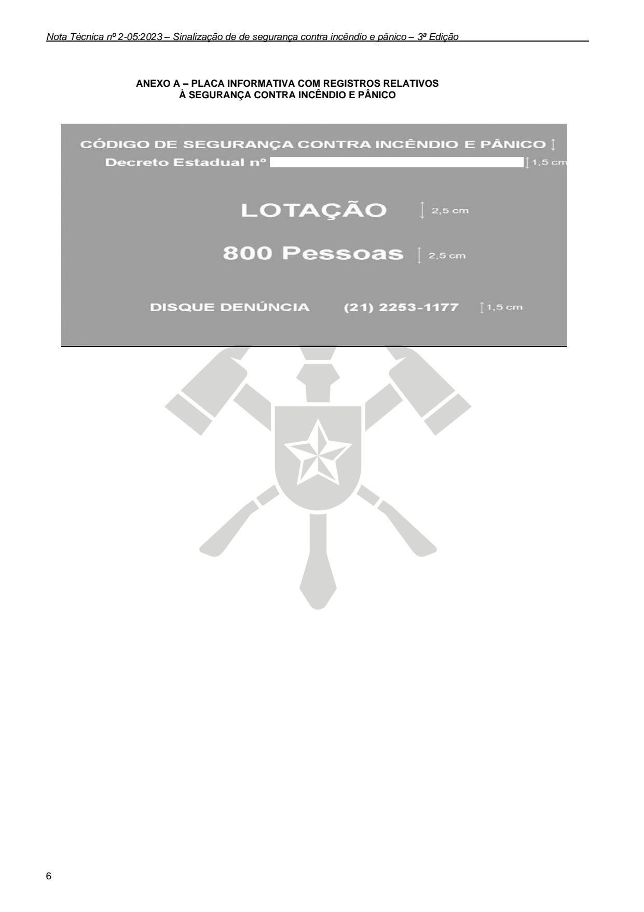

### ANEXO A - PLACA INFORMATIVA COM REGISTROS RELATIVOS

### À SEGURANÇA CONTRA INCÊNDIO E PÂNICO

---

## Página 7

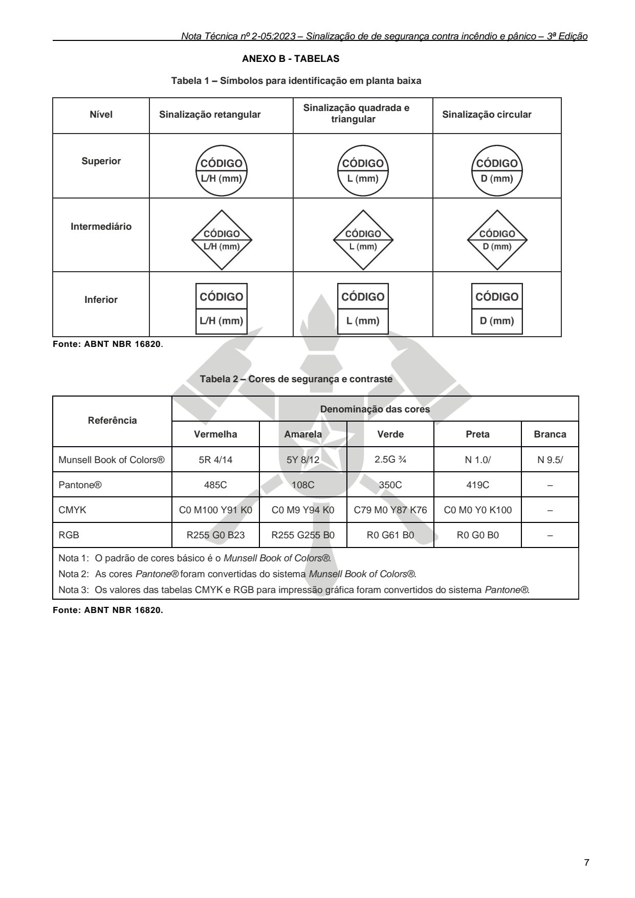

### ANEXO B - TABELAS

Tabela 1 - Símbolos para identificação em planta baixa

Fonte: ABNT NBR 16820.

Tabela 2 - Cores de segurança e contraste

Fonte: ABNT NBR 16820.

### Tabelas extraídas

#### Tabela 1 da página

| Nível | Sinalização retangular | Sinalização quadrada e triangular | Sinalização circular |
| --- | --- | --- | --- |
| Superior |  |  |  |
| Intermediário |  |  |  |
| Inferior |  |  |  |

#### Tabela 2 da página

| Referência | Denominação das cores |  |  |  |  |
| --- | --- | --- | --- | --- | --- |
|  | Vermelha | Amarela | Verde | Preta | Branca |
| Munsell Book of Colors® | 5R 4/14 | 5Y 8/12 | 2.5G ¾ | N 1.0/ | N 9.5/ |
| Pantone® | 485C | 108C | 350C | 419C | - |
| CMYK | C0 M100 Y91 K0 | C0 M9 Y94 K0 | C79 M0 Y87 K76 | C0 M0 Y0 K100 | - |
| RGB | R255 G0 B23 | R255 G255 B0 | R0 G61 B0 | R0 G0 B0 | - |
| Nota 1: O padrão de cores básico é o Munsell Book of Colors®. Nota 2: As cores Pantone® foram convertidas do sistema Munsell Book of Colors®. Nota 3: Os valores das tabelas CMYK e RGB para impressão gráfica foram convertidos do sistema Pantone®. |  |  |  |  |  |

---

## Página 8

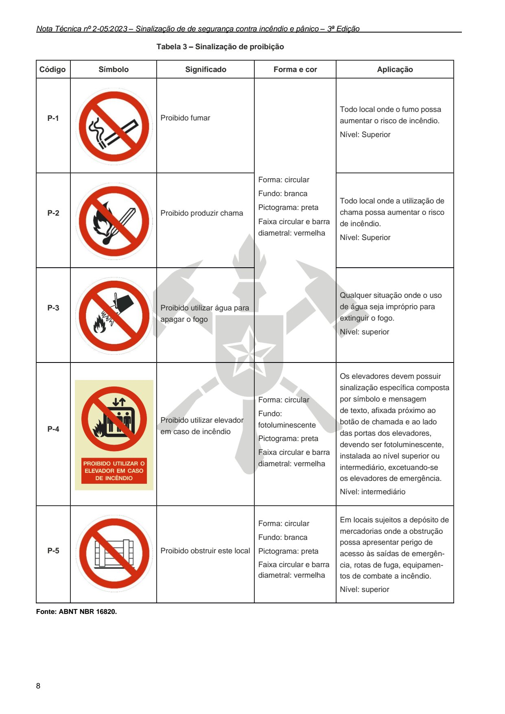

Tabela 3 - Sinalização de proibição

Fonte: ABNT NBR 16820.

### Tabelas extraídas

#### Tabela 1 da página

| Código | Símbolo | Significado | Forma e cor | Aplicação |
| --- | --- | --- | --- | --- |
| P-1 |  | Proibido fumar | Forma: circular Fundo: branca Pictograma: preta Faixa circular e barra diametral: vermelha | Todo local onde o fumo possa aumentar o risco de incêndio. Nível: Superior |
| P-2 |  | Proibido produzir chama |  | Todo local onde a utilização de chama possa aumentar o risco de incêndio. Nível: Superior |
| P-3 |  | Proibido utilizar água para apagar o fogo |  | Qualquer situação onde o uso de água seja impróprio para extinguir o fogo. Nível: superior |
| P-4 |  | Proibido utilizar elevador em caso de incêndio | Forma: circular Fundo: fotoluminescente Pictograma: preta Faixa circular e barra diametral: vermelha | Os elevadores devem possuir sinalização específica composta por símbolo e mensagem de texto, afixada próximo ao botão de chamada e ao lado das portas dos elevadores, devendo ser fotoluminescente, instalada ao nível superior ou intermediário, excetuando-se os elevadores de emergência. Nível: intermediário |
| P-5 |  | Proibido obstruir este local | Forma: circular Fundo: branca Pictograma: preta Faixa circular e barra diametral: vermelha | Em locais sujeitos a depósito de mercadorias onde a obstrução possa apresentar perigo de acesso às saídas de emergência, rotas de fuga, equipamentos de combate a incêndio. Nível: superior |

---

## Página 9

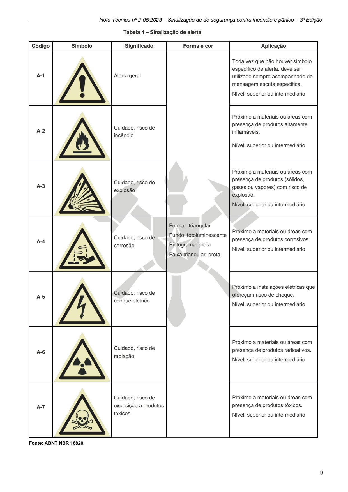

Tabela 4 - Sinalização de alerta

Fonte: ABNT NBR 16820.

### Tabelas extraídas

#### Tabela 1 da página

| Código | Símbolo | Significado | Forma e cor | Aplicação |
| --- | --- | --- | --- | --- |
| A-1 |  | Alerta geral | Forma: triangular Fundo: fotoluminescente Pictograma: preta Faixa triangular: preta | Toda vez que não houver símbolo específico de alerta, deve ser utilizado sempre acompanhado de mensagem escrita específica. Nível: superior ou intermediário |
| A-2 |  | Cuidado, risco de incêndio |  | Próximo a materiais ou áreas com presença de produtos altamente inflamáveis. Nível: superior ou intermediário |
| A-3 |  | Cuidado, risco de explosão |  | Próximo a materiais ou áreas com presença de produtos (sólidos, gases ou vapores) com risco de explosão. Nível: superior ou intermediário |
| A-4 |  | Cuidado, risco de corrosão |  | Próximo a materiais ou áreas com presença de produtos corrosivos. Nível: superior ou intermediário |
| A-5 |  | Cuidado, risco de choque elétrico |  | Próximo a instalações elétricas que ofereçam risco de choque. Nível: superior ou intermediário |
| A-6 |  | Cuidado, risco de radiação |  | Próximo a materiais ou áreas com presença de produtos radioativos. Nível: superior ou intermediário |
| A-7 |  | Cuidado, risco de exposição a produtos tóxicos |  | Próximo a materiais ou áreas com presença de produtos tóxicos. Nível: superior ou intermediário |

---

## Página 10

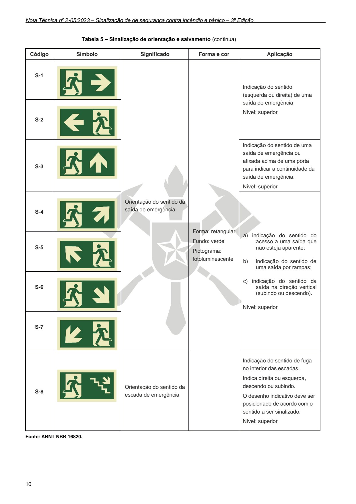

Tabela 5 - Sinalização de orientação e salvamento (continua)

Fonte: ABNT NBR 16820.

### Tabelas extraídas

#### Tabela 1 da página

| Código | Símbolo | Significado | Forma e cor | Aplicação |
| --- | --- | --- | --- | --- |
| S-1 |  | Orientação do sentido da saída de emergência | Forma: retangular Fundo: verde Pictograma: fotoluminescente | Indicação do sentido (esquerda ou direita) de uma saída de emergência Nível: superior |
| S-2 |  |  |  |  |
| S-3 |  |  |  | Indicação do sentido de uma saída de emergência ou afixada acima de uma porta para indicar a continuidade da saída de emergência. Nível: superior |
| S-4 |  |  |  | a) indicação do sentido do acesso a uma saída que não esteja aparente; b) indicação do sentido de uma saída por rampas; c) indicação do sentido da saída na direção vertical (subindo ou descendo). Nível: superior |
| S-5 |  |  |  |  |
| S-6 |  |  |  |  |
| S-7 |  |  |  |  |
| S-8 |  | Orientação do sentido da escada de emergência |  | Indicação do sentido de fuga no interior das escadas. Indica direita ou esquerda, descendo ou subindo. O desenho indicativo deve ser posicionado de acordo com o sentido a ser sinalizado. Nível: superior |

---

## Página 11

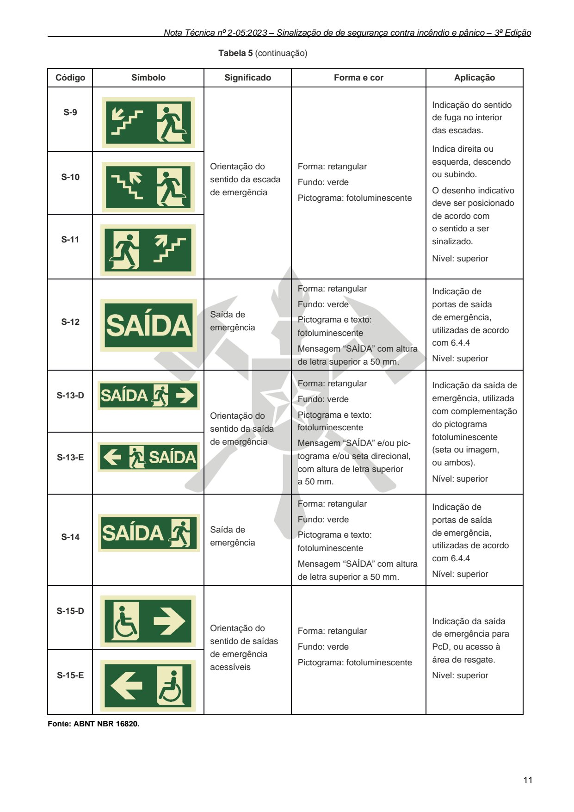

Tabela 5 (continuação)

Fonte: ABNT NBR 16820.

### Tabelas extraídas

#### Tabela 1 da página

| Código | Símbolo | Significado | Forma e cor | Aplicação |
| --- | --- | --- | --- | --- |
| S-9 |  | Orientação do sentido da escada de emergência | Forma: retangular Fundo: verde Pictograma: fotoluminescente | Indicação do sentido de fuga no interior das escadas. Indica direita ou esquerda, descendo ou subindo. O desenho indicativo deve ser posicionado de acordo com o sentido a ser sinalizado. Nível: superior |
| S-10 |  |  |  |  |
| S-11 |  |  |  |  |
| S-12 |  | Saída de emergência | Forma: retangular Fundo: verde Pictograma e texto: fotoluminescente Mensagem “SAÍDA” com altura de letra superior a 50 mm. | Indicação de portas de saída de emergência, utilizadas de acordo com 6.4.4 Nível: superior |
| S-13-D |  | Orientação do sentido da saída de emergência | Forma: retangular Fundo: verde Pictograma e texto: fotoluminescente Mensagem “SAÍDA” e/ou pictograma e/ou seta direcional, com altura de letra superior a 50 mm. | Indicação da saída de emergência, utilizada com complementação do pictograma fotoluminescente (seta ou imagem, ou ambos). Nível: superior |
| S-13-E |  |  |  |  |
| S-14 |  | Saída de emergência | Forma: retangular Fundo: verde Pictograma e texto: fotoluminescente Mensagem “SAÍDA” com altura de letra superior a 50 mm. | Indicação de portas de saída de emergência, utilizadas de acordo com 6.4.4 Nível: superior |
| S-15-D |  | Orientação do sentido de saídas de emergência acessíveis | Forma: retangular Fundo: verde Pictograma: fotoluminescente | Indicação da saída de emergência para PcD, ou acesso à área de resgate. Nível: superior |
| S-15-E |  |  |  |  |

---

## Página 12

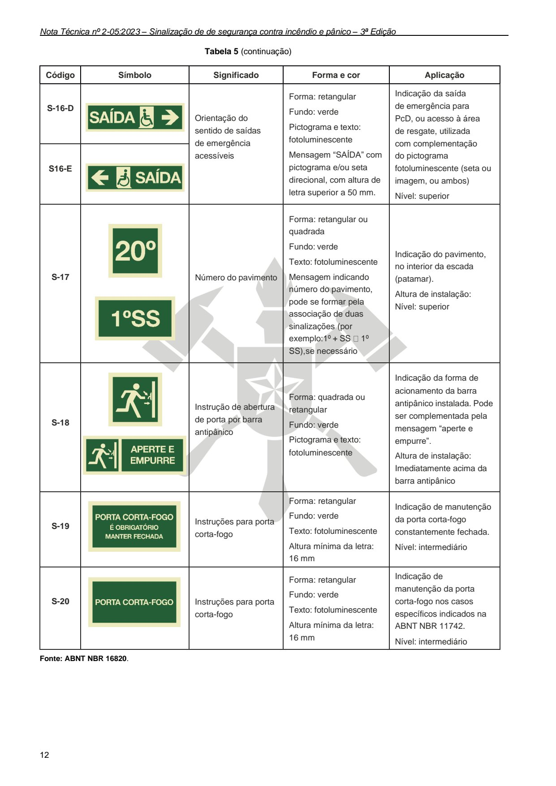

Tabela 5 (continuação)

Fonte: ABNT NBR 16820.

### Tabelas extraídas

#### Tabela 1 da página

| Código | Símbolo | Significado | Forma e cor | Aplicação |
| --- | --- | --- | --- | --- |
| S-16-D |  | Orientação do sentido de saídas de emergência acessíveis | Forma: retangular Fundo: verde Pictograma e texto: fotoluminescente Mensagem “SAÍDA” com pictograma e/ou seta direcional, com altura de letra superior a 50 mm. | Indicação da saída de emergência para PcD, ou acesso à área de resgate, utilizada com complementação do pictograma fotoluminescente (seta ou imagem, ou ambos) Nível: superior |
| S16-E |  |  |  |  |
| S-17 |  | Número do pavimento | Forma: retangular ou quadrada Fundo: verde Texto: fotoluminescente Mensagem indicando número do pavimento, pode se formar pela associação de duas sinalizações (por exemplo:1º + SS 1º SS), se necessário | Indicação do pavimento, no interior da escada (patamar). Altura de instalação: Nível: superior |
| S-18 |  | Instrução de abertura de porta por barra antipânico | Forma: quadrada ou retangular Fundo: verde Pictograma e texto: fotoluminescente | Indicação da forma de acionamento da barra antipânico instalada. Pode ser complementada pela mensagem “aperte e empurre”. Altura de instalação: Imediatamente acima da barra antipânico |
| S-19 |  | Instruções para porta corta-fogo | Forma: retangular Fundo: verde Texto: fotoluminescente Altura mínima da letra: 16 mm | Indicação de manutenção da porta corta-fogo constantemente fechada. Nível: intermediário |
| S-20 |  | Instruções para porta corta-fogo | Forma: retangular Fundo: verde Texto: fotoluminescente Altura mínima da letra: 16 mm | Indicação de manutenção da porta corta-fogo nos casos específicos indicados na ABNT NBR 11742. Nível: intermediário |

---

## Página 13

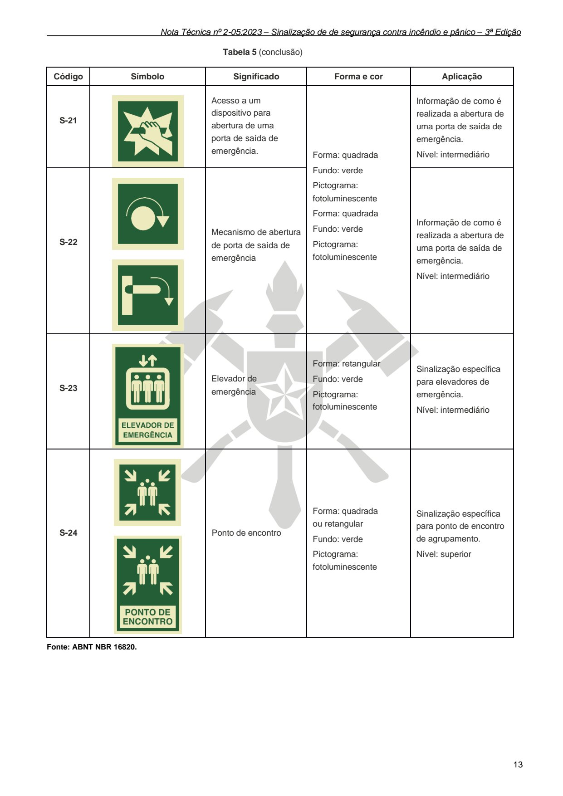

Tabela 5 (conclusão)

Fonte: ABNT NBR 16820.

### Tabelas extraídas

#### Tabela 1 da página

| Código | Símbolo | Significado | Forma e cor | Aplicação |
| --- | --- | --- | --- | --- |
| S-21 |  | Acesso a um dispositivo para abertura de uma porta de saída de emergência. | Forma: quadrada Fundo: verde Pictograma: fotoluminescente Forma: quadrada Fundo: verde Pictograma: fotoluminescente | Informação de como é realizada a abertura de uma porta de saída de emergência. Nível: intermediário |
| S-22 |  | Mecanismo de abertura de porta de saída de emergência |  | Informação de como é realizada a abertura de uma porta de saída de emergência. Nível: intermediário |
| S-23 |  | Elevador de emergência | Forma: retangular Fundo: verde Pictograma: fotoluminescente | Sinalização específica para elevadores de emergência. Nível: intermediário |
| S-24 |  | Ponto de encontro | Forma: quadrada ou retangular Fundo: verde Pictograma: fotoluminescente | Sinalização específica para ponto de encontro de agrupamento. Nível: superior |

---

## Página 14

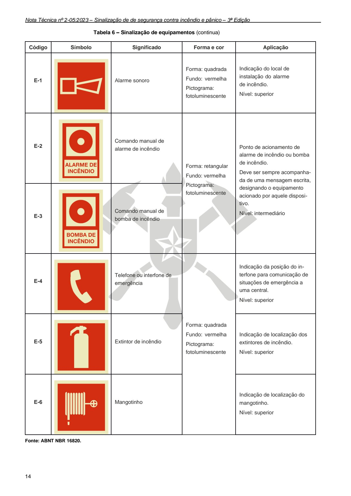

Tabela 6 - Sinalização de equipamentos (continua)

Fonte: ABNT NBR 16820.

### Tabelas extraídas

#### Tabela 1 da página

| Código | Símbolo | Significado | Forma e cor | Aplicação |
| --- | --- | --- | --- | --- |
| E-1 |  | Alarme sonoro | Forma: quadrada Fundo: vermelha Pictograma: fotoluminescente | Indicação do local de instalação do alarme de incêndio. Nível: superior |
| E-2 |  | Comando manual de alarme de incêndio | Forma: retangular Fundo: vermelha Pictograma: fotoluminescente | Ponto de acionamento de alarme de incêndio ou bomba de incêndio. Deve ser sempre acompanhada de uma mensagem escrita, designando o equipamento acionado por aquele dispositivo. Nível: intermediário |
| E-3 |  | Comando manual de bomba de incêndio |  |  |
| E-4 |  | Telefone ou interfone de emergência | Forma: quadrada Fundo: vermelha Pictograma: fotoluminescente | Indicação da posição do interfone para comunicação de situações de emergência a uma central. Nível: superior |
| E-5 |  | Extintor de incêndio |  | Indicação de localização dos extintores de incêndio. Nível: superior |
| E-6 |  | Mangotinho |  | Indicação de localização do mangotinho. Nível: superior |

---

## Página 15

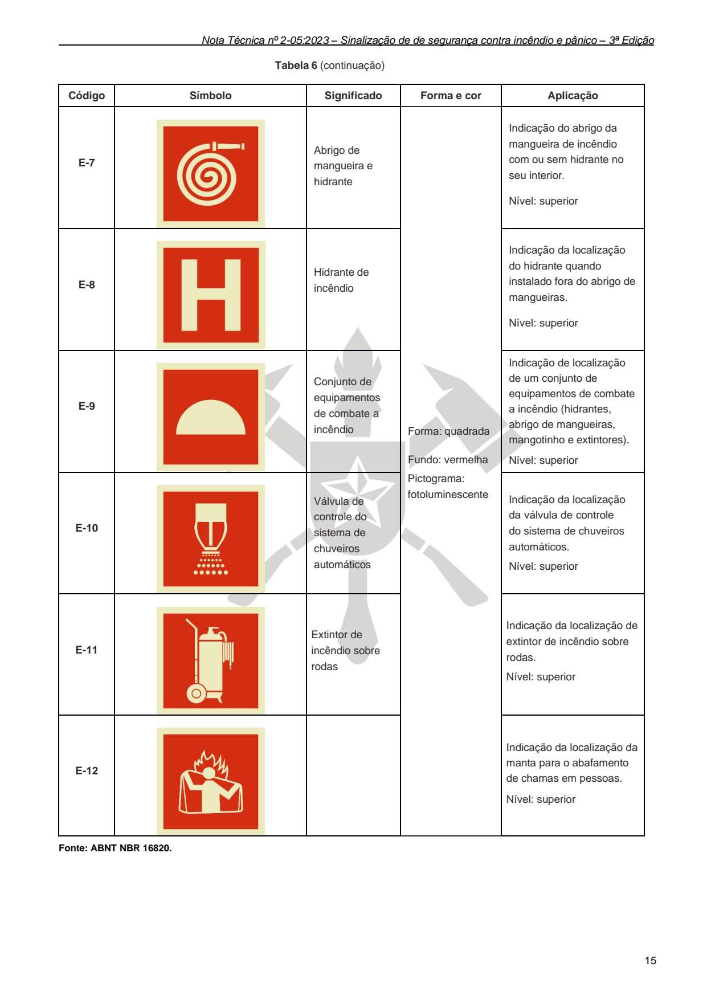

Tabela 6 (continuação)

Fonte: ABNT NBR 16820.

### Tabelas extraídas

#### Tabela 1 da página

| Código | Símbolo | Significado | Forma e cor | Aplicação |
| --- | --- | --- | --- | --- |
| E-7 |  | Abrigo de mangueira e hidrante | Forma: quadrada Fundo: vermelha Pictograma: fotoluminescente | Indicação do abrigo da mangueira de incêndio com ou sem hidrante no seu interior. Nível: superior |
| E-8 |  | Hidrante de incêndio |  | Indicação da localização do hidrante quando instalado fora do abrigo de mangueiras. Nível: superior |
| E-9 |  | Conjunto de equipamentos de combate a incêndio |  | Indicação de localização de um conjunto de equipamentos de combate a incêndio (hidrantes, abrigo de mangueiras, mangotinho e extintores). Nível: superior |
| E-10 |  | Válvula de controle do sistema de chuveiros automáticos |  | Indicação da localização da válvula de controle do sistema de chuveiros automáticos. Nível: superior |
| E-11 |  | Extintor de incêndio sobre rodas |  | Indicação da localização de extintor de incêndio sobre rodas. Nível: superior |
| E-12 |  |  |  | Indicação da localização da manta para o abafamento de chamas em pessoas. Nível: superior |

---

## Página 16

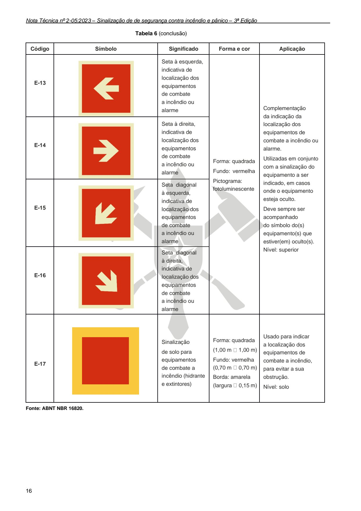

Tabela 6 (conclusão)

Fonte: ABNT NBR 16820.

### Tabelas extraídas

#### Tabela 1 da página

| Código | Símbolo | Significado | Forma e cor | Aplicação |
| --- | --- | --- | --- | --- |
| E-13 |  | Seta à esquerda, indicativa de localização dos equipamentos de combate a incêndio ou alarme | Forma: quadrada Fundo: vermelha Pictograma: fotoluminescente | Complementação da indicação da localização dos equipamentos de combate a incêndio ou alarme. Utilizadas em conjunto com a sinalização do equipamento a ser indicado, em casos onde o equipamento esteja oculto. Deve sempre ser acompanhado do símbolo do(s) equipamento(s) que estiver(em) oculto(s). Nível: superior |
| E-14 |  | Seta à direita, indicativa de localização dos equipamentos de combate a incêndio ou alarme |  |  |
| E-15 |  | Seta diagonal à esquerda, indicativa de localização dos equipamentos de combate a incêndio ou alarme |  |  |
| E-16 |  | Seta diagonal à direita, indicativa de localização dos equipamentos de combate a incêndio ou alarme |  |  |
| E-17 |  | Sinalização de solo para equipamentos de combate a incêndio (hidrante e extintores) | Forma: quadrada (1,00 m 1,00 m) Fundo: vermelha (0,70 m 0,70 m) Borda: amarela (largura 0,15 m) | Usado para indicar a localização dos equipamentos de combate a incêndio, para evitar a sua obstrução. Nível: solo |

---

## Página 17

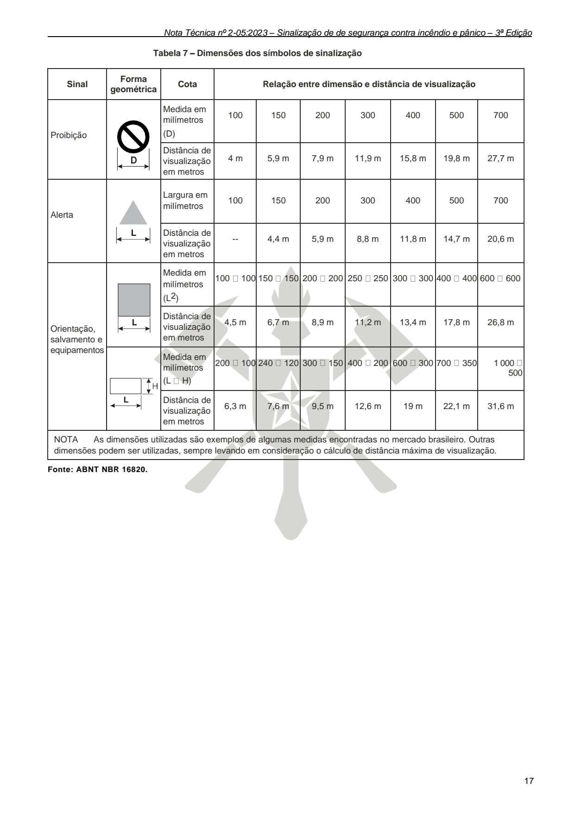

Tabela 7 - Dimensões dos símbolos de sinalização

Fonte: ABNT NBR 16820.

### Tabelas extraídas

#### Tabela 1 da página

| Sinal | Forma geométrica | Cota | Relação entre dimensão e distância de visualização |  |  |  |  |  |  |
| --- | --- | --- | --- | --- | --- | --- | --- | --- | --- |
| Proibição |  | Medida em milímetros (D) | 100 | 150 | 200 | 300 | 400 | 500 | 700 |
|  |  | Distância de visualização em metros | 4 m | 5,9 m | 7,9 m | 11,9 m | 15,8 m | 19,8 m | 27,7 m |
| Alerta |  | Largura em milímetros | 100 | 150 | 200 | 300 | 400 | 500 | 700 |
|  |  | Distância de visualização em metros | -- | 4,4 m | 5,9 m | 8,8 m | 11,8 m | 14,7 m | 20,6 m |
| Orientação, salvamento e equipamentos |  | Medida em milímetros (L2) | 100 100 | 150 150 | 200 200 | 250 250 | 300 300 | 400 400 | 600 600 |
|  |  | Distância de visualização em metros | 4,5 m | 6,7 m | 8,9 m | 11,2 m | 13,4 m | 17,8 m | 26,8 m |
|  |  | Medida em milímetros (L H) | 200 100 | 240 120 | 300 150 | 400 200 | 600 300 | 700 350 | 1 000 500 |
|  |  | Distância de visualização em metros | 6,3 m | 7,6 m | 9,5 m | 12,6 m | 19 m | 22,1 m | 31,6 m |
| NOTA As dimensões utilizadas são exemplos de algumas medidas encontradas no mercado brasileiro. Outras dimensões podem ser utilizadas, sempre levando em consideração o cálculo de distância máxima de visualização. |  |  |  |  |  |  |  |  |  |

---

## Página 18

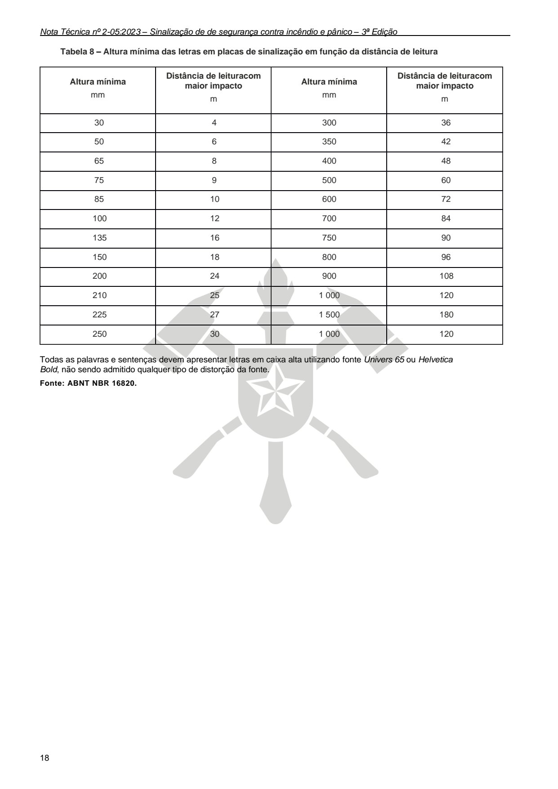

Tabela 8 - Altura mínima das letras em placas de sinalização em função da distância de leitura

Todas as palavras e sentenças devem apresentar letras em caixa alta utilizando fonte Univers 65 ou Helvetica Bold, não sendo admitido qualquer tipo de distorção da fonte.

Fonte: ABNT NBR 16820.

### Tabelas extraídas

#### Tabela 1 da página

| Altura mínima | Distância de leitura com | Altura mínima | Distância de leitura com maior impacto m |
| --- | --- | --- | --- |
|  | maior impacto |  |  |
| mm |  | mm |  |
|  | m |  |  |
|  |  |  |  |
|  |  |  |  |
| 30 | 4 | 300 | 36 |
| 50 | 6 | 350 | 42 |
| 65 | 8 | 400 | 48 |
| 75 | 9 | 500 | 60 |
| 85 | 10 | 600 | 72 |
| 100 | 12 | 700 | 84 |
| 135 | 16 | 750 | 90 |
| 150 | 18 | 800 | 96 |
| 200 | 24 | 900 | 108 |
| 210 | 25 | 1 000 | 120 |
| 225 | 27 | 1 500 | 180 |
| 250 | 30 | 1 000 | 120 |
