# NT 2-08 - Saídas de emergência em edificações

> Conversão integral para consulta computacional. A numeração de página do PDF foi preservada. Quando houver tabela complexa, símbolo ou desenho, conferir também a representação visual indicada e o PDF oficial.

## Sumário por página

- [Página 1](#pagina-1)
- [Página 2](#pagina-2)
- [Página 3](#pagina-3)
- [Página 4](#pagina-4)
- [Página 5](#pagina-5)
- [Página 6](#pagina-6)
- [Página 7](#pagina-7)
- [Página 8](#pagina-8)
- [Página 9](#pagina-9)
- [Página 10](#pagina-10)
- [Página 11](#pagina-11)
- [Página 12](#pagina-12)
- [Página 13](#pagina-13)
- [Página 14](#pagina-14)
- [Página 15](#pagina-15)
- [Página 16](#pagina-16)
- [Página 17](#pagina-17)
- [Página 18](#pagina-18)
- [Página 19](#pagina-19)
- [Página 20](#pagina-20)
- [Página 21](#pagina-21)
- [Página 22](#pagina-22)

---

## Página 1

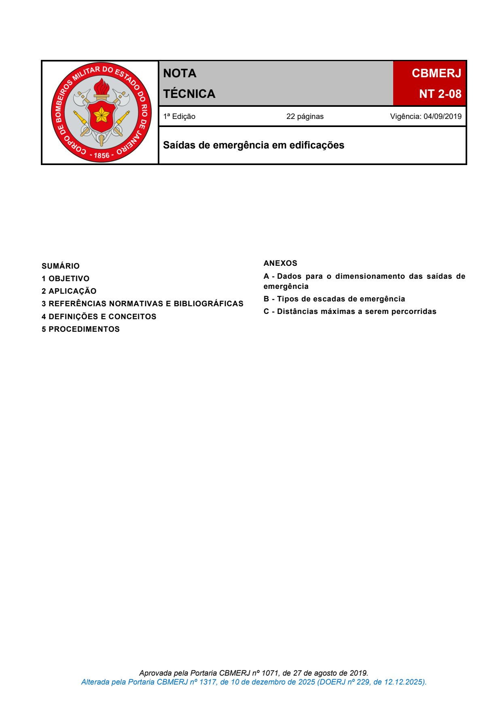

Aprovada pela Portaria CBMERJ nº 1071, de 27 de agosto de 2019. Alterada pela Portaria CBMERJ nº 1317, de 10 de dezembro de 2025 (DOERJ nº 229, de 12.12.2025).

### SUMÁRIO

### 1 OBJETIVO

### 2 APLICAÇÃO

### 3 REFERÊNCIAS NORMATIVAS E BIBLIOGRÁFICAS

### 4 DEFINIÇÕES E CONCEITOS

### 5 PROCEDIMENTOS

### ANEXOS

A - Dados para o dimensionamento das saídas de emergência

B - Tipos de escadas de emergência

C - Distâncias máximas a serem percorridas

### Tabelas extraídas (bruto, não usar para citação)
#### Tabela 1 da página

|  |  | NOTA |  |  | CBMERJ |  |
| --- | --- | --- | --- | --- | --- | --- |
|  |  | TÉCNICA |  |  | NT 2-08 |  |
|  | 1ª Edição 22 páginas Vigência: 04/09/2019 |  |  |  |  |  |
|  | Saídas de emergência em edificações |  |  |  |  |  |

---

## Página 2

Corpo de Bombeiros Militar do Estado do Rio de Janeiro CBMERJ Praça da República, nº 45, Centro, Rio de Janeiro - RJ. CEP: 20.211-350. www.cbmerj.rj.gov.br http://www.cbmerj.rj.gov.br/notas-tecnicas

---

## Página 3

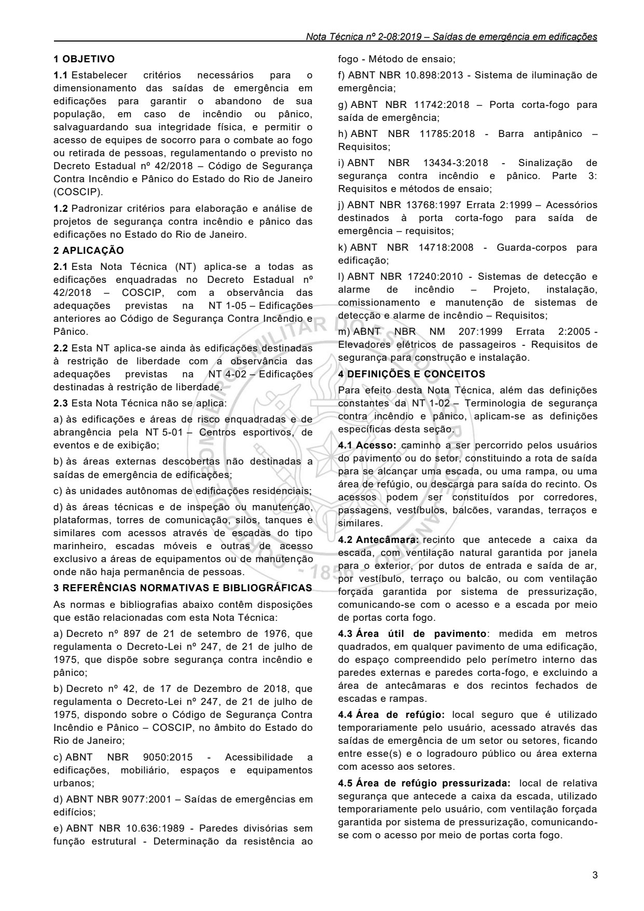

### 1 OBJETIVO

1.1 Estabelecer critérios necessários para o dimensionamento das saídas de emergência em edificações para garantir o abandono de sua população, em caso de incêndio ou pânico, salvaguardando sua integridade física, e permitir o acesso de equipes de socorro para o combate ao fogo ou retirada de pessoas, regulamentando o previsto no Decreto Estadual nº 42/2018 - Código de Segurança Contra Incêndio e Pânico do Estado do Rio de Janeiro (COSCIP).

1.2 Padronizar critérios para elaboração e análise de projetos de segurança contra incêndio e pânico das edificações no Estado do Rio de Janeiro.

### 2 APLICAÇÃO

2.1 Esta Nota Técnica (NT) aplica-se a todas as edificações enquadradas no Decreto Estadual nº 42/2018 - COSCIP, com a observância das adequações previstas na NT 1-05 - Edificações anteriores ao Código de Segurança Contra Incêndio e Pânico.

2.2 Esta NT aplica-se ainda às edificações destinadas à restrição de liberdade com a observância das adequações previstas na NT 4-02 - Edificações destinadas à restrição de liberdade.

2.3 Esta Nota Técnica não se aplica:

a) às edificações e áreas de risco enquadradas e de abrangência pela NT 5-01 - Centros esportivos, de eventos e de exibição;

b) às áreas externas descobertas não destinadas a saídas de emergência de edificações;

c) às unidades autônomas de edificações residenciais;

d) às áreas técnicas e de inspeção ou manutenção, plataformas, torres de comunicação, silos, tanques e similares com acessos através de escadas do tipo marinheiro, escadas móveis e outras de acesso exclusivo a áreas de equipamentos ou de manutenção onde não haja permanência de pessoas.

### 3 REFERÊNCIAS NORMATIVAS E BIBLIOGRÁFICAS

As normas e bibliografias abaixo contêm disposições que estão relacionadas com esta Nota Técnica:

a) Decreto nº 897 de 21 de setembro de 1976, que regulamenta o Decreto-Lei nº 247, de 21 de julho de 1975, que dispõe sobre segurança contra incêndio e pânico;

b) Decreto nº 42, de 17 de Dezembro de 2018, que regulamenta o Decreto-Lei nº 247, de 21 de julho de 1975, dispondo sobre o Código de Segurança Contra Incêndio e Pânico - COSCIP, no âmbito do Estado do Rio de Janeiro;

c) ABNT NBR 9050:2015 - Acessibilidade a edificações, mobiliário, espaços e equipamentos urbanos;

d) ABNT NBR 9077:2001 - Saídas de emergências em edifícios;

e) ABNT NBR 10.636:1989 - Paredes divisórias sem função estrutural - Determinação da resistência ao

fogo - Método de ensaio;

f) ABNT NBR 10.898:2013 - Sistema de iluminação de emergência;

g) ABNT NBR 11742:2018 - Porta corta-fogo para saída de emergência;

h) ABNT NBR 11785:2018 - Barra antipânico - Requisitos;

i) ABNT NBR 13434-3:2018 - Sinalização de segurança contra incêndio e pânico. Parte 3: Requisitos e métodos de ensaio;

j) ABNT NBR 13768:1997 Errata 2:1999 - Acessórios destinados à porta corta-fogo para saída de emergência - requisitos;

k) ABNT NBR 14718:2008 - Guarda-corpos para edificação;

l) ABNT NBR 17240:2010 - Sistemas de detecção e alarme de incêndio - Projeto, instalação, comissionamento e manutenção de sistemas de detecção e alarme de incêndio - Requisitos;

m) ABNT NBR NM 207:1999 Errata 2:2005 - Elevadores elétricos de passageiros - Requisitos de segurança para construção e instalação.

### 4 DEFINIÇÕES E CONCEITOS

Para efeito desta Nota Técnica, além das definições constantes da NT 1-02 - Terminologia de segurança contra incêndio e pânico, aplicam-se as definições específicas desta seção.

4.1 Acesso: caminho a ser percorrido pelos usuários do pavimento ou do setor, constituindo a rota de saída para se alcançar uma escada, ou uma rampa, ou uma área de refúgio, ou descarga para saída do recinto. Os acessos podem ser constituídos por corredores, passagens, vestíbulos, balcões, varandas, terraços e similares.

4.2 Antecâmara: recinto que antecede a caixa da escada, com ventilação natural garantida por janela para o exterior, por dutos de entrada e saída de ar, por vestíbulo, terraço ou balcão, ou com ventilação forçada garantida por sistema de pressurização, comunicando-se com o acesso e a escada por meio de portas corta fogo.

4.3 Área útil de pavimento: medida em metros quadrados, em qualquer pavimento de uma edificação, do espaço compreendido pelo perímetro interno das paredes externas e paredes corta-fogo, e excluindo a área de antecâmaras e dos recintos fechados de escadas e rampas.

4.4 Área de refúgio: local seguro que é utilizado temporariamente pelo usuário, acessado através das saídas de emergência de um setor ou setores, ficando entre esse(s) e o logradouro público ou área externa com acesso aos setores.

4.5 Área de refúgio pressurizada: local de relativa segurança que antecede a caixa da escada, utilizado temporariamente pelo usuário, com ventilação forçada garantida por sistema de pressurização, comunicandose com o acesso por meio de portas corta fogo.

---

## Página 4

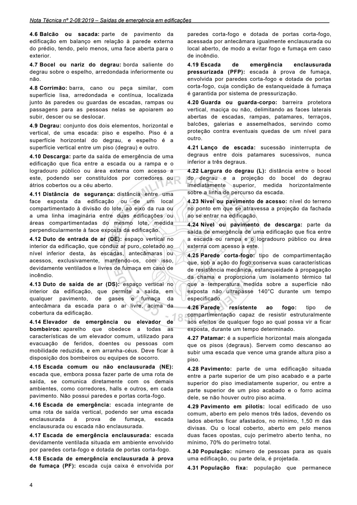

4.6 Balcão ou sacada: parte de pavimento da edificação em balanço em relação à parede externa do prédio, tendo, pelo menos, uma face aberta para o exterior.

4.7 Bocel ou nariz do degrau: borda saliente do degrau sobre o espelho, arredondada inferiormente ou não.

4.8 Corrimão: barra, cano ou peça similar, com superfície lisa, arredondada e contínua, localizada junto às paredes ou guardas de escadas, rampas ou passagens para as pessoas nelas se apoiarem ao subir, descer ou se deslocar.

4.9 Degrau: conjunto dos dois elementos, horizontal e vertical, de uma escada: piso e espelho. Piso é a superfície horizontal do degrau, e espelho é a superfície vertical entre um piso (degrau) e outro.

4.10 Descarga: parte da saída de emergência de uma edificação que fica entre a escada ou a rampa e o logradouro público ou área externa com acesso a este, podendo ser constituídos por corredores ou átrios cobertos ou a céu aberto.

4.11 Distância de segurança: distância entre uma face exposta da edificação ou de um local compartimentado à divisão do lote, ao eixo da rua ou a uma linha imaginária entre duas edificações ou áreas compartimentadas do mesmo lote, medida perpendicularmente à face exposta da edificação.

4.12 Duto de entrada de ar (DE): espaço vertical no interior da edificação, que conduz ar puro, coletado ao nível inferior desta, às escadas, antecâmaras ou acessos, exclusivamente, mantendo-os, com isso, devidamente ventilados e livres de fumaça em caso de incêndio.

4.13 Duto de saída de ar (DS): espaço vertical no interior da edificação, que permite a saída, em qualquer pavimento, de gases e fumaça da antecâmara da escada para o ar livre, acima da cobertura da edificação.

4.14 Elevador de emergência ou elevador de bombeiros: aparelho que obedece a todas as características de um elevador comum, utilizado para evacuação de feridos, doentes ou pessoas com mobilidade reduzida, e em arranha-céus. Deve ficar à disposição dos bombeiros ou equipes de socorro.

4.15 Escada comum ou não enclausurada (NE): escada que, embora possa fazer parte de uma rota de saída, se comunica diretamente com os demais ambientes, como corredores, halls e outros, em cada pavimento. Não possui paredes e portas corta-fogo.

4.16 Escada de emergência: escada integrante de uma rota de saída vertical, podendo ser uma escada enclausurada à prova de fumaça, escada enclausurada ou escada não enclausurada.

4.17 Escada de emergência enclausurada: escada devidamente ventilada situada em ambiente envolvido por paredes corta-fogo e dotada de portas corta-fogo.

4.18 Escada de emergência enclausurada à prova de fumaça (PF): escada cuja caixa é envolvida por

paredes corta-fogo e dotada de portas corta-fogo, acessada por antecâmara igualmente enclausurada ou local aberto, de modo a evitar fogo e fumaça em caso de incêndio.

4.19 Escada de emergência enclausurada pressurizada (PFP): escada à prova de fumaça, envolvida por paredes corta-fogo e dotada de portas corta-fogo, cuja condição de estanqueidade à fumaça é garantida por sistema de pressurização.

4.20 Guarda ou guarda-corpo: barreira protetora vertical, maciça ou não, delimitando as faces laterais abertas de escadas, rampas, patamares, terraços, balcões, galerias e assemelhados, servindo como proteção contra eventuais quedas de um nível para outro.

4.21 Lanço de escada: sucessão ininterrupta de degraus entre dois patamares sucessivos, nunca inferior a três degraus.

4.22 Largura do degrau (L): distância entre o bocel do degrau e a projeção do bocel do degrau imediatamente superior, medida horizontalmente sobre a linha de percurso da escada.

4.23 Nível ou pavimento de acesso: nível do terreno no ponto em que se atravessa a projeção da fachada ao se entrar na edificação.

4.24 Nível ou pavimento de descarga: parte da saída de emergência de uma edificação que fica entre a escada ou rampa e o logradouro público ou área externa com acesso a este.

4.25 Parede corta-fogo: tipo de compartimentação que, sob a ação do fogo,conserva suas características de resistência mecânica, estanqueidade à propagação da chama e proporciona um isolamento térmico tal que a temperatura medida sobre a superfície não exposta não ultrapasse 140°C durante um tempo especificado.

4.26 Parede resistente ao fogo: tipo de compartimentação capaz de resistir estruturalmente aos efeitos de qualquer fogo ao qual possa vir a ficar exposta, durante um tempo determinado.

4.27 Patamar: é a superfície horizontal mais alongada que os pisos (degraus). Servem como descanso ao subir uma escada que vence uma grande altura piso a piso.

4.28 Pavimento: parte de uma edificação situada entre a parte superior de um piso acabado e a parte superior do piso imediatamente superior, ou entre a parte superior de um piso acabado e o forro acima dele, se não houver outro piso acima.

4.29 Pavimento em pilotis: local edificado de uso comum, aberto em pelo menos três lados, devendo os lados abertos ficar afastados, no mínimo, 1,50 m das divisas. Ou o local coberto, aberto em pelo menos duas faces opostas, cujo perímetro aberto tenha, no mínimo, 70% do perímetro total.

4.30 População: número de pessoas para as quais uma edificação, ou parte dela, é projetada.

4.31 População fixa: população que permanece

---

## Página 5

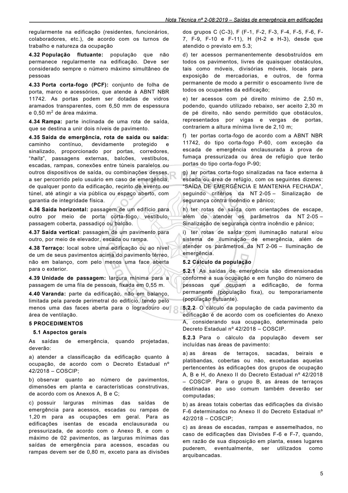

regularmente na edificação (residentes, funcionários, colaboradores, etc.), de acordo com os turnos de trabalho e natureza da ocupação

4.32 População flutuante: população que não permanece regularmente na edificação. Deve ser considerado sempre o número máximo simultâneo de pessoas

4.33 Porta corta-fogo (PCF): conjunto de folha de porta, marco e acessórios, que atende à ABNT NBR 11742. As portas podem ser dotadas de vidros aramados transparentes, com 6,50 mm de espessura e 0,50 m2 de área máxima.

4.34 Rampa: parte inclinada de uma rota de saída, que se destina a unir dois níveis de pavimento.

4.35 Saída de emergência, rota de saída ou saída: caminho contínuo, devidamente protegido e sinalizado, proporcionado por portas, corredores, “halls”, passagens externas, balcões, vestíbulos, escadas, rampas, conexões entre túneis paralelos ou outros dispositivos de saída, ou combinações desses, a ser percorrido pelo usuário em caso de emergência, de qualquer ponto da edificação, recinto de evento ou túnel, até atingir a via pública ou espaço aberto, com garantia de integridade física.

4.36 Saída horizontal: passagem de um edifício para outro por meio de porta corta-fogo, vestíbulo, passagem coberta, passadiço ou balcão.

4.37 Saída vertical: passagem de um pavimento para outro, por meio de elevador, escada ou rampa.

4.38 Terraço: local sobre uma edificação ou ao nível de um de seus pavimentos acima do pavimento térreo, não em balanço, com pelo menos uma face aberta para o exterior.

4.39 Unidade de passagem: largura mínima para a passagem de uma fila de pessoas, fixada em 0,55 m.

4.40 Varanda: parte da edificação, não em balanço, limitada pela parede perimetral do edifício, tendo pelo menos uma das faces aberta para o logradouro ou área de ventilação.

### 5 PROCEDIMENTOS

5.1 Aspectos gerais

As saídas de emergência, quando projetadas, deverão:

a) atender a classificação da edificação quanto à ocupação, de acordo com o Decreto Estadual nº 42/2018 - COSCIP;

b) observar quanto ao número de pavimentos, dimensões em planta e características construtivas, de acordo com os Anexos A, B e C;

c) possuir larguras mínimas das saídas de emergência para acessos, escadas ou rampas de 1,20 m para as ocupações em geral. Para as edificações isentas de escada enclausurada ou pressurizada, de acordo com o Anexo B, e com o máximo de 02 pavimentos, as larguras mínimas das saídas de emergência para acessos, escadas ou rampas devem ser de 0,80 m, exceto para as divisões

dos grupos C (C-3), F (F-1, F-2, F-3, F-4, F-5, F-6, F- 7, F-9, F-10 e F-11), H (H-2 e H-3), desde que atendido o previsto em 5.3;

d) ter acessos permanentemente desobstruídos em todos os pavimentos, livres de quaisquer obstáculos, tais como móveis, divisórias móveis, locais para exposição de mercadorias, e outros, de forma permanente de modo a permitir o escoamento livre de todos os ocupantes da edificação;

e) ter acessos com pé direito mínimo de 2,50 m, podendo, quando utilizado rebaixo, ser aceito 2,30 m de pé direito, não sendo permitido que obstáculos, representados por vigas e vergas de portas, contrariem a altura mínima livre de 2,10 m;

f) ter portas corta-fogo de acordo com a ABNT NBR 11742, do tipo corta-fogo P-60, com exceção da escada de emergência enclausurada à prova de fumaça pressurizada ou área de refúgio que terão portas do tipo corta-fogo P-90;

g) ter portas corta-fogo sinalizadas na face externa à escada ou área de refúgio, com os seguintes dizeres: “SAÍDA DE EMERGÊNCIA E MANTENHA FECHADA”, seguindo critérios da NT 2-05 - Sinalização de segurança contra incêndio e pânico;

h) ter rotas de saída com orientações de escape, além de atender os parâmetros da NT 2-05 - Sinalização de segurança contra incêndio e pânico;

i) ter rotas de saída com iluminação natural e/ou sistema de iluminação de emergência, além de atender os parâmetros da NT 2-06 - Iluminação de emergência.

5.2 Cálculo da população

5.2.1 As saídas de emergência são dimensionadas conforme a sua ocupação e em função do número de pessoas que ocupam a edificação, de forma permanente (população fixa), ou temporariamente (população flutuante).

5.2.2 O cálculo da população de cada pavimento da edificação é de acordo com os coeficientes do Anexo A, considerando sua ocupação, determinada pelo Decreto Estadual nº 42/2018 - COSCIP.

5.2.3 Para o cálculo da população devem ser incluídas nas áreas de pavimento:

a) as áreas de terraços, sacadas, beirais e platibandas, cobertas ou não, excetuadas aquelas pertencentes às edificações dos grupos de ocupação A, B e H, do Anexo II do Decreto Estadual nº 42/2018 - COSCIP. Para o grupo B, as áreas de terraços destinadas ao uso comum também deverão ser computadas;

b) as áreas totais cobertas das edificações da divisão F-6 determinados no Anexo II do Decreto Estadual nº 42/2018 - COSCIP;

c) as áreas de escadas, rampas e assemelhados, no caso de edificações das Divisões F-6 e F-7, quando, em razão de sua disposição em planta, esses lugares puderem, eventualmente, ser utilizados como arquibancadas.

---

## Página 6

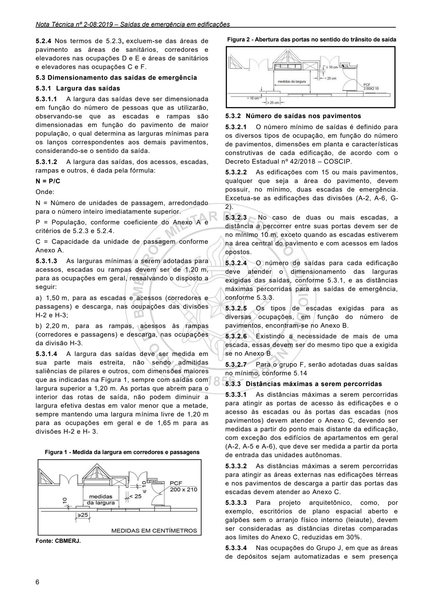

5.2.4 Nos termos de 5.2.3, excluem-se das áreas de pavimento as áreas de sanitários, corredores e elevadores nas ocupações D e E e áreas de sanitários e elevadores nas ocupações C e F.

5.3 Dimensionamento das saídas de emergência

5.3.1 Largura das saídas

5.3.1.1 A largura das saídas deve ser dimensionada em função do número de pessoas que as utilizarão, observando-se que as escadas e rampas são dimensionadas em função do pavimento de maior população, o qual determina as larguras mínimas para os lanços correspondentes aos demais pavimentos, considerando-se o sentido da saída.

5.3.1.2 A largura das saídas, dos acessos, escadas, rampas e outros, é dada pela fórmula:

### N = P/C

Onde:

N = Número de unidades de passagem, arredondado para o número inteiro imediatamente superior.

P = População, conforme coeficiente do Anexo A e critérios de 5.2.3 e 5.2.4.

C = Capacidade da unidade de passagem conforme Anexo A.

5.3.1.3 As larguras mínimas a serem adotadas para acessos, escadas ou rampas devem ser de 1,20 m, para as ocupações em geral, ressalvando o disposto a seguir:

a) 1,50 m, para as escadas e acessos (corredores e passagens) e descarga, nas ocupações das divisões H-2 e H-3;

b) 2,20 m, para as rampas, acessos às rampas (corredores e passagens) e descarga, nas ocupações da divisão H-3.

5.3.1.4 A largura das saídas deve ser medida em sua parte mais estreita, não sendo admitidas saliências de pilares e outros, com dimensões maiores que as indicadas na Figura 1, sempre com saídas com largura superior a 1,20 m. As portas que abrem para o interior das rotas de saída, não podem diminuir a largura efetiva destas em valor menor que a metade, sempre mantendo uma largura mínima livre de 1,20 m para as ocupações em geral e de 1,65 m para as divisões H-2 e H- 3.

Figura 1 - Medida da largura em corredores e passagens

Fonte: CBMERJ.

Figura 2 - Abertura das portas no sentido do trânsito de saída

5.3.2 Número de saídas nos pavimentos

5.3.2.1 O número mínimo de saídas é definido para os diversos tipos de ocupação, em função do número de pavimentos, dimensões em planta e características construtivas de cada edificação, de acordo com o Decreto Estadual nº 42/2018 - COSCIP.

5.3.2.2 As edificações com 15 ou mais pavimentos, qualquer que seja a área do pavimento, devem possuir, no mínimo, duas escadas de emergência. Excetua-se as edificações das divisões (A-2, A-6, G- 2).

5.3.2.3 No caso de duas ou mais escadas, a distância a percorrer entre suas portas devem ser de no mínimo 10 m, exceto quando as escadas estiverem na área central do pavimento e com acessos em lados opostos.

5.3.2.4 O número de saídas para cada edificação deve atender o dimensionamento das larguras exigidas das saídas, conforme 5.3.1, e as distâncias máximas percorridas para as saídas de emergência, conforme 5.3.3.

5.3.2.5 Os tipos de escadas exigidas para as diversas ocupações, em função do número de pavimentos, encontram-se no Anexo B.

5.3.2.6 Existindo a necessidade de mais de uma escada, essas devem ser do mesmo tipo que a exigida se no Anexo B.

5.3.2.7 Para o grupo F, serão adotadas duas saídas no mínimo, conforme 5.14

5.3.3 Distâncias máximas a serem percorridas

5.3.3.1 As distâncias máximas a serem percorridas para atingir as portas de acesso às edificações e o acesso às escadas ou às portas das escadas (nos pavimentos) devem atender o Anexo C, devendo ser medidas a partir do ponto mais distante da edificação, com exceção dos edifícios de apartamentos em geral (A-2, A-5 e A-6), que deve ser medida a partir da porta de entrada das unidades autônomas.

5.3.3.2 As distâncias máximas a serem percorridas para atingir as áreas externas nas edificações térreas e nos pavimentos de descarga a partir das portas das escadas devem atender ao Anexo C.

5.3.3.3 Para projeto arquitetônico, como, por exemplo, escritórios de plano espacial aberto e galpões sem o arranjo físico interno (leiaute), devem ser consideradas as distâncias diretas comparadas aos limites do Anexo C, reduzidas em 30%.

5.3.3.4 Nas ocupações do Grupo J, em que as áreas de depósitos sejam automatizadas e sem presença

---

## Página 7

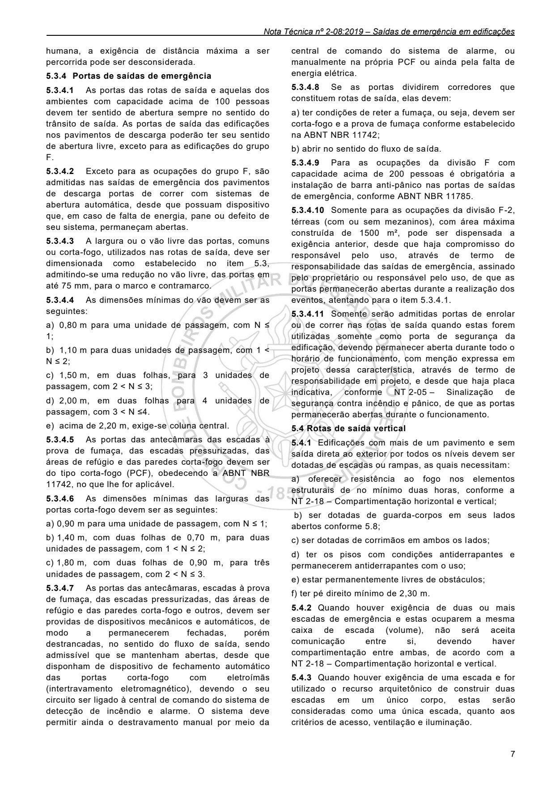

humana, a exigência de distância máxima a ser percorrida pode ser desconsiderada.

5.3.4 Portas de saídas de emergência

5.3.4.1 As portas das rotas de saída e aquelas dos ambientes com capacidade acima de 100 pessoas devem ter sentido de abertura sempre no sentido do trânsito de saída. As portas de saída das edificações nos pavimentos de descarga poderão ter seu sentido de abertura livre, exceto para as edificações do grupo F.

5.3.4.2 Exceto para as ocupações do grupo F, são admitidas nas saídas de emergência dos pavimentos de descarga portas de correr com sistemas de abertura automática, desde que possuam dispositivo que, em caso de falta de energia, pane ou defeito de seu sistema, permaneçam abertas.

5.3.4.3 A largura ou o vão livre das portas, comuns ou corta-fogo, utilizados nas rotas de saída, deve ser dimensionada como estabelecido no item 5.3, admitindo-se uma redução no vão livre, das portas em até 75 mm, para o marco e contramarco.

5.3.4.4 As dimensões mínimas do vão devem ser as seguintes:

a) 0,80 m para uma unidade de passagem, com N ≤ 1;

b) 1,10 m para duas unidades de passagem, com 1 < N ≤ 2;

c) 1,50 m, em duas folhas, para 3 unidades de passagem, com 2 < N ≤ 3;

d) 2,00 m, em duas folhas para 4 unidades de passagem, com 3 < N ≤4.

e) acima de 2,20 m, exige-se coluna central.

5.3.4.5 As portas das antecâmaras das escadas à prova de fumaça, das escadas pressurizadas, das áreas de refúgio e das paredes corta-fogo devem ser do tipo corta-fogo (PCF), obedecendo a ABNT NBR 11742, no que lhe for aplicável.

5.3.4.6 As dimensões mínimas das larguras das portas corta-fogo devem ser as seguintes:

a) 0,90 m para uma unidade de passagem, com N ≤ 1;

b) 1,40 m, com duas folhas de 0,70 m, para duas unidades de passagem, com 1 < N ≤ 2;

c) 1,80 m, com duas folhas de 0,90 m, para três unidades de passagem, com 2 < N ≤ 3.

5.3.4.7 As portas das antecâmaras, escadas à prova de fumaça, das escadas pressurizadas, das áreas de refúgio e das paredes corta-fogo e outros, devem ser providas de dispositivos mecânicos e automáticos, de modo a permanecerem fechadas, porém destrancadas, no sentido do fluxo de saída, sendo admissível que se mantenham abertas, desde que disponham de dispositivo de fechamento automático das portas corta-fogo com eletroímãs (intertravamento eletromagnético), devendo o seu circuito ser ligado à central de comando do sistema de detecção de incêndio e alarme. O sistema deve permitir ainda o destravamento manual por meio da

central de comando do sistema de alarme, ou manualmente na própria PCF ou ainda pela falta de energia elétrica.

5.3.4.8 Se as portas dividirem corredores que constituem rotas de saída, elas devem:

a) ter condições de reter a fumaça, ou seja, devem ser corta-fogo e a prova de fumaça conforme estabelecido na ABNT NBR 11742;

b) abrir no sentido do fluxo de saída.

5.3.4.9 Para as ocupações da divisão F com capacidade acima de 200 pessoas é obrigatória a instalação de barra anti-pânico nas portas de saídas de emergência, conforme ABNT NBR 11785.

5.3.4.10 Somente para as ocupações da divisão F-2, térreas (com ou sem mezaninos), com área máxima construída de 1500 m², pode ser dispensada a exigência anterior, desde que haja compromisso do responsável pelo uso, através de termo de responsabilidade das saídas de emergência, assinado pelo proprietário ou responsável pelo uso, de que as portas permanecerão abertas durante a realização dos eventos, atentando para o item 5.3.4.1.

5.3.4.11 Somente serão admitidas portas de enrolar ou de correr nas rotas de saída quando estas forem utilizadas somente como porta de segurança da edificação, devendo permanecer aberta durante todo o horário de funcionamento, com menção expressa em projeto dessa característica, através de termo de responsabilidade em projeto, e desde que haja placa indicativa, conforme NT 2-05 - Sinalização de segurança contra incêndio e pânico, de que as portas permanecerão abertas durante o funcionamento.

5.4 Rotas de saída vertical

5.4.1 Edificações com mais de um pavimento e sem saída direta ao exterior por todos os níveis devem ser dotadas de escadas ou rampas, as quais necessitam:

a) oferecer resistência ao fogo nos elementos estruturais de no mínimo duas horas, conforme a NT 2-18 - Compartimentação horizontal e vertical;

b) ser dotadas de guarda-corpos em seus lados abertos conforme 5.8;

c) ser dotadas de corrimãos em ambos os lados;

d) ter os pisos com condições antiderrapantes e permanecerem antiderrapantes com o uso;

e) estar permanentemente livres de obstáculos;

f) ter pé direito mínimo de 2,30 m.

5.4.2 Quando houver exigência de duas ou mais escadas de emergência e estas ocuparem a mesma caixa de escada (volume), não será aceita comunicação entre si, devendo haver compartimentação entre ambas, de acordo com a NT 2-18 - Compartimentação horizontal e vertical.

5.4.3 Quando houver exigência de uma escada e for utilizado o recurso arquitetônico de construir duas escadas em um único corpo, estas serão consideradas como uma única escada, quanto aos critérios de acesso, ventilação e iluminação.

### Tabelas extraídas (bruto, não usar para citação)
#### Tabela 1 da página

| disponham de dispositivo de fechamento | automático |
| --- | --- |
| das portas corta-fogo com eletroímãs |  |

---

## Página 8

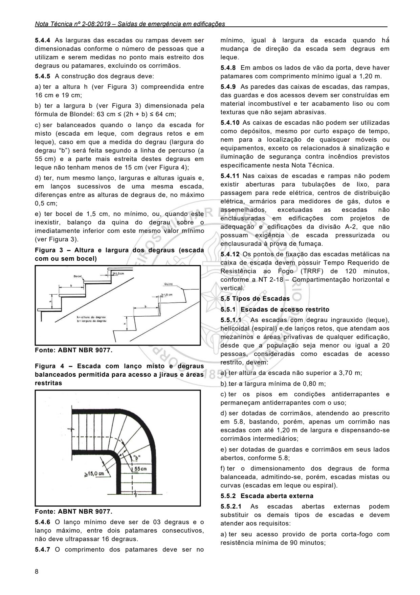

5.4.4 As larguras das escadas ou rampas devem ser dimensionadas conforme o número de pessoas que a utilizam e serem medidas no ponto mais estreito dos degraus ou patamares, excluindo os corrimãos.

5.4.5 A construção dos degraus deve:

a) ter a altura h (ver Figura 3) compreendida entre 16 cm e 19 cm;

b) ter a largura b (ver Figura 3) dimensionada pela fórmula de Blondel: 63 cm ≤ (2h + b) ≤ 64 cm;

c) ser balanceados quando o lanço da escada for misto (escada em leque, com degraus retos e em leque), caso em que a medida do degrau (largura do degrau “b”) será feita segundo a linha de percurso (a 55 cm) e a parte mais estreita destes degraus em leque não tenham menos de 15 cm (ver Figura 4);

d) ter, num mesmo lanço, larguras e alturas iguais e, em lanços sucessivos de uma mesma escada, diferenças entre as alturas de degraus de, no máximo 0,5 cm;

e) ter bocel de 1,5 cm, no mínimo, ou, quando este inexistir, balanço da quina do degrau sobre o imediatamente inferior com este mesmo valor mínimo (ver Figura 3).

Figura 3 - Altura e largura dos degraus (escada com ou sem bocel)

Fonte: ABNT NBR 9077. Figura 4 - Escada com lanço misto e degraus balanceados permitida para acesso a jiraus e áreas restritas

Fonte: ABNT NBR 9077.

5.4.6 O lanço mínimo deve ser de 03 degraus e o lanço máximo, entre dois patamares consecutivos, não deve ultrapassar 16 degraus.

5.4.7 O comprimento dos patamares deve ser no

mínimo, igual à largura da escada quando há mudança de direção da escada sem degraus em leque.

5.4.8 Em ambos os lados de vão da porta, deve haver patamares com comprimento mínimo igual a 1,20 m.

5.4.9 As paredes das caixas de escadas, das rampas, das guardas e dos acessos devem ser construídas em material incombustível e ter acabamento liso ou com texturas que não sejam abrasivas.

5.4.10 As caixas de escadas não podem ser utilizadas como depósitos, mesmo por curto espaço de tempo, nem para a localização de quaisquer móveis ou equipamentos, exceto os relacionados à sinalização e iluminação de segurança contra incêndios previstos especificamente nesta Nota Técnica.

5.4.11 Nas caixas de escadas e rampas não podem existir aberturas para tubulações de lixo, para passagem para rede elétrica, centros de distribuição elétrica, armários para medidores de gás, dutos e assemelhados, excetuadas as escadas não enclausuradas em edificações com projetos de adequação e edificações da divisão A-2, que não possuam exigência de escada pressurizada ou enclausurada à prova de fumaça.

5.4.12 Os pontos de fixação das escadas metálicas na caixa de escada devem possuir Tempo Requerido de Resistência ao Fogo (TRRF) de 120 minutos, conforme a NT 2-18 - Compartimentação horizontal e vertical.

5.5 Tipos de Escadas

5.5.1 Escadas de acesso restrito

5.5.1.1 As escadas com degrau ingrauxido (leque), helicoidal (espiral) e de lanços retos, que atendam aos mezaninos e áreas privativas de qualquer edificação, desde que a população seja menor ou igual a 20 pessoas, consideradas como escadas de acesso restrito, devem:

a) ter altura da escada não superior a 3,70 m;

b) ter a largura mínima de 0,80 m;

c) ter os pisos em condições antiderrapantes e permaneçam antiderrapantes com o uso;

d) ser dotadas de corrimãos, atendendo ao prescrito em 5.8, bastando, porém, apenas um corrimão nas escadas com até 1,20 m de largura e dispensando-se corrimãos intermediários;

e) ser dotadas de guardas e corrimãos em seus lados abertos, conforme 5.8;

f) ter o dimensionamento dos degraus de forma balanceada, admitindo-se, porém, escadas mistas ou curvas (escadas em leque ou espiral).

5.5.2 Escada aberta externa

5.5.2.1 As escadas abertas externas podem substituir os demais tipos de escadas e devem atender aos requisitos:

a) ter seu acesso provido de porta corta-fogo com resistência mínima de 90 minutos;

---

## Página 9

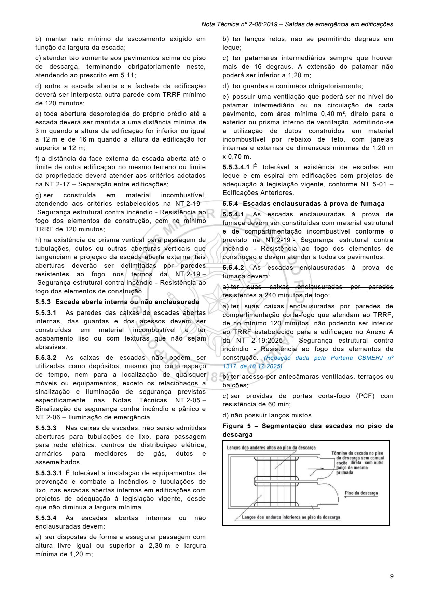

b) manter raio mínimo de escoamento exigido em função da largura da escada;

c) atender tão somente aos pavimentos acima do piso de descarga, terminando obrigatoriamente neste, atendendo ao prescrito em 5.11;

d) entre a escada aberta e a fachada da edificação deverá ser interposta outra parede com TRRF mínimo de 120 minutos;

e) toda abertura desprotegida do próprio prédio até a escada deverá ser mantida a uma distância mínima de 3 m quando a altura da edificação for inferior ou igual a 12 m e de 16 m quando a altura da edificação for superior a 12 m;

f) a distância da face externa da escada aberta até o limite de outra edificação no mesmo terreno ou limite da propriedade deverá atender aos critérios adotados na NT 2-17 - Separação entre edificações;

g) ser construída em material incombustível, atendendo aos critérios estabelecidos na NT 2-19 - Segurança estrutural contra incêndio - Resistência ao fogo dos elementos de construção, com no mínimo TRRF de 120 minutos;

h) na existência de prisma vertical para passagem de tubulações, dutos ou outras aberturas verticais que tangenciam a projeção da escada aberta externa, tais aberturas deverão ser delimitadas por paredes resistentes ao fogo nos termos da NT 2-19 - Segurança estrutural contra incêndio - Resistência ao fogo dos elementos de construção.

5.5.3 Escada aberta interna ou não enclausurada

5.5.3.1 As paredes das caixas de escadas abertas internas, das guardas e dos acessos devem ser construídas em material incombustível e ter acabamento liso ou com texturas que não sejam abrasivas.

5.5.3.2 As caixas de escadas não podem ser utilizadas como depósitos, mesmo por curto espaço de tempo, nem para a localização de quaisquer móveis ou equipamentos, exceto os relacionados a sinalização e iluminação de segurança previstos especificamente nas Notas Técnicas NT 2-05 - Sinalização de segurança contra incêndio e pânico e NT 2-06 - Iluminação de emergência.

5.5.3.3 Nas caixas de escadas, não serão admitidas aberturas para tubulações de lixo, para passagem para rede elétrica, centros de distribuição elétrica, armários para medidores de gás, dutos e assemelhados.

5.5.3.3.1 É tolerável a instalação de equipamentos de prevenção e combate a incêndios e tubulações de lixo, nas escadas abertas internas em edificações com projetos de adequação à legislação vigente, desde que não diminua a largura mínima.

5.5.3.4 As escadas abertas internas ou não enclausuradas devem:

a) ser dispostas de forma a assegurar passagem com altura livre igual ou superior a 2,30 m e largura mínima de 1,20 m;

b) ter lanços retos, não se permitindo degraus em leque;

c) ter patamares intermediários sempre que houver mais de 16 degraus. A extensão do patamar não poderá ser inferior a 1,20 m;

d) ter guardas e corrimãos obrigatoriamente;

e) possuir uma ventilação que poderá ser no nível do patamar intermediário ou na circulação de cada pavimento, com área mínima 0,40 m², direto para o exterior ou prisma interno de ventilação, admitindo-se a utilização de dutos construídos em material incombustível por rebaixo de teto, com janelas internas e externas de dimensões mínimas de 1,20 m x 0,70 m.

5.5.3.4.1 É tolerável a existência de escadas em leque e em espiral em edificações com projetos de adequação à legislação vigente, conforme NT 5-01 - Edificações Anteriores.

5.5.4 Escadas enclausuradas à prova de fumaça

5.5.4.1 As escadas enclausuradas à prova de fumaça devem ser constituídas com material estrutural e de compartimentação incombustível conforme o previsto na NT 2-19 - Segurança estrutural contra incêndio - Resistência ao fogo dos elementos de construção e devem atender a todos os pavimentos.

5.5.4.2 As escadas enclausuradas à prova de fumaça devem:

a) ter suas caixas enclausuradas por paredes resistentes a 240 minutos de fogo;

a) ter suas caixas enclausuradas por paredes de compartimentação corta-fogo que atendam ao TRRF, de no mínimo 120 minutos, não podendo ser inferior ao TRRF estabelecido para a edificação no Anexo A da NT 2-19:2025 - Segurança estrutural contra incêndio - Resistência ao fogo dos elementos de construção. (Redação dada pela Portaria CBMERJ nº 1317, de 10.12.2025)

b) ter acesso por antecâmaras ventiladas, terraços ou balcões;

c) ser providas de portas corta-fogo (PCF) com resistência de 60 min;

d) não possuir lanços mistos.

Figura 5 - Segmentação das escadas no piso de descarga

Fonte: CBMERJ.

---

## Página 10

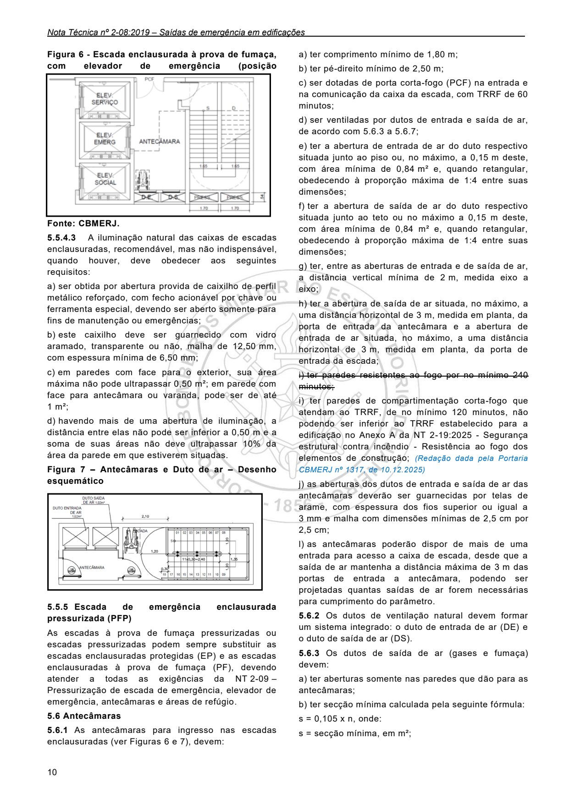

Figura 6 - Escada enclausurada à prova de fumaça, com elevador de emergência (posição exemplificativa) na antecâmara

Fonte: CBMERJ.

5.5.4.3 A iluminação natural das caixas de escadas enclausuradas, recomendável, mas não indispensável, quando houver, deve obedecer aos seguintes requisitos:

a) ser obtida por abertura provida de caixilho de perfil metálico reforçado, com fecho acionável por chave ou ferramenta especial, devendo ser aberto somente para fins de manutenção ou emergências;

b) este caixilho deve ser guarnecido com vidro aramado, transparente ou não, malha de 12,50 mm, com espessura mínima de 6,50 mm;

c) em paredes com face para o exterior, sua área máxima não pode ultrapassar 0,50 m²; em parede com face para antecâmara ou varanda, pode ser de até 1 m²;

d) havendo mais de uma abertura de iluminação, a distância entre elas não pode ser inferior a 0,50 m e a soma de suas áreas não deve ultrapassar 10% da área da parede em que estiverem situadas.

Figura 7 - Antecâmaras e Duto de ar - Desenho esquemático

5.5.5 Escada de emergência enclausurada pressurizada (PFP)

As escadas à prova de fumaça pressurizadas ou escadas pressurizadas podem sempre substituir as escadas enclausuradas protegidas (EP) e as escadas enclausuradas à prova de fumaça (PF), devendo atender a todas as exigências da NT 2-09 - Pressurização de escada de emergência, elevador de emergência, antecâmaras e áreas de refúgio.

5.6 Antecâmaras

5.6.1 As antecâmaras para ingresso nas escadas enclausuradas (ver Figuras 6 e 7), devem:

a) ter comprimento mínimo de 1,80 m;

b) ter pé-direito mínimo de 2,50 m;

c) ser dotadas de porta corta-fogo (PCF) na entrada e na comunicação da caixa da escada, com TRRF de 60 minutos;

d) ser ventiladas por dutos de entrada e saída de ar, de acordo com 5.6.3 a 5.6.7;

e) ter a abertura de entrada de ar do duto respectivo situada junto ao piso ou, no máximo, a 0,15 m deste, com área mínima de 0,84 m² e, quando retangular, obedecendo à proporção máxima de 1:4 entre suas dimensões;

f) ter a abertura de saída de ar do duto respectivo situada junto ao teto ou no máximo a 0,15 m deste, com área mínima de 0,84 m² e, quando retangular, obedecendo à proporção máxima de 1:4 entre suas dimensões;

g) ter, entre as aberturas de entrada e de saída de ar, a distância vertical mínima de 2 m, medida eixo a eixo;

h) ter a abertura de saída de ar situada, no máximo, a uma distância horizontal de 3 m, medida em planta, da porta de entrada da antecâmara e a abertura de entrada de ar situada, no máximo, a uma distância horizontal de 3 m, medida em planta, da porta de entrada da escada;

i) ter paredes resistentes ao fogo por no mínimo 240 minutos;

i) ter paredes de compartimentação corta-fogo que atendam ao TRRF, de no mínimo 120 minutos, não podendo ser inferior ao TRRF estabelecido para a edificação no Anexo A da NT 2-19:2025 - Segurança estrutural contra incêndio - Resistência ao fogo dos elementos de construção; (Redação dada pela Portaria CBMERJ nº 1317, de 10.12.2025)

j) as aberturas dos dutos de entrada e saída de ar das antecâmaras deverão ser guarnecidas por telas de arame, com espessura dos fios superior ou igual a 3 mm e malha com dimensões mínimas de 2,5 cm por 2,5 cm;

l) as antecâmaras poderão dispor de mais de uma entrada para acesso a caixa de escada, desde que a saída de ar mantenha a distância máxima de 3 m das portas de entrada a antecâmara, podendo ser projetadas quantas saídas de ar forem necessárias para cumprimento do parâmetro.

5.6.2 Os dutos de ventilação natural devem formar um sistema integrado: o duto de entrada de ar (DE) e o duto de saída de ar (DS).

5.6.3 Os dutos de saída de ar (gases e fumaça) devem:

a) ter aberturas somente nas paredes que dão para as antecâmaras;

b) ter secção mínima calculada pela seguinte fórmula:

s = 0,105 x n, onde:

s = secção mínima, em m²;

---

## Página 11

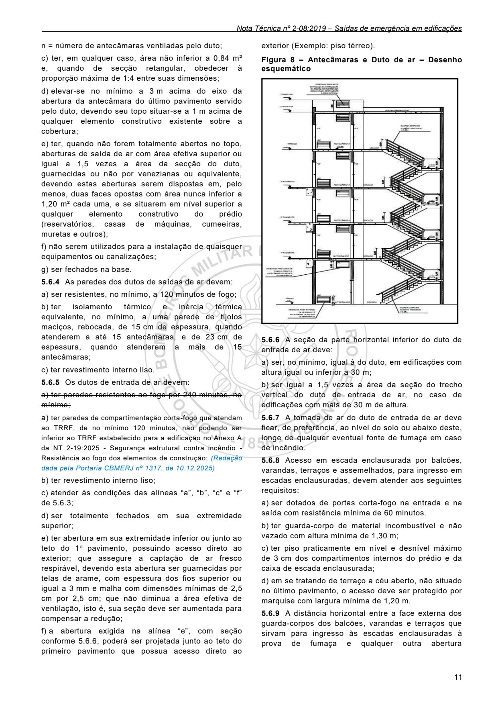

n = número de antecâmaras ventiladas pelo duto;

c) ter, em qualquer caso, área não inferior a 0,84 m² e, quando de secção retangular, obedecer à proporção máxima de 1:4 entre suas dimensões;

d) elevar-se no mínimo a 3 m acima do eixo da abertura da antecâmara do último pavimento servido pelo duto, devendo seu topo situar-se a 1 m acima de qualquer elemento construtivo existente sobre a cobertura;

e) ter, quando não forem totalmente abertos no topo, aberturas de saída de ar com área efetiva superior ou igual a 1,5 vezes a área da secção do duto, guarnecidas ou não por venezianas ou equivalente, devendo estas aberturas serem dispostas em, pelo menos, duas faces opostas com área nunca inferior a 1,20 m² cada uma, e se situarem em nível superior a qualquer elemento construtivo do prédio (reservatórios, casas de máquinas, cumeeiras, muretas e outros);

f) não serem utilizados para a instalação de quaisquer equipamentos ou canalizações;

g) ser fechados na base.

5.6.4 As paredes dos dutos de saídas de ar devem:

a) ser resistentes, no mínimo, a 120 minutos de fogo;

b) ter isolamento térmico e inércia térmica equivalente, no mínimo, a uma parede de tijolos maciços, rebocada, de 15 cm de espessura, quando atenderem a até 15 antecâmaras, e de 23 cm de espessura, quando atenderem a mais de 15 antecâmaras;

c) ter revestimento interno liso.

5.6.5 Os dutos de entrada de ar devem:

a) ter paredes resistentes ao fogo por 240 minutos, no mínimo;

a) ter paredes de compartimentação corta-fogo que atendam ao TRRF, de no mínimo 120 minutos, não podendo ser inferior ao TRRF estabelecido para a edificação no Anexo A da NT 2-19:2025 - Segurança estrutural contra incêndio - Resistência ao fogo dos elementos de construção; (Redação dada pela Portaria CBMERJ nº 1317, de 10.12.2025)

b) ter revestimento interno liso;

c) atender às condições das alíneas “a”, “b”, “c” e “f” de 5.6.3;

d) ser totalmente fechados em sua extremidade superior;

e) ter abertura em sua extremidade inferior ou junto ao teto do 1o pavimento, possuindo acesso direto ao exterior; que assegure a captação de ar fresco respirável, devendo esta abertura ser guarnecidas por telas de arame, com espessura dos fios superior ou igual a 3 mm e malha com dimensões mínimas de 2,5 cm por 2,5 cm; que não diminua a área efetiva de ventilação, isto é, sua seção deve ser aumentada para compensar a redução;

f) a abertura exigida na alínea “e”, com seção conforme 5.6.6, poderá ser projetada junto ao teto do primeiro pavimento que possua acesso direto ao

exterior (Exemplo: piso térreo).

Figura 8 - Antecâmaras e Duto de ar - Desenho esquemático

5.6.6 A seção da parte horizontal inferior do duto de entrada de ar deve:

a) ser, no mínimo, igual à do duto, em edificações com altura igual ou inferior a 30 m;

b) ser igual a 1,5 vezes a área da seção do trecho vertical do duto de entrada de ar, no caso de edificações com mais de 30 m de altura.

5.6.7 A tomada de ar do duto de entrada de ar deve ficar, de preferência, ao nível do solo ou abaixo deste, longe de qualquer eventual fonte de fumaça em caso de incêndio.

5.6.8 Acesso em escada enclausurada por balcões, varandas, terraços e assemelhados, para ingresso em escadas enclausuradas, devem atender aos seguintes requisitos:

a) ser dotados de portas corta-fogo na entrada e na saída com resistência mínima de 60 minutos.

b) ter guarda-corpo de material incombustível e não vazado com altura mínima de 1,30 m;

c) ter piso praticamente em nível e desnível máximo de 3 cm dos compartimentos internos do prédio e da caixa de escada enclausurada;

d) em se tratando de terraço a céu aberto, não situado no último pavimento, o acesso deve ser protegido por marquise com largura mínima de 1,20 m.

5.6.9 A distância horizontal entre a face externa dos guarda-corpos dos balcões, varandas e terraços que sirvam para ingresso às escadas enclausuradas à prova de fumaça e qualquer outra abertura

---

## Página 12

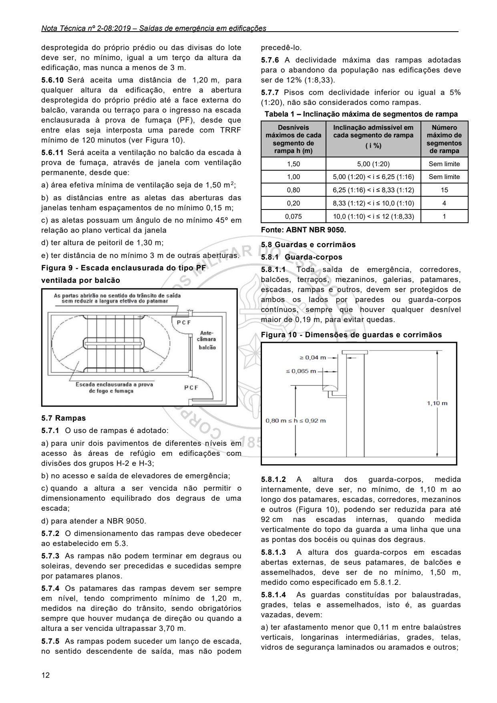

desprotegida do próprio prédio ou das divisas do lote deve ser, no mínimo, igual a um terço da altura da edificação, mas nunca a menos de 3 m.

5.6.10 Será aceita uma distância de 1,20 m, para qualquer altura da edificação, entre a abertura desprotegida do próprio prédio até a face externa do balcão, varanda ou terraço para o ingresso na escada enclausurada à prova de fumaça (PF), desde que entre elas seja interposta uma parede com TRRF mínimo de 120 minutos (ver Figura 10).

5.6.11 Será aceita a ventilação no balcão da escada à prova de fumaça, através de janela com ventilação permanente, desde que:

a) área efetiva mínima de ventilação seja de 1,50 m 2;

b) as distâncias entre as aletas das aberturas das janelas tenham espaçamentos de no mínimo 0,15 m;

c) as aletas possuam um ângulo de no mínimo 45º em relação ao plano vertical da janela

d) ter altura de peitoril de 1,30 m;

e) ter distância de no mínimo 3 m de outras aberturas.

Figura 9 - Escada enclausurada do tipo PF

ventilada por balcão

5.7 Rampas

5.7.1 O uso de rampas é adotado:

a) para unir dois pavimentos de diferentes níveis em acesso às áreas de refúgio em edificações com divisões dos grupos H-2 e H-3;

b) no acesso e saída de elevadores de emergência;

c) quando a altura a ser vencida não permitir o dimensionamento equilibrado dos degraus de uma escada;

d) para atender a NBR 9050.

5.7.2 O dimensionamento das rampas deve obedecer ao estabelecido em 5.3.

5.7.3 As rampas não podem terminar em degraus ou soleiras, devendo ser precedidas e sucedidas sempre por patamares planos.

5.7.4 Os patamares das rampas devem ser sempre em nível, tendo comprimento mínimo de 1,20 m, medidos na direção do trânsito, sendo obrigatórios sempre que houver mudança de direção ou quando a altura a ser vencida ultrapassar 3,70 m.

5.7.5 As rampas podem suceder um lanço de escada, no sentido descendente de saída, mas não podem

precedê-lo.

5.7.6 A declividade máxima das rampas adotadas para o abandono da população nas edificações deve ser de 12% (1:8,33).

5.7.7 Pisos com declividade inferior ou igual a 5% (1:20), não são considerados como rampas.

Tabela 1 - Inclinação máxima de segmentos de rampa

Fonte: ABNT NBR 9050.

5.8 Guardas e corrimãos

5.8.1 Guarda-corpos

5.8.1.1 Toda saída de emergência, corredores, balcões, terraços, mezaninos, galerias, patamares, escadas, rampas e outros, devem ser protegidos de ambos os lados por paredes ou guarda-corpos contínuos, sempre que houver qualquer desnível maior de 0,19 m, para evitar quedas.

Figura 10 - Dimensões de guardas e corrimãos

5.8.1.2 A altura dos guarda-corpos, medida internamente, deve ser, no mínimo, de 1,10 m ao longo dos patamares, escadas, corredores, mezaninos e outros (Figura 10), podendo ser reduzida para até 92 cm nas escadas internas, quando medida verticalmente do topo da guarda a uma linha que una as pontas dos bocéis ou quinas dos degraus.

5.8.1.3 A altura dos guarda-corpos em escadas abertas externas, de seus patamares, de balcões e assemelhados, deve ser de no mínimo, 1,50 m, medido como especificado em 5.8.1.2.

5.8.1.4 As guardas constituídas por balaustradas, grades, telas e assemelhados, isto é, as guardas vazadas, devem:

a) ter afastamento menor que 0,11 m entre balaústres verticais, longarinas intermediárias, grades, telas, vidros de segurança laminados ou aramados e outros;

### Tabelas extraídas (bruto, não usar para citação)
#### Tabela 1 da página

|  | Desníveis |  | Inclinação admissível em cada segmento de rampa (i %) |  | Número |  |
| --- | --- | --- | --- | --- | --- | --- |
|  | máximos de cada |  |  |  | máximo de |  |
|  | segmento de |  |  |  | segmentos |  |
|  | rampa h (m) |  |  |  | de rampa |  |
| 1,50 |  |  | 5,00 (1:20) | Sem limite |  |  |
| 1,00 |  |  | 5,00 (1:20) < i ≤ 6,25 (1:16) | Sem limite |  |  |
| 0,80 |  |  | 6,25 (1:16) < i ≤ 8,33 (1:12) | 15 |  |  |
| 0,20 |  |  | 8,33 (1:12) < i ≤ 10,0 (1:10) | 4 |  |  |
| 0,075 |  |  | 10,0 (1:10) < i ≤ 12 (1:8,33) | 1 |  |  |

<!-- tabela-conferida: Tabela 1 p12 -->
### Tabela 1 — Inclinação máxima de segmentos de rampa (conferida)

| Desníveis máximos de cada segmento de rampa h (m) | Inclinação admissível em cada segmento de rampa (i %) | Número máximo de segmentos de rampa |
| --- | --- | --- |
| 1,50 | 5,00 (1:20) | Sem limite |
| 1,00 | 5,00 (1:20) < i ≤ 6,25 (1:16) | Sem limite |
| 0,80 | 6,25 (1:16) < i ≤ 8,33 (1:12) | 15 |
| 0,20 | 8,33 (1:12) < i ≤ 10,0 (1:10) | 4 |
| 0,075 | 10,0 (1:10) < i ≤ 12 (1:8,33) | 1 |

Fonte: NT 2-08, página 12, Tabela 1; conferida em 2026-09-29 (visual + geometrica).
Fonte indicada na página: ABNT NBR 9050. Na imagem o cabeçalho da 2ª coluna é "( i %)".
<!-- /tabela-conferida: Tabela 1 p12 -->

---

## Página 13

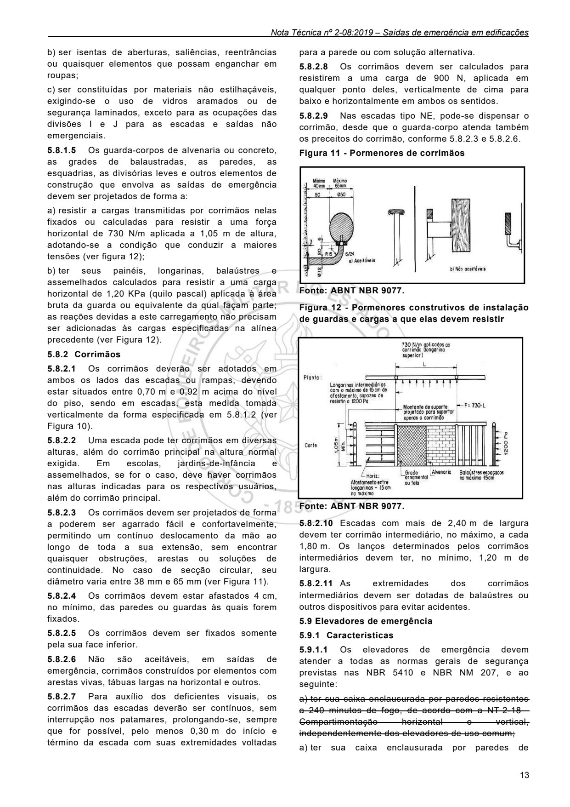

b) ser isentas de aberturas, saliências, reentrâncias ou quaisquer elementos que possam enganchar em roupas;

c) ser constituídas por materiais não estilhaçáveis, exigindo-se o uso de vidros aramados ou de segurança laminados, exceto para as ocupações das divisões I e J para as escadas e saídas não emergenciais.

5.8.1.5 Os guarda-corpos de alvenaria ou concreto, as grades de balaustradas, as paredes, as esquadrias, as divisórias leves e outros elementos de construção que envolva as saídas de emergência devem ser projetados de forma a:

a) resistir a cargas transmitidas por corrimãos nelas fixados ou calculadas para resistir a uma força horizontal de 730 N/m aplicada a 1,05 m de altura, adotando-se a condição que conduzir a maiores tensões (ver figura 12);

b) ter seus painéis, longarinas, balaústres e assemelhados calculados para resistir a uma carga horizontal de 1,20 KPa (quilo pascal) aplicada à área bruta da guarda ou equivalente da qual façam parte; as reações devidas a este carregamento não precisam ser adicionadas às cargas especificadas na alínea precedente (ver Figura 12).

5.8.2 Corrimãos

5.8.2.1 Os corrimãos deverão ser adotados em ambos os lados das escadas ou rampas, devendo estar situados entre 0,70 m e 0,92 m acima do nível do piso, sendo em escadas, esta medida tomada verticalmente da forma especificada em 5.8.1.2 (ver Figura 10).

5.8.2.2 Uma escada pode ter corrimãos em diversas alturas, além do corrimão principal na altura normal exigida. Em escolas, jardins-de-infância e assemelhados, se for o caso, deve haver corrimãos nas alturas indicadas para os respectivos usuários, além do corrimão principal.

5.8.2.3 Os corrimãos devem ser projetados de forma a poderem ser agarrado fácil e confortavelmente, permitindo um contínuo deslocamento da mão ao longo de toda a sua extensão, sem encontrar quaisquer obstruções, arestas ou soluções de continuidade. No caso de secção circular, seu diâmetro varia entre 38 mm e 65 mm (ver Figura 11).

5.8.2.4 Os corrimãos devem estar afastados 4 cm, no mínimo, das paredes ou guardas às quais forem fixados.

5.8.2.5 Os corrimãos devem ser fixados somente pela sua face inferior.

5.8.2.6 Não são aceitáveis, em saídas de emergência, corrimãos construídos por elementos com arestas vivas, tábuas largas na horizontal e outros.

5.8.2.7 Para auxílio dos deficientes visuais, os corrimãos das escadas deverão ser contínuos, sem interrupção nos patamares, prolongando-se, sempre que for possível, pelo menos 0,30 m do início e término da escada com suas extremidades voltadas

para a parede ou com solução alternativa.

5.8.2.8 Os corrimãos devem ser calculados para resistirem a uma carga de 900 N, aplicada em qualquer ponto deles, verticalmente de cima para baixo e horizontalmente em ambos os sentidos.

5.8.2.9 Nas escadas tipo NE, pode-se dispensar o corrimão, desde que o guarda-corpo atenda também os preceitos do corrimão, conforme 5.8.2.3 e 5.8.2.6.

Figura 11 - Pormenores de corrimãos

Fonte: ABNT NBR 9077.

Figura 12 - Pormenores construtivos de instalação de guardas e cargas a que elas devem resistir

Fonte: ABNT NBR 9077.

5.8.2.10 Escadas com mais de 2,40 m de largura devem ter corrimão intermediário, no máximo, a cada 1,80 m. Os lanços determinados pelos corrimãos intermediários devem ter, no mínimo, 1,20 m de largura.

5.8.2.11 As extremidades dos corrimãos intermediários devem ser dotadas de balaústres ou outros dispositivos para evitar acidentes.

5.9 Elevadores de emergência

5.9.1 Características

5.9.1.1 Os elevadores de emergência devem atender a todas as normas gerais de segurança previstas nas NBR 5410 e NBR NM 207, e ao seguinte:

a) ter sua caixa enclausurada por paredes resistentes a 240 minutos de fogo, de acordo com a NT 2-18 - Compartimentação horizontal e vertical, independentemente dos elevadores de uso comum;

a) ter sua caixa enclausurada por paredes de

---

## Página 14

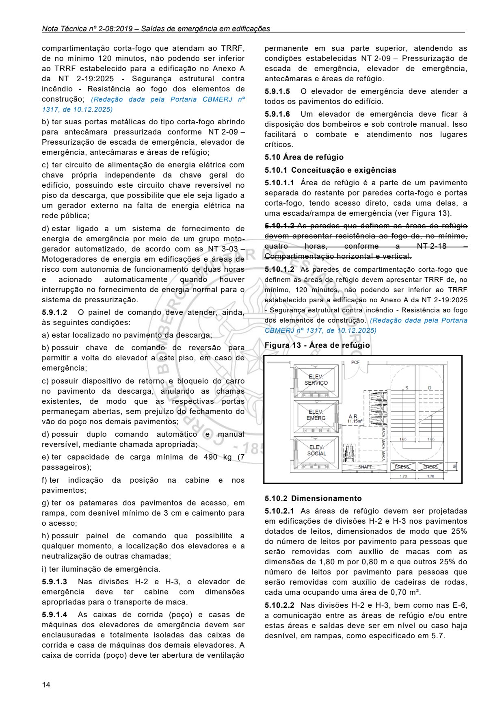

compartimentação corta-fogo que atendam ao TRRF, de no mínimo 120 minutos, não podendo ser inferior ao TRRF estabelecido para a edificação no Anexo A da NT 2-19:2025 - Segurança estrutural contra incêndio - Resistência ao fogo dos elementos de construção; (Redação dada pela Portaria CBMERJ nº 1317, de 10.12.2025)

b) ter suas portas metálicas do tipo corta-fogo abrindo para antecâmara pressurizada conforme NT 2-09 - Pressurização de escada de emergência, elevador de emergência, antecâmaras e áreas de refúgio;

c) ter circuito de alimentação de energia elétrica com chave própria independente da chave geral do edifício, possuindo este circuito chave reversível no piso da descarga, que possibilite que ele seja ligado a um gerador externo na falta de energia elétrica na rede pública;

d) estar ligado a um sistema de fornecimento de energia de emergência por meio de um grupo motogerador automatizado, de acordo com as NT 3-03 - Motogeradores de energia em edificações e áreas de risco com autonomia de funcionamento de duas horas e acionado automaticamente quando houver interrupção no fornecimento de energia normal para o sistema de pressurização.

5.9.1.2 O painel de comando deve atender, ainda, às seguintes condições:

a) estar localizado no pavimento da descarga;

b) possuir chave de comando de reversão para permitir a volta do elevador a este piso, em caso de emergência;

c) possuir dispositivo de retorno e bloqueio do carro no pavimento da descarga, anulando as chamas existentes, de modo que as respectivas portas permaneçam abertas, sem prejuízo do fechamento do vão do poço nos demais pavimentos;

d) possuir duplo comando automático e manual reversível, mediante chamada apropriada;

e) ter capacidade de carga mínima de 490 kg (7 passageiros);

f) ter indicação da posição na cabine e nos pavimentos;

g) ter os patamares dos pavimentos de acesso, em rampa, com desnível mínimo de 3 cm e caimento para o acesso;

h) possuir painel de comando que possibilite a qualquer momento, a localização dos elevadores e a neutralização de outras chamadas;

i) ter iluminação de emergência.

5.9.1.3 Nas divisões H-2 e H-3, o elevador de emergência deve ter cabine com dimensões apropriadas para o transporte de maca.

5.9.1.4 As caixas de corrida (poço) e casas de máquinas dos elevadores de emergência devem ser enclausuradas e totalmente isoladas das caixas de corrida e casa de máquinas dos demais elevadores. A caixa de corrida (poço) deve ter abertura de ventilação

permanente em sua parte superior, atendendo as condições estabelecidas NT 2-09 - Pressurização de escada de emergência, elevador de emergência, antecâmaras e áreas de refúgio.

5.9.1.5 O elevador de emergência deve atender a todos os pavimentos do edifício.

5.9.1.6 Um elevador de emergência deve ficar à disposição dos bombeiros e sob controle manual. Isso facilitará o combate e atendimento nos lugares críticos.

5.10 Área de refúgio

5.10.1 Conceituação e exigências

5.10.1.1 Área de refúgio é a parte de um pavimento separada do restante por paredes corta-fogo e portas corta-fogo, tendo acesso direto, cada uma delas, a uma escada/rampa de emergência (ver Figura 13).

5.10.1.2 As paredes que definem as áreas de refúgio devem apresentar resistência ao fogo de, no mínimo, quatro horas, conforme a NT 2-18 - Compartimentação horizontal e vertical.

5.10.1.2 As paredes de compartimentação corta-fogo que definem as áreas de refúgio devem apresentar TRRF de, no mínimo, 120 minutos, não podendo ser inferior ao TRRF estabelecido para a edificação no Anexo A da NT 2-19:2025 - Segurança estrutural contra incêndio - Resistência ao fogo dos elementos de construção. (Redação dada pela Portaria CBMERJ nº 1317, de 10.12.2025)

Figura 13 - Área de refúgio

5.10.2 Dimensionamento

5.10.2.1 As áreas de refúgio devem ser projetadas em edificações de divisões H-2 e H-3 nos pavimentos dotados de leitos, dimensionados de modo que 25% do número de leitos por pavimento para pessoas que serão removidas com auxílio de macas com as dimensões de 1,80 m por 0,80 m e que outros 25% do número de leitos por pavimento para pessoas que serão removidas com auxílio de cadeiras de rodas, cada uma ocupando uma área de 0,70 m².

5.10.2.2 Nas divisões H-2 e H-3, bem como nas E-6, a comunicação entre as áreas de refúgio e/ou entre estas áreas e saídas deve ser em nível ou caso haja desnível, em rampas, como especificado em 5.7.

---

## Página 15

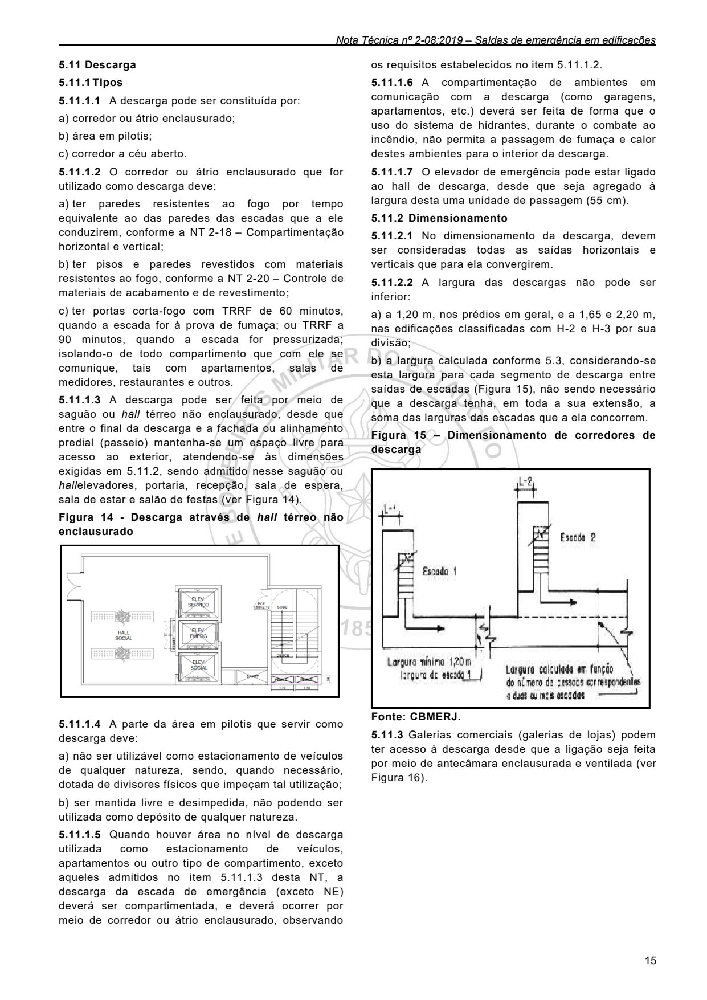

5.11 Descarga

5.11.1 Tipos

5.11.1.1 A descarga pode ser constituída por:

a) corredor ou átrio enclausurado;

b) área em pilotis;

c) corredor a céu aberto.

5.11.1.2 O corredor ou átrio enclausurado que for utilizado como descarga deve:

a) ter paredes resistentes ao fogo por tempo equivalente ao das paredes das escadas que a ele conduzirem, conforme a NT 2-18 - Compartimentação horizontal e vertical;

b) ter pisos e paredes revestidos com materiais resistentes ao fogo, conforme a NT 2-20 - Controle de materiais de acabamento e de revestimento;

c) ter portas corta-fogo com TRRF de 60 minutos, quando a escada for à prova de fumaça; ou TRRF a 90 minutos, quando a escada for pressurizada; isolando-o de todo compartimento que com ele se comunique, tais com apartamentos, salas de medidores, restaurantes e outros.

5.11.1.3 A descarga pode ser feita por meio de saguão ou hall térreo não enclausurado, desde que entre o final da descarga e a fachada ou alinhamento predial (passeio) mantenha-se um espaço livre para acesso ao exterior, atendendo-se às dimensões exigidas em 5.11.2, sendo admitido nesse saguão ou hallelevadores, portaria, recepção, sala de espera, sala de estar e salão de festas (ver Figura 14).

Figura 14 - Descarga através de hall térreo não enclausurado

5.11.1.4 A parte da área em pilotis que servir como descarga deve:

a) não ser utilizável como estacionamento de veículos de qualquer natureza, sendo, quando necessário, dotada de divisores físicos que impeçam tal utilização;

b) ser mantida livre e desimpedida, não podendo ser utilizada como depósito de qualquer natureza.

5.11.1.5 Quando houver área no nível de descarga utilizada como estacionamento de veículos, apartamentos ou outro tipo de compartimento, exceto aqueles admitidos no item 5.11.1.3 desta NT, a descarga da escada de emergência (exceto NE) deverá ser compartimentada, e deverá ocorrer por meio de corredor ou átrio enclausurado, observando

os requisitos estabelecidos no item 5.11.1.2.

5.11.1.6 A compartimentação de ambientes em comunicação com a descarga (como garagens, apartamentos, etc.) deverá ser feita de forma que o uso do sistema de hidrantes, durante o combate ao incêndio, não permita a passagem de fumaça e calor destes ambientes para o interior da descarga.

5.11.1.7 O elevador de emergência pode estar ligado ao hall de descarga, desde que seja agregado à largura desta uma unidade de passagem (55 cm).

5.11.2 Dimensionamento

5.11.2.1 No dimensionamento da descarga, devem ser consideradas todas as saídas horizontais e verticais que para ela convergirem.

5.11.2.2 A largura das descargas não pode ser inferior:

a) a 1,20 m, nos prédios em geral, e a 1,65 e 2,20 m, nas edificações classificadas com H-2 e H-3 por sua divisão;

b) a largura calculada conforme 5.3, considerando-se esta largura para cada segmento de descarga entre saídas de escadas (Figura 15), não sendo necessário que a descarga tenha, em toda a sua extensão, a soma das larguras das escadas que a ela concorrem.

Figura 15 - Dimensionamento de corredores de descarga

Fonte: CBMERJ.

5.11.3 Galerias comerciais (galerias de lojas) podem ter acesso à descarga desde que a ligação seja feita por meio de antecâmara enclausurada e ventilada (ver Figura 16).

---

## Página 16

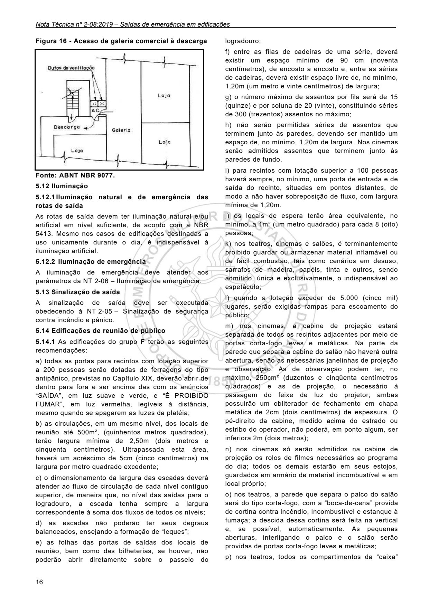

Figura 16 - Acesso de galeria comercial à descarga

Fonte: ABNT NBR 9077.

5.12 Iluminação

5.12.1 Iluminação natural e de emergência das rotas de saída

As rotas de saída devem ter iluminação natural e/ou artificial em nível suficiente, de acordo com a NBR 5413. Mesmo nos casos de edificações destinadas a uso unicamente durante o dia, é indispensável à iluminação artificial.

5.12.2 Iluminação de emergência

A iluminação de emergência deve atender aos parâmetros da NT 2-06 - Iluminação de emergência.

5.13 Sinalização de saída

A sinalização de saída deve ser executada obedecendo à NT 2-05 - Sinalização de segurança contra incêndio e pânico.

5.14 Edificações de reunião de público

5.14.1 As edificações do grupo F terão as seguintes recomendações:

a) todas as portas para recintos com lotação superior a 200 pessoas serão dotadas de ferragens do tipo antipânico, previstas no Capítulo XIX, deverão abrir de dentro para fora e ser encima das com os anúncios “SAÍDA”, em luz suave e verde, e “É PROIBIDO FUMAR”, em luz vermelha, legíveis à distância, mesmo quando se apagarem as luzes da platéia;

b) as circulações, em um mesmo nível, dos locais de reunião até 500m², (quinhentos metros quadrados), terão largura mínima de 2,50m (dois metros e cinquenta centímetros). Ultrapassada esta área, haverá um acréscimo de 5cm (cinco centímetros) na largura por metro quadrado excedente;

c) o dimensionamento da largura das escadas deverá atender ao fluxo de circulação de cada nível contíguo superior, de maneira que, no nível das saídas para o logradouro, a escada tenha sempre a largura correspondente à soma dos fluxos de todos os níveis;

d) as escadas não poderão ter seus degraus balanceados, ensejando a formação de “leques”;

e) as folhas das portas de saídas dos locais de reunião, bem como das bilheterias, se houver, não poderão abrir diretamente sobre o passeio do

logradouro;

f) entre as filas de cadeiras de uma série, deverá existir um espaço mínimo de 90 cm (noventa centímetros), de encosto a encosto e, entre as séries de cadeiras, deverá existir espaço livre de, no mínimo, 1,20m (um metro e vinte centímetros) de largura;

g) o número máximo de assentos por fila será de 15 (quinze) e por coluna de 20 (vinte), constituindo séries de 300 (trezentos) assentos no máximo;

h) não serão permitidas séries de assentos que terminem junto às paredes, devendo ser mantido um espaço de, no mínimo, 1,20m de largura. Nos cinemas serão admitidos assentos que terminem junto às paredes de fundo,

i) para recintos com lotação superior a 100 pessoas haverá sempre, no mínimo, uma porta de entrada e de saída do recinto, situadas em pontos distantes, de modo a não haver sobreposição de fluxo, com largura mínima de 1,20m.

j) os locais de espera terão área equivalente, no mínimo, a 1m² (um metro quadrado) para cada 8 (oito) pessoas;

k) nos teatros, cinemas e salões, é terminantemente proibido guardar ou armazenar material inflamável ou de fácil combustão, tais como cenários em desuso, sarrafos de madeira, papéis, tinta e outros, sendo admitido, única e exclusivamente, o indispensável ao espetáculo;

l) quando a lotação exceder de 5.000 (cinco mil) lugares, serão exigidas rampas para escoamento do público;

m) nos cinemas, a cabine de projeção estará separada de todos os recintos adjacentes por meio de portas corta-fogo leves e metálicas. Na parte da parede que separa a cabine do salão não haverá outra abertura, senão as necessárias janelinhas de projeção e observação. As de observação podem ter, no máximo, 250cm² (duzentos e cinqüenta centímetros quadrados) e as de projeção, o necessário á passagem do feixe de luz do projetor; ambas possuirão um obliterador de fechamento em chapa metálica de 2cm (dois centímetros) de espessura. O pé-direito da cabine, medido acima do estrado ou estribo do operador, não poderá, em ponto algum, ser inferiora 2m (dois metros);

n) nos cinemas só serão admitidos na cabine de projeção os rolos de filmes necessários ao programa do dia; todos os demais estarão em seus estojos, guardados em armário de material incombustível e em local próprio;

o) nos teatros, a parede que separa o palco do salão será do tipo corta-fogo, com a “boca-de-cena” provida de cortina contra incêndio, incombustível e estanque à fumaça; a descida dessa cortina será feita na vertical e, se possível, automaticamente. As pequenas aberturas, interligando o palco e o salão serão providas de portas corta-fogo leves e metálicas;

p) nos teatros, todos os compartimentos da “caixa”

---

## Página 17

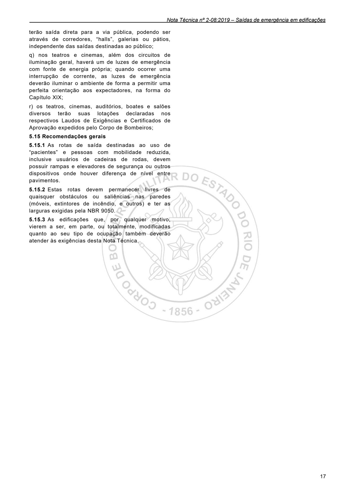

terão saída direta para a via pública, podendo ser através de corredores, “halls”, galerias ou pátios, independente das saídas destinadas ao público;

q) nos teatros e cinemas, além dos circuitos de iluminação geral, haverá um de luzes de emergência com fonte de energia própria; quando ocorrer uma interrupção de corrente, as luzes de emergência deverão iluminar o ambiente de forma a permitir uma perfeita orientação aos expectadores, na forma do Capítulo XIX;

r) os teatros, cinemas, auditórios, boates e salões diversos terão suas lotações declaradas nos respectivos Laudos de Exigências e Certificados de Aprovação expedidos pelo Corpo de Bombeiros;

5.15 Recomendações gerais

5.15.1 As rotas de saída destinadas ao uso de “pacientes” e pessoas com mobilidade reduzida, inclusive usuários de cadeiras de rodas, devem possuir rampas e elevadores de segurança ou outros dispositivos onde houver diferença de nível entre pavimentos.

5.15.2 Estas rotas devem permanecer livres de quaisquer obstáculos ou saliências nas paredes (móveis, extintores de incêndio, e outros) e ter as larguras exigidas pela NBR 9050.

5.15.3 As edificações que, por qualquer motivo, vierem a ser, em parte, ou totalmente, modificadas quanto ao seu tipo de ocupação também deverão atender às exigências desta Nota Técnica.

---

## Página 18

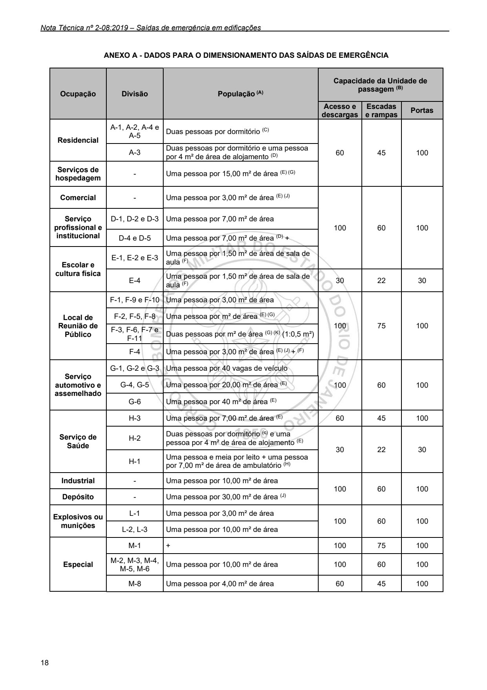

### ANEXO A - DADOS PARA O DIMENSIONAMENTO DAS SAÍDAS DE EMERGÊNCIA

### Tabelas extraídas (bruto, não usar para citação)
#### Tabela 1 da página

| Ocupação | Divisão | População (A) | Capacidade da Unidade de passagem (B) |  |  |  |  |  |  |
| --- | --- | --- | --- | --- | --- | --- | --- | --- | --- |
|  |  |  |  | Acesso e |  |  | Escadas |  | Portas |
|  |  |  |  | descargas |  |  | e rampas |  |  |
| Residencial | A-1, A-2, A-4 e A-5 | Duas pessoas por dormitório (C) | 60 |  |  | 45 |  |  | 100 |
|  | A-3 | Duas pessoas por dormitório e uma pessoa por 4 m² de área de alojamento (D) |  |  |  |  |  |  |  |
| Serviços de hospedagem | - | Uma pessoa por 15,00 m² de área (E) (G) |  |  |  |  |  |  |  |
| Comercial | - | Uma pessoa por 3,00 m² de área (E) (J) | 100 |  |  | 60 |  |  | 100 |
| Serviço profissional e institucional | D-1, D-2 e D-3 | Uma pessoa por 7,00 m² de área |  |  |  |  |  |  |  |
|  | D-4 e D-5 | Uma pessoa por 7,00 m² de área (D) + |  |  |  |  |  |  |  |
| Escolar e cultura física | E-1, E-2 e E-3 | Uma pessoa por 1,50 m² de área de sala de aula (F) |  |  |  |  |  |  |  |
|  | E-4 | Uma pessoa por 1,50 m² de área de sala de aula (F) | 30 |  |  | 22 |  |  | 30 |
| Local de Reunião de Público | F-1, F-9 e F-10 | Uma pessoa por 3,00 m² de área | 100 |  |  | 75 |  |  | 100 |
|  | F-2, F-5, F-8 | Uma pessoa por m² de área (E) (G) |  |  |  |  |  |  |  |
|  | F-3, F-6, F-7 e F-11 | Duas pessoas por m² de área (G) (K) (1:0,5 m²) |  |  |  |  |  |  |  |
|  | F-4 | Uma pessoa por 3,00 m² de área (E) (J) + (F) |  |  |  |  |  |  |  |
| Serviço automotivo e assemelhado | G-1, G-2 e G-3 | Uma pessoa por 40 vagas de veículo | 100 |  |  | 60 |  |  | 100 |
|  | G-4, G-5 | Uma pessoa por 20,00 m² de área (E) |  |  |  |  |  |  |  |
|  | G-6 | Uma pessoa por 40 m² de área (E) |  |  |  |  |  |  |  |
| Serviço de Saúde | H-3 | Uma pessoa por 7,00 m² de área (E) | 60 |  |  | 45 |  |  | 100 |
|  | H-2 | Duas pessoas por dormitório (c) e uma pessoa por 4 m² de área de alojamento (E) | 30 |  |  | 22 |  |  | 30 |
|  | H-1 | Uma pessoa e meia por leito + uma pessoa por 7,00 m² de área de ambulatório (H) |  |  |  |  |  |  |  |
| Industrial | - | Uma pessoa por 10,00 m² de área | 100 |  |  | 60 |  |  | 100 |
| Depósito | - | Uma pessoa por 30,00 m² de área (J) |  |  |  |  |  |  |  |
| Explosivos ou munições | L-1 | Uma pessoa por 3,00 m² de área | 100 |  |  | 60 |  |  | 100 |
|  | L-2, L-3 | Uma pessoa por 10,00 m² de área |  |  |  |  |  |  |  |
| Especial | M-1 | + | 100 |  |  | 75 |  |  | 100 |
|  | M-2, M-3, M-4, M-5, M-6 | Uma pessoa por 10,00 m² de área | 100 |  |  | 60 |  |  | 100 |
|  | M-8 | Uma pessoa por 4,00 m² de área | 60 |  |  | 45 |  |  | 100 |

<!-- tabela-conferida: Tabela do Anexo A p18 -->
### Tabela do Anexo A — Dados para o dimensionamento das saídas de emergência (conferida)

| Ocupação | Divisão | População (A) | Capacidade da unidade de passagem (B) — Acesso e descargas | Capacidade da unidade de passagem (B) — Escadas e rampas | Capacidade da unidade de passagem (B) — Portas |
| --- | --- | --- | --- | --- | --- |
| Residencial | A-1, A-2, A-4 e A-5 | Duas pessoas por dormitório (C) | 60 | 45 | 100 |
| Residencial | A-3 | Duas pessoas por dormitório e uma pessoa por 4 m² de área de alojamento (D) | 60 | 45 | 100 |
| Serviços de hospedagem | - | Uma pessoa por 15,00 m² de área (E) (G) | 60 | 45 | 100 |
| Comercial | - | Uma pessoa por 3,00 m² de área (E) (J) | 100 | 60 | 100 |
| Serviço profissional e institucional | D-1, D-2 e D-3 | Uma pessoa por 7,00 m² de área | 100 | 60 | 100 |
| Serviço profissional e institucional | D-4 e D-5 | Uma pessoa por 7,00 m² de área (D) + | 100 | 60 | 100 |
| Escolar e cultura física | E-1, E-2 e E-3 | Uma pessoa por 1,50 m² de área de sala de aula (F) | 100 | 60 | 100 |
| Escolar e cultura física | E-4 | Uma pessoa por 1,50 m² de área de sala de aula (F) | 30 | 22 | 30 |
| Local de Reunião de Público | F-1, F-9 e F-10 | Uma pessoa por 3,00 m² de área | 100 | 75 | 100 |
| Local de Reunião de Público | F-2, F-5, F-8 | Uma pessoa por m² de área (E) (G) | 100 | 75 | 100 |
| Local de Reunião de Público | F-3, F-6, F-7 e F-11 | Duas pessoas por m² de área (G) (K) (1:0,5 m²) | 100 | 75 | 100 |
| Local de Reunião de Público | F-4 | Uma pessoa por 3,00 m² de área (E) (J) + (F) | 100 | 75 | 100 |
| Serviço automotivo e assemelhado | G-1, G-2 e G-3 | Uma pessoa por 40 vagas de veículo | 100 | 60 | 100 |
| Serviço automotivo e assemelhado | G-4, G-5 | Uma pessoa por 20,00 m² de área (E) | 100 | 60 | 100 |
| Serviço automotivo e assemelhado | G-6 | Uma pessoa por 40 m² de área (E) | 100 | 60 | 100 |
| Serviço de Saúde | H-3 | Uma pessoa por 7,00 m² de área (E) | 60 | 45 | 100 |
| Serviço de Saúde | H-2 | Duas pessoas por dormitório (c) e uma pessoa por 4 m² de área de alojamento (E) | 30 | 22 | 30 |
| Serviço de Saúde | H-1 | Uma pessoa e meia por leito + uma pessoa por 7,00 m² de área de ambulatório (H) | 30 | 22 | 30 |
| Industrial | - | Uma pessoa por 10,00 m² de área | 100 | 60 | 100 |
| Depósito | - | Uma pessoa por 30,00 m² de área (J) | 100 | 60 | 100 |
| Explosivos ou munições | L-1 | Uma pessoa por 3,00 m² de área | 100 | 60 | 100 |
| Explosivos ou munições | L-2, L-3 | Uma pessoa por 10,00 m² de área | 100 | 60 | 100 |
| Especial | M-1 | + | 100 | 75 | 100 |
| Especial | M-2, M-3, M-4, M-5, M-6 | Uma pessoa por 10,00 m² de área | 100 | 60 | 100 |
| Especial | M-8 | Uma pessoa por 4,00 m² de área | 60 | 45 | 100 |

Fonte: NT 2-08, página 18, Tabela do Anexo A; conferida em 2026-09-29 (visual + geometrica).
Células mescladas ("^" na leitura visual): a capacidade da unidade de passagem vale para o bloco de linhas indicado na imagem (ex.: 60/45/100 para Residencial e Serviços de hospedagem; 100/60/100 de Comercial até E-1, E-2 e E-3). Na publicação, cada linha repete o valor do bloco.
Observações (A) a (N) e a redução das unidades de passagem: ver o texto da página 19. "+" = consultar normas específicas (observação I).
<!-- /tabela-conferida: Tabela do Anexo A p18 -->

---

## Página 19

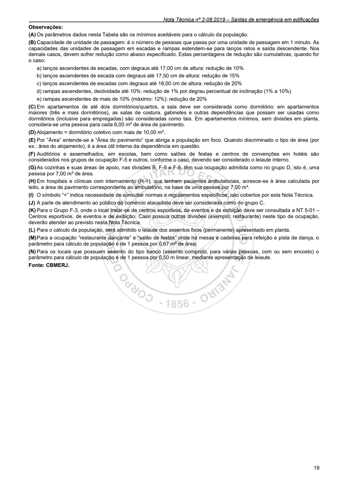

Observações: (A) Os parâmetros dados nesta Tabela são os mínimos aceitáveis para o cálculo da população. (B) Capacidade de unidade de passagem: é o número de pessoas que passa por uma unidade de passagem em 1 minuto. As capacidades das unidades de passagem em escadas e rampas estendem-se para lanços retos e saída descendente. Nos demais casos, devem sofrer redução como abaixo especificado. Estas percentagens de redução são cumulativas, quando for o caso: a) lanços ascendentes de escadas, com degraus até 17,00 cm de altura: redução de 10% b) lanços ascendentes de escada com degraus até 17,50 cm de altura: redução de 15% c) lanços ascendentes de escadas com degraus até 18,00 cm de altura: redução de 20% d) rampas ascendentes, declividade até 10%: redução de 1% por degrau percentual de inclinação (1% a 10%) e) rampas ascendentes de mais de 10% (máximo: 12%): redução de 20% (C) Em apartamentos de até dois dormitórios/quartos, a sala deve ser considerada como dormitório: em apartamentos maiores (três e mais dormitórios), as salas de costura, gabinetes e outras dependências que possam ser usadas como dormitórios (inclusive para empregadas) são consideradas como tais. Em apartamentos mínimos, sem divisões em planta, considera-se uma pessoa para cada 6,00 m² de área de pavimento. (D) Alojamento = dormitório coletivo com mais de 10,00 m². (E) Por ”Área” entende-se a “Área do pavimento” que abriga a população em foco. Quando discriminado o tipo de área (por ex.: área do alojamento), é a área útil interna da dependência em questão. (F) Auditórios e assemelhados, em escolas, bem como salões de festas e centros de convenções em hotéis são considerados nos grupos de ocupação F-5 e outros, conforme o caso, devendo ser considerado o leiaute interno. (G) As cozinhas e suas áreas de apoio, nas divisões B, F-6 e F-8, têm sua ocupação admitida como no grupo D, isto é, uma pessoa por 7,00 m² de área. (H) Em hospitais e clínicas com internamento (H-1), que tenham pacientes ambulatoriais, acresce-se à área calculada por leito, a área de pavimento correspondente ao ambulatório, na base de uma pessoa por 7,00 m². (I) O símbolo “+” indica necessidade de consultar normas e regulamentos específicos, não cobertos por esta Nota Técnica. (J) A parte de atendimento ao público de comércio atacadista deve ser considerada como do grupo C. (K) Para o Grupo F-3, onde o local tratar-se de centros esportivos, de eventos e de exibição deve ser consultada a NT 5-01 - Centros esportivos, de eventos e de exibição. Caso possua outras divisões (exemplo: restaurante) neste tipo de ocupação, deverão atender ao previsto nesta Nota Técnica. (L) Para o cálculo da população, será admitido o leiaute dos assentos fixos (permanente) apresentado em planta. (M) Para a ocupação “restaurante dançante” e “salão de festas” onde há mesas e cadeiras para refeição e pista de dança, o parâmetro para cálculo de população é de 1 pessoa por 0,67 m² de área; (N) Para os locais que possuam assento do tipo banco (assento comprido, para várias pessoas, com ou sem encosto) o parâmetro para cálculo de população é de 1 pessoa por 0,50 m linear, mediante apresentação de leiaute. Fonte: CBMERJ.

---

## Página 20

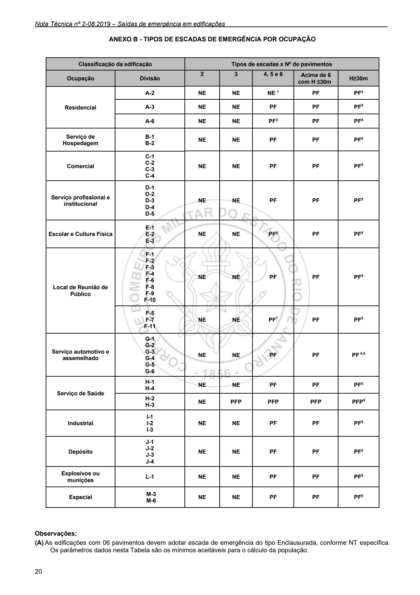

### ANEXO B - TIPOS DE ESCADAS DE EMERGÊNCIA POR OCUPAÇÃO

Observações: (A) As edificações com 06 pavimentos devem adotar escada de emergência do tipo Enclausurada, conforme NT específica.

Os parâmetros dados nesta Tabela são os mínimos aceitáveis para o cálculo da população.

### Tabelas extraídas (bruto, não usar para citação)
#### Tabela 1 da página

| Classificação da edificação |  | Tipos de escadas x Nº de pavimentos |  |  |  |  |  |  |
| --- | --- | --- | --- | --- | --- | --- | --- | --- |
| Ocupação | Divisão | 2 | 3 | 4, 5 e 6 |  | Acima de 6 |  | H≥30m |
|  |  |  |  |  |  | com H ≤30m |  |  |
| Residencial | A-2 | NE | NE | NE 1 | PF |  |  | PF4 |
|  | A-3 | NE | NE | PF | PF |  |  | PF5 |
|  | A-6 | NE | NE | PF2 | PF |  |  | PF4 |
| Serviço de Hospedagem | B-1 B-2 | NE | NE | PF | PF |  |  | PF5 |
| Comercial | C-1 C-2 C-3 C-4 | NE | NE | PF | PF |  |  | PF5 |
| Serviço profissional e institucional | D-1 D-2 D-3 D-4 D-5 | NE | NE | PF | PF |  |  | PF5 |
| Escolar e Cultura Física | E-1 E-2 E-3 | NE | NE | PF6 | PF |  |  | PF5 |
| Local de Reunião de Público | F-1 F-2 F-3 F-4 F-6 F-8 F-9 F-10 | NE | NE | PF | PF |  |  | PF5 |
|  | F-5 F-7 F-11 | NE | NE | PF7 | PF |  |  | PF5 |
| Serviço automotivo e assemelhado | G-1 G-2 G-3 G-4 G-5 G-6 | NE | NE | PF | PF |  |  | PF 4,5 |
| Serviço de Saúde | H-1 H-4 | NE | NE | PF | PF |  |  | PF5 |
|  | H-2 H-3 | NE | PFP | PFP | PFP |  |  | PFP5 |
| Industrial | I-1 I-2 I-3 | NE | NE | PF | PF |  |  | PF5 |
| Depósito | J-1 J-2 J-3 J-4 | NE | NE | PF | PF |  |  | PF5 |
| Explosivos ou munições | L-1 | NE | NE | PF | PF |  |  | PF5 |
| Especial | M-3 M-6 | NE | NE | PF | PF |  |  | PF5 |

<!-- tabela-conferida: Tabela do Anexo B p20 -->
### Tabela do Anexo B — Tipos de escadas de emergência por ocupação (conferida)

| Ocupação | Divisão | 2 pavimentos | 3 pavimentos | 4, 5 e 6 pavimentos | Acima de 6 com H ≤30m | H≥30m |
| --- | --- | --- | --- | --- | --- | --- |
| Residencial | A-2 | NE | NE | NE1 | PF | PF4 |
| Residencial | A-3 | NE | NE | PF | PF | PF5 |
| Residencial | A-6 | NE | NE | PF2 | PF | PF4 |
| Serviço de Hospedagem | B-1 B-2 | NE | NE | PF | PF | PF5 |
| Comercial | C-1 C-2 C-3 C-4 | NE | NE | PF | PF | PF5 |
| Serviço profissional e institucional | D-1 D-2 D-3 D-4 D-5 | NE | NE | PF | PF | PF5 |
| Escolar e Cultura Física | E-1 E-2 E-3 | NE | NE | PF6 | PF | PF5 |
| Local de Reunião de Público | F-1 F-2 F-3 F-4 F-6 F-8 F-9 F-10 | NE | NE | PF | PF | PF5 |
| Local de Reunião de Público | F-5 F-7 F-11 | NE | NE | PF7 | PF | PF5 |
| Serviço automotivo e assemelhado | G-1 G-2 G-3 G-4 G-5 G-6 | NE | NE | PF | PF | PF4,5 |
| Serviço de Saúde | H-1 H-4 | NE | NE | PF | PF | PF5 |
| Serviço de Saúde | H-2 H-3 | NE | PFP | PFP | PFP | PFP5 |
| Industrial | I-1 I-2 I-3 | NE | NE | PF | PF | PF5 |
| Depósito | J-1 J-2 J-3 J-4 | NE | NE | PF | PF | PF5 |
| Explosivos ou munições | L-1 | NE | NE | PF | PF | PF5 |
| Especial | M-3 M-6 | NE | NE | PF | PF | PF5 |

Fonte: NT 2-08, página 20, Tabela do Anexo B; conferida em 2026-09-29 (visual + geometrica).
Siglas: NE = escada não enclausurada; PF = escada enclausurada à prova de fumaça; PFP = enclausurada à prova de fumaça pressurizada (observações J e K). Números colados ao tipo (NE1, PF4, PF4,5…) são as notas sobrescritas da imagem.
As células de Ocupação são mescladas: na publicação, as linhas A-3, A-6, F-5/F-7/F-11 e H-2/H-3 herdam a ocupação da linha de cima.
Observações (A) a (K): ver o texto das páginas 20 e 21.
<!-- /tabela-conferida: Tabela do Anexo B p20 -->

---

## Página 21

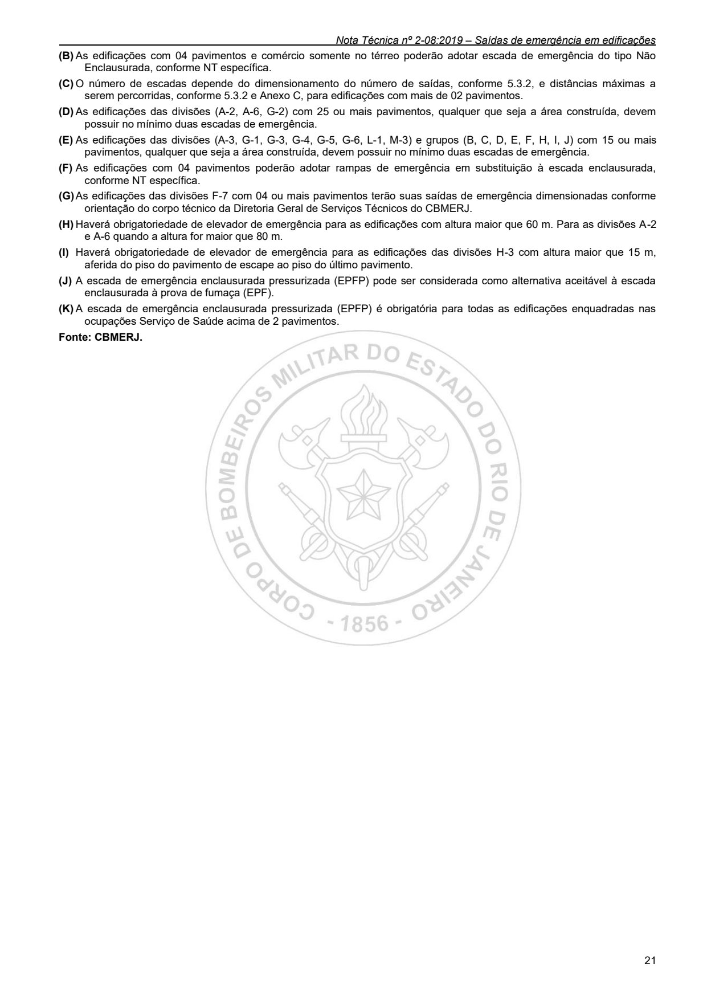

(B) As edificações com 04 pavimentos e comércio somente no térreo poderão adotar escada de emergência do tipo Não

Enclausurada, conforme NT específica. (C) O número de escadas depende do dimensionamento do número de saídas, conforme 5.3.2, e distâncias máximas a

serem percorridas, conforme 5.3.2 e Anexo C, para edificações com mais de 02 pavimentos. (D) As edificações das divisões (A-2, A-6, G-2) com 25 ou mais pavimentos, qualquer que seja a área construída, devem

possuir no mínimo duas escadas de emergência. (E) As edificações das divisões (A-3, G-1, G-3, G-4, G-5, G-6, L-1, M-3) e grupos (B, C, D, E, F, H, I, J) com 15 ou mais

pavimentos, qualquer que seja a área construída, devem possuir no mínimo duas escadas de emergência. (F) As edificações com 04 pavimentos poderão adotar rampas de emergência em substituição à escada enclausurada,

conforme NT específica. (G) As edificações das divisões F-7 com 04 ou mais pavimentos terão suas saídas de emergência dimensionadas conforme

orientação do corpo técnico da Diretoria Geral de Serviços Técnicos do CBMERJ. (H) Haverá obrigatoriedade de elevador de emergência para as edificações com altura maior que 60 m. Para as divisões A-2

e A-6 quando a altura for maior que 80 m. (I) Haverá obrigatoriedade de elevador de emergência para as edificações das divisões H-3 com altura maior que 15 m,

aferida do piso do pavimento de escape ao piso do último pavimento. (J) A escada de emergência enclausurada pressurizada (EPFP) pode ser considerada como alternativa aceitável à escada

enclausurada à prova de fumaça (EPF). (K) A escada de emergência enclausurada pressurizada (EPFP) é obrigatória para todas as edificações enquadradas nas

ocupações Serviço de Saúde acima de 2 pavimentos. Fonte: CBMERJ.

---

## Página 22

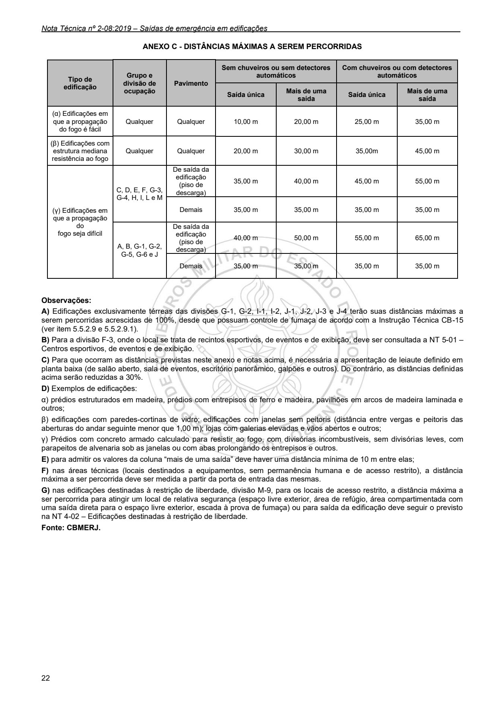

### ANEXO C - DISTÂNCIAS MÁXIMAS A SEREM PERCORRIDAS

Observações: A) Edificações exclusivamente térreas das divisões G-1, G-2, I-1, I-2, J-1, J-2, J-3 e J-4 terão suas distâncias máximas a serem percorridas acrescidas de 100%, desde que possuam controle de fumaça de acordo com a Instrução Técnica CB-15 (ver item 5.5.2.9 e 5.5.2.9.1). B) Para a divisão F-3, onde o local se trata de recintos esportivos, de eventos e de exibição, deve ser consultada a NT 5-01 - Centros esportivos, de eventos e de exibição. C) Para que ocorram as distâncias previstas neste anexo e notas acima, é necessária a apresentação de leiaute definido em planta baixa (de salão aberto, sala de eventos, escritório panorâmico, galpões e outros). Do contrário, as distâncias definidas acima serão reduzidas a 30%. D) Exemplos de edificações: α) prédios estruturados em madeira, prédios com entrepisos de ferro e madeira, pavilhões em arcos de madeira laminada e outros; β) edificações com paredes-cortinas de vidro; edificações com janelas sem peitoris (distância entre vergas e peitoris das aberturas do andar seguinte menor que 1,00 m); lojas com galerias elevadas e vãos abertos e outros; γ) Prédios com concreto armado calculado para resistir ao fogo, com divisórias incombustíveis, sem divisórias leves, com parapeitos de alvenaria sob as janelas ou com abas prolongando os entrepisos e outros. E) para admitir os valores da coluna “mais de uma saída” deve haver uma distância mínima de 10 m entre elas; F) nas áreas técnicas (locais destinados a equipamentos, sem permanência humana e de acesso restrito), a distância máxima a ser percorrida deve ser medida a partir da porta de entrada das mesmas. G) nas edificações destinadas à restrição de liberdade, divisão M-9, para os locais de acesso restrito, a distância máxima a ser percorrida para atingir um local de relativa segurança (espaço livre exterior, área de refúgio, área compartimentada com uma saída direta para o espaço livre exterior, escada à prova de fumaça) ou para saída da edificação deve seguir o previsto na NT 4-02 - Edificações destinadas à restrição de liberdade. Fonte: CBMERJ.

### Tabelas extraídas (bruto, não usar para citação)
#### Tabela 1 da página

| Tipo de edificação | Grupo e divisão de ocupação | Pavimento | Sem chuveiros ou sem detectores automáticos |  | Com chuveiros ou com detectores automáticos |  |
| --- | --- | --- | --- | --- | --- | --- |
|  |  |  | Saída única | Mais de uma saída | Saída única | Mais de uma saída |
| (α) Edificaçoẽ s em que a propagação do fogo é fácil | Qualquer | Qualquer | 10,00 m | 20,00 m | 25,00 m | 35,00 m |
| (β) Edificaçoẽ s com estrutura mediana resistência ao fogo | Qualquer | Qualquer | 20,00 m | 30,00 m | 35,00m | 45,00 m |
| (γ) Edificaçoẽ s em que a propagação do fogo seja difícil | C, D, E, F, G-3, G-4, H, I, L e M | De saída da edificação (piso de descarga) | 35,00 m | 40,00 m | 45,00 m | 55,00 m |
|  |  | Demais | 35,00 m | 35,00 m | 35,00 m | 35,00 m |
|  | A, B, G-1, G-2, G-5, G-6 e J | De saída da edificação (piso de descarga) | 40,00 m | 50,00 m | 55,00 m | 65,00 m |
|  |  | Demais | 35,00 m | 35,00 m | 35,00 m | 35,00 m |
<!-- tabela-conferida: Tabela do Anexo C p22 -->
### Tabela do Anexo C — Distâncias máximas a serem percorridas (conferida)

| Tipo de edificação | Grupo e divisão de ocupação | Pavimento | Sem chuveiros ou sem detectores automáticos — Saída única | Sem chuveiros ou sem detectores automáticos — Mais de uma saída | Com chuveiros ou com detectores automáticos — Saída única | Com chuveiros ou com detectores automáticos — Mais de uma saída |
| --- | --- | --- | --- | --- | --- | --- |
| (α) Edificações em que a propagação do fogo é fácil | Qualquer | Qualquer | 10,00 m | 20,00 m | 25,00 m | 35,00 m |
| (β) Edificações com estrutura mediana resistência ao fogo | Qualquer | Qualquer | 20,00 m | 30,00 m | 35,00m | 45,00 m |
| (γ) Edificações em que a propagação do fogo seja difícil | C, D, E, F, G-3, G-4, H, I, L e M | De saída da edificação (piso de descarga) | 35,00 m | 40,00 m | 45,00 m | 55,00 m |
| (γ) Edificações em que a propagação do fogo seja difícil | C, D, E, F, G-3, G-4, H, I, L e M | Demais | 35,00 m | 35,00 m | 35,00 m | 35,00 m |
| (γ) Edificações em que a propagação do fogo seja difícil | A, B, G-1, G-2, G-5, G-6 e J | De saída da edificação (piso de descarga) | 40,00 m | 50,00 m | 55,00 m | 65,00 m |
| (γ) Edificações em que a propagação do fogo seja difícil | A, B, G-1, G-2, G-5, G-6 e J | Demais | 35,00 m | 35,00 m | 35,00 m | 35,00 m |

Fonte: NT 2-08, página 22, Tabela do Anexo C; conferida em 2026-09-29 (visual + geometrica).
Fonte: CBMERJ.
Células mescladas: "(γ) …" abrange as 4 últimas linhas; cada grupo de ocupação γ abrange 2 linhas (piso de descarga e demais). Na publicação, as linhas "Demais" herdam o tipo e o grupo da linha de cima.
Confere com normative/base/distancias-saida.yaml (24 limites; linhas α, β, γ×2×2), que o motor usa. Observações A–G: ver o texto da página 22.
Na imagem: "35,00m" sem espaço na linha β (igual ao texto convertido); "Edificações" está correto no PDF — "Edificaçoẽ s" é erro da conversão.
<!-- /tabela-conferida: Tabela do Anexo C p22 -->

