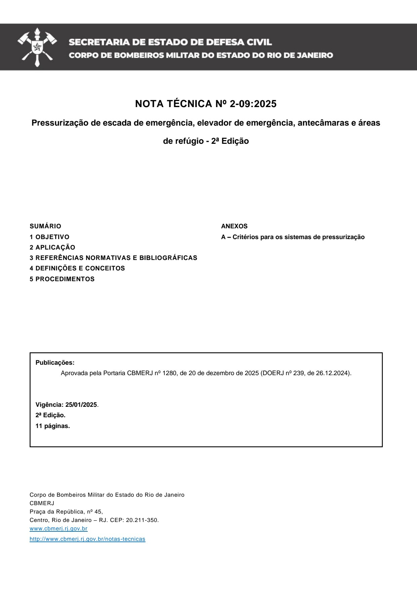
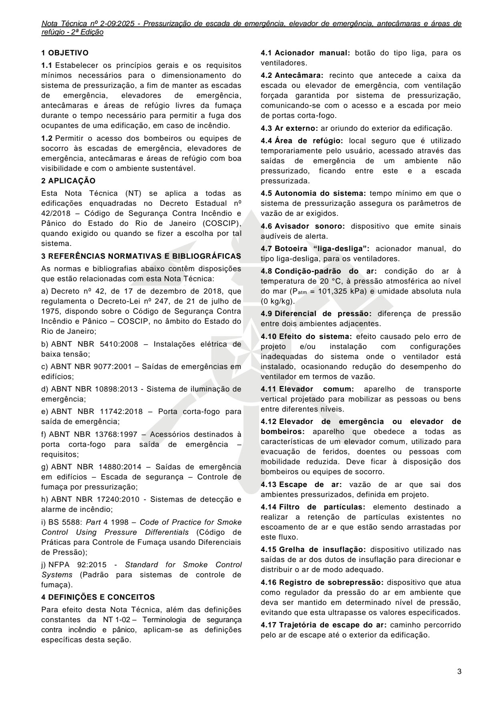
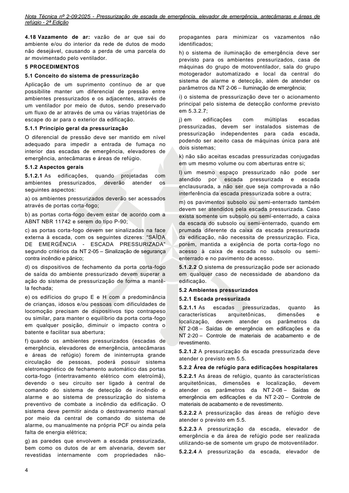
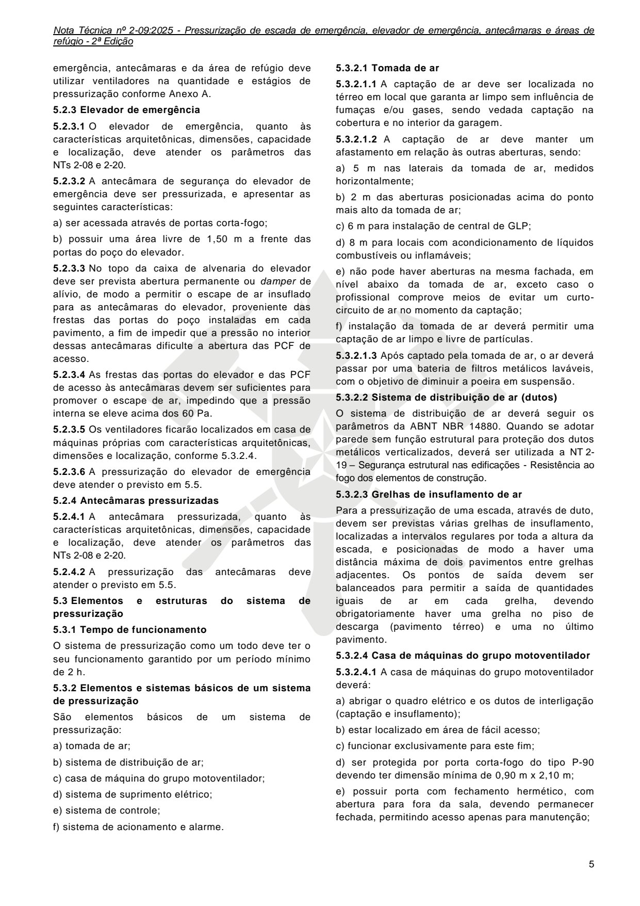
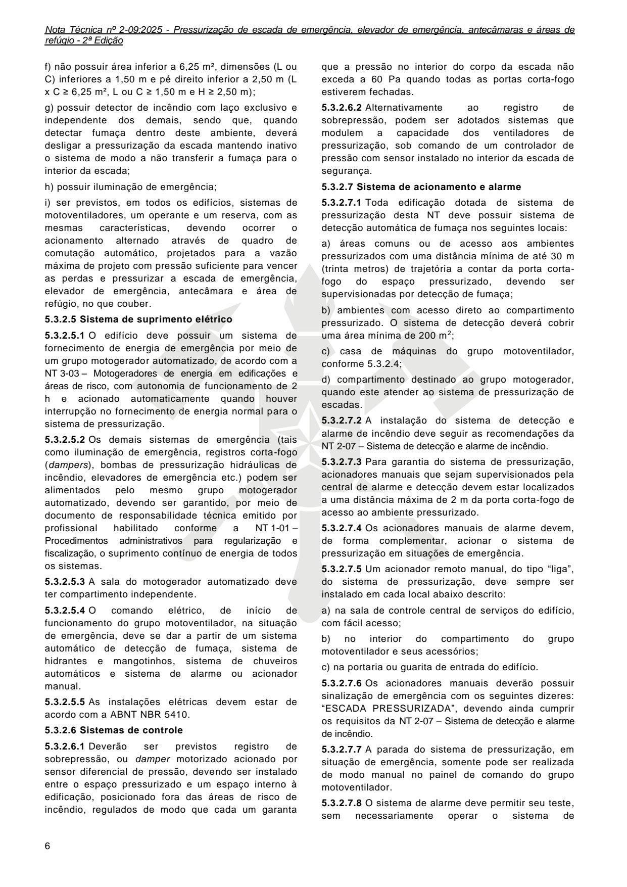
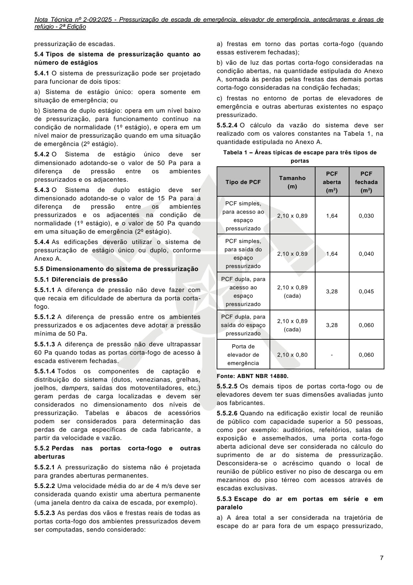
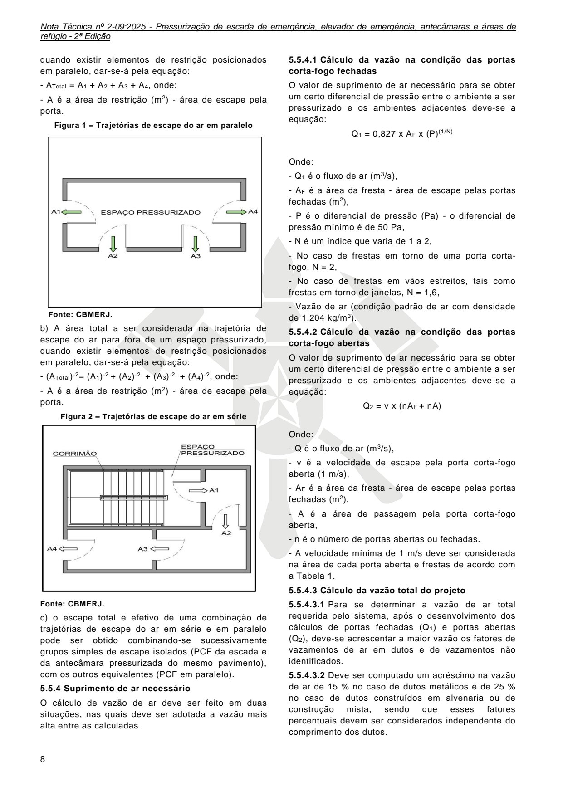
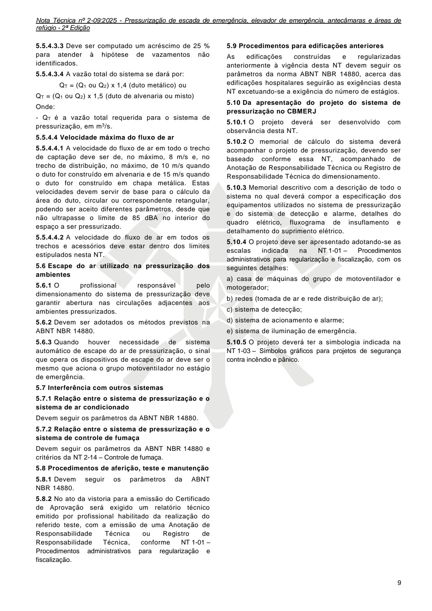
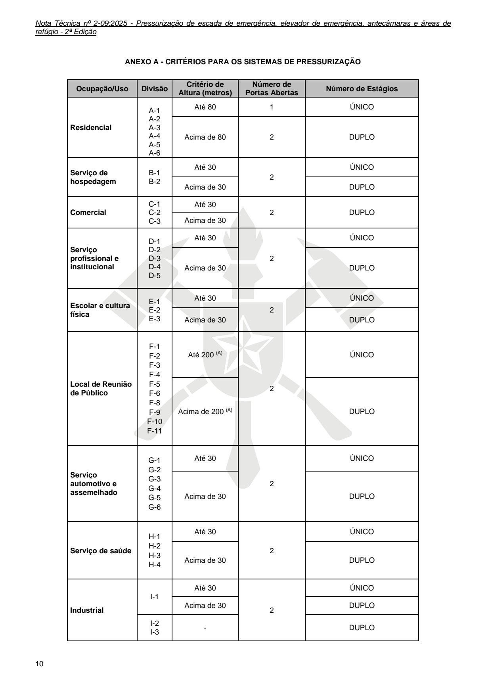
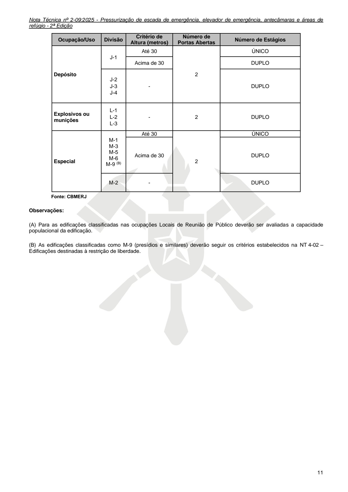

# NT 2-09 - Pressurização de escada de emergência, elevador de emergência, antecâmaras e áreas de refúgio

> Conversão integral para consulta computacional. A numeração de página do PDF foi preservada. Quando houver tabela complexa, símbolo ou desenho, conferir também a representação visual indicada e o PDF oficial.

## Sumário por página

- [Página 1](#pagina-1)
- [Página 2](#pagina-2)
- [Página 3](#pagina-3)
- [Página 4](#pagina-4)
- [Página 5](#pagina-5)
- [Página 6](#pagina-6)
- [Página 7](#pagina-7)
- [Página 8](#pagina-8)
- [Página 9](#pagina-9)
- [Página 10](#pagina-10)
- [Página 11](#pagina-11)

---

## Página 1

### NT 2-09

### N O T A T É C N I C A 2 - 0 9

P r e s s u r i z a ç ã o d e e s c a d a d e e m e r g ê n c i a,

e l e v a d o r d e e m e r g ê n c i a, a n t e c â m a r a s e á r e a s

d e r e f ú g i o

2 0 2 5

---

## Página 2

NOTA TÉCNICA Nº 2-09:2025

Pressurização de escada de emergência, elevador de emergência, antecâmaras e áreas

de refúgio - 2ª Edição

Aprovada pela Portaria CBMERJ nº 1280, de 20 de dezembro de 2025 (DOERJ nº 239, de 26.12.2024).

Publicada no Boletim da SEDEC/CBMERJ nº XX, de XX de XX de 2023.

### SUMÁRIO

### 1 OBJETIVO

### 2 APLICAÇÃO

### 3 REFERÊNCIAS NORMATIVAS E BIBLIOGRÁFICAS

### 4 DEFINIÇÕES E CONCEITOS

### 5 PROCEDIMENTOS

Publicações:

Vigência: 25/01/2025.

2ª Edição.

11 páginas.

Corpo de Bombeiros Militar do Estado do Rio de Janeiro CBMERJ Praça da República, nº 45, Centro, Rio de Janeiro - RJ. CEP: 20.211-350. www.cbmerj.rj.gov.br

http://www.cbmerj.rj.gov.br/notas-tecnicas

### ANEXOS

A - Critérios para os sistemas de pressurização

---

## Página 3

### 1 OBJETIVO

1.1 Estabelecer os princípios gerais e os requisitos mínimos necessários para o dimensionamento do sistema de pressurização, a fim de manter as escadas de emergência, elevadores de emergência, antecâmaras e áreas de refúgio livres da fumaça durante o tempo necessário para permitir a fuga dos ocupantes de uma edificação, em caso de incêndio.

1.2 Permitir o acesso dos bombeiros ou equipes de socorro às escadas de emergência, elevadores de emergência, antecâmaras e áreas de refúgio com boa visibilidade e com o ambiente sustentável.

### 2 APLICAÇÃO

Esta Nota Técnica (NT) se aplica a todas as edificações enquadradas no Decreto Estadual nº 42/2018 - Código de Segurança Contra Incêndio e Pânico do Estado do Rio de Janeiro (COSCIP), quando exigido ou quando se fizer a escolha por tal sistema.

### 3 REFERÊNCIAS NORMATIVAS E BIBLIOGRÁFICAS

As normas e bibliografias abaixo contêm disposições que estão relacionadas com esta Nota Técnica:

a) Decreto nº 42, de 17 de dezembro de 2018, que regulamenta o Decreto-Lei nº 247, de 21 de julho de 1975, dispondo sobre o Código de Segurança Contra Incêndio e Pânico - COSCIP, no âmbito do Estado do Rio de Janeiro;

b) ABNT NBR 5410:2008 - Instalações elétrica de baixa tensão;

c) ABNT NBR 9077:2001 - Saídas de emergências em edifícios;

d) ABNT NBR 10898:2013 - Sistema de iluminação de emergência;

e) ABNT NBR 11742:2018 - Porta corta-fogo para saída de emergência;

f) ABNT NBR 13768:1997 - Acessórios destinados à porta corta-fogo para saída de emergência - requisitos;

g) ABNT NBR 14880:2014 - Saídas de emergência em edifícios - Escada de segurança - Controle de fumaça por pressurização;

h) ABNT NBR 17240:2010 - Sistemas de detecção e alarme de incêndio;

i) BS 5588: Part 4 1998 - Code of Practice for Smoke Control Using Pressure Differentials (Código de Práticas para Controle de Fumaça usando Diferenciais de Pressão);

j) NFPA 92:2015 - Standard for Smoke Control Systems (Padrão para sistemas de controle de fumaça).

### 4 DEFINIÇÕES E CONCEITOS

Para efeito desta Nota Técnica, além das definições constantes da NT 1-02 - Terminologia de segurança contra incêndio e pânico, aplicam-se as definições específicas desta seção.

4.1 Acionador manual: botão do tipo liga, para os ventiladores.

4.2 Antecâmara: recinto que antecede a caixa da escada ou elevador de emergência, com ventilação forçada garantida por sistema de pressurização, comunicando-se com o acesso e a escada por meio de portas corta-fogo.

4.3 Ar externo: ar oriundo do exterior da edificação.

4.4 Área de refúgio: local seguro que é utilizado temporariamente pelo usuário, acessado através das saídas de emergência de um ambiente não pressurizado, ficando entre este e a escada pressurizada.

4.5 Autonomia do sistema: tempo mínimo em que o sistema de pressurização assegura os parâmetros de vazão de ar exigidos.

4.6 Avisador sonoro: dispositivo que emite sinais audíveis de alerta.

4.7 Botoeira “liga-desliga”: acionador manual, do tipo liga-desliga, para os ventiladores.

4.8 Condição-padrão do ar: condição do ar à temperatura de 20 °C, à pressão atmosférica ao nível do mar (Patm = 101,325 kPa) e umidade absoluta nula (0 kg/kg).

4.9 Diferencial de pressão: diferença de pressão entre dois ambientes adjacentes.

4.10 Efeito do sistema: efeito causado pelo erro de projeto e/ou instalação com configurações inadequadas do sistema onde o ventilador está instalado, ocasionando redução do desempenho do ventilador em termos de vazão.

4.11 Elevador comum: aparelho de transporte vertical projetado para mobilizar as pessoas ou bens entre diferentes níveis.

4.12 Elevador de emergência ou elevador de bombeiros: aparelho que obedece a todas as características de um elevador comum, utilizado para evacuação de feridos, doentes ou pessoas com mobilidade reduzida. Deve ficar à disposição dos bombeiros ou equipes de socorro.

4.13 Escape de ar: vazão de ar que sai dos ambientes pressurizados, definida em projeto.

4.14 Filtro de partículas: elemento destinado a realizar a retenção de partículas existentes no escoamento de ar e que estão sendo arrastadas por este fluxo.

4.15 Grelha de insuflação: dispositivo utilizado nas saídas de ar dos dutos de insuflação para direcionar e distribuir o ar de modo adequado.

4.16 Registro de sobrepressão: dispositivo que atua como regulador da pressão do ar em ambiente que deva ser mantido em determinado nível de pressão, evitando que esta ultrapasse os valores especificados.

4.17 Trajetória de escape do ar: caminho percorrido pelo ar de escape até o exterior da edificação.

---

## Página 4

4.18 Vazamento de ar: vazão de ar que sai do ambiente e/ou do interior da rede de dutos de modo não desejável, causando a perda de uma parcela do ar movimentado pelo ventilador.

### 5 PROCEDIMENTOS

5.1 Conceito do sistema de pressurização

Aplicação de um suprimento contínuo de ar que possibilite manter um diferencial de pressão entre ambientes pressurizados e os adjacentes, através de um ventilador por meio de dutos, sendo preservado um fluxo de ar através de uma ou várias trajetórias de escape do ar para o exterior da edificação.

5.1.1 Princípio geral da pressurização

O diferencial de pressão deve ser mantido em nível adequado para impedir a entrada de fumaça no interior das escadas de emergência, elevadores de emergência, antecâmaras e áreas de refúgio.

5.1.2 Aspectos gerais

5.1.2.1 As edificações, quando projetadas com ambientes pressurizados, deverão atender os seguintes aspectos:

a) os ambientes pressurizados deverão ser acessados através de portas corta-fogo;

b) as portas corta-fogo devem estar de acordo com a ABNT NBR 11742 e serem do tipo P-90;

c) as portas corta-fogo devem ser sinalizadas na face externa à escada, com os seguintes dizeres: “SAÍDA DE EMERGÊNCIA - ESCADA PRESSURIZADA” segundo critérios da NT 2-05 - Sinalização de segurança contra incêndio e pânico;

d) os dispositivos de fechamento da porta corta-fogo de saída do ambiente pressurizado devem superar a ação do sistema de pressurização de forma a mantêla fechada;

f) quando os ambientes pressurizados (escadas de emergência, elevadores de emergência, antecâmaras e áreas de refúgio) forem de ininterrupta grande circulação de pessoas, poderá possuir sistema eletromagnético de fechamento automático das portas corta-fogo (intertravamento elétrico com eletroímã), devendo o seu circuito ser ligado à central de comando do sistema de detecção de incêndio e alarme e ao sistema de pressurização do sistema preventivo de combate a incêndio da edificação. O sistema deve permitir ainda o destravamento manual por meio da central de comando do sistema de alarme, ou manualmente na própria PCF ou ainda pela falta de energia elétrica;

g) as paredes que envolvem a escada pressurizada, bem como os dutos de ar em alvenaria, devem ser revestidas internamente com propriedades não-

propagantes para minimizar os vazamentos não identificados;

h) o sistema de iluminação de emergência deve ser previsto para os ambientes pressurizados, casa de máquinas do grupo de motoventilador, sala do grupo motogerador automatizado e local da central do sistema de alarme e detecção, além de atender os parâmetros da NT 2-06 - Iluminação de emergência;

i) o sistema de pressurização deve ter o acionamento principal pelo sistema de detecção conforme previsto em 5.3.2.7;

j) em edificações com múltiplas escadas pressurizadas, devem ser instalados sistemas de pressurização independentes para cada escada, podendo ser aceito casa de máquinas única para até dois sistemas;

k) não são aceitas escadas pressurizadas conjugadas em um mesmo volume ou com aberturas entre si;

l) um mesmo espaço pressurizado não pode ser atendido por escada pressurizada e escada enclausurada, a não ser que seja comprovada a não interferência da escada pressurizada sobre a outra;

m) os pavimentos subsolo ou semi-enterrado também devem ser atendidos pela escada pressurizada. Caso exista somente um subsolo ou semi-enterrado, a caixa da escada do subsolo ou semi-enterrado, quando em prumada diferente da caixa da escada pressurizada da edificação, não necessita de pressurização. Fica, porém, mantida a exigência de porta corta-fogo no acesso à caixa de escada no subsolo ou semienterrado e no pavimento de acesso.

5.1.2.2 O sistema de pressurização pode ser acionado em qualquer caso de necessidade de abandono da edificação.

5.2 Ambientes pressurizados

5.2.1 Escada pressurizada

5.2.1.1 As escadas pressurizadas, quanto às características arquitetônicas, dimensões e localização, devem atender os parâmetros da NT 2-08 - Saídas de emergência em edificações e da NT 2-20 - Controle de materiais de acabamento e de revestimento.

5.2.1.2 A pressurização da escada pressurizada deve atender o previsto em 5.5.

5.2.2 Área de refúgio para edificações hospitalares

5.2.2.1 As áreas de refúgio, quanto às características arquitetônicas, dimensões e localização, devem atender os parâmetros da NT 2-08 - Saídas de emergência em edificações e da NT 2-20 - Controle de materiais de acabamento e de revestimento.

5.2.2.2 A pressurização das áreas de refúgio deve atender o previsto em 5.5.

5.2.2.3 A pressurização da escada, elevador de emergência e da área de refúgio pode ser realizada utilizando-se de somente um grupo de motoventilador.

5.2.2.4 A pressurização da escada, elevador de

### Tabelas extraídas (bruto, não usar para citação)
#### Tabela 1 da página

| ou similar, para | manter o equilíbrio da porta corta-fogo |  |
| --- | --- | --- |
| em qualquer posição, diminuir o impacto contra o |  |  |
| batente e facilitar sua abertura |  | ; |

#### Tabela 2 da página

| circulação de pessoas, |  | poderá possuir sistema |
| --- | --- | --- |
| eletromagnético de fechamento automático das portas |  |  |
| corta-fogo | (intertravamento elétrico com eletroímã), |  |

---

## Página 5

emergência, antecâmaras e da área de refúgio deve utilizar ventiladores na quantidade e estágios de pressurização conforme Anexo A.

5.2.3 Elevador de emergência

5.2.3.1 O elevador de emergência, quanto às características arquitetônicas, dimensões, capacidade e localização, deve atender os parâmetros das NTs 2-08 e 2-20.

5.2.3.2 A antecâmara de segurança do elevador de emergência deve ser pressurizada, e apresentar as seguintes características:

a) ser acessada através de portas corta-fogo;

b) possuir uma área livre de 1,50 m a frente das portas do poço do elevador.

5.2.3.3 No topo da caixa de alvenaria do elevador deve ser prevista abertura permanente ou damper de alívio, de modo a permitir o escape de ar insuflado para as antecâmaras do elevador, proveniente das frestas das portas do poço instaladas em cada pavimento, a fim de impedir que a pressão no interior dessas antecâmaras dificulte a abertura das PCF de acesso.

5.2.3.4 As frestas das portas do elevador e das PCF de acesso às antecâmaras devem ser suficientes para promover o escape de ar, impedindo que a pressão interna se eleve acima dos 60 Pa.

5.2.3.5 Os ventiladores ficarão localizados em casa de máquinas próprias com características arquitetônicas, dimensões e localização, conforme 5.3.2.4.

5.2.3.6 A pressurização do elevador de emergência deve atender o previsto em 5.5.

5.2.4 Antecâmaras pressurizadas

5.2.4.1 A antecâmara pressurizada, quanto às características arquitetônicas, dimensões, capacidade e localização, deve atender os parâmetros das NTs 2-08 e 2-20.

5.2.4.2 A pressurização das antecâmaras deve atender o previsto em 5.5.

5.3 Elementos e estruturas do sistema de pressurização

5.3.1 Tempo de funcionamento

O sistema de pressurização como um todo deve ter o seu funcionamento garantido por um período mínimo de 2 h.

5.3.2 Elementos e sistemas básicos de um sistema de pressurização

São elementos básicos de um sistema de pressurização:

a) tomada de ar;

b) sistema de distribuição de ar;

c) casa de máquina do grupo motoventilador;

d) sistema de suprimento elétrico;

e) sistema de controle;

f) sistema de acionamento e alarme.

5.3.2.1 Tomada de ar

5.3.2.1.1 A captação de ar deve ser localizada no térreo em local que garanta ar limpo sem influência de fumaças e/ou gases, sendo vedada captação na cobertura e no interior da garagem.

5.3.2.1.2 A captação de ar deve manter um afastamento em relação às outras aberturas, sendo:

a) 5 m nas laterais da tomada de ar, medidos horizontalmente;

b) 2 m das aberturas posicionadas acima do ponto mais alto da tomada de ar;

c) 6 m para instalação de central de GLP;

d) 8 m para locais com acondicionamento de líquidos combustíveis ou inflamáveis;

e) não pode haver aberturas na mesma fachada, em nível abaixo da tomada de ar, exceto caso o profissional comprove meios de evitar um curtocircuito de ar no momento da captação;

f) instalação da tomada de ar deverá permitir uma captação de ar limpo e livre de partículas.

5.3.2.1.3 Após captado pela tomada de ar, o ar deverá passar por uma bateria de filtros metálicos laváveis, com o objetivo de diminuir a poeira em suspensão.

5.3.2.2 Sistema de distribuição de ar (dutos)

O sistema de distribuição de ar deverá seguir os parâmetros da ABNT NBR 14880. Quando se adotar parede sem função estrutural para proteção dos dutos metálicos verticalizados, deverá ser utilizada a NT 2- 19 - Segurança estrutural nas edificações - Resistência ao fogo dos elementos de construção.

5.3.2.3 Grelhas de insuflamento de ar

Para a pressurização de uma escada, através de duto, devem ser previstas várias grelhas de insuflamento, localizadas a intervalos regulares por toda a altura da escada, e posicionadas de modo a haver uma distância máxima de dois pavimentos entre grelhas adjacentes. Os pontos de saída devem ser balanceados para permitir a saída de quantidades iguais de ar em cada grelha, devendo obrigatoriamente haver uma grelha no piso de descarga (pavimento térreo) e uma no último pavimento.

5.3.2.4 Casa de máquinas do grupo motoventilador

5.3.2.4.1 A casa de máquinas do grupo motoventilador deverá:

a) abrigar o quadro elétrico e os dutos de interligação (captação e insuflamento);

b) estar localizado em área de fácil acesso;

c) funcionar exclusivamente para este fim;

d) ser protegida por porta corta-fogo do tipo P-90 devendo ter dimensão mínima de 0,90 m x 2,10 m;

e) possuir porta com fechamento hermético, com abertura para fora da sala, devendo permanecer fechada, permitindo acesso apenas para manutenção;

---

## Página 6

f) não possuir área inferior a 6,25 m², dimensões (L ou C) inferiores a 1,50 m e pé direito inferior a 2,50 m (L x C ≥ 6,25 m², L ou C ≥ 1,50 m e H ≥ 2,50 m);

g) possuir detector de incêndio com laço exclusivo e independente dos demais, sendo que, quando detectar fumaça dentro deste ambiente, deverá desligar a pressurização da escada mantendo inativo o sistema de modo a não transferir a fumaça para o interior da escada;

h) possuir iluminação de emergência;

i) ser previstos, em todos os edifícios, sistemas de motoventiladores, um operante e um reserva, com as mesmas características, devendo ocorrer o acionamento alternado através de quadro de comutação automático, projetados para a vazão máxima de projeto com pressão suficiente para vencer as perdas e pressurizar a escada de emergência, elevador de emergência, antecâmara e área de refúgio, no que couber.

5.3.2.5 Sistema de suprimento elétrico

5.3.2.5.1 O edifício deve possuir um sistema de fornecimento de energia de emergência por meio de um grupo motogerador automatizado, de acordo com a NT 3-03 - Motogeradores de energia em edificações e áreas de risco, com autonomia de funcionamento de 2 h e acionado automaticamente quando houver interrupção no fornecimento de energia normal para o sistema de pressurização.

5.3.2.5.2 Os demais sistemas de emergência (tais como iluminação de emergência, registros corta-fogo (dampers), bombas de pressurização hidráulicas de incêndio, elevadores de emergência etc.) podem ser alimentados pelo mesmo grupo motogerador automatizado, devendo ser garantido, por meio de documento de responsabilidade técnica emitido por profissional habilitado conforme a NT 1-01 - Procedimentos administrativos para regularização e fiscalização, o suprimento contínuo de energia de todos os sistemas.

5.3.2.5.3 A sala do motogerador automatizado deve ter compartimento independente.

5.3.2.5.4 O comando elétrico, de início de funcionamento do grupo motoventilador, na situação de emergência, deve se dar a partir de um sistema automático de detecção de fumaça, sistema de hidrantes e mangotinhos, sistema de chuveiros automáticos e sistema de alarme ou acionador manual.

5.3.2.5.5 As instalações elétricas devem estar de acordo com a ABNT NBR 5410.

5.3.2.6 Sistemas de controle

5.3.2.6.1 Deverão ser previstos registro de sobrepressão, ou damper motorizado acionado por sensor diferencial de pressão, devendo ser instalado entre o espaço pressurizado e um espaço interno à edificação, posicionado fora das áreas de risco de incêndio, regulados de modo que cada um garanta

que a pressão no interior do corpo da escada não exceda a 60 Pa quando todas as portas corta-fogo estiverem fechadas.

5.3.2.6.2 Alternativamente ao registro de sobrepressão, podem ser adotados sistemas que modulem a capacidade dos ventiladores de pressurização, sob comando de um controlador de pressão com sensor instalado no interior da escada de segurança.

5.3.2.7 Sistema de acionamento e alarme

5.3.2.7.1 Toda edificação dotada de sistema de pressurização desta NT deve possuir sistema de detecção automática de fumaça nos seguintes locais:

a) áreas comuns ou de acesso aos ambientes pressurizados com uma distância mínima de até 30 m (trinta metros) de trajetória a contar da porta cortafogo do espaço pressurizado, devendo ser supervisionadas por detecção de fumaça;

b) ambientes com acesso direto ao compartimento pressurizado. O sistema de detecção deverá cobrir uma área mínima de 200 m2;

c) casa de máquinas do grupo motoventilador, conforme 5.3.2.4;

d) compartimento destinado ao grupo motogerador, quando este atender ao sistema de pressurização de escadas.

5.3.2.7.2 A instalação do sistema de detecção e alarme de incêndio deve seguir as recomendações da NT 2-07 - Sistema de detecção e alarme de incêndio.

5.3.2.7.4 Os acionadores manuais de alarme devem, de forma complementar, acionar o sistema de pressurização em situações de emergência.

5.3.2.7.5 Um acionador remoto manual, do tipo “liga”, do sistema de pressurização, deve sempre ser instalado em cada local abaixo descrito:

a) na sala de controle central de serviços do edifício, com fácil acesso;

b) no interior do compartimento do grupo motoventilador e seus acessórios;

c) na portaria ou guarita de entrada do edifício.

5.3.2.7.6 Os acionadores manuais deverão possuir sinalização de emergência com os seguintes dizeres: “ESCADA PRESSURIZADA”, devendo ainda cumprir os requisitos da NT 2-07 - Sistema de detecção e alarme de incêndio.

5.3.2.7.7 A parada do sistema de pressurização, em situação de emergência, somente pode ser realizada de modo manual no painel de comando do grupo motoventilador.

5.3.2.7.8 O sistema de alarme deve permitir seu teste, sem necessariamente operar o sistema de

### Tabelas extraídas (bruto, não usar para citação)
#### Tabela 1 da página

| central de alarme e detecção | devem estar localizados |  |
| --- | --- | --- |
| a uma distância máxima de 2 m da porta corta-fogo de |  |  |
| acesso ao ambiente pressurizado. |  |  |

---

## Página 7

pressurização de escadas.

5.4 Tipos de sistema de pressurização quanto ao número de estágios

5.4.1 O sistema de pressurização pode ser projetado para funcionar de dois tipos:

a) Sistema de estágio único: opera somente em situação de emergência; ou

b) Sistema de duplo estágio: opera em um nível baixo de pressurização, para funcionamento contínuo na condição de normalidade (1º estágio), e opera em um nível maior de pressurização quando em uma situação de emergência (2º estágio).

5.4.2 O Sistema de estágio único deve ser dimensionado adotando-se o valor de 50 Pa para a diferença de pressão entre os ambientes pressurizados e os adjacentes.

5.4.3 O Sistema de duplo estágio deve ser dimensionado adotando-se o valor de 15 Pa para a diferença de pressão entre os ambientes pressurizados e os adjacentes na condição de normalidade (1º estágio), e o valor de 50 Pa quando em uma situação de emergência (2º estágio).

5.4.4 As edificações deverão utilizar o sistema de pressurização de estágio único ou duplo, conforme Anexo A.

5.5 Dimensionamento do sistema de pressurização

5.5.1 Diferenciais de pressão

5.5.1.1 A diferença de pressão não deve fazer com que recaia em dificuldade de abertura da porta cortafogo.

5.5.1.2 A diferença de pressão entre os ambientes pressurizados e os adjacentes deve adotar a pressão mínima de 50 Pa.

5.5.1.3 A diferença de pressão não deve ultrapassar 60 Pa quando todas as portas corta-fogo de acesso à escada estiverem fechadas.

5.5.1.4 Todos os componentes de captação e distribuição do sistema (dutos, venezianas, grelhas, joelhos, dampers, saídas dos motoventiladores, etc.) geram perdas de carga localizadas e devem ser considerados no dimensionamento dos níveis de pressurização. Tabelas e ábacos de acessórios podem ser considerados para determinação das perdas de carga específicas de cada fabricante, a partir da velocidade e vazão.

5.5.2 Perdas nas portas corta-fogo e outras aberturas

5.5.2.1 A pressurização do sistema não é projetada para grandes aberturas permanentes.

5.5.2.2 Uma velocidade média do ar de 4 m/s deve ser considerada quando existir uma abertura permanente (uma janela dentro da caixa de escada, por exemplo).

5.5.2.3 As perdas dos vãos e frestas reais de todas as portas corta-fogo dos ambientes pressurizados devem ser computadas, sendo considerado:

a) frestas em torno das portas corta-fogo (quando essas estiverem fechadas);

b) vão de luz das portas corta-fogo consideradas na condição abertas, na quantidade estipulada do Anexo A, somada às perdas pelas frestas das demais portas corta-fogo consideradas na condição fechadas;

c) frestas no entorno de portas de elevadores de emergência e outras aberturas existentes no espaço pressurizado.

5.5.2.4 O cálculo da vazão do sistema deve ser realizado com os valores constantes na Tabela 1, na quantidade estipulada no Anexo A.

Tabela 1 - Áreas típicas de escape para três tipos de

portas

Fonte: ABNT NBR 14880.

5.5.2.5 Os demais tipos de portas corta-fogo ou de elevadores devem ter suas dimensões avaliadas junto aos fabricantes.

5.5.2.6 Quando na edificação existir local de reunião de público com capacidade superior a 50 pessoas, como por exemplo: auditórios, refeitórios, salas de exposição e assemelhados, uma porta corta-fogo aberta adicional deve ser considerada no cálculo do suprimento de ar do sistema de pressurização. Desconsidera-se o acréscimo quando o local de reunião de público estiver no piso de descarga ou em mezaninos do piso térreo com acessos através de escadas exclusivas.

5.5.3 Escape do ar em portas em série e em paralelo

a) A área total a ser considerada na trajetória de escape do ar para fora de um espaço pressurizado,

### Tabelas extraídas (bruto, não usar para citação)
#### Tabela 1 da página

| Tipo de PCF | Tamanho (m) |  | PCF |  |  | PCF |  |
| --- | --- | --- | --- | --- | --- | --- | --- |
|  |  |  | aberta |  |  | fechada |  |
|  |  |  | (m2) |  |  | (m2) |  |
| PCF simples, para acesso ao espaço pressurizado | 2,10 x 0,89 | 1,64 |  |  | 0,030 |  |  |
| PCF simples, para saída do espaço pressurizado | 2,10 x 0,89 | 1,64 |  |  | 0,040 |  |  |
| PCF dupla, para acesso ao espaço pressurizado | 2,10 x 0,89 (cada) | 3,28 |  |  | 0,045 |  |  |
| PCF dupla, para saída do espaço pressurizado | 2,10 x 0,89 (cada) | 3,28 |  |  | 0,060 |  |  |
| Porta de elevador de emergência | 2,10 x 0,80 | - |  |  | 0,060 |  |  |

---

## Página 8

quando existir elementos de restrição posicionados em paralelo, dar-se-á pela equação:

- ATotal = A1 + A2 + A3 + A4, onde:

- A é a área de restrição (m2) - área de escape pela porta.

Figura 1 - Trajetórias de escape do ar em paralelo

Fonte: CBMERJ.

b) A área total a ser considerada na trajetória de escape do ar para fora de um espaço pressurizado, quando existir elementos de restrição posicionados em paralelo, dar-se-á pela equação:

- (ATotal)-2= (A1)-2 + (A2)-2 + (A3)-2 + (A4)-2, onde:

- A é a área de restrição (m2) - área de escape pela porta.

Figura 2 - Trajetórias de escape do ar em série

Fonte: CBMERJ.

c) o escape total e efetivo de uma combinação de trajetórias de escape do ar em série e em paralelo pode ser obtido combinando-se sucessivamente grupos simples de escape isolados (PCF da escada e da antecâmara pressurizada do mesmo pavimento), com os outros equivalentes (PCF em paralelo).

5.5.4 Suprimento de ar necessário

O cálculo de vazão de ar deve ser feito em duas situações, nas quais deve ser adotada a vazão mais alta entre as calculadas.

5.5.4.1 Cálculo da vazão na condição das portas corta-fogo fechadas

O valor de suprimento de ar necessário para se obter um certo diferencial de pressão entre o ambiente a ser pressurizado e os ambientes adjacentes deve-se a equação:

Q1 = 0,827 x AF x (P)(1/N)

Onde:

- Q1 é o fluxo de ar (m3/s),

- AF é a área da fresta - área de escape pelas portas fechadas (m2),

- P é o diferencial de pressão (Pa) - o diferencial de pressão mínimo é de 50 Pa,

- N é um índice que varia de 1 a 2,

- No caso de frestas em torno de uma porta cortafogo, N = 2,

- No caso de frestas em vãos estreitos, tais como frestas em torno de janelas, N = 1,6,

- Vazão de ar (condição padrão de ar com densidade de 1,204 kg/m3).

5.5.4.2 Cálculo da vazão na condição das portas corta-fogo abertas

O valor de suprimento de ar necessário para se obter um certo diferencial de pressão entre o ambiente a ser pressurizado e os ambientes adjacentes deve-se a equação:

Q2 = v x (nAF + nA)

Onde:

- Q é o fluxo de ar (m3/s),

- v é a velocidade de escape pela porta corta-fogo aberta (1 m/s),

- AF é a área da fresta - área de escape pelas portas fechadas (m2),

- A é a área de passagem pela porta corta-fogo aberta,

- n é o número de portas abertas ou fechadas.

- A velocidade mínima de 1 m/s deve ser considerada na área de cada porta aberta e frestas de acordo com a Tabela 1.

5.5.4.3 Cálculo da vazão total do projeto

5.5.4.3.1 Para se determinar a vazão de ar total requerida pelo sistema, após o desenvolvimento dos cálculos de portas fechadas (Q1) e portas abertas (Q2), deve-se acrescentar a maior vazão os fatores de vazamentos de ar em dutos e de vazamentos não identificados.

5.5.4.3.2 Deve ser computado um acréscimo na vazão de ar de 15 % no caso de dutos metálicos e de 25 % no caso de dutos construídos em alvenaria ou de construção mista, sendo que esses fatores percentuais devem ser considerados independente do comprimento dos dutos.

---

## Página 9

5.5.4.3.3 Deve ser computado um acréscimo de 25 % para atender à hipótese de vazamentos não identificados.

5.5.4.3.4 A vazão total do sistema se dará por:

QT = (Q1 ou Q2) x 1,4 (duto metálico) ou

QT = (Q1 ou Q2) x 1,5 (duto de alvenaria ou misto)

Onde:

- QT é a vazão total requerida para o sistema de pressurização, em m3/s.

5.5.4.4 Velocidade máxima do fluxo de ar

5.5.4.4.1 A velocidade do fluxo de ar em todo o trecho de captação deve ser de, no máximo, 8 m/s e, no trecho de distribuição, no máximo, de 10 m/s quando o duto for construído em alvenaria e de 15 m/s quando o duto for construído em chapa metálica. Estas velocidades devem servir de base para o cálculo da área do duto, circular ou correspondente retangular, podendo ser aceito diferentes parâmetros, desde que não ultrapasse o limite de 85 dBA no interior do espaço a ser pressurizado.

5.5.4.4.2 A velocidade do fluxo de ar em todos os trechos e acessórios deve estar dentro dos limites estipulados nesta NT.

5.6 Escape do ar utilizado na pressurização dos ambientes

5.6.1 O profissional responsável pelo dimensionamento do sistema de pressurização deve garantir abertura nas circulações adjacentes aos ambientes pressurizados.

5.6.2 Devem ser adotados os métodos previstos na ABNT NBR 14880.

5.6.3 Quando houver necessidade de sistema automático de escape do ar de pressurização, o sinal que opera os dispositivos de escape do ar deve ser o mesmo que aciona o grupo motoventilador no estágio de emergência.

5.7 Interferência com outros sistemas

5.7.1 Relação entre o sistema de pressurização e o sistema de ar condicionado

Devem seguir os parâmetros da ABNT NBR 14880.

5.7.2 Relação entre o sistema de pressurização e o sistema de controle de fumaça

Devem seguir os parâmetros da ABNT NBR 14880 e critérios da NT 2-14 - Controle de fumaça.

5.8 Procedimentos de aferição, teste e manutenção

5.8.1 Devem seguir os parâmetros da ABNT NBR 14880.

5.8.2 No ato da vistoria para a emissão do Certificado de Aprovação será exigido um relatório técnico emitido por profissional habilitado da realização do referido teste, com a emissão de uma Anotação de Responsabilidade Técnica ou Registro de Responsabilidade Técnica, conforme NT 1-01 - Procedimentos administrativos para regularização e fiscalização.

5.9 Procedimentos para edificações anteriores

As edificações construídas e regularizadas anteriormente à vigência desta NT devem seguir os parâmetros da norma ABNT NBR 14880, acerca das edificações hospitalares seguirão as exigências desta NT excetuando-se a exigência do número de estágios.

5.10 Da apresentação do projeto do sistema de pressurização no CBMERJ

5.10.1 O projeto deverá ser desenvolvido com observância desta NT.

5.10.2 O memorial de cálculo do sistema deverá acompanhar o projeto de pressurização, devendo ser baseado conforme essa NT, acompanhado de Anotação de Responsabilidade Técnica ou Registro de Responsabilidade Técnica do dimensionamento.

5.10.3 Memorial descritivo com a descrição de todo o sistema no qual deverá compor a especificação dos equipamentos utilizados no sistema de pressurização e do sistema de detecção e alarme, detalhes do quadro elétrico, fluxograma de insuflamento e detalhamento do suprimento elétrico.

5.10.4 O projeto deve ser apresentado adotando-se as escalas indicada na NT 1-01 - Procedimentos administrativos para regularização e fiscalização, com os seguintes detalhes:

a) casa de máquinas do grupo de motoventilador e motogerador;

b) redes (tomada de ar e rede distribuição de ar);

c) sistema de detecção;

d) sistema de acionamento e alarme;

e) sistema de iluminação de emergência.

5.10.5 O projeto deverá ter a simbologia indicada na NT 1-03 - Símbolos gráficos para projetos de segurança contra incêndio e pânico.

---

## Página 10

### ANEXO A - CRITÉRIOS PARA OS SISTEMAS DE PRESSURIZAÇÃO

### Tabelas extraídas (bruto, não usar para citação)
#### Tabela 1 da página

| Ocupação/Uso | Divisão |  | Critério de |  |  | Número de |  | Número de Estágios |
| --- | --- | --- | --- | --- | --- | --- | --- | --- |
|  |  |  | Altura (metros) |  |  | Portas Abertas |  |  |
| Residencial | A-1 A-2 A-3 A-4 A-5 A-6 | Até 80 |  |  | 1 |  |  | ÚNICO |
|  |  | Acima de 80 |  |  | 2 |  |  | DUPLO |
| Serviço de hospedagem | B-1 B-2 | Até 30 |  |  | 2 |  |  | ÚNICO |
|  |  | Acima de 30 |  |  |  |  |  | DUPLO |
| Comercial | C-1 C-2 C-3 | Até 30 |  |  | 2 |  |  | DUPLO |
|  |  | Acima de 30 |  |  |  |  |  |  |
| Serviço profissional e institucional | D-1 D-2 D-3 D-4 D-5 | Até 30 |  |  | 2 |  |  | ÚNICO |
|  |  | Acima de 30 |  |  |  |  |  | DUPLO |
| Escolar e cultura física | E-1 E-2 E-3 | Até 30 |  |  | 2 |  |  | ÚNICO |
|  |  | Acima de 30 |  |  |  |  |  | DUPLO |
| Local de Reunião de Público | F-1 F-2 F-3 F-4 F-5 F-6 F-8 F-9 F-10 F-11 | Até 200 (A) |  |  | 2 |  |  | ÚNICO |
|  |  | Acima de 200 (A) |  |  |  |  |  | DUPLO |
| Serviço automotivo e assemelhado | G-1 G-2 G-3 G-4 G-5 G-6 | Até 30 |  |  | 2 |  |  | ÚNICO |
|  |  | Acima de 30 |  |  |  |  |  | DUPLO |
| Serviço de saúde | H-1 H-2 H-3 H-4 | Até 30 |  |  | 2 |  |  | ÚNICO |
|  |  | Acima de 30 |  |  |  |  |  | DUPLO |
| Industrial | I-1 | Até 30 |  |  | 2 |  |  | ÚNICO |
|  |  | Acima de 30 |  |  |  |  |  | DUPLO |
|  | I-2 I-3 | - |  |  |  |  |  | DUPLO |

---

## Página 11

Fonte: CBMERJ

Observações:

(A) Para as edificações classificadas nas ocupações Locais de Reunião de Público deverão ser avaliadas a capacidade populacional da edificação.

(B) As edificações classificadas como M-9 (presídios e similares) deverão seguir os critérios estabelecidos na NT 4-02 - Edificações destinadas à restrição de liberdade.

### Tabelas extraídas (bruto, não usar para citação)
#### Tabela 1 da página

| Ocupação/Uso | Divisão |  | Critério de |  |  | Número de |  | Número de Estágios |
| --- | --- | --- | --- | --- | --- | --- | --- | --- |
|  |  |  | Altura (metros) |  |  | Portas Abertas |  |  |
| Depósito | J-1 | Até 30 |  |  | 2 |  |  | ÚNICO |
|  |  | Acima de 30 |  |  |  |  |  | DUPLO |
|  | J-2 J-3 J-4 | - |  |  |  |  |  | DUPLO |
| Explosivos ou munições | L-1 L-2 L-3 | - |  |  | 2 |  |  | DUPLO |
| Especial | M-1 M-3 M-5 M-6 M-9 (B) | Até 30 |  |  | 2 |  |  | ÚNICO |
|  |  | Acima de 30 |  |  |  |  |  | DUPLO |
|  | M-2 | - |  |  |  |  |  | DUPLO |
