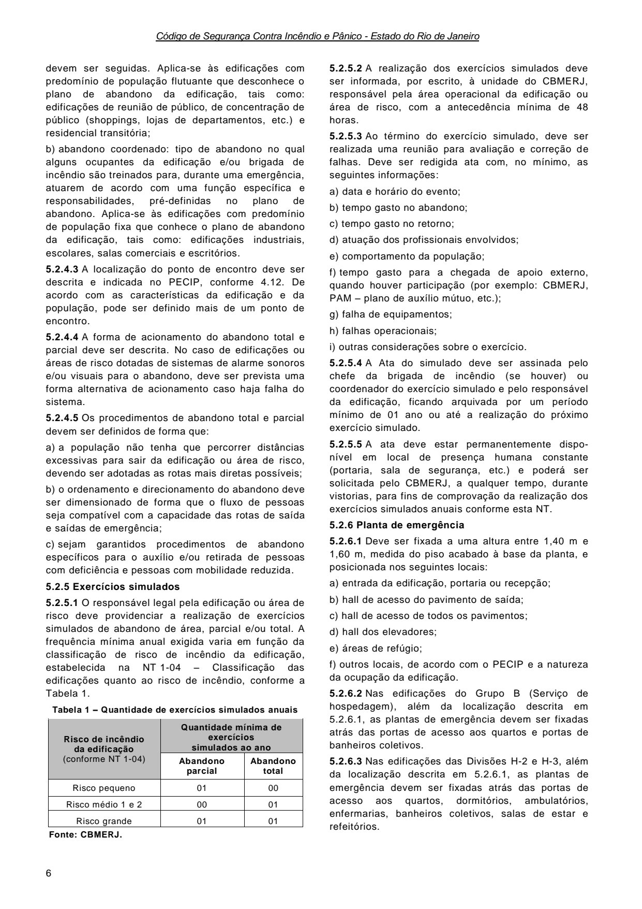
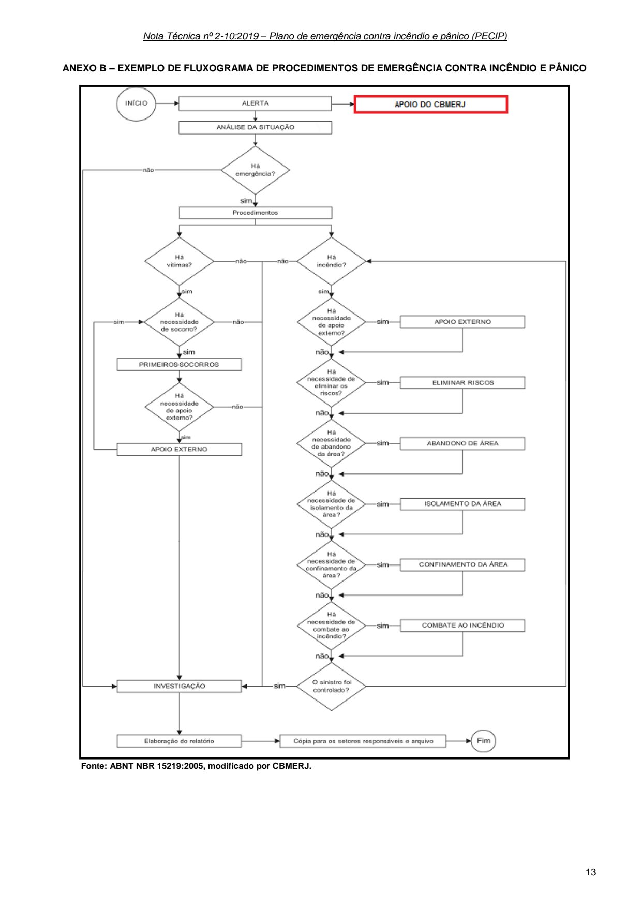
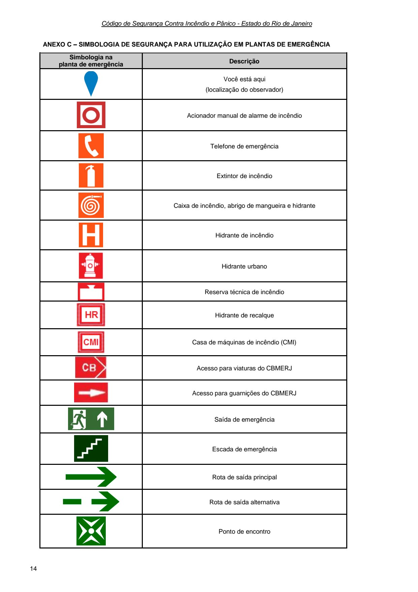
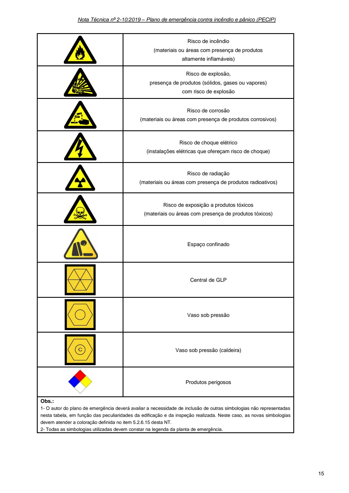
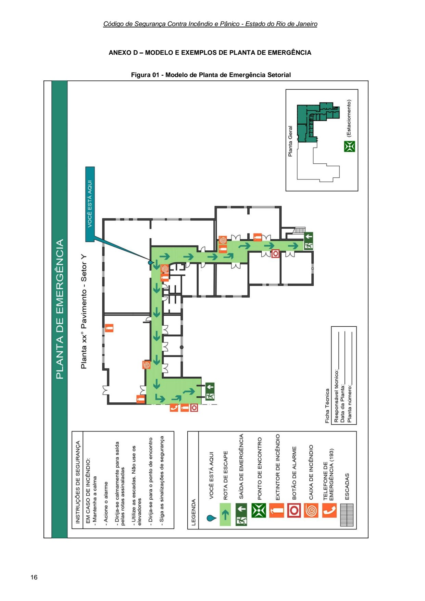
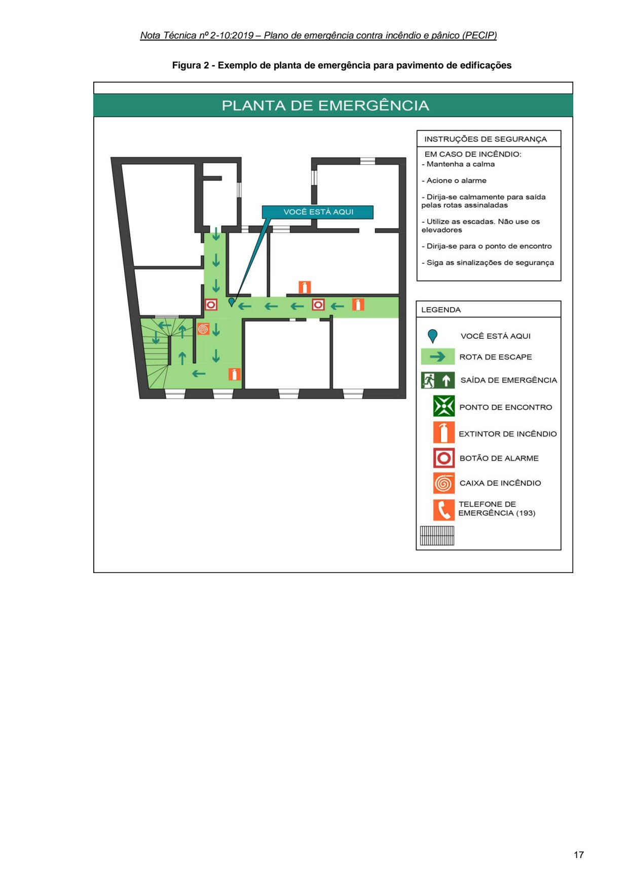
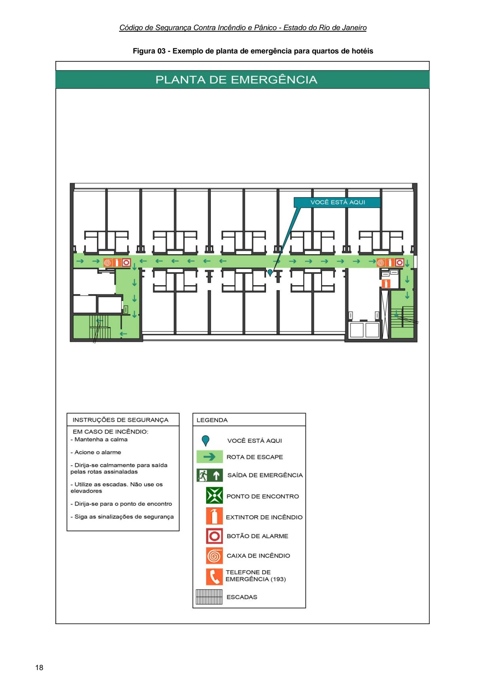
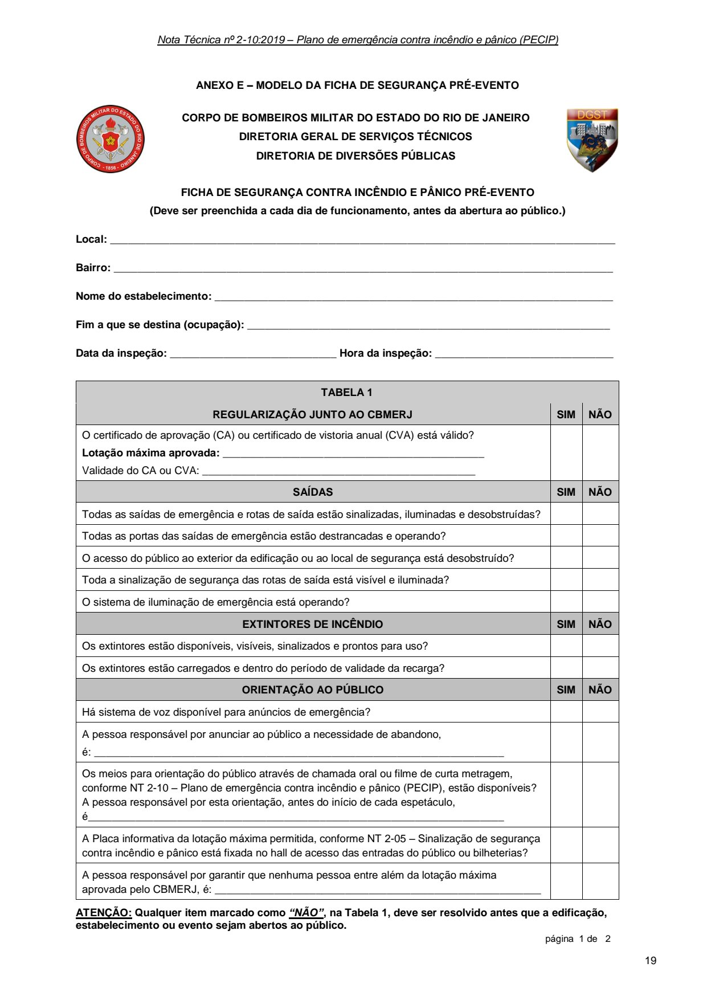
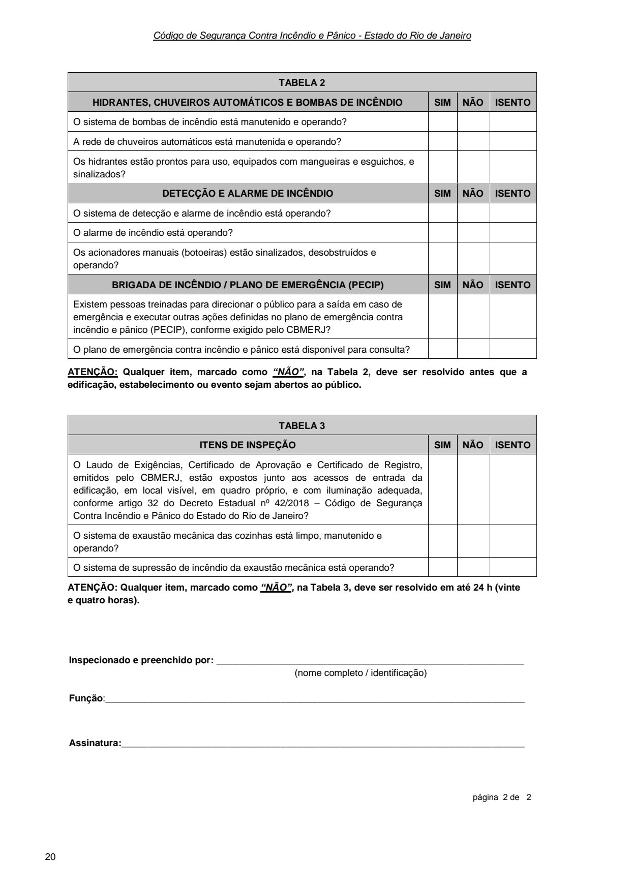

# NT 2-10 - Plano de emergência contra incêndio e pânico - PECIP

> Conversão integral para consulta computacional. A numeração de página do PDF foi preservada. Quando houver tabela complexa, símbolo ou desenho, conferir também a representação visual indicada e o PDF oficial.

## Sumário por página

- [Página 1](#pagina-1)
- [Página 2](#pagina-2)
- [Página 3](#pagina-3)
- [Página 4](#pagina-4)
- [Página 5](#pagina-5)
- [Página 6](#pagina-6)
- [Página 7](#pagina-7)
- [Página 8](#pagina-8)
- [Página 9](#pagina-9)
- [Página 10](#pagina-10)
- [Página 11](#pagina-11)
- [Página 12](#pagina-12)
- [Página 13](#pagina-13)
- [Página 14](#pagina-14)
- [Página 15](#pagina-15)
- [Página 16](#pagina-16)
- [Página 17](#pagina-17)
- [Página 18](#pagina-18)
- [Página 19](#pagina-19)
- [Página 20](#pagina-20)

---

## Página 1

Aprovada pela Portaria CBMERJ nº 1071, de 27 de agosto de 2019.

### SUMÁRIO

### 1 OBJETIVO

### 2 APLICAÇÃO

### 3 REFERÊNCIAS NORMATIVAS E BIBLIOGRÁFICAS

### 4 DEFINIÇÕES E CONCEITOS

### 5 PROCEDIMENTOS

### ANEXOS

A - Modelo de plano de emergência contra incêndio e pânico (PECIP)

B - Fluxograma de procedimentos de emergência contra incêndio e pânico

C - Simbologia de segurança para utilização em planta de emergência

D - Modelo e exemplos de planta de emergência

E - Ficha de segurança pré-evento

### Tabelas extraídas (bruto, não usar para citação)
#### Tabela 1 da página

|  |  | NOTA |  |  | CBMERJ |  |
| --- | --- | --- | --- | --- | --- | --- |
|  |  | TÉCNICA |  |  | NT 2-10 |  |
|  | Versão: 01 20 páginas Vigência: 04/09/2019 |  |  |  |  |  |
|  | Plano de emergência contra incêndio e pânico (PECIP) |  |  |  |  |  |

---

## Página 2

> Página sem texto extraível suficiente; consultar a representação visual ou o PDF oficial.

---

## Página 3

### 1 OBJETIVO

1.1 Estabelecer os requisitos exigidos para a elaboração, implantação, manutenção, revisão e aprovação do plano de emergência contra incêndio e pânico (PECIP) das edificações e áreas de risco, regulamentando o previsto no Decreto Estadual nº 42/2018 - Código de Segurança Contra Incêndio e Pânico do Estado do Rio de Janeiro (COSCIP).

1.2 Padronizar a elaboração da planta de emergência e sua instalação nas edificações e áreas de risco conforme Decreto Estadual nº 42/2018 - COSCIP.

### 2 APLICAÇÃO

Esta Nota Técnica (NT) aplica-se às edificações e áreas de risco para as quais o plano de emergência contra incêndio e pânico (PECIP) é exigido nos termos do Decreto Estadual nº 42/2018 - COSCIP.

### 3 REFERÊNCIAS NORMATIVAS E BIBLIOGRÁFICAS

As normas e bibliografias abaixo contêm disposições que estão relacionadas com esta NT:

a) Lei nº 13.146, de 06 de julho de 2015, que institui a Lei Brasileira de Inclusão da Pessoa com Deficiência (Estatuto da Pessoa com Deficiência);

b) Lei Estadual nº 1.535, de 26 de setembro de 1989, que dispõe sobre a obrigatoriedade de medidas que orientem os frequentadores de recintos fechados, no caso de acidentes de grande porte, explosões, incêndios ou pânico, no estado do Rio de Janeiro, estabelece sanções e dá outras providências;

c) Decreto-Lei nº 247, de 21 de julho de 1975, que dispõe sobre a segurança contra incêndio e pânico;

d) Decreto nº 44.035, de 18 de janeiro de 2013, que estabelece os requisitos mínimos de segurança contra incêndio e pânico em centros esportivos, de eventos e de exibição e dá outras providências;

e) Decreto nº 42, de 17 de dezembro de 2018, que regulamenta o Decreto-Lei nº 247, de 21 de julho de 1975, dispondo sobre o Código de Segurança Contra Incêndio e Pânico - COSCIP, no âmbito do Estado do Rio de Janeiro;

f) Resolução SEDEC nº 097, de 04 de novembro de 1991, que regulamenta a Lei nº 1.535, de 26 de setembro de 1989;

g) Resolução SEDEC nº 31, de 10 de janeiro de 2013, que dispõe sobre o credenciamento de empresas especializadas para realizar curso de formação, curso de atualização e habilitação de bombeiro civil (BC), de empresas especializadas para realizar curso de formação e atualização de brigadistas voluntários de incêndio (BVI), sobre o serviço de brigadas de incêndio e do credenciamento de empresas especializadas para prestação de serviço de bombeiro civil (BC) nas edificações, eventos e áreas de risco no Estado do Rio de Janeiro, e dá outras providências;

h) ABNT NBR 14276:2006 - Brigada de incêndio - Requisitos;

i) ABNT NBR 15219:2005 - Plano de emergência contra incêndio - Requisitos;

j) Manual de Planejamento em Defesa Civil - Volume I. Ministério da Integração Nacional;

k) NFPA 1620 - Standard for Pre-Incident Planning - 2015 Edition;

l) Nota Técnica nº 05 - Locais de Risco. Autoridade Nacional de Proteção Civil (ANPC), Portugal;

m) Nota Técnica nº 21 - Planos de Segurança. Autoridade Nacional de Proteção Civil (ANPC), Portugal;

n) Nota Técnica nº 22 - Plantas de Emergência. Autoridade Nacional de Proteção Civil (ANPC), Portugal;

o) SEITO, Alexandre Itiu et al., “A Segurança Contra Incêndio no Brasil”. São Paulo: Projeto Editora, 2008.

### 4 DEFINIÇÕES E CONCEITOS

Para efeito desta Nota Técnica, além das definições constantes da NT 1-02 - Terminologia de segurança contra incêndio e pânico, aplicam-se as definições específicas desta seção.

4.1 Bombeiro civil (BC): aquele que exerce, em caráter habitual, função remunerada de prevenção e combate a incêndio, conforme NT 2-11 - Brigadas de incêndio.

4.2 Brigada de incêndio (BI): grupo organizado de pessoas treinadas e capacitadas para atuar na prevenção e combate a incêndio, na orientação ao escape da população fixa e flutuante das edificações e eventos, bem como no atendimento às emergências setoriais, conforme NT 2-11 - Brigadas de incêndio.

4.3 Brigadista voluntário de incêndio (BVI): aquele que, é treinado e capacitado a exercer, de forma voluntária, as atividades básicas de prevenção e combate a incêndios, bem como o atendimento a emergências setoriais, conforme NT 2-11 - Brigadas de incêndio.

4.4 Emergência: situação crítica e fortuita que representa perigo à vida, ao meio ambiente e ao patrimônio, gerando um dano continuado que obriga a uma imediata intervenção operacional.

4.5 Exercícios simulados: atividade prática realizada periodicamente conforme o plano de emergência contra incêndio e pânico (PECIP), com o objetivo de manter os ocupantes da edificação em condições de enfrentar uma situação real de emergência, realizando o abandono da edificação e os procedimentos básicos de emergência.

4.6 Ficha de segurança pré-evento: ficha que deve ser preenchida pelos responsáveis das edificações e áreas de risco das divisões F-3, F-5, F-6, F-7 e F-11, para cada evento, antes da abertura ao público. Representa uma lista de verificação das condições gerais de segurança contra incêndio e pânico do local.

4.7 Pessoa com deficiência: aquela que tem impedimento de longo prazo de natureza física,

---

## Página 4

Código de Segurança Contra Incêndio e Pânico - Estado do Rio de Janeiro

mental, intelectual ou sensorial, o qual, em interação com uma ou mais barreiras, pode obstruir sua participação plena e efetiva na sociedade em igualdade de condições com as demais pessoas.

4.8 Pessoa com mobilidade reduzida: aquela que tenha, por qualquer motivo, dificuldade de movimentação, permanente ou temporária, gerando redução efetiva da mobilidade, da flexibilidade, da coordenação motora ou da percepção, incluindo idoso, gestante, lactante, pessoa com criança de colo e obeso.

4.9 Plano de abandono: parte integrante do plano de emergência contra incêndio pânico, que estabelece um conjunto de ações e procedimentos a ser adotado em uma edificação ou área de risco, visando à remoção rápida, segura e ordenada de toda a população fixa e flutuante do local em caso de emergência.

4.10 Plano de emergência contra incêndio e pânico (PECIP): documento estabelecido em função dos riscos de incêndio e pânico da edificação, que encerra um conjunto de ações e procedimentos a ser adotado, visando à proteção da vida, do meio ambiente e do patrimônio, bem como a redução das consequências de sinistros.

4.11 Planta de emergência: croqui ou planta simplificada instalada na edificação, conforme requisitos definidos nesta NT, com objetivo de facilitar o reconhecimento do local por parte da população e das equipes de emergência, e orientar quanto aos procedimentos de emergência, indicando os riscos, recursos e rotas de saída existentes na edificação.

4.12 Ponto de encontro: local seguro externo à edificação, protegido dos efeitos do sinistro, onde os ocupantes devem aguardar a chegada do socorro, ou permanecer após o abandono da edificação em caso de emergência. Deve ser previamente estabelecido no plano de emergência contra incêndio e pânico.

4.13 População fixa: população que permanece regularmente na edificação (residentes, funcionários, colaboradores, etc.), de acordo com os turnos de trabalho e natureza da ocupação.

4.14 População flutuante: população que não permanece regularmente na edificação. Deve ser considerado sempre o número máximo simultâneo de pessoas.

4.15 Risco: propriedade de um perigo ou acidente promover danos, com possibilidade de perdas humanas, ambientais, materiais e/ou econômicas, resultante da combinação entre probabilidade de ocorrência e intensidade ou grandeza das consequências possíveis.

4.16 Rota de saída: caminhos e saídas devidamente sinalizados, dotados de proteção contra incêndio e desobstruídos, que devem ser percorridos pelas pessoas para um rápido e seguro abandono da edificação, deslocando-se de qualquer local até o ponto de encontro.

4.17 Saídas de emergência: saídas que atendam os requisitos da NT 2-08 - Saídas de emergência em edificações.

4.18 Sinistro: ocorrência proveniente de risco que resulte em prejuízo ou dano.

### 5 PROCEDIMENTOS

Para elaboração, implantação, manutenção, revisão e aprovação do plano de emergência contra incêndio e pânico (PECIP) adotam-se os requisitos da norma ABNT NBR 15219, com as modificações e complementações desta NT.

5.1 Requisitos gerais

5.1.1 O plano de emergência contra incêndio e pânico (PECIP) será exigido para as edificações, em função da classificação das edificações e áreas de risco, conforme as tabelas de exigências do Anexo III do Decreto Estadual nº 42/2018 - COSCIP.

5.1.2 Os responsáveis pela elaboração do PECIP devem visitar a edificação ou área de risco para se familiarizarem com suas características estruturais, ocupacionais e humanas, recursos e conteúdo existentes.

5.1.3 O levantamento de informações da edificação deve considerar o conhecimento prévio dos ocupantes e usuários da edificação, tais como: funcionários de segurança do trabalho, segurança patrimonial, manutenção, operação, projeto e desenvolvimento das instalações.

5.1.4 Após o levantamento inicial das características da edificação ou área risco, o profissional responsável pela elaboração do PECIP deve realizar uma inspeção da edificação. Esta inspeção deve estabelecer ações para a minimização ou eliminação dos riscos de incêndio e pânico existentes. Os riscos de incêndio e pânico que não puderem ser eliminados devem ser relacionados e abordados no PECIP.

5.1.5 O PECIP deve ser elaborado por escrito, conforme requisitos mínimos definidos nesta NT, e ser assinado pelo profissional elaborador e pelo responsável da edificação ou área de risco.

5.1.6 Para efeito de apresentação junto ao CBMERJ, o plano de emergência contra incêndio e pânico deve ser elaborado por profissionais ou empresas, cadastrados junto ao CBMERJ para elaboração de projeto de segurança contra incêndio e pânico, conforme NT 1-01 - Procedimentos administrativos para regularização e fiscalização.

5.1.7 O PECIP deve identificar todos os participantes com funções específicas definidas, suas respectivas responsabilidades e seus substitutos, considerando turnos de trabalho, férias ou outros afastamentos. A identificação destes participantes deve ser nominal ou pelo cargo ou função.

5.1.8 O autor do PECIP deve prever a integração com possíveis planos existentes na edificação ou área de risco, tais como: plano de comunicação, plano de contingência, plano de auxílio mútuo, etc.

---

## Página 5

5.2 Requisitos específicos

5.2.1 O plano de emergência contra incêndio e pânico deve conter, no mínimo:

a) as características gerais da edificação;

b) os procedimentos básicos de emergência contra incêndio e pânico;

c) o plano de abandono;

d) a previsão de exercícios simulados; e

e) as plantas de emergência.

5.2.1.1 Além do disposto em 5.2.1, o PECIP das edificações das divisões F-3, F-5, F-6, F-7 e F-11 deve prever o preenchimento da Ficha de segurança pré-evento, conforme 5.2.7 e Anexo E.

5.2.2 Características gerais da edificação

5.2.2.1 As características estruturais, ocupacionais e humanas da edificação, os riscos e recursos existentes, relevantes para o desenvolvimento das ações de emergência e abandono, devem ser descritos detalhadamente.

5.2.2.2 O plano de emergência contra incêndio e pânico deve descrever, no mínimo, as características gerais da edificação listadas no Anexo A.

5.2.3 Procedimentos básicos de emergência contra incêndio e pânico

5.2.3.1 Os procedimentos devem ser descritos de forma sequencial, possibilitando a execução pela população da edificação (usuários e/ou brigada de incêndio).

5.2.3.2 Para facilitar a compreensão, o PECIP deve conter fluxogramas dos procedimentos estabelecidos para a edificação ou área de risco, conforme exemplificado no Anexo B.

5.2.3.3 Os procedimentos básicos de emergência conta incêndio e pânico são definidos conforme segue:

a) alerta: ao identificar uma situação de emergência, qualquer pessoa, através dos meios de comunicação existentes ou sistema de alarme, pode alertar os ocupantes e os brigadistas (se houver). O alerta pode ser executado automaticamente em edificações dotadas de sistema de detecção e alarme de incêndio;

b) apoio do CBMERJ: identificada uma situação de emergência, o CBMERJ deve ser imediatamente acionado. Quando houver brigada de incêndio na edificação, o acionamento deve ser realizado por brigadista. Durante o acionamento, o solicitante deve:

 informar qual é a emergência (ex: incêndio, explosão, vazamento de gás, etc.),

 informar o endereço completo da edificação, pontos de referência e/ou acessos,

 informar o nome e o número do telefone utilizado,

 informar as características da emergência, local ou pavimento e eventuais vítimas e suas condições,

 recepcionar o CBMERJ na chegada ao local para orientação e possíveis informações adicionais. O

solicitante deve estar munido do PECIP, para que este possa ser utilizado nas operações de combate a incêndio e salvamento.

c) análise da situação: avaliar a situação e a necessidade de acionamento de apoio externo, desde o início até o final da emergência. Desencadear os procedimentos necessários, que podem ser priorizados ou realizados simultaneamente, de acordo com os recursos materiais e humanos disponíveis no local. Esta fase não pode retardar o acionamento do apoio externo quando necessário;

d) apoio externo: acionar outros órgãos locais, quando necessário;

e) primeiros socorros: socorrer possíveis vítimas com objetivo de manter ou restabelecer suas funções vitais, conforme protocolos vigentes, até a chegada do socorro de profissional de saúde especializado;

f) eliminar os riscos: quando possível e necessário, eliminar riscos da área sinistrada ou geral por meio do corte do fornecimento de energia elétrica e do fechamento de válvulas das tubulações de abastecimento de gases combustíveis (GLP ou GN), produtos perigosos, etc.;

g) abandono de área: promover o abandono da edificação parcial ou total, quando necessário, conforme comunicação preestabelecida no plano de abandono, removendo a população para local seguro (ponto de encontro), permanecendo até o restabelecimento da normalidade;

h) isolamento da área: isolar fisicamente a área sinistrada, com atenção a uma possível evolução do sinistro, de modo a garantir os procedimentos de emergência e evitar aproximação de pessoas não autorizadas;

i) confinamento do sinistro: utilizar os meios de combate existentes de forma a evitar a propagação do sinistro e reduzir suas consequências;

j) extinção: combater o princípio de incêndio, quando possível, até sua extinção, restabelecendo a normalidade;

k) registro de eventos: documentar as ocorrências e atendimentos prestados para fins estatísticos, preventivos e educacionais.

5.2.4 Plano de abandono

5.2.4.1 O plano de abandono deve identificar todos os participantes com funções específicas e suas respectivas responsabilidades. A identificação destes participantes deve ser nominal, pelo cargo ou função.

5.2.4.2 O tipo de abandono e a distribuição de funções e responsabilidades devem ser compatíveis com a complexidade da edificação e os recursos humanos e materiais existentes:

a) abandono orientado: tipo de abandono no qual alguns ocupantes da edificação e/ou brigada de incêndio são treinados para, durante uma emergência, se posicionarem em locais preestabelecidos para orientar a população sobre quais rotas de escape

---

## Página 6

Código de Segurança Contra Incêndio e Pânico - Estado do Rio de Janeiro

devem ser seguidas. Aplica-se às edificações com predomínio de população flutuante que desconhece o plano de abandono da edificação, tais como: edificações de reunião de público, de concentração de público (shoppings, lojas de departamentos, etc.) e residencial transitória;

b) abandono coordenado: tipo de abandono no qual alguns ocupantes da edificação e/ou brigada de incêndio são treinados para, durante uma emergência, atuarem de acordo com uma função específica e responsabilidades, pré-definidas no plano de abandono. Aplica-se às edificações com predomínio de população fixa que conhece o plano de abandono da edificação, tais como: edificações industriais, escolares, salas comerciais e escritórios.

5.2.4.3 A localização do ponto de encontro deve ser descrita e indicada no PECIP, conforme 4.12. De acordo com as características da edificação e da população, pode ser definido mais de um ponto de encontro.

5.2.4.4 A forma de acionamento do abandono total e parcial deve ser descrita. No caso de edificações ou áreas de risco dotadas de sistemas de alarme sonoros e/ou visuais para o abandono, deve ser prevista uma forma alternativa de acionamento caso haja falha do sistema.

5.2.4.5 Os procedimentos de abandono total e parcial devem ser definidos de forma que:

a) a população não tenha que percorrer distâncias excessivas para sair da edificação ou área de risco, devendo ser adotadas as rotas mais diretas possíveis;

b) o ordenamento e direcionamento do abandono deve ser dimensionado de forma que o fluxo de pessoas seja compatível com a capacidade das rotas de saída e saídas de emergência;

c) sejam garantidos procedimentos de abandono específicos para o auxílio e/ou retirada de pessoas com deficiência e pessoas com mobilidade reduzida.

5.2.5 Exercícios simulados

5.2.5.1 O responsável legal pela edificação ou área de risco deve providenciar a realização de exercícios simulados de abandono de área, parcial e/ou total. A frequência mínima anual exigida varia em função da classificação de risco de incêndio da edificação, estabelecida na NT 1-04 - Classificação das edificações quanto ao risco de incêndio, conforme a Tabela 1.

Tabela 1 - Quantidade de exercícios simulados anuais

Fonte: CBMERJ.

5.2.5.2 A realização dos exercícios simulados deve ser informada, por escrito, à unidade do CBMERJ, responsável pela área operacional da edificação ou área de risco, com a antecedência mínima de 48 horas.

5.2.5.3 Ao término do exercício simulado, deve ser realizada uma reunião para avaliação e correção de falhas. Deve ser redigida ata com, no mínimo, as seguintes informações:

a) data e horário do evento;

b) tempo gasto no abandono;

c) tempo gasto no retorno;

d) atuação dos profissionais envolvidos;

e) comportamento da população;

f) tempo gasto para a chegada de apoio externo, quando houver participação (por exemplo: CBMERJ, PAM - plano de auxílio mútuo, etc.);

g) falha de equipamentos;

h) falhas operacionais;

i) outras considerações sobre o exercício.

5.2.5.4 A Ata do simulado deve ser assinada pelo chefe da brigada de incêndio (se houver) ou coordenador do exercício simulado e pelo responsável da edificação, ficando arquivada por um período mínimo de 01 ano ou até a realização do próximo exercício simulado.

5.2.5.5 A ata deve estar permanentemente disponível em local de presença humana constante (portaria, sala de segurança, etc.) e poderá ser solicitada pelo CBMERJ, a qualquer tempo, durante vistorias, para fins de comprovação da realização dos exercícios simulados anuais conforme esta NT.

5.2.6 Planta de emergência

5.2.6.1 Deve ser fixada a uma altura entre 1,40 m e 1,60 m, medida do piso acabado à base da planta, e posicionada nos seguintes locais:

a) entrada da edificação, portaria ou recepção;

b) hall de acesso do pavimento de saída;

c) hall de acesso de todos os pavimentos;

d) hall dos elevadores;

e) áreas de refúgio;

f) outros locais, de acordo com o PECIP e a natureza da ocupação da edificação.

5.2.6.2 Nas edificações do Grupo B (Serviço de hospedagem), além da localização descrita em 5.2.6.1, as plantas de emergência devem ser fixadas atrás das portas de acesso aos quartos e portas de banheiros coletivos.

5.2.6.3 Nas edificações das Divisões H-2 e H-3, além da localização descrita em 5.2.6.1, as plantas de emergência devem ser fixadas atrás das portas de acesso aos quartos, dormitórios, ambulatórios, enfermarias, banheiros coletivos, salas de estar e refeitórios.

### Tabelas extraídas (bruto, não usar para citação)
#### Tabela 1 da página

| Risco de incêndio da edificação (conforme NT 1-04) |  | Quantidade mínima de |  |  |
| --- | --- | --- | --- | --- |
|  |  | exercícios |  |  |
|  |  | simulados ao ano |  |  |
|  | Abandono parcial |  | Abandono total |  |
| Risco pequeno | 01 |  | 00 |  |
| Risco médio 1 e 2 | 00 |  | 01 |  |
| Risco grande | 01 |  | 01 |  |

<!-- tabela-conferida: Tabela 1 p6 -->
### Tabela 1 — Quantidade de exercícios simulados anuais (conferida)

| Risco de incêndio da edificação (conforme NT 1-04) | Exercícios simulados ao ano — abandono parcial | Exercícios simulados ao ano — abandono total |
| --- | --- | --- |
| Risco pequeno | 01 | 00 |
| Risco médio 1 e 2 | 00 | 01 |
| Risco grande | 01 | 01 |

Fonte: NT 2-10, página 6, Tabela 1; conferida em 2026-09-29 (visual + texto).
Fonte indicada na página: CBMERJ.
<!-- /tabela-conferida: Tabela 1 p6 -->

---

## Página 7

5.2.6.4 Nas edificações do Grupo E (Escolar e cultura física), além da localização descrita em 5.2.6.1, as plantas de emergência devem ser fixadas atrás das portas de banheiros coletivos e refeitórios.

5.2.6.5 Nas edificações de reunião de público das Divisões F-3, F-5, F-6, F-7 e F-11, além da localização descrita em 5.2.6.1, as plantas de emergência devem ser fixadas atrás das portas de acesso de banheiros coletivos e de camarotes ou grupos de camarotes.

5.2.6.6 Quando os ambientes possuírem portas que permaneçam abertas, a planta deverá ser afixada na parede ao lado desta.

5.2.6.7 As plantas de emergência devem orientar claramente a rota de saída a ser percorrida para que a população saia da edificação e chegue às saídas de emergência, escadas de emergência e ao ponto de encontro.

5.2.6.8 As plantas de emergência devem ser orientadas conforme os elementos localizados à direita e à esquerda do observador, de acordo com o pavimento a que se referem, incluindo as seguintes informações:

a) identificação da edificação, pavimento ou setor;

b) localização exata do observador;

c) identificação das rotas de saída do local até o ponto de encontro, saída de emergência ou escada de emergência mais próxima;

d) localização das saídas de emergência e escadas de emergência;

e) vias de acesso às viaturas do CBMERJ (pavimento de saída);

f) localização dos extintores de incêndio;

g) localização das caixas de incêndio ou hidrantes;

h) localização do hidrante de recalque;

i) localização de hidrantes urbanos existentes no interior da propriedade;

j) localização dos acionadores manuais do alarme de incêndio;

k) localização da central de alarme de incêndio;

l) localização dos principais riscos (produtos perigosos, caldeira, transformadores, central de GLP, estação de redução e medição de pressão de GN, etc.);

m) número de telefone de emergência interno (caso haja) e externo (193 - CBMERJ);

n) instruções gerais de emergência e abandono da edificação;

o) legenda da simbologia utilizada, conforme Anexo C;

p) data de execução (mês/ ano);

q) indicação do fabricante, fornecedor ou responsável pela execução.

5.2.6.9 A planta de emergência, localizada no hall de acesso do pavimento de saída, deve indicar claramente a rota de saída do seu ponto de fixação até o ponto de encontro.

5.2.6.10 Fica vedada a inclusão de publicidade nas plantas de emergência. A inclusão de elementos deve priorizar as ações de emergência e abandono.

5.2.6.11 As instruções gerais de emergência e abandono, incluídas nas plantas de emergência, devem estar de acordo com o plano de emergência contra incêndio e pânico (PECIP) da edificação e conter, no mínimo, as seguintes orientações:

a) mantenha a calma;

b) alerte o demais ocupantes; ou acione o botão de alarme; ou utilize o telefone de emergência;

c) combata o fogo usando os extintores, em segurança;

d) dirija-se calmamente para a saída, siga a sinalização;

e) utilize as escadas;

f) não use os elevadores em caso de emergência;

g) siga até o ponto de encontro e aguarde instruções.

5.2.6.12 Em edificações com atividades que recebam público estrangeiro, tais como: B-1, B-2, F-1, F-3, F-4, F-6, F-11, e outras; as instruções gerais de emergência e abandono e a legenda devem ser descritas em português e inglês. Caso sejam utilizadas línguas adicionais, estas devem ser associadas à bandeira do país correspondente.

5.2.6.13 A representação da arquitetura da edificação deve ser simplificada (croqui ou planta arquitetônica), permitindo fácil leitura mesmo após a inclusão da simbologia de emergência. Devem ser representados, no mínimo:

a) todas as paredes externas principais;

b) todas as paredes internas que delimitam as rotas de saída;

c) paredes de separação dos ambientes, quando relevantes para o entendimento da planta e das vias de saída;

d) portas, escadas e vãos de acesso existentes.

5.2.6.14 Em pavimentos com área construída igual ou superior a 1.000 m², podem ser elaboradas plantas de emergência setoriais. Neste caso, cada planta de emergência setorial deve conter um esquemático da área total do piso do pavimento com a demarcação do setor correspondente, conforme Anexo D.

5.2.6.15 A simbologia de emergência aplicada nas plantas de emergência deve atender o padrão definido no Anexo C, e ter coloração conforme segue:

a) azul: informações ao usuário da edificação;

b) verde: indicar rotas de saída e saídas de emergência;

c) vermelho: indicar a localização e os tipos de equipamentos de combate a incêndio e alarme existentes;

d) amarelo: riscos de incêndio ou explosão;

e) preto: desenho arquitetônico da edificação.

---

## Página 8

Código de Segurança Contra Incêndio e Pânico - Estado do Rio de Janeiro

5.2.6.16 As rotas de saída devem ser destacadas na planta de emergência por linhas tracejadas na cor verde ou destacadas na cor verde claro. O sentido do abandono deve ser indicado por setas verdes, permitindo uma rápida identificação do fluxo de saída.

5.2.6.17 As plantas de emergência devem ser elaboradas conforme os seguintes requisitos:

a) dimensão mínima de formato A4, preferencialmente em escala padronizada;

b) possuir resistência às condições ambientais, ao tempo e ao choque;

c) manter sua legibilidade e integridade em caso de incêndio, conforme requisitos definidos na NT 2-05 - Sinalização de segurança contra incêndio e pânico;

d) apresentar efeito fotoluminescente, conforme NT 2- 05, ou ser fixada na área de influência de uma luminária de emergência, dimensionada conforme NT 2-06 - Iluminação de Emergência.

5.2.6.18 Caso haja modificação arquitetônica nos dispositivos preventivos, rotas de saída ou alteração dos riscos existentes na edificação, deve ser feita a atualização e substituição das plantas de emergência.

5.2.7 Ficha de segurança pré-evento

5.2.7.1 O plano de emergência contra incêndio e pânico (PECIP) das edificações das Divisões F3, F5, F6, F7 e F11 deve prever a realização de inspeção visual das condições de segurança contra incêndio e pânico, e preenchimento da Ficha de segurança préevento, conforme Anexo E.

5.2.7.2 O responsável legal pela edificação ou estabelecimento deve providenciar o preenchimento da Ficha de segurança pré-evento conforme esta NT. As pessoas responsáveis pelo preenchimento, e seus substitutos, devem ser formalmente indicadas no PECIP, através do nome, cargo ou função.

5.2.7.3 A inspeção visual e preenchimento da Ficha de segurança pré-evento devem ser executados e concluídos antes da abertura do evento ao público, todo o dia em que a edificação ou estabelecimento estiver em funcionamento. A ficha confirma que a edificação continua segura para a atividade de diversões públicas, através da inspeção visual dos dispositivos preventivos conforme Anexo E.

5.2.7.4 Constatadas inconformidades nos itens de inspeção, definidos no Anexo E, estas devem ser solucionadas antes que a edificação, estabelecimento ou evento seja aberto ao público.

5.2.7.5 Excepcionalmente, as inconformidades nos itens de inspeção, definidos na Tabela 3 do Anexo E, terão o prazo para sua correção limitado em até 24 h após sua constatação.

5.2.7.6 A ficha deve ser preenchida e assinada pelo responsável pela inspeção visual, ficando arquivada por um período mínimo de 01 ano, em local de presença humana constante (portaria, sala de segurança, etc.).

5.2.7.7 Em caso de vistorias, a Ficha de segurança pré-evento poderá ser solicitada pelo CBMERJ, a qualquer tempo, para fins de comprovação do cumprimento dos requisitos estabelecidos nesta NT.

5.3 Divulgação e treinamento do plano de emergência contra incêndio e pânico (PECIP)

5.3.1 O responsável pela elaboração do PECIP deve providenciar uma palestra ou reunião, para que o proprietário da edificação, ocupantes com funções definidas no plano e demais ocupantes selecionados, tomem conhecimento dos conceitos e procedimentos estabelecidos no PECIP.

5.3.2 O responsável legal pela edificação ou área de risco deverá providenciar a ampla divulgação e treinamento do PECIP. Toda a população deve conhecer os procedimentos a serem adotados em caso de emergência.

5.3.3 O treinamento da população, da edificação ou área de risco, deve contemplar a realização de exercícios simulados conforme 5.2.5.

5.3.4 Nas edificações dotadas de brigada de incêndio, o PECIP deve fazer parte dos treinamentos e reuniões dos membros da brigada, conforme NT 2-11 - Brigadas de Incêndio.

5.3.5 Nas edificações classificadas como risco grande, conforme a NT 1-04 - Classificação das edificações quanto ao risco de incêndio, os visitantes devem ser formalmente informados sobre o PECIP, por meio de panfletos, vídeos e/ou palestras. Nas edificações classificadas como risco médio ou risco pequeno, esta informação é recomendada.

5.3.6 Em cinemas, teatros, salas de espetáculos em geral (F-5) e eventos temporários, os frequentadores devem ser orientados quanto aos procedimentos de emergência, através de chamada oral ou filme de curta metragem, que citem os dispositivos de prevenção e combate a incêndio existentes, bem como identifiquem a quantidade e localização das saídas de emergência.

5.3.6.1 A orientação por chamada oral pode ser na forma de gravação ou ao vivo pelo apresentador do espetáculo, utilizando-se o sistema de som do estabelecimento.

5.3.6.2 A orientação por filme de curta metragem deve ter duração mínima de 30 s, na forma de redação, de planta baixa ou de croquis, podendo ser animado ou não.

5.3.6.3 O desenvolvimento e divulgação do material de orientação, antes do início do primeiro espetáculo, apresentação ou atividade, é de responsabilidade do proprietário do estabelecimento.

5.4 Manutenção e revisão do plano de emergência contra incêndio e pânico (PECIP)

5.4.1 O responsável legal pela edificação ou área de risco deve manter o PECIP atualizado, através de reuniões periódicas com a participação de representantes dos seguintes grupos:

---

## Página 9

a) funcionários e colaboradores;

b) ocupantes com funções definidas no plano; e

c) brigadistas (se houver).

5.4.2 As reuniões periódicas devem ser registradas em ata, com envio de informações aos setores competentes para as providencias cabíveis. Devem ser discutidos os seguintes tópicos:

a) calendário dos exercícios de abandono;

b) funções de cada pessoa dentro do PECIP;

c) condições de uso dos equipamentos de combate a incêndio;

d) apresentação dos problemas relacionados à prevenção de incêndios, encontrados nas inspeções, para que sejam feitas propostas corretivas;

e) atualização de técnicas e táticas de combate a incêndio;

f) outros assuntos relevantes para a segurança contra incêndio e pânico da edificação.

5.4.3 Devem ser realizadas reuniões extraordinárias para análise de situação sempre que:

a) ocorrer um sinistro;

b) for identificado um risco iminente;

c) ocorrer uma alteração significativa dos processos industriais ou de serviços, de área ou de leiaute;

d) houver previsão e execução de serviços que possam gerar algum risco.

5.4.4 O PECIP deve ser revisado por profissional habilitado (conforme 5.1.6), sempre que:

a) ocorrer uma alteração significativa da natureza estrutural, organizacional e humana da edificação, tais como: modificações arquitetônicas, alterações de atividade, alteração da forma de abastecimento por gás combustível, inclusão de novos equipamentos ou produtos perigosos, ou qualquer modificação que altere o risco de incêndio da edificação;

b) for constatada a possibilidade de melhoria do plano;

c) completar 24 meses, a contar da data de emissão do Certificado de Aprovação da edificação ou da última revisão do PECIP.

5.5 Apresentação do plano de emergência contra incêndio e pânico (PECIP) junto ao CBMERJ

5.5.1 A tramitação dos processos de legalização de edificações nas quais se exige a elaboração de PECIP deverá atender os requisitos definidos na NT 1-01- Procedimentos administrativos para regularização e fiscalização.

5.5.2 No ato da solicitação de vistoria para a emissão do Certificado de Aprovação para a edificação, deverá ser apresentada a anotação de responsabilidade técnica (ART) ou registro de responsabilidade técnica (RRT) de elaboração do plano de emergência contra incêndio e pânico, emitida pelo autor do plano conforme 5.1.6, com a seguinte descrição:

a) “Elaboração de plano de emergência contra

incêndio e pânico (PECIP), conforme Nota Técnica do CBMERJ, NT 2-10 - Plano de emergência contra incêndio e pânico (PECIP)”.

5.5.3 Para a emissão do certificado de aprovação, o conteúdo do PECIP não será objeto de análise pelo CBMERJ. O profissional elaborador do plano de emergência contra incêndio e pânico é responsável por seu conteúdo e fiel cumprimento desta NT.

5.5.4 A elaboração e instalação das plantas de emergência nas edificações e áreas de risco, conforme esta NT, serão objeto de análise pelo CBMERJ no ato da vistoria para emissão do Certificado de Aprovação.

5.5.5 A qualquer tempo, 01 via do plano de emergência contra incêndio e pânico poderá ser solicitada pelo CBMERJ para análise, planejamento operacional ou treinamento. Verificada qualquer inadequação a esta NT, a edificação será notificada a providenciar as modificações necessárias ou a elaboração de um novo PECIP.

5.5.6 O PECIP deve estar permanentemente disponível para consulta em local de permanência humana constante (portaria, sala de segurança, etc.) e acessível ao público interno e às equipes do CBMERJ, durante vistorias, treinamentos e emergências.

---

## Página 10

Código de Segurança Contra Incêndio e Pânico - Estado do Rio de Janeiro

### ANEXO A - MODELO DE PLANO DE EMERGÊNCIA CONTRA INCÊNDIO E PÂNICO

(Observação: O presente anexo estabelece um modelo de plano de emergência contra incêndio e pânico, através da definição de requisitos mínimos para a apresentação junto ao CBMERJ. Cabe ao responsável pela elaboração do plano, complementar este modelo de acordo com as características da edificação, recursos, riscos e necessidades envolvidos.)

### 1 CARACTERÍSTICAS GERAIS DA EDIFICAÇÃO (OU ÁREA DE RISCO)

1.1 Identificação: identificar o nome da empresa, edifício ou condomínio.

1.2 Localização: indicar o tipo de localização: área urbana ou rural, endereço, característica da vizinhança, distância da unidade do CBMERJ mais próxima e meios de ajuda externa (plano de auxílio mútuo - PAM, hospitais, PMERJ, etc.).

1.3 Sistemas construtivos: indicar o tipo, por exemplo: de alvenaria, concreto, metálica, madeira, etc.

1.4 Características arquitetônicas: indicar área total construída (ATC) de cada uma das edificações, altura de cada edificação, número de pavimentos, se há subsolos, garagens e outros detalhes.

1.5 Ocupação: indicar a classificação da edificação quanto à ocupação, de acordo com Anexo II do Decreto nº 42/2018 - COSCIP.

1.6 Risco de incêndio: indicar a classificação quanto ao risco de incêndio de acordo com a NT 1-04 - Classificação das edificações quanto ao risco de incêndio (risco: pequeno, médio 1, médio 2 ou grande).

1.7 População: indicar o quantitativo de população fixa e flutuante, e suas características.

1.8 Pessoas portadoras de deficiências: indicar o número de pessoas portadoras de necessidades especiais e/ou mobilidade reduzida e sua localização na edificação ou área de risco.

1.9 Características de funcionamento: indicar os horários e turnos de trabalho, os dias e horários fora do expediente de funcionamento e demais aspectos relevantes.

1.10 Riscos específicos: detalhar todos os riscos existentes relacionados à atividade, tais como: caldeira, centrais de GLP, líquidos inflamáveis, produtos perigosos, geradores, subestações de energia elétrica, etc.

1.11 Recursos humanos: indicar o número de membros da brigada de incêndio (bombeiro civil e brigadistas voluntários de incêndio) e outros meios de ajuda externa (por exemplo: apoio de pessoal integrante de plano de auxílio mútuo).

1.12 Recursos materiais e estruturais: indicar os dispositivos preventivos fixos e móveis e medidas preventivas existentes (extintores de incêndio, hidrantes, chuveiros automáticos, sinalização de segurança, iluminação de emergência, alarme de incêndio manual, detecção e alarme de incêndio, escada de emergência à prova de fumaça, saídas de emergência, portas corta-fogo, etc.)

1.13 Rotas de saída: identificar e indicar as rotas de saída existentes. Definir a quantidade e localização dos pontos de encontro necessários. As rotas de saída e os pontos de encontro devem ser mantidos sinalizados e desobstruídos conforme definido nesta NT.

### 2 PROCEDIMENTOS BÁSICOS DE EMERGÊNCIA CONTRA INCÊNDIO E PÂNICO

2.1 Alerta: detalhar como será dado o alerta em caso de incêndio (por exemplo: através de alarme, telefone ou outro meio) e como os membros da brigada e a população em geral serão avisados sobre o alerta.

2.2 Apoio do CBMERJ: identificar quem será a pessoa responsável por acionar o CBMERJ. Deve estar claro que esta pessoa (solicitante) deverá fornecer no mínimo as seguintes informações:

a) nome e número do telefone utilizado;

b) endereço da edificação ou área de risco (completo);

c) pontos de referência;

d) características do sinistro;

e) quantidade e estado das eventuais vítimas.

O solicitante, preferencialmente um brigadista, deverá orientar o CBMERJ quando da sua chegada, sobre as condições e acessos, e apresentá-los ao responsável pela edificação ou chefe da brigada (se houver).

2.3 Análise da situação: identificar quem irá realizar a análise da situação, qual a responsabilidade desta pessoa, a quem ela deverá informar caso seja confirmada a emergência e demais providências necessárias.

---

## Página 11

2.4 Apoio externo: identificar quem será a pessoa responsável por acionar outro meio de ajuda externa. O solicitante deverá orientar o meio de ajuda externa quando da sua chegada ao local.

2.5 Primeiros socorros: indicar quem são as pessoas habilitadas para prestar os primeiros socorros às eventuais vítimas.

2.6 Eliminar riscos: indicar quem será a pessoa responsável pelo corte da energia elétrica (parcial ou total) e pelo fechamento das válvulas das tubulações, se necessário.

2.7 Abandono de área: indicar a metodologia a ser usada para o acionamento do plano de abandono, caso seja necessário o abandono total ou parcial da edificação, e as pessoas responsáveis por este processo.

2.8 Isolamento de área: indicar a metodologia a ser usada para isolar as áreas sinistradas e as pessoas responsáveis por este processo.

2.9 Confinamento do sinistro: indicar a metodologia a ser usada para evitar a propagação do incêndio e suas consequências, bem como as pessoas responsáveis por este processo.

2.10 Extinção: indicar quem irá combater o princípio de incêndio e os meios a serem utilizados em seu combate.

2.11 Registro de eventos: indicar o responsável por documentar as ocorrências e atendimentos prestados para fins estatísticos, preventivos e educacionais, com o objetivo de propor medidas corretivas para evitar a reincidência.

### 3 PLANO DE ABANDONO

Estabelecer todas as ações e procedimentos necessários para o abandono parcial e total da edificação.

Definir o tipo de abandono, a distribuição de funções e responsabilidades.

Identificar todos os participantes com funções específicas e suas respectivas responsabilidades.

Definir a localização do(s) ponto(s) de encontro.

Definir a forma de acionamento do abandono total ou parcial.

Definir orientações gerais de abandono para a população fixa e flutuante.

Definir o ordenamento e direcionamento do abandono e as rotas de saída e saídas de emergência utilizadas.

Definir as rotas de saída e procedimentos específicos para auxilio à saída e/ou remoção de pessoa deficiente ou com dificuldade de locomoção.

### 4 PREVISÃO DE EXERCÍCIOS SIMULADOS

Estabelecer a previsão anual de exercícios simulados, conforme 5.2.5.

### 5 PLANTAS DE EMERGÊNCIA

Anexar as cópias das plantas de emergência a serem fixadas no hall do pavimento de saída e no hall principal dos demais pavimentos da edificação.

### 6 DOCUMENTOS DE REGULARIZAÇÃO JUNTO AO CBMERJ

Devem ser anexadas cópias dos documentos emitidos pelo CBMERJ para a regularização da edificação, em vigor até a conclusão do plano, tais como: laudo de exigências, certificado de despacho, etc.

### 7 RESPONSABILIDADE PELO PLANO DE EMERGÊNCIA CONTRA INCÊNDIO E PÂNICO

O responsável legal pela edificação ou área de risco e o responsável pela elaboração do plano de emergência contra incêndio e pânico (PECIP) devem assinar o plano. Este capítulo deve conter:

a) o termo de responsabilidade do profissional, assinado pelo profissional responsável pela elaboração ou revisão do PECIP;

b) o termo de responsabilidade do responsável pela edificação, assinado pelo responsável legal da edificação (ou área de risco);

c) cópia da ART (ou RRT) de elaboração do PECIP, assinada pelo profissional responsável pela elaboração e pelo responsável pela edificação (ou área de risco).

---

## Página 12

Código de Segurança Contra Incêndio e Pânico - Estado do Rio de Janeiro

Termo de responsabilidade do profissional

Eu,____________________(nome completo)________, ____(formação profissional)___, CREA (ou CAU) nº: _________, profissional responsável pela elaboração (ou revisão) do plano emergência contra incêndio e pânico da edificação (ou área de risco) situada a_____________________________________________________________________________________ ______________________________________________________________________________, declaro que assumo total responsabilidade pela veracidade das informações prestadas, e o cumprimento dos requisitos estabelecidos na Nota Técnica do CBMERJ, NT 2-10 - Plano de emergência contra incêndio e pânico e Decreto nº 42, de 17 de dezembro de 2018 - Código de Segurança Contra Incêndio e Pânico.

(Município), _____ de ______________ de _______.

_______(assinatura do profissional)_____

(nome completo)

(formação profissional)

### (CREA/CAU)

Termo de Responsabilidade do responsável pela edificação (ou área de risco)

Eu,____________________(nome completo)________, CPF nº: _________, responsável pela edificação (ou área de risco) situada a _____________________________________________________________________ _______________________________________________________________________, declaro que assumo total responsabilidade pela divulgação, treinamento, manutenção e revisão do presente plano de emergência contra incêndio e pânico, conforme requisitos estabelecidos na Nota Técnica do CBMERJ, NT 2-10 - Plano de emergência contra incêndio e pânico e Decreto nº 42, de 17 de dezembro de 2018 - Código de Segurança Contra Incêndio e Pânico.

(Município), _____ de ______________ de _______.

_______(assinatura do responsável)______

(nome completo)

### (CPF)

---

## Página 13

### ANEXO B - EXEMPLO DE FLUXOGRAMA DE PROCEDIMENTOS DE EMERGÊNCIA CONTRA INCÊNDIO E PÂNICO

Fonte: ABNT NBR 15219:2005, modificado por CBMERJ.

---

## Página 14

Código de Segurança Contra Incêndio e Pânico - Estado do Rio de Janeiro

### ANEXO C - SIMBOLOGIA DE SEGURANÇA PARA UTILIZAÇÃO EM PLANTAS DE EMERGÊNCIA

### Tabelas extraídas (bruto, não usar para citação)
#### Tabela 1 da página

|  | Simbologia na |  | Descrição |
| --- | --- | --- | --- |
|  | planta de emergência |  |  |
|  |  |  | Você está aqui (localização do observador) |
|  |  |  | Acionador manual de alarme de incêndio |
|  |  |  | Telefone de emergência |
|  |  |  | Extintor de incêndio |
|  |  |  | Caixa de incêndio, abrigo de mangueira e hidrante |
|  |  |  | Hidrante de incêndio |
|  |  |  | Hidrante urbano |
|  |  |  | Reserva técnica de incêndio |
|  |  |  | Hidrante de recalque |
|  |  |  | Casa de máquinas de incêndio (CMI) |
|  |  |  | Acesso para viaturas do CBMERJ |
|  |  |  | Acesso para guarnições do CBMERJ |
|  |  |  | Saída de emergência |
|  |  |  | Escada de emergência |
|  |  |  | Rota de saída principal |
|  |  |  | Rota de saída alternativa |
|  |  |  | Ponto de encontro |

<!-- tabela-conferida: Tabela do Anexo C p14 -->
### Tabela do Anexo C — Simbologia de segurança para utilização em plantas de emergência (p. 14) (conferida)

| Simbologia na planta de emergência | Descrição |
| --- | --- |
|  | Você está aqui (localização do observador) |
|  | Acionador manual de alarme de incêndio |
|  | Telefone de emergência |
|  | Extintor de incêndio |
|  | Caixa de incêndio, abrigo de mangueira e hidrante |
|  | Hidrante de incêndio |
|  | Hidrante urbano |
|  | Reserva técnica de incêndio |
|  | Hidrante de recalque |
|  | Casa de máquinas de incêndio (CMI) |
|  | Acesso para viaturas do CBMERJ |
|  | Acesso para guarnições do CBMERJ |
|  | Saída de emergência |
|  | Escada de emergência |
|  | Rota de saída principal |
|  | Rota de saída alternativa |
|  | Ponto de encontro |

Fonte: NT 2-10, página 14, Tabela do Anexo C; conferida em 2026-09-29 (visual + texto).
A coluna de simbologia traz o desenho do símbolo (só na imagem da página); a célula fica em branco na tabela.
Nos símbolos aparecem as siglas "HR" (hidrante de recalque), "CMI" e "CB".
<!-- /tabela-conferida: Tabela do Anexo C p14 -->

---

## Página 15

> Página sem texto extraível suficiente; consultar a representação visual ou o PDF oficial.

### Tabelas extraídas (bruto, não usar para citação)
#### Tabela 1 da página

|  | Risco de incêndio (materiais ou áreas com presença de produtos altamente inflamáveis) |
| --- | --- |
|  | Risco de explosão, presença de produtos (sólidos, gases ou vapores) com risco de explosão |
|  | Risco de corrosão (materiais ou áreas com presença de produtos corrosivos) |
|  | Risco de choque elétrico (instalações elétricas que ofereçam risco de choque) |
|  | Risco de radiação (materiais ou áreas com presença de produtos radioativos) |
|  | Risco de exposição a produtos tóxicos (materiais ou áreas com presença de produtos tóxicos) |
|  | Espaço confinado |
|  | Central de GLP |
|  | Vaso sob pressão |
|  | Vaso sob pressão (caldeira) |
|  | Produtos perigosos |
| Obs.: 1- O autor do plano de emergência deverá avaliar a necessidade de inclusão de outras simbologias não representadas nesta tabela, em função das peculiaridades da edificação e da inspeção realizada. Neste caso, as novas simbologias devem atender a coloração definida no item 5.2.6.15 desta NT. 2- Todas as simbologias utilizadas devem constar na legenda da planta de emergência. |  |

<!-- tabela-conferida: Tabela do Anexo C p15 -->
### Tabela do Anexo C — Simbologia de segurança para utilização em plantas de emergência (continuação, p. 15) (conferida)

| Simbologia na planta de emergência | Descrição |
| --- | --- |
|  | Risco de incêndio (materiais ou áreas com presença de produtos altamente inflamáveis) |
|  | Risco de explosão, presença de produtos (sólidos, gases ou vapores) com risco de explosão |
|  | Risco de corrosão (materiais ou áreas com presença de produtos corrosivos) |
|  | Risco de choque elétrico (instalações elétricas que ofereçam risco de choque) |
|  | Risco de radiação (materiais ou áreas com presença de produtos radioativos) |
|  | Risco de exposição a produtos tóxicos (materiais ou áreas com presença de produtos tóxicos) |
|  | Espaço confinado |
|  | Central de GLP |
|  | Vaso sob pressão |
|  | Vaso sob pressão (caldeira) |
|  | Produtos perigosos |

Fonte: NT 2-10, página 15, Tabela do Anexo C; conferida em 2026-09-29 (visual + texto).
A coluna de simbologia traz o desenho do símbolo (só na imagem da página); a célula fica em branco na tabela.
Obs. 1 da tabela: O autor do plano de emergência deverá avaliar a necessidade de inclusão de outras simbologias não representadas nesta tabela, em função das peculiaridades da edificação e da inspeção realizada. Neste caso, as novas simbologias devem atender a coloração definida no item 5.2.6.15 desta NT.
Obs. 2 da tabela: Todas as simbologias utilizadas devem constar na legenda da planta de emergência.
<!-- /tabela-conferida: Tabela do Anexo C p15 -->

---

## Página 16

Código de Segurança Contra Incêndio e Pânico - Estado do Rio de Janeiro

### ANEXO D - MODELO E EXEMPLOS DE PLANTA DE EMERGÊNCIA

Figura 01 - Modelo de Planta de Emergência Setorial

---

## Página 17

Figura 2 - Exemplo de planta de emergência para pavimento de edificações

---

## Página 18

Código de Segurança Contra Incêndio e Pânico - Estado do Rio de Janeiro

Figura 03 - Exemplo de planta de emergência para quartos de hotéis

---

## Página 19

### ANEXO E - MODELO DA FICHA DE SEGURANÇA PRÉ-EVENTO

### CORPO DE BOMBEIROS MILITAR DO ESTADO DO RIO DE JANEIRO

### DIRETORIA GERAL DE SERVIÇOS TÉCNICOS

### DIRETORIA DE DIVERSÕES PÚBLICAS

### FICHA DE SEGURANÇA CONTRA INCÊNDIO E PÂNICO PRÉ-EVENTO

(Deve ser preenchida a cada dia de funcionamento, antes da abertura ao público.)

Local: _____________________________________________________________________________________

Bairro: ____________________________________________________________________________________

Nome do estabelecimento: ___________________________________________________________________

Fim a que se destina (ocupação): _____________________________________________________________

Data da inspeção: ____________________________ Hora da inspeção: ______________________________

ATENÇÃO: Qualquer item marcado como “NÃO”, na Tabela 1, deve ser resolvido antes que a edificação, estabelecimento ou evento sejam abertos ao público.

página 1 de 2

### Tabelas extraídas (bruto, não usar para citação)
#### Tabela 1 da página

|  | TABELA 1 |  |  |  |  |  |  |  |
| --- | --- | --- | --- | --- | --- | --- | --- | --- |
|  | REGULARIZAÇÃO JUNTO AO CBMERJ |  |  | SIM |  |  | NÃO |  |
| O certificado de aprovação (CA) ou certificado de vistoria anual (CVA) está válido? Lotação máxima aprovada: ____________________________________________ Validade do CA ou CVA: ______________________________________________ |  |  |  |  |  |  |  |  |
|  | SAÍDAS |  |  | SIM |  |  | NÃO |  |
| Todas as saídas de emergência e rotas de saída estão sinalizadas, iluminadas e desobstruídas? |  |  |  |  |  |  |  |  |
| Todas as portas das saídas de emergência estão destrancadas e operando? |  |  |  |  |  |  |  |  |
| O acesso do público ao exterior da edificação ou ao local de segurança está desobstruído? |  |  |  |  |  |  |  |  |
| Toda a sinalização de segurança das rotas de saída está visível e iluminada? |  |  |  |  |  |  |  |  |
| O sistema de iluminação de emergência está operando? |  |  |  |  |  |  |  |  |
|  | EXTINTORES DE INCÊNDIO |  |  | SIM |  |  | NÃO |  |
| Os extintores estão disponíveis, visíveis, sinalizados e prontos para uso? |  |  |  |  |  |  |  |  |
| Os extintores estão carregados e dentro do período de validade da recarga? |  |  |  |  |  |  |  |  |
|  | ORIENTAÇÃO AO PÚBLICO |  |  | SIM |  |  | NÃO |  |
| Há sistema de voz disponível para anúncios de emergência? |  |  |  |  |  |  |  |  |
| A pessoa responsável por anunciar ao público a necessidade de abandono, é: _____________________________________________________________________ |  |  |  |  |  |  |  |  |
| Os meios para orientação do público através de chamada oral ou filme de curta metragem, conforme NT 2-10 - Plano de emergência contra incêndio e pânico (PECIP), estão disponíveis? A pessoa responsável por esta orientação, antes do início de cada espetáculo, é ______________________________________________________________________ |  |  |  |  |  |  |  |  |
| A Placa informativa da lotação máxima permitida, conforme NT 2-05 - Sinalização de segurança contra incêndio e pânico está fixada no hall de acesso das entradas do público ou bilheterias? |  |  |  |  |  |  |  |  |
| A pessoa responsável por garantir que nenhuma pessoa entre além da lotação máxima aprovada pelo CBMERJ, é: _______________________________________________________ |  |  |  |  |  |  |  |  |

<!-- tabela-conferida: Tabela 1 do Anexo E p19 -->
### Tabela 1 do Anexo E — Ficha de segurança contra incêndio e pânico pré-evento — Tabela 1 (conferida)

| Item | SIM | NÃO |
| --- | --- | --- |
| TABELA 1 | TABELA 1 | TABELA 1 |
| REGULARIZAÇÃO JUNTO AO CBMERJ | SIM | NÃO |
| O certificado de aprovação (CA) ou certificado de vistoria anual (CVA) está válido? Lotação máxima aprovada: ____ Validade do CA ou CVA: ____ |  |  |
| SAÍDAS | SIM | NÃO |
| Todas as saídas de emergência e rotas de saída estão sinalizadas, iluminadas e desobstruídas? |  |  |
| Todas as portas das saídas de emergência estão destrancadas e operando? |  |  |
| O acesso do público ao exterior da edificação ou ao local de segurança está desobstruído? |  |  |
| Toda a sinalização de segurança das rotas de saída está visível e iluminada? |  |  |
| O sistema de iluminação de emergência está operando? |  |  |
| EXTINTORES DE INCÊNDIO | SIM | NÃO |
| Os extintores estão disponíveis, visíveis, sinalizados e prontos para uso? |  |  |
| Os extintores estão carregados e dentro do período de validade da recarga? |  |  |
| ORIENTAÇÃO AO PÚBLICO | SIM | NÃO |
| Há sistema de voz disponível para anúncios de emergência? |  |  |
| A pessoa responsável por anunciar ao público a necessidade de abandono, é: ____ |  |  |
| Os meios para orientação do público através de chamada oral ou filme de curta metragem, conforme NT 2-10 – Plano de emergência contra incêndio e pânico (PECIP), estão disponíveis? A pessoa responsável por esta orientação, antes do início de cada espetáculo, é____ |  |  |
| A Placa informativa da lotação máxima permitida, conforme NT 2-05 – Sinalização de segurança contra incêndio e pânico está fixada no hall de acesso das entradas do público ou bilheterias? |  |  |
| A pessoa responsável por garantir que nenhuma pessoa entre além da lotação máxima aprovada pelo CBMERJ, é: ____ |  |  |

Fonte: NT 2-10, página 19, Tabela 1 do Anexo E; conferida em 2026-09-29 (visual + texto).
Anexo E da NT 2-10: modelo da ficha de segurança pré-evento (formulário: as colunas SIM e NÃO são para preenchimento).
Cabeçalho da ficha na página: Local, Bairro, Nome do estabelecimento, Fim a que se destina (ocupação), Data e Hora da inspeção.
Texto abaixo da tabela: ATENÇÃO: Qualquer item marcado como "NÃO", na Tabela 1, deve ser resolvido antes que a edificação, estabelecimento ou evento sejam abertos ao público.
<!-- /tabela-conferida: Tabela 1 do Anexo E p19 -->

---

## Página 20

Código de Segurança Contra Incêndio e Pânico - Estado do Rio de Janeiro

ATENÇÃO: Qualquer item, marcado como “NÃO”, na Tabela 2, deve ser resolvido antes que a edificação, estabelecimento ou evento sejam abertos ao público.

ATENÇÃO: Qualquer item, marcado como “NÃO”, na Tabela 3, deve ser resolvido em até 24 h (vinte

e quatro horas).

Inspecionado e preenchido por: __________________________________________________________ (nome completo / identificação)

Função:_______________________________________________________________________________

Assinatura:____________________________________________________________________________

página 2 de 2

### Tabelas extraídas (bruto, não usar para citação)
#### Tabela 1 da página

|  | TABELA 2 |  |  |  |  |  |  |  |  |  |  |
| --- | --- | --- | --- | --- | --- | --- | --- | --- | --- | --- | --- |
|  | HIDRANTES, CHUVEIROS AUTOMÁTICOS E BOMBAS DE INCÊNDIO |  |  | SIM |  |  | NÃO |  |  | ISENTO |  |
| O sistema de bombas de incêndio está manutenido e operando? |  |  |  |  |  |  |  |  |  |  |  |
| A rede de chuveiros automáticos está manutenida e operando? |  |  |  |  |  |  |  |  |  |  |  |
| Os hidrantes estão prontos para uso, equipados com mangueiras e esguichos, e sinalizados? |  |  |  |  |  |  |  |  |  |  |  |
|  | DETECÇÃO E ALARME DE INCÊNDIO |  |  | SIM |  |  | NÃO |  |  | ISENTO |  |
| O sistema de detecção e alarme de incêndio está operando? |  |  |  |  |  |  |  |  |  |  |  |
| O alarme de incêndio está operando? |  |  |  |  |  |  |  |  |  |  |  |
| Os acionadores manuais (botoeiras) estão sinalizados, desobstruídos e operando? |  |  |  |  |  |  |  |  |  |  |  |
|  | BRIGADA DE INCÊNDIO / PLANO DE EMERGÊNCIA (PECIP) |  |  | SIM |  |  | NÃO |  |  | ISENTO |  |
| Existem pessoas treinadas para direcionar o público para a saída em caso de emergência e executar outras ações definidas no plano de emergência contra incêndio e pânico (PECIP), conforme exigido pelo CBMERJ? |  |  |  |  |  |  |  |  |  |  |  |
| O plano de emergência contra incêndio e pânico está disponível para consulta? |  |  |  |  |  |  |  |  |  |  |  |

#### Tabela 2 da página

|  | TABELA 3 |  |  |  |  |  |  |  |  |  |  |
| --- | --- | --- | --- | --- | --- | --- | --- | --- | --- | --- | --- |
|  | ITENS DE INSPEÇÃO |  |  | SIM |  |  | NÃO |  |  | ISENTO |  |
| O Laudo de Exigências, Certificado de Aprovação e Certificado de Registro, emitidos pelo CBMERJ, estão expostos junto aos acessos de entrada da edificação, em local visível, em quadro próprio, e com iluminação adequada, conforme artigo 32 do Decreto Estadual nº 42/2018 - Código de Segurança Contra Incêndio e Pânico do Estado do Rio de Janeiro? |  |  |  |  |  |  |  |  |  |  |  |
| O sistema de exaustão mecânica das cozinhas está limpo, manutenido e operando? |  |  |  |  |  |  |  |  |  |  |  |
| O sistema de supressão de incêndio da exaustão mecânica está operando? |  |  |  |  |  |  |  |  |  |  |  |
<!-- tabela-conferida: Tabela 2 do Anexo E p20 -->
### Tabela 2 do Anexo E — Ficha de segurança contra incêndio e pânico pré-evento — Tabela 2 (conferida)

| Item | SIM | NÃO | ISENTO |
| --- | --- | --- | --- |
| TABELA 2 | TABELA 2 | TABELA 2 | TABELA 2 |
| HIDRANTES, CHUVEIROS AUTOMÁTICOS E BOMBAS DE INCÊNDIO | SIM | NÃO | ISENTO |
| O sistema de bombas de incêndio está manutenido e operando? |  |  |  |
| A rede de chuveiros automáticos está manutenida e operando? |  |  |  |
| Os hidrantes estão prontos para uso, equipados com mangueiras e esguichos, e sinalizados? |  |  |  |
| DETECÇÃO E ALARME DE INCÊNDIO | SIM | NÃO | ISENTO |
| O sistema de detecção e alarme de incêndio está operando? |  |  |  |
| O alarme de incêndio está operando? |  |  |  |
| Os acionadores manuais (botoeiras) estão sinalizados, desobstruídos e operando? |  |  |  |
| BRIGADA DE INCÊNDIO / PLANO DE EMERGÊNCIA (PECIP) | SIM | NÃO | ISENTO |
| Existem pessoas treinadas para direcionar o público para a saída em caso de emergência e executar outras ações definidas no plano de emergência contra incêndio e pânico (PECIP), conforme exigido pelo CBMERJ? |  |  |  |
| O plano de emergência contra incêndio e pânico está disponível para consulta? |  |  |  |

Fonte: NT 2-10, página 20, Tabela 2 do Anexo E; conferida em 2026-09-29 (visual + texto).
Anexo E da NT 2-10: modelo da ficha de segurança pré-evento (formulário: as colunas SIM, NÃO e ISENTO são para preenchimento).
Texto abaixo da tabela: ATENÇÃO: Qualquer item, marcado como "NÃO", na Tabela 2, deve ser resolvido antes que a edificação, estabelecimento ou evento sejam abertos ao público.
<!-- /tabela-conferida: Tabela 2 do Anexo E p20 -->

<!-- tabela-conferida: Tabela 3 do Anexo E p20 -->
### Tabela 3 do Anexo E — Ficha de segurança contra incêndio e pânico pré-evento — Tabela 3 (conferida)

| Item | SIM | NÃO | ISENTO |
| --- | --- | --- | --- |
| TABELA 3 | TABELA 3 | TABELA 3 | TABELA 3 |
| ITENS DE INSPEÇÃO | SIM | NÃO | ISENTO |
| O Laudo de Exigências, Certificado de Aprovação e Certificado de Registro, emitidos pelo CBMERJ, estão expostos junto aos acessos de entrada da edificação, em local visível, em quadro próprio, e com iluminação adequada, conforme artigo 32 do Decreto Estadual nº 42/2018 – Código de Segurança Contra Incêndio e Pânico do Estado do Rio de Janeiro? |  |  |  |
| O sistema de exaustão mecânica das cozinhas está limpo, manutenido e operando? |  |  |  |
| O sistema de supressão de incêndio da exaustão mecânica está operando? |  |  |  |

Fonte: NT 2-10, página 20, Tabela 3 do Anexo E; conferida em 2026-09-29 (visual + texto).
Anexo E da NT 2-10: modelo da ficha de segurança pré-evento (formulário: as colunas SIM, NÃO e ISENTO são para preenchimento).
Texto abaixo da tabela: ATENÇÃO: Qualquer item, marcado como "NÃO", na Tabela 3, deve ser resolvido em até 24 h (vinte e quatro horas).
Fim da ficha: Inspecionado e preenchido por (nome completo / identificação), Função, Assinatura.
<!-- /tabela-conferida: Tabela 3 do Anexo E p20 -->

