# NT 2-11 - Brigadas de incêndio

> Conversão integral para consulta computacional. A numeração de página do PDF foi preservada. Quando houver tabela complexa, símbolo ou desenho, conferir também a representação visual indicada e o PDF oficial.

## Sumário por página

- [Página 1](#pagina-1)
- [Página 2](#pagina-2)
- [Página 3](#pagina-3)
- [Página 4](#pagina-4)
- [Página 5](#pagina-5)
- [Página 6](#pagina-6)
- [Página 7](#pagina-7)
- [Página 8](#pagina-8)
- [Página 9](#pagina-9)
- [Página 10](#pagina-10)
- [Página 11](#pagina-11)
- [Página 12](#pagina-12)
- [Página 13](#pagina-13)
- [Página 14](#pagina-14)
- [Página 15](#pagina-15)
- [Página 16](#pagina-16)
- [Página 17](#pagina-17)
- [Página 18](#pagina-18)
- [Página 19](#pagina-19)
- [Página 20](#pagina-20)
- [Página 21](#pagina-21)
- [Página 22](#pagina-22)
- [Página 23](#pagina-23)
- [Página 24](#pagina-24)
- [Página 25](#pagina-25)
- [Página 26](#pagina-26)

---

## Página 1

Aprovada pela Portaria CBMERJ nº 1071, de 27 de agosto de 2019.

### SUMÁRIO

### 1 OBJETIVO

### 2 APLICAÇÃO

### 3 REFERÊNCIAS NORMATIVAS E BIBLIOGRÁFICAS

### 4 DEFINIÇÕES E CONCEITOS

### 5 PROCEDIMENTOS

### 6 SERVIÇO E CAPACITAÇÃO PARA A COMPOSIÇÃO DA BRIGADA DE INCÊNDIO

### 7 DIMENSIONAMENTO DE BRIGADAS DE INCÊNDIO

### ANEXO

A - Critérios para formação de BC

B - Critérios para formação de BVI

C - Dimensionamento para Brigadista Voluntário de

Incêndio - BVI D - Dimensionamento para Bombeiro Civil - BC

### Tabelas extraídas (bruto, não usar para citação)
#### Tabela 1 da página

|  |  | NOTA |  |  | CBMERJ |  |
| --- | --- | --- | --- | --- | --- | --- |
|  |  | TÉCNICA |  |  | NT 2-11 |  |
|  | Versão: 01 26 páginas Vigência: 04/09/2019 |  |  |  |  |  |
|  | Brigadas de incêndio |  |  |  |  |  |

---

## Página 2

> Página sem texto extraível suficiente; consultar a representação visual ou o PDF oficial.

---

## Página 3

### 1 OBJETIVO

1.1 Normatizar os procedimentos para formação, treinamento e atualização de Bombeiros Civis e Brigadistas Voluntários de Incêndio, o credenciamento de Empresas Especializadas na formação, treinamento e prestadoras desses serviços, bem como o dimensionamento de Brigadas de Incêndio para atuação em edificações e eventos de reunião de público.

1.2 Estabelecer as condições mínimas necessárias para a formação, treinamento e atualização de Bombeiros Civis e Brigadista Voluntário de Incêndio visando à proteção da vida e do patrimônio, bem como reduzir as consequências sociais dos sinistros e dos danos ao meio ambiente.

1.3 Estabelecer as condições mínimas necessárias para o credenciamento de empresas especializadas na formação e treinamento de brigada de incêndio e de empresas prestadoras de serviço de brigadas.

1.4 Estabelecer parâmetros de dimensionamento de Brigadas de incêndio nas edificações, eventos e áreas de risco.

### 2 APLICAÇÃO

Esta Nota Técnica (NT) aplica-se a todas as edificações ou áreas de risco, conforme o Decreto Estadual nº 42/2018 - Código de Segurança Contra Incêndio e Pânico do Estado do Rio de Janeiro (COSCIP).

### 3 REFERÊNCIAS NORMATIVAS E BIBLIOGRÁFICAS

As normas e bibliografias abaixo contêm disposições que estão relacionadas com esta Nota Técnica:

a) Lei nº 11.901, de 12 de janeiro de 2009, que dispõe sobre a profissão de Bombeiro Civil e dá outras providências;

b) Lei nº 7.355, de 14 de julho de 2016, que dispõe sobre a realização do serviço particular denominado brigadas de incêndio por bombeiro profissional civil (BPC);

c) Resolução SEDEC nº 031 de 10 de janeiro de 2013, que dispõe sobre o credenciamento de empresas especializadas para realizar curso de formação, curso de atualização e habilitação de bombeiro civil (BC), de empresas especializadas para realizar curso de formação e atualização de brigadistas voluntários de incêndio (BVI), sobre o serviço de brigadas de incêndio e do credenciamento de empresas especializadas para prestação de serviço de bombeiro civil (BC) nas edificações, eventos e áreas de risco no estado do rio de janeiro, e dá outras providências;

d) ABNT NBR 14023:1997 - Registro de atividades de bombeiros;

e) ABNT NBR 14276:2006 - Programa de brigada de incêndio;

f) ABNT NBR 14277:2005 - Instalações e equipamentos para treinamento de combate a incêndio;

g) ABNT NBR 14608:2007 - Bombeiro profissional civil;

h) ABNT NBR 15219:2005 - Plano de emergência contra incêndio - requisitos.

### 4 DEFINIÇÕES E CONCEITOS

Para efeito desta Nota Técnica, além das definições constantes da NT 1-02 - Terminologia de segurança contra incêndio e pânico, aplicam-se as definições específicas deste item.

4.1 Atualização: curso realizado pelas empresas formadoras de Bombeiro Civil (BC) e Brigadista Voluntário de Incêndio (BVI), visando à atualização dos conhecimentos adquiridos no curso de formação e realizado periodicamente para o exercício das funções.

4.2 Bombeiro Civil (BC): aquele que, habilitado nos termos da Lei nº 11.901, de 12 de janeiro de 2009, exerça, em caráter habitual, função remunerada e exclusiva de prevenção e combate a incêndio. Os BC que exercem funções classificadas como de Bombeiro Civil, nível básico, combatente ou não, do fogo, deverão possuir homologação e habilitação registradas no Corpo de Bombeiros Militar do Estado do Rio de Janeiro (CBMERJ), na forma prevista nesta Nota Técnica.

4.3 Bombeiro Civil Líder: formado como técnico em prevenção e combate a incêndio, em nível de ensino médio, chefe de guarnição em seu horário de trabalho.

4.4 Bombeiro Civil Mestre: formado em engenharia com especialização em prevenção e combate a incêndio, responsável pelo Departamento de Prevenção e Combate a Incêndio.

4.5 Brigada de Incêndio (BI): grupo organizado de pessoas treinadas e capacitadas para atuar na prevenção e combate a incêndio, na orientação ao escape da população fixa e flutuante das edificações e eventos, bem como no atendimento às emergências setoriais, sendo composta de Bombeiros Civis (BC) e/ou Brigadistas Voluntários de Incêndio (BVI), sendo de acordo com a análise de risco, compostas somente por BC, BVI ou mistas.

4.6 Brigadista Voluntário de Incêndio (BVI): aquele que, pertencente à população fixa do local objeto da proteção, é treinado e capacitado a exercer, sem exclusividade, as atividades básicas de prevenção e combate a incêndios, bem como o atendimento a emergências setoriais, na forma prevista nesta Nota Técnica.

4.7 Empresas formadoras de Bombeiro Civil e Brigadista Voluntário de Incêndio: aquelas que devidamente registradas e habilitadas no CBMERJ, se encontram em condições de executar a formação e a atualização de Bombeiro Civil (BC) e a formação e a atualização do Brigadista Voluntário de Incêndio (BVI), no território do Estado do Rio de Janeiro.

4.8 Empresas de prestação de serviço de Brigadas de Incêndio: aquelas que devidamente registradas e

---

## Página 4

Código de Segurança Contra Incêndio e Pânico - Estado do Rio de Janeiro

habilitadas no CBMERJ, se encontram em condições de executar o serviço de Brigadas de Incêndio, no território do Estado do Rio de Janeiro.

4.9 Formação: curso realizado pelas empresas formadoras de Bombeiro Civil e Brigadista Voluntário de Incêndio visando à preparação do aluno para exercer as funções de Bombeiro Civil (BC) ou Brigadista Voluntário de Incêndio (BVI).

4.10 Habilitação: ato administrativo de reconhecimento e validação periódica de todas as etapas pertinentes à manutenção de suas rotinas profissionais em cursos de atualização e dos seus certificados de conclusão dos cursos de atualização emitidos por empresa formadora de BC credenciada no CBMERJ realizada periodicamente para o exercício das funções profissionais.

4.11 Homologação: ato administrativo de reconhecimento de todas as etapas pertinentes ao seu curso de formação e do seu certificado de conclusão emitidos por empresa formadora de BC credenciada no CBMERJ.

### 5 PROCEDIMENTOS

5.1 Do Bombeiro Civil

5.1.1 Para o exercício da profissão de Bombeiro Civil (BC), no território do Estado do Rio de Janeiro, deverão ser atendidos os seguintes requisitos, comprovados através de documentação:

a) ter a idade mínima de 18 anos;

b) ter instrução mínima ao quinto ano do ensino fundamental;

c) estar aprovado no curso de formação de Bombeiro Civil (BC), em ata registrada por empresa credenciada no CBMERJ, como formadora de bombeiro civil e devidamente homologada pelo CBMERJ;

d) possuir registro no Cadastro de Pessoa Física (CPF);

e) apresentar ao empregador atestado médico, em papel timbrado com carimbo, número de registro no Conselho Regional de Medicina (CRM) e assinatura do médico, no qual deve estar especificado, expressamente, que o candidato está apto a realizar esforços físicos que permitam o exercício das atividades pertinentes à profissão de BC.

5.2 Do Brigadista Voluntário de Incêndio

5.2.1 Para o efetivo reconhecimento pelo CBMERJ da função de Brigadista Voluntário de Incêndio (BVI) no território do Estado do Rio de Janeiro, deverão ser atendidos os seguintes requisitos, comprovados através de documentação:

a) ter a idade mínima de 18 anos;

b) ser alfabetizado;

c) possuir Certificado de Conclusão de Curso de Brigadista Voluntário de Incêndio, emitido por empresa credenciada no CBMERJ como formadora de BC e BVI;

d) possuir registro no Cadastro de Pessoa Física (CPF);

e) apresentar ao empregador, atestado médico em papel timbrado, com carimbo, número de registro no Conselho Regional de Medicina (CRM) e assinatura do médico, no qual deve estar especificado, expressamente, que o candidato está apto a realizar esforços físicos que permitam o exercício das atividades pertinentes à função de BVI, com prazo de validade especificado de 1 ano;

f) possuir vínculo trabalhista com a empresa responsável pelo local de trabalho onde o BVI desenvolverá sua função. O vínculo não será necessário para os profissionais terceirizados ou temporários sem prejuízo da possibilidade de atuação como BVI.

5.3 Do credenciamento das empresas para realizarem curso de formação e atualização de Bombeiro Civil (BC) e cursos de formação e atualização de Brigadista Voluntário de Incêndio (BVI)

5.3.1 O processo de credenciamento das empresas formadoras de BC e BVI será feito na Diretoria-Geral de Serviços Técnicos do Corpo de Bombeiros Militar do Estado do Rio de Janeiro (DGST/CBMERJ), conforme o requisitos da NT 1-01 - Procedimentos administrativos para regularização e fiscalização.

5.3.2 Além do cumprimento integral das exigências processuais descritas na NT 1-01 - Procedimentos Administrativos, a empresa poderá a qualquer tempo ser submetida a procedimento de vistoria por Oficial do CBMERJ, investido da função fiscalizadora, para constatação das informações fornecidas no processo de credenciamento ou recredenciamento.

5.4 Da infraestrutura e equipamentos diversos para a realização dos cursos de formação de Bombeiro Civil (BC) e Brigadista Voluntário de Incêndio (BVI)

5.4.1 A empresa formadora de BC e BVI credenciada deve possuir as instalações referentes às salas de aula, banheiros, iluminação, ventilação para a formação e atualização, com turmas de no máximo 30 (trinta) alunos, simultâneas e/ou sucessivas, durante todo o período de vigência do credenciamento, de acordo com as leis e normas técnicas orientadoras da atividade de projetos e execução de obras em edificações correspondentes à atividade desenvolvida.

5.4.2 Para os treinamentos práticos de primeiros socorros a relação entre instruendos e equipamentos será de 1 para no máximo 10.

5.4.3 A empresa formadora deve possuir, no mínimo, uma sala de aula própria ou locada por meio de contrato de vigência mínima de um ano, correspondente de forma integral ao período de credenciamento, equipada com:

a) quadro branco ou de giz com no mínimo 1 m²;

b) computador e projetor multimídia para a apresentação das aulas teóricas;

---

## Página 5

c) possuir mobiliário escolar com apoio para escrever.

5.4.4 A empresa formadora deve possuir, no mínimo, equipamentos para treinamento de primeiros socorros, cuja propriedade ou posse deve ser comprovada pela apresentação da documentação comprobatória (notas fiscais, contrato de locação ou comodato etc.), de vigência compatível com o período de treinamentos no ato de homologação das turmas:

a) 1 desfibrilador externo automático (simulador);

b) 2 manequins de reanimação cardio-pulmonar;

c) 2 colares cervicais de tamanhos diferentes;

d) 2 pranchas rígidas montadas com 4 cintos de contenção, tirantes e imobilizadores de cabeça (headblocks);

e) 2 máscaras de ventilação (pocket-mask);

f) equipamentos de Proteção Individual (Luvas de procedimento e Óculos de proteção).

5.4.5 A empresa formadora deve possuir, além dos equipamentos para treinamentos de primeiros socorros, insumos básicos para o primeiro atendimento de eventuais acidentes ocorridos durante os treinamentos práticos.

5.4.6 A empresa formadora deve possuir campo de treinamento prático, ou apresentar instrumento contratual que comprove locação ou comodato de no mínimo 1 ano, correspondentes integralmente ao período de credenciamento, referente a instalações de campo de treinamento de propriedade de outra empresa especializada, não sendo permitida a transferência de responsabilidade de execução do treinamento prático entre empresas, isto é, as empresas formadoras credenciadas deverão executar, tanto a parte prática, quanto a teórica, do curso de formação e atualização, mesmo que se utilizem instalações para atividade prática compartilhadas.

5.4.7 Nas aulas práticas de combate a incêndio, o instrutor deve utilizar um auxiliar de instrução na proporção de um auxiliar para cada 20 alunos que utilizarem o campo de treinamento simultaneamente e independente do número de instruendos.

5.4.8 A empresa formadora deve possuir equipamento móvel de combate a incêndio, na quantidade mínima apontada nas alíneas deste item, os quais deverão estar destinados exclusivamente a uso no campo de treinamento prático, sendo necessária a apresentação da documentação comprobatória da propriedade ou posse dos equipamentos, sendo no caso dos serviços de recarga que estes sejam executados obrigatoriamente por empresas credenciadas ao CBMERJ:

a) 15 aparelhos extintores de gás carbônico (CO2) de capacidade extintora 5-BC;

b) 15aparelhos extintores de pó químico seco (PQS) de capacidade extintora 20-BC;

c) 15 aparelhos extintores de água pressurizada (AP) de capacidade extintora 2-A;

5.4.9 A empresa formadora deve possuir equipamento de proteção individual com os respectivos Certificados de Aprovação (CA) emitidos pela Secretaria de Trabalho do Ministério da Economia em validade, na quantidade mínima para o atendimento de todos os instruendos destinados exclusivamente ao uso no campo de treinamento prático, sendo necessária a apresentação da documentação comprobatória da propriedade ou posse dos equipamentos:

a) 10 óculos de proteção;

b) 10 capacetes para a atividade de combate a incêndio;

c) 10 botas de segurança;

d) 02 equipamentos de respiração autônoma;

e) 10 pares de luvas para proteção contra agentes térmicos;

f) 10 vestimentas de aproximação para combate a incêndios.

5.4.10 O campo de treinamento utilizado deve possuir no mínimo os equipamentos de prevenção e combate a incêndios:

a) 2 hidrantes duplos com saídas de 21/2”(duas e meia polegadas) com conexões do tipo storz;

b) 01 eletrobomba hidráulica com potência capaz de garantir ao hidrante mais desfavorável do campo vazão de 1000 l/min e pressão de 40 mca aferida através da apresentação de memória de cálculo;

c) 01 reservatório de água interligado ao sistema de pressurização com no mínimo 30.000 l de água;

d) 04 mangueiras de 21/2”(duas e meia polegadas);

06 mangueiras de 11/2”(uma e meia polegadas);

e) 02 esguichos com requintes reguláveis de 21/2”(duas e meia polegadas);

f) 02 esguichos com requintes reguláveis de 11/2”(uma e meia polegadas);

g) 01 esguicho com requinte tronco cônico de 21/2”(duas e meia polegadas);

h) 01 esguicho com requinte tronco cônico de 11/2”(uma e meia polegadas);

i) 01 sistema lançador de espuma.

5.4.11 O campo de treinamento utilizado deve possuir casa de fumaça com no mínimo:

a) 12 m² (doze metros quadrados) de área;

b) uma porta para entrada e saída com abertura no sentido do escape e com dispositivo de barra antipânico.

5.4.12 O campo de treinamento utilizado deve atender as Normas Reguladoras (NR) da Secretaria de Trabalho do Ministério da Economia, no que diz respeito a proteção dos seus usuários.

5.4.13 O campo de treinamento deve estar regularmente autorizado pelo órgão governamental responsável pela proteção ambiental da região onde estiver localizado.

---

## Página 6

Código de Segurança Contra Incêndio e Pânico - Estado do Rio de Janeiro

5.5 Das exigências de formação técnica mínima para os responsáveis técnicos e instrutores dos cursos de formação e atualização de Bombeiro Civil (BC) e Brigadista Voluntário de Incêndio(BVI)

5.5.1 As documentações que comprovam as qualificações e formações exigidas aos instrutores devem permanecer arquivadas nas empresas de formação de BC e BVI e disponíveis para a fiscalização a qualquer tempo pelo CBMERJ.

5.5.2 O responsável técnico deve ser engenheiro de segurança do trabalho ou Bombeiro Civil mestre ou Oficial bombeiro militar inativo, e atender as seguintes exigências:

a) se engenheiro ou arquiteto com pós graduação em segurança no trabalho possuir, respectivamente, registro nos conselhos de classe (CREA ou CAU);

b) Bombeiro Civil mestre, possuir registro válido na Secretaria de Trabalho do Ministério da Economia e curso de especialização previsto na Lei Federal nº 11.901, de 12 de janeiro de 2009;

c) se Oficial bombeiro militar inativo, possuir curso de nível superior em entidade de ensino de formação de bombeiro militar, ou curso superior na área de engenharia ou arquitetura reconhecido no Brasil e não ter sido reformado por motivos disciplinares administrativos.

5.5.3 Não será permitido o acúmulo das funções de responsabilidade técnica de um profissional em mais de uma empresa de formação e atualização de BC e BVI.

5.5.4 Quando houver destituição ou substituição do responsável técnico de uma empresa de formação de BC e BVI, a mesma deve ser comunicada imediatamente ao CBMERJ para as providências cabíveis para a modificação do registro em razão da nova responsabilidade técnica conforme a documentação que será exigida.

5.5.5 Os instrutores das disciplinas dos cursos de formação e atualização de Bombeiro Civil e Brigadista Voluntário de Incêndio deverão possuir qualificação como engenheiro de segurança do trabalho ou Bombeiro Civil mestre ou técnico de segurança do trabalho ou bombeiro militar inativo e atender as seguintes condições:

a) se engenheiro ou arquiteto com pós graduação em segurança no trabalho, respectivamente com registro nos conselhos de classe (CREA ou CAU) ou Bombeiro Civil mestre, possuir registro válido na Secretaria de Trabalho do Ministério da Economia;

b) se técnico de segurança no trabalho, possuir registro válido na Secretaria de Trabalho do Ministério da Economia;

c) se bombeiro militar inativo, possuir escolaridade mínima de nível de ensino médio ou equivalente e curso realizado em estabelecimento de ensino de bombeiro militar, que tenha em sua grade curricular a

matéria de prevenção e combate a incêndios com carga horária mínima de 90 (noventa) horas-aula.

5.5.6 As documentações que comprovam as qualificações e formações exigidas aos instrutores devem permanecer arquivadas nas empresas de formação de BC e BVI e disponíveis para a fiscalização a qualquer tempo pelo CBMERJ.

5.5.7 O previsto neste item não se aplica à disciplina de primeiros socorros.

5.5.8 Os instrutores de primeiros socorros deverão possuir a qualificação de médico, enfermeiro, técnico de enfermagem ou bombeiro militar inativo e atender as seguintes exigências:

a) se for médico, possuir registro válido no Conselho Regional de Medicina (CRM).

b) se for enfermeiro, possuir registro válido no Conselho Regional de Enfermagem (COREN).

c) se for técnico em enfermagem, possuir registro válido no COREN.

d) se bombeiro militar inativo, enquadrar-se nas condições anteriores ou ter concluído com aproveitamento o Curso de Especialização para Técnico de Enfermagem em Urgência Pré-hospitalar, ministrado pelo CBMERJ.

5.6 Dos cursos de formação e atualização de Bombeiro Civil (BC) e Brigadista Voluntário de Incêndio (BVI)

5.6.1 O currículo do curso de formação de Bombeiro Civil - nível básico possui carga horária mínima específica de 80 horas-aula, com duração máxima de 4meses e carga máxima diária de 8 horas-aula.

5.6.2 O currículo da atualização para Bombeiro Civil - nível básico possui carga horária mínima de 24horasaula, com duração máxima de 2 meses e cargahorária diária máxima de 8 horas-aula.

5.6.3 O treinamento previsto neste item deve ser realizado em um prazo máximo de 2 anos, a contar da data da formação do BC ou da atualização anterior.

5.6.4 Para validação, o Brigadista Voluntário de Incêndio (BVI), deve apresentar Certificado de Conclusão emitido por empresa formadora credenciada com currículo do curso de formação de brigadista voluntário de incêndio, possuindo carga horária mínima de 16horas-aula, com duração máxima de 2meses e carga-horária diária máxima de 8 horasaula.

5.6.5 O currículo de atualização para brigadista voluntário de incêndio possuirá carga horária mínima de 8 horas-aula, com duração máxima de 2 meses e carga-horária diária máxima de 8 horas-aula.

5.6.6 O treinamento previsto neste item deve ser realizado em um prazo máximo de 1 ano, a contar da data da formação do BVI ou da atualização anterior.

5.6.7 Os cursos de formação de Bombeiro Civil (BC) e Brigadista Voluntário de Incêndio (BVI) terão como avaliação:

---

## Página 7

a) uma prova teórica de prevenção e combate a incêndios;

b) uma prova teórica de primeiros socorros;

c) uma prova prática de combate a incêndios;

d) uma prova prática de primeiros socorros.

5.6.8 As provas teóricas deverão permanecer arquivadas por um período de 1 ano na empresa credenciada, para fiscalização pelo CBMERJ a qualquer tempo.

5.6.9 As provas teóricas e práticas serão montadas pelos instrutores com a supervisão do responsável técnico e aplicada pelos instrutores, sendo toda sua montagem e realização de responsabilidade da empresa credenciada.

5.6.10 Serão considerados aprovados os instruendos que obtiverem média geral grau 6,00 no cômputo das provas (combate a incêndio, primeiros socorros, prática de primeiros socorros e prática de combate a incêndios) e não inferior a 5,00 em nenhuma das provas individualmente.

5.6.11 A empresa formadora deve emitir certificados individuais para todos os aprovados, constando nome, endereço, CNPJ e número do credenciamento da empresa formadora, além de nome e CPF do instruendo e data de realização do curso. Deve constar, ainda, a assinatura do responsável técnico da empresa formadora.

5.6.12 O instruendo reprovado em qualquer matéria poderá realizar nova avaliação, após a realização de no mínimo 04 (quatro) horas-aula de reforço e com a observância de um intervalo mínimo de 3 dias e máximo de5 dias entre a prova que ficou reprovado e a nova prova, de modo que o instruendo em recuperação seja registrado na mesma ata da sua turma inicial, seja como aprovado ou reprovado.

5.7 Da avaliação da atualização de Bombeiro Civil (BC) e Brigadista Voluntário de Incêndios (BVI)

5.7.1 A atualização do Bombeiro Civil e Brigadista Voluntário de Incêndio terá como avaliação os mesmos parâmetros utilizados para os cursos de formação, devendo ser adequados à carga horária de cada curso de atualização.

5.7.2 A empresa formadora deve emitir o respectivo certificado das atualizações, constando para o BC, o número da ata de seu curso de formação e todos os outros dados constantes do certificado emitido na formação.

5.8 Da homologação e habilitação do Bombeiro Civil junto ao CBMERJ

5.8.1 No ato da homologação o bombeiro civil (BC) será considerado também habilitado para o exercício da atividade nos2 primeiros anos de vigência de sua homologação.

5.8.2 Para fins de homologação e da habilitação de bombeiro civil, a empresa credenciada seguirá os procedimentos administrativos determinados pela

DGST/CBMERJ conforme a NT 1-01 - Procedimentos administrativos para regularização e fiscalização.

5.8.3 A DGST deve dar publicidade integral dos atos de homologação e habilitação através de publicação em boletim interno da SEDEC/CBMERJ e pelo website do Portal do Corpo de Bombeiros Militar do Estado do Rio de Janeiro.

5.8.4 O Brigadista Voluntário de Incêndio (BVI) durante a vigência da validade de sua formação ou da atualização estará apto ao desempenho da respectiva atividade, o que será comprovado pela posse dos certificados emitidos por empresa formadora credenciada, não sendo necessário controle de registro na DGST/CBMERJ. Quando a validade for relativa a atualização, este deve ser acompanhado do certificado que comprove o curso de formação.

5.9 Das obrigações das empresas formadoras de bombeiro Civil (BC) e Brigadista Voluntário de Incêndio (BVI)

5.9.1 As empresas formadoras de BC e BVI credenciadas no CBMERJ deverão manter registros de no mínimo 5 anos de todas as atividades docentes, incluídas listas de presença e controle de notas.

5.9.2 As empresas formadoras de BC e BVI credenciadas no CBMERJ deverão manter atualizado o cadastro de Responsável Técnico e Instrutores, junto ao CBMERJ.

5.9.3 Qualquer alteração das instalações físicas e da infraestrutura aprovada pela empresa credenciada no CBMERJ por ocasião do processo de credenciamento deve ser antecipadamente informada à DGST/CBMERJ, que analisará a possibilidade de manutenção do credenciamento, bem como da influência positiva ou negativa na capacidade de fornecer treinamentos.

5.9.4 As empresas formadoras de BC e BVI credenciadas no CBMERJ deverão cumprir todas as rotinas administrativas prevista na NT 1-01 - Procedimentos administrativos para regularização e fiscalização, para os processos de homologação e habilitação, com responsabilidades sobre os preenchimentos dos formulários, na informação ao CBMERJ do desempenho dos instruendos e demais etapas previstas.

### 6 SERVIÇO E CAPACITAÇÃO PARA A COMPOSIÇÃO DA BRIGADA DE INCÊNDIO

6.1 O serviço de Brigadas de Incêndio nas edificações permanentes ou temporárias e nas áreas de risco, compostas por Bombeiro Civil e/ou Brigadista Voluntário de Incêndio como recursos humanos participantes e integrantes do sistema preventivo de segurança contra incêndio e pânico, terão suas condições de regulamentação estabelecidas nesta Nota Técnica, objetivando normatizar a natureza do serviço, suas peculiaridades e aumentar a qualidade destas atividades à população fluminense.

6.1.1 Os Bombeiros Civis e os Brigadistas Voluntários de Incêndio que comporão as Brigadas de Incêndio

---

## Página 8

Código de Segurança Contra Incêndio e Pânico - Estado do Rio de Janeiro

previstos nesta Nota Técnica, somente serão aceitos pelo CBMERJ quando formados por empresas devidamente credenciadas e encontrarem-se devidamente homologados e habilitados junto ao CBMERJ.

6.1.2 Os critérios básicos para a participação na Brigada de Incêndio como Bombeiro Civil devem atender ao seguinte:

a) possuir homologação e habilitação no CBMERJ, conforme os critérios desta Nota Técnica;

b) ter contrato de trabalho ou contrato temporário de prestação de serviço com a pessoa jurídica que ocupa o local da prestação do serviço ou empresa contratada para prestação de serviço de Bombeiro Civil.

6.1.3 Os critérios básicos para seleção de candidatos para a participação na Brigada de Incêndio como Brigadista Voluntário Incêndio devem atender aos seguintes critérios básicos:

a) pertencer a população fixa do local objeto da proteção;

b) possuir Certificado emitido por empresa formadora de Bombeiro Civil e Brigadista Voluntário de Incêndio devidamente credenciado no CBMERJ e exercer, sem exclusividade, as atividades básicas de prevenção e combate a incêndios, bem como o atendimento a emergências setoriais.

6.2 Das brigadas de incêndio para eventos de reunião de público

6.2.1 O serviço de Brigadas de Incêndio nos eventos de reunião de público serão compostas por Bombeiro Civil como recursos humanos participantes e integrantes do sistema preventivo de segurança contra incêndio e pânico, terão suas condições de regulamentação estabelecidas nesta Nota Técnica, objetivando normatizar a natureza do serviço, suas peculiaridades e aumentar a qualidade destas atividades à população.

6.2.2 Os Bombeiros Civis que comporão as Brigadas de Incêndio, somente serão aceitos pelo CBMERJ quando formados por empresas formadoras devidamente credenciadas e encontrarem-se devidamente homologados e habilitados junto ao CBMERJ.

6.2.3 Os critérios básicos para a participação do Bombeiro Civil na Brigada de Incêndio são os seguintes:

a) possuir homologação e habilitação no CBMERJ, conforme os critérios desta Nota Técnica;

b) ter contrato com empresa credenciada para prestação de serviço de Bombeiro Civil.

6.3 Das atribuições da Brigada de Incêndio

6.3.1 As atribuições da Brigada de Incêndio são definidas na forma a seguir:

6.3.1.1 Ações de prevenção:

a) análise dos riscos existentes;

b) notificação ao setor competente da empresa, da edificação ou área de risco das eventuais irregularidades encontradas no tocante a prevenção e proteção contra incêndios;

c) executar vistorias periódicas no local objeto da proteção para a identificação de riscos e proposição de aperfeiçoamento do planejamento de emergência da brigada;

d) orientação à população fixa e flutuante no que se refere a segurança contra incêndio e pânico;

e) participação nos exercícios simulados;

f) conhecer o planejamento de ações de emergência da edificação ou área de risco.

6.3.1.2 Ações de emergência:

a) identificação da situação;

b) alarme e orientação ao escape de área e administração dos pontos de encontro estabelecidos no plano de emergência;

c) acionamento do Corpo de Bombeiros Militar do Estado do Rio de Janeiro;

d) corte de energia conforme o planejamento de emergência;

e) primeiros socorros;

f) emergências relativas a gases combustíveis;

g) combate a princípios de incêndio;

h) recepção e auxílio ao CBMERJ.

6.4 Dos procedimentos da Brigada de Incêndio

6.4.1 Os procedimentos desenvolvidos pela Brigada de Incêndio são definidos na forma a seguir:

a) alerta: identificada uma situação de emergência, qualquer pessoa pode alertar, através dos meios de comunicação disponíveis, os ocupantes e os brigadistas;

b) análise da situação: após o alerta, a brigada deve analisar a situação, desde o início até o final do sinistro, sempre acionando o CBMERJ e desencadeando os procedimentos necessários que podem ser priorizados ou realizados simultaneamente, de acordo com o número de brigadistas e com os recursos disponíveis no local;

c) primeiros socorros: prestar o primeiro atendimento às possíveis vítimas, seguindo protocolos vigentes, porém não substituindo o profissional de saúde especializado, o qual deve ser acionado;

d) corte de energia: cortar, quando possível ou necessário, a energia elétrica dos equipamentos da área ou geral;

e) abandono de área: proceder ao abandono da área parcial ou total, quando necessário, conforme comunicação preestabelecida, removendo para local seguro, permanecendo até a definição final;

f) confinamento do sinistro: evitar a propagação do sinistro e suas consequências;

---

## Página 9

g) isolamento da área: isolar fisicamente a área sinistrada de modo a garantir os trabalhos de emergência e evitar que pessoas não autorizadas adentrem ao local;

h) extinção: eliminar o sinistro restabelecendo a normalidade;

i) registro de eventos: documentar as ocorrências ou atendimentos prestados para fins estatísticos, preventivos e instrucionais, com o objetivo de propor medidas corretivas para evitar a repetição da ocorrência.

6.5 Das exigências para credenciamento de Empresas Prestadoras de Serviço de Bombeiros Civis

6.5.1 O processo de credenciamento das empresas prestadoras de serviço de Bombeiro Civil (BC) será feito na Diretoria Geral de Serviços Técnicos do Corpo de Bombeiros Militar do Estado do Rio de Janeiro (DGST/CBMERJ), conforme a NT 1-01 - Procedimentos administrativos para regularização e fiscalização. Além do cumprimento integral das exigências processuais descritas na NT 1-01 - Procedimentos administrativos para regularização e fiscalização, a empresa poderá ser submetida a procedimento de vistoria por Oficial do CBMERJ, para o credenciamento e recredenciamento anuais, com objetivo de constatação das informações fornecidas no processo.

6.5.2 A empresa ou condomínio que dispuser de engenheiro de segurança do trabalho ou oficial bombeiro militar inativo no seu quadro de funcionários, poderá implantar e administrar sua própria Brigada de Incêndio, que somente poderá atuar em sua sede ou local de desenvolvimento de suas atividades. Para a implantação da Brigada de Incêndio devem ser seguidos, pelo responsável técnico, os requisitos descritos a seguir:

a) a definição da especialização do treinamento disponibilizado aos BC e/ou BVI será feito conforme as peculiaridades identificadas durante a análise de risco;

b) a disponibilização de equipamentos de prevenção e combate a incêndios, bem como o fornecimento de EPI aos componentes da Brigada de Incêndio devem estar adequados aos riscos de exposição identificados na análise de risco;

c) a Brigada de Incêndio deve cumprir as rotinas descritas em planejamento próprio para cada local a proteger, sendo listadas e detalhadas todas as ações de prevenção e ações de emergência desenvolvidas.

6.5.3 O Responsável Técnico deve elaborar o Planejamento das ações de prevenção e de emergência de cada local a proteger, avaliando os riscos de incêndio específicos das edificações, eventos ou áreas de risco, ficando ainda responsável pela fiscalização da execução das atribuições definidas nesta Nota Técnica.

6.5.4 A empresa prestadora de serviço de BC deve, obrigatoriamente, manter em posse do responsável pela Brigada de Incêndio o Plano de Emergência, confeccionado conforme a NT 2-10 -Plano de emergência contra incêndio e pânico, com todos os detalhes da implantação da Brigada de Incêndio e do planejamento das ações de prevenção e de emergência de cada local de atuação, para apresentação imediata no caso de solicitação do CBMERJ.

6.5.5 A Brigada de Incêndio deve manter atualizado o cadastro dos seus componentes e o controle sobre seu treinamento.

6.6 Dos uniformes dos bombeiros profissionais civis

6.6.1 Os Bombeiros Civis desempenharão suas atividades na Brigada de Incêndio das edificações, eventos e áreas de risco, devidamente uniformizados, a fim de serem facilmente identificados.

6.6.2 O uniforme do Bombeiro Civil deve ser diferente em padrões de cores (sendo vedadas as cores vermelho e cáqui), formato, acabamento, bolsos, pregas, reforço, costuras e acessórios dos uniformes usados pelo CBMERJ e por outras forças militares, no âmbito federal e estadual.

6.6.3 Os uniformes dos Bombeiros Civis utilizados nas Brigadas de Incêndio próprias ou pelas prestadoras de serviço de Brigada de Incêndio devem ser distintos entre si.

6.6.4 O uniforme do Bombeiro Civil deve conter somente:

a) razão social ou nome de fantasia da empresa;

b) o logotipo da prestadora de serviço, se for o caso, que não guarde semelhança com os utilizados pelo CBMERJ, devendo ser submetido a aprovação da DGST;

c) plaqueta de identificação (crachá) do Bombeiro Civil, autenticada pela empresa, com validade de 2 anos, constando o nome e fotografia colorida em tamanho 3x4 e registro no CBMERJ;

d) caso a empresa prestadora de serviço de BC, opte por fazer menção relativa ao serviço prestado, a inscrição deve ser: “Brigada de Incêndio”.

6.6.5 Não será permitida a fixação de quaisquer brevês, insígnias, medalhas ou congêneres no uniforme do Bombeiro Civil que sejam oriundos de Corporações militares ou que guardem semelhança com os mesmos.

6.6.6 O uniforme do Bombeiro Civil disponibilizado pela empresa prestadora de serviço de BC deve ser aprovado e registrado na DGST/CBMERJ na ocasião do processo de credenciamento no CBMERJ da empresa prestadora de serviço de BC, mediante a apresentação de:

a) memorial descritivo ou projeto do uniforme;

---

## Página 10

Código de Segurança Contra Incêndio e Pânico - Estado do Rio de Janeiro

b) logotipo da empresa prestadora de serviço de BC que não guarde semelhança aos utilizados pelo CBMERJ;

c) fotografias em cores do uniforme (frontal, posterior e lateral).

6.6.7 A empresa prestadora de serviço de BC ou a responsável por sua própria brigada deve fornecer o uniforme completo ao Bombeiro Civil, bem como os EPI necessários conforme a análise de risco da edificação.

6.7 Das sanções a que estão sujeitas as empresas formadoras de Bombeiro Civil(BC) e Brigadistas Voluntário de Incêndio (BVI) e as empresas prestadoras de serviços de brigadas de incêndio

6.7.1 Conforme o Art. 1º, do Decreto-Lei 247, de 21 de julho de 1975, que dá competência ao CBMERJ para exercer a fiscalização e execução das normas que disciplinam a segurança de bens e pessoas contra incêndio e pânico, as empresas formadoras de BC e BVI credenciados no CBMERJ, quando cometerem, por ação ou omissão, infrações às disposições estabelecidas nesta Nota Técnica, ficarão sujeitas às penalidades como a seguir:

a) advertência: notificação de advertência por escrito com o teor da decisão pela punição, seus argumentos e/ou constatações com a devida publicidade do ato administrativo;

b) suspensão temporária: notificação do descredenciamento temporário por escrito com o teor da decisão pela punição, seus argumentos e/ou constatações com a devida publicidade do ato administrativo e o tempo de pena adotado resguardado o direto da ampla defesa e do contraditório.

6.7.2 As ocorrências e possíveis infrações serão analisadas por uma comissão constituída por 3 oficiais, designada pelo Diretor Geral de Serviços Técnicos do CBMERJ, em processo regular administrativo, iniciado por Portaria do Diretor Geral de Serviços Técnicos do CBMERJ e cumprindo os rigores formais dos inquéritos administrativos, assegurado o contraditório e a ampla defesa.

6.7.3 As graduações das penalidades previstas nesta Nota Técnica serão definidas de acordo com o grau de prejuízo que advierem de suas ações ou omissões, ou mesmo do risco em potencial de prejuízo, sempre resguardando a ética, o interesse público e individual, reafirmando o caráter preventivo e educativo das punições.

6.7.4 Nos casos em que for comprovada reincidência do mesmo tipo de infrações às disposições desta Nota Técnica por uma mesma empresa formadora de BC e BVI, poderão ser aplicadas penalidades com grau imediatamente superior as anteriormente estipuladas, podendo seguir até o grau de descredenciamento.

6.7.5 Nos casos onde for estipulado o grau de punição de suspensão temporária, a mesma será aplicada até que sejam restabelecidos os requisitos de credenciamento previstos na presente Nota Técnica e nos processos administrativos pertinentes.

### 7 DIMENSIONAMENTO DE BRIGADAS DE INCÊNDIO

7.1 A definição do número mínimo de Bombeiros Civis e Brigadistas Voluntários de Incêndio será determinado conforme os parâmetros constantes do ANEXO C da presente NT e, será definido por edificação, por setor, pavimento, compartimento deve prever os turnos, a natureza de trabalho e os eventuais afastamentos do local de trabalho por férias, licenças, tratamento médico ou outros motivos.

7.2 A composição da brigada de incêndio deve levar em conta a participação dos Bombeiros Civis contratados e de pessoas de todos os setores.

7.3 A edificação ou área de risco que não for enquadrada em nenhuma das divisões previstas nesta Nota Técnica deve ser classificada por analogia com o nível de risco mais próximo.

7.4 Quando em uma edificação ou área de risco houver mais de uma ocupação, o numero de Bombeiros Civis e de Brigadistas Voluntários de incêndio deve ser determinado levando-se em conta a ocupação do maior risco.

---

## Página 11

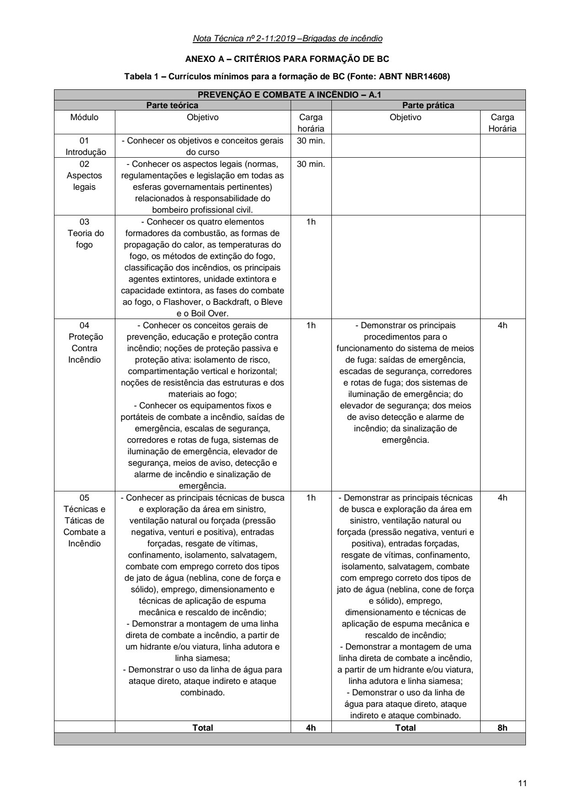

### ANEXO A - CRITÉRIOS PARA FORMAÇÃO DE BC

Tabela 1 - Currículos mínimos para a formação de BC (Fonte: ABNT NBR14608)

### Tabelas extraídas (bruto, não usar para citação)
#### Tabela 1 da página

|  | PREVENÇÃO E COMBATE A INCÊNDIO - A.1 |  |  |  |  |  |  |  |  |  |
| --- | --- | --- | --- | --- | --- | --- | --- | --- | --- | --- |
|  | Parte teórica |  |  |  |  |  |  | Parte prática |  |  |
| Módulo |  | Objetivo |  | Carga horária |  |  | Objetivo |  | Carga Horária |  |
| 01 Introdução |  | - Conhecer os objetivos e conceitos gerais do curso |  | 30 min. |  |  |  |  |  |  |
| 02 Aspectos legais |  | - Conhecer os aspectos legais (normas, regulamentações e legislação em todas as esferas governamentais pertinentes) relacionados à responsabilidade do bombeiro profissional civil. |  | 30 min. |  |  |  |  |  |  |
| 03 Teoria do fogo |  | - Conhecer os quatro elementos formadores da combustão, as formas de propagação do calor, as temperaturas do fogo, os métodos de extinção do fogo, classificação dos incêndios, os principais agentes extintores, unidade extintora e capacidade extintora, as fases do combate ao fogo, o Flashover, o Backdraft, o Bleve e o Boil Over. |  | 1h |  |  |  |  |  |  |
| 04 Proteção Contra Incêndio |  | - Conhecer os conceitos gerais de prevenção, educação e proteção contra incêndio; noções de proteção passiva e proteção ativa: isolamento de risco, compartimentação vertical e horizontal; noções de resistência das estruturas e dos materiais ao fogo; - Conhecer os equipamentos fixos e portáteis de combate a incêndio, saídas de emergência, escalas de segurança, corredores e rotas de fuga, sistemas de iluminação de emergência, elevador de segurança, meios de aviso, detecção e alarme de incêndio e sinalização de emergência. |  | 1h |  |  | - Demonstrar os principais procedimentos para o funcionamento do sistema de meios de fuga: saídas de emergência, escadas de segurança, corredores e rotas de fuga; dos sistemas de iluminação de emergência; do elevador de segurança; dos meios de aviso detecção e alarme de incêndio; da sinalização de emergência. |  | 4h |  |
| 05 Técnicas e Táticas de Combate a Incêndio |  | - Conhecer as principais técnicas de busca e exploração da área em sinistro, ventilação natural ou forçada (pressão negativa, venturi e positiva), entradas forçadas, resgate de vítimas, confinamento, isolamento, salvatagem, combate com emprego correto dos tipos de jato de água (neblina, cone de força e sólido), emprego, dimensionamento e técnicas de aplicação de espuma mecânica e rescaldo de incêndio; - Demonstrar a montagem de uma linha direta de combate a incêndio, a partir de um hidrante e/ou viatura, linha adutora e linha siamesa; - Demonstrar o uso da linha de água para ataque direto, ataque indireto e ataque combinado. |  | 1h |  |  | - Demonstrar as principais técnicas de busca e exploração da área em sinistro, ventilação natural ou forçada (pressão negativa, venturi e positiva), entradas forçadas, resgate de vítimas, confinamento, isolamento, salvatagem, combate com emprego correto dos tipos de jato de água (neblina, cone de força e sólido), emprego, dimensionamento e técnicas de aplicação de espuma mecânica e rescaldo de incêndio; - Demonstrar a montagem de uma linha direta de combate a incêndio, a partir de um hidrante e/ou viatura, linha adutora e linha siamesa; - Demonstrar o uso da linha de água para ataque direto, ataque indireto e ataque combinado. |  | 4h |  |
|  |  | Total |  | 4h |  |  | Total |  | 8h |  |
|  |  |  |  |  |  |  |  |  |  |  |

---

## Página 12

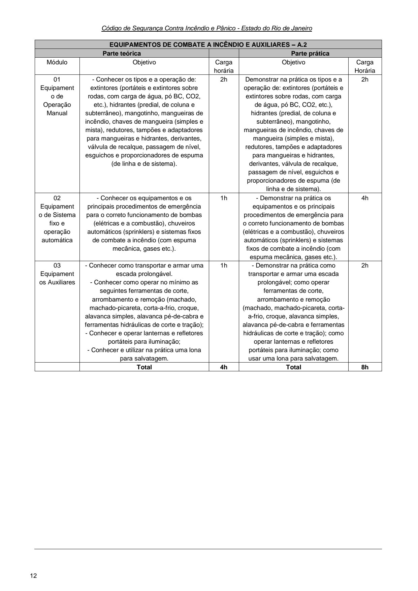

Código de Segurança Contra Incêndio e Pânico - Estado do Rio de Janeiro

Total 4h Total 8h

### Tabelas extraídas (bruto, não usar para citação)
#### Tabela 1 da página

|  | EQUIPAMENTOS DE COMBATE A INCÊNDIO E AUXILIARES - A.2 |  |  |  |  |  |  |  |  |  |  |  |
| --- | --- | --- | --- | --- | --- | --- | --- | --- | --- | --- | --- | --- |
|  | Parte teórica |  |  |  |  |  |  |  | Parte prática |  |  |  |
| Módulo | Módulo | Objetivo | Objetivo |  |  | Carga |  | Objetivo | Objetivo |  | Carga |  |
|  |  |  |  |  |  | horária |  |  |  |  | Horária |  |
| 01 Equipament o de Operação Manual |  | - Conhecer os tipos e a operação de: extintores (portáteis e extintores sobre rodas, com carga de água, pó BC, CO2, etc.), hidrantes (predial, de coluna e subterrâneo), mangotinho, mangueiras de incêndio, chaves de mangueira (simples e mista), redutores, tampões e adaptadores para mangueiras e hidrantes, derivantes, válvula de recalque, passagem de nível, esguichos e proporcionadores de espuma (de linha e de sistema). |  |  | 2h |  |  | Demonstrar na prática os tipos e a operação de: extintores (portáteis e extintores sobre rodas, com carga de água, pó BC, CO2, etc.), hidrantes (predial, de coluna e subterrâneo), mangotinho, mangueiras de incêndio, chaves de mangueira (simples e mista), redutores, tampões e adaptadores para mangueiras e hidrantes, derivantes, válvula de recalque, passagem de nível, esguichos e proporcionadores de espuma (de linha e de sistema). |  | 2h |  |  |
| 02 Equipament o de Sistema fixo e operação automática |  | - Conhecer os equipamentos e os principais procedimentos de emergência para o correto funcionamento de bombas (elétricas e a combustão), chuveiros automáticos (sprinklers) e sistemas fixos de combate a incêndio (com espuma mecânica, gases etc.). |  |  | 1h |  |  | - Demonstrar na prática os equipamentos e os principais procedimentos de emergência para o correto funcionamento de bombas (elétricas e a combustão), chuveiros automáticos (sprinklers) e sistemas fixos de combate a incêndio (com espuma mecânica, gases etc.). |  | 4h |  |  |
| 03 Equipament os Auxiliares |  | - Conhecer como transportar e armar uma escada prolongável. - Conhecer como operar no mínimo as seguintes ferramentas de corte, arrombamento e remoção (machado, machado-picareta, corta-a-frio, croque, alavanca simples, alavanca pé-de-cabra e ferramentas hidráulicas de corte e tração); - Conhecer e operar lanternas e refletores portáteis para iluminação; - Conhecer e utilizar na prática uma lona para salvatagem. |  |  | 1h |  |  | - Demonstrar na prática como transportar e armar uma escada prolongável; como operar ferramentas de corte, arrombamento e remoção (machado, machado-picareta, cortaa-frio, croque, alavanca simples, alavanca pé-de-cabra e ferramentas hidráulicas de corte e tração); como operar lanternas e refletores portáteis para iluminação; como usar uma lona para salvatagem. |  | 2h |  |  |
|  |  | Total |  |  | 4h |  |  | Total |  | 8h |  |  |

---

## Página 13

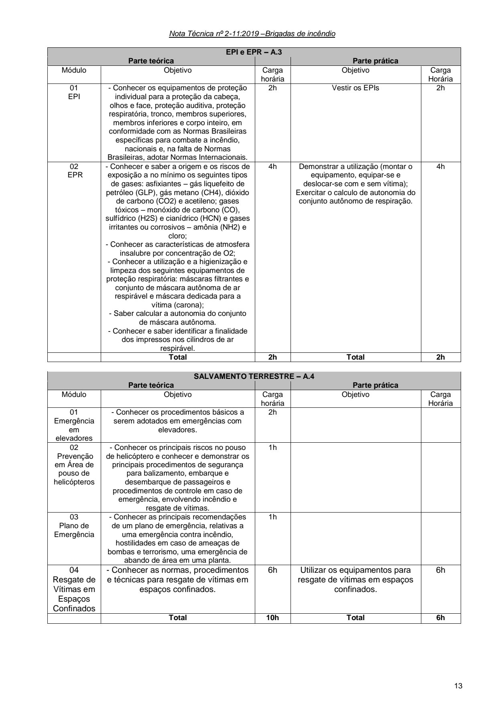

Total 10h Total 6h

### Tabelas extraídas (bruto, não usar para citação)
#### Tabela 1 da página

|  | EPI e EPR - A.3 |  |  |  |  |  |  |  |  |  |  |  |
| --- | --- | --- | --- | --- | --- | --- | --- | --- | --- | --- | --- | --- |
|  | Parte teórica |  |  |  |  |  |  |  | Parte prática |  |  |  |
| Módulo | Módulo | Objetivo | Objetivo |  |  | Carga |  | Objetivo | Objetivo |  | Carga |  |
|  |  |  |  |  |  | horária |  |  |  |  | Horária |  |
| 01 EPI |  | - Conhecer os equipamentos de proteção individual para a proteção da cabeça, olhos e face, proteção auditiva, proteção respiratória, tronco, membros superiores, membros inferiores e corpo inteiro, em conformidade com as Normas Brasileiras específicas para combate a incêndio, nacionais e, na falta de Normas Brasileiras, adotar Normas Internacionais. |  |  | 2h |  |  | Vestir os EPIs |  | 2h |  |  |
| 02 EPR |  | - Conhecer e saber a origem e os riscos de exposição a no mínimo os seguintes tipos de gases: asfixiantes - gás liquefeito de petróleo (GLP), gás metano (CH4), dióxido de carbono (CO2) e acetileno; gases tóxicos - monóxido de carbono (CO), sulfídrico (H2S) e cianídrico (HCN) e gases irritantes ou corrosivos - amônia (NH2) e cloro; - Conhecer as características de atmosfera insalubre por concentração de O2; - Conhecer a utilização e a higienização e limpeza dos seguintes equipamentos de proteção respiratória: máscaras filtrantes e conjunto de máscara autônoma de ar respirável e máscara dedicada para a vítima (carona); - Saber calcular a autonomia do conjunto de máscara autônoma. - Conhecer e saber identificar a finalidade dos impressos nos cilindros de ar respirável. |  |  | 4h |  |  | Demonstrar a utilização (montar o equipamento, equipar-se e deslocar-se com e sem vítima); Exercitar o calculo de autonomia do conjunto autônomo de respiração. |  | 4h |  |  |
|  |  | Total |  |  | 2h |  |  | Total |  | 2h |  |  |

#### Tabela 2 da página

|  | SALVAMENTO TERRESTRE - A.4 |  |  |  |  |  |  |  |  |  |  |  |
| --- | --- | --- | --- | --- | --- | --- | --- | --- | --- | --- | --- | --- |
|  | Parte teórica |  |  |  |  |  |  |  | Parte prática |  |  |  |
| Módulo | Módulo | Objetivo | Objetivo |  |  | Carga |  | Objetivo | Objetivo |  | Carga |  |
|  |  |  |  |  |  | horária |  |  |  |  | Horária |  |
| 01 Emergência em elevadores |  | - Conhecer os procedimentos básicos a serem adotados em emergências com elevadores. |  |  | 2h |  |  |  |  |  |  |  |
| 02 Prevenção em Área de pouso de helicópteros |  | - Conhecer os principais riscos no pouso de helicóptero e conhecer e demonstrar os principais procedimentos de segurança para balizamento, embarque e desembarque de passageiros e procedimentos de controle em caso de emergência, envolvendo incêndio e resgate de vítimas. |  |  | 1h |  |  |  |  |  |  |  |
| 03 Plano de Emergência |  | - Conhecer as principais recomendações de um plano de emergência, relativas a uma emergência contra incêndio, hostilidades em caso de ameaças de bombas e terrorismo, uma emergência de abando de área em uma planta. |  |  | 1h |  |  |  |  |  |  |  |
| 04 Resgate de Vítimas em Espaços Confinados |  | - Conhecer as normas, procedimentos e técnicas para resgate de vítimas em espaços confinados. |  |  | 6h |  |  | Utilizar os equipamentos para resgate de vítimas em espaços confinados. |  | 6h |  |  |
|  |  | Total |  |  | 10h |  |  | Total |  | 6h |  |  |

---

## Página 14

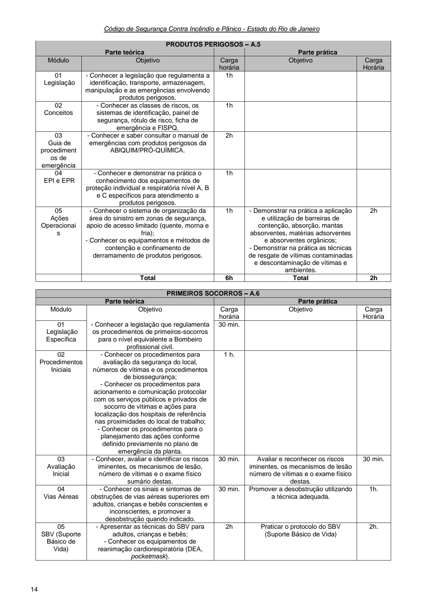

Código de Segurança Contra Incêndio e Pânico - Estado do Rio de Janeiro

### Tabelas extraídas (bruto, não usar para citação)
#### Tabela 1 da página

|  | PRODUTOS PERIGOSOS - A.5 |  |  |  |  |  |  |  |  |  |  |  |
| --- | --- | --- | --- | --- | --- | --- | --- | --- | --- | --- | --- | --- |
|  | Parte teórica |  |  |  |  |  |  |  | Parte prática |  |  |  |
| Módulo | Módulo | Objetivo | Objetivo |  |  | Carga |  | Objetivo | Objetivo |  | Carga |  |
|  |  |  |  |  |  | horária |  |  |  |  | Horária |  |
| 01 Legislação |  | - Conhecer a legislação que regulamenta a identificação, transporte, armazenagem, manipulação e as emergências envolvendo produtos perigosos. |  |  | 1h |  |  |  |  |  |  |  |
| 02 Conceitos |  | - Conhecer as classes de riscos, os sistemas de identificação, painel de segurança, rótulo de risco, ficha de emergência e FISPQ. |  |  | 1h |  |  |  |  |  |  |  |
| 03 Guia de procediment os de emergência |  | - Conhecer e saber consultar o manual de emergências com produtos perigosos da ABIQUIM/PRÓ-QUÍMICA. |  |  | 2h |  |  |  |  |  |  |  |
| 04 EPI e EPR |  | - Conhecer e demonstrar na prática o conhecimento dos equipamentos de proteção individual e respiratória nível A, B e C específicos para atendimento a produtos perigosos. |  |  | 1h |  |  |  |  |  |  |  |
| 05 Ações Operacionai s |  | - Conhecer o sistema de organização da área do sinistro em zonas de segurança, apoio de acesso limitado (quente, morna e fria); - Conhecer os equipamentos e métodos de contenção e confinamento de derramamento de produtos perigosos. |  |  | 1h |  |  | - Demonstrar na prática a aplicação e utilização de barreiras de contenção, absorção, mantas absorventes, matérias adsorventes e absorventes orgânicos; - Demonstrar na prática as técnicas de resgate de vítimas contaminadas e descontaminação de vítimas e ambientes. |  | 2h |  |  |
|  |  | Total |  |  | 6h |  |  | Total |  | 2h |  |  |

#### Tabela 2 da página

|  | PRIMEIROS SOCORROS - A.6 |  |  |  |  |  |  |  |  |  |  |
| --- | --- | --- | --- | --- | --- | --- | --- | --- | --- | --- | --- |
|  | Parte teórica |  |  |  |  |  |  |  | Parte prática |  |  |
| Módulo |  | Objetivo |  |  | Carga horária |  |  | Objetivo |  | Carga Horária |  |
| 01 Legislação Específica |  |  | - Conhecer a legislação que regulamenta |  | 30 min. |  |  |  |  |  |  |
|  |  |  | os procedimentos de primeiros-socorros |  |  |  |  |  |  |  |  |
|  |  |  | para o nível equivalente a Bombeiro |  |  |  |  |  |  |  |  |
|  |  |  | profissional civil. |  |  |  |  |  |  |  |  |
| 02 Procedimentos Iniciais |  |  | - Conhecer os procedimentos para |  | 1 h. |  |  |  |  |  |  |
|  |  |  | avaliação da segurança do local, |  |  |  |  |  |  |  |  |
|  |  |  | números de vítimas e os procedimentos |  |  |  |  |  |  |  |  |
|  |  |  | de biossegurança; |  |  |  |  |  |  |  |  |
|  |  |  | - Conhecer os procedimentos para |  |  |  |  |  |  |  |  |
|  |  |  | acionamento e comunicação protocolar |  |  |  |  |  |  |  |  |
|  |  |  | com os serviços públicos e privados de |  |  |  |  |  |  |  |  |
|  |  |  | socorro de vítimas e ações para |  |  |  |  |  |  |  |  |
|  |  |  | localização dos hospitais de referência |  |  |  |  |  |  |  |  |
|  |  |  | nas proximidades do local de trabalho; |  |  |  |  |  |  |  |  |
|  |  |  | - Conhecer os procedimentos para o |  |  |  |  |  |  |  |  |
|  |  |  | planejamento das ações conforme |  |  |  |  |  |  |  |  |
|  |  |  | definido previamente no plano de |  |  |  |  |  |  |  |  |
|  |  |  | emergência da planta. |  |  |  |  |  |  |  |  |
| 03 Avaliação Inicial |  |  | - Conhecer, avaliar e identificar os riscos |  | 30 min. |  |  | Avaliar e reconhecer os riscos iminentes, os mecanismos de lesão número de vítimas e o exame físico destas. |  | 30 min. |  |
|  |  |  | iminentes, os mecanismos de lesão, |  |  |  |  |  |  |  |  |
|  |  |  | número de vítimas e o exame físico |  |  |  |  |  |  |  |  |
|  |  |  | sumário destas. |  |  |  |  |  |  |  |  |
| 04 Vias Aéreas |  |  | - Conhecer os sinais e sintomas de |  | 30 min. |  |  | Promover a desobstrução utilizando a técnica adequada. |  | 1h. |  |
|  |  |  | obstruções de vias aéreas superiores em |  |  |  |  |  |  |  |  |
|  |  |  | adultos, crianças e bebês conscientes e |  |  |  |  |  |  |  |  |
|  |  |  | inconscientes, e promover a |  |  |  |  |  |  |  |  |
|  |  |  | desobstrução quando indicado. |  |  |  |  |  |  |  |  |
| 05 SBV (Suporte Básico de Vida) |  |  | - Apresentar as técnicas do SBV para |  | 2h |  |  | Praticar o protocolo do SBV (Suporte Básico de Vida) |  | 2h. |  |
|  |  |  | adultos, crianças e bebês; |  |  |  |  |  |  |  |  |
|  |  |  | - Conhecer os equipamentos de |  |  |  |  |  |  |  |  |
|  |  |  | reanimação cardiorespiratória (DEA, |  |  |  |  |  |  |  |  |
|  |  |  | pocketmask). |  |  |  |  |  |  |  |  |

---

## Página 15

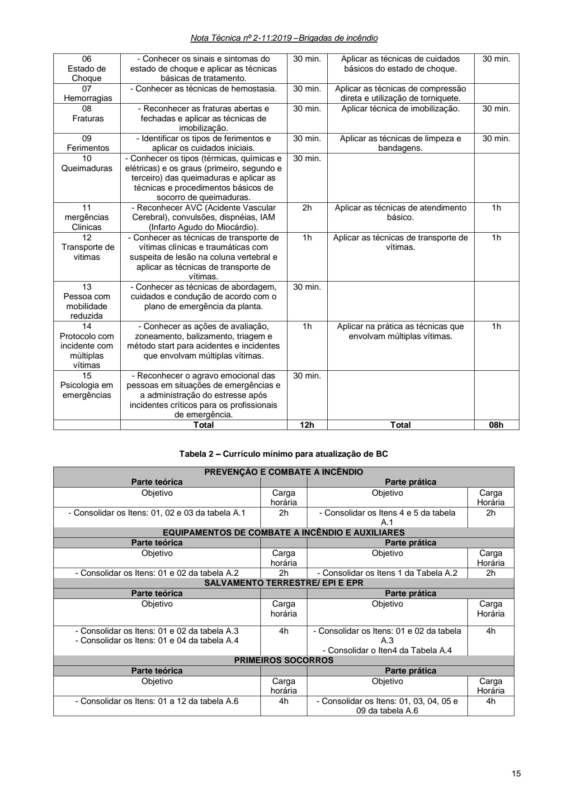

Tabela 2 - Currículo mínimo para atualização de BC

### Tabelas extraídas (bruto, não usar para citação)
#### Tabela 1 da página

| 06 Estado de Choque | - Conhecer os sinais e sintomas do estado de choque e aplicar as técnicas básicas de tratamento. | 30 min. | Aplicar as técnicas de cuidados básicos do estado de choque. | 30 min. |
| --- | --- | --- | --- | --- |
| 07 Hemorragias | - Conhecer as técnicas de hemostasia. | 30 min. | Aplicar as técnicas de compressão direta e utilização de torniquete. |  |
| 08 Fraturas | - Reconhecer as fraturas abertas e fechadas e aplicar as técnicas de imobilização. | 30 min. | Aplicar técnica de imobilização. | 30 min. |
| 09 Ferimentos | - Identificar os tipos de ferimentos e aplicar os cuidados iniciais. | 30 min. | Aplicar as técnicas de limpeza e bandagens. | 30 min. |
| 10 Queimaduras | - Conhecer os tipos (térmicas, químicas e elétricas) e os graus (primeiro, segundo e terceiro) das queimaduras e aplicar as técnicas e procedimentos básicos de socorro de queimaduras. | 30 min. |  |  |
| 11 mergências Clinicas | - Reconhecer AVC (Acidente Vascular Cerebral), convulsões, dispnéias, IAM (Infarto Agudo do Miocárdio). | 2h | Aplicar as técnicas de atendimento básico. | 1h |
| 12 Transporte de vitimas | - Conhecer as técnicas de transporte de vítimas clínicas e traumáticas com suspeita de lesão na coluna vertebral e aplicar as técnicas de transporte de vítimas. | 1h | Aplicar as técnicas de transporte de vítimas. | 1h |
| 13 Pessoa com mobilidade reduzida | - Conhecer as técnicas de abordagem, cuidados e condução de acordo com o plano de emergência da planta. | 30 min. |  |  |
| 14 Protocolo com incidente com múltiplas vítimas | - Conhecer as ações de avaliação, zoneamento, balizamento, triagem e método start para acidentes e incidentes que envolvam múltiplas vítimas. | 1h | Aplicar na prática as técnicas que envolvam múltiplas vítimas. | 1h |
| 15 Psicologia em emergências | - Reconhecer o agravo emocional das pessoas em situações de emergências e a administração do estresse após incidentes críticos para os profissionais de emergência. | 30 min. |  |  |
|  | Total | 12h | Total | 08h |

#### Tabela 2 da página

|  | PREVENÇÃO E COMBATE A INCÊNDIO |  |  |  |  |  |  |  |  |
| --- | --- | --- | --- | --- | --- | --- | --- | --- | --- |
|  | Parte teórica |  |  |  |  |  | Parte prática |  |  |
| Objetivo |  |  | Carga horária |  |  | Objetivo |  | Carga Horária |  |
| - Consolidar os Itens: 01, 02 e 03 da tabela A.1 |  |  | 2h |  |  | - Consolidar os Itens 4 e 5 da tabela A.1 |  | 2h |  |
|  | EQUIPAMENTOS DE COMBATE A INCÊNDIO E AUXILIARES |  |  |  |  |  |  |  |  |
|  | Parte teórica |  |  |  |  |  | Parte prática |  |  |
| Objetivo |  |  | Carga horária |  |  | Objetivo |  | Carga Horária |  |
| - Consolidar os Itens: 01 e 02 da tabela A.2 |  |  | 2h |  |  | - Consolidar os Itens 1 da Tabela A.2 |  | 2h |  |
|  | SALVAMENTO TERRESTRE/ EPI E EPR |  |  |  |  |  |  |  |  |
|  | Parte teórica |  |  |  |  |  | Parte prática |  |  |
| Objetivo |  |  | Carga horária |  |  | Objetivo |  | Carga Horária |  |
| - Consolidar os Itens: 01 e 02 da tabela A.3 - Consolidar os Itens: 01 e 04 da tabela A.4 |  |  | 4h |  |  | - Consolidar os Itens: 01 e 02 da tabela A.3 - Consolidar o Iten4 da Tabela A.4 |  | 4h |  |
|  | PRIMEIROS SOCORROS |  |  |  |  |  |  |  |  |
|  | Parte teórica |  |  |  |  |  | Parte prática |  |  |
| Objetivo |  |  | Carga horária |  |  | Objetivo |  | Carga Horária |  |
| - Consolidar os Itens: 01 a 12 da tabela A.6 |  |  | 4h |  |  | - Consolidar os Itens: 01, 03, 04, 05 e 09 da tabela A.6 |  | 4h |  |

---

## Página 16

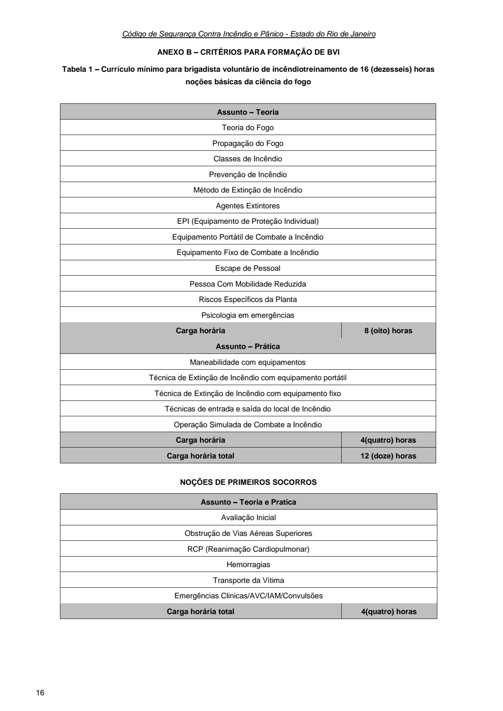

Código de Segurança Contra Incêndio e Pânico - Estado do Rio de Janeiro

### ANEXO B - CRITÉRIOS PARA FORMAÇÃO DE BVI

Tabela 1 - Currículo mínimo para brigadista voluntário de incêndiotreinamento de 16 (dezesseis) horas

noções básicas da ciência do fogo

### NOÇÕES DE PRIMEIROS SOCORROS

### Tabelas extraídas (bruto, não usar para citação)
#### Tabela 1 da página

|  | Assunto - Teoria |  |  |  |  |
| --- | --- | --- | --- | --- | --- |
| Teoria do Fogo |  |  |  |  |  |
| Propagação do Fogo |  |  |  |  |  |
| Classes de Incêndio |  |  |  |  |  |
| Prevenção de Incêndio |  |  |  |  |  |
| Método de Extinção de Incêndio |  |  |  |  |  |
| Agentes Extintores |  |  |  |  |  |
| EPI (Equipamento de Proteção Individual) |  |  |  |  |  |
| Equipamento Portátil de Combate a Incêndio |  |  |  |  |  |
| Equipamento Fixo de Combate a Incêndio |  |  |  |  |  |
| Escape de Pessoal |  |  |  |  |  |
| Pessoa Com Mobilidade Reduzida |  |  |  |  |  |
| Riscos Específicos da Planta |  |  |  |  |  |
| Psicologia em emergências |  |  |  |  |  |
|  | Carga horária |  |  | 8 (oito) horas |  |
|  | Assunto - Prática |  |  |  |  |
| Maneabilidade com equipamentos |  |  |  |  |  |
| Técnica de Extinção de Incêndio com equipamento portátil |  |  |  |  |  |
| Técnica de Extinção de Incêndio com equipamento fixo |  |  |  |  |  |
| Técnicas de entrada e saída do local de Incêndio |  |  |  |  |  |
| Operação Simulada de Combate a Incêndio |  |  |  |  |  |
|  | Carga horária |  |  | 4(quatro) horas |  |
|  | Carga horária total |  |  | 12 (doze) horas |  |

#### Tabela 2 da página

|  | Assunto - Teoria e Pratica |  |  |  |  |
| --- | --- | --- | --- | --- | --- |
| Avaliação Inicial |  |  |  |  |  |
| Obstrução de Vias Aéreas Superiores |  |  |  |  |  |
| RCP (Reanimação Cardiopulmonar) |  |  |  |  |  |
| Hemorragias |  |  |  |  |  |
| Transporte da Vítima |  |  |  |  |  |
| Emergências Clinicas/AVC/IAM/Convulsões |  |  |  |  |  |
|  | Carga horária total |  |  | 4(quatro) horas |  |

---

## Página 17

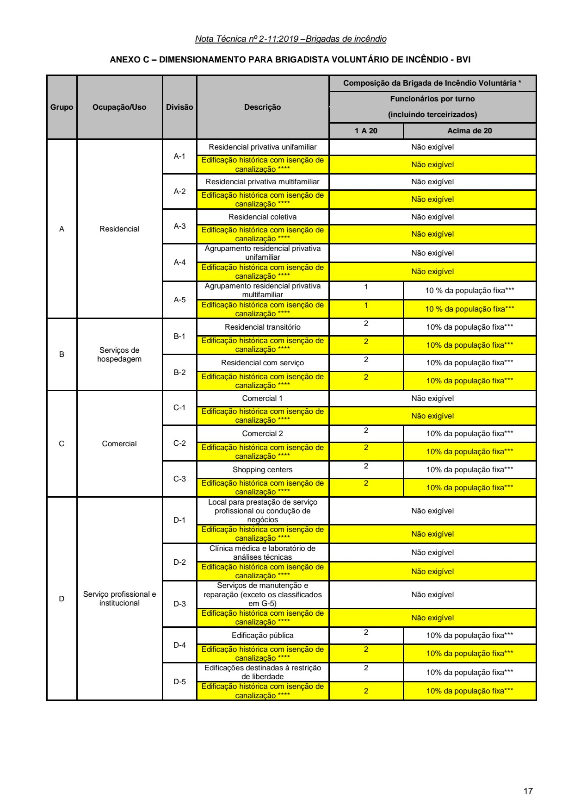

### ANEXO C - DIMENSIONAMENTO PARA BRIGADISTA VOLUNTÁRIO DE INCÊNDIO - BVI

### Tabelas extraídas (bruto, não usar para citação)
#### Tabela 1 da página

|  |  | Divisão |  | Composição da Brigada de Incêndio Voluntária * |  |  |
| --- | --- | --- | --- | --- | --- | --- |
|  |  |  |  | Funcionários por turno |  |  |
| Grupo | Ocupação/Uso |  | Descrição | (incluindo terceirizados) |  |  |
|  |  |  |  |  |  |  |
|  |  |  |  | 1 A 20 |  | Acima de 20 |
| A | Residencial | A-1 | Residencial privativa unifamiliar | Não exigível |  |  |
|  |  |  | Edificação histórica com isenção de | Não exigível |  |  |
|  |  |  | canalização **** |  |  |  |
|  |  | A-2 | Residencial privativa multifamiliar | Não exigível |  |  |
|  |  |  | Edificação histórica com isenção de | Não exigível |  |  |
|  |  |  | canalização **** |  |  |  |
|  |  | A-3 | Residencial coletiva | Não exigível |  |  |
|  |  |  | Edificação histórica com isenção de | Não exigível |  |  |
|  |  |  | canalização **** |  |  |  |
|  |  | A-4 | Agrupamento residencial privativa unifamiliar | Não exigível |  |  |
|  |  |  | Edificação histórica com isenção de | Não exigível |  |  |
|  |  |  | canalização **** |  |  |  |
|  |  | A-5 | Agrupamento residencial privativa multifamiliar | 1 |  | 10 % da população fixa*** |
|  |  |  | Edificação histórica com isenção de |  | 1 | 10 % da população fixa*** |
|  |  |  | canalização **** |  |  |  |
| B | Serviços de hospedagem | B-1 | Residencial transitório | 2 |  | 10% da população fixa*** |
|  |  |  | Edificação histórica com isenção de |  | 2 | 10% da população fixa*** |
|  |  |  | canalização **** |  |  |  |
|  |  | B-2 | Residencial com serviço | 2 |  | 10% da população fixa*** |
|  |  |  | Edificação histórica com isenção de |  | 2 | 10% da população fixa*** |
|  |  |  | canalização **** |  |  |  |
| C | Comercial | C-1 | Comercial 1 | Não exigível |  |  |
|  |  |  | Edificação histórica com isenção de | Não exigível |  |  |
|  |  |  | canalização **** |  |  |  |
|  |  | C-2 | Comercial 2 | 2 |  | 10% da população fixa*** |
|  |  |  | Edificação histórica com isenção de |  | 2 | 10% da população fixa*** |
|  |  |  | canalização **** |  |  |  |
|  |  | C-3 | Shopping centers | 2 |  | 10% da população fixa*** |
|  |  |  | Edificação histórica com isenção de |  | 2 | 10% da população fixa*** |
|  |  |  | canalização **** |  |  |  |
| D | Serviço profissional e institucional | D-1 | Local para prestação de serviço profissional ou condução de negócios | Não exigível |  |  |
|  |  |  | Edificação histórica com isenção de | Não exigível |  |  |
|  |  |  | canalização **** |  |  |  |
|  |  | D-2 | Clínica médica e laboratório de análises técnicas | Não exigível |  |  |
|  |  |  | Edificação histórica com isenção de | Não exigível |  |  |
|  |  |  | canalização **** |  |  |  |
|  |  | D-3 | Serviços de manutenção e reparação (exceto os classificados em G-5) | Não exigível |  |  |
|  |  |  | Edificação histórica com isenção de | Não exigível |  |  |
|  |  |  | canalização **** |  |  |  |
|  |  | D-4 | Edificação pública | 2 |  | 10% da população fixa*** |
|  |  |  | Edificação histórica com isenção de |  | 2 | 10% da população fixa*** |
|  |  |  | canalização **** |  |  |  |
|  |  | D-5 | Edificações destinadas à restrição | 2 |  | 10% da população fixa*** |
|  |  |  | de liberdade |  |  |  |
|  |  |  | Edificação histórica com isenção de | 2 |  | 10% da população fixa*** |
|  |  |  | canalização **** |  |  |  |

---

## Página 18

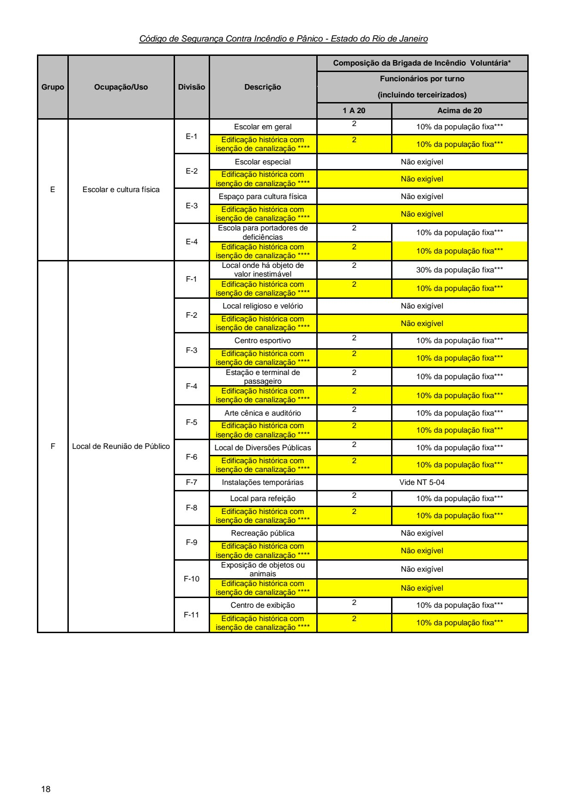

Código de Segurança Contra Incêndio e Pânico - Estado do Rio de Janeiro

### Tabelas extraídas (bruto, não usar para citação)
#### Tabela 1 da página

| Grupo |  | Divisão |  | Composição da Brigada de Incêndio Voluntária* |  |
| --- | --- | --- | --- | --- | --- |
|  |  |  |  | Funcionários por turno |  |
|  | Ocupação/Uso |  | Descrição | (incluindo terceirizados) |  |
|  |  |  |  | 1 A 20 | Acima de 20 |
| E | Escolar e cultura física | E-1 | Escolar em geral | 2 | 10% da população fixa*** |
|  |  |  | Edificação histórica com isenção de canalização **** | 2 | 10% da população fixa*** |
|  |  | E-2 | Escolar especial | Não exigível |  |
|  |  |  | Edificação histórica com isenção de canalização **** | Não exigível |  |
|  |  | E-3 | Espaço para cultura física | Não exigível |  |
|  |  |  | Edificação histórica com isenção de canalização **** | Não exigível |  |
|  |  | E-4 | Escola para portadores de deficiências | 2 | 10% da população fixa*** |
|  |  |  | Edificação histórica com isenção de canalização **** | 2 | 10% da população fixa*** |
| F | Local de Reunião de Público | F-1 | Local onde há objeto de valor inestimável | 2 | 30% da população fixa*** |
|  |  |  | Edificação histórica com isenção de canalização **** | 2 | 10% da população fixa*** |
|  |  | F-2 | Local religioso e velório | Não exigível |  |
|  |  |  | Edificação histórica com isenção de canalização **** | Não exigível |  |
|  |  | F-3 | Centro esportivo | 2 | 10% da população fixa*** |
|  |  |  | Edificação histórica com isenção de canalização **** | 2 | 10% da população fixa*** |
|  |  | F-4 | Estação e terminal de passageiro | 2 | 10% da população fixa*** |
|  |  |  | Edificação histórica com isenção de canalização **** | 2 | 10% da população fixa*** |
|  |  | F-5 | Arte cênica e auditório | 2 | 10% da população fixa*** |
|  |  |  | Edificação histórica com isenção de canalização **** | 2 | 10% da população fixa*** |
|  |  | F-6 | Local de Diversões Públicas | 2 | 10% da população fixa*** |
|  |  |  | Edificação histórica com isenção de canalização **** | 2 | 10% da população fixa*** |
|  |  | F-7 | Instalações temporárias | Vide NT 5-04 |  |
|  |  | F-8 | Local para refeição | 2 | 10% da população fixa*** |
|  |  |  | Edificação histórica com isenção de canalização **** | 2 | 10% da população fixa*** |
|  |  | F-9 | Recreação pública | Não exigível |  |
|  |  |  | Edificação histórica com isenção de canalização **** | Não exigível |  |
|  |  | F-10 | Exposição de objetos ou animais | Não exigível |  |
|  |  |  | Edificação histórica com isenção de canalização **** | Não exigível |  |
|  |  | F-11 | Centro de exibição | 2 | 10% da população fixa*** |
|  |  |  | Edificação histórica com isenção de canalização **** | 2 | 10% da população fixa*** |

---

## Página 19

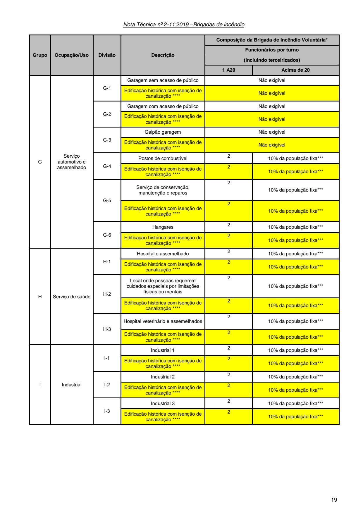

> Página sem texto extraível suficiente; consultar a representação visual ou o PDF oficial.

### Tabelas extraídas (bruto, não usar para citação)
#### Tabela 1 da página

|  |  | Divisão | Descrição |  | Composição da Brigada de Incêndio Voluntária* |  |  |
| --- | --- | --- | --- | --- | --- | --- | --- |
|  |  |  |  |  | Funcionários por turno |  |  |
|  |  |  |  |  |  | Funcionários por turno |  |
| Grupo | Ocupação/Uso |  |  | Descrição | (incluindo terceirizados) |  |  |
|  |  |  |  |  | 1 A20 |  | Acima de 20 |
| G | Serviço automotivo e assemelhado | G-1 | Garagem sem acesso de público |  | Não exigível |  |  |
|  |  |  | Edificação histórica com isenção de canalização **** |  | Não exigível |  |  |
|  |  | G-2 | Garagem com acesso de público |  | Não exigível |  |  |
|  |  |  | Edificação histórica com isenção de canalização **** |  | Não exigível |  |  |
|  |  | G-3 | Galpão garagem |  | Não exigível |  |  |
|  |  |  | Edificação histórica com isenção de canalização **** |  | Não exigível |  |  |
|  |  | G-4 | Postos de combustível |  | 2 |  | 10% da população fixa*** |
|  |  |  | Edificação histórica com isenção de canalização **** |  | 2 |  | 10% da população fixa*** |
|  |  | G-5 | Serviço de conservação, manutenção e reparos |  | 2 |  | 10% da população fixa*** |
|  |  |  | Edificação histórica com isenção de canalização **** |  |  | 2 | 10% da população fixa*** |
|  |  | G-6 | Hangares |  | 2 |  | 10% da população fixa*** |
|  |  |  | Edificação histórica com isenção de canalização **** |  | 2 |  | 10% da população fixa*** |
| H | Serviço de saúde | H-1 | Hospital e assemelhado |  | 2 |  | 10% da população fixa*** |
|  |  |  | Edificação histórica com isenção de canalização **** |  | 2 |  | 10% da população fixa*** |
|  |  | H-2 | Local onde pessoas requerem cuidados especiais por limitações físicas ou mentais |  | 2 |  | 10% da população fixa*** |
|  |  |  | Edificação histórica com isenção de canalização **** |  | 2 |  | 10% da população fixa*** |
|  |  | H-3 | Hospital veterinário e assemelhados |  | 2 |  | 10% da população fixa*** |
|  |  |  | Edificação histórica com isenção de canalização **** |  | 2 |  | 10% da população fixa*** |
| I | Industrial | I-1 | Industrial 1 |  | 2 |  | 10% da população fixa*** |
|  |  |  | Edificação histórica com isenção de canalização **** |  | 2 |  | 10% da população fixa*** |
|  |  | I-2 | Industrial 2 |  | 2 |  | 10% da população fixa*** |
|  |  |  | Edificação histórica com isenção de canalização **** |  | 2 |  | 10% da população fixa*** |
|  |  | I-3 | Industrial 3 |  | 2 |  | 10% da população fixa*** |
|  |  |  | Edificação histórica com isenção de canalização **** |  | 2 |  | 10% da população fixa*** |

---

## Página 20

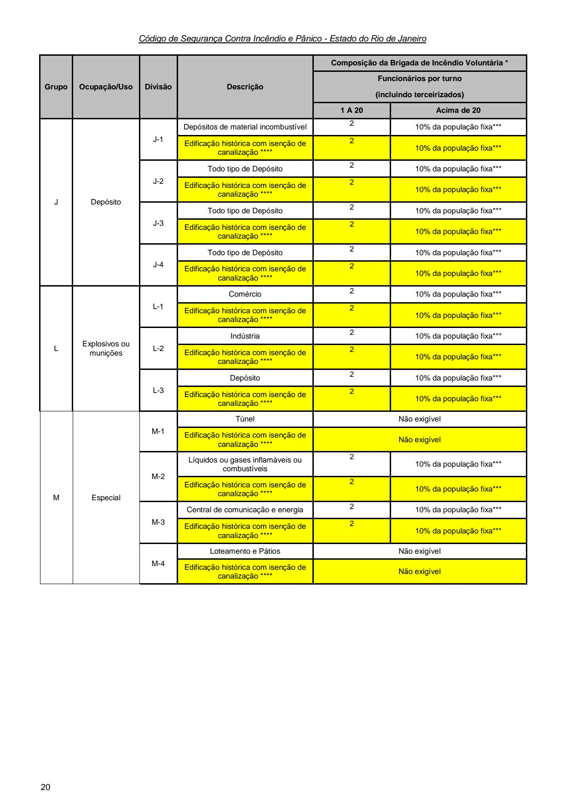

Código de Segurança Contra Incêndio e Pânico - Estado do Rio de Janeiro

### Tabelas extraídas (bruto, não usar para citação)
#### Tabela 1 da página

|  |  |  | Descrição | Composição da Brigada de Incêndio Voluntária * |  |
| --- | --- | --- | --- | --- | --- |
|  |  |  |  | Funcionários por turno |  |
| Grupo | Ocupação/Uso | Divisão |  | (incluindo terceirizados) |  |
|  |  |  |  | 1 A 20 | Acima de 20 |
| J | Depósito | J-1 | Depósitos de material incombustível | 2 | 10% da população fixa*** |
|  |  |  | Edificação histórica com isenção de canalização **** | 2 | 10% da população fixa*** |
|  |  | J-2 | Todo tipo de Depósito | 2 | 10% da população fixa*** |
|  |  |  | Edificação histórica com isenção de canalização **** | 2 | 10% da população fixa*** |
|  |  | J-3 | Todo tipo de Depósito | 2 | 10% da população fixa*** |
|  |  |  | Edificação histórica com isenção de canalização **** | 2 | 10% da população fixa*** |
|  |  | J-4 | Todo tipo de Depósito | 2 | 10% da população fixa*** |
|  |  |  | Edificação histórica com isenção de canalização **** | 2 | 10% da população fixa*** |
| L | Explosivos ou munições | L-1 | Comércio | 2 | 10% da população fixa*** |
|  |  |  | Edificação histórica com isenção de canalização **** | 2 | 10% da população fixa*** |
|  |  | L-2 | Indústria | 2 | 10% da população fixa*** |
|  |  |  | Edificação histórica com isenção de canalização **** | 2 | 10% da população fixa*** |
|  |  | L-3 | Depósito | 2 | 10% da população fixa*** |
|  |  |  | Edificação histórica com isenção de canalização **** | 2 | 10% da população fixa*** |
| M | Especial | M-1 | Túnel | Não exigível |  |
|  |  |  | Edificação histórica com isenção de canalização **** | Não exigível |  |
|  |  | M-2 | Líquidos ou gases inflamáveis ou combustíveis | 2 | 10% da população fixa*** |
|  |  |  | Edificação histórica com isenção de canalização **** | 2 | 10% da população fixa*** |
|  |  | M-3 | Central de comunicação e energia | 2 | 10% da população fixa*** |
|  |  |  | Edificação histórica com isenção de canalização **** | 2 | 10% da população fixa*** |
|  |  | M-4 | Loteamento e Pátios | Não exigível |  |
|  |  |  | Edificação histórica com isenção de canalização **** | Não exigível |  |

---

## Página 21

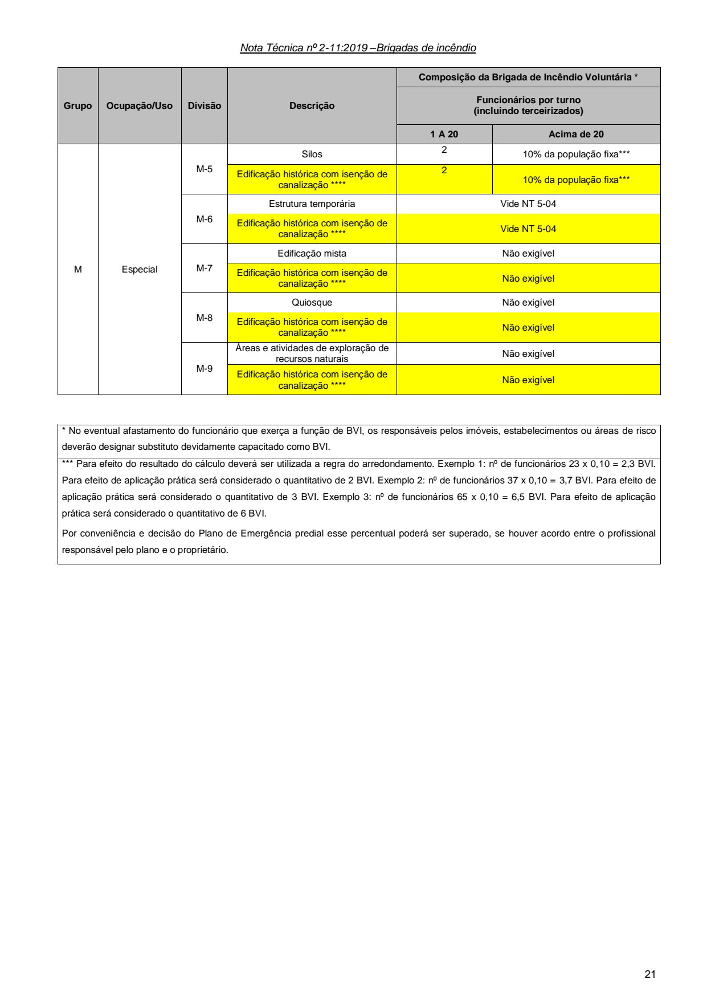

> Página sem texto extraível suficiente; consultar a representação visual ou o PDF oficial.

### Tabelas extraídas (bruto, não usar para citação)
#### Tabela 1 da página

| Grupo | Ocupação/Uso | Divisão | Descrição | Composição da Brigada de Incêndio Voluntária * |  |
| --- | --- | --- | --- | --- | --- |
|  |  |  |  | Funcionários por turno (incluindo terceirizados) |  |
|  |  |  |  | 1 A 20 | Acima de 20 |
| M | Especial | M-5 | Silos | 2 | 10% da população fixa*** |
|  |  |  | Edificação histórica com isenção de canalização **** | 2 | 10% da população fixa*** |
|  |  | M-6 | Estrutura temporária | Vide NT 5-04 |  |
|  |  |  | Edificação histórica com isenção de canalização **** | Vide NT 5-04 |  |
|  |  | M-7 | Edificação mista | Não exigível |  |
|  |  |  | Edificação histórica com isenção de canalização **** | Não exigível |  |
|  |  | M-8 | Quiosque | Não exigível |  |
|  |  |  | Edificação histórica com isenção de canalização **** | Não exigível |  |
|  |  | M-9 | Áreas e atividades de exploração de recursos naturais | Não exigível |  |
|  |  |  | Edificação histórica com isenção de canalização **** | Não exigível |  |
|  |  |  |  |  |  |
| * No eventual afastamento do funcionário que exerça a função de BVI, os responsáveis pelos imóveis, estabelecimentos ou áreas de risco deverão designar substituto devidamente capacitado como BVI. |  |  |  |  |  |
| *** Para efeito do resultado do cálculo deverá ser utilizada a regra do arredondamento. Exemplo 1: nº de funcionários 23 x 0,10 = 2,3 BVI. Para efeito de aplicação prática será considerado o quantitativo de 2 BVI. Exemplo 2: nº de funcionários 37 x 0,10 = 3,7 BVI. Para efeito de aplicação prática será considerado o quantitativo de 3 BVI. Exemplo 3: nº de funcionários 65 x 0,10 = 6,5 BVI. Para efeito de aplicação prática será considerado o quantitativo de 6 BVI. Por conveniência e decisão do Plano de Emergência predial esse percentual poderá ser superado, se houver acordo entre o profissional responsável pelo plano e o proprietário. |  |  |  |  |  |

---

## Página 22

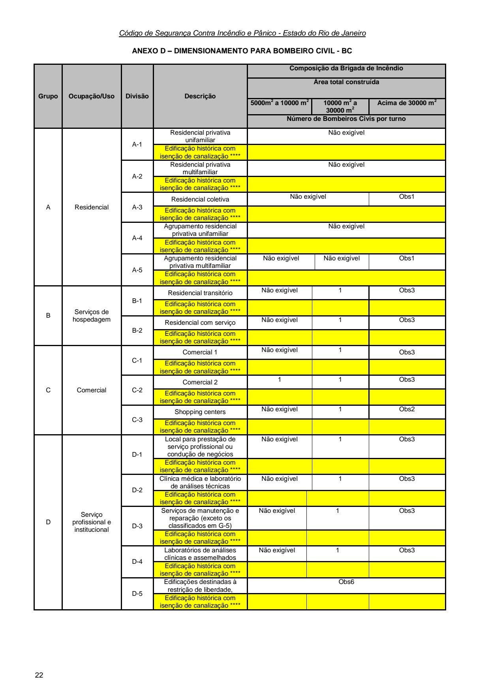

Código de Segurança Contra Incêndio e Pânico - Estado do Rio de Janeiro

### ANEXO D - DIMENSIONAMENTO PARA BOMBEIRO CIVIL - BC

### Tabelas extraídas (bruto, não usar para citação)
#### Tabela 1 da página

| Grupo | Ocupação/Uso | Divisão | Descrição | Composição da Brigada de Incêndio |  |  |
| --- | --- | --- | --- | --- | --- | --- |
|  |  |  |  | Área total construída |  |  |
|  |  |  |  |  |  |  |
|  |  |  |  | 5000m2 a 10000 m2 | 10000 m2 a 30000 m2 | Acima de 30000 m2 |
|  |  |  |  | Número de Bombeiros Civis por turno |  |  |
| A | Residencial | A-1 | Residencial privativa unifamiliar | Não exigível |  |  |
|  |  |  | Edificação histórica com isenção de canalização **** |  |  |  |
|  |  | A-2 | Residencial privativa multifamiliar | Não exigível |  |  |
|  |  |  | Edificação histórica com isenção de canalização **** |  |  |  |
|  |  | A-3 | Residencial coletiva | Não exigível |  | Obs1 |
|  |  |  | Edificação histórica com isenção de canalização **** |  |  |  |
|  |  | A-4 | Agrupamento residencial privativa unifamiliar | Não exigível |  |  |
|  |  |  | Edificação histórica com isenção de canalização **** |  |  |  |
|  |  | A-5 | Agrupamento residencial privativa multifamiliar | Não exigível | Não exigível | Obs1 |
|  |  |  | Edificação histórica com isenção de canalização **** |  |  |  |
| B | Serviços de hospedagem | B-1 | Residencial transitório | Não exigível | 1 | Obs3 |
|  |  |  | Edificação histórica com isenção de canalização **** |  |  |  |
|  |  | B-2 | Residencial com serviço | Não exigível | 1 | Obs3 |
|  |  |  | Edificação histórica com isenção de canalização **** |  |  |  |
| C | Comercial | C-1 | Comercial 1 | Não exigível | 1 | Obs3 |
|  |  |  | Edificação histórica com isenção de canalização **** |  |  |  |
|  |  | C-2 | Comercial 2 | 1 | 1 | Obs3 |
|  |  |  | Edificação histórica com isenção de canalização **** |  |  |  |
|  |  | C-3 | Shopping centers | Não exigível | 1 | Obs2 |
|  |  |  | Edificação histórica com isenção de canalização **** |  |  |  |
| D | Serviço profissional e institucional | D-1 | Local para prestação de serviço profissional ou condução de negócios | Não exigível | 1 | Obs3 |
|  |  |  | Edificação histórica com isenção de canalização **** |  |  |  |
|  |  | D-2 | Clínica médica e laboratório de análises técnicas | Não exigível | 1 | Obs3 |
|  |  |  | Edificação histórica com isenção de canalização **** |  |  |  |
|  |  | D-3 | Serviços de manutenção e reparação (exceto os classificados em G-5) | Não exigível | 1 | Obs3 |
|  |  |  | Edificação histórica com isenção de canalização **** |  |  |  |
|  |  | D-4 | Laboratórios de análises clínicas e assemelhados | Não exigível | 1 | Obs3 |
|  |  |  | Edificação histórica com isenção de canalização **** |  |  |  |
|  |  | D-5 | Edificações destinadas à restrição de liberdade, | Obs6 |  |  |
|  |  |  | Edificação histórica com isenção de canalização **** |  |  |  |

---

## Página 23

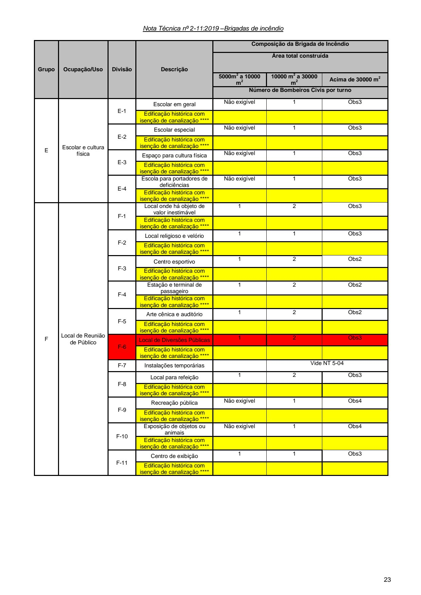

> Página sem texto extraível suficiente; consultar a representação visual ou o PDF oficial.

### Tabelas extraídas (bruto, não usar para citação)
#### Tabela 1 da página

| Grupo | Ocupação/Uso | Divisão | Descrição | Composição da Brigada de Incêndio |  |  |  |
| --- | --- | --- | --- | --- | --- | --- | --- |
|  |  |  |  | Área total construída |  |  |  |
|  |  |  |  |  |  |  |  |
|  |  |  |  | 5000m2 a 10000 m2 | 10000 m2 a 30000 m2 | Acima de 30000 m2 |  |
|  |  |  |  | Número de Bombeiros Civis por turno |  |  |  |
| E | Escolar e cultura física | E-1 | Escolar em geral | Não exigível | 1 | Obs3 |  |
|  |  |  | Edificação histórica com isenção de canalização **** |  |  |  |  |
|  |  | E-2 | Escolar especial | Não exigível | 1 | Obs3 |  |
|  |  |  | Edificação histórica com isenção de canalização **** |  |  |  |  |
|  |  | E-3 | Espaço para cultura física | Não exigível | 1 | Obs3 |  |
|  |  |  | Edificação histórica com isenção de canalização **** |  |  |  |  |
|  |  | E-4 | Escola para portadores de deficiências | Não exigível | 1 | Obs3 |  |
|  |  |  | Edificação histórica com isenção de canalização **** |  |  |  |  |
| F | Local de Reunião de Público | F-1 | Local onde há objeto de valor inestimável | 1 | 2 | Obs3 |  |
|  |  |  | Edificação histórica com isenção de canalização **** |  |  |  |  |
|  |  | F-2 | Local religioso e velório | 1 | 1 | Obs3 |  |
|  |  |  | Edificação histórica com isenção de canalização **** |  |  |  |  |
|  |  | F-3 | Centro esportivo | 1 | 2 | Obs2 |  |
|  |  |  | Edificação histórica com isenção de canalização **** |  |  |  |  |
|  |  |  |  |  |  |  |  |
|  |  | F-4 | Estação e terminal de passageiro | 1 | 2 | Obs2 |  |
|  |  |  | Edificação histórica com isenção de canalização **** |  |  |  |  |
|  |  | F-5 | Arte cênica e auditório | 1 | 2 | Obs2 |  |
|  |  |  | Edificação histórica com isenção de canalização **** |  |  |  |  |
|  |  | F-6 | Local de Diversões Públicas | 1 | 2 | Obs3 |  |
|  |  |  | Edificação histórica com isenção de canalização **** |  |  |  |  |
|  |  | F-7 | Instalações temporárias |  | Vide NT 5-04 |  |  |
|  |  | F-8 | Local para refeição | 1 | 2 | Obs3 |  |
|  |  |  | Edificação histórica com isenção de canalização **** |  |  |  |  |
|  |  | F-9 | Recreação pública | Não exigível | 1 | Obs4 |  |
|  |  |  | Edificação histórica com isenção de canalização **** |  |  |  |  |
|  |  | F-10 | Exposição de objetos ou animais | Não exigível | 1 | Obs4 |  |
|  |  |  | Edificação histórica com isenção de canalização **** |  |  |  |  |
|  |  | F-11 | Centro de exibição | 1 | 1 | Obs3 |  |
|  |  |  | Edificação histórica com isenção de canalização **** |  |  |  |  |

---

## Página 24

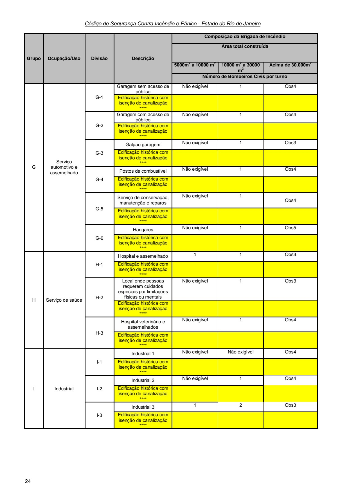

Código de Segurança Contra Incêndio e Pânico - Estado do Rio de Janeiro

### Tabelas extraídas (bruto, não usar para citação)
#### Tabela 1 da página

| Grupo | Ocupação/Uso | Divisão |  | Composição da Brigada de Incêndio | Composição da Brigada de Incêndio |  |  |
| --- | --- | --- | --- | --- | --- | --- | --- |
|  |  |  |  | Área total construída | Área total construída |  |  |
|  |  |  |  |  |  |  |  |
|  |  |  | Descrição |  |  |  |  |
|  |  |  |  | 5000m2 a 10000 m2 |  | 10000 m2 a 30000 m2 | Acima de 30.000m2 |
|  |  |  |  | Número de Bombeiros Civis por turno | Número de Bombeiros Civis por turno |  |  |
| G | Serviço automotivo e assemelhado | G-1 | Garagem sem acesso de público | Não exigível |  | 1 | Obs4 |
|  |  |  | Edificação histórica com |  |  |  |  |
|  |  |  | isenção de canalização |  |  |  |  |
|  |  |  | **** |  |  |  |  |
|  |  | G-2 | Garagem com acesso de público | Não exigível |  | 1 | Obs4 |
|  |  |  | Edificação histórica com |  |  |  |  |
|  |  |  | isenção de canalização |  |  |  |  |
|  |  |  | **** |  |  |  |  |
|  |  | G-3 | Galpão garagem | Não exigível |  | 1 | Obs3 |
|  |  |  | Edificação histórica com |  |  |  |  |
|  |  |  | isenção de canalização |  |  |  |  |
|  |  |  | **** |  |  |  |  |
|  |  | G-4 | Postos de combustível | Não exigível |  | 1 | Obs4 |
|  |  |  | Edificação histórica com |  |  |  |  |
|  |  |  | isenção de canalização |  |  |  |  |
|  |  |  | **** |  |  |  |  |
|  |  | G-5 | Serviço de conservação, manutenção e reparos | Não exigível |  | 1 | Obs4 |
|  |  |  | Edificação histórica com |  |  |  |  |
|  |  |  | isenção de canalização |  |  |  |  |
|  |  |  | **** |  |  |  |  |
|  |  | G-6 | Hangares | Não exigível |  | 1 | Obs5 |
|  |  |  | Edificação histórica com |  |  |  |  |
|  |  |  | isenção de canalização |  |  |  |  |
|  |  |  | **** |  |  |  |  |
| H | Serviço de saúde | H-1 | Hospital e assemelhado | 1 |  | 1 | Obs3 |
|  |  |  | Edificação histórica com |  |  |  |  |
|  |  |  | isenção de canalização |  |  |  |  |
|  |  |  | **** |  |  |  |  |
|  |  | H-2 | Local onde pessoas requerem cuidados especiais por limitações físicas ou mentais | Não exigível |  | 1 | Obs3 |
|  |  |  | Edificação histórica com |  |  |  |  |
|  |  |  | isenção de canalização |  |  |  |  |
|  |  |  | **** |  |  |  |  |
|  |  | H-3 | Hospital veterinário e assemelhados | Não exigível |  | 1 | Obs4 |
|  |  |  | Edificação histórica com |  |  |  |  |
|  |  |  | isenção de canalização |  |  |  |  |
|  |  |  | **** |  |  |  |  |
| I | Industrial | I-1 | Industrial 1 | Não exigível |  | Não exigível | Obs4 |
|  |  |  | Edificação histórica com |  |  |  |  |
|  |  |  | isenção de canalização |  |  |  |  |
|  |  |  | **** |  |  |  |  |
|  |  | I-2 | Industrial 2 | Não exigível |  | 1 | Obs4 |
|  |  |  | Edificação histórica com |  |  |  |  |
|  |  |  | isenção de canalização |  |  |  |  |
|  |  |  | **** |  |  |  |  |
|  |  | I-3 | Industrial 3 | 1 |  | 2 | Obs3 |
|  |  |  | Edificação histórica com |  |  |  |  |
|  |  |  | isenção de canalização |  |  |  |  |
|  |  |  | **** |  |  |  |  |

---

## Página 25

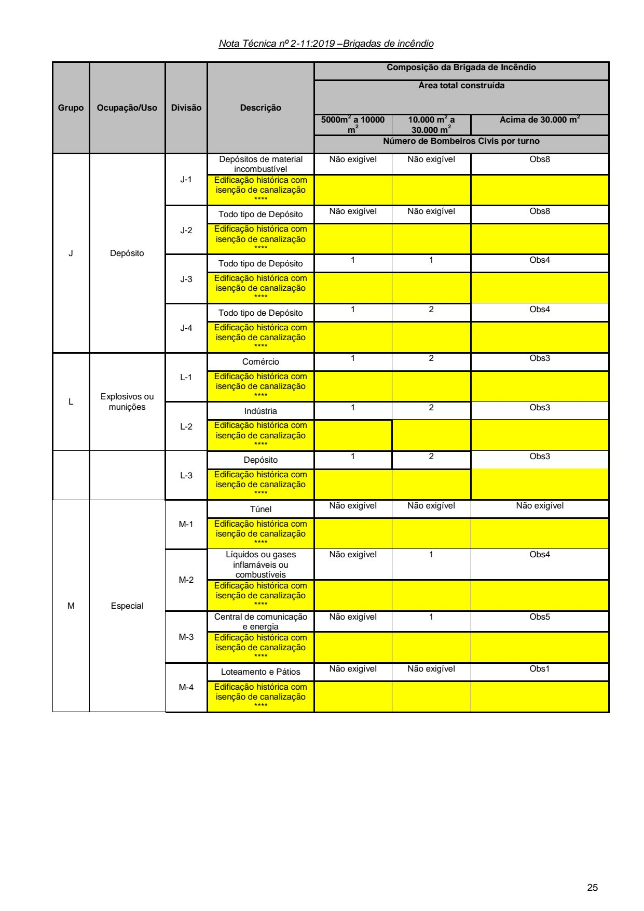

> Página sem texto extraível suficiente; consultar a representação visual ou o PDF oficial.

### Tabelas extraídas (bruto, não usar para citação)
#### Tabela 1 da página

| Grupo | Ocupação/Uso | Divisão | Descrição | Composição da Brigada de Incêndio |  |  |  |  |
| --- | --- | --- | --- | --- | --- | --- | --- | --- |
|  |  |  |  | Área total construída |  |  |  |  |
|  |  |  |  |  |  |  |  |  |
|  |  |  |  | 5000m2 a 10000 m2 |  | 10.000 m2 a 30.000 m2 | Acima de 30.000 m2 |  |
|  |  |  |  | Número de Bombeiros Civis por turno |  |  |  |  |
| J | Depósito | J-1 | Depósitos de material incombustível | Não exigível |  | Não exigível | Obs8 |  |
|  |  |  | Edificação histórica com isenção de canalização **** |  |  |  |  |  |
|  |  | J-2 | Todo tipo de Depósito | Não exigível |  | Não exigível | Obs8 |  |
|  |  |  | Edificação histórica com isenção de canalização **** |  |  |  |  |  |
|  |  | J-3 | Todo tipo de Depósito | 1 |  | 1 | Obs4 |  |
|  |  |  | Edificação histórica com isenção de canalização **** |  |  |  |  |  |
|  |  | J-4 | Todo tipo de Depósito | 1 |  | 2 | Obs4 |  |
|  |  |  | Edificação histórica com isenção de canalização **** |  |  |  |  |  |
|  |  |  |  |  |  |  |  |  |
| L | Explosivos ou munições | L-1 | Comércio | 1 |  | 2 | Obs3 |  |
|  |  |  | Edificação histórica com isenção de canalização **** |  |  |  |  |  |
|  |  | L-2 | Indústria | 1 |  | 2 | Obs3 |  |
|  |  |  | Edificação histórica com isenção de canalização **** |  |  |  |  |  |
|  |  | L-3 | Depósito | 1 |  | 2 | Obs3 |  |
|  |  |  | Edificação histórica com isenção de canalização **** |  |  |  |  |  |
| M | Especial | M-1 | Túnel | Não exigível |  | Não exigível | Não exigível |  |
|  |  |  | Edificação histórica com isenção de canalização **** |  |  |  |  |  |
|  |  | M-2 | Líquidos ou gases inflamáveis ou combustíveis | Não exigível |  | 1 | Obs4 |  |
|  |  |  | Edificação histórica com isenção de canalização **** |  |  |  |  |  |
|  |  |  |  |  |  |  |  |  |
|  |  | M-3 | Central de comunicação e energia | Não exigível |  | 1 | Obs5 |  |
|  |  |  | Edificação histórica com isenção de canalização **** |  |  |  |  |  |
|  |  | M-4 | Loteamento e Pátios | Não exigível |  | Não exigível | Obs1 |  |
|  |  |  | Edificação histórica com isenção de canalização **** |  |  |  |  |  |

---

## Página 26

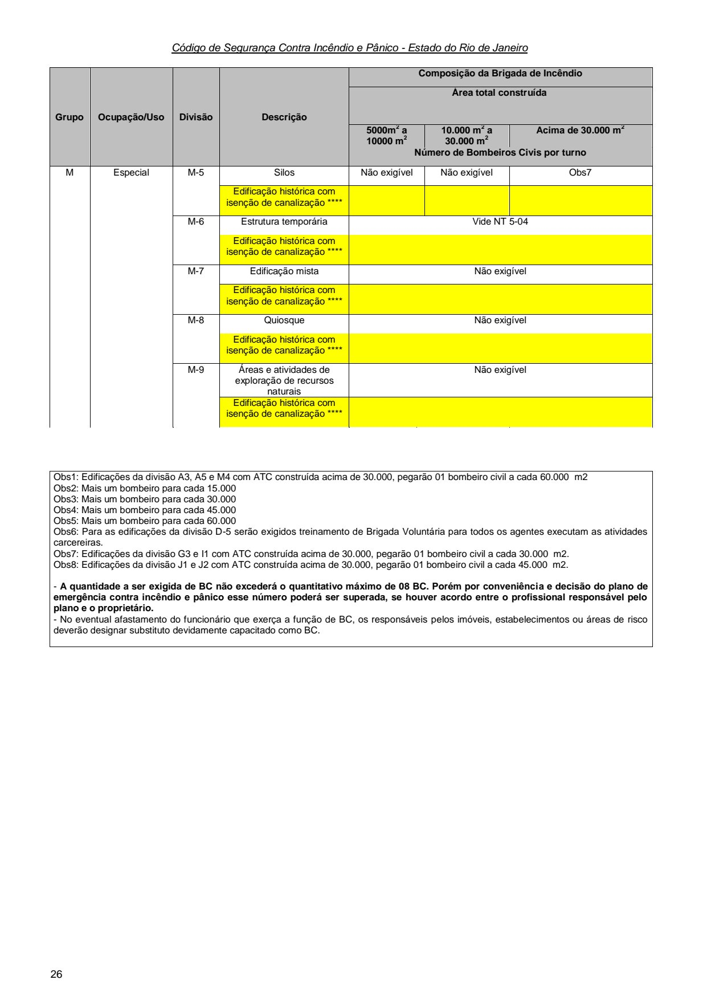

Código de Segurança Contra Incêndio e Pânico - Estado do Rio de Janeiro

### Tabelas extraídas (bruto, não usar para citação)
#### Tabela 1 da página

| Grupo |  | Ocupação/Uso | Divisão | Descrição | Composição da Brigada de Incêndio |  |  |  |  |  |  |  |  |  |
| --- | --- | --- | --- | --- | --- | --- | --- | --- | --- | --- | --- | --- | --- | --- |
|  |  |  |  |  | Área total construída |  |  |  |  |  |  |  |  |  |
|  |  |  |  |  |  | 5000m2 a |  |  |  | 10.000 m2 a |  |  | Acima de 30.000 m2 |  |
|  |  |  |  |  |  | 10000 m2 |  |  |  | 30.000 m2 |  |  |  |  |
|  |  |  |  |  | Número de Bombeiros Civis por turno | Número de Bombeiros Civis por turno |  |  |  |  |  |  |  |  |
| M |  | Especial | M-5 | Silos | Não exigível |  |  |  | Não exigível |  |  |  | Obs7 |  |
|  |  |  |  | Edificação histórica com isenção de canalização **** |  |  |  |  |  |  |  |  |  |  |
|  |  |  | M-6 | Estrutura temporária | Vide NT 5-04 |  |  |  |  |  |  |  |  |  |
|  |  |  |  | Edificação histórica com isenção de canalização **** |  |  |  |  |  |  |  |  |  |  |
|  |  |  | M-7 | Edificação mista | Não exigível |  |  |  |  |  |  |  |  |  |
|  |  |  |  | Edificação histórica com isenção de canalização **** |  |  |  |  |  |  |  |  |  |  |
|  |  |  | M-8 | Quiosque | Não exigível |  |  |  |  |  |  |  |  |  |
|  |  |  |  | Edificação histórica com isenção de canalização **** |  |  |  |  |  |  |  |  |  |  |
|  |  |  | M-9 | Áreas e atividades de exploração de recursos naturais | Não exigível |  |  |  |  |  |  |  |  |  |
|  |  |  |  | Edificação histórica com isenção de canalização **** |  |  |  |  |  |  |  |  |  |  |
|  |  |  |  |  |  |  |  |  |  |  |  |  |  |  |
|  | Obs1: Edificações da divisão A3, A5 e M4 com ATC construída acima de 30.000, pegarão 01 bombeiro civil a cada 60.000 m2 |  |  |  |  |  |  |  |  |  |  |  |  |  |
|  | Obs2: Mais um bombeiro para cada 15.000 |  |  |  |  |  |  |  |  |  |  |  |  |  |
|  | Obs3: Mais um bombeiro para cada 30.000 |  |  |  |  |  |  |  |  |  |  |  |  |  |
|  | Obs4: Mais um bombeiro para cada 45.000 |  |  |  |  |  |  |  |  |  |  |  |  |  |
|  | Obs5: Mais um bombeiro para cada 60.000 |  |  |  |  |  |  |  |  |  |  |  |  |  |
|  | Obs6: Para as edificações da divisão D-5 serão exigidos treinamento de Brigada Voluntária para todos os agentes executam as atividades |  |  |  |  |  |  |  |  |  |  |  |  |  |
|  | carcereiras. |  |  |  |  |  |  |  |  |  |  |  |  |  |
|  | Obs7: Edificações da divisão G3 e I1 com ATC construída acima de 30.000, pegarão 01 bombeiro civil a cada 30.000 m2. |  |  |  |  |  |  |  |  |  |  |  |  |  |
|  | Obs8: Edificações da divisão J1 e J2 com ATC construída acima de 30.000, pegarão 01 bombeiro civil a cada 45.000 m2. |  |  |  |  |  |  |  |  |  |  |  |  |  |
|  |  |  |  |  |  |  |  |  |  |  |  |  |  |  |
|  | - A quantidade a ser exigida de BC não excederá o quantitativo máximo de 08 BC. Porém por conveniência e decisão do plano de |  |  |  |  |  |  |  |  |  |  |  |  |  |
|  | emergência contra incêndio e pânico esse número poderá ser superada, se houver acordo entre o profissional responsável pelo |  |  |  |  |  |  |  |  |  |  |  |  |  |
|  | plano e o proprietário. |  |  |  |  |  |  |  |  |  |  |  |  |  |
|  | - No eventual afastamento do funcionário que exerça a função de BC, os responsáveis pelos imóveis, estabelecimentos ou áreas de risco |  |  |  |  |  |  |  |  |  |  |  |  |  |
|  | deverão designar substituto devidamente capacitado como BC. |  |  |  |  |  |  |  |  |  |  |  |  |  |
|  |  |  |  |  |  |  |  |  |  |  |  |  |  |  |
