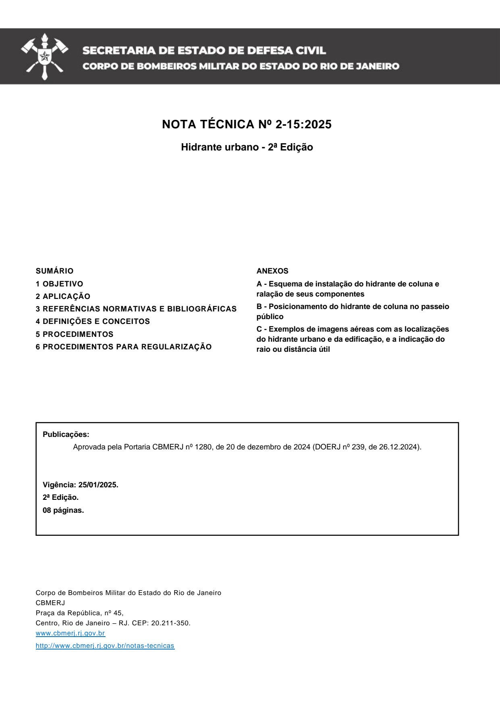
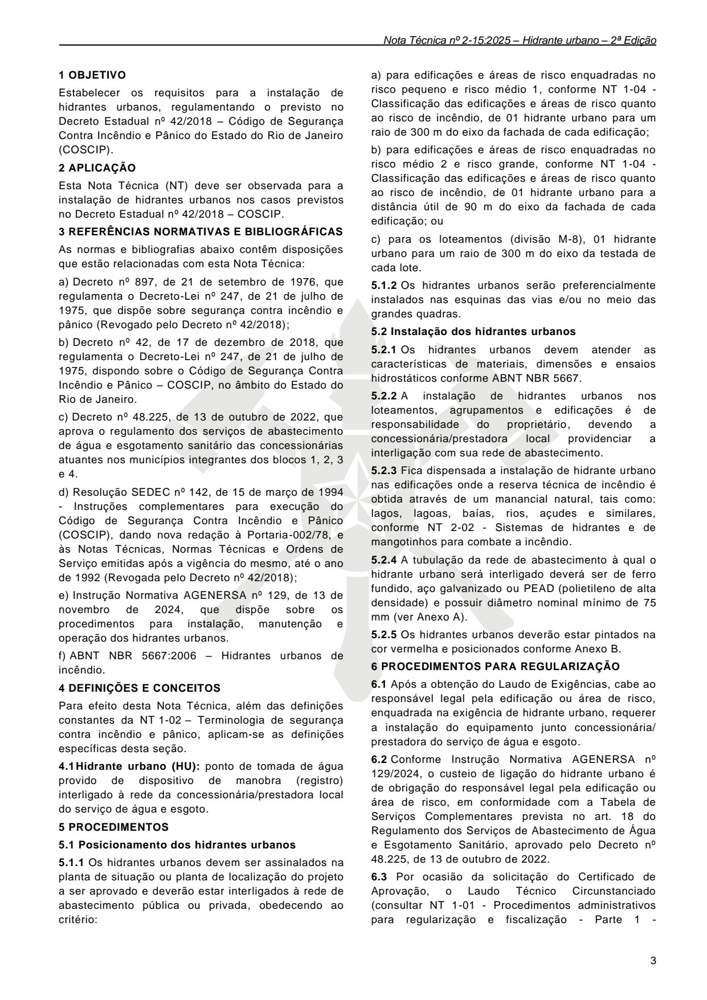
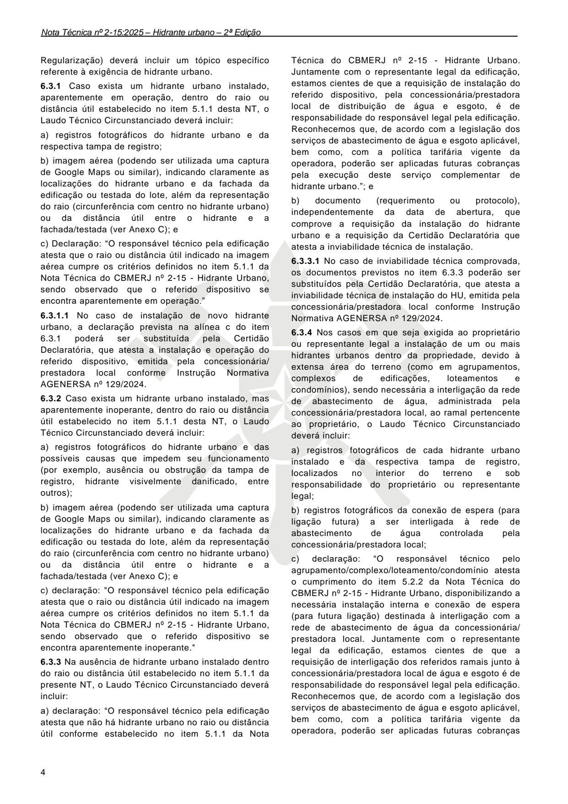
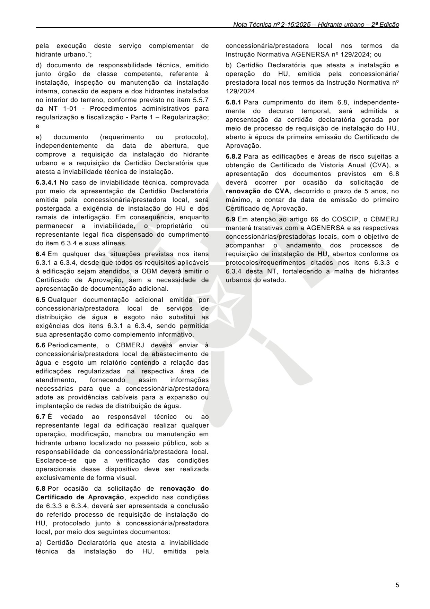
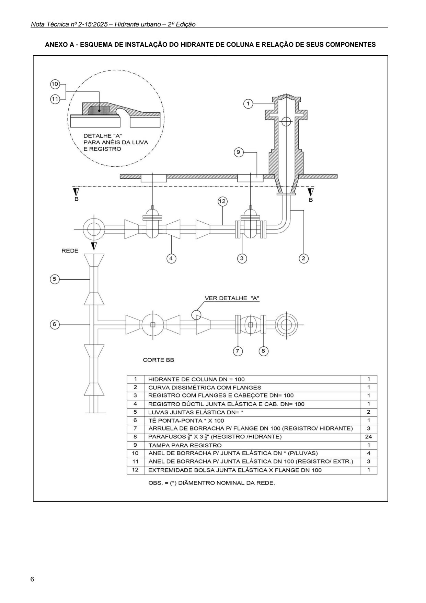
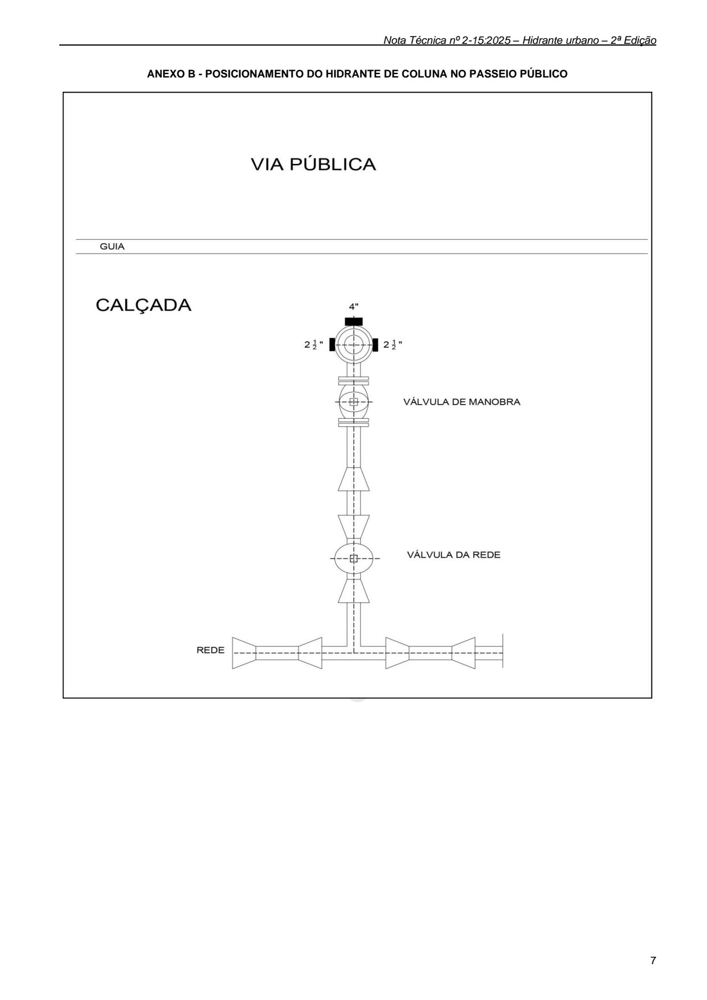
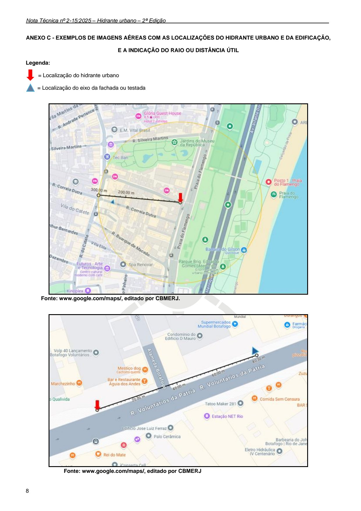

# NT 2-15 - Hidrante urbano

> Conversão integral para consulta computacional. A numeração de página do PDF foi preservada. Quando houver tabela complexa, símbolo ou desenho, conferir também a representação visual indicada e o PDF oficial.

## Sumário por página

- [Página 1](#pagina-1)
- [Página 2](#pagina-2)
- [Página 3](#pagina-3)
- [Página 4](#pagina-4)
- [Página 5](#pagina-5)
- [Página 6](#pagina-6)
- [Página 7](#pagina-7)
- [Página 8](#pagina-8)

---

## Página 1

### NT 2-15

### N O T A T É C N I C A 2 - 1 5

H i d r a n t e u r b a n o

2 0 2 5

---

## Página 2

NOTA TÉCNICA Nº 2-15:2025

Hidrante urbano - 2ª Edição

Aprovada pela Portaria CBMERJ nº 1280, de 20 de dezembro de 2024 (DOERJ nº 239, de 26.12.2024).

Publicada no Boletim da SEDEC/CBMERJ nº XX, de XX de XX de 2023.

### SUMÁRIO

### 1 OBJETIVO

### 2 APLICAÇÃO

### 3 REFERÊNCIAS NORMATIVAS E BIBLIOGRÁFICAS

### 4 DEFINIÇÕES E CONCEITOS

### 5 PROCEDIMENTOS

### 6 PROCEDIMENTOS PARA REGULARIZAÇÃO

Publicações:

Vigência: 25/01/2025.

2ª Edição.

08 páginas.

Corpo de Bombeiros Militar do Estado do Rio de Janeiro CBMERJ Praça da República, nº 45, Centro, Rio de Janeiro - RJ. CEP: 20.211-350. www.cbmerj.rj.gov.br

http://www.cbmerj.rj.gov.br/notas-tecnicas

### ANEXOS

A - Esquema de instalação do hidrante de coluna e ralação de seus componentes

B - Posicionamento do hidrante de coluna no passeio público

C - Exemplos de imagens aéreas com as localizações do hidrante urbano e da edificação, e a indicação do raio ou distância útil

---

## Página 3

### 1 OBJETIVO

Estabelecer os requisitos para a instalação de hidrantes urbanos, regulamentando o previsto no Decreto Estadual nº 42/2018 - Código de Segurança Contra Incêndio e Pânico do Estado do Rio de Janeiro (COSCIP).

### 2 APLICAÇÃO

Esta Nota Técnica (NT) deve ser observada para a instalação de hidrantes urbanos nos casos previstos no Decreto Estadual nº 42/2018 - COSCIP.

### 3 REFERÊNCIAS NORMATIVAS E BIBLIOGRÁFICAS

As normas e bibliografias abaixo contêm disposições que estão relacionadas com esta Nota Técnica:

a) Decreto nº 897, de 21 de setembro de 1976, que regulamenta o Decreto-Lei nº 247, de 21 de julho de 1975, que dispõe sobre segurança contra incêndio e pânico (Revogado pelo Decreto nº 42/2018);

b) Decreto nº 42, de 17 de dezembro de 2018, que regulamenta o Decreto-Lei nº 247, de 21 de julho de 1975, dispondo sobre o Código de Segurança Contra Incêndio e Pânico - COSCIP, no âmbito do Estado do Rio de Janeiro.

c) Decreto nº 48.225, de 13 de outubro de 2022, que aprova o regulamento dos serviços de abastecimento de água e esgotamento sanitário das concessionárias atuantes nos municípios integrantes dos blocos 1, 2, 3 e 4.

d) Resolução SEDEC nº 142, de 15 de março de 1994 - Instruções complementares para execução do Código de Segurança Contra Incêndio e Pânico (COSCIP), dando nova redação à Portaria-002/78, e às Notas Técnicas, Normas Técnicas e Ordens de Serviço emitidas após a vigência do mesmo, até o ano de 1992 (Revogada pelo Decreto nº 42/2018);

e) Instrução Normativa AGENERSA nº 129, de 13 de novembro de 2024, que dispõe sobre os procedimentos para instalação, manutenção e operação dos hidrantes urbanos.

f) ABNT NBR 5667:2006 - Hidrantes urbanos de incêndio.

### 4 DEFINIÇÕES E CONCEITOS

Para efeito desta Nota Técnica, além das definições constantes da NT 1-02 - Terminologia de segurança contra incêndio e pânico, aplicam-se as definições específicas desta seção.

4.1 Hidrante urbano (HU): ponto de tomada de água provido de dispositivo de manobra (registro) interligado à rede da concessionária/prestadora local do serviço de água e esgoto.

### 5 PROCEDIMENTOS

5.1 Posicionamento dos hidrantes urbanos

5.1.1 Os hidrantes urbanos devem ser assinalados na planta de situação ou planta de localização do projeto a ser aprovado e deverão estar interligados à rede de abastecimento pública ou privada, obedecendo ao critério:

a) para edificações e áreas de risco enquadradas no risco pequeno e risco médio 1, conforme NT 1-04 - Classificação das edificações e áreas de risco quanto ao risco de incêndio, de 01 hidrante urbano para um raio de 300 m do eixo da fachada de cada edificação;

b) para edificações e áreas de risco enquadradas no risco médio 2 e risco grande, conforme NT 1-04 - Classificação das edificações e áreas de risco quanto ao risco de incêndio, de 01 hidrante urbano para a distância útil de 90 m do eixo da fachada de cada edificação; ou

c) para os loteamentos (divisão M-8), 01 hidrante urbano para um raio de 300 m do eixo da testada de cada lote.

5.1.2 Os hidrantes urbanos serão preferencialmente instalados nas esquinas das vias e/ou no meio das grandes quadras.

5.2 Instalação dos hidrantes urbanos

5.2.1 Os hidrantes urbanos devem atender as características de materiais, dimensões e ensaios hidrostáticos conforme ABNT NBR 5667.

5.2.2 A instalação de hidrantes urbanos nos loteamentos, agrupamentos e edificações é de responsabilidade do proprietário, devendo a concessionária/prestadora local providenciar a interligação com sua rede de abastecimento.

5.2.3 Fica dispensada a instalação de hidrante urbano nas edificações onde a reserva técnica de incêndio é obtida através de um manancial natural, tais como: lagos, lagoas, baías, rios, açudes e similares, conforme NT 2-02 - Sistemas de hidrantes e de mangotinhos para combate a incêndio.

5.2.4 A tubulação da rede de abastecimento à qual o hidrante urbano será interligado deverá ser de ferro fundido, aço galvanizado ou PEAD (polietileno de alta densidade) e possuir diâmetro nominal mínimo de 75 mm (ver Anexo A).

5.2.5 Os hidrantes urbanos deverão estar pintados na cor vermelha e posicionados conforme Anexo B.

### 6 PROCEDIMENTOS PARA REGULARIZAÇÃO

6.1 Após a obtenção do Laudo de Exigências, cabe ao responsável legal pela edificação ou área de risco, enquadrada na exigência de hidrante urbano, requerer a instalação do equipamento junto concessionária/ prestadora do serviço de água e esgoto.

6.2 Conforme Instrução Normativa AGENERSA nº 129/2024, o custeio de ligação do hidrante urbano é de obrigação do responsável legal pela edificação ou área de risco, em conformidade com a Tabela de Serviços Complementares prevista no art. 18 do Regulamento dos Serviços de Abastecimento de Água e Esgotamento Sanitário, aprovado pelo Decreto nº 48.225, de 13 de outubro de 2022.

6.3 Por ocasião da solicitação do Certificado de Aprovação, o Laudo Técnico Circunstanciado (consultar NT 1-01 - Procedimentos administrativos para regularização e fiscalização - Parte 1 -

---

## Página 4

Regularização) deverá incluir um tópico específico referente à exigência de hidrante urbano.

6.3.1 Caso exista um hidrante urbano instalado, aparentemente em operação, dentro do raio ou distância útil estabelecido no item 5.1.1 desta NT, o Laudo Técnico Circunstanciado deverá incluir:

a) registros fotográficos do hidrante urbano e da respectiva tampa de registro;

b) imagem aérea (podendo ser utilizada uma captura de Google Maps ou similar), indicando claramente as localizações do hidrante urbano e da fachada da edificação ou testada do lote, além da representação do raio (circunferência com centro no hidrante urbano) ou da distância útil entre o hidrante e a fachada/testada (ver Anexo C); e

c) Declaração: “O responsável técnico pela edificação atesta que o raio ou distância útil indicado na imagem aérea cumpre os critérios definidos no item 5.1.1 da Nota Técnica do CBMERJ nº 2-15 - Hidrante Urbano, sendo observado que o referido dispositivo se encontra aparentemente em operação.”

6.3.1.1 No caso de instalação de novo hidrante urbano, a declaração prevista na alínea c do item 6.3.1 poderá ser substituída pela Certidão Declaratória, que atesta a instalação e operação do referido dispositivo, emitida pela concessionária/ prestadora local conforme Instrução Normativa AGENERSA nº 129/2024.

6.3.2 Caso exista um hidrante urbano instalado, mas aparentemente inoperante, dentro do raio ou distância útil estabelecido no item 5.1.1 desta NT, o Laudo Técnico Circunstanciado deverá incluir:

a) registros fotográficos do hidrante urbano e das possíveis causas que impedem seu funcionamento (por exemplo, ausência ou obstrução da tampa de registro, hidrante visivelmente danificado, entre outros);

b) imagem aérea (podendo ser utilizada uma captura de Google Maps ou similar), indicando claramente as localizações do hidrante urbano e da fachada da edificação ou testada do lote, além da representação do raio (circunferência com centro no hidrante urbano) ou da distância útil entre o hidrante e a fachada/testada (ver Anexo C); e

c) declaração: "O responsável técnico pela edificação atesta que o raio ou distância útil indicado na imagem aérea cumpre os critérios definidos no item 5.1.1 da Nota Técnica do CBMERJ nº 2-15 - Hidrante Urbano, sendo observado que o referido dispositivo se encontra aparentemente inoperante."

6.3.3 Na ausência de hidrante urbano instalado dentro do raio ou distância útil estabelecido no item 5.1.1 da presente NT, o Laudo Técnico Circunstanciado deverá incluir:

a) declaração: “O responsável técnico pela edificação atesta que não há hidrante urbano no raio ou distância útil conforme estabelecido no item 5.1.1 da Nota

Técnica do CBMERJ nº 2-15 - Hidrante Urbano. Juntamente com o representante legal da edificação, estamos cientes de que a requisição de instalação do referido dispositivo, pela concessionária/prestadora local de distribuição de água e esgoto, é de responsabilidade do responsável legal pela edificação. Reconhecemos que, de acordo com a legislação dos serviços de abastecimento de água e esgoto aplicável, bem como, com a política tarifária vigente da operadora, poderão ser aplicadas futuras cobranças pela execução deste serviço complementar de hidrante urbano.”; e

b) documento (requerimento ou protocolo), independentemente da data de abertura, que comprove a requisição da instalação do hidrante urbano e a requisição da Certidão Declaratória que atesta a inviabilidade técnica de instalação.

6.3.3.1 No caso de inviabilidade técnica comprovada, os documentos previstos no item 6.3.3 poderão ser substituídos pela Certidão Declaratória, que atesta a inviabilidade técnica de instalação do HU, emitida pela concessionária/prestadora local conforme Instrução Normativa AGENERSA nº 129/2024.

6.3.4 Nos casos em que seja exigida ao proprietário ou representante legal a instalação de um ou mais hidrantes urbanos dentro da propriedade, devido à extensa área do terreno (como em agrupamentos, complexos de edificações, loteamentos e condomínios), sendo necessária a interligação da rede de abastecimento de água, administrada pela concessionária/prestadora local, ao ramal pertencente ao proprietário, o Laudo Técnico Circunstanciado deverá incluir:

a) registros fotográficos de cada hidrante urbano instalado e da respectiva tampa de registro, localizados no interior do terreno e sob responsabilidade do proprietário ou representante legal;

b) registros fotográficos da conexão de espera (para ligação futura) a ser interligada à rede de abastecimento de água controlada pela concessionária/prestadora local;

c) declaração: “O responsável técnico pelo agrupamento/complexo/loteamento/condomínio atesta o cumprimento do item 5.2.2 da Nota Técnica do CBMERJ nº 2-15 - Hidrante Urbano, disponibilizando a necessária instalação interna e conexão de espera (para futura ligação) destinada à interligação com a rede de abastecimento de água da concessionária/ prestadora local. Juntamente com o representante legal da edificação, estamos cientes de que a requisição de interligação dos referidos ramais junto à concessionária/prestadora local de água e esgoto é de responsabilidade do responsável legal pela edificação. Reconhecemos que, de acordo com a legislação dos serviços de abastecimento de água e esgoto aplicável, bem como, com a política tarifária vigente da operadora, poderão ser aplicadas futuras cobranças

---

## Página 5

pela execução deste serviço complementar de hidrante urbano.”;

d) documento de responsabilidade técnica, emitido junto órgão de classe competente, referente à instalação, inspeção ou manutenção da instalação interna, conexão de espera e dos hidrantes instalados no interior do terreno, conforme previsto no item 5.5.7 da NT 1-01 - Procedimentos administrativos para regularização e fiscalização - Parte 1 - Regularização; e

e) documento (requerimento ou protocolo), independentemente da data de abertura, que comprove a requisição da instalação do hidrante urbano e a requisição da Certidão Declaratória que atesta a inviabilidade técnica de instalação.

6.3.4.1 No caso de inviabilidade técnica, comprovada por meio da apresentação de Certidão Declaratória emitida pela concessionária/prestadora local, será postergada a exigência de instalação do HU e dos ramais de interligação. Em consequência, enquanto permanecer a inviabilidade, o proprietário ou representante legal fica dispensado do cumprimento do item 6.3.4 e suas alíneas.

6.4 Em qualquer das situações previstas nos itens 6.3.1 a 6.3.4, desde que todos os requisitos aplicáveis à edificação sejam atendidos, a OBM deverá emitir o Certificado de Aprovação, sem a necessidade de apresentação de documentação adicional.

6.5 Qualquer documentação adicional emitida por concessionária/prestadora local de serviços de distribuição de água e esgoto não substitui as exigências dos itens 6.3.1 a 6.3.4, sendo permitida sua apresentação como complemento informativo.

6.6 Periodicamente, o CBMERJ deverá enviar à concessionária/prestadora local de abastecimento de água e esgoto um relatório contendo a relação das edificações regularizadas na respectiva área de atendimento, fornecendo assim informações necessárias para que a concessionária/prestadora adote as providências cabíveis para a expansão ou implantação de redes de distribuição de água.

6.7 É vedado ao responsável técnico ou ao representante legal da edificação realizar qualquer operação, modificação, manobra ou manutenção em hidrante urbano localizado no passeio público, sob a responsabilidade da concessionária/prestadora local. Esclarece-se que a verificação das condições operacionais desse dispositivo deve ser realizada exclusivamente de forma visual.

6.8 Por ocasião da solicitação de renovação do Certificado de Aprovação, expedido nas condições de 6.3.3 e 6.3.4, deverá ser apresentada a conclusão do referido processo de requisição de instalação do HU, protocolado junto à concessionária/prestadora local, por meio dos seguintes documentos:

a) Certidão Declaratória que atesta a inviabilidade técnica da instalação do HU, emitida pela

concessionária/prestadora local nos termos da Instrução Normativa AGENERSA nº 129/2024; ou

b) Certidão Declaratória que atesta a instalação e operação do HU, emitida pela concessionária/ prestadora local nos termos da Instrução Normativa nº 129/2024.

6.8.1 Para cumprimento do item 6.8, independentemente do decurso temporal, será admitida a apresentação da certidão declaratória gerada por meio de processo de requisição de instalação do HU, aberto à época da primeira emissão do Certificado de Aprovação.

6.8.2 Para as edificações e áreas de risco sujeitas a obtenção de Certificado de Vistoria Anual (CVA), a apresentação dos documentos previstos em 6.8 deverá ocorrer por ocasião da solicitação de renovação do CVA, decorrido o prazo de 5 anos, no máximo, a contar da data de emissão do primeiro Certificado de Aprovação.

6.9 Em atenção ao artigo 66 do COSCIP, o CBMERJ manterá tratativas com a AGENERSA e as respectivas concessionárias/prestadoras locais, com o objetivo de acompanhar o andamento dos processos de requisição de instalação de HU, abertos conforme os protocolos/requerimentos citados nos itens 6.3.3 e 6.3.4 desta NT, fortalecendo a malha de hidrantes urbanos do estado.

---

## Página 6

### ANEXO A - ESQUEMA DE INSTALAÇÃO DO HIDRANTE DE COLUNA E RELAÇÃO DE SEUS COMPONENTES

---

## Página 7

### ANEXO B - POSICIONAMENTO DO HIDRANTE DE COLUNA NO PASSEIO PÚBLICO

---

## Página 8

### ANEXO C - EXEMPLOS DE IMAGENS AÉREAS COM AS LOCALIZAÇÕES DO HIDRANTE URBANO E DA EDIFICAÇÃO,

### E A INDICAÇÃO DO RAIO OU DISTÂNCIA ÚTIL

Legenda:

= Localização do hidrante urbano

= Localização do eixo da fachada ou testada

Fonte: www.google.com/maps/, editado por CBMERJ.

Fonte: www.google.com/maps/, editado por CBMERJ
