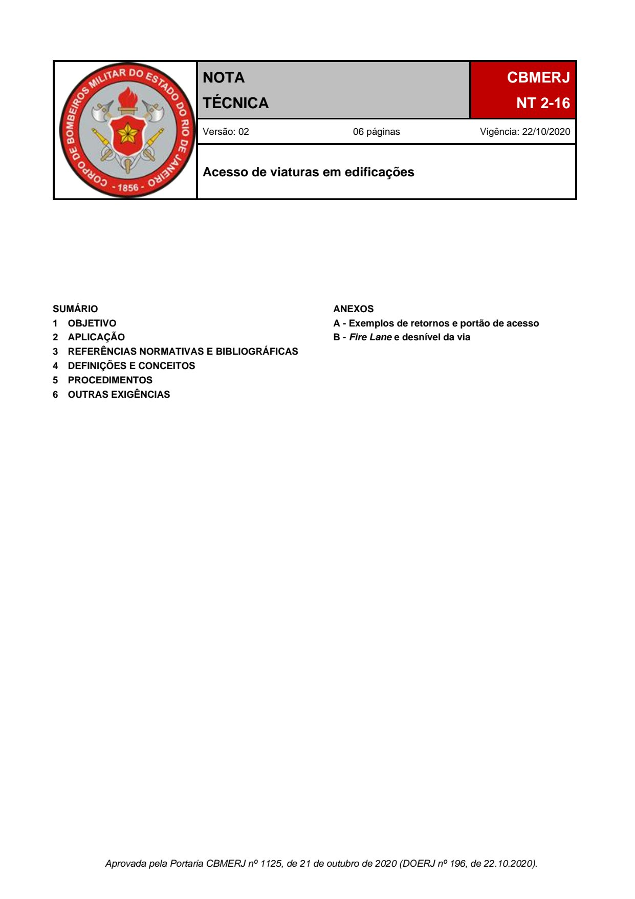
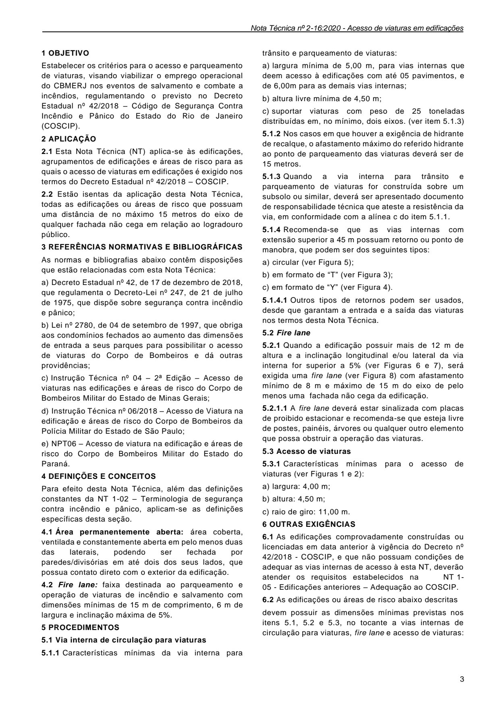
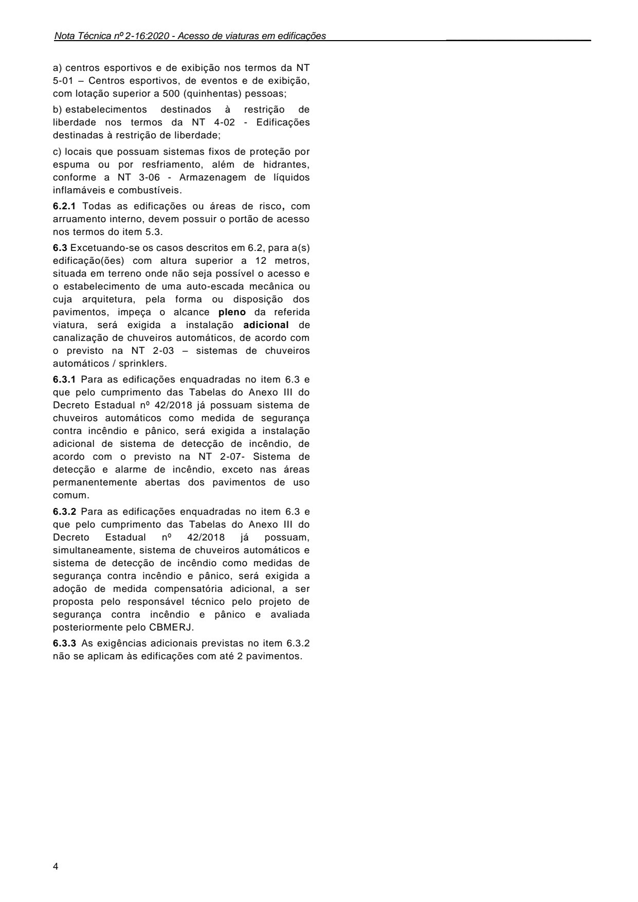
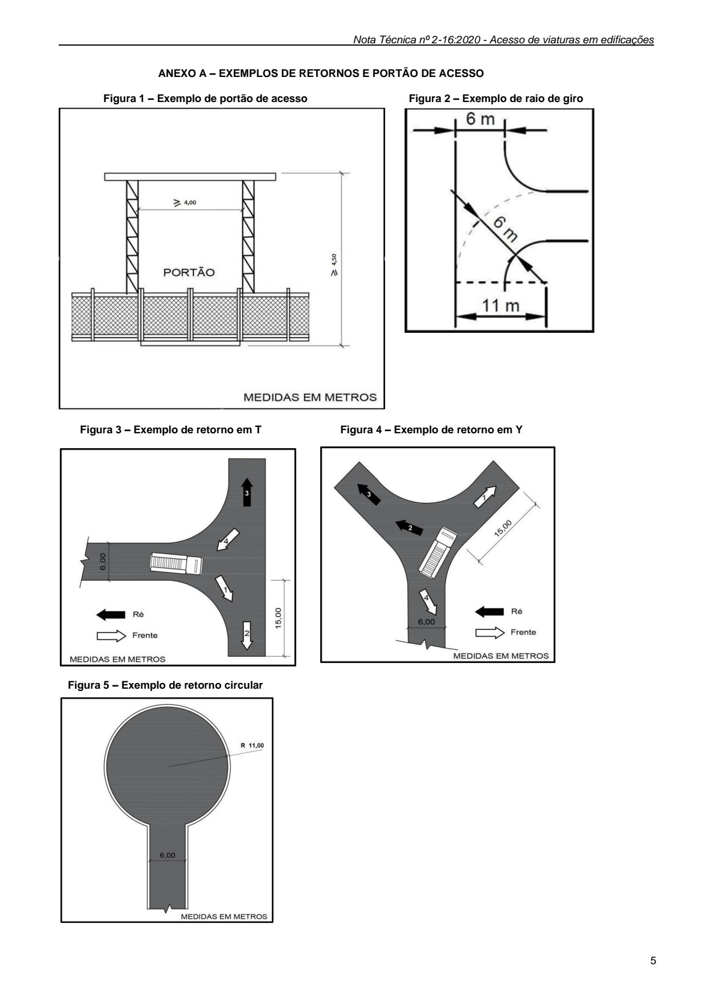
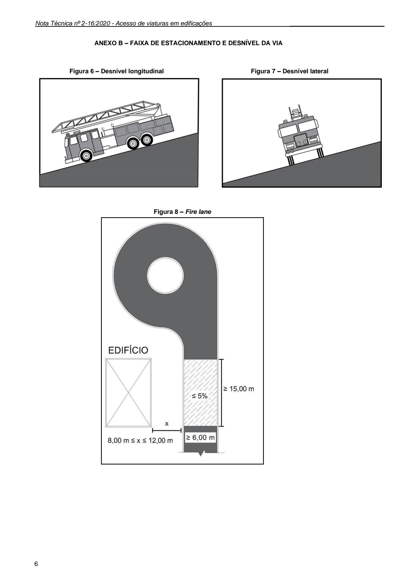

# NT 2-16 - Acesso de viaturas em edificações

> Conversão integral para consulta computacional. A numeração de página do PDF foi preservada. Quando houver tabela complexa, símbolo ou desenho, conferir também a representação visual indicada e o PDF oficial.

## Sumário por página

- [Página 1](#pagina-1)
- [Página 2](#pagina-2)
- [Página 3](#pagina-3)
- [Página 4](#pagina-4)
- [Página 5](#pagina-5)
- [Página 6](#pagina-6)

---

## Página 1

### SUMÁRIO 1 OBJETIVO 2 APLICAÇÃO 3 REFERÊNCIAS NORMATIVAS E BIBLIOGRÁFICAS 4 DEFINIÇÕES E CONCEITOS 5 PROCEDIMENTOS 6 OUTRAS EXIGÊNCIAS

ANEXOS A - Exemplos de retornos e portão de acesso B - Fire Lane e desnível da via

Aprovada pela Portaria CBMERJ nº 1125, de 21 de outubro de 2020 (DOERJ nº 196, de 22.10.2020).

### Tabelas extraídas (bruto, não usar para citação)
#### Tabela 1 da página

|  |  | NOTA |  |  | CBMERJ |  |
| --- | --- | --- | --- | --- | --- | --- |
|  |  | TÉCNICA |  |  | NT 2-16 |  |
|  | Versão: 02 06 páginas Vigência: 22/10/2020 |  |  |  |  |  |
|  | Acesso de viaturas em edificações |  |  |  |  |  |

---

## Página 2

Corpo de Bombeiros Militar do Estado do Rio de Janeiro CBMERJ Praça da República, nº 45, Centro, Rio de Janeiro - RJ. CEP: 20.211-350. www.cbmerj.rj.gov.br http://www.cbmerj.rj.gov.br/notas-tecnicas

---

## Página 3

### 1 OBJETIVO

Estabelecer os critérios para o acesso e parqueamento de viaturas, visando viabilizar o emprego operacional do CBMERJ nos eventos de salvamento e combate a incêndios, regulamentando o previsto no Decreto Estadual nº 42/2018 - Código de Segurança Contra Incêndio e Pânico do Estado do Rio de Janeiro (COSCIP).

### 2 APLICAÇÃO

2.1 Esta Nota Técnica (NT) aplica-se às edificações, agrupamentos de edificações e áreas de risco para as quais o acesso de viaturas em edificações é exigido nos termos do Decreto Estadual nº 42/2018 - COSCIP.

2.2 Estão isentas da aplicação desta Nota Técnica, todas as edificações ou áreas de risco que possuam uma distância de no máximo 15 metros do eixo de qualquer fachada não cega em relação ao logradouro público.

### 3 REFERÊNCIAS NORMATIVAS E BIBLIOGRÁFICAS

As normas e bibliografias abaixo contêm disposições que estão relacionadas com esta Nota Técnica:

a) Decreto Estadual nº 42, de 17 de dezembro de 2018, que regulamenta o Decreto-Lei nº 247, de 21 de julho de 1975, que dispõe sobre segurança contra incêndio e pânico;

b) Lei nº 2780, de 04 de setembro de 1997, que obriga aos condomínios fechados ao aumento das dimensões de entrada a seus parques para possibilitar o acesso de viaturas do Corpo de Bombeiros e dá outras providências;

c) Instrução Técnica nº 04 - 2ª Edição - Acesso de viaturas nas edificações e áreas de risco do Corpo de Bombeiros Militar do Estado de Minas Gerais;

d) Instrução Técnica nº 06/2018 - Acesso de Viatura na edificação e áreas de risco do Corpo de Bombeiros da Polícia Militar do Estado de São Paulo;

e) NPT06 - Acesso de viatura na edificação e áreas de risco do Corpo de Bombeiros Militar do Estado do Paraná.

### 4 DEFINIÇÕES E CONCEITOS

Para efeito desta Nota Técnica, além das definições constantes da NT 1-02 - Terminologia de segurança contra incêndio e pânico, aplicam-se as definições específicas desta seção.

4.1 Área permanentemente aberta: área coberta, ventilada e constantemente aberta em pelo menos duas das laterais, podendo ser fechada por paredes/divisórias em até dois dos seus lados, que possua contato direto com o exterior da edificação.

4.2 Fire lane: faixa destinada ao parqueamento e operação de viaturas de incêndio e salvamento com dimensões mínimas de 15 m de comprimento, 6 m de largura e inclinação máxima de 5%.

### 5 PROCEDIMENTOS

5.1 Via interna de circulação para viaturas

5.1.1 Características mínimas da via interna para

trânsito e parqueamento de viaturas:

a) largura mínima de 5,00 m, para vias internas que deem acesso à edificações com até 05 pavimentos, e de 6,00m para as demais vias internas;

b) altura livre mínima de 4,50 m;

c) suportar viaturas com peso de 25 toneladas distribuídas em, no mínimo, dois eixos. (ver item 5.1.3)

5.1.2 Nos casos em que houver a exigência de hidrante de recalque, o afastamento máximo do referido hidrante ao ponto de parqueamento das viaturas deverá ser de 15 metros.

5.1.3 Quando a via interna para trânsito e parqueamento de viaturas for construída sobre um subsolo ou similar, deverá ser apresentado documento de responsabilidade técnica que ateste a resistência da via, em conformidade com a alínea c do item 5.1.1.

5.1.4 Recomenda-se que as vias internas com extensão superior a 45 m possuam retorno ou ponto de manobra, que podem ser dos seguintes tipos:

a) circular (ver Figura 5);

b) em formato de “T” (ver Figura 3);

c) em formato de “Y” (ver Figura 4).

5.1.4.1 Outros tipos de retornos podem ser usados, desde que garantam a entrada e a saída das viaturas nos termos desta Nota Técnica.

5.2 Fire lane

5.2.1 Quando a edificação possuir mais de 12 m de altura e a inclinação longitudinal e/ou lateral da via interna for superior a 5% (ver Figuras 6 e 7), será exigida uma fire lane (ver Figura 8) com afastamento mínimo de 8 m e máximo de 15 m do eixo de pelo menos uma fachada não cega da edificação.

5.2.1.1 A fire lane deverá estar sinalizada com placas de proibido estacionar e recomenda-se que esteja livre de postes, painéis, árvores ou qualquer outro elemento que possa obstruir a operação das viaturas.

5.3 Acesso de viaturas

5.3.1 Características mínimas para o acesso de viaturas (ver Figuras 1 e 2):

a) largura: 4,00 m;

b) altura: 4,50 m;

c) raio de giro: 11,00 m.

### 6 OUTRAS EXIGÊNCIAS

6.1 As edificações comprovadamente construídas ou licenciadas em data anterior à vigência do Decreto nº 42/2018 - COSCIP, e que não possuam condições de adequar as vias internas de acesso à esta NT, deverão atender os requisitos estabelecidos na NT 1- 05 - Edificações anteriores - Adequação ao COSCIP.

6.2 As edificações ou áreas de risco abaixo descritas

devem possuir as dimensões mínimas previstas nos itens 5.1, 5.2 e 5.3, no tocante a vias internas de circulação para viaturas, fire lane e acesso de viaturas:

---

## Página 4

a) centros esportivos e de exibição nos termos da NT 5-01 - Centros esportivos, de eventos e de exibição, com lotação superior a 500 (quinhentas) pessoas;

b) estabelecimentos destinados à restrição de liberdade nos termos da NT 4-02 - Edificações destinadas à restrição de liberdade;

c) locais que possuam sistemas fixos de proteção por espuma ou por resfriamento, além de hidrantes, conforme a NT 3-06 - Armazenagem de líquidos inflamáveis e combustíveis.

6.2.1 Todas as edificações ou áreas de risco, com arruamento interno, devem possuir o portão de acesso nos termos do item 5.3.

6.3 Excetuando-se os casos descritos em 6.2, para a(s) edificação(ões) com altura superior a 12 metros, situada em terreno onde não seja possível o acesso e o estabelecimento de uma auto-escada mecânica ou cuja arquitetura, pela forma ou disposição dos pavimentos, impeça o alcance pleno da referida viatura, será exigida a instalação adicional de canalização de chuveiros automáticos, de acordo com o previsto na NT 2-03 - sistemas de chuveiros automáticos / sprinklers.

6.3.1 Para as edificações enquadradas no item 6.3 e que pelo cumprimento das Tabelas do Anexo III do Decreto Estadual nº 42/2018 já possuam sistema de chuveiros automáticos como medida de segurança contra incêndio e pânico, será exigida a instalação adicional de sistema de detecção de incêndio, de acordo com o previsto na NT 2-07- Sistema de detecção e alarme de incêndio, exceto nas áreas permanentemente abertas dos pavimentos de uso comum.

6.3.2 Para as edificações enquadradas no item 6.3 e que pelo cumprimento das Tabelas do Anexo III do Decreto Estadual nº 42/2018 já possuam, simultaneamente, sistema de chuveiros automáticos e sistema de detecção de incêndio como medidas de segurança contra incêndio e pânico, será exigida a adoção de medida compensatória adicional, a ser proposta pelo responsável técnico pelo projeto de segurança contra incêndio e pânico e avaliada posteriormente pelo CBMERJ.

6.3.3 As exigências adicionais previstas no item 6.3.2 não se aplicam às edificações com até 2 pavimentos.

---

## Página 5

### ANEXO A - EXEMPLOS DE RETORNOS E PORTÃO DE ACESSO

Figura 1 - Exemplo de portão de acesso Figura 2 - Exemplo de raio de giro

Figura 3 - Exemplo de retorno em T Figura 4 - Exemplo de retorno em Y

Figura 5 - Exemplo de retorno circular

---

## Página 6

### ANEXO B - FAIXA DE ESTACIONAMENTO E DESNÍVEL DA VIA

Figura 6 - Desnível longitudinal Figura 7 - Desnível lateral

Figura 8 - Fire lane
