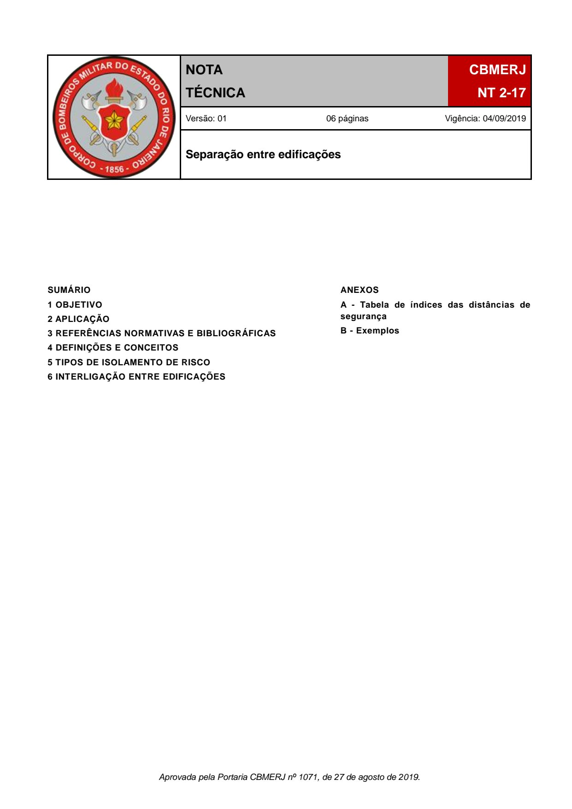
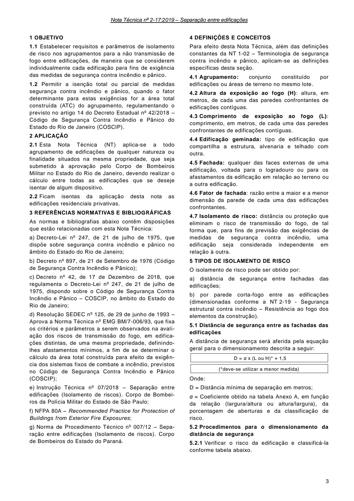
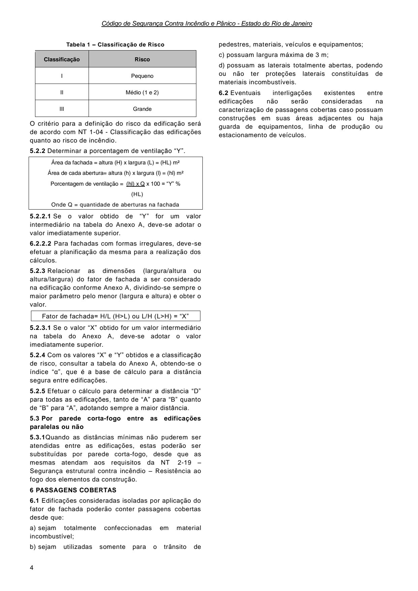
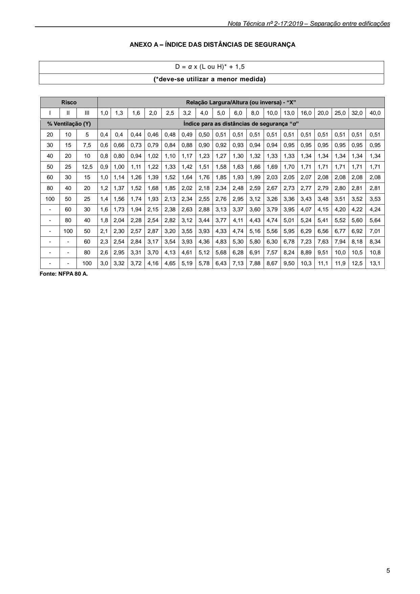
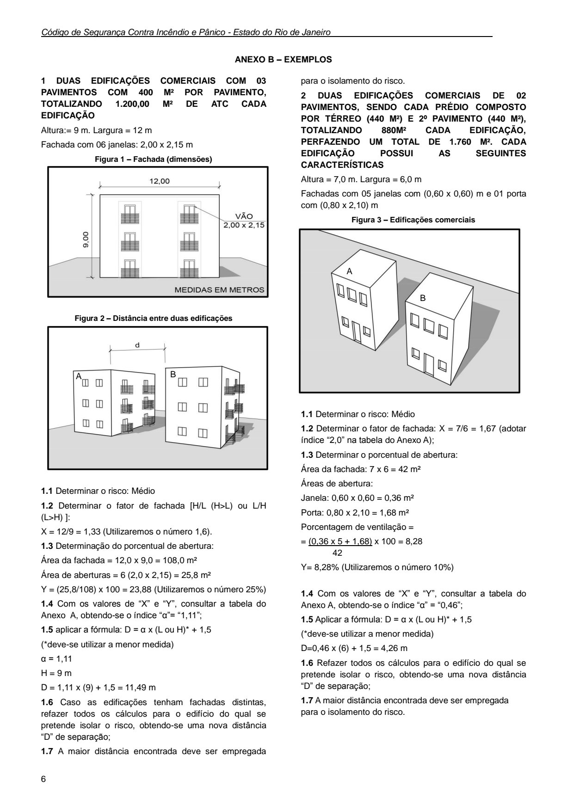

# NT 2-17 - Separação entre edificações

> Conversão integral para consulta computacional. A numeração de página do PDF foi preservada. Quando houver tabela complexa, símbolo ou desenho, conferir também a representação visual indicada e o PDF oficial.

## Sumário por página

- [Página 1](#pagina-1)
- [Página 2](#pagina-2)
- [Página 3](#pagina-3)
- [Página 4](#pagina-4)
- [Página 5](#pagina-5)
- [Página 6](#pagina-6)

---

## Página 1

Aprovada pela Portaria CBMERJ nº 1071, de 27 de agosto de 2019.

### SUMÁRIO

### 1 OBJETIVO

### 2 APLICAÇÃO

### 3 REFERÊNCIAS NORMATIVAS E BIBLIOGRÁFICAS

### 4 DEFINIÇÕES E CONCEITOS

### 5 TIPOS DE ISOLAMENTO DE RISCO

### 6 INTERLIGAÇÃO ENTRE EDIFICAÇÕES

### ANEXOS

A - Tabela de índices das distâncias de segurança

B - Exemplos

### Tabelas extraídas

#### Tabela 1 da página

|  | NOTA TÉCNICA |  | CBMERJ |  |
| --- | --- | --- | --- | --- |
|  |  |  | NT 2-17 |  |
|  | Versão: 01 06 páginas Vigência: 04/09/2019 |  |  |  |
|  | Separação entre edificações |  |  |  |

---

## Página 2

> Página sem texto extraível suficiente; consultar a representação visual ou o PDF oficial.

---

## Página 3

### 1 OBJETIVO

1.1 Estabelecer requisitos e parâmetros de isolamento de risco nos agrupamentos para a não transmissão de fogo entre edificações, de maneira que se considerem individualmente cada edificação para fins de exigência das medidas de segurança contra incêndio e pânico.

1.2 Permitir a isenção total ou parcial de medidas segurança contra incêndio e pânico, quando o fator determinante para estas exigências for a área total construída (ATC) do agrupamento, regulamentando o previsto no artigo 14 do Decreto Estadual nº 42/2018 - Código de Segurança Contra Incêndio e Pânico do Estado do Rio de Janeiro (COSCIP).

### 2 APLICAÇÃO

2.1 Esta Nota Técnica (NT) aplica-se a todo agrupamento de edificações de qualquer natureza ou finalidade situados na mesma propriedade, que seja submetido à aprovação pelo Corpo de Bombeiros Militar no Estado do Rio de Janeiro, devendo realizar o cálculo entre todas as edificações que se deseje isentar de algum dispositivo.

2.2 Ficam isentas da aplicação desta nota as edificações residenciais privativas.

### 3 REFERÊNCIAS NORMATIVAS E BIBLIOGRÁFICAS

As normas e bibliografias abaixo contêm disposições que estão relacionadas com esta Nota Técnica:

a) Decreto-Lei nº 247, de 21 de julho de 1975, que dispõe sobre segurança contra incêndio e pânico no âmbito do Estado do Rio de Janeiro;

b) Decreto nº 897, de 21 de Setembro de 1976 (Código de Segurança Contra Incêndio e Pânico);

c) Decreto nº 42, de 17 de Dezembro de 2018, que regulamenta o Decreto-Lei nº 247, de 21 de julho de 1975, dispondo sobre o Código de Segurança Contra Incêndio e Pânico - COSCIP, no âmbito do Estado do Rio de Janeiro;

d) Resolução SEDEC nº 125, de 29 de junho de 1993 - Aprova a Norma Técnica nº EMG BM/7-006/93, que fixa os critérios e parâmetros a serem observados na avaliação dos riscos de transmissão do fogo, em edificações distintas, de uma mesma propriedade, definindolhes afastamentos mínimos, a fim de se determinar o cálculo da área total construída para efeito da exigência dos sistemas fixos de combate a incêndio, previstos no Código de Segurança Contra Incêndio e Pânico (COSCIP);

e) Instrução Técnica nº 07/2018 - Separação entre edificações (Isolamento de riscos). Corpo de Bombeiros da Polícia Militar do Estado de São Paulo;

f) NFPA 80A - Recommended Practice for Protection of Buildings from Exterior Fire Exposures;

g) Norma de Procedimento Técnico nº 007/12 - Separação entre edificações (Isolamento de riscos). Corpo de Bombeiros do Estado do Paraná.

### 4 DEFINIÇÕES E CONCEITOS

Para efeito desta Nota Técnica, além das definições constantes da NT 1-02 - Terminologia de segurança contra incêndio e pânico, aplicam-se as definições específicas desta seção.

4.1 Agrupamento: conjunto constituído por edificações ou áreas de terreno no mesmo lote.

4.2 Altura da exposição ao fogo (H): altura, em metros, de cada uma das paredes confrontantes de edificações contíguas.

4.3 Comprimento de exposição ao fogo (L): comprimento, em metros, de cada uma das paredes confrontantes de edificações contíguas.

4.4 Edificação geminada: tipo de edificação que compartilha a estrutura, alvenaria e telhado com outra.

4.5 Fachada: qualquer das faces externas de uma edificação, voltada para o logradouro ou para os afastamentos da edificação em relação ao terreno ou a outra edificação.

4.6 Fator de fachada: razão entre a maior e a menor dimensão da parede de cada uma das edificações confrontantes.

4.7 Isolamento de risco: distância ou proteção que eliminam o risco de transmissão do fogo, de tal forma que, para fins de previsão das exigências de medidas de segurança contra incêndio, uma edificação seja considerada independente em relação à outra.

### 5 TIPOS DE ISOLAMENTO DE RISCO

O isolamento de risco pode ser obtido por:

a) distância de segurança entre fachadas das edificações;

b) por parede corta-fogo entre as edificações (dimensionadas conforme a NT 2-19 - Segurança estrutural contra incêndio - Resistência ao fogo dos elementos da construção).

5.1 Distância de segurança entre as fachadas das edificações

A distância de segurança será aferida pela equação geral para o dimensionamento descrita a seguir:

D = α x (L ou H)* + 1,5

(*deve-se utilizar a menor medida)

Onde:

D = Distância mínima de separação em metros;

α = Coeficiente obtido na tabela Anexo A, em função da relação (largura/altura ou altura/largura), da porcentagem de aberturas e da classificação de risco.

5.2 Procedimentos para o dimensionamento da distância de segurança

5.2.1 Verificar o risco da edificação e classificá-la conforme tabela abaixo.

---

## Página 4

Código de Segurança Contra Incêndio e Pânico - Estado do Rio de Janeiro

Tabela 1 - Classificação de Risco

O critério para a definição do risco da edificação será de acordo com NT 1-04 - Classificação das edificações quanto ao risco de incêndio.

5.2.2 Determinar a porcentagem de ventilação “Y”.

Área da fachada = altura (H) x largura (L) = (HL) m²

Área de cada abertura= altura (h) x largura (l) = (hl) m²

Porcentagem de ventilação = (hl) x Q x 100 = “Y” %

### (HL)

Onde Q = quantidade de aberturas na fachada

5.2.2.1 Se o valor obtido de “Y” for um valor intermediário na tabela do Anexo A, deve-se adotar o valor imediatamente superior.

6.2.2.2 Para fachadas com formas irregulares, deve-se efetuar a planificação da mesma para a realização dos cálculos.

5.2.3 Relacionar as dimensões (largura/altura ou altura/largura) do fator de fachada a ser considerado na edificação conforme Anexo A, dividindo-se sempre o maior parâmetro pelo menor (largura e altura) e obter o valor.

Fator de fachada= H/L (H>L) ou L/H (L>H) = “X”

5.2.3.1 Se o valor “X” obtido for um valor intermediário na tabela do Anexo A, deve-se adotar o valor imediatamente superior.

5.2.4 Com os valores “X” e “Y” obtidos e a classificação de risco, consultar a tabela do Anexo A, obtendo-se o índice “α”, que é a base de cálculo para a distância segura entre edificações.

5.2.5 Efetuar o cálculo para determinar a distância “D” para todas as edificações, tanto de “A” para “B” quanto de “B” para “A”, adotando sempre a maior distância.

5.3 Por parede corta-fogo entre as edificações paralelas ou não

5.3.1Quando as distâncias mínimas não puderem ser atendidas entre as edificações, estas poderão ser substituídas por parede corta-fogo, desde que as mesmas atendam aos requisitos da NT 2-19 - Segurança estrutural contra incêndio - Resistência ao fogo dos elementos da construção.

### 6 PASSAGENS COBERTAS

6.1 Edificações consideradas isoladas por aplicação do fator de fachada poderão conter passagens cobertas desde que:

a) sejam totalmente confeccionadas em material incombustível;

b) sejam utilizadas somente para o trânsito de

pedestres, materiais, veículos e equipamentos;

c) possuam largura máxima de 3 m;

d) possuam as laterais totalmente abertas, podendo ou não ter proteções laterais constituídas de materiais incombustíveis.

6.2 Eventuais interligações existentes entre edificações não serão consideradas na caracterização de passagens cobertas caso possuam construções em suas áreas adjacentes ou haja guarda de equipamentos, linha de produção ou estacionamento de veículos.

### Tabelas extraídas

#### Tabela 1 da página

| Classificação | Risco |
| --- | --- |
| I | Pequeno |
| II | Médio (1 e 2) |
| III | Grande |

---

## Página 5

### ANEXO A - ÍNDICE DAS DISTÂNCIAS DE SEGURANÇA

D = α x (L ou H)* + 1,5

(*deve-se utilizar a menor medida)

Fonte: NFPA 80 A.

### Tabelas extraídas

#### Tabela 1 da página

| Risco |  |  | Relação Largura/Altura (ou inversa) - “X” |  |  |  |  |  |  |  |  |  |  |  |  |  |  |  |  |
| --- | --- | --- | --- | --- | --- | --- | --- | --- | --- | --- | --- | --- | --- | --- | --- | --- | --- | --- | --- |
| I | II | III | 1,0 | 1,3 | 1,6 | 2,0 | 2,5 | 3,2 | 4,0 | 5,0 | 6,0 | 8,0 | 10,0 | 13,0 | 16,0 | 20,0 | 25,0 | 32,0 | 40,0 |
| % Ventilação (Y) |  |  | Índice para as distâncias de segurança “α” |  |  |  |  |  |  |  |  |  |  |  |  |  |  |  |  |
| 20 | 10 | 5 | 0,4 | 0,4 | 0,44 | 0,46 | 0,48 | 0,49 | 0,50 | 0,51 | 0,51 | 0,51 | 0,51 | 0,51 | 0,51 | 0,51 | 0,51 | 0,51 | 0,51 |
| 30 | 15 | 7,5 | 0,6 | 0,66 | 0,73 | 0,79 | 0,84 | 0,88 | 0,90 | 0,92 | 0,93 | 0,94 | 0,94 | 0,95 | 0,95 | 0,95 | 0,95 | 0,95 | 0,95 |
| 40 | 20 | 10 | 0,8 | 0,80 | 0,94 | 1,02 | 1,10 | 1,17 | 1,23 | 1,27 | 1,30 | 1,32 | 1,33 | 1,33 | 1,34 | 1,34 | 1,34 | 1,34 | 1,34 |
| 50 | 25 | 12,5 | 0,9 | 1,00 | 1,11 | 1,22 | 1,33 | 1,42 | 1,51 | 1,58 | 1,63 | 1,66 | 1,69 | 1,70 | 1,71 | 1,71 | 1,71 | 1,71 | 1,71 |
| 60 | 30 | 15 | 1,0 | 1,14 | 1,26 | 1,39 | 1,52 | 1,64 | 1,76 | 1,85 | 1,93 | 1,99 | 2,03 | 2,05 | 2,07 | 2,08 | 2,08 | 2,08 | 2,08 |
| 80 | 40 | 20 | 1,2 | 1,37 | 1,52 | 1,68 | 1,85 | 2,02 | 2,18 | 2,34 | 2,48 | 2,59 | 2,67 | 2,73 | 2,77 | 2,79 | 2,80 | 2,81 | 2,81 |
| 100 | 50 | 25 | 1,4 | 1,56 | 1,74 | 1,93 | 2,13 | 2,34 | 2,55 | 2,76 | 2,95 | 3,12 | 3,26 | 3,36 | 3,43 | 3,48 | 3,51 | 3,52 | 3,53 |
| - | 60 | 30 | 1,6 | 1,73 | 1,94 | 2,15 | 2,38 | 2,63 | 2,88 | 3,13 | 3,37 | 3,60 | 3,79 | 3,95 | 4,07 | 4,15 | 4,20 | 4,22 | 4,24 |
| - | 80 | 40 | 1,8 | 2,04 | 2,28 | 2,54 | 2,82 | 3,12 | 3,44 | 3,77 | 4,11 | 4,43 | 4,74 | 5,01 | 5,24 | 5,41 | 5,52 | 5,60 | 5,64 |
| - | 100 | 50 | 2,1 | 2,30 | 2,57 | 2,87 | 3,20 | 3,55 | 3,93 | 4,33 | 4,74 | 5,16 | 5,56 | 5,95 | 6,29 | 6,56 | 6,77 | 6,92 | 7,01 |
| - | - | 60 | 2,3 | 2,54 | 2,84 | 3,17 | 3,54 | 3,93 | 4,36 | 4,83 | 5,30 | 5,80 | 6,30 | 6,78 | 7,23 | 7,63 | 7,94 | 8,18 | 8,34 |
| - | - | 80 | 2,6 | 2,95 | 3,31 | 3,70 | 4,13 | 4,61 | 5,12 | 5,68 | 6,28 | 6,91 | 7,57 | 8,24 | 8,89 | 9,51 | 10,0 | 10,5 | 10,8 |
| - | - | 100 | 3,0 | 3,32 | 3,72 | 4,16 | 4,65 | 5,19 | 5,78 | 6,43 | 7,13 | 7,88 | 8,67 | 9,50 | 10,3 | 11,1 | 11,9 | 12,5 | 13,1 |

---

## Página 6

Código de Segurança Contra Incêndio e Pânico - Estado do Rio de Janeiro

### ANEXO B - EXEMPLOS

### 1 DUAS EDIFICAÇÕES COMERCIAIS COM 03 PAVIMENTOS COM 400 M² POR PAVIMENTO, TOTALIZANDO 1.200,00 M² DE ATC CADA EDIFICAÇÃO

Altura:= 9 m. Largura = 12 m

Fachada com 06 janelas: 2,00 x 2,15 m

Figura 1 - Fachada (dimensões)

Figura 2 - Distância entre duas edificações

### A B

1.1 Determinar o risco: Médio

1.2 Determinar o fator de fachada [H/L (H>L) ou L/H (L>H) ]:

X = 12/9 = 1,33 (Utilizaremos o número 1,6).

1.3 Determinação do porcentual de abertura:

Área da fachada = 12,0 x 9,0 = 108,0 m²

Área de aberturas = 6 (2,0 x 2,15) = 25,8 m²

Y = (25,8/108) x 100 = 23,88 (Utilizaremos o número 25%)

1.4 Com os valores de “X” e “Y”, consultar a tabela do Anexo A, obtendo-se o índice “α”= “1,11”;

1.5 aplicar a fórmula: D = α x (L ou H)* + 1,5

(*deve-se utilizar a menor medida)

α = 1,11

H = 9 m

D = 1,11 x (9) + 1,5 = 11,49 m

1.6 Caso as edificações tenham fachadas distintas, refazer todos os cálculos para o edifício do qual se pretende isolar o risco, obtendo-se uma nova distância “D” de separação;

1.7 A maior distância encontrada deve ser empregada

para o isolamento do risco.

2 DUAS EDIFICAÇÕES COMERCIAIS DE 02 PAVIMENTOS, SENDO CADA PRÉDIO COMPOSTO POR TÉRREO (440 M²) E 2º PAVIMENTO (440 M²), TOTALIZANDO 880M² CADA EDIFICAÇÃO, PERFAZENDO UM TOTAL DE 1.760 M². CADA EDIFICAÇÃO POSSUI AS SEGUINTES CARACTERÍSTICAS

Altura = 7,0 m. Largura = 6,0 m

Fachadas com 05 janelas com (0,60 x 0,60) m e 01 porta com (0,80 x 2,10) m

Figura 3 - Edificações comerciais

A

B

1.1 Determinar o risco: Médio

1.2 Determinar o fator de fachada: X = 7/6 = 1,67 (adotar índice “2,0” na tabela do Anexo A);

1.3 Determinar o porcentual de abertura:

Área da fachada: 7 x 6 = 42 m²

Áreas de abertura:

Janela: 0,60 x 0,60 = 0,36 m²

Porta: 0,80 x 2,10 = 1,68 m²

Porcentagem de ventilação =

= (0,36 x 5 + 1,68) x 100 = 8,28 42

Y= 8,28% (Utilizaremos o número 10%)

1.4 Com os valores de “X” e “Y”, consultar a tabela do Anexo A, obtendo-se o índice “α” = “0,46”;

1.5 Aplicar a fórmula: D = α x (L ou H)* + 1,5

(*deve-se utilizar a menor medida)

D=0,46 x (6) + 1,5 = 4,26 m

1.6 Refazer todos os cálculos para o edifício do qual se pretende isolar o risco, obtendo-se uma nova distância “D” de separação;

1.7 A maior distância encontrada deve ser empregada para o isolamento do risco.
