# NT 2-18 - Compartimentação horizontal e vertical

> Conversão integral para consulta computacional. A numeração de página do PDF foi preservada. Quando houver tabela complexa, símbolo ou desenho, conferir também a representação visual indicada e o PDF oficial.

## Sumário por página

- [Página 1](#pagina-1)
- [Página 2](#pagina-2)
- [Página 3](#pagina-3)
- [Página 4](#pagina-4)
- [Página 5](#pagina-5)
- [Página 6](#pagina-6)
- [Página 7](#pagina-7)
- [Página 8](#pagina-8)
- [Página 9](#pagina-9)
- [Página 10](#pagina-10)
- [Página 11](#pagina-11)
- [Página 12](#pagina-12)
- [Página 13](#pagina-13)
- [Página 14](#pagina-14)
- [Página 15](#pagina-15)
- [Página 16](#pagina-16)
- [Página 17](#pagina-17)
- [Página 18](#pagina-18)
- [Página 19](#pagina-19)
- [Página 20](#pagina-20)

---

## Página 1

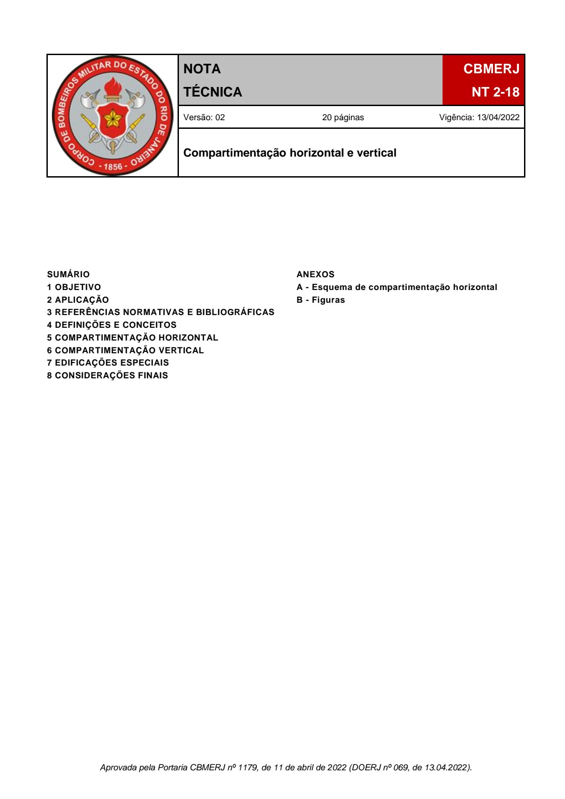

SUMÁRIO 1 OBJETIVO 2 APLICAÇÃO 3 REFERÊNCIAS NORMATIVAS E BIBLIOGRÁFICAS 4 DEFINIÇÕES E CONCEITOS 5 COMPARTIMENTAÇÃO HORIZONTAL 6 COMPARTIMENTAÇÃO VERTICAL 7 EDIFICAÇÕES ESPECIAIS 8 CONSIDERAÇÕES FINAIS

ANEXOS A - Esquema de compartimentação horizontal B - Figuras

Aprovada pela Portaria CBMERJ nº 1179, de 11 de abril de 2022 (DOERJ nº 069, de 13.04.2022).

### Tabelas extraídas (bruto, não usar para citação)
#### Tabela 1 da página

|  |  | NOTA |  |  | CBMERJ |  |
| --- | --- | --- | --- | --- | --- | --- |
|  |  | TÉCNICA |  |  | NT 2-18 |  |
|  | Versão: 02 20 páginas Vigência: 13/04/2022 |  |  |  |  |  |
|  | Compartimentação horizontal e vertical |  |  |  |  |  |

---

## Página 2

Corpo de Bombeiros Militar do Estado do Rio de Janeiro

CBMERJ Praça da República, nº 45, Centro, Rio de Janeiro - RJ. CEP: 20.211-350. www.cbmerj.rj.gov.br

http://www.cbmerj.rj.gov.br/notas-tecnicas

---

## Página 3

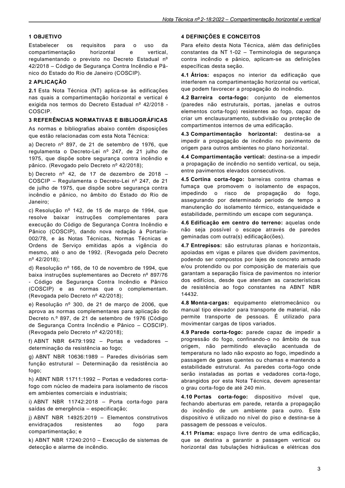

### 1 OBJETIVO

Estabelecer os requisitos para o uso da compartimentação horizontal e vertical, regulamentando o previsto no Decreto Estadual nº 42/2018 - Código de Segurança Contra Incêndio e Pânico do Estado do Rio de Janeiro (COSCIP).

### 2 APLICAÇÃO

2.1 Esta Nota Técnica (NT) aplica-se às edificações nas quais a compartimentação horizontal e vertical é exigida nos termos do Decreto Estadual nº 42/2018 - COSCIP.

### 3 REFERÊNCIAS NORMATIVAS E BIBLIOGRÁFICAS

As normas e bibliografias abaixo contêm disposições que estão relacionadas com esta Nota Técnica:

a) Decreto nº 897, de 21 de setembro de 1976, que regulamenta o Decreto-Lei nº 247, de 21 julho de 1975, que dispõe sobre segurança contra incêndio e pânico. (Revogado pelo Decreto nº 42/2018);

b) Decreto nº 42, de 17 de dezembro de 2018 - COSCIP - Regulamenta o Decreto-Lei nº 247, de 21 de julho de 1975, que dispõe sobre segurança contra incêndio e pânico, no âmbito do Estado do Rio de Janeiro;

c) Resolução nº 142, de 15 de março de 1994, que resolve baixar instruções complementares para execução do Código de Segurança Contra Incêndio e Pânico (COSCIP), dando nova redação à Portaria- 002/78, e às Notas Técnicas, Normas Técnicas e Ordens de Serviço emitidas após a vigência do mesmo, até o ano de 1992. (Revogada pelo Decreto nº 42/2018);

d) Resolução nº 166, de 10 de novembro de 1994, que baixa instruções suplementares ao Decreto nº 897/76 - Código de Segurança Contra Incêndio e Pânico (COSCIP) e as normas que o complementam. (Revogada pelo Decreto nº 42/2018);

e) Resolução nº 300, de 21 de março de 2006, que aprova as normas complementares para aplicação do Decreto n.º 897, de 21 de setembro de 1976 (Código de Segurança Contra Incêndio e Pânico - COSCIP). (Revogada pelo Decreto nº 42/2018);

f) ABNT NBR 6479:1992 - Portas e vedadores - determinação da resistência ao fogo;

g) ABNT NBR 10636:1989 - Paredes divisórias sem função estrutural - Determinação da resistência ao fogo;

h) ABNT NBR 11711:1992 - Portas e vedadores cortafogo com núcleo de madeira para isolamento de riscos em ambientes comerciais e industriais;

i) ABNT NBR 11742:2018 - Porta corta-fogo para saídas de emergência - especificação;

j) ABNT NBR 14925:2019 - Elementos construtivos envidraçados resistentes ao fogo para compartimentação; e

k) ABNT NBR 17240:2010 - Execução de sistemas de detecção e alarme de incêndio.

### 4 DEFINIÇÕES E CONCEITOS

Para efeito desta Nota Técnica, além das definições constantes da NT 1-02 - Terminologia de segurança contra incêndio e pânico, aplicam-se as definições específicas desta seção.

4.1 Átrios: espaços no interior da edificação que interferem na compartimentação horizontal ou vertical, que podem favorecer a propagação do incêndio.

4.2 Barreira corta-fogo: conjunto de elementos (paredes não estruturais, portas, janelas e outros elementos corta-fogo) resistentes ao fogo, capaz de criar um enclausuramento, subdivisão ou proteção de compartimentos internos de uma edificação.

4.3 Compartimentação horizontal: destina-se a impedir a propagação de incêndio no pavimento de origem para outros ambientes no plano horizontal.

4.4 Compartimentação vertical: destina-se a impedir a propagação de incêndio no sentido vertical, ou seja, entre pavimentos elevados consecutivos.

4.5 Cortina corta-fogo: barreiras contra chamas e fumaça que promovem o isolamento de espaços, impedindo o risco de propagação do fogo, assegurando por determinado periodo de tempo a manutenção do isolamento térmico, estanqueidade e estabilidade, permitindo um escape com segurança.

4.6 Edificação em centro do terreno: aquelas onde não seja possível o escape através de paredes geminadas com outra(s) edificação(ões).

4.7 Entrepisos: são estruturas planas e horizontais, apoiadas em vigas e pilares que dividem pavimentos, podendo ser compostos por lajes de concreto armado e/ou protendido ou por composição de materiais que garantam a separação física de pavimentos no interior dos edifícios, desde que atendam as características de resistência ao fogo constantes na ABNT NBR 14432.

4.8 Monta-cargas: equipamento eletromecânico ou manual tipo elevador para transporte de material, não permite transporte de pessoas. É utilizado para movimentar cargas de tipos variados.

4.9 Parede corta-fogo: parede capaz de impedir a progressão do fogo, confinando-o no âmbito de sua origem, não permitindo elevação acentuada de temperatura no lado não exposto ao fogo, impedindo a passagem de gases quentes ou chamas e mantendo a estabilidade estrutural. As paredes corta-fogo onde serão instaladas as portas e vedadores corta-fogo, abrangidos por esta Nota Técnica, devem apresentar o grau corta-fogo de até 240 min.

4.10 Portas corta-fogo: dispositivo móvel que, fechando aberturas em parede, retarda a propagação do incêndio de um ambiente para outro. Este dispositivo é utilizado no nível do piso e destina-se à passagem de pessoas e veículos.

4.11 Prisma: espaço livre dentro de uma edificação, que se destina a garantir a passagem vertical ou horizontal das tubulações hidráulicas e elétricas dos

---

## Página 4

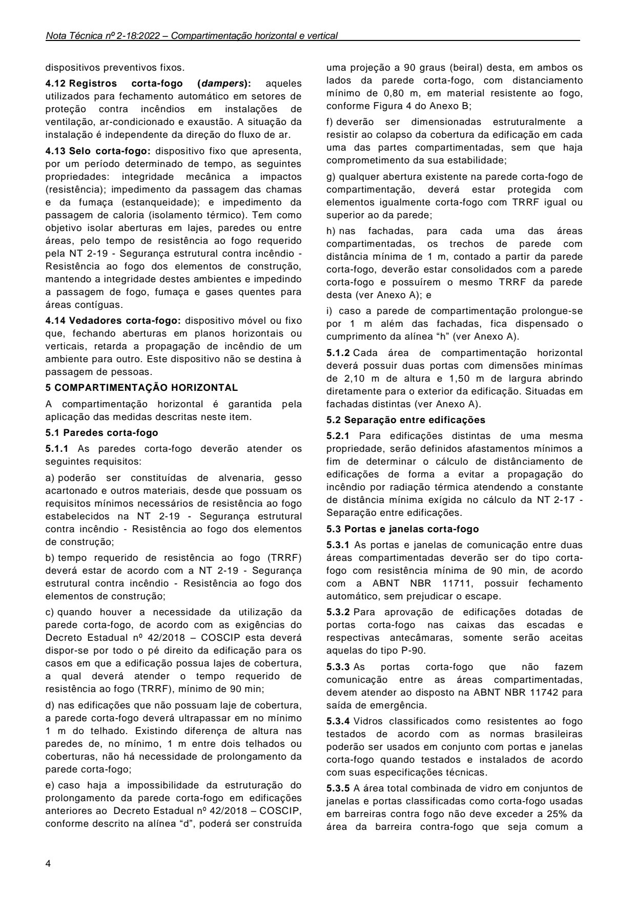

dispositivos preventivos fixos.

4.12 Registros corta-fogo (dampers): aqueles utilizados para fechamento automático em setores de proteção contra incêndios em instalações de ventilação, ar-condicionado e exaustão. A situação da instalação é independente da direção do fluxo de ar.

4.13 Selo corta-fogo: dispositivo fixo que apresenta, por um período determinado de tempo, as seguintes propriedades: integridade mecânica a impactos (resistência); impedimento da passagem das chamas e da fumaça (estanqueidade); e impedimento da passagem de caloria (isolamento térmico). Tem como objetivo isolar aberturas em lajes, paredes ou entre áreas, pelo tempo de resistência ao fogo requerido pela NT 2-19 - Segurança estrutural contra incêndio - Resistência ao fogo dos elementos de construção, mantendo a integridade destes ambientes e impedindo a passagem de fogo, fumaça e gases quentes para áreas contíguas.

4.14 Vedadores corta-fogo: dispositivo móvel ou fixo que, fechando aberturas em planos horizontais ou verticais, retarda a propagação de incêndio de um ambiente para outro. Este dispositivo não se destina à passagem de pessoas.

### 5 COMPARTIMENTAÇÃO HORIZONTAL

A compartimentação horizontal é garantida pela aplicação das medidas descritas neste item.

5.1 Paredes corta-fogo

5.1.1 As paredes corta-fogo deverão atender os seguintes requisitos:

a) poderão ser constituídas de alvenaria, gesso acartonado e outros materiais, desde que possuam os requisitos mínimos necessários de resistência ao fogo estabelecidos na NT 2-19 - Segurança estrutural contra incêndio - Resistência ao fogo dos elementos de construção;

b) tempo requerido de resistência ao fogo (TRRF) deverá estar de acordo com a NT 2-19 - Segurança estrutural contra incêndio - Resistência ao fogo dos elementos de construção;

c) quando houver a necessidade da utilização da parede corta-fogo, de acordo com as exigências do Decreto Estadual nº 42/2018 - COSCIP esta deverá dispor-se por todo o pé direito da edificação para os casos em que a edificação possua lajes de cobertura, a qual deverá atender o tempo requerido de resistência ao fogo (TRRF), mínimo de 90 min;

d) nas edificações que não possuam laje de cobertura, a parede corta-fogo deverá ultrapassar em no mínimo 1 m do telhado. Existindo diferença de altura nas paredes de, no mínimo, 1 m entre dois telhados ou coberturas, não há necessidade de prolongamento da parede corta-fogo;

e) caso haja a impossibilidade da estruturação do prolongamento da parede corta-fogo em edificações anteriores ao Decreto Estadual nº 42/2018 - COSCIP, conforme descrito na alínea “d”, poderá ser construída

uma projeção a 90 graus (beiral) desta, em ambos os lados da parede corta-fogo, com distanciamento mínimo de 0,80 m, em material resistente ao fogo, conforme Figura 4 do Anexo B;

f) deverão ser dimensionadas estruturalmente a resistir ao colapso da cobertura da edificação em cada uma das partes compartimentadas, sem que haja comprometimento da sua estabilidade;

g) qualquer abertura existente na parede corta-fogo de compartimentação, deverá estar protegida com elementos igualmente corta-fogo com TRRF igual ou superior ao da parede;

h) nas fachadas, para cada uma das áreas compartimentadas, os trechos de parede com distância mínima de 1 m, contado a partir da parede corta-fogo, deverão estar consolidados com a parede corta-fogo e possuírem o mesmo TRRF da parede desta (ver Anexo A); e

i) caso a parede de compartimentação prolongue-se por 1 m além das fachadas, fica dispensado o cumprimento da alínea “h” (ver Anexo A).

5.1.2 Cada área de compartimentação horizontal deverá possuir duas portas com dimensões minímas de 2,10 m de altura e 1,50 m de largura abrindo diretamente para o exterior da edificação. Situadas em fachadas distintas (ver Anexo A).

5.2 Separação entre edificações

5.2.1 Para edificações distintas de uma mesma propriedade, serão definidos afastamentos mínimos a fim de determinar o cálculo de distânciamento de edificações de forma a evitar a propagação do incêndio por radiação térmica atendendo a constante de distância mínima exígida no cálculo da NT 2-17 - Separação entre edificações.

5.3 Portas e janelas corta-fogo

5.3.1 As portas e janelas de comunicação entre duas áreas compartimentadas deverão ser do tipo cortafogo com resistência mínima de 90 min, de acordo com a ABNT NBR 11711, possuir fechamento automático, sem prejudicar o escape.

5.3.2 Para aprovação de edificações dotadas de portas corta-fogo nas caixas das escadas e respectivas antecâmaras, somente serão aceitas aquelas do tipo P-90.

5.3.3 As portas corta-fogo que não fazem comunicação entre as áreas compartimentadas, devem atender ao disposto na ABNT NBR 11742 para saída de emergência.

5.3.4 Vidros classificados como resistentes ao fogo testados de acordo com as normas brasileiras poderão ser usados em conjunto com portas e janelas corta-fogo quando testados e instalados de acordo com suas especificações técnicas.

5.3.5 A área total combinada de vidro em conjuntos de janelas e portas classificadas como corta-fogo usadas em barreiras contra fogo não deve exceder a 25% da área da barreira contra-fogo que seja comum a

---

## Página 5

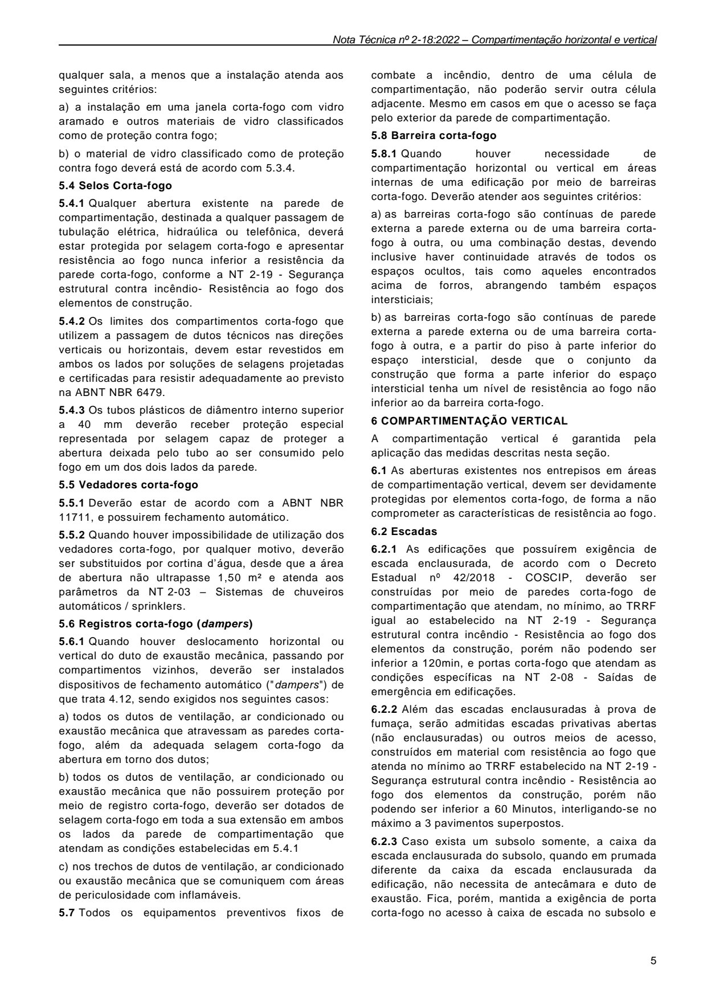

qualquer sala, a menos que a instalação atenda aos seguintes critérios:

a) a instalação em uma janela corta-fogo com vidro aramado e outros materiais de vidro classificados como de proteção contra fogo;

b) o material de vidro classificado como de proteção contra fogo deverá está de acordo com 5.3.4.

5.4 Selos Corta-fogo

5.4.1 Qualquer abertura existente na parede de compartimentação, destinada a qualquer passagem de tubulação elétrica, hidraúlica ou telefônica, deverá estar protegida por selagem corta-fogo e apresentar resistência ao fogo nunca inferior a resistência da parede corta-fogo, conforme a NT 2-19 - Segurança estrutural contra incêndio- Resistência ao fogo dos elementos de construção.

5.4.2 Os limites dos compartimentos corta-fogo que utilizem a passagem de dutos técnicos nas direções verticais ou horizontais, devem estar revestidos em ambos os lados por soluções de selagens projetadas e certificadas para resistir adequadamente ao previsto na ABNT NBR 6479.

5.4.3 Os tubos plásticos de diâmentro interno superior a 40 mm deverão receber proteção especial representada por selagem capaz de proteger a abertura deixada pelo tubo ao ser consumido pelo fogo em um dos dois lados da parede.

5.5 Vedadores corta-fogo

5.5.1 Deverão estar de acordo com a ABNT NBR 11711, e possuirem fechamento automático.

5.5.2 Quando houver impossibilidade de utilização dos vedadores corta-fogo, por qualquer motivo, deverão ser substituidos por cortina d’água, desde que a área de abertura não ultrapasse 1,50 m² e atenda aos parâmetros da NT 2-03 - Sistemas de chuveiros automáticos / sprinklers.

5.6 Registros corta-fogo (dampers)

5.6.1 Quando houver deslocamento horizontal ou vertical do duto de exaustão mecânica, passando por compartimentos vizinhos, deverão ser instalados dispositivos de fechamento automático ("dampers") de que trata 4.12, sendo exigidos nos seguintes casos:

a) todos os dutos de ventilação, ar condicionado ou exaustão mecânica que atravessam as paredes cortafogo, além da adequada selagem corta-fogo da abertura em torno dos dutos;

b) todos os dutos de ventilação, ar condicionado ou exaustão mecânica que não possuirem proteção por meio de registro corta-fogo, deverão ser dotados de selagem corta-fogo em toda a sua extensão em ambos os lados da parede de compartimentação que atendam as condições estabelecidas em 5.4.1

c) nos trechos de dutos de ventilação, ar condicionado ou exaustão mecânica que se comuniquem com áreas de periculosidade com inflamáveis.

5.7 Todos os equipamentos preventivos fixos de

combate a incêndio, dentro de uma célula de compartimentação, não poderão servir outra célula adjacente. Mesmo em casos em que o acesso se faça pelo exterior da parede de compartimentação.

5.8 Barreira corta-fogo

5.8.1 Quando houver necessidade de compartimentação horizontal ou vertical em áreas internas de uma edificação por meio de barreiras corta-fogo. Deverão atender aos seguintes critérios:

a) as barreiras corta-fogo são contínuas de parede externa a parede externa ou de uma barreira cortafogo à outra, ou uma combinação destas, devendo inclusive haver continuidade através de todos os espaços ocultos, tais como aqueles encontrados acima de forros, abrangendo também espaços intersticiais;

b) as barreiras corta-fogo são contínuas de parede externa a parede externa ou de uma barreira cortafogo à outra, e a partir do piso à parte inferior do espaço intersticial, desde que o conjunto da construção que forma a parte inferior do espaço intersticial tenha um nível de resistência ao fogo não inferior ao da barreira corta-fogo.

### 6 COMPARTIMENTAÇÃO VERTICAL

A compartimentação vertical é garantida pela aplicação das medidas descritas nesta seção.

6.1 As aberturas existentes nos entrepisos em áreas de compartimentação vertical, devem ser devidamente protegidas por elementos corta-fogo, de forma a não comprometer as características de resistência ao fogo.

6.2 Escadas

6.2.1 As edificações que possuírem exigência de escada enclausurada, de acordo com o Decreto Estadual nº 42/2018 - COSCIP, deverão ser construídas por meio de paredes corta-fogo de compartimentação que atendam, no mínimo, ao TRRF igual ao estabelecido na NT 2-19 - Segurança estrutural contra incêndio - Resistência ao fogo dos elementos da construção, porém não podendo ser inferior a 120min, e portas corta-fogo que atendam as condições específicas na NT 2-08 - Saídas de emergência em edificações.

6.2.2 Além das escadas enclausuradas à prova de fumaça, serão admitidas escadas privativas abertas (não enclausuradas) ou outros meios de acesso, construídos em material com resistência ao fogo que atenda no mínimo ao TRRF estabelecido na NT 2-19 - Segurança estrutural contra incêndio - Resistência ao fogo dos elementos da construção, porém não podendo ser inferior a 60 Minutos, interligando-se no máximo a 3 pavimentos superpostos.

6.2.3 Caso exista um subsolo somente, a caixa da escada enclausurada do subsolo, quando em prumada diferente da caixa da escada enclausurada da edificação, não necessita de antecâmara e duto de exaustão. Fica, porém, mantida a exigência de porta corta-fogo no acesso à caixa de escada no subsolo e

---

## Página 6

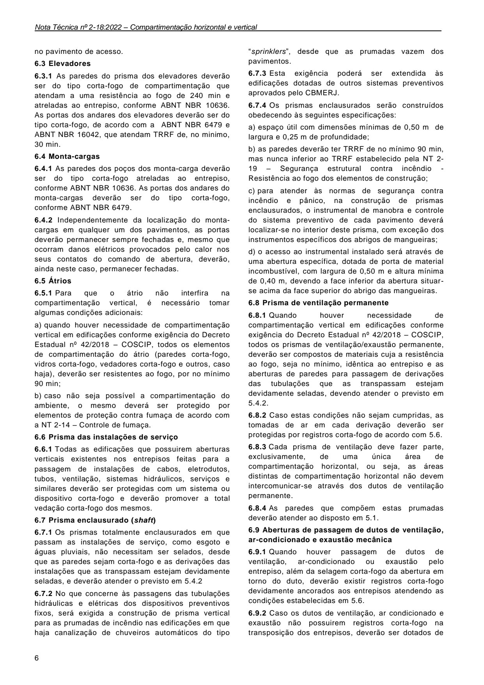

no pavimento de acesso.

6.3 Elevadores

6.3.1 As paredes do prisma dos elevadores deverão ser do tipo corta-fogo de compartimentação que atendam a uma resistência ao fogo de 240 min e atreladas ao entrepiso, conforme ABNT NBR 10636. As portas dos andares dos elevadores deverão ser do tipo corta-fogo, de acordo com a ABNT NBR 6479 e ABNT NBR 16042, que atendam TRRF de, no minimo, 30 min.

6.4 Monta-cargas

6.4.1 As paredes dos poços dos monta-carga deverão ser do tipo corta-fogo atreladas ao entrepiso, conforme ABNT NBR 10636. As portas dos andares do monta-cargas deverão ser do tipo corta-fogo, conforme ABNT NBR 6479.

6.4.2 Independentemente da localização do montacargas em qualquer um dos pavimentos, as portas deverão permanecer sempre fechadas e, mesmo que ocorram danos elétricos provocados pelo calor nos seus contatos do comando de abertura, deverão, ainda neste caso, permanecer fechadas.

6.5 Átrios

6.5.1 Para que o átrio não interfira na compartimentação vertical, é necessário tomar algumas condições adicionais:

a) quando houver necessidade de compartimentação vertical em edificações conforme exigência do Decreto Estadual nº 42/2018 - COSCIP, todos os elementos de compartimentação do átrio (paredes corta-fogo, vidros corta-fogo, vedadores corta-fogo e outros, caso haja), deverão ser resistentes ao fogo, por no mínimo 90 min;

b) caso não seja possível a compartimentação do ambiente, o mesmo deverá ser protegido por elementos de proteção contra fumaça de acordo com a NT 2-14 - Controle de fumaça.

6.6 Prisma das instalações de serviço

6.6.1 Todas as edificações que possuirem aberturas verticais existentes nos entrepisos feitas para a passagem de instalações de cabos, eletrodutos, tubos, ventilação, sistemas hidráulicos, serviços e similares deverão ser protegidas com um sistema ou dispositivo corta-fogo e deverão promover a total vedação corta-fogo dos mesmos.

6.7 Prisma enclausurado (shaft)

6.7.1 Os prismas totalmente enclausurados em que passam as instalações de serviço, como esgoto e águas pluviais, não necessitam ser selados, desde que as paredes sejam corta-fogo e as derivações das instalações que as transpassam estejam devidamente seladas, e deverão atender o previsto em 5.4.2

6.7.2 No que concerne às passagens das tubulações hidráulicas e elétricas dos dispositivos preventivos fixos, será exigida a construção de prisma vertical para as prumadas de incêndio nas edificações em que haja canalização de chuveiros automáticos do tipo

“sprinklers”, desde que as prumadas vazem dos pavimentos.

6.7.3 Esta exigência poderá ser extendida às edificações dotadas de outros sistemas preventivos aprovados pelo CBMERJ.

6.7.4 Os prismas enclausurados serão construídos obedecendo às seguintes especificações:

a) espaço útil com dimensões mínimas de 0,50 m de largura e 0,25 m de profundidade;

b) as paredes deverão ter TRRF de no mínimo 90 min, mas nunca inferior ao TRRF estabelecido pela NT 2- 19 - Segurança estrutural contra incêndio - Resistência ao fogo dos elementos de construção;

c) para atender às normas de segurança contra incêndio e pânico, na construção de prismas enclausurados, o instrumental de manobra e controle do sistema preventivo de cada pavimento deverá localizar-se no interior deste prisma, com exceção dos instrumentos específicos dos abrigos de mangueiras;

d) o acesso ao instrumental instalado será através de uma abertura específica, dotada de porta de material incombustível, com largura de 0,50 m e altura mínima de 0,40 m, devendo a face inferior da abertura situarse acima da face superior do abrigo das mangueiras.

6.8 Prisma de ventilação permanente

6.8.1 Quando houver necessidade de compartimentação vertical em edificações conforme exigência do Decreto Estadual nº 42/2018 - COSCIP, todos os prismas de ventilação/exaustão permanente, deverão ser compostos de materiais cuja a resistência ao fogo, seja no mínimo, idêntica ao entrepiso e as aberturas de paredes para passagem de derivações das tubulações que as transpassam estejam devidamente seladas, devendo atender o previsto em 5.4.2.

6.8.2 Caso estas condições não sejam cumpridas, as tomadas de ar em cada derivação deverão ser protegidas por registros corta-fogo de acordo com 5.6.

6.8.3 Cada prisma de ventilação deve fazer parte, exclusivamente, de uma única área de compartimentação horizontal, ou seja, as áreas distintas de compartimentação horizontal não devem intercomunicar-se através dos dutos de ventilação permanente.

6.8.4 As paredes que compõem estas prumadas deverão atender ao disposto em 5.1.

6.9 Aberturas de passagem de dutos de ventilação, ar-condicionado e exaustão mecânica

6.9.1 Quando houver passagem de dutos de ventilação, ar-condicionado ou exaustão pelo entrepiso, além da selagem corta-fogo da abertura em torno do duto, deverão existir registros corta-fogo devidamente ancorados aos entrepisos atendendo as condições estabelecidas em 5.6.

6.9.2 Caso os dutos de ventilação, ar condicionado e exaustão não possuirem registros corta-fogo na transposição dos entrepisos, deverão ser dotados de

---

## Página 7

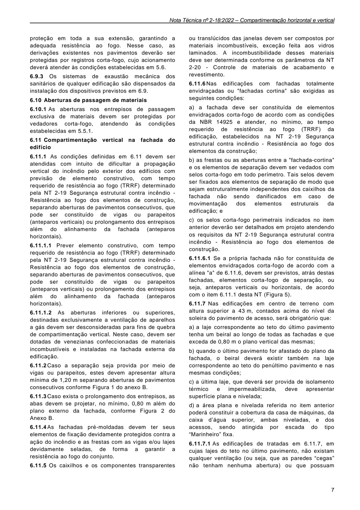

proteção em toda a sua extensão, garantindo a adequada resistência ao fogo. Nesse caso, as derivações existentes nos pavimentos deverão ser protegidas por registros corta-fogo, cujo acionamento deverá atender às condições estabelecidas em 5.6.

6.9.3 Os sistemas de exaustão mecânica dos sanitários de qualquer edificação são dispensados da instalação dos dispositivos previstos em 6.9.

6.10 Aberturas de passagem de materiais

6.10.1 As aberturas nos entrepisos de passagem exclusiva de materiais devem ser protegidas por vedadores corta-fogo, atendendo às condições estabelecidas em 5.5.1.

6.11 Compartimentação vertical na fachada do edifício

6.11.1 As condições definidas em 6.11 devem ser atendidas com intuito de dificultar a propagação vertical do incêndio pelo exterior dos edifícios com previsão de elemento construtivo, com tempo requerido de resistência ao fogo (TRRF) determinado pela NT 2-19 Segurança estrutural contra incêndio - Resistência ao fogo dos elementos de construção, separando aberturas de pavimentos consecutivos, que pode ser constituído de vigas ou parapeitos (anteparos verticais) ou prolongamento dos entrepisos além do alinhamento da fachada (anteparos horizontais).

6.11.1.1 Prever elemento construtivo, com tempo requerido de resistência ao fogo (TRRF) determinado pela NT 2-19 Segurança estrutural contra incêndio - Resistência ao fogo dos elementos de construção, separando aberturas de pavimentos consecutivos, que pode ser constituído de vigas ou parapeitos (anteparos verticais) ou prolongamento dos entrepisos além do alinhamento da fachada (anteparos horizontais).

6.11.1.2 As aberturas inferiores ou superiores, destinadas exclusivamente a ventilação de aparelhos a gás devem ser desconsideradas para fins de quebra de compartimentação vertical. Neste caso, devem ser dotadas de venezianas confeccionadas de materiais incombustíveis e instaladas na fachada externa da edificação.

6.11.2 Caso a separação seja provida por meio de vigas ou parapeitos, estes devem apresentar altura mínima de 1,20 m separando aberturas de pavimentos consecutivos conforme Figura 1 do anexo B.

6.11.3 Caso exista o prolongamento dos entrepisos, as abas devem se projetar, no mínimo, 0,80 m além do plano externo da fachada, conforme Figura 2 do Anexo B.

6.11.4 As fachadas pré-moldadas devem ter seus elementos de fixação devidamente protegidos contra a ação do incêndio e as frestas com as vigas e/ou lajes devidamente seladas, de forma a garantir a resistência ao fogo do conjunto.

6.11.5 Os caixilhos e os componentes transparentes

ou translúcidos das janelas devem ser compostos por materiais incombustíveis, exceção feita aos vidros laminados. A incombustibilidade desses materiais deve ser determinada conforme os parâmetros da NT 2-20 - Controle de materiais de acabamento e revestimento.

6.11.6 Nas edificações com fachadas totalmente envidraçadas ou "fachadas cortina" são exigidas as seguintes condições:

a) a fachada deve ser constituída de elementos envidraçados corta-fogo de acordo com as condições da NBR 14925 e atender, no mínimo, ao tempo requerido de resistência ao fogo (TRRF) da edificação, estabelecidos na NT 2-19 Segurança estrutural contra incêndio - Resistência ao fogo dos elementos da construção;

b) as frestas ou as aberturas entre a "fachada-cortina" e os elementos de separação devem ser vedados com selos corta-fogo em todo perímetro. Tais selos devem ser fixados aos elementos de separação de modo que sejam estruturalmente independentes dos caixilhos da fachada não sendo danificados em caso de movimentação dos elementos estruturais da edificação; e

c) os selos corta-fogo perimetrais indicados no item anterior deverão ser detalhados em projeto atendendo os requisitos da NT 2-19 Segurança estrutural contra incêndio - Resistência ao fogo dos elementos de construção.

6.11.6.1 Se a própria fachada não for constituída de elementos envidraçados corta-fogo de acordo com a alínea "a" de 6.11.6, devem ser previstos, atrás destas fachadas, elementos corta-fogo de separação, ou seja, anteparos verticais ou horizontais, de acordo com o item 6.11.1 desta NT (Figura 5).

6.11.7 Nas edificações em centro de terreno com altura superior a 43 m, contados acima do nível da soleira do pavimento de acesso, será obrigatório que:

a) a laje correspondente ao teto do último pavimento tenha um beiral ao longo de todas as fachadas e que exceda de 0,80 m o plano vertical das mesmas;

b) quando o último pavimento for afastado do plano da fachada, o beiral deverá existir também na laje correspondente ao teto do penúltimo pavimento e nas mesmas condições;

c) a última laje, que deverá ser provida de isolamento térmico e impermeabilizada, deve apresentar superfície plana e nivelada;

d) a área plana e nivelada referida no item anterior poderá constituir a cobertura da casa de máquinas, da caixa d’água superior, ambas niveladas, e dos acessos, sendo atingida por escada do tipo “Marinheiro” fixa.

6.11.7.1 As edificações de tratadas em 6.11.7, em cujas lajes do teto no último pavimento, não existam qualquer ventilação (ou seja, que as paredes “cegas” não tenham nenhuma abertura) ou que possuam

---

## Página 8

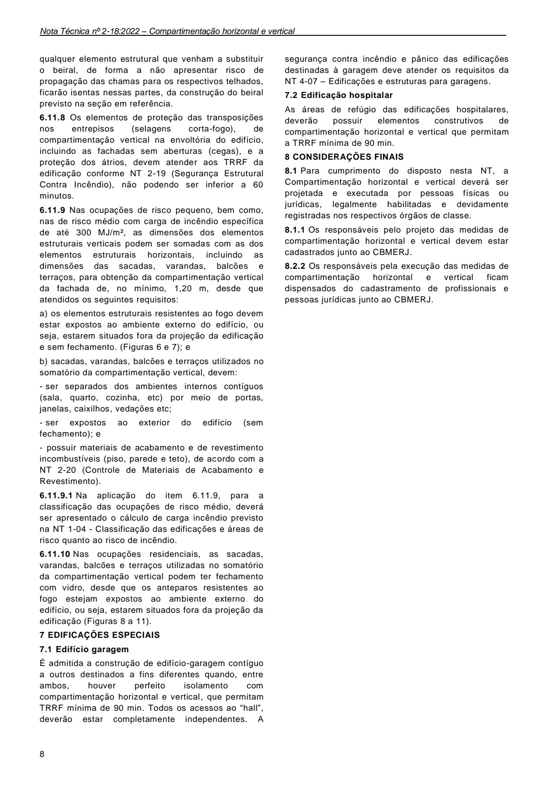

qualquer elemento estrutural que venham a substituir o beiral, de forma a não apresentar risco de propagação das chamas para os respectivos telhados, ficarão isentas nessas partes, da construção do beiral previsto na seção em referência.

6.11.8 Os elementos de proteção das transposições nos entrepisos (selagens corta-fogo), de compartimentação vertical na envoltória do edifício, incluindo as fachadas sem aberturas (cegas), e a proteção dos átrios, devem atender aos TRRF da edificação conforme NT 2-19 (Segurança Estrutural Contra Incêndio), não podendo ser inferior a 60 minutos.

6.11.9 Nas ocupações de risco pequeno, bem como, nas de risco médio com carga de incêndio específica de até 300 MJ/m², as dimensões dos elementos estruturais verticais podem ser somadas com as dos elementos estruturais horizontais, incluindo as dimensões das sacadas, varandas, balcões e terraços, para obtenção da compartimentação vertical da fachada de, no mínimo, 1,20 m, desde que atendidos os seguintes requisitos:

a) os elementos estruturais resistentes ao fogo devem estar expostos ao ambiente externo do edifício, ou seja, estarem situados fora da projeção da edificação e sem fechamento. (Figuras 6 e 7); e

b) sacadas, varandas, balcões e terraços utilizados no somatório da compartimentação vertical, devem:

- ser separados dos ambientes internos contíguos (sala, quarto, cozinha, etc) por meio de portas, janelas, caixilhos, vedações etc;

- ser expostos ao exterior do edifício (sem fechamento); e

- possuir materiais de acabamento e de revestimento incombustíveis (piso, parede e teto), de acordo com a NT 2-20 (Controle de Materiais de Acabamento e Revestimento).

6.11.9.1 Na aplicação do item 6.11.9, para a classificação das ocupações de risco médio, deverá ser apresentado o cálculo de carga incêndio previsto na NT 1-04 - Classificação das edificações e áreas de risco quanto ao risco de incêndio.

6.11.10 Nas ocupações residenciais, as sacadas, varandas, balcões e terraços utilizadas no somatório da compartimentação vertical podem ter fechamento com vidro, desde que os anteparos resistentes ao fogo estejam expostos ao ambiente externo do edifício, ou seja, estarem situados fora da projeção da edificação (Figuras 8 a 11).

### 7 EDIFICAÇÕES ESPECIAIS

7.1 Edifício garagem

É admitida a construção de edifício-garagem contíguo a outros destinados a fins diferentes quando, entre ambos, houver perfeito isolamento com compartimentação horizontal e vertical, que permitam TRRF mínima de 90 min. Todos os acessos ao “hall”, deverão estar completamente independentes. A

segurança contra incêndio e pânico das edificações destinadas à garagem deve atender os requisitos da NT 4-07 - Edificações e estruturas para garagens.

7.2 Edificação hospitalar

As áreas de refúgio das edificações hospitalares, deverão possuir elementos construtivos de compartimentação horizontal e vertical que permitam a TRRF mínima de 90 min.

### 8 CONSIDERAÇÕES FINAIS

8.1 Para cumprimento do disposto nesta NT, a Compartimentação horizontal e vertical deverá ser projetada e executada por pessoas físicas ou jurídicas, legalmente habilitadas e devidamente registradas nos respectivos órgãos de classe.

8.1.1 Os responsáveis pelo projeto das medidas de compartimentação horizontal e vertical devem estar cadastrados junto ao CBMERJ.

8.2.2 Os responsáveis pela execução das medidas de compartimentação horizontal e vertical ficam dispensados do cadastramento de profissionais e pessoas jurídicas junto ao CBMERJ.

---

## Página 9

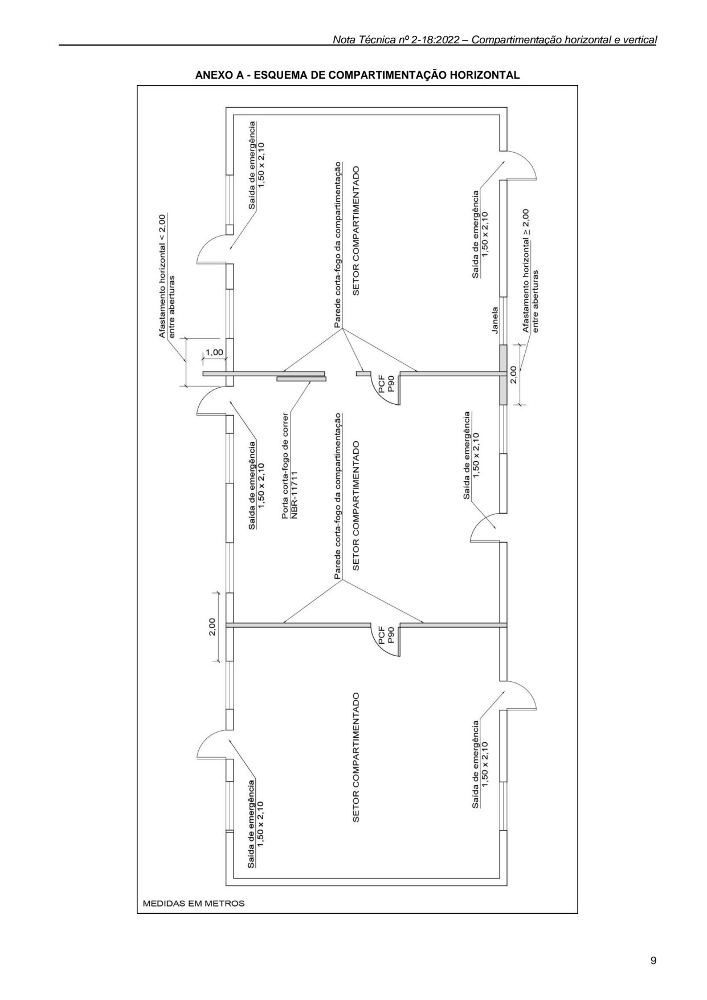

### ANEXO A - ESQUEMA DE COMPARTIMENTAÇÃO HORIZONTAL

---

## Página 10

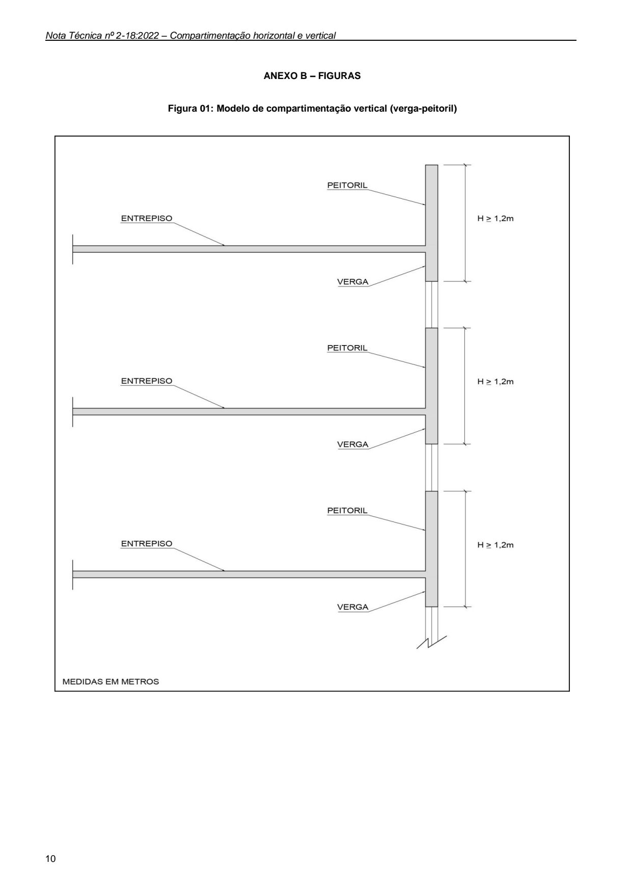

### ANEXO B - FIGURAS

Figura 01: Modelo de compartimentação vertical (verga-peitoril)

---

## Página 11

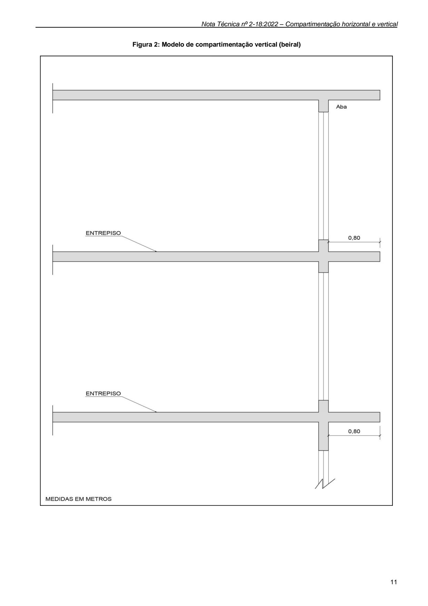

Figura 2: Modelo de compartimentação vertical (beiral)

---

## Página 12

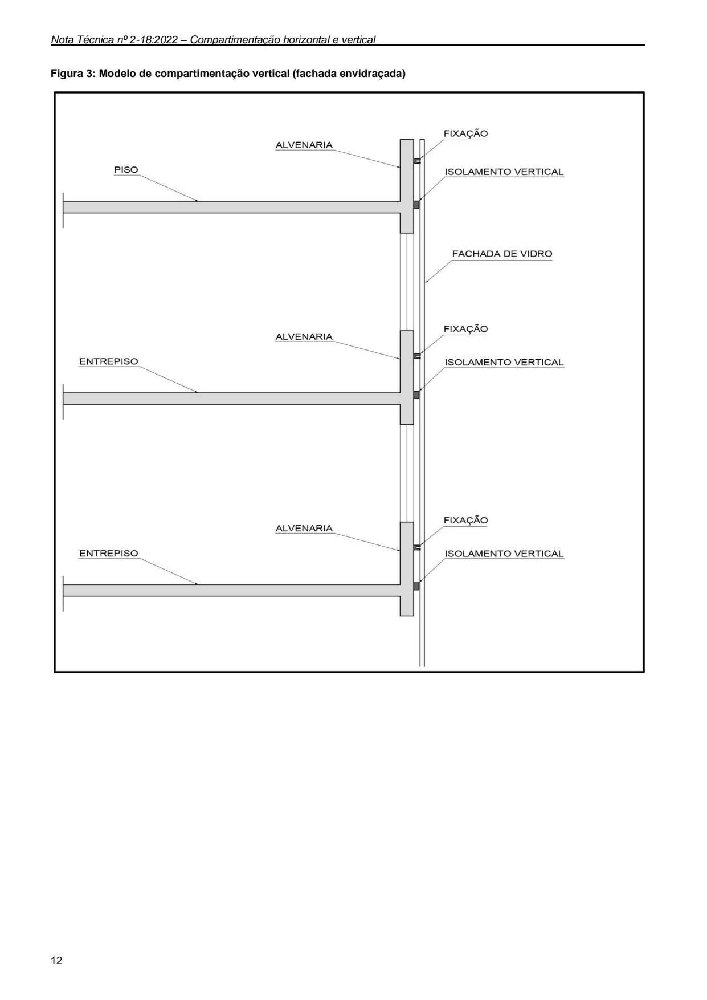

Figura 3: Modelo de compartimentação vertical (fachada envidraçada)

---

## Página 13

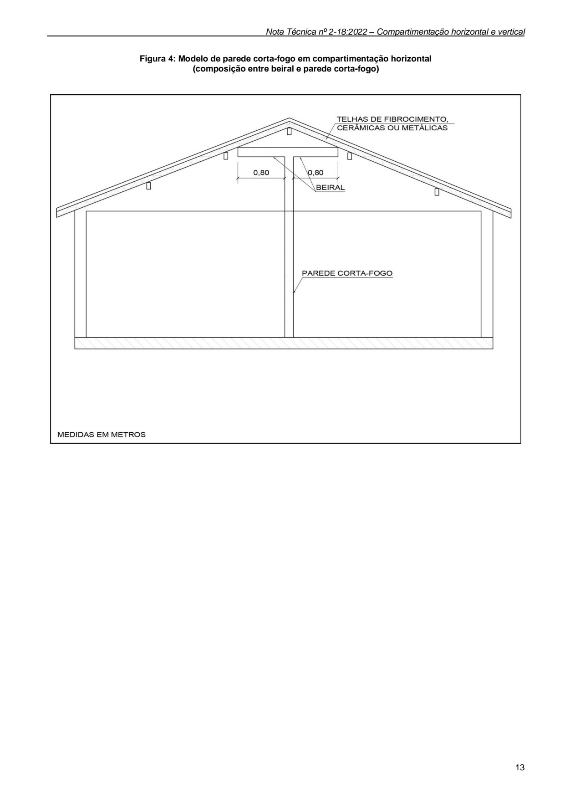

Figura 4: Modelo de parede corta-fogo em compartimentação horizontal

(composição entre beiral e parede corta-fogo)

---

## Página 14

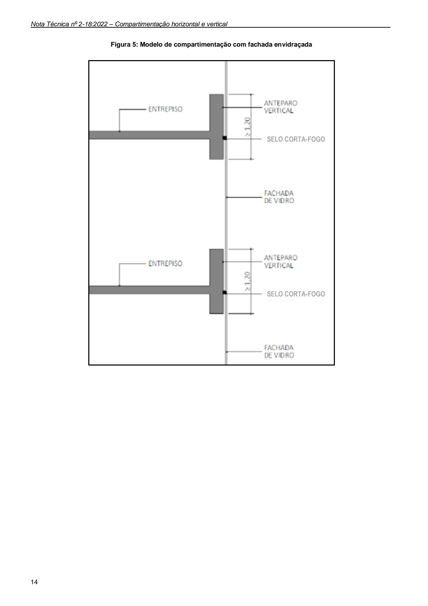

Figura 5: Modelo de compartimentação com fachada envidraçada

### SELO CORTA-FOGO

### SELO CORTA-FOGO

---

## Página 15

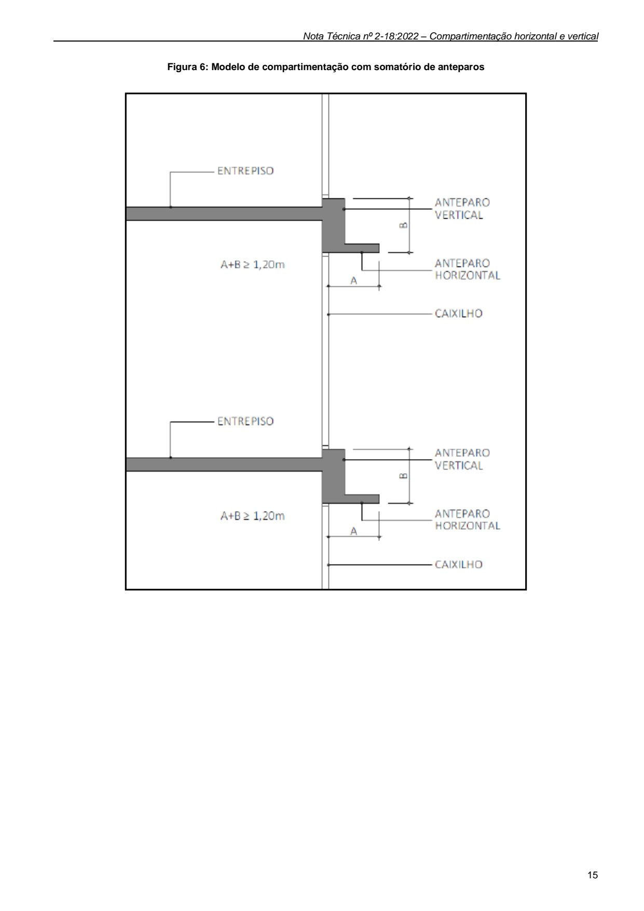

Figura 6: Modelo de compartimentação com somatório de anteparos

---

## Página 16

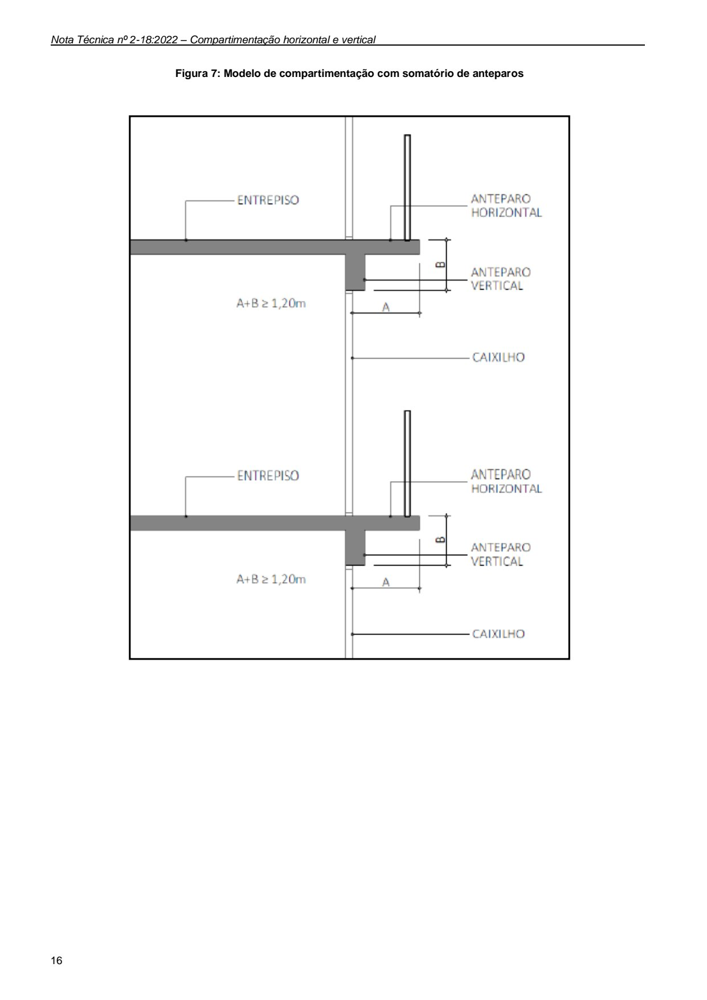

Figura 7: Modelo de compartimentação com somatório de anteparos

---

## Página 17

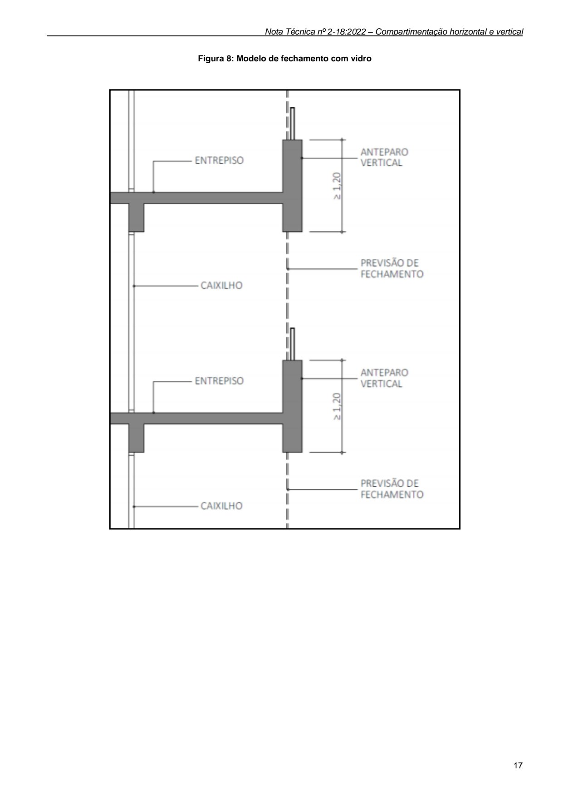

Figura 8: Modelo de fechamento com vidro

---

## Página 18

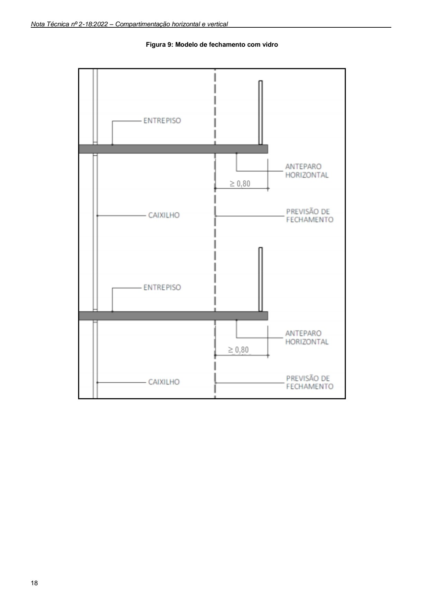

Figura 9: Modelo de fechamento com vidro

≥ 0,80

≥ 0,80

---

## Página 19

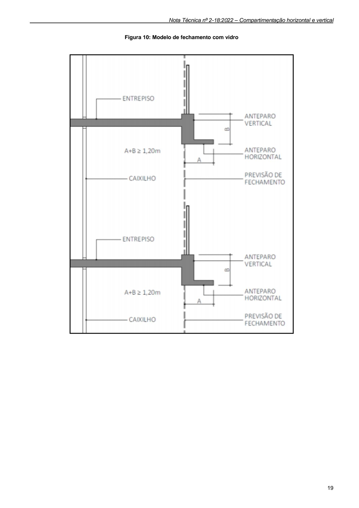

Figura 10: Modelo de fechamento com vidro

---

## Página 20

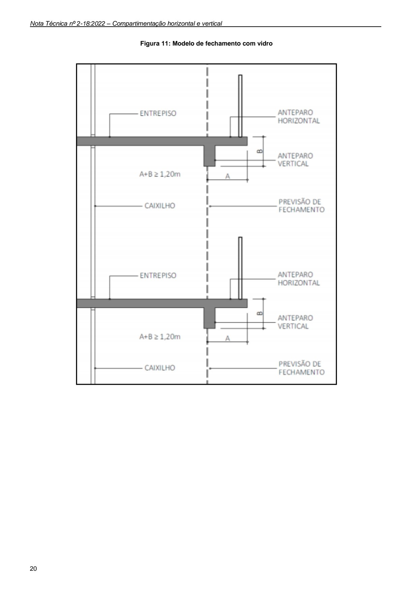

Figura 11: Modelo de fechamento com vidro
