# NT 2-19 - Segurança estrutural contra incêndio - Resistência ao fogo dos elementos de construção

> Conversão integral para consulta computacional. A numeração de página do PDF foi preservada. Quando houver tabela complexa, símbolo ou desenho, conferir também a representação visual indicada e o PDF oficial.

## Sumário por página

- [Página 1](#pagina-1)
- [Página 2](#pagina-2)
- [Página 3](#pagina-3)
- [Página 4](#pagina-4)
- [Página 5](#pagina-5)
- [Página 6](#pagina-6)
- [Página 7](#pagina-7)
- [Página 8](#pagina-8)
- [Página 9](#pagina-9)
- [Página 10](#pagina-10)
- [Página 11](#pagina-11)
- [Página 12](#pagina-12)

---

## Página 1

### NT 2-19

### N O T A T É C N I C A 2 - 1 9

S e g u r a n ç a e s t r u t u r a l c o n t r a i n c ê n d i o -

R e s i s t ê n c i a a o f o g o d o s e l e m e n t o s d e c o n s t r u ç ã o

2 0 2 5

---

## Página 2

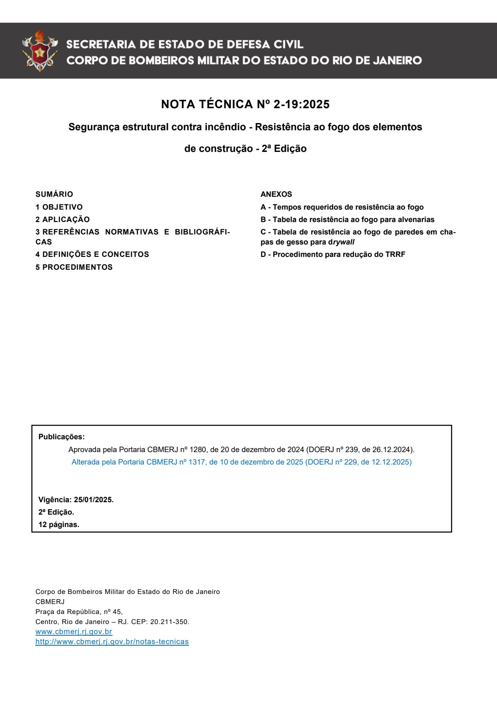

NOTA TÉCNICA Nº 2-19:2025

Segurança estrutural contra incêndio - Resistência ao fogo dos elementos

de construção - 2ª Edição

Aprovada pela Portaria CBMERJ nº 1280, de 20 de dezembro de 2024 (DOERJ nº 239, de 26.12.2024).

Alterada pela Portaria CBMERJ nº 1317, de 10 de dezembro de 2025 (DOERJ nº 229, de 12.12.2025)

Publicada no Boletim da SEDEC/CBMERJ nº XX, de XX de XX de 2023.

### SUMÁRIO

### 1 OBJETIVO

### 2 APLICAÇÃO

### 3 REFERÊNCIAS NORMATIVAS E BIBLIOGRÁFICAS

### 4 DEFINIÇÕES E CONCEITOS

### 5 PROCEDIMENTOS

Publicações:

Vigência: 25/01/2025.

2ª Edição.

12 páginas.

Corpo de Bombeiros Militar do Estado do Rio de Janeiro CBMERJ Praça da República, nº 45, Centro, Rio de Janeiro - RJ. CEP: 20.211-350. www.cbmerj.rj.gov.br http://www.cbmerj.rj.gov.br/notas-tecnicas

### ANEXOS

A - Tempos requeridos de resistência ao fogo

B - Tabela de resistência ao fogo para alvenarias

C - Tabela de resistência ao fogo de paredes em chapas de gesso para drywall

D - Procedimento para redução do TRRF

---

## Página 3

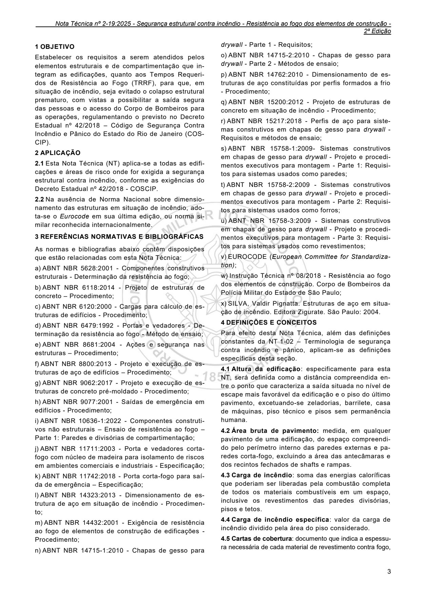

### 1 OBJETIVO

Estabelecer os requisitos a serem atendidos pelos elementos estruturais e de compartimentação que integram as edificações, quanto aos Tempos Requeridos de Resistência ao Fogo (TRRF), para que, em situação de incêndio, seja evitado o colapso estrutural prematuro, com vistas a possibilitar a saída segura das pessoas e o acesso do Corpo de Bombeiros para as operações, regulamentando o previsto no Decreto Estadual nº 42/2018 - Código de Segurança Contra Incêndio e Pânico do Estado do Rio de Janeiro (COSCIP).

### 2 APLICAÇÃO

2.1 Esta Nota Técnica (NT) aplica-se a todas as edificações e áreas de risco onde for exigida a segurança estrutural contra incêndio, conforme as exigências do Decreto Estadual nº 42/2018 - COSCIP.

2.2 Na ausência de Norma Nacional sobre dimensionamento das estruturas em situação de incêndio, adota-se o Eurocode em sua última edição, ou norma similar reconhecida internacionalmente.

### 3 REFERÊNCIAS NORMATIVAS E BIBLIOGRÁFICAS

As normas e bibliografias abaixo contêm disposições que estão relacionadas com esta Nota Técnica:

a) ABNT NBR 5628:2001 - Componentes construtivos estruturais - Determinação da resistência ao fogo;

b) ABNT NBR 6118:2014 - Projeto de estruturas de concreto - Procedimento;

c) ABNT NBR 6120:2000 - Cargas para cálculo de estruturas de edifícios - Procedimento;

d) ABNT NBR 6479:1992 - Portas e vedadores - Determinação da resistência ao fogo - Método de ensaio;

e) ABNT NBR 8681:2004 - Ações e segurança nas estruturas - Procedimento;

f) ABNT NBR 8800:2013 - Projeto e execução de estruturas de aço de edifícios - Procedimento;

g) ABNT NBR 9062:2017 - Projeto e execução de estruturas de concreto pré-moldado - Procedimento;

h) ABNT NBR 9077:2001 - Saídas de emergência em edifícios - Procedimento;

i) ABNT NBR 10636-1:2022 - Componentes construtivos não estruturais - Ensaio de resistência ao fogo - Parte 1: Paredes e divisórias de compartimentação;

j) ABNT NBR 11711:2003 - Porta e vedadores cortafogo com núcleo de madeira para isolamento de riscos em ambientes comerciais e industriais - Especificação;

k) ABNT NBR 11742:2018 - Porta corta-fogo para saída de emergência - Especificação;

l) ABNT NBR 14323:2013 - Dimensionamento de estrutura de aço em situação de incêndio - Procedimento;

m) ABNT NBR 14432:2001 - Exigência de resistência ao fogo de elementos de construção de edificações - Procedimento;

n) ABNT NBR 14715-1:2010 - Chapas de gesso para

2ª Edição

drywall - Parte 1 - Requisitos;

o) ABNT NBR 14715-2:2010 - Chapas de gesso para drywall - Parte 2 - Métodos de ensaio;

p) ABNT NBR 14762:2010 - Dimensionamento de estruturas de aço constituídas por perfis formados a frio - Procedimento;

q) ABNT NBR 15200:2012 - Projeto de estruturas de concreto em situação de incêndio - Procedimento;

r) ABNT NBR 15217:2018 - Perfis de aço para sistemas construtivos em chapas de gesso para drywall - Requisitos e métodos de ensaio;

s) ABNT NBR 15758-1:2009- Sistemas construtivos em chapas de gesso para drywall - Projeto e procedimentos executivos para montagem - Parte 1: Requisitos para sistemas usados como paredes;

t) ABNT NBR 15758-2:2009 - Sistemas construtivos em chapas de gesso para drywall - Projeto e procedimentos executivos para montagem - Parte 2: Requisitos para sistemas usados como forros;

u) ABNT NBR 15758-3:2009 - Sistemas construtivos em chapas de gesso para drywall - Projeto e procedimentos executivos para montagem - Parte 3: Requisitos para sistemas usados como revestimentos;

v) EUROCODE (European Committee for Standardization);

w) Instrução Técnica nº 08/2018 - Resistência ao fogo dos elementos de construção. Corpo de Bombeiros da Polícia Militar do Estado de São Paulo;

x) SILVA, Valdir Pignatta. Estruturas de aço em situação de incêndio. Editora Zigurate. São Paulo: 2004.

### 4 DEFINIÇÕES E CONCEITOS

Para efeito desta Nota Técnica, além das definições constantes da NT 1-02 - Terminologia de segurança contra incêndio e pânico, aplicam-se as definições específicas desta seção.

4.1 Altura da edificação: especificamente para esta NT, será definida como a distância compreendida entre o ponto que caracteriza a saída situada no nível de escape mais favorável da edificação e o piso do último pavimento, excetuando-se zeladorias, barrilete, casa de máquinas, piso técnico e pisos sem permanência humana.

4.2 Área bruta de pavimento: medida, em qualquer pavimento de uma edificação, do espaço compreendido pelo perímetro interno das paredes externas e paredes corta-fogo, excluindo a área das antecâmaras e dos recintos fechados de shafts e rampas.

4.3 Carga de incêndio: soma das energias caloríficas que poderiam ser liberadas pela combustão completa de todos os materiais combustíveis em um espaço, inclusive os revestimentos das paredes divisórias, pisos e tetos.

4.4 Carga de incêndio específica: valor da carga de incêndio dividido pela área do piso considerado.

4.5 Cartas de cobertura: documento que indica a espessura necessária de cada material de revestimento contra fogo,

---

## Página 4

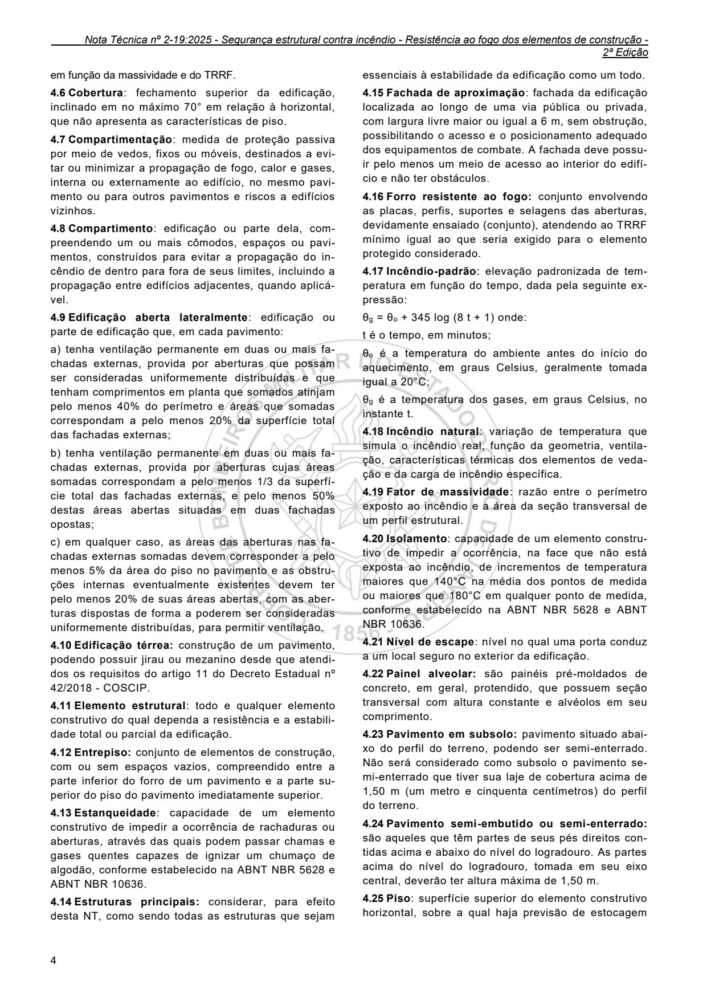

em função da massividade e do TRRF.

4.6 Cobertura: fechamento superior da edificação, inclinado em no máximo 70° em relação à horizontal, que não apresenta as características de piso.

4.7 Compartimentação: medida de proteção passiva por meio de vedos, fixos ou móveis, destinados a evitar ou minimizar a propagação de fogo, calor e gases, interna ou externamente ao edifício, no mesmo pavimento ou para outros pavimentos e riscos a edifícios vizinhos.

4.8 Compartimento: edificação ou parte dela, compreendendo um ou mais cômodos, espaços ou pavimentos, construídos para evitar a propagação do incêndio de dentro para fora de seus limites, incluindo a propagação entre edifícios adjacentes, quando aplicável.

4.9 Edificação aberta lateralmente: edificação ou parte de edificação que, em cada pavimento:

a) tenha ventilação permanente em duas ou mais fachadas externas, provida por aberturas que possam ser consideradas uniformemente distribuídas e que tenham comprimentos em planta que somados atinjam pelo menos 40% do perímetro e áreas que somadas correspondam a pelo menos 20% da superfície total das fachadas externas;

b) tenha ventilação permanente em duas ou mais fachadas externas, provida por aberturas cujas áreas somadas correspondam a pelo menos 1/3 da superfície total das fachadas externas, e pelo menos 50% destas áreas abertas situadas em duas fachadas opostas;

c) em qualquer caso, as áreas das aberturas nas fachadas externas somadas devem corresponder a pelo menos 5% da área do piso no pavimento e as obstruções internas eventualmente existentes devem ter pelo menos 20% de suas áreas abertas, com as aberturas dispostas de forma a poderem ser consideradas uniformemente distribuídas, para permitir ventilação.

4.10 Edificação térrea: construção de um pavimento, podendo possuir jirau ou mezanino desde que atendidos os requisitos do artigo 11 do Decreto Estadual nº 42/2018 - COSCIP.

4.11 Elemento estrutural: todo e qualquer elemento construtivo do qual dependa a resistência e a estabilidade total ou parcial da edificação.

4.12 Entrepiso: conjunto de elementos de construção, com ou sem espaços vazios, compreendido entre a parte inferior do forro de um pavimento e a parte superior do piso do pavimento imediatamente superior.

4.13 Estanqueidade: capacidade de um elemento construtivo de impedir a ocorrência de rachaduras ou aberturas, através das quais podem passar chamas e gases quentes capazes de ignizar um chumaço de algodão, conforme estabelecido na ABNT NBR 5628 e ABNT NBR 10636.

4.14 Estruturas principais: considerar, para efeito desta NT, como sendo todas as estruturas que sejam

2ª Edição

essenciais à estabilidade da edificação como um todo.

4.15 Fachada de aproximação: fachada da edificação localizada ao longo de uma via pública ou privada, com largura livre maior ou igual a 6 m, sem obstrução, possibilitando o acesso e o posicionamento adequado dos equipamentos de combate. A fachada deve possuir pelo menos um meio de acesso ao interior do edifício e não ter obstáculos.

4.16 Forro resistente ao fogo: conjunto envolvendo as placas, perfis, suportes e selagens das aberturas, devidamente ensaiado (conjunto), atendendo ao TRRF mínimo igual ao que seria exigido para o elemento protegido considerado.

4.17 Incêndio-padrão: elevação padronizada de temperatura em função do tempo, dada pela seguinte expressão:

θg = θo + 345 log (8 t + 1) onde:

t é o tempo, em minutos;

θo é a temperatura do ambiente antes do início do aquecimento, em graus Celsius, geralmente tomada igual a 20°C;

θg é a temperatura dos gases, em graus Celsius, no instante t.

4.18 Incêndio natural: variação de temperatura que simula o incêndio real, função da geometria, ventilação, características térmicas dos elementos de vedação e da carga de incêndio específica.

4.19 Fator de massividade: razão entre o perímetro exposto ao incêndio e a área da seção transversal de um perfil estrutural.

4.20 Isolamento: capacidade de um elemento construtivo de impedir a ocorrência, na face que não está exposta ao incêndio, de incrementos de temperatura maiores que 140°C na média dos pontos de medida ou maiores que 180°C em qualquer ponto de medida, conforme estabelecido na ABNT NBR 5628 e ABNT NBR 10636.

4.21 Nível de escape: nível no qual uma porta conduz a um local seguro no exterior da edificação.

4.22 Painel alveolar: são painéis pré-moldados de concreto, em geral, protendido, que possuem seção transversal com altura constante e alvéolos em seu comprimento.

4.23 Pavimento em subsolo: pavimento situado abaixo do perfil do terreno, podendo ser semi-enterrado. Não será considerado como subsolo o pavimento semi-enterrado que tiver sua laje de cobertura acima de 1,50 m (um metro e cinquenta centímetros) do perfil do terreno.

4.24 Pavimento semi-embutido ou semi-enterrado: são aqueles que têm partes de seus pés direitos contidas acima e abaixo do nível do logradouro. As partes acima do nível do logradouro, tomada em seu eixo central, deverão ter altura máxima de 1,50 m.

4.25 Piso: superfície superior do elemento construtivo horizontal, sobre a qual haja previsão de estocagem

---

## Página 5

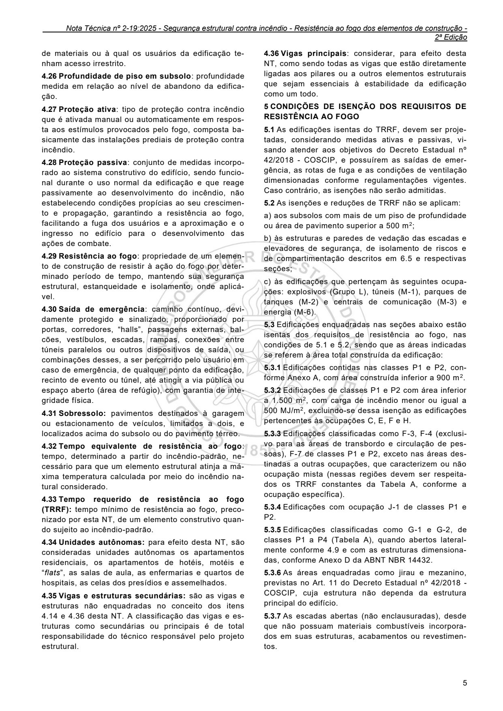

de materiais ou à qual os usuários da edificação tenham acesso irrestrito.

4.26 Profundidade de piso em subsolo: profundidade medida em relação ao nível de abandono da edificação.

4.27 Proteção ativa: tipo de proteção contra incêndio que é ativada manual ou automaticamente em resposta aos estímulos provocados pelo fogo, composta basicamente das instalações prediais de proteção contra incêndio.

4.28 Proteção passiva: conjunto de medidas incorporado ao sistema construtivo do edifício, sendo funcional durante o uso normal da edificação e que reage passivamente ao desenvolvimento do incêndio, não estabelecendo condições propícias ao seu crescimento e propagação, garantindo a resistência ao fogo, facilitando a fuga dos usuários e a aproximação e o ingresso no edifício para o desenvolvimento das ações de combate.

4.29 Resistência ao fogo: propriedade de um elemento de construção de resistir à ação do fogo por determinado período de tempo, mantendo sua segurança estrutural, estanqueidade e isolamento, onde aplicável.

4.30 Saída de emergência: caminho contínuo, devidamente protegido e sinalizado, proporcionado por portas, corredores, “halls”, passagens externas, balcões, vestíbulos, escadas, rampas, conexões entre túneis paralelos ou outros dispositivos de saída, ou combinações desses, a ser percorrido pelo usuário em caso de emergência, de qualquer ponto da edificação, recinto de evento ou túnel, até atingir a via pública ou espaço aberto (área de refúgio), com garantia de integridade física.

4.31 Sobressolo: pavimentos destinados à garagem ou estacionamento de veículos, limitados a dois, e localizados acima do subsolo ou do pavimento térreo.

4.32 Tempo equivalente de resistência ao fogo: tempo, determinado a partir do incêndio-padrão, necessário para que um elemento estrutural atinja a máxima temperatura calculada por meio do incêndio natural considerado.

4.33 Tempo requerido de resistência ao fogo (TRRF): tempo mínimo de resistência ao fogo, preconizado por esta NT, de um elemento construtivo quando sujeito ao incêndio-padrão.

4.34 Unidades autônomas: para efeito desta NT, são consideradas unidades autônomas os apartamentos residenciais, os apartamentos de hotéis, motéis e “flats”, as salas de aula, as enfermarias e quartos de hospitais, as celas dos presídios e assemelhados.

4.35 Vigas e estruturas secundárias: são as vigas e estruturas não enquadradas no conceito dos itens 4.14 e 4.36 desta NT. A classificação das vigas e estruturas como secundárias ou principais é de total responsabilidade do técnico responsável pelo projeto estrutural.

2ª Edição

4.36 Vigas principais: considerar, para efeito desta NT, como sendo todas as vigas que estão diretamente ligadas aos pilares ou a outros elementos estruturais que sejam essenciais à estabilidade da edificação como um todo.

### 5 CONDIÇÕES DE ISENÇÃO DOS REQUISITOS DE RESISTÊNCIA AO FOGO

5.1 As edificações isentas do TRRF, devem ser projetadas, considerando medidas ativas e passivas, visando atender aos objetivos do Decreto Estadual nº 42/2018 - COSCIP, e possuírem as saídas de emergência, as rotas de fuga e as condições de ventilação dimensionadas conforme regulamentações vigentes. Caso contrário, as isenções não serão admitidas.

5.2 As isenções e reduções de TRRF não se aplicam:

a) aos subsolos com mais de um piso de profundidade ou área de pavimento superior a 500 m2;

b) às estruturas e paredes de vedação das escadas e elevadores de segurança, de isolamento de riscos e de compartimentação descritos em 6.5 e respectivas seções;

c) às edificações que pertençam às seguintes ocupações: explosivos (Grupo L), túneis (M-1), parques de tanques (M-2) e centrais de comunicação (M-3) e energia (M-6).

5.3 Edificações enquadradas nas seções abaixo estão isentas dos requisitos de resistência ao fogo, nas condições de 5.1 e 5.2, sendo que as áreas indicadas se referem à área total construída da edificação:

5.3.1 Edificações contidas nas classes P1 e P2, conforme Anexo A, com área construída inferior a 900 m 2.

5.3.2 Edificações de classes P1 e P2 com área inferior a 1.500 m2, com carga de incêndio menor ou igual a 500 MJ/m2, excluindo-se dessa isenção as edificações pertencentes às ocupações C, E, F e H.

5.3.3 Edificações classificadas como F-3, F-4 (exclusivo para as áreas de transbordo e circulação de pessoas), F-7 de classes P1 e P2, exceto nas áreas destinadas a outras ocupações, que caracterizem ou não ocupação mista (nessas regiões devem ser respeitados os TRRF constantes da Tabela A, conforme a ocupação específica).

5.3.4 Edificações com ocupação J-1 de classes P1 e P2.

5.3.5 Edificações classificadas como G-1 e G-2, de classes P1 a P4 (Tabela A), quando abertos lateralmente conforme 4.9 e com as estruturas dimensionadas, conforme Anexo D da ABNT NBR 14432.

5.3.6 As áreas enquadradas como jirau e mezanino, previstas no Art. 11 do Decreto Estadual nº 42/2018 - COSCIP, cuja estrutura não dependa da estrutura principal do edifício.

5.3.7 As escadas abertas (não enclausuradas), desde que não possuam materiais combustíveis incorporados em suas estruturas, acabamentos ou revestimentos.

---

## Página 6

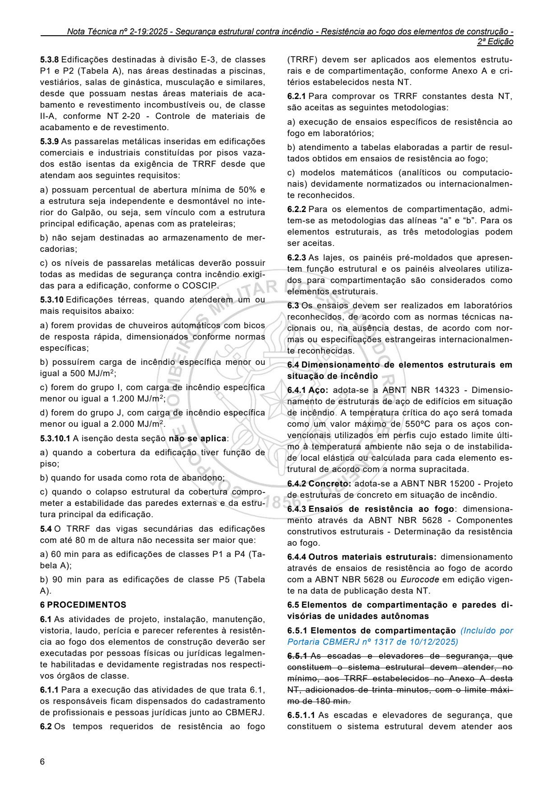

5.3.8 Edificações destinadas à divisão E-3, de classes P1 e P2 (Tabela A), nas áreas destinadas a piscinas, vestiários, salas de ginástica, musculação e similares, desde que possuam nestas áreas materiais de acabamento e revestimento incombustíveis ou, de classe II-A, conforme NT 2-20 - Controle de materiais de acabamento e de revestimento.

5.3.9 As passarelas metálicas inseridas em edificações comerciais e industriais constituídas por pisos vazados estão isentas da exigência de TRRF desde que atendam aos seguintes requisitos:

a) possuam percentual de abertura mínima de 50% e a estrutura seja independente e desmontável no interior do Galpão, ou seja, sem vínculo com a estrutura principal edificação, apenas com as prateleiras;

b) não sejam destinadas ao armazenamento de mercadorias;

c) os níveis de passarelas metálicas deverão possuir todas as medidas de segurança contra incêndio exigidas para a edificação, conforme o COSCIP.

5.3.10 Edificações térreas, quando atenderem um ou mais requisitos abaixo:

a) forem providas de chuveiros automáticos com bicos de resposta rápida, dimensionados conforme normas específicas;

b) possuírem carga de incêndio específica menor ou igual a 500 MJ/m2;

c) forem do grupo I, com carga de incêndio específica menor ou igual a 1.200 MJ/m2;

d) forem do grupo J, com carga de incêndio específica menor ou igual a 2.000 MJ/m2.

5.3.10.1 A isenção desta seção não se aplica:

a) quando a cobertura da edificação tiver função de piso;

b) quando for usada como rota de abandono;

c) quando o colapso estrutural da cobertura comprometer a estabilidade das paredes externas e da estrutura principal da edificação.

5.4 O TRRF das vigas secundárias das edificações com até 80 m de altura não necessita ser maior que:

a) 60 min para as edificações de classes P1 a P4 (Tabela A);

b) 90 min para as edificações de classe P5 (Tabela A).

### 6 PROCEDIMENTOS

6.1 As atividades de projeto, instalação, manutenção, vistoria, laudo, perícia e parecer referentes à resistência ao fogo dos elementos de construção deverão ser executadas por pessoas físicas ou jurídicas legalmente habilitadas e devidamente registradas nos respectivos órgãos de classe.

6.1.1 Para a execução das atividades de que trata 6.1, os responsáveis ficam dispensados do cadastramento de profissionais e pessoas jurídicas junto ao CBMERJ.

6.2 Os tempos requeridos de resistência ao fogo

2ª Edição

(TRRF) devem ser aplicados aos elementos estruturais e de compartimentação, conforme Anexo A e critérios estabelecidos nesta NT.

6.2.1 Para comprovar os TRRF constantes desta NT, são aceitas as seguintes metodologias:

a) execução de ensaios específicos de resistência ao fogo em laboratórios;

b) atendimento a tabelas elaboradas a partir de resultados obtidos em ensaios de resistência ao fogo;

c) modelos matemáticos (analíticos ou computacionais) devidamente normatizados ou internacionalmente reconhecidos.

6.2.2 Para os elementos de compartimentação, admitem-se as metodologias das alíneas “a” e “b”. Para os elementos estruturais, as três metodologias podem ser aceitas.

6.2.3 As lajes, os painéis pré-moldados que apresentem função estrutural e os painéis alveolares utilizados para compartimentação são considerados como elementos estruturais.

6.3 Os ensaios devem ser realizados em laboratórios reconhecidos, de acordo com as normas técnicas nacionais ou, na ausência destas, de acordo com normas ou especificações estrangeiras internacionalmente reconhecidas.

6.4 Dimensionamento de elementos estruturais em situação de incêndio

6.4.1 Aço: adota-se a ABNT NBR 14323 - Dimensionamento de estruturas de aço de edifícios em situação de incêndio. A temperatura crítica do aço será tomada como um valor máximo de 550ºC para os aços convencionais utilizados em perfis cujo estado limite último à temperatura ambiente não seja o de instabilidade local elástica ou calculada para cada elemento estrutural de acordo com a norma supracitada.

6.4.2 Concreto: adota-se a ABNT NBR 15200 - Projeto de estruturas de concreto em situação de incêndio.

6.4.3 Ensaios de resistência ao fogo: dimensionamento através da ABNT NBR 5628 - Componentes construtivos estruturais - Determinação da resistência ao fogo.

6.4.4 Outros materiais estruturais: dimensionamento através de ensaios de resistência ao fogo de acordo com a ABNT NBR 5628 ou Eurocode em edição vigente na data de publicação desta NT.

6.5 Elementos de compartimentação e paredes divisórias de unidades autônomas

6.5.1 Elementos de compartimentação (Incluído por Portaria CBMERJ nº 1317 de 10/12/2025)

6.5.1 As escadas e elevadores de segurança, que constituem o sistema estrutural devem atender, no mínimo, aos TRRF estabelecidos no Anexo A desta NT, adicionados de trinta minutos, com o limite máximo de 180 min.

6.5.1.1 As escadas e elevadores de segurança, que constituem o sistema estrutural devem atender aos

---

## Página 7

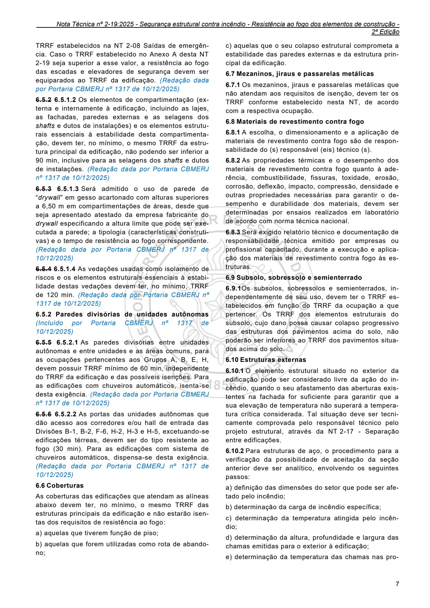

TRRF estabelecidos na NT 2-08 Saídas de emergência. Caso o TRRF estabelecido no Anexo A desta NT 2-19 seja superior a esse valor, a resistência ao fogo das escadas e elevadores de segurança devem ser equiparados ao TRRF da edificação. (Redação dada por Portaria CBMERJ nº 1317 de 10/12/2025)

6.5.2 6.5.1.2 Os elementos de compartimentação (externa e internamente à edificação, incluindo as lajes, as fachadas, paredes externas e as selagens dos shafts e dutos de instalações) e os elementos estruturais essenciais à estabilidade desta compartimentação, devem ter, no mínimo, o mesmo TRRF da estrutura principal da edificação, não podendo ser inferior a 90 min, inclusive para as selagens dos shafts e dutos de instalações. (Redação dada por Portaria CBMERJ nº 1317 de 10/12/2025)

6.5.3 6.5.1.3 Será admitido o uso de parede de “drywall” em gesso acartonado com alturas superiores a 6,50 m em compartimentações de áreas, desde que seja apresentado atestado da empresa fabricante do drywall especificando a altura limite que pode ser executada a parede; a tipologia (características construtivas) e o tempo de resistência ao fogo correspondente. (Redação dada por Portaria CBMERJ nº 1317 de 10/12/2025)

6.5.4 6.5.1.4 As vedações usadas como isolamento de riscos e os elementos estruturais essenciais à estabilidade destas vedações devem ter, no mínimo, TRRF de 120 min. (Redação dada por Portaria CBMERJ nº 1317 de 10/12/2025)

6.5.2 Paredes divisórias de unidades autônomas (Incluído por Portaria CBMERJ nº 1317 de 10/12/2025)

6.5.5 6.5.2.1 As paredes divisórias entre unidades autônomas e entre unidades e as áreas comuns, para as ocupações pertencentes aos Grupos A, B, E, H, devem possuir TRRF mínimo de 60 min, independente do TRRF da edificação e das possíveis isenções. Para as edificações com chuveiros automáticos, isenta-se desta exigência. (Redação dada por Portaria CBMERJ nº 1317 de 10/12/2025)

6.5.6 6.5.2.2 As portas das unidades autônomas que dão acesso aos corredores e/ou hall de entrada das Divisões B-1, B-2, F-6, H-2, H-3 e H-5, excetuando-se edificações térreas, devem ser do tipo resistente ao fogo (30 min). Para as edificações com sistema de chuveiros automáticos, dispensa-se desta exigência. (Redação dada por Portaria CBMERJ nº 1317 de 10/12/2025)

6.6 Coberturas

As coberturas das edificações que atendam as alíneas abaixo devem ter, no mínimo, o mesmo TRRF das estruturas principais da edificação e não estarão isentas dos requisitos de resistência ao fogo:

a) aquelas que tiverem função de piso;

b) aquelas que forem utilizadas como rota de abandono;

2ª Edição

c) aquelas que o seu colapso estrutural comprometa a estabilidade das paredes externas e da estrutura principal da edificação.

6.7 Mezaninos, jiraus e passarelas metálicas

6.7.1 Os mezaninos, jiraus e passarelas metálicas que não atendam aos requisitos de isenção, devem ter os TRRF conforme estabelecido nesta NT, de acordo com a respectiva ocupação.

6.8 Materiais de revestimento contra fogo

6.8.1 A escolha, o dimensionamento e a aplicação de materiais de revestimento contra fogo são de responsabilidade do (s) responsável (eis) técnico (s).

6.8.2 As propriedades térmicas e o desempenho dos materiais de revestimento contra fogo quanto à aderência, combustibilidade, fissuras, toxidade, erosão, corrosão, deflexão, impacto, compressão, densidade e outras propriedades necessárias para garantir o desempenho e durabilidade dos materiais, devem ser determinadas por ensaios realizados em laboratório de acordo com norma técnica nacional.

6.8.3 Será exigido relatório técnico e documentação de responsabilidade técnica emitido por empresas ou profissional capacitado, durante a execução e aplicação dos materiais de revestimento contra fogo às estruturas.

6.9 Subsolo, sobressolo e semienterrado

6.9.1Os subsolos, sobressolos e semienterrados, independentemente de seu uso, devem ter o TRRF estabelecidos em função do TRRF da ocupação a que pertencer. Os TRRF dos elementos estruturais do subsolo, cujo dano possa causar colapso progressivo das estruturas dos pavimentos acima do solo, não poderão ser inferiores ao TRRF dos pavimentos situados acima do solo.

6.10 Estruturas externas

6.10.1 O elemento estrutural situado no exterior da edificação pode ser considerado livre da ação do incêndio, quando o seu afastamento das aberturas existentes na fachada for suficiente para garantir que a sua elevação de temperatura não superará a temperatura crítica considerada. Tal situação deve ser tecnicamente comprovada pelo responsável técnico pelo projeto estrutural, através da NT 2-17 - Separação entre edificações.

6.10.2 Para estruturas de aço, o procedimento para a verificação da possibilidade de aceitação da seção anterior deve ser analítico, envolvendo os seguintes passos:

a) definição das dimensões do setor que pode ser afetado pelo incêndio;

b) determinação da carga de incêndio específica;

c) determinação da temperatura atingida pelo incêndio;

d) determinação da altura, profundidade e largura das chamas emitidas para o exterior à edificação;

e) determinação da temperatura das chamas nas pro-

---

## Página 8

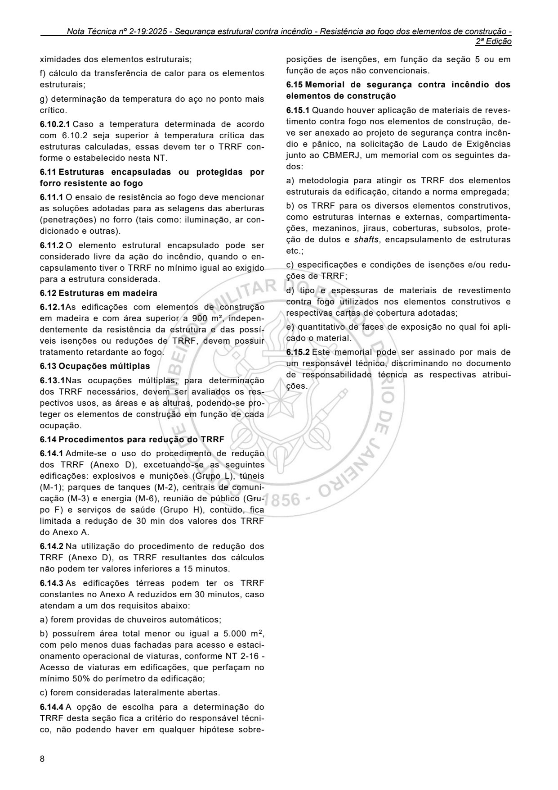

ximidades dos elementos estruturais;

f) cálculo da transferência de calor para os elementos estruturais;

g) determinação da temperatura do aço no ponto mais crítico.

6.10.2.1 Caso a temperatura determinada de acordo com 6.10.2 seja superior à temperatura crítica das estruturas calculadas, essas devem ter o TRRF conforme o estabelecido nesta NT.

6.11 Estruturas encapsuladas ou protegidas por forro resistente ao fogo

6.11.1 O ensaio de resistência ao fogo deve mencionar as soluções adotadas para as selagens das aberturas (penetrações) no forro (tais como: iluminação, ar condicionado e outras).

6.11.2 O elemento estrutural encapsulado pode ser considerado livre da ação do incêndio, quando o encapsulamento tiver o TRRF no mínimo igual ao exigido para a estrutura considerada.

6.12 Estruturas em madeira

6.12.1As edificações com elementos de construção em madeira e com área superior a 900 m², independentemente da resistência da estrutura e das possíveis isenções ou reduções de TRRF, devem possuir tratamento retardante ao fogo.

6.13 Ocupações múltiplas

6.13.1Nas ocupações múltiplas, para determinação dos TRRF necessários, devem ser avaliados os respectivos usos, as áreas e as alturas, podendo-se proteger os elementos de construção em função de cada ocupação.

6.14 Procedimentos para redução do TRRF

6.14.1 Admite-se o uso do procedimento de redução dos TRRF (Anexo D), excetuando-se as seguintes edificações: explosivos e munições (Grupo L), túneis (M-1); parques de tanques (M-2), centrais de comunicação (M-3) e energia (M-6), reunião de público (Grupo F) e serviços de saúde (Grupo H), contudo, fica limitada a redução de 30 min dos valores dos TRRF do Anexo A.

6.14.2 Na utilização do procedimento de redução dos TRRF (Anexo D), os TRRF resultantes dos cálculos não podem ter valores inferiores a 15 minutos.

6.14.3 As edificações térreas podem ter os TRRF constantes no Anexo A reduzidos em 30 minutos, caso atendam a um dos requisitos abaixo:

a) forem providas de chuveiros automáticos;

b) possuírem área total menor ou igual a 5.000 m2, com pelo menos duas fachadas para acesso e estacionamento operacional de viaturas, conforme NT 2-16 - Acesso de viaturas em edificações, que perfaçam no mínimo 50% do perímetro da edificação;

c) forem consideradas lateralmente abertas.

6.14.4 A opção de escolha para a determinação do TRRF desta seção fica a critério do responsável técnico, não podendo haver em qualquer hipótese sobre-

2ª Edição

posições de isenções, em função da seção 5 ou em função de aços não convencionais.

6.15 Memorial de segurança contra incêndio dos elementos de construção

6.15.1 Quando houver aplicação de materiais de revestimento contra fogo nos elementos de construção, deve ser anexado ao projeto de segurança contra incêndio e pânico, na solicitação de Laudo de Exigências junto ao CBMERJ, um memorial com os seguintes dados:

a) metodologia para atingir os TRRF dos elementos estruturais da edificação, citando a norma empregada;

b) os TRRF para os diversos elementos construtivos, como estruturas internas e externas, compartimentações, mezaninos, jiraus, coberturas, subsolos, proteção de dutos e shafts, encapsulamento de estruturas etc.;

c) especificações e condições de isenções e/ou reduções de TRRF;

d) tipo e espessuras de materiais de revestimento contra fogo utilizados nos elementos construtivos e respectivas cartas de cobertura adotadas;

e) quantitativo de faces de exposição no qual foi aplicado o material.

6.15.2 Este memorial pode ser assinado por mais de um responsável técnico, discriminando no documento de responsabilidade técnica as respectivas atribuições.

---

## Página 9

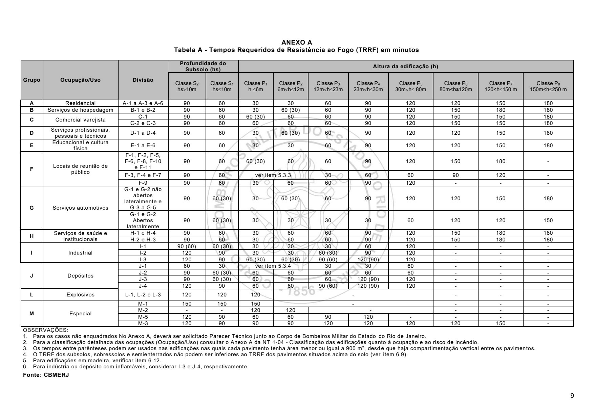

### ANEXO A Tabela A - Tempos Requeridos de Resistência ao Fogo (TRRF) em minutos

M-1 150 150 150 - - - - M-2 - - 120 120 - - - - M-5 120 90 60 60 90 120 - - - - M-3 120 90 90 90 120 120 120 120 150 - OBSERVAÇÕES: 1. Para os casos não enquadrados No Anexo A, deverá ser solicitado Parecer Técnico junto ao Corpo de Bombeiros Militar do Estado do Rio de Janeiro. 2. Para a classificação detalhada das ocupações (Ocupação/Uso) consultar o Anexo A da NT 1-04 - Classificação das edificações quanto à ocupação e ao risco de incêndio. 3. Os tempos entre parênteses podem ser usados nas edificações nas quais cada pavimento tenha área menor ou igual a 900 m², desd e que haja compartimentação vertical entre os pavimentos. 4. O TRRF dos subsolos, sobressolos e semienterrados não podem ser inferiores ao TRRF dos pavimentos situados acima do solo (ver item 6.9). 5. Para edificações em madeira, verificar item 6.12. 6. Para indústria ou depósito com inflamáveis, considerar I-3 e J-4, respectivamente. Fonte: CBMERJ

### Tabelas extraídas (bruto, não usar para citação)
#### Tabela 1 da página

| Grupo | Ocupação/Uso | Divisão |  | Profundidade do |  |  | Altura da edificação (h) |  |  |  |  |  |  |  |
| --- | --- | --- | --- | --- | --- | --- | --- | --- | --- | --- | --- | --- | --- | --- |
|  |  |  |  | Subsolo (hs) |  |  |  |  |  |  |  |  |  |  |
|  |  |  | Classe S2 hs10m |  | Classe S1 hs10m |  | Classe P1 h 6m | Classe P2 6mh12m | Classe P3 12mh23m | Classe P4 23mh30m | Classe P5 30mh 80m | Classe P6 80m<h≤120m | Classe P7 120<h150 m | Classe P8 150m<h250 m |
| A | Residencial | A-1 a A-3 e A-6 | 90 |  | 60 |  | 30 | 30 | 60 | 90 | 120 | 120 | 150 | 180 |
| B | Serviços de hospedagem | B-1 e B-2 | 90 |  | 60 |  | 30 | 60 (30) | 60 | 90 | 120 | 150 | 180 | 180 |
| C | Comercial varejista | C-1 | 90 |  | 60 |  | 60 (30) | 60 | 60 | 90 | 120 | 150 | 150 | 180 |
|  |  | C-2 e C-3 | 90 |  | 60 |  | 60 | 60 | 60 | 90 | 120 | 150 | 150 | 180 |
| D | Serviços profissionais, pessoais e técnicos | D-1 a D-4 | 90 |  | 60 |  | 30 | 60 (30) | 60 | 90 | 120 | 120 | 150 | 180 |
| E | Educacional e cultura física | E-1 a E-6 | 90 |  | 60 |  | 30 | 30 | 60 | 90 | 120 | 120 | 150 | 180 |
| F | Locais de reunião de público | F-1, F-2, F-5, F-6, F-8, F-10 e F-11 | 90 |  | 60 |  | 60 (30) | 60 | 60 | 90 | 120 | 150 | 180 | - |
|  |  | F-3, F-4 e F-7 | 90 |  | 60 |  | ver item 5.3.3 |  | 30 | 60 | 60 | 90 | 120 | - |
|  |  | F-9 | 90 |  | 60 |  | 30 | 60 | 60 | 90 | 120 | - | - | - |
| G | Serviços automotivos | G-1 e G-2 não abertos lateralmente e G-3 a G-5 | 90 |  | 60 (30) |  | 30 | 60 (30) | 60 | 90 | 120 | 120 | 150 | 180 |
|  |  | G-1 e G-2 Abertos lateralmente | 90 |  | 60 (30) |  | 30 | 30 | 30 | 30 | 60 | 120 | 120 | 150 |
| H | Serviços de saúde e institucionais | H-1 e H-4 | 90 |  | 60 |  | 30 | 60 | 60 | 90 | 120 | 150 | 180 | 180 |
|  |  | H-2 e H-3 | 90 |  | 60 |  | 30 | 60 | 60 | 90 | 120 | 150 | 180 | 180 |
| I | Industrial | I-1 | 90 (60) |  | 60 (30) |  | 30 | 30 | 30 | 60 | 120 | - | - | - |
|  |  | I-2 | 120 |  | 90 |  | 30 | 30 | 60 (30) | 90 | 120 | - | - | - |
|  |  | I-3 | 120 |  | 90 |  | 60 (30) | 60 (30) | 90 (60) | 120 (90) | 120 | - | - | - |
| J | Depósitos | J-1 | 60 |  | 30 |  | ver item 5.3.4 |  | 30 | 30 | 60 | - | - | - |
|  |  | J-2 | 90 |  | 60 (30) |  | 60 | 60 | 60 | 60 | 60 | - | - | - |
|  |  | J-3 | 90 |  | 60 (30) |  | 60 | 60 | 60 | 120 (90) | 120 | - | - | - |
|  |  | J-4 | 120 |  | 90 |  | 60 | 60 | 90 (60) | 120 (90) | 120 | - | - | - |
| L | Explosivos | L-1, L-2 e L-3 | 120 |  | 120 |  | 120 | - |  |  |  | - | - | - |
| M | Especial | M-1 | 150 |  | 150 |  | 150 | - |  |  |  | - | - | - |
|  |  | M-2 | - |  | - |  | 120 | 120 | - |  |  | - | - | - |
|  |  | M-5 | 120 |  | 90 |  | 60 | 60 | 90 | 120 | - | - | - | - |
|  |  | M-3 | 120 |  | 90 |  | 90 | 90 | 120 | 120 | 120 | 120 | 150 | - |

<!-- tabela-conferida: Tabela A p9 -->
### Tabela A — Tempos Requeridos de Resistência ao Fogo (TRRF) em minutos (conferida)

| Grupo | Ocupação/Uso | Divisão | Subsolo — Classe S2 hs>10m | Subsolo — Classe S1 hs≤10m | Altura — Classe P1 h ≤6m | Altura — Classe P2 6m<h≤12m | Altura — Classe P3 12m<h≤23m | Altura — Classe P4 23m<h≤30m | Altura — Classe P5 30m<h≤ 80m | Altura — Classe P6 80m<h≤120m | Altura — Classe P7 120<h≤150 m | Altura — Classe P8 150m<h≤250 m |
| --- | --- | --- | --- | --- | --- | --- | --- | --- | --- | --- | --- | --- |
| A | Residencial | A-1 a A-3 e A-6 | 90 | 60 | 30 | 30 | 60 | 90 | 120 | 120 | 150 | 180 |
| B | Serviços de hospedagem | B-1 e B-2 | 90 | 60 | 30 | 60 (30) | 60 | 90 | 120 | 150 | 180 | 180 |
| C | Comercial varejista | C-1 | 90 | 60 | 60 (30) | 60 | 60 | 90 | 120 | 150 | 150 | 180 |
| C | Comercial varejista | C-2 e C-3 | 90 | 60 | 60 | 60 | 60 | 90 | 120 | 150 | 150 | 180 |
| D | Serviços profissionais, pessoais e técnicos | D-1 a D-4 | 90 | 60 | 30 | 60 (30) | 60 | 90 | 120 | 120 | 150 | 180 |
| E | Educacional e cultura física | E-1 a E-6 | 90 | 60 | 30 | 30 | 60 | 90 | 120 | 120 | 150 | 180 |
| F | Locais de reunião de público | F-1, F-2, F-5, F-6, F-8, F-10 e F-11 | 90 | 60 | 60 (30) | 60 | 60 | 90 | 120 | 150 | 180 | - |
| F | Locais de reunião de público | F-3, F-4 e F-7 | 90 | 60 | ver item 5.3.3 | ver item 5.3.3 | 30 | 60 | 60 | 90 | 120 | - |
| F | Locais de reunião de público | F-9 | 90 | 60 | 30 | 60 | 60 | 90 | 120 | - | - | - |
| G | Serviços automotivos | G-1 e G-2 não abertos lateralmente e G-3 a G-5 | 90 | 60 (30) | 30 | 60 (30) | 60 | 90 | 120 | 120 | 150 | 180 |
| G | Serviços automotivos | G-1 e G-2 Abertos lateralmente | 90 | 60 (30) | 30 | 30 | 30 | 30 | 60 | 120 | 120 | 150 |
| H | Serviços de saúde e institucionais | H-1 e H-4 | 90 | 60 | 30 | 60 | 60 | 90 | 120 | 150 | 180 | 180 |
| H | Serviços de saúde e institucionais | H-2 e H-3 | 90 | 60 | 30 | 60 | 60 | 90 | 120 | 150 | 180 | 180 |
| I | Industrial | I-1 | 90 (60) | 60 (30) | 30 | 30 | 30 | 60 | 120 | - | - | - |
| I | Industrial | I-2 | 120 | 90 | 30 | 30 | 60 (30) | 90 | 120 | - | - | - |
| I | Industrial | I-3 | 120 | 90 | 60 (30) | 60 (30) | 90 (60) | 120 (90) | 120 | - | - | - |
| J | Depósitos | J-1 | 60 | 30 | ver item 5.3.4 | ver item 5.3.4 | 30 | 30 | 60 | - | - | - |
| J | Depósitos | J-2 | 90 | 60 (30) | 60 | 60 | 60 | 60 | 60 | - | - | - |
| J | Depósitos | J-3 | 90 | 60 (30) | 60 | 60 | 60 | 120 (90) | 120 | - | - | - |
| J | Depósitos | J-4 | 120 | 90 | 60 | 60 | 90 (60) | 120 (90) | 120 | - | - | - |
| L | Explosivos | L-1, L-2 e L-3 | 120 | 120 | 120 | - | - | - | - | - | - | - |
| M | Especial | M-1 | 150 | 150 | 150 | - | - | - | - | - | - | - |
| M | Especial | M-2 | - | - | 120 | 120 | - | - | - | - | - | - |
| M | Especial | M-5 | 120 | 90 | 60 | 60 | 90 | 120 | - | - | - | - |
| M | Especial | M-3 | 120 | 90 | 90 | 90 | 120 | 120 | 120 | 120 | 150 | - |

Fonte: NT 2-19, página 9, Tabela A; conferida em 2026-09-29 (visual + geometrica).
Anexo A da NT 2-19. "^" = mesclada com a de cima; "<" = mesclada com a da esquerda ("ver item 5.3.3", "ver item 5.3.4" e "-" que abrangem várias classes). Valores entre parênteses: observação 3 (pavimentos de até 900 m² com compartimentação vertical).
A camada de texto perdeu os sinais das classes ("6mh12m", "hs10m"); a leitura visual os restitui: S2 hs>10m, S1 hs≤10m, P1 h≤6m, P2 6m<h≤12m, P3 12m<h≤23m, P4 23m<h≤30m, P5 30m<h≤80m, P6 80m<h≤120m, P7 120<h≤150 m, P8 150m<h≤250 m.
Observações 1 a 6 abaixo da tabela: ver o texto da página 9. Fonte indicada: CBMERJ.
<!-- /tabela-conferida: Tabela A p9 -->

---

## Página 10

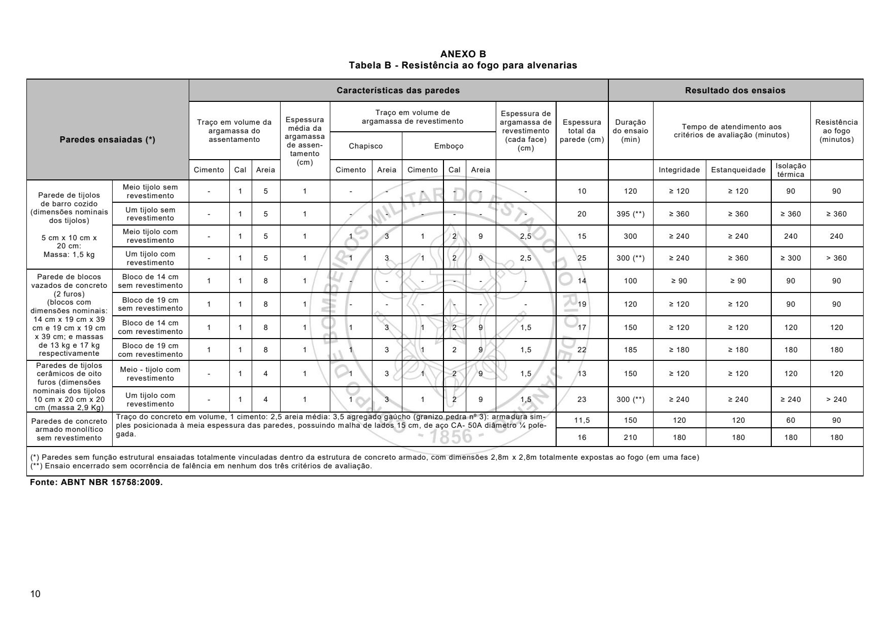

### ANEXO B Tabela B - Resistência ao fogo para alvenarias

Fonte: ABNT NBR 15758:2009.

### Tabelas extraídas (bruto, não usar para citação)
#### Tabela 1 da página

| Paredes ensaiadas (*) |  | Características das paredes |  |  |  |  |  |  |  |  |  |  | Resultado dos ensaios |  |  |  |  |
| --- | --- | --- | --- | --- | --- | --- | --- | --- | --- | --- | --- | --- | --- | --- | --- | --- | --- |
|  |  | Traço em volume da argamassa do assentamento |  |  | Espessura média da argamassa de assentamento (cm) | Traço em volume de argamassa de revestimento |  |  |  |  | Espessura de argamassa de revestimento (cada face) (cm) | Espessura total da parede (cm) | Duração do ensaio (min) | Tempo de atendimento aos critérios de avaliação (minutos) |  |  | Resistência ao fogo (minutos) |
|  |  |  |  |  |  | Chapisco |  | Emboço |  |  |  |  |  |  |  |  |  |
|  |  | Cimento | Cal | Areia |  | Cimento | Areia | Cimento | Cal | Areia |  |  |  | Integridade | Estanqueidade | Isolação térmica |  |
| Parede de tijolos de barro cozido (dimensões nominais dos tijolos) 5 cm x 10 cm x 20 cm: Massa: 1,5 kg | Meio tijolo sem revestimento | - | 1 | 5 | 1 | - | - | - | - | - | - | 10 | 120 | ≥ 120 | ≥ 120 | 90 | 90 |
|  | Um tijolo sem revestimento | - | 1 | 5 | 1 | - | - | - | - | - | - | 20 | 395 (**) | ≥ 360 | ≥ 360 | ≥ 360 | ≥ 360 |
|  | Meio tijolo com revestimento | - | 1 | 5 | 1 | 1 | 3 | 1 | 2 | 9 | 2,5 | 15 | 300 | ≥ 240 | ≥ 240 | 240 | 240 |
|  | Um tijolo com revestimento | - | 1 | 5 | 1 | 1 | 3 | 1 | 2 | 9 | 2,5 | 25 | 300 (**) | ≥ 240 | ≥ 360 | ≥ 300 | > 360 |
| Parede de blocos vazados de concreto (2 furos) (blocos com dimensões nominais: 14 cm x 19 cm x 39 cm e 19 cm x 19 cm x 39 cm; e massas de 13 kg e 17 kg respectivamente | Bloco de 14 cm sem revestimento | 1 | 1 | 8 | 1 | - | - | - | - | - | - | 14 | 100 | ≥ 90 | ≥ 90 | 90 | 90 |
|  | Bloco de 19 cm sem revestimento | 1 | 1 | 8 | 1 | - | - | - | - | - | - | 19 | 120 | ≥ 120 | ≥ 120 | 90 | 90 |
|  | Bloco de 14 cm com revestimento | 1 | 1 | 8 | 1 | 1 | 3 | 1 | 2 | 9 | 1,5 | 17 | 150 | ≥ 120 | ≥ 120 | 120 | 120 |
|  | Bloco de 19 cm com revestimento | 1 | 1 | 8 | 1 | 1 | 3 | 1 | 2 | 9 | 1,5 | 22 | 185 | ≥ 180 | ≥ 180 | 180 | 180 |
| Paredes de tijolos cerâmicos de oito furos (dimensões nominais dos tijolos 10 cm x 20 cm x 20 cm (massa 2,9 Kg) | Meio - tijolo com revestimento | - | 1 | 4 | 1 | 1 | 3 | 1 | 2 | 9 | 1,5 | 13 | 150 | ≥ 120 | ≥ 120 | 120 | 120 |
|  | Um tijolo com revestimento | - | 1 | 4 | 1 | 1 | 3 | 1 | 2 | 9 | 1,5 | 23 | 300 (**) | ≥ 240 | ≥ 240 | ≥ 240 | > 240 |
| Paredes de concreto armado monolítico sem revestimento | Traço do concreto em volume, 1 cimento: 2,5 areia média: 3,5 agregado gaúcho (granizo pedra nº 3): arma dura simples posicionada à meia espessura das paredes, possuindo malha de lados 15 cm, de aço CA- 50A diâmetro ¼ polegada. |  |  |  |  |  |  |  |  |  |  | 11,5 | 150 | 120 | 120 | 60 | 90 |
|  |  |  |  |  |  |  |  |  |  |  |  | 16 | 210 | 180 | 180 | 180 | 180 |
| (*) Paredes sem função estrutural ensaiadas totalmente vinculadas dentro da estrutura de concreto armado, com dimensões 2,8m x 2,8m totalmente expostas ao fogo (em uma face) (**) Ensaio encerrado sem ocorrência de falência em nenhum dos três critérios de avaliação. |  |  |  |  |  |  |  |  |  |  |  |  |  |  |  |  |  |

<!-- tabela-conferida: Tabela B p10 -->
### Tabela B — Resistência ao fogo para alvenarias (conferida)

| Paredes ensaiadas (*) | Tipo | Assentamento — cimento | Assentamento — cal | Assentamento — areia | Espessura média da argamassa de assentamento (cm) | Chapisco — cimento | Chapisco — areia | Emboço — cimento | Emboço — cal | Emboço — areia | Espessura de argamassa de revestimento (cada face) (cm) | Espessura total da parede (cm) | Duração do ensaio (min) | Integridade (min) | Estanqueidade (min) | Isolação térmica (min) | Resistência ao fogo (minutos) |
| --- | --- | --- | --- | --- | --- | --- | --- | --- | --- | --- | --- | --- | --- | --- | --- | --- | --- |
| Parede de tijolos de barro cozido (dimensões nominais dos tijolos) 5 cm x 10 cm x 20 cm: Massa: 1,5 kg | Meio tijolo sem revestimento | - | 1 | 5 | 1 | - | - | - | - | - | - | 10 | 120 | ≥ 120 | ≥ 120 | 90 | 90 |
| Parede de tijolos de barro cozido (dimensões nominais dos tijolos) 5 cm x 10 cm x 20 cm: Massa: 1,5 kg | Um tijolo sem revestimento | - | 1 | 5 | 1 | - | - | - | - | - | - | 20 | 395 (**) | ≥ 360 | ≥ 360 | ≥ 360 | ≥ 360 |
| Parede de tijolos de barro cozido (dimensões nominais dos tijolos) 5 cm x 10 cm x 20 cm: Massa: 1,5 kg | Meio tijolo com revestimento | - | 1 | 5 | 1 | 1 | 3 | 1 | 2 | 9 | 2,5 | 15 | 300 | ≥ 240 | ≥ 240 | 240 | 240 |
| Parede de tijolos de barro cozido (dimensões nominais dos tijolos) 5 cm x 10 cm x 20 cm: Massa: 1,5 kg | Um tijolo com revestimento | - | 1 | 5 | 1 | 1 | 3 | 1 | 2 | 9 | 2,5 | 25 | 300 (**) | ≥ 240 | ≥ 360 | ≥ 300 | > 360 |
| Parede de blocos vazados de concreto (2 furos) (blocos com dimensões nominais: 14 cm x 19 cm x 39 cm e 19 cm x 19 cm x 39 cm; e massas de 13 kg e 17 kg respectivamente | Bloco de 14 cm sem revestimento | 1 | 1 | 8 | 1 | - | - | - | - | - | - | 14 | 100 | ≥ 90 | ≥ 90 | 90 | 90 |
| Parede de blocos vazados de concreto (2 furos) (blocos com dimensões nominais: 14 cm x 19 cm x 39 cm e 19 cm x 19 cm x 39 cm; e massas de 13 kg e 17 kg respectivamente | Bloco de 19 cm sem revestimento | 1 | 1 | 8 | 1 | - | - | - | - | - | - | 19 | 120 | ≥ 120 | ≥ 120 | 90 | 90 |
| Parede de blocos vazados de concreto (2 furos) (blocos com dimensões nominais: 14 cm x 19 cm x 39 cm e 19 cm x 19 cm x 39 cm; e massas de 13 kg e 17 kg respectivamente | Bloco de 14 cm com revestimento | 1 | 1 | 8 | 1 | 1 | 3 | 1 | 2 | 9 | 1,5 | 17 | 150 | ≥ 120 | ≥ 120 | 120 | 120 |
| Parede de blocos vazados de concreto (2 furos) (blocos com dimensões nominais: 14 cm x 19 cm x 39 cm e 19 cm x 19 cm x 39 cm; e massas de 13 kg e 17 kg respectivamente | Bloco de 19 cm com revestimento | 1 | 1 | 8 | 1 | 1 | 3 | 1 | 2 | 9 | 1,5 | 22 | 185 | ≥ 180 | ≥ 180 | 180 | 180 |
| Paredes de tijolos cerâmicos de oito furos (dimensões nominais dos tijolos 10 cm x 20 cm x 20 cm (massa 2,9 Kg) | Meio - tijolo com revestimento | - | 1 | 4 | 1 | 1 | 3 | 1 | 2 | 9 | 1,5 | 13 | 150 | ≥ 120 | ≥ 120 | 120 | 120 |
| Paredes de tijolos cerâmicos de oito furos (dimensões nominais dos tijolos 10 cm x 20 cm x 20 cm (massa 2,9 Kg) | Um tijolo com revestimento | - | 1 | 4 | 1 | 1 | 3 | 1 | 2 | 9 | 1,5 | 23 | 300 (**) | ≥ 240 | ≥ 240 | ≥ 240 | > 240 |
| Paredes de concreto armado monolítico sem revestimento | Traço do concreto em volume, 1 cimento: 2,5 areia média: 3,5 agregado gaúcho (granizo pedra nº 3): armadura simples posicionada à meia espessura das paredes, possuindo malha de lados 15 cm, de aço CA- 50A diâmetro ¼ polegada. | Traço do concreto em volume, 1 cimento: 2,5 areia média: 3,5 agregado gaúcho (granizo pedra nº 3): armadura simples posicionada à meia espessura das paredes, possuindo malha de lados 15 cm, de aço CA- 50A diâmetro ¼ polegada. | Traço do concreto em volume, 1 cimento: 2,5 areia média: 3,5 agregado gaúcho (granizo pedra nº 3): armadura simples posicionada à meia espessura das paredes, possuindo malha de lados 15 cm, de aço CA- 50A diâmetro ¼ polegada. | Traço do concreto em volume, 1 cimento: 2,5 areia média: 3,5 agregado gaúcho (granizo pedra nº 3): armadura simples posicionada à meia espessura das paredes, possuindo malha de lados 15 cm, de aço CA- 50A diâmetro ¼ polegada. | Traço do concreto em volume, 1 cimento: 2,5 areia média: 3,5 agregado gaúcho (granizo pedra nº 3): armadura simples posicionada à meia espessura das paredes, possuindo malha de lados 15 cm, de aço CA- 50A diâmetro ¼ polegada. | Traço do concreto em volume, 1 cimento: 2,5 areia média: 3,5 agregado gaúcho (granizo pedra nº 3): armadura simples posicionada à meia espessura das paredes, possuindo malha de lados 15 cm, de aço CA- 50A diâmetro ¼ polegada. | Traço do concreto em volume, 1 cimento: 2,5 areia média: 3,5 agregado gaúcho (granizo pedra nº 3): armadura simples posicionada à meia espessura das paredes, possuindo malha de lados 15 cm, de aço CA- 50A diâmetro ¼ polegada. | Traço do concreto em volume, 1 cimento: 2,5 areia média: 3,5 agregado gaúcho (granizo pedra nº 3): armadura simples posicionada à meia espessura das paredes, possuindo malha de lados 15 cm, de aço CA- 50A diâmetro ¼ polegada. | Traço do concreto em volume, 1 cimento: 2,5 areia média: 3,5 agregado gaúcho (granizo pedra nº 3): armadura simples posicionada à meia espessura das paredes, possuindo malha de lados 15 cm, de aço CA- 50A diâmetro ¼ polegada. | Traço do concreto em volume, 1 cimento: 2,5 areia média: 3,5 agregado gaúcho (granizo pedra nº 3): armadura simples posicionada à meia espessura das paredes, possuindo malha de lados 15 cm, de aço CA- 50A diâmetro ¼ polegada. | Traço do concreto em volume, 1 cimento: 2,5 areia média: 3,5 agregado gaúcho (granizo pedra nº 3): armadura simples posicionada à meia espessura das paredes, possuindo malha de lados 15 cm, de aço CA- 50A diâmetro ¼ polegada. | 11,5 | 150 | 120 | 120 | 60 | 90 |
| Paredes de concreto armado monolítico sem revestimento | Traço do concreto em volume, 1 cimento: 2,5 areia média: 3,5 agregado gaúcho (granizo pedra nº 3): armadura simples posicionada à meia espessura das paredes, possuindo malha de lados 15 cm, de aço CA- 50A diâmetro ¼ polegada. | Traço do concreto em volume, 1 cimento: 2,5 areia média: 3,5 agregado gaúcho (granizo pedra nº 3): armadura simples posicionada à meia espessura das paredes, possuindo malha de lados 15 cm, de aço CA- 50A diâmetro ¼ polegada. | Traço do concreto em volume, 1 cimento: 2,5 areia média: 3,5 agregado gaúcho (granizo pedra nº 3): armadura simples posicionada à meia espessura das paredes, possuindo malha de lados 15 cm, de aço CA- 50A diâmetro ¼ polegada. | Traço do concreto em volume, 1 cimento: 2,5 areia média: 3,5 agregado gaúcho (granizo pedra nº 3): armadura simples posicionada à meia espessura das paredes, possuindo malha de lados 15 cm, de aço CA- 50A diâmetro ¼ polegada. | Traço do concreto em volume, 1 cimento: 2,5 areia média: 3,5 agregado gaúcho (granizo pedra nº 3): armadura simples posicionada à meia espessura das paredes, possuindo malha de lados 15 cm, de aço CA- 50A diâmetro ¼ polegada. | Traço do concreto em volume, 1 cimento: 2,5 areia média: 3,5 agregado gaúcho (granizo pedra nº 3): armadura simples posicionada à meia espessura das paredes, possuindo malha de lados 15 cm, de aço CA- 50A diâmetro ¼ polegada. | Traço do concreto em volume, 1 cimento: 2,5 areia média: 3,5 agregado gaúcho (granizo pedra nº 3): armadura simples posicionada à meia espessura das paredes, possuindo malha de lados 15 cm, de aço CA- 50A diâmetro ¼ polegada. | Traço do concreto em volume, 1 cimento: 2,5 areia média: 3,5 agregado gaúcho (granizo pedra nº 3): armadura simples posicionada à meia espessura das paredes, possuindo malha de lados 15 cm, de aço CA- 50A diâmetro ¼ polegada. | Traço do concreto em volume, 1 cimento: 2,5 areia média: 3,5 agregado gaúcho (granizo pedra nº 3): armadura simples posicionada à meia espessura das paredes, possuindo malha de lados 15 cm, de aço CA- 50A diâmetro ¼ polegada. | Traço do concreto em volume, 1 cimento: 2,5 areia média: 3,5 agregado gaúcho (granizo pedra nº 3): armadura simples posicionada à meia espessura das paredes, possuindo malha de lados 15 cm, de aço CA- 50A diâmetro ¼ polegada. | Traço do concreto em volume, 1 cimento: 2,5 areia média: 3,5 agregado gaúcho (granizo pedra nº 3): armadura simples posicionada à meia espessura das paredes, possuindo malha de lados 15 cm, de aço CA- 50A diâmetro ¼ polegada. | 16 | 210 | 180 | 180 | 180 | 180 |

Fonte: NT 2-19, página 10, Tabela B; conferida em 2026-09-29 (visual + geometrica).
Anexo B da NT 2-19. "^" = mesclada com a de cima; "<" = mesclada com a da esquerda (o traço do concreto armado ocupa as colunas de características). Fonte indicada: ABNT NBR 15758:2009.
Notas da tabela (fora da comparação): (*) paredes sem função estrutural ensaiadas totalmente vinculadas dentro da estrutura de concreto armado, 2,8 m x 2,8 m, expostas ao fogo em uma face; (**) ensaio encerrado sem falência em nenhum dos três critérios.
<!-- /tabela-conferida: Tabela B p10 -->

---

## Página 11

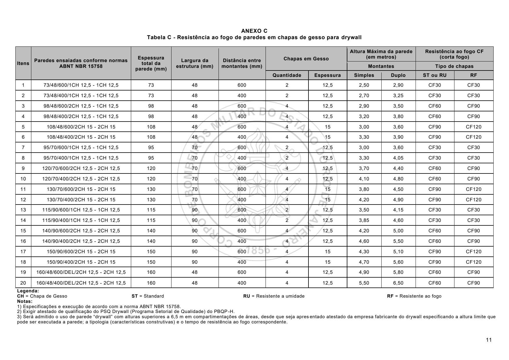

### ANEXO C Tabela C - Resistência ao fogo de paredes em chapas de gesso para drywall

Legenda: CH = Chapa de Gesso ST = Standard RU = Resistente a umidade RF = Resistente ao fogo Notas: 1) Especificações e execução de acordo com a norma ABNT NBR 15758. 2) Exigir atestado de qualificação do PSQ Drywall (Programa Setorial de Qualidade) do PBQP -H. 3) Será admitido o uso de parede “drywall” com alturas superiores a 6,5 m em compartimentações de áreas, desde que seja apres entado atestado da empresa fabricante do drywall especificando a altura limite que pode ser executada a parede; a tipologia (características construtivas) e o tempo de resistência ao fogo correspondente.

### Tabelas extraídas (bruto, não usar para citação)
#### Tabela 1 da página

|  |  |  |  |  |  |  | Altura Máxima da parede |  | Resistência ao fogo CF |  |
| --- | --- | --- | --- | --- | --- | --- | --- | --- | --- | --- |
|  | Paredes ensaiadas conforme normas | Espessura | Largura da | Distância entre | Chapas em Gesso |  | (em metros) |  | (corta fogo) |  |
| Itens | ABNT NBR 15758 | total da | estrutura (mm) | montantes (mm) |  |  | Montantes |  | Tipo de chapas |  |
|  |  | parede (mm) |  |  |  |  |  |  |  |  |
|  |  |  |  |  | Quantidade | Espessura | Simples | Duplo | ST ou RU | RF |
| 1 | 73/48/600/1CH 12,5 - 1CH 12,5 | 73 | 48 | 600 | 2 | 12,5 | 2,50 | 2,90 | CF30 | CF30 |
| 2 | 73/48/400/1CH 12,5 - 1CH 12,5 | 73 | 48 | 400 | 2 | 12,5 | 2,70 | 3,25 | CF30 | CF30 |
| 3 | 98/48/600/2CH 12,5 - 1CH 12,5 | 98 | 48 | 600 | 4 | 12,5 | 2,90 | 3,50 | CF60 | CF90 |
| 4 | 98/48/400/2CH 12,5 - 1CH 12,5 | 98 | 48 | 400 | 4 | 12,5 | 3,20 | 3,80 | CF60 | CF90 |
| 5 | 108/48/600/2CH 15 - 2CH 15 | 108 | 48 | 600 | 4 | 15 | 3,00 | 3,60 | CF90 | CF120 |
| 6 | 108/48/400/2CH 15 - 2CH 15 | 108 | 48 | 400 | 4 | 15 | 3,30 | 3,90 | CF90 | CF120 |
| 7 | 95/70/600/1CH 12,5 - 1CH 12,5 | 95 | 70 | 600 | 2 | 12,5 | 3,00 | 3,60 | CF30 | CF30 |
| 8 | 95/70/400/1CH 12,5 - 1CH 12,5 | 95 | 70 | 400 | 2 | 12,5 | 3,30 | 4,05 | CF30 | CF30 |
| 9 | 120/70/600/2CH 12,5 - 2CH 12,5 | 120 | 70 | 600 | 4 | 12,5 | 3,70 | 4,40 | CF60 | CF90 |
| 10 | 120/70/400/2CH 12,5 - 2CH 12,5 | 120 | 70 | 400 | 4 | 12,5 | 4,10 | 4,80 | CF60 | CF90 |
| 11 | 130/70/600/2CH 15 - 2CH 15 | 130 | 70 | 600 | 4 | 15 | 3,80 | 4,50 | CF90 | CF120 |
| 12 | 130/70/400/2CH 15 - 2CH 15 | 130 | 70 | 400 | 4 | 15 | 4,20 | 4,90 | CF90 | CF120 |
| 13 | 115/90/600/1CH 12,5 - 1CH 12,5 | 115 | 90 | 600 | 2 | 12,5 | 3,50 | 4,15 | CF30 | CF30 |
| 14 | 115/90/400/1CH 12,5 - 1CH 12,5 | 115 | 90 | 400 | 2 | 12,5 | 3,85 | 4,60 | CF30 | CF30 |
| 15 | 140/90/600/2CH 12,5 - 2CH 12,5 | 140 | 90 | 600 | 4 | 12,5 | 4,20 | 5,00 | CF60 | CF90 |
| 16 | 140/90/400/2CH 12,5 - 2CH 12,5 | 140 | 90 | 400 | 4 | 12,5 | 4,60 | 5,50 | CF60 | CF90 |
| 17 | 150/90/600/2CH 15 - 2CH 15 | 150 | 90 | 600 | 4 | 15 | 4,30 | 5,10 | CF90 | CF120 |
| 18 | 150/90/400/2CH 15 - 2CH 15 | 150 | 90 | 400 | 4 | 15 | 4,70 | 5,60 | CF90 | CF120 |
| 19 | 160/48/600/DEL/2CH 12,5 - 2CH 12,5 | 160 | 48 | 600 | 4 | 12,5 | 4,90 | 5,80 | CF60 | CF90 |
| 20 | 160/48/400/DEL/2CH 12,5 - 2CH 12,5 | 160 | 48 | 400 | 4 | 12,5 | 5,50 | 6,50 | CF60 | CF90 |

<!-- tabela-conferida: Tabela C p11 -->
### Tabela C — Resistência ao fogo de paredes em chapas de gesso para drywall (conferida)

| Itens | Paredes ensaiadas conforme ABNT NBR 15758 | Espessura total da parede (mm) | Largura da estrutura (mm) | Distância entre montantes (mm) | Chapas em gesso — quantidade | Chapas em gesso — espessura | Altura máxima (m) — montantes simples | Altura máxima (m) — montantes duplos | Resistência ao fogo — chapas ST ou RU | Resistência ao fogo — chapas RF |
| --- | --- | --- | --- | --- | --- | --- | --- | --- | --- | --- |
| 1 | 73/48/600/1CH 12,5 - 1CH 12,5 | 73 | 48 | 600 | 2 | 12,5 | 2,50 | 2,90 | CF30 | CF30 |
| 2 | 73/48/400/1CH 12,5 - 1CH 12,5 | 73 | 48 | 400 | 2 | 12,5 | 2,70 | 3,25 | CF30 | CF30 |
| 3 | 98/48/600/2CH 12,5 - 1CH 12,5 | 98 | 48 | 600 | 4 | 12,5 | 2,90 | 3,50 | CF60 | CF90 |
| 4 | 98/48/400/2CH 12,5 - 1CH 12,5 | 98 | 48 | 400 | 4 | 12,5 | 3,20 | 3,80 | CF60 | CF90 |
| 5 | 108/48/600/2CH 15 - 2CH 15 | 108 | 48 | 600 | 4 | 15 | 3,00 | 3,60 | CF90 | CF120 |
| 6 | 108/48/400/2CH 15 - 2CH 15 | 108 | 48 | 400 | 4 | 15 | 3,30 | 3,90 | CF90 | CF120 |
| 7 | 95/70/600/1CH 12,5 - 1CH 12,5 | 95 | 70 | 600 | 2 | 12,5 | 3,00 | 3,60 | CF30 | CF30 |
| 8 | 95/70/400/1CH 12,5 - 1CH 12,5 | 95 | 70 | 400 | 2 | 12,5 | 3,30 | 4,05 | CF30 | CF30 |
| 9 | 120/70/600/2CH 12,5 - 2CH 12,5 | 120 | 70 | 600 | 4 | 12,5 | 3,70 | 4,40 | CF60 | CF90 |
| 10 | 120/70/400/2CH 12,5 - 2CH 12,5 | 120 | 70 | 400 | 4 | 12,5 | 4,10 | 4,80 | CF60 | CF90 |
| 11 | 130/70/600/2CH 15 - 2CH 15 | 130 | 70 | 600 | 4 | 15 | 3,80 | 4,50 | CF90 | CF120 |
| 12 | 130/70/400/2CH 15 - 2CH 15 | 130 | 70 | 400 | 4 | 15 | 4,20 | 4,90 | CF90 | CF120 |
| 13 | 115/90/600/1CH 12,5 - 1CH 12,5 | 115 | 90 | 600 | 2 | 12,5 | 3,50 | 4,15 | CF30 | CF30 |
| 14 | 115/90/400/1CH 12,5 - 1CH 12,5 | 115 | 90 | 400 | 2 | 12,5 | 3,85 | 4,60 | CF30 | CF30 |
| 15 | 140/90/600/2CH 12,5 - 2CH 12,5 | 140 | 90 | 600 | 4 | 12,5 | 4,20 | 5,00 | CF60 | CF90 |
| 16 | 140/90/400/2CH 12,5 - 2CH 12,5 | 140 | 90 | 400 | 4 | 12,5 | 4,60 | 5,50 | CF60 | CF90 |
| 17 | 150/90/600/2CH 15 - 2CH 15 | 150 | 90 | 600 | 4 | 15 | 4,30 | 5,10 | CF90 | CF120 |
| 18 | 150/90/400/2CH 15 - 2CH 15 | 150 | 90 | 400 | 4 | 15 | 4,70 | 5,60 | CF90 | CF120 |
| 19 | 160/48/600/DEL/2CH 12,5 - 2CH 12,5 | 160 | 48 | 600 | 4 | 12,5 | 4,90 | 5,80 | CF60 | CF90 |
| 20 | 160/48/400/DEL/2CH 12,5 - 2CH 12,5 | 160 | 48 | 400 | 4 | 12,5 | 5,50 | 6,50 | CF60 | CF90 |

Fonte: NT 2-19, página 11, Tabela C; conferida em 2026-09-29 (visual + geometrica).
Anexo C da NT 2-19. O cabeçalho em três níveis foi achatado por coluna. Legenda: CH = chapa de gesso; ST = standard; RU = resistente à umidade; RF = resistente ao fogo. Notas 1 a 3 abaixo da tabela: ver o texto da página 11.
<!-- /tabela-conferida: Tabela C p11 -->

---

## Página 12

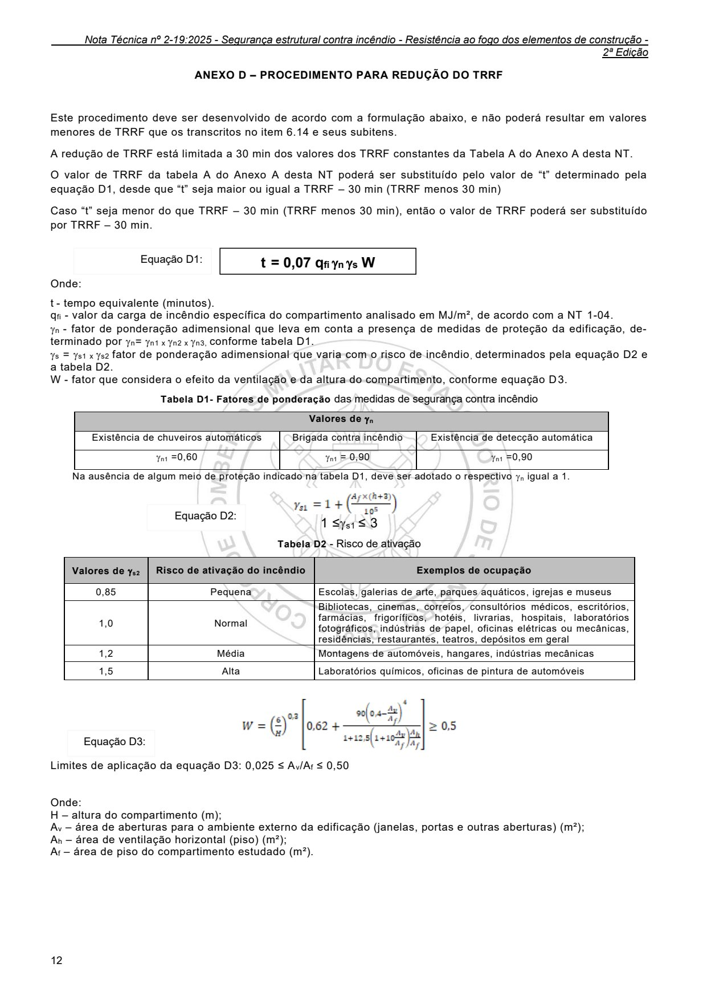

2ª Edição

### ANEXO D - PROCEDIMENTO PARA REDUÇÃO DO TRRF

Este procedimento deve ser desenvolvido de acordo com a formulação abaixo, e não poderá resultar em valores menores de TRRF que os transcritos no item 6.14 e seus subitens.

A redução de TRRF está limitada a 30 min dos valores dos TRRF constantes da Tabela A do Anexo A desta NT.

O valor de TRRF da tabela A do Anexo A desta NT poderá ser substituído pelo valor de “t” determinado pela equação D1, desde que “t” seja maior ou igual a TRRF - 30 min (TRRF menos 30 min)

Caso “t” seja menor do que TRRF - 30 min (TRRF menos 30 min), então o valor de TRRF poderá ser substituído por TRRF - 30 min.

t = 0,07 qfi n s W Equação D1:

Onde:

t - tempo equivalente (minutos). qfi - valor da carga de incêndio específica do compartimento analisado em MJ/m², de acordo com a NT 1-04. n - fator de ponderação adimensional que leva em conta a presença de medidas de proteção da edificação, determinado por n= n1 x n2 x n3, conforme tabela D1. s = s1 x s2 fator de ponderação adimensional que varia com o risco de incêndio, determinados pela equação D2 e a tabela D2. W - fator que considera o efeito da ventilação e da altura do compartimento, conforme equação D3.

Tabela D1- Fatores de ponderação das medidas de segurança contra incêndio

Na ausência de algum meio de proteção indicado na tabela D1, deve ser adotado o respectivo n igual a 1.

Equação D2:

1 ≤s1 ≤ 3

Tabela D2 - Risco de ativação

Equação D3:

Limites de aplicação da equação D3: 0,025 ≤ Av/Af ≤ 0,50 Onde: H - altura do compartimento (m); Av - área de aberturas para o ambiente externo da edificação (janelas, portas e outras aberturas) (m²); Ah - área de ventilação horizontal (piso) (m²); Af - área de piso do compartimento estudado (m²).

### Tabelas extraídas (bruto, não usar para citação)
#### Tabela 1 da página

|  | Valores de  n |  |  |  |
| --- | --- | --- | --- | --- |
| Existência de chuveiros automáticos |  | Brigada contra incêndio | Existência de detecção automática |  |
|  =0,60 n1 |  |  = 0,90 n1 |  =0,90 n1 |  |

#### Tabela 2 da página

| Valores de  s2 | Risco de ativação do incêndio | Exemplos de ocupação |
| --- | --- | --- |
| 0,85 | Pequena | Escolas, galerias de arte, parques aquáticos, igrejas e museus |
| 1,0 | Normal | Bibliotecas, cinemas, correios, consultórios médicos, escritórios, farmácias, frigoríficos, hotéis, livrarias, hospitais, laboratórios fotográficos, indústrias de papel, oficinas elétricas ou mecânicas, residências, restaurantes, teatros, depósitos em geral |
| 1,2 | Média | Montagens de automóveis, hangares, indústrias mecânicas |
| 1,5 | Alta | Laboratórios químicos, oficinas de pintura de automóveis |
<!-- tabela-conferida: Tabela D2 p12 -->
### Tabela D2 — Risco de ativação (conferida)

| Valores de γs2 | Risco de ativação do incêndio | Exemplos de ocupação |
| --- | --- | --- |
| 0,85 | Pequena | Escolas, galerias de arte, parques aquáticos, igrejas e museus |
| 1,0 | Normal | Bibliotecas, cinemas, correios, consultórios médicos, escritórios, farmácias, frigoríficos, hotéis, livrarias, hospitais, laboratórios fotográficos, indústrias de papel, oficinas elétricas ou mecânicas, residências, restaurantes, teatros, depósitos em geral |
| 1,2 | Média | Montagens de automóveis, hangares, indústrias mecânicas |
| 1,5 | Alta | Laboratórios químicos, oficinas de pintura de automóveis |

Fonte: NT 2-19, página 12, Tabela D2; conferida em 2026-09-29 (visual + geometrica).
<!-- /tabela-conferida: Tabela D2 p12 -->

