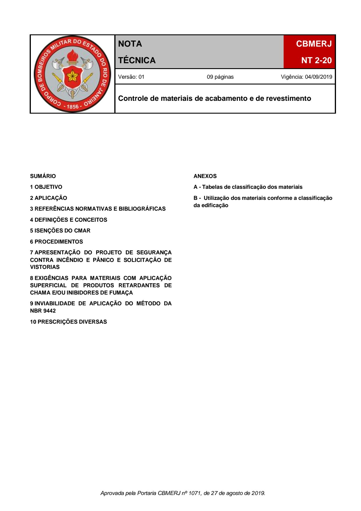
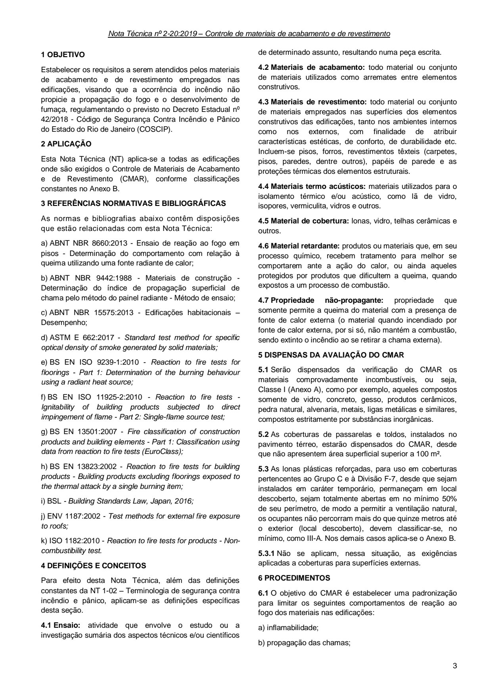
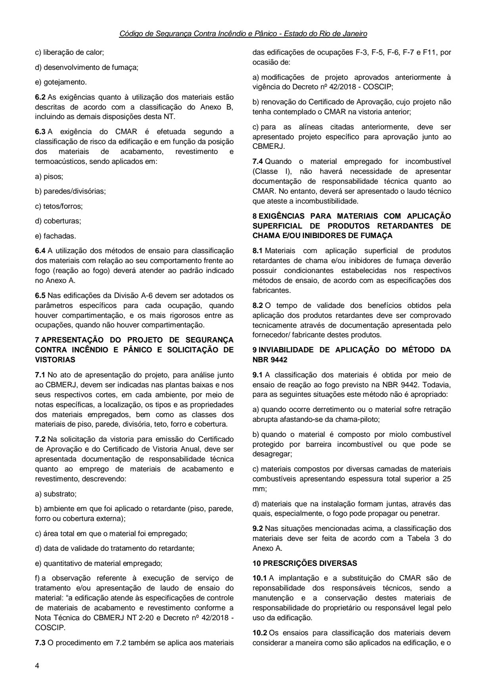
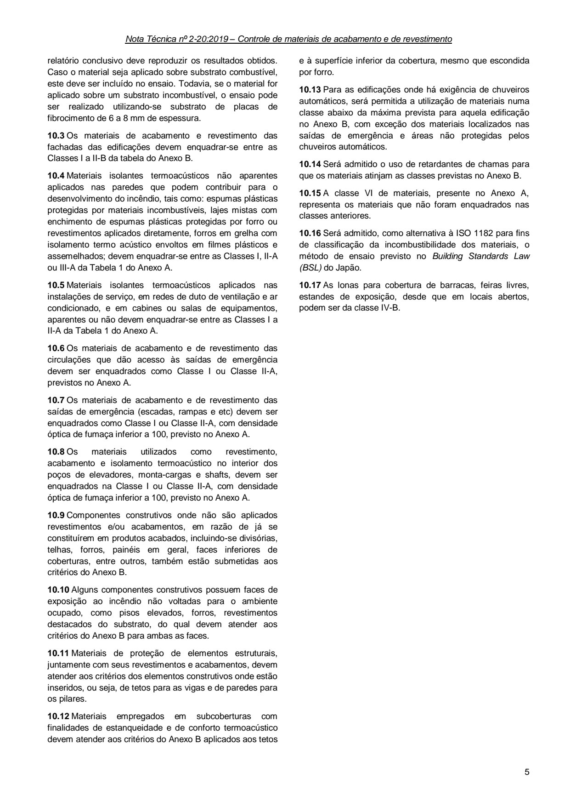
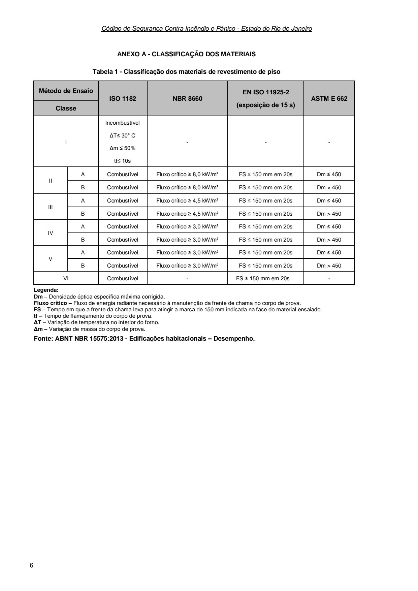
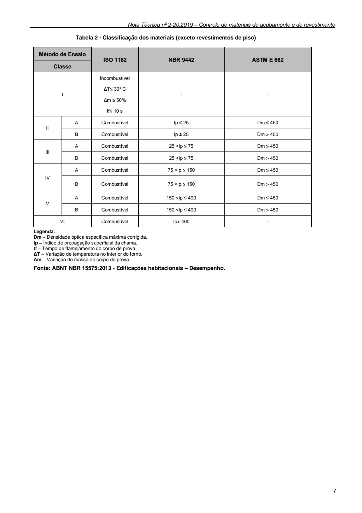
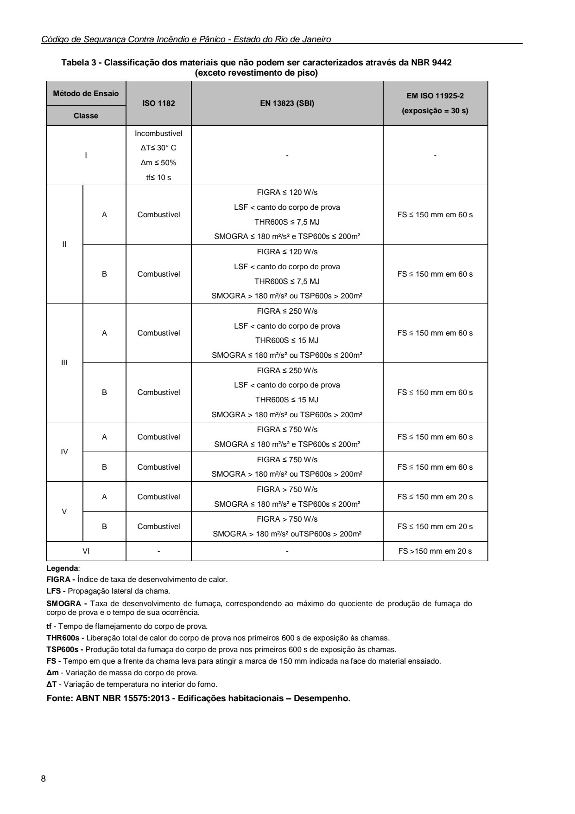
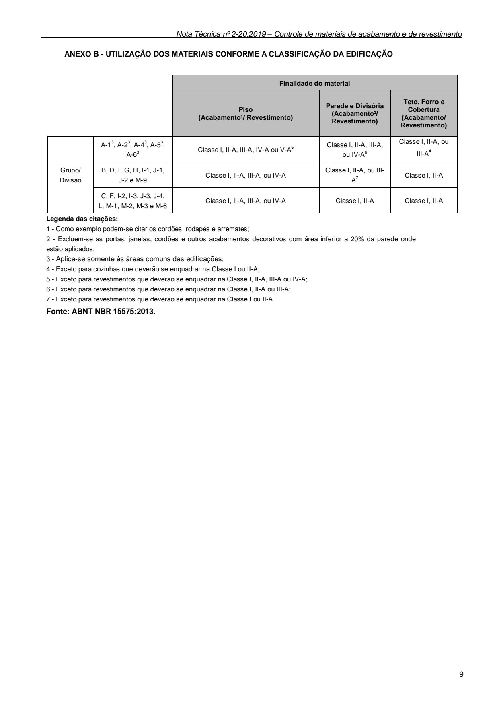

# NT 2-20 - Controle de materiais de acabamento e de revestimento

> Conversão integral para consulta computacional. A numeração de página do PDF foi preservada. Quando houver tabela complexa, símbolo ou desenho, conferir também a representação visual indicada e o PDF oficial.

## Sumário por página

- [Página 1](#pagina-1)
- [Página 2](#pagina-2)
- [Página 3](#pagina-3)
- [Página 4](#pagina-4)
- [Página 5](#pagina-5)
- [Página 6](#pagina-6)
- [Página 7](#pagina-7)
- [Página 8](#pagina-8)
- [Página 9](#pagina-9)

---

## Página 1

Aprovada pela Portaria CBMERJ nº 1071, de 27 de agosto de 2019.

### SUMÁRIO

### 1 OBJETIVO

### 2 APLICAÇÃO

### 3 REFERÊNCIAS NORMATIVAS E BIBLIOGRÁFICAS

### 4 DEFINIÇÕES E CONCEITOS

### 5 ISENÇÕES DO CMAR

### 6 PROCEDIMENTOS

### 7 APRESENTAÇÃO DO PROJETO DE SEGURANÇA CONTRA INCÊNDIO E PÂNICO E SOLICITAÇÃO DE VISTORIAS

### 8 EXIGÊNCIAS PARA MATERIAIS COM APLICAÇÃO SUPERFICIAL DE PRODUTOS RETARDANTES DE CHAMA E/OU INIBIDORES DE FUMAÇA

### 9 INVIABILIDADE DE APLICAÇÃO DO MÉTODO DA NBR 9442

### 10 PRESCRIÇÕES DIVERSAS

### ANEXOS

A - Tabelas de classificação dos materiais

B - Utilização dos materiais conforme a classificação da edificação

### Tabelas extraídas

#### Tabela 1 da página

|  |  | NOTA |  |  | CBMERJ |  |
| --- | --- | --- | --- | --- | --- | --- |
|  |  | TÉCNICA |  |  | NT 2-20 |  |
|  | Versão: 01 09 páginas Vigência: 04/09/2019 |  |  |  |  |  |
|  | Controle de materiais de acabamento e de revestimento |  |  |  |  |  |

---

## Página 2

> Página sem texto extraível suficiente; consultar a representação visual ou o PDF oficial.

---

## Página 3

### 1 OBJETIVO

Estabelecer os requisitos a serem atendidos pelos materiais de acabamento e de revestimento empregados nas edificações, visando que a ocorrência do incêndio não propicie a propagação do fogo e o desenvolvimento de fumaça, regulamentando o previsto no Decreto Estadual nº 42/2018 - Código de Segurança Contra Incêndio e Pânico do Estado do Rio de Janeiro (COSCIP).

### 2 APLICAÇÃO

Esta Nota Técnica (NT) aplica-se a todas as edificações onde são exigidos o Controle de Materiais de Acabamento e de Revestimento (CMAR), conforme classificações constantes no Anexo B.

### 3 REFERÊNCIAS NORMATIVAS E BIBLIOGRÁFICAS

As normas e bibliografias abaixo contêm disposições que estão relacionadas com esta Nota Técnica:

a) ABNT NBR 8660:2013 - Ensaio de reação ao fogo em pisos - Determinação do comportamento com relação à queima utilizando uma fonte radiante de calor;

b) ABNT NBR 9442:1988 - Materiais de construção - Determinação do índice de propagação superficial de chama pelo método do painel radiante - Método de ensaio;

c) ABNT NBR 15575:2013 - Edificações habitacionais - Desempenho;

d) ASTM E 662:2017 - Standard test method for specific optical density of smoke generated by solid materials;

e) BS EN ISO 9239-1:2010 - Reaction to fire tests for floorings - Part 1: Determination of the burning behaviour using a radiant heat source;

f) BS EN ISO 11925-2:2010 - Reaction to fire tests - Ignitability of building products subjected to direct impingement of flame - Part 2: Single-flame source test;

g) BS EN 13501:2007 - Fire classification of construction products and building elements - Part 1: Classification using data from reaction to fire tests (EuroClass);

h) BS EN 13823:2002 - Reaction to fire tests for building products - Building products excluding floorings exposed to the thermal attack by a single burning item;

i) BSL - Building Standards Law, Japan, 2016;

j) ENV 1187:2002 - Test methods for external fire exposure to roofs;

k) ISO 1182:2010 - Reaction to fire tests for products - Noncombustibility test.

### 4 DEFINIÇÕES E CONCEITOS

Para efeito desta Nota Técnica, além das definições constantes da NT 1-02 - Terminologia de segurança contra incêndio e pânico, aplicam-se as definições específicas desta seção.

4.1 Ensaio: atividade que envolve o estudo ou a investigação sumária dos aspectos técnicos e/ou científicos

de determinado assunto, resultando numa peça escrita.

4.2 Materiais de acabamento: todo material ou conjunto de materiais utilizados como arremates entre elementos construtivos.

4.3 Materiais de revestimento: todo material ou conjunto de materiais empregados nas superfícies dos elementos construtivos das edificações, tanto nos ambientes internos como nos externos, com finalidade de atribuir características estéticas, de conforto, de durabilidade etc. Incluem-se pisos, forros, revestimentos têxteis (carpetes, pisos, paredes, dentre outros), papéis de parede e as proteções térmicas dos elementos estruturais.

4.4 Materiais termo acústicos: materiais utilizados para o isolamento térmico e/ou acústico, como lã de vidro, isopores, vermiculita, vidros e outros.

4.5 Material de cobertura: lonas, vidro, telhas cerâmicas e outros.

4.6 Material retardante: produtos ou materiais que, em seu processo químico, recebem tratamento para melhor se comportarem ante a ação do calor, ou ainda aqueles protegidos por produtos que dificultem a queima, quando expostos a um processo de combustão.

4.7 Propriedade não-propagante: propriedade que somente permite a queima do material com a presença de fonte de calor externa (o material quando incendiado por fonte de calor externa, por si só, não mantém a combustão, sendo extinto o incêndio ao se retirar a chama externa).

### 5 DISPENSAS DA AVALIAÇÃO DO CMAR

5.1 Serão dispensados da verificação do CMAR os materiais comprovadamente incombustíveis, ou seja, Classe I (Anexo A), como por exemplo, aqueles compostos somente de vidro, concreto, gesso, produtos cerâmicos, pedra natural, alvenaria, metais, ligas metálicas e similares, compostos estritamente por substâncias inorgânicas.

5.2 As coberturas de passarelas e toldos, instalados no pavimento térreo, estarão dispensados do CMAR, desde que não apresentem área superficial superior a 100 m².

5.3 As lonas plásticas reforçadas, para uso em coberturas pertencentes ao Grupo C e à Divisão F-7, desde que sejam instalados em caráter temporário, permaneçam em local descoberto, sejam totalmente abertas em no mínimo 50% de seu perímetro, de modo a permitir a ventilação natural, os ocupantes não percorram mais do que quinze metros até o exterior (local descoberto), devem classificar-se, no mínimo, como III-A. Nos demais casos aplica-se o Anexo B.

5.3.1 Não se aplicam, nessa situação, as exigências aplicadas a coberturas para superfícies externas.

### 6 PROCEDIMENTOS

6.1 O objetivo do CMAR é estabelecer uma padronização para limitar os seguintes comportamentos de reação ao fogo dos materiais nas edificações:

a) inflamabilidade;

b) propagação das chamas;

---

## Página 4

Código de Segurança Contra Incêndio e Pânico - Estado do Rio de Janeiro

c) liberação de calor;

d) desenvolvimento de fumaça;

e) gotejamento.

6.2 As exigências quanto à utilização dos materiais estão descritas de acordo com a classificação do Anexo B, incluindo as demais disposições desta NT.

6.3 A exigência do CMAR é efetuada segundo a classificação de risco da edificação e em função da posição dos materiais de acabamento, revestimento e termoacústicos, sendo aplicados em:

a) pisos;

b) paredes/divisórias;

c) tetos/forros;

d) coberturas;

e) fachadas.

6.4 A utilização dos métodos de ensaio para classificação dos materiais com relação ao seu comportamento frente ao fogo (reação ao fogo) deverá atender ao padrão indicado no Anexo A.

6.5 Nas edificações da Divisão A-6 devem ser adotados os parâmetros específicos para cada ocupação, quando houver compartimentação, e os mais rigorosos entre as ocupações, quando não houver compartimentação.

### 7 APRESENTAÇÃO DO PROJETO DE SEGURANÇA CONTRA INCÊNDIO E PÂNICO E SOLICITAÇÃO DE VISTORIAS

7.1 No ato de apresentação do projeto, para análise junto ao CBMERJ, devem ser indicadas nas plantas baixas e nos seus respectivos cortes, em cada ambiente, por meio de notas específicas, a localização, os tipos e as propriedades dos materiais empregados, bem como as classes dos materiais de piso, parede, divisória, teto, forro e cobertura.

7.2 Na solicitação da vistoria para emissão do Certificado de Aprovação e do Certificado de Vistoria Anual, deve ser apresentada documentação de responsabilidade técnica quanto ao emprego de materiais de acabamento e revestimento, descrevendo:

a) substrato;

b) ambiente em que foi aplicado o retardante (piso, parede, forro ou cobertura externa);

c) área total em que o material foi empregado;

d) data de validade do tratamento do retardante;

e) quantitativo de material empregado;

f) a observação referente à execução de serviço de tratamento e/ou apresentação de laudo de ensaio do material: “a edificação atende às especificações de controle de materiais de acabamento e revestimento conforme a Nota Técnica do CBMERJ NT 2-20 e Decreto nº 42/2018 - COSCIP.

7.3 O procedimento em 7.2 também se aplica aos materiais

das edificações de ocupações F-3, F-5, F-6, F-7 e F11, por ocasião de:

a) modificações de projeto aprovados anteriormente à vigência do Decreto nº 42/2018 - COSCIP;

b) renovação do Certificado de Aprovação, cujo projeto não tenha contemplado o CMAR na vistoria anterior;

c) para as alíneas citadas anteriormente, deve ser apresentado projeto específico para aprovação junto ao CBMERJ.

7.4 Quando o material empregado for incombustível (Classe I), não haverá necessidade de apresentar documentação de responsabilidade técnica quanto ao CMAR. No entanto, deverá ser apresentado o laudo técnico que ateste a incombustibilidade.

### 8 EXIGÊNCIAS PARA MATERIAIS COM APLICAÇÃO SUPERFICIAL DE PRODUTOS RETARDANTES DE CHAMA E/OU INIBIDORES DE FUMAÇA

8.1 Materiais com aplicação superficial de produtos retardantes de chama e/ou inibidores de fumaça deverão possuir condicionantes estabelecidas nos respectivos métodos de ensaio, de acordo com as especificações dos fabricantes.

8.2 O tempo de validade dos benefícios obtidos pela aplicação dos produtos retardantes deve ser comprovado tecnicamente através de documentação apresentada pelo fornecedor/ fabricante destes produtos.

### 9 INVIABILIDADE DE APLICAÇÃO DO MÉTODO DA NBR 9442

9.1 A classificação dos materiais é obtida por meio de ensaio de reação ao fogo previsto na NBR 9442. Todavia, para as seguintes situações este método não é apropriado:

a) quando ocorre derretimento ou o material sofre retração abrupta afastando-se da chama-piloto;

b) quando o material é composto por miolo combustível protegido por barreira incombustível ou que pode se desagregar;

c) materiais compostos por diversas camadas de materiais combustíveis apresentando espessura total superior a 25 mm;

d) materiais que na instalação formam juntas, através das quais, especialmente, o fogo pode propagar ou penetrar.

9.2 Nas situações mencionadas acima, a classificação dos materiais deve ser feita de acordo com a Tabela 3 do Anexo A.

### 10 PRESCRIÇÕES DIVERSAS

10.1 A implantação e a substituição do CMAR são de reponsabilidade dos responsáveis técnicos, sendo a manutenção e a conservação destes materiais de responsabilidade do proprietário ou responsável legal pelo uso da edificação.

10.2 Os ensaios para classificação dos materiais devem considerar a maneira como são aplicados na edificação, e o

---

## Página 5

relatório conclusivo deve reproduzir os resultados obtidos. Caso o material seja aplicado sobre substrato combustível, este deve ser incluído no ensaio. Todavia, se o material for aplicado sobre um substrato incombustível, o ensaio pode ser realizado utilizando-se substrato de placas de fibrocimento de 6 a 8 mm de espessura.

10.3 Os materiais de acabamento e revestimento das fachadas das edificações devem enquadrar-se entre as Classes I a II-B da tabela do Anexo B.

10.4 Materiais isolantes termoacústicos não aparentes aplicados nas paredes que podem contribuir para o desenvolvimento do incêndio, tais como: espumas plásticas protegidas por materiais incombustíveis, lajes mistas com enchimento de espumas plásticas protegidas por forro ou revestimentos aplicados diretamente, forros em grelha com isolamento termo acústico envoltos em filmes plásticos e assemelhados; devem enquadrar-se entre as Classes I, II-A ou III-A da Tabela 1 do Anexo A.

10.5 Materiais isolantes termoacústicos aplicados nas instalações de serviço, em redes de duto de ventilação e ar condicionado, e em cabines ou salas de equipamentos, aparentes ou não devem enquadrar-se entre as Classes I a II-A da Tabela 1 do Anexo A.

10.6 Os materiais de acabamento e de revestimento das circulações que dão acesso às saídas de emergência devem ser enquadrados como Classe I ou Classe II-A, previstos no Anexo A.

10.7 Os materiais de acabamento e de revestimento das saídas de emergência (escadas, rampas e etc) devem ser enquadrados como Classe I ou Classe II-A, com densidade óptica de fumaça inferior a 100, previsto no Anexo A.

10.8 Os materiais utilizados como revestimento, acabamento e isolamento termoacústico no interior dos poços de elevadores, monta-cargas e shafts, devem ser enquadrados na Classe I ou Classe II-A, com densidade óptica de fumaça inferior a 100, previsto no Anexo A.

10.9 Componentes construtivos onde não são aplicados revestimentos e/ou acabamentos, em razão de já se constituírem em produtos acabados, incluindo-se divisórias, telhas, forros, painéis em geral, faces inferiores de coberturas, entre outros, também estão submetidas aos critérios do Anexo B.

10.10 Alguns componentes construtivos possuem faces de exposição ao incêndio não voltadas para o ambiente ocupado, como pisos elevados, forros, revestimentos destacados do substrato, do qual devem atender aos critérios do Anexo B para ambas as faces.

10.11 Materiais de proteção de elementos estruturais, juntamente com seus revestimentos e acabamentos, devem atender aos critérios dos elementos construtivos onde estão inseridos, ou seja, de tetos para as vigas e de paredes para os pilares.

10.12 Materiais empregados em subcoberturas com finalidades de estanqueidade e de conforto termoacústico devem atender aos critérios do Anexo B aplicados aos tetos

e à superfície inferior da cobertura, mesmo que escondida por forro.

10.13 Para as edificações onde há exigência de chuveiros automáticos, será permitida a utilização de materiais numa classe abaixo da máxima prevista para aquela edificação no Anexo B, com exceção dos materiais localizados nas saídas de emergência e áreas não protegidas pelos chuveiros automáticos.

10.14 Será admitido o uso de retardantes de chamas para que os materiais atinjam as classes previstas no Anexo B.

10.15 A classe VI de materiais, presente no Anexo A, representa os materiais que não foram enquadrados nas classes anteriores.

10.16 Será admitido, como alternativa à ISO 1182 para fins de classificação da incombustibilidade dos materiais, o método de ensaio previsto no Building Standards Law (BSL) do Japão.

10.17 As lonas para cobertura de barracas, feiras livres, estandes de exposição, desde que em locais abertos, podem ser da classe IV-B.

---

## Página 6

Código de Segurança Contra Incêndio e Pânico - Estado do Rio de Janeiro

### ANEXO A - CLASSIFICAÇÃO DOS MATERIAIS

Tabela 1 - Classificação dos materiais de revestimento de piso

Legenda: Dm - Densidade óptica específica máxima corrigida. Fluxo crítico - Fluxo de energia radiante necessário à manutenção da frente de chama no corpo de prova. FS - Tempo em que a frente da chama leva para atingir a marca de 150 mm indicada na face do material ensaiado. tf - Tempo de flamejamento do corpo de prova. ΔT - Variação de temperatura no interior do forno. Δm - Variação de massa do corpo de prova.

Fonte: ABNT NBR 15575:2013 - Edificações habitacionais - Desempenho.

### Tabelas extraídas

#### Tabela 1 da página

| Método de Ensaio |  |  |  | ISO 1182 | NBR 8660 | EN ISO 11925-2 (exposição de 15 s) | ASTM E 662 |
| --- | --- | --- | --- | --- | --- | --- | --- |
|  | Classe |  |  |  |  |  |  |
| I |  |  |  | Incombustível ΔT≤ 30° C Δm ≤ 50% tf≤ 10s | - | - | - |
| II |  | A |  | Combustível | Fluxo crítico ≥ 8,0 kW/m² | FS ≤ 150 mm em 20s | Dm ≤ 450 |
|  |  | B |  | Combustível | Fluxo crítico ≥ 8,0 kW/m² | FS ≤ 150 mm em 20s | Dm > 450 |
| III |  | A |  | Combustível | Fluxo crítico ≥ 4,5 kW/m² | FS ≤ 150 mm em 20s | Dm ≤ 450 |
|  |  | B |  | Combustível | Fluxo crítico ≥ 4,5 kW/m² | FS ≤ 150 mm em 20s | Dm > 450 |
| IV |  | A |  | Combustível | Fluxo crítico ≥ 3,0 kW/m² | FS ≤ 150 mm em 20s | Dm ≤ 450 |
|  |  | B |  | Combustível | Fluxo crítico ≥ 3,0 kW/m² | FS ≤ 150 mm em 20s | Dm > 450 |
| V |  | A |  | Combustível | Fluxo crítico ≥ 3,0 kW/m² | FS ≤ 150 mm em 20s | Dm ≤ 450 |
|  |  | B |  | Combustível | Fluxo crítico ≥ 3,0 kW/m² | FS ≤ 150 mm em 20s | Dm > 450 |
| VI |  |  |  | Combustível | - | FS ≥ 150 mm em 20s | - |

---

## Página 7

Tabela 2 - Classificação dos materiais (exceto revestimentos de piso)

Legenda: Dm - Densidade óptica específica máxima corrigida. Ip - Índice de propagação superficial da chama. tf - Tempo de flamejamento do corpo de prova. ΔT - Variação de temperatura no interior do forno. Δm - Variação de massa do corpo de prova.

Fonte: ABNT NBR 15575:2013 - Edificações habitacionais - Desempenho.

### Tabelas extraídas

#### Tabela 1 da página

|  | Método de Ensaio |  |  | ISO 1182 | NBR 9442 | ASTM E 662 |
| --- | --- | --- | --- | --- | --- | --- |
|  | Classe |  |  |  |  |  |
| I |  |  |  | Incombustível ΔT≤ 30° C Δm ≤ 50% tf≤ 10 s | - | - |
| II |  | A |  | Combustível | Ip ≤ 25 | Dm ≤ 450 |
|  |  | B |  | Combustível | Ip ≤ 25 | Dm > 450 |
| III |  | A |  | Combustível | 25 <Ip ≤ 75 | Dm ≤ 450 |
|  |  | B |  | Combustível | 25 <Ip ≤ 75 | Dm > 450 |
| IV |  | A |  | Combustível | 75 <Ip ≤ 150 | Dm ≤ 450 |
|  |  | B |  | Combustível | 75 <Ip ≤ 150 | Dm > 450 |
| V |  | A |  | Combustível | 150 <Ip ≤ 400 | Dm ≤ 450 |
|  |  | B |  | Combustível | 150 <Ip ≤ 400 | Dm > 450 |
| VI |  |  |  | Combustível | Ip> 400 | - |

---

## Página 8

Código de Segurança Contra Incêndio e Pânico - Estado do Rio de Janeiro

Tabela 3 - Classificação dos materiais que não podem ser caracterizados através da NBR 9442

(exceto revestimento de piso)

Legenda: FIGRA - Índice de taxa de desenvolvimento de calor.

LFS - Propagação lateral da chama.

SMOGRA - Taxa de desenvolvimento de fumaça, correspondendo ao máximo do quociente de produção de fumaça do corpo de prova e o tempo de sua ocorrência.

tf - Tempo de flamejamento do corpo de prova.

THR600s - Liberação total de calor do corpo de prova nos primeiros 600 s de exposição às chamas.

TSP600s - Produção total da fumaça do corpo de prova nos primeiros 600 s de exposição às chamas.

FS - Tempo em que a frente da chama leva para atingir a marca de 150 mm indicada na face do material ensaiado.

Δm - Variação de massa do corpo de prova.

ΔT - Variação de temperatura no interior do forno.

Fonte: ABNT NBR 15575:2013 - Edificações habitacionais - Desempenho.

### Tabelas extraídas

#### Tabela 1 da página

| Método de Ensaio |  |  |  | ISO 1182 | EN 13823 (SBI) | EM ISO 11925-2 (exposição = 30 s) |
| --- | --- | --- | --- | --- | --- | --- |
|  | Classe |  |  |  |  |  |
| I |  |  |  | Incombustível ΔT≤ 30° C Δm ≤ 50% tf≤ 10 s | - | - |
| II |  | A |  | Combustível | FIGRA ≤ 120 W/s LSF < canto do corpo de prova THR600S ≤ 7,5 MJ SMOGRA ≤ 180 m²/s² e TSP600s ≤ 200m² | FS ≤ 150 mm em 60 s |
|  |  | B |  | Combustível | FIGRA ≤ 120 W/s LSF < canto do corpo de prova THR600S ≤ 7,5 MJ SMOGRA > 180 m²/s² ou TSP600s > 200m² | FS ≤ 150 mm em 60 s |
| III |  | A |  | Combustível | FIGRA ≤ 250 W/s LSF < canto do corpo de prova THR600S ≤ 15 MJ SMOGRA ≤ 180 m²/s² ou TSP600s ≤ 200m² | FS ≤ 150 mm em 60 s |
|  |  | B |  | Combustível | FIGRA ≤ 250 W/s LSF < canto do corpo de prova THR600S ≤ 15 MJ SMOGRA > 180 m²/s² ou TSP600s > 200m² | FS ≤ 150 mm em 60 s |
| IV |  | A |  | Combustível | FIGRA ≤ 750 W/s SMOGRA ≤ 180 m²/s² e TSP600s ≤ 200m² | FS ≤ 150 mm em 60 s |
|  |  | B |  | Combustível | FIGRA ≤ 750 W/s SMOGRA > 180 m²/s² ou TSP600s > 200m² | FS ≤ 150 mm em 60 s |
| V |  | A |  | Combustível | FIGRA > 750 W/s SMOGRA ≤ 180 m²/s² e TSP600s ≤ 200m² | FS ≤ 150 mm em 20 s |
|  |  | B |  | Combustível | FIGRA > 750 W/s SMOGRA > 180 m²/s² ouTSP600s > 200m² | FS ≤ 150 mm em 20 s |
| VI |  |  |  | - | - | FS >150 mm em 20 s |

---

## Página 9

### ANEXO B - UTILIZAÇÃO DOS MATERIAIS CONFORME A CLASSIFICAÇÃO DA EDIFICAÇÃO

Legenda das citações:

1 - Como exemplo podem-se citar os cordões, rodapés e arremates;

2 - Excluem-se as portas, janelas, cordões e outros acabamentos decorativos com área inferior a 20% da parede onde

estão aplicados;

3 - Aplica-se somente às áreas comuns das edificações;

4 - Exceto para cozinhas que deverão se enquadrar na Classe I ou II-A;

5 - Exceto para revestimentos que deverão se enquadrar na Classe I, II-A, III-A ou IV-A;

6 - Exceto para revestimentos que deverão se enquadrar na Classe I, II-A ou III-A;

7 - Exceto para revestimentos que deverão se enquadrar na Classe I ou II-A.

Fonte: ABNT NBR 15575:2013.

### Tabelas extraídas

#### Tabela 1 da página

|  |  |  | Finalidade do material |  |  |  |  |
| --- | --- | --- | --- | --- | --- | --- | --- |
|  |  |  |  |  | Parede e Divisória (Acabamento²/ Revestimento) | Teto, Forro e Cobertura (Acabamento/ Revestimento) |  |
|  |  |  | Piso |  |  |  |  |
|  |  |  | (Acabamento¹/ Revestimento) |  |  |  |  |
|  |  |  |  |  |  |  |  |
| Grupo/ Divisão | A-13, A-23, A-43, A-53, A-63 | Classe I, II-A, III-A, IV-A ou V-A5 |  |  | Classe I, II-A, III-A, ou IV-A6 | Classe I, II-A, ou III-A4 |  |
|  | B, D, E G, H, I-1, J-1, J-2 e M-9 | Classe I, II-A, III-A, ou IV-A |  |  | Classe I, II-A, ou IIIA7 | Classe I, II-A |  |
|  | C, F, I-2, I-3, J-3, J-4, L, M-1, M-2, M-3 e M-6 | Classe I, II-A, III-A, ou IV-A |  |  | Classe I, II-A | Classe I, II-A |  |
