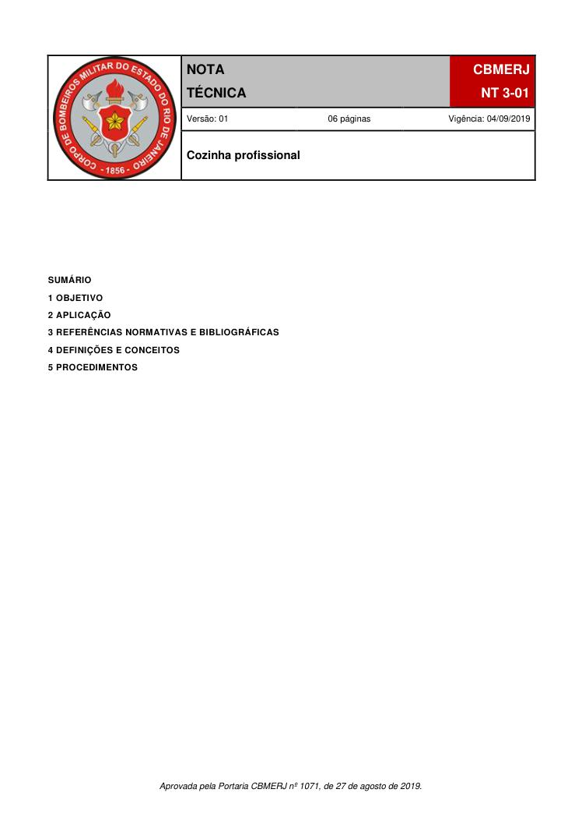
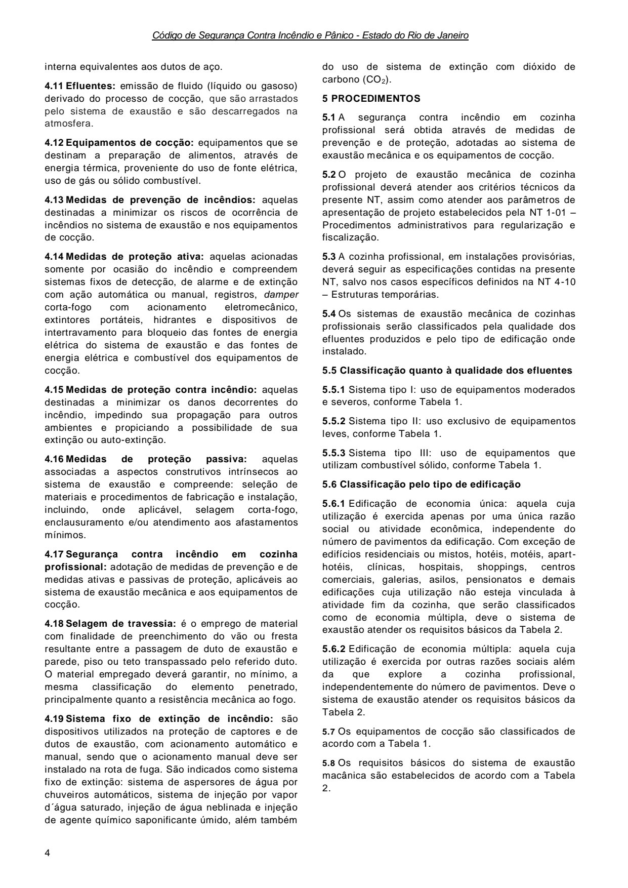
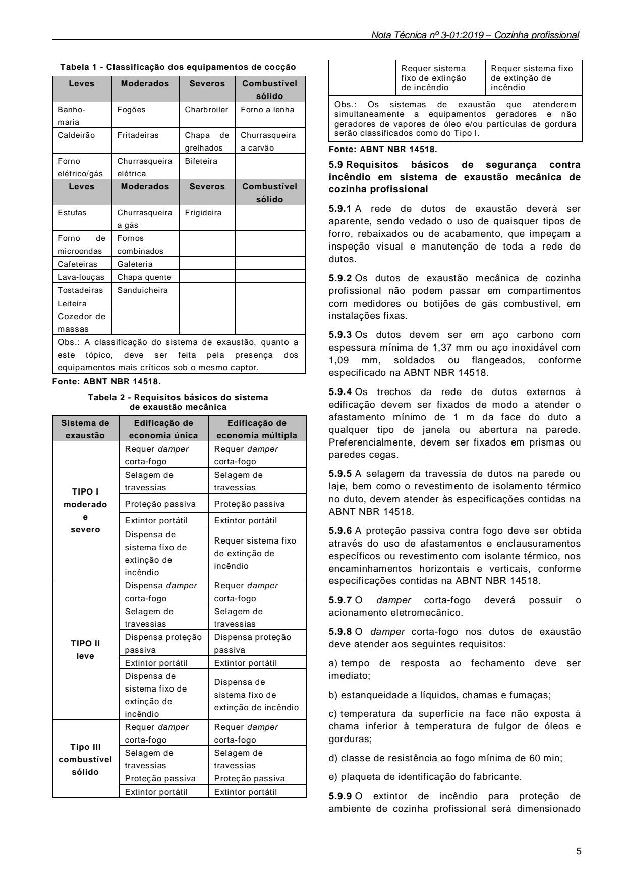

# NT 3-01 - Cozinha profissional

> Conversão integral para consulta computacional. A numeração de página do PDF foi preservada. Quando houver tabela complexa, símbolo ou desenho, conferir também a representação visual indicada e o PDF oficial.

## Sumário por página

- [Página 1](#pagina-1)
- [Página 2](#pagina-2)
- [Página 3](#pagina-3)
- [Página 4](#pagina-4)
- [Página 5](#pagina-5)
- [Página 6](#pagina-6)

---

## Página 1

### SUMÁRIO

### 1 OBJETIVO

### 2 APLICAÇÃO

### 3 REFERÊNCIAS NORMATIVAS E BIBLIOGRÁFICAS

### 4 DEFINIÇÕES E CONCEITOS

### 5 PROCEDIMENTOS

Aprovada pela Portaria CBMERJ nº 1071, de 27 de agosto de 2019.

### Tabelas extraídas (bruto, não usar para citação)
#### Tabela 1 da página

|  |  |  |  | NOTA |  |  | CBMERJ |  |
| --- | --- | --- | --- | --- | --- | --- | --- | --- |
|  |  |  |  | TÉCNICA |  |  | NT 3-01 |  |
|  |  |  | Versão: 01 06 páginas Vigência: 04/09/2019 |  |  |  |  |  |
|  |  |  | Cozinha profissional |  |  |  |  |  |

---

## Página 2

> Página sem texto extraível suficiente; consultar a representação visual ou o PDF oficial.

---

## Página 3

### 1 OBJETIVO

Estabelecer os requisitos de prevenção e proteção contra incêndio aplicáveis em ambientes destinados a cozinha profissional, de forma a minimizar os riscos e danos decorrentes de incêndios no sistema de exaustão, através da normalização das instalações, manutenção preventiva e corretiva, do impedimento de propagação a outros ambientes, e da possibilidade de extinção de incêndio, regulamentando o previsto no Decreto Estadual nº 42/2018 - Código de Segurança Contra Incêndio e Pânico do Estado do Rio de Janeiro (COSCIP).

### 2 APLICAÇÃO

2.1 Esta Nota Técnicas (NT) aplica-se ao conjunto de equipamentos e dispositivos que compõem o sistema de exaustão mecânica em cozinhas profissionais, quando se caracterizar pela falta de compartimentação do ambiente da cozinha, com relação ao duto de exaustão.

2.2 Para efeito de aplicação desta NT, a falta de compartimentação ocorrerá quando:

a) o duto de exaustão da cozinha profissional se comunicar com outros ambientes da edificação, por meio da travessia de paredes, pisos ou tetos;

b) o duto externo para exaustão da cozinha profissional estiver localizado com afastamento inferior a 1 m de quaisquer tipos de aberturas na fachada da edificação, tais como janelas, e outras tomadas de ar.

2.3 As cozinhas privativas em edificações residenciais unifamiliares ou multifamiliares não são consideradas cozinhas profissionais para aplicação desta NT.

2.4 As copas encontram-se dispensadas da aplicação desta NT.

### 3 REFERÊNCIAS NORMATIVAS E BIBLIOGRÁFICAS

As normas e bibliografias abaixo contêm disposições que estão relacionadas com esta Nota Técnica:

a) Decreto nº 42, de 17 de Dezembro de 2018, que regulamenta o Decreto-Lei nº 247, de 21 de julho de 1975, dispondo sobre o Código de Segurança Contra Incêndio e Pânico - COSCIP, no âmbito do Estado do Rio de Janeiro;

b) Lei nº 22.281, de 19 de novembro de 2002 que institui o Regulamento para a Instalação e Conservação de Sistemas de Ar Condicionado e Ventilação Mecânica no Município do Rio de Janeiro;

c) ABNT NBR 10897:2014 - Sistemas de proteção contra incêndio por chuveiros automáticos;

d) ABNT NBR 14518:2000 - Sistemas de ventilação para cozinha profissional.

### 4 DEFINIÇÕES E CONCEITOS

Para efeito desta Nota Técnica, além das definições

constantes da NT 1-02 - Terminologia de segurança contra incêndio e pânico, aplicam-se as definições específicas desta seção.

4.1 Captor: dispositivo para coleta de efluentes.

4.2 Cocção: processo de preparação de alimentos onde há o emprego de energia térmica, gerando a emissão de vapor d´água, calor e gases da combustão contendo propriedades poluentes, aderentes e combustíveis, com odores característicos.

4.3 Coifa: tipo de captor cujo formato e o posicionamento deve ser adequado aos distintos equipamentos de cocção da cozinha profissional, de forma a realizar captação local, e de forma contínua, dos vapores com ou sem gordura e/ou materiais particulados, enquanto perdurar a cocção de alimentos.

4.4 Combustível sólido: material orgânico sólido utilizado como combustível para a cocção de alimentos.

4.5 Compartimentação: caracteriza-se quando o duto de exaustão da cozinha profissional não se comunicar com ambientes distintos a esta finalidade, independente do pavimento, e quando o duto de exaustão se mantiver afastado de quaisquer aberturas na fachada da edificação.

4.6 Copa: ambiente, de apoio à cozinha, destinado ao empratamento, lavagem de louças e utensílios, e não utilizado para produção de refeições coletivas, através da cocção de alimentos.

4.7 Cozinha privativa: instalação dotada de equipamento de cocção, para uso exclusivo da unidade residencial privativa.

4.8 Cozinha profissional: instalação delimitada por um único compartimento ou por compartimentos adjacentes, independente da distinção de pavimentos, dotada de equipamentos de cocção e utilizados por uma razão social para produção de refeições coletivas.

4.9 Damper corta-fogo: dispositivo de proteção ativa contra incêndio, instalado no duto de exaustão, na seção onde este atravessa uma parede, piso ou teto que limite o ambiente da cozinha, sendo de acionamento eletromecânico, cuja função é de bloquear, em caso de incêndio no interior do referido duto de exaustão, a propagação de fumaça, fogo, e efluentes oriundos do processo de cocção, a outros ambientes distintos ao da cozinha profissional.

4.10 Duto de exaustão: utilizados como condutores de gases, vapores e demais efluentes oriundos da cocção, sendo construído em formato de prisma ou em formato cilíndrico, constituídos por materiais incombustíveis, tais como: chapa de aço carbono, aço inoxidável, ou qualquer outro material que venha a garantir os mesmos critérios de resistência mecânica ao fogo e à corrosão, estanqueidade e rugosidade

---

## Página 4

Código de Segurança Contra Incêndio e Pânico - Estado do Rio de Janeiro

interna equivalentes aos dutos de aço.

4.12 Equipamentos de cocção: equipamentos que se destinam a preparação de alimentos, através de energia térmica, proveniente do uso de fonte elétrica, uso de gás ou sólido combustível.

4.13 Medidas de prevenção de incêndios: aquelas destinadas a minimizar os riscos de ocorrência de incêndios no sistema de exaustão e nos equipamentos de cocção.

4.14 Medidas de proteção ativa: aquelas acionadas somente por ocasião do incêndio e compreendem sistemas fixos de detecção, de alarme e de extinção com ação automática ou manual, registros, damper corta-fogo com acionamento eletromecânico, extintores portáteis, hidrantes e dispositivos de intertravamento para bloqueio das fontes de energia elétrica do sistema de exaustão e das fontes de energia elétrica e combustível dos equipamentos de cocção.

4.15 Medidas de proteção contra incêndio: aquelas destinadas a minimizar os danos decorrentes do incêndio, impedindo sua propagação para outros ambientes e propiciando a possibilidade de sua extinção ou auto-extinção.

4.16 Medidas de proteção passiva: aquelas associadas a aspectos construtivos intrínsecos ao sistema de exaustão e compreende: seleção de materiais e procedimentos de fabricação e instalação, incluindo, onde aplicável, selagem corta-fogo, enclausuramento e/ou atendimento aos afastamentos mínimos.

4.17 Segurança contra incêndio em cozinha profissional: adotação de medidas de prevenção e de medidas ativas e passivas de proteção, aplicáveis ao sistema de exaustão mecânica e aos equipamentos de cocção.

4.18 Selagem de travessia: é o emprego de material com finalidade de preenchimento do vão ou fresta resultante entre a passagem de duto de exaustão e parede, piso ou teto transpassado pelo referido duto. O material empregado deverá garantir, no mínimo, a mesma classificação do elemento penetrado, principalmente quanto a resistência mecânica ao fogo.

4.19 Sistema fixo de extinção de incêndio: são dispositivos utilizados na proteção de captores e de dutos de exaustão, com acionamento automático e manual, sendo que o acionamento manual deve ser instalado na rota de fuga. São indicados como sistema fixo de extinção: sistema de aspersores de água por chuveiros automáticos, sistema de injeção por vapor d´água saturado, injeção de água neblinada e injeção de agente químico saponificante úmido, além também

do uso de sistema de extinção com dióxido de carbono (CO2).

### 5 PROCEDIMENTOS

5.1 A segurança contra incêndio em cozinha profissional será obtida através de medidas de prevenção e de proteção, adotadas ao sistema de exaustão mecânica e os equipamentos de cocção.

5.2 O projeto de exaustão mecânica de cozinha profissional deverá atender aos critérios técnicos da presente NT, assim como atender aos parâmetros de apresentação de projeto estabelecidos pela NT 1-01 - Procedimentos administrativos para regularização e fiscalização.

5.3 A cozinha profissional, em instalações provisórias, deverá seguir as especificações contidas na presente NT, salvo nos casos específicos definidos na NT 4-10 - Estruturas temporárias.

5.4 Os sistemas de exaustão mecânica de cozinhas profissionais serão classificados pela qualidade dos efluentes produzidos e pelo tipo de edificação onde instalado.

5.5 Classificação quanto à qualidade dos efluentes

5.5.1 Sistema tipo I: uso de equipamentos moderados e severos, conforme Tabela 1.

5.5.2 Sistema tipo II: uso exclusivo de equipamentos leves, conforme Tabela 1.

5.5.3 Sistema tipo III: uso de equipamentos que utilizam combustível sólido, conforme Tabela 1.

5.6 Classificação pelo tipo de edificação

5.6.1 Edificação de economia única: aquela cuja utilização é exercida apenas por uma única razão social ou atividade econômica, independente do número de pavimentos da edificação. Com exceção de edifícios residenciais ou mistos, hotéis, motéis, aparthotéis, clínicas, hospitais, shoppings, centros comerciais, galerias, asilos, pensionatos e demais edificações cuja utilização não esteja vinculada à atividade fim da cozinha, que serão classificados como de economia múltipla, deve o sistema de exaustão atender os requisitos básicos da Tabela 2.

5.6.2 Edificação de economia múltipla: aquela cuja utilização é exercida por outras razões sociais além da que explore a cozinha profissional, independentemente do número de pavimentos. Deve o sistema de exaustão atender os requisitos básicos da Tabela 2.

5.7 Os equipamentos de cocção são classificados de acordo com a Tabela 1.

5.8 Os requisitos básicos do sistema de exaustão macânica são estabelecidos de acordo com a Tabela 2.

### Tabelas extraídas (bruto, não usar para citação)
#### Tabela 1 da página

|  | que são arrastados |
| --- | --- |
| pelo sistema de exaustão e são descarregados na |  |
| atmosfera. |  |

---

## Página 5

Tabela 1 - Classificação dos equipamentos de cocção

Fonte: ABNT NBR 14518.

Tabela 2 - Requisitos básicos do sistema

de exaustão mecânica

Fonte: ABNT NBR 14518.

5.9 Requisitos básicos de segurança contra incêndio em sistema de exaustão mecânica de cozinha profissional

5.9.1 A rede de dutos de exaustão deverá ser aparente, sendo vedado o uso de quaisquer tipos de forro, rebaixados ou de acabamento, que impeçam a inspeção visual e manutenção de toda a rede de dutos.

5.9.2 Os dutos de exaustão mecânica de cozinha profissional não podem passar em compartimentos com medidores ou botijões de gás combustível, em instalações fixas.

5.9.3 Os dutos devem ser em aço carbono com espessura mínima de 1,37 mm ou aço inoxidável com 1,09 mm, soldados ou flangeados, conforme especificado na ABNT NBR 14518.

5.9.4 Os trechos da rede de dutos externos à edificação devem ser fixados de modo a atender o afastamento mínimo de 1 m da face do duto a qualquer tipo de janela ou abertura na parede. Preferencialmente, devem ser fixados em prismas ou paredes cegas.

5.9.5 A selagem da travessia de dutos na parede ou laje, bem como o revestimento de isolamento térmico no duto, devem atender às especificações contidas na ABNT NBR 14518.

5.9.6 A proteção passiva contra fogo deve ser obtida através do uso de afastamentos e enclausuramentos específicos ou revestimento com isolante térmico, nos encaminhamentos horizontais e verticais, conforme especificações contidas na ABNT NBR 14518.

5.9.7 O damper corta-fogo deverá possuir o acionamento eletromecânico.

5.9.8 O damper corta-fogo nos dutos de exaustão deve atender aos seguintes requisitos:

a) tempo de resposta ao fechamento deve ser imediato;

b) estanqueidade a líquidos, chamas e fumaças;

c) temperatura da superfície na face não exposta à chama inferior à temperatura de fulgor de óleos e gorduras;

d) classe de resistência ao fogo mínima de 60 min;

e) plaqueta de identificação do fabricante.

5.9.9 O extintor de incêndio para proteção de ambiente de cozinha profissional será dimensionado

### Tabelas extraídas (bruto, não usar para citação)
#### Tabela 1 da página

|  | Requer sistema fixo de extinção de incêndio | Requer sistema fixo de extinção de incêndio |
| --- | --- | --- |
| Obs.: Os sistemas de exaustão que atenderem simultaneamente a equipamentos geradores e não geradores de vapores de óleo e/ou partículas de gordura serão classificados como do Tipo I. |  |  |

#### Tabela 2 da página

| Leves | Moderados | Severos |  | Combustível |  |
| --- | --- | --- | --- | --- | --- |
|  |  |  |  | sólido |  |
| Banhomaria | Fogões | Charbroiler | Forno a lenha |  |  |
| Caldeirão | Fritadeiras | Chapa de grelhados | Churrasqueira a carvão |  |  |
| Forno elétrico/gás | Churrasqueira elétrica | Bifeteira |  |  |  |
| Leves | Moderados | Severos |  | Combustível |  |
|  |  |  |  | sólido |  |
| Estufas | Churrasqueira a gás | Frigideira |  |  |  |
| Forno de microondas | Fornos combinados |  |  |  |  |
| Cafeteiras | Galeteria |  |  |  |  |
| Lava-louças | Chapa quente |  |  |  |  |
| Tostadeiras | Sanduicheira |  |  |  |  |
| Leiteira |  |  |  |  |  |
| Cozedor de massas |  |  |  |  |  |
| Obs.: A classificação do sistema de exaustão, quanto a este tópico, deve ser feita pela presença dos equipamentos mais críticos sob o mesmo captor. |  |  |  |  |  |

#### Tabela 3 da página

|  | Sistema de |  |  | Edificação de |  |  | Edificação de |  |
| --- | --- | --- | --- | --- | --- | --- | --- | --- |
|  | exaustão |  |  | economia única |  |  | economia múltipla |  |
| TIPO I moderado e severo |  |  | Requer damper corta-fogo |  |  | Requer damper corta-fogo |  |  |
|  |  |  | Selagem de travessias |  |  | Selagem de travessias |  |  |
|  |  |  | Proteção passiva |  |  | Proteção passiva |  |  |
|  |  |  | Extintor portátil |  |  | Extintor portátil |  |  |
|  |  |  | Dispensa de sistema fixo de extinção de incêndio |  |  | Requer sistema fixo de extinção de incêndio |  |  |
| TIPO II leve |  |  | Dispensa damper corta-fogo |  |  | Requer damper corta-fogo |  |  |
|  |  |  | Selagem de travessias |  |  | Selagem de travessias |  |  |
|  |  |  | Dispensa proteção passiva |  |  | Dispensa proteção passiva |  |  |
|  |  |  | Extintor portátil |  |  | Extintor portátil |  |  |
|  |  |  | Dispensa de sistema fixo de extinção de incêndio |  |  | Dispensa de sistema fixo de extinção de incêndio |  |  |
| Tipo III combustível sólido |  |  | Requer damper corta-fogo |  |  | Requer damper corta-fogo |  |  |
|  |  |  | Selagem de travessias |  |  | Selagem de travessias |  |  |
|  |  |  | Proteção passiva |  |  | Proteção passiva |  |  |
|  |  |  | Extintor portátil |  |  | Extintor portátil |  |  |

<!-- tabela-conferida: Tabela 1 p5 -->
### Tabela 1 — Classificação dos equipamentos de cocção (conferida)

| Leves | Moderados | Severos | Combustível sólido |
| --- | --- | --- | --- |
| Banho-maria | Fogões | Charbroiler | Forno a lenha |
| Caldeirão | Fritadeiras | Chapa de grelhados | Churrasqueira a carvão |
| Forno elétrico/gás | Churrasqueira elétrica | Bifeteira |  |
| Leves | Moderados | Severos | Combustível sólido |
| Estufas | Churrasqueira a gás | Frigideira |  |
| Forno de microondas | Fornos combinados |  |  |
| Cafeteiras | Galeteria |  |  |
| Lava-louças | Chapa quente |  |  |
| Tostadeiras | Sanduicheira |  |  |
| Leiteira |  |  |  |
| Cozedor de massas |  |  |  |

Fonte: NT 3-01, página 5, Tabela 1; conferida em 2026-09-29 (visual + texto).
A linha de cabeçalho (Leves, Moderados, Severos, Combustível sólido) repete-se no meio da tabela, como na página.
Obs. da tabela: A classificação do sistema de exaustão, quanto a este tópico, deve ser feita pela presença dos equipamentos mais críticos sob o mesmo captor.
Fonte indicada na página: ABNT NBR 14518.
<!-- /tabela-conferida: Tabela 1 p5 -->

<!-- tabela-conferida: Tabela 2 p5 -->
### Tabela 2 — Requisitos básicos do sistema de exaustão mecânica (conferida)

| Sistema de exaustão | Edificação de economia única | Edificação de economia múltipla |
| --- | --- | --- |
| TIPO I moderado e severo | Requer damper corta-fogo | Requer damper corta-fogo |
| TIPO I moderado e severo | Selagem de travessias | Selagem de travessias |
| TIPO I moderado e severo | Proteção passiva | Proteção passiva |
| TIPO I moderado e severo | Extintor portátil | Extintor portátil |
| TIPO I moderado e severo | Dispensa de sistema fixo de extinção de incêndio | Requer sistema fixo de extinção de incêndio |
| TIPO II leve | Dispensa damper corta-fogo | Requer damper corta-fogo |
| TIPO II leve | Selagem de travessias | Selagem de travessias |
| TIPO II leve | Dispensa proteção passiva | Dispensa proteção passiva |
| TIPO II leve | Extintor portátil | Extintor portátil |
| TIPO II leve | Dispensa de sistema fixo de extinção de incêndio | Dispensa de sistema fixo de extinção de incêndio |
| Tipo III combustível sólido | Requer damper corta-fogo | Requer damper corta-fogo |
| Tipo III combustível sólido | Selagem de travessias | Selagem de travessias |
| Tipo III combustível sólido | Proteção passiva | Proteção passiva |
| Tipo III combustível sólido | Extintor portátil | Extintor portátil |

Fonte: NT 3-01, página 5, Tabela 2; conferida em 2026-09-29 (visual + texto).
A tabela continua no alto da coluna da direita (última linha do Tipo III e observação): ver "Tabela 2 (continuação)".
Fonte indicada na página: ABNT NBR 14518.
<!-- /tabela-conferida: Tabela 2 p5 -->

<!-- tabela-conferida: Tabela 2 (continuação) p5 -->
### Tabela 2 (continuação) — Requisitos básicos do sistema de exaustão mecânica (continuação na coluna da direita) (conferida)

| Sistema de exaustão | Edificação de economia única | Edificação de economia múltipla |
| --- | --- | --- |
|  | Requer sistema fixo de extinção de incêndio | Requer sistema fixo de extinção de incêndio |

Fonte: NT 3-01, página 5, Tabela 2 (continuação); conferida em 2026-09-29 (visual + texto).
Na página a primeira célula desta linha está em branco: a linha pertence ao Tipo III (combustível sólido), cuja célula mesclada fica no pé da coluna da esquerda.
Obs. da tabela: Os sistemas de exaustão que atenderem simultaneamente a equipamentos geradores e não geradores de vapores de óleo e/ou partículas de gordura serão classificados como do Tipo I.
Fonte indicada na página: ABNT NBR 14518.
<!-- /tabela-conferida: Tabela 2 (continuação) p5 -->

---

## Página 6

Código de Segurança Contra Incêndio e Pânico - Estado do Rio de Janeiro

considerando-se a NT 1-04 - Classificação das edificações quanto ao risco de incêndio, e os critérios estabelecidos pela NT 2-01 - Sistema de proteção por extintores de incêndio.

5.9.10 O sistema fixo de extinção de incêndio, quando exigido, deverá ser aplicado na proteção de captores e no interior da rede de dutos de exaustão mecânica de cozinha profissional.

5.9.11 O sistema fixo de extinção de incêndio deverá ter acionamento automático, através de elemento de detecção, conforme especificações contidas na ABNT NBR 14518, e ter acionamento manual localizado na rota de fuga.

5.9.12 Para sistema fixo de extinção de incêndio pode ser indicado aspersão de água por chuveiros automáticos, injeção de vapor d´água saturado, injeção de água nebulizada e injeção de agente químico saponificante úmido, além de sistema de extinção com dióxido de carbono, conforme especificações contidas na ABNT NBR 14518.
