# NT 3-02 - Gás (GLP-GN) - Uso em edificações e áreas de risco

> Conversão integral para consulta computacional. A numeração de página do PDF foi preservada. Quando houver tabela complexa, símbolo ou desenho, conferir também a representação visual indicada e o PDF oficial.

## Sumário por página

- [Página 1](#pagina-1)
- [Página 2](#pagina-2)
- [Página 3](#pagina-3)
- [Página 4](#pagina-4)
- [Página 5](#pagina-5)
- [Página 6](#pagina-6)
- [Página 7](#pagina-7)
- [Página 8](#pagina-8)
- [Página 9](#pagina-9)
- [Página 10](#pagina-10)
- [Página 11](#pagina-11)
- [Página 12](#pagina-12)
- [Página 13](#pagina-13)
- [Página 14](#pagina-14)
- [Página 15](#pagina-15)

---

## Página 1

### NT 3-02

### N O T A T É C N I C A 3 - 0 2

G á s (G L P / G N) - U s o e m e d i f i c a ç õ e s e á r e a s d e

r i s c o

2 0 2 3

---

## Página 2

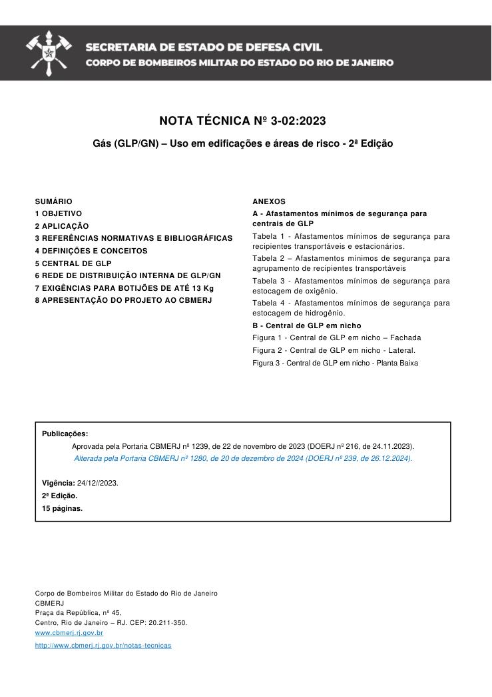

NOTA TÉCNICA Nº 3-02:2023

Gás (GLP/GN) - Uso em edificações e áreas de risco - 2ª Edição

Aprovada pela Portaria CBMERJ nº 1239, de 22 de novembro de 2023 (DOERJ nº 216, de 24.11.2023).

Alterada pela Portaria CBMERJ nº 1280, de 20 de dezembro de 2024 (DOERJ nº 239, de 26.12.2024).

Publicada no Boletim da SEDEC/CBMERJ nº XX, de XX de XX de 2023.A

### SUMÁRIO

### 1 OBJETIVO

### 2 APLICAÇÃO

### 3 REFERÊNCIAS NORMATIVAS E BIBLIOGRÁFICAS

### 4 DEFINIÇÕES E CONCEITOS

### 5 CENTRAL DE GLP

### 6 REDE DE DISTRIBUIÇÃO INTERNA DE GLP/GN

### 7 EXIGÊNCIAS PARA BOTIJÕES DE ATÉ 13 Kg

### 8 APRESENTAÇÃO DO PROJETO AO CBMERJ

Publicações:

Vigência: 24/12//2023.

2ª Edição.

15 páginas.

Corpo de Bombeiros Militar do Estado do Rio de Janeiro CBMERJ Praça da República, nº 45, Centro, Rio de Janeiro - RJ. CEP: 20.211-350. www.cbmerj.rj.gov.br

http://www.cbmerj.rj.gov.br/notas-tecnicas

### ANEXOS

A - Afastamentos mínimos de segurança para centrais de GLP

Tabela 1 - Afastamentos mínimos de segurança para recipientes transportáveis e estacionários.

Tabela 2 - Afastamentos mínimos de segurança para agrupamento de recipientes transportáveis

Tabela 3 - Afastamentos mínimos de segurança para estocagem de oxigênio.

Tabela 4 - Afastamentos mínimos de segurança para estocagem de hidrogênio.

B - Central de GLP em nicho

Figura 1 - Central de GLP em nicho - Fachada

Figura 2 - Central de GLP em nicho - Lateral.

Figura 3 - Central de GLP em nicho - Planta Baixa

---

## Página 3

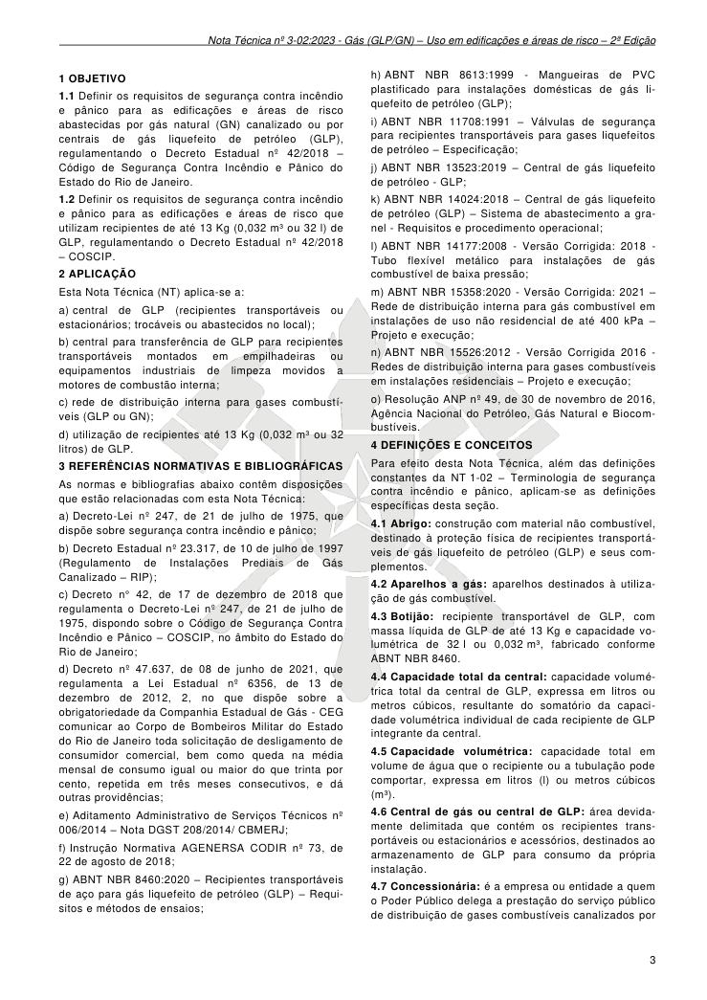

### 1 OBJETIVO

1.1 Definir os requisitos de segurança contra incêndio e pânico para as edificações e áreas de risco abastecidas por gás natural (GN) canalizado ou por centrais de gás liquefeito de petróleo (GLP), regulamentando o Decreto Estadual nº 42/2018 - Código de Segurança Contra Incêndio e Pânico do Estado do Rio de Janeiro.

1.2 Definir os requisitos de segurança contra incêndio e pânico para as edificações e áreas de risco que utilizam recipientes de até 13 Kg (0,032 m³ ou 32 l) de GLP, regulamentando o Decreto Estadual nº 42/2018 - COSCIP.

### 2 APLICAÇÃO

Esta Nota Técnica (NT) aplica-se a:

a) central de GLP (recipientes transportáveis ou estacionários; trocáveis ou abastecidos no local);

b) central para transferência de GLP para recipientes transportáveis montados em empilhadeiras ou equipamentos industriais de limpeza movidos a motores de combustão interna;

c) rede de distribuição interna para gases combustíveis (GLP ou GN);

d) utilização de recipientes até 13 Kg (0,032 m³ ou 32 litros) de GLP.

### 3 REFERÊNCIAS NORMATIVAS E BIBLIOGRÁFICAS

As normas e bibliografias abaixo contêm disposições que estão relacionadas com esta Nota Técnica:

a) Decreto-Lei nº 247, de 21 de julho de 1975, que dispõe sobre segurança contra incêndio e pânico;

b) Decreto Estadual nº 23.317, de 10 de julho de 1997 (Regulamento de Instalações Prediais de Gás Canalizado - RIP);

c) Decreto n° 42, de 17 de dezembro de 2018 que regulamenta o Decreto-Lei nº 247, de 21 de julho de 1975, dispondo sobre o Código de Segurança Contra Incêndio e Pânico - COSCIP, no âmbito do Estado do Rio de Janeiro;

d) Decreto nº 47.637, de 08 de junho de 2021, que regulamenta a Lei Estadual nº 6356, de 13 de dezembro de 2012, 2, no que dispõe sobre a obrigatoriedade da Companhia Estadual de Gás - CEG comunicar ao Corpo de Bombeiros Militar do Estado do Rio de Janeiro toda solicitação de desligamento de consumidor comercial, bem como queda na média mensal de consumo igual ou maior do que trinta por cento, repetida em três meses consecutivos, e dá outras providências;

e) Aditamento Administrativo de Serviços Técnicos nº 006/2014 - Nota DGST 208/2014/ CBMERJ;

f) Instrução Normativa AGENERSA CODIR nº 73, de 22 de agosto de 2018;

g) ABNT NBR 8460:2020 - Recipientes transportáveis de aço para gás liquefeito de petróleo (GLP) - Requisitos e métodos de ensaios;

h) ABNT NBR 8613:1999 - Mangueiras de PVC plastificado para instalações domésticas de gás liquefeito de petróleo (GLP);

i) ABNT NBR 11708:1991 - Válvulas de segurança para recipientes transportáveis para gases liquefeitos de petróleo - Especificação;

j) ABNT NBR 13523:2019 - Central de gás liquefeito de petróleo - GLP;

k) ABNT NBR 14024:2018 - Central de gás liquefeito de petróleo (GLP) - Sistema de abastecimento a granel - Requisitos e procedimento operacional;

l) ABNT NBR 14177:2008 - Versão Corrigida: 2018 - Tubo flexível metálico para instalações de gás combustível de baixa pressão;

m) ABNT NBR 15358:2020 - Versão Corrigida: 2021 - Rede de distribuição interna para gás combustível em instalações de uso não residencial de até 400 kPa - Projeto e execução;

n) ABNT NBR 15526:2012 - Versão Corrigida 2016 - Redes de distribuição interna para gases combustíveis em instalações residenciais - Projeto e execução;

o) Resolução ANP nº 49, de 30 de novembro de 2016, Agência Nacional do Petróleo, Gás Natural e Biocombustíveis.

### 4 DEFINIÇÕES E CONCEITOS

Para efeito desta Nota Técnica, além das definições constantes da NT 1-02 - Terminologia de segurança contra incêndio e pânico, aplicam-se as definições específicas desta seção.

4.1 Abrigo: construção com material não combustível, destinado à proteção física de recipientes transportáveis de gás liquefeito de petróleo (GLP) e seus complementos.

4.2 Aparelhos a gás: aparelhos destinados à utilização de gás combustível.

4.3 Botijão: recipiente transportável de GLP, com massa líquida de GLP de até 13 Kg e capacidade volumétrica de 32 l ou 0,032 m³, fabricado conforme ABNT NBR 8460.

4.4 Capacidade total da central: capacidade volumétrica total da central de GLP, expressa em litros ou metros cúbicos, resultante do somatório da capacidade volumétrica individual de cada recipiente de GLP integrante da central.

4.5 Capacidade volumétrica: capacidade total em volume de água que o recipiente ou a tubulação pode comportar, expressa em litros (l) ou metros cúbicos (m³).

4.6 Central de gás ou central de GLP: área devidamente delimitada que contém os recipientes transportáveis ou estacionários e acessórios, destinados ao armazenamento de GLP para consumo da própria instalação.

4.7 Concessionária: é a empresa ou entidade a quem o Poder Público delega a prestação do serviço público de distribuição de gases combustíveis canalizados por

---

## Página 4

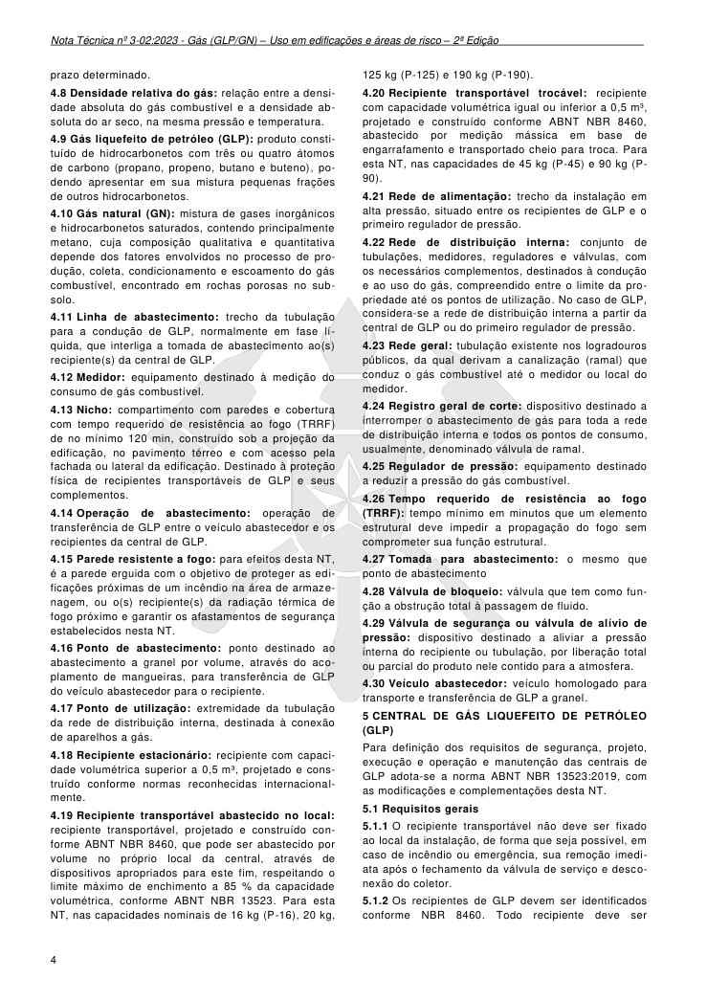

prazo determinado.

4.8 Densidade relativa do gás: relação entre a densidade absoluta do gás combustível e a densidade absoluta do ar seco, na mesma pressão e temperatura.

4.9 Gás liquefeito de petróleo (GLP): produto constituído de hidrocarbonetos com três ou quatro átomos de carbono (propano, propeno, butano e buteno), podendo apresentar em sua mistura pequenas frações de outros hidrocarbonetos.

4.10 Gás natural (GN): mistura de gases inorgânicos e hidrocarbonetos saturados, contendo principalmente metano, cuja composição qualitativa e quantitativa depende dos fatores envolvidos no processo de produção, coleta, condicionamento e escoamento do gás combustível, encontrado em rochas porosas no subsolo.

4.11 Linha de abastecimento: trecho da tubulação para a condução de GLP, normalmente em fase líquida, que interliga a tomada de abastecimento ao(s) recipiente(s) da central de GLP.

4.12 Medidor: equipamento destinado à medição do consumo de gás combustível.

4.13 Nicho: compartimento com paredes e cobertura com tempo requerido de resistência ao fogo (TRRF) de no mínimo 120 min, construído sob a projeção da edificação, no pavimento térreo e com acesso pela fachada ou lateral da edificação. Destinado à proteção física de recipientes transportáveis de GLP e seus complementos.

4.14 Operação de abastecimento: operação de transferência de GLP entre o veículo abastecedor e os recipientes da central de GLP.

4.15 Parede resistente a fogo: para efeitos desta NT, é a parede erguida com o objetivo de proteger as edificações próximas de um incêndio na área de armazenagem, ou o(s) recipiente(s) da radiação térmica de fogo próximo e garantir os afastamentos de segurança estabelecidos nesta NT.

4.16 Ponto de abastecimento: ponto destinado ao abastecimento a granel por volume, através do acoplamento de mangueiras, para transferência de GLP do veículo abastecedor para o recipiente.

4.17 Ponto de utilização: extremidade da tubulação da rede de distribuição interna, destinada à conexão de aparelhos a gás.

4.18 Recipiente estacionário: recipiente com capacidade volumétrica superior a 0,5 m³, projetado e construído conforme normas reconhecidas internacionalmente.

4.19 Recipiente transportável abastecido no local: recipiente transportável, projetado e construído conforme ABNT NBR 8460, que pode ser abastecido por volume no próprio local da central, através de dispositivos apropriados para este fim, respeitando o limite máximo de enchimento a 85 % da capacidade volumétrica, conforme ABNT NBR 13523. Para esta NT, nas capacidades nominais de 16 kg (P-16), 20 kg,

125 kg (P-125) e 190 kg (P-190).

4.20 Recipiente transportável trocável: recipiente com capacidade volumétrica igual ou inferior a 0,5 m³, projetado e construído conforme ABNT NBR 8460, abastecido por medição mássica em base de engarrafamento e transportado cheio para troca. Para esta NT, nas capacidades de 45 kg (P-45) e 90 kg (P- 90).

4.21 Rede de alimentação: trecho da instalação em alta pressão, situado entre os recipientes de GLP e o primeiro regulador de pressão.

4.22 Rede de distribuição interna: conjunto de tubulações, medidores, reguladores e válvulas, com os necessários complementos, destinados à condução e ao uso do gás, compreendido entre o limite da propriedade até os pontos de utilização. No caso de GLP, considera-se a rede de distribuição interna a partir da central de GLP ou do primeiro regulador de pressão.

4.23 Rede geral: tubulação existente nos logradouros públicos, da qual derivam a canalização (ramal) que conduz o gás combustível até o medidor ou local do medidor.

4.24 Registro geral de corte: dispositivo destinado a interromper o abastecimento de gás para toda a rede de distribuição interna e todos os pontos de consumo, usualmente, denominado válvula de ramal.

4.25 Regulador de pressão: equipamento destinado a reduzir a pressão do gás combustível.

4.26 Tempo requerido de resistência ao fogo (TRRF): tempo mínimo em minutos que um elemento estrutural deve impedir a propagação do fogo sem comprometer sua função estrutural.

4.27 Tomada para abastecimento: o mesmo que ponto de abastecimento

4.28 Válvula de bloqueio: válvula que tem como função a obstrução total à passagem de fluido.

4.29 Válvula de segurança ou válvula de alívio de pressão: dispositivo destinado a aliviar a pressão interna do recipiente ou tubulação, por liberação total ou parcial do produto nele contido para a atmosfera.

4.30 Veículo abastecedor: veículo homologado para transporte e transferência de GLP a granel.

### 5 CENTRAL DE GÁS LIQUEFEITO DE PETRÓLEO (GLP)

Para definição dos requisitos de segurança, projeto, execução e operação e manutenção das centrais de GLP adota-se a norma ABNT NBR 13523:2019, com as modificações e complementações desta NT.

5.1 Requisitos gerais

5.1.1 O recipiente transportável não deve ser fixado ao local da instalação, de forma que seja possível, em caso de incêndio ou emergência, sua remoção imediata após o fechamento da válvula de serviço e desconexão do coletor.

5.1.2 Os recipientes de GLP devem ser identificados conforme NBR 8460. Todo recipiente deve ser

---

## Página 5

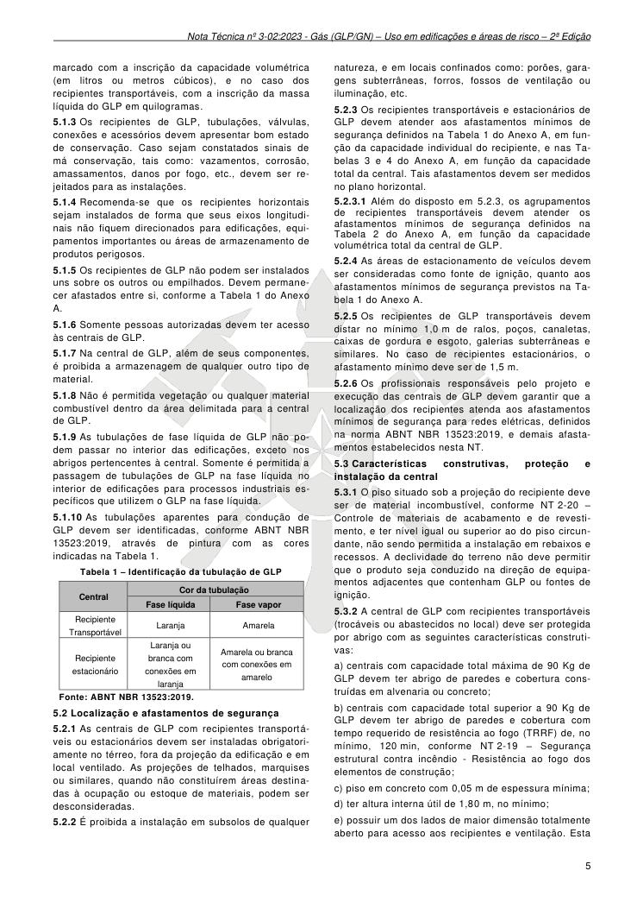

marcado com a inscrição da capacidade volumétrica (em litros ou metros cúbicos), e no caso dos recipientes transportáveis, com a inscrição da massa líquida do GLP em quilogramas.

5.1.3 Os recipientes de GLP, tubulações, válvulas, conexões e acessórios devem apresentar bom estado de conservação. Caso sejam constatados sinais de má conservação, tais como: vazamentos, corrosão, amassamentos, danos por fogo, etc., devem ser rejeitados para as instalações.

5.1.4 Recomenda-se que os recipientes horizontais sejam instalados de forma que seus eixos longitudinais não fiquem direcionados para edificações, equipamentos importantes ou áreas de armazenamento de produtos perigosos.

5.1.5 Os recipientes de GLP não podem ser instalados uns sobre os outros ou empilhados. Devem permanecer afastados entre si, conforme a Tabela 1 do Anexo A.

5.1.6 Somente pessoas autorizadas devem ter acesso às centrais de GLP.

5.1.7 Na central de GLP, além de seus componentes, é proibida a armazenagem de qualquer outro tipo de material.

5.1.8 Não é permitida vegetação ou qualquer material combustível dentro da área delimitada para a central de GLP.

5.1.9 As tubulações de fase líquida de GLP não podem passar no interior das edificações, exceto nos abrigos pertencentes à central. Somente é permitida a passagem de tubulações de GLP na fase líquida no interior de edificações para processos industriais específicos que utilizem o GLP na fase líquida.

5.1.10 As tubulações aparentes para condução de GLP devem ser identificadas, conforme ABNT NBR 13523:2019, através de pintura com as cores indicadas na Tabela 1.

Tabela 1 - Identificação da tubulação de GLP

Fonte: ABNT NBR 13523:2019.

5.2 Localização e afastamentos de segurança

5.2.1 As centrais de GLP com recipientes transportáveis ou estacionários devem ser instaladas obrigatoriamente no térreo, fora da projeção da edificação e em local ventilado. As projeções de telhados, marquises ou similares, quando não constituírem áreas destinadas à ocupação ou estoque de materiais, podem ser desconsideradas.

5.2.2 É proibida a instalação em subsolos de qualquer

natureza, e em locais confinados como: porões, garagens subterrâneas, forros, fossos de ventilação ou iluminação, etc.

5.2.3 Os recipientes transportáveis e estacionários de GLP devem atender aos afastamentos mínimos de segurança definidos na Tabela 1 do Anexo A, em função da capacidade individual do recipiente, e nas Tabelas 3 e 4 do Anexo A, em função da capacidade total da central. Tais afastamentos devem ser medidos no plano horizontal.

5.2.3.1 Além do disposto em 5.2.3, os agrupamentos de recipientes transportáveis devem atender os afastamentos mínimos de segurança definidos na Tabela 2 do Anexo A, em função da capacidade volumétrica total da central de GLP.

5.2.4 As áreas de estacionamento de veículos devem ser consideradas como fonte de ignição, quanto aos afastamentos mínimos de segurança previstos na Tabela 1 do Anexo A.

5.2.5 Os recipientes de GLP transportáveis devem distar no mínimo 1,0 m de ralos, poços, canaletas, caixas de gordura e esgoto, galerias subterrâneas e similares. No caso de recipientes estacionários, o afastamento mínimo deve ser de 1,5 m.

5.2.6 Os profissionais responsáveis pelo projeto e execução das centrais de GLP devem garantir que a localização dos recipientes atenda aos afastamentos mínimos de segurança para redes elétricas, definidos na norma ABNT NBR 13523:2019, e demais afastamentos estabelecidos nesta NT.

5.3 Características construtivas, proteção e instalação da central

5.3.1 O piso situado sob a projeção do recipiente deve ser de material incombustível, conforme NT 2-20 - Controle de materiais de acabamento e de revestimento, e ter nível igual ou superior ao do piso circundante, não sendo permitida a instalação em rebaixos e recessos. A declividade do terreno não deve permitir que o produto seja conduzido na direção de equipamentos adjacentes que contenham GLP ou fontes de ignição.

5.3.2 A central de GLP com recipientes transportáveis (trocáveis ou abastecidos no local) deve ser protegida por abrigo com as seguintes características construtivas:

a) centrais com capacidade total máxima de 90 Kg de GLP devem ter abrigo de paredes e cobertura construídas em alvenaria ou concreto;

b) centrais com capacidade total superior a 90 Kg de GLP devem ter abrigo de paredes e cobertura com tempo requerido de resistência ao fogo (TRRF) de, no mínimo, 120 min, conforme NT 2-19 - Segurança estrutural contra incêndio - Resistência ao fogo dos elementos de construção;

c) piso em concreto com 0,05 m de espessura mínima;

d) ter altura interna útil de 1,80 m, no mínimo;

e) possuir um dos lados de maior dimensão totalmente aberto para acesso aos recipientes e ventilação. Esta

### Tabelas extraídas (bruto, não usar para citação)
#### Tabela 1 da página

| Central |  | Cor da tubulação |  |  |  |  |
| --- | --- | --- | --- | --- | --- | --- |
|  |  | Fase líquida |  |  | Fase vapor |  |
| Recipiente Transportável | Laranja |  |  | Amarela |  |  |
| Recipiente estacionário | Laranja ou branca com conexões em laranja |  |  | Amarela ou branca com conexões em amarelo |  |  |

---

## Página 6

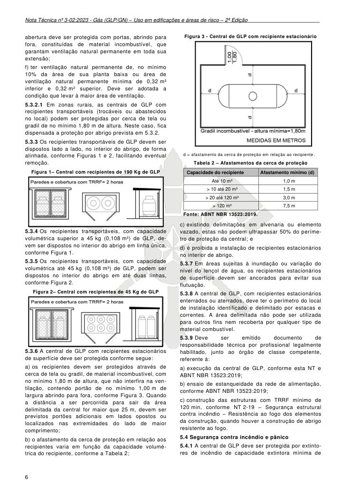

abertura deve ser protegida com portas, abrindo para fora, constituídas de material incombustível, que garantam ventilação natural permanente em toda sua extensão;

f) ter ventilação natural permanente de, no mínimo 10% da área de sua planta baixa ou área de ventilação natural permanente mínima de 0,32 m² inferior e 0,32 m² superior. Deve ser adotada a condição que levar à maior área de ventilação.

5.3.2.1 Em zonas rurais, as centrais de GLP com recipientes transportáveis (trocáveis ou abastecidos no local) podem ser protegidas por cerca de tela ou gradil de no mínimo 1,80 m de altura. Neste caso, fica dispensada a proteção por abrigo prevista em 5.3.2.

5.3.3 Os recipientes transportáveis de GLP devem ser dispostos lado a lado, no interior do abrigo, de forma alinhada, conforme Figuras 1 e 2, facilitando eventual remoção.

Figura 1- Central com recipientes de 190 Kg de GLP

5.3.4 Os recipientes transportáveis, com capacidade volumétrica superior a 45 kg (0,108 m³) de GLP, devem ser dispostos no interior do abrigo em linha única, conforme Figura 1.

5.3.5 Os recipientes transportáveis, com capacidade volumétrica até 45 kg (0,108 m³) de GLP, podem ser dispostos no interior do abrigo em até duas linhas, conforme Figura 2.

Figura 2- Central com recipientes de 45 Kg de GLP

5.3.6 A central de GLP com recipientes estacionários de superfície deve ser protegida conforme segue:

a) os recipientes devem ser protegidos através de cerca de tela ou gradil, de material incombustível, com no mínimo 1,80 m de altura, que não interfira na ventilação, contendo portão de no mínimo 1,00 m de largura abrindo para fora, conforme Figura 3. Quando a distância a ser percorrida para sair da área delimitada da central for maior que 25 m, devem ser previstos portões adicionais em lados opostos ou localizados nas extremidades do lado de maior comprimento;

b) o afastamento da cerca de proteção em relação aos recipientes varia em função da capacidade volumétrica do recipiente, conforme a Tabela 2;

Figura 3 - Central de GLP com recipiente estacionário

de superfície

d = afastamento da cerca de proteção em relação ao recipiente.

Tabela 2 - Afastamentos da cerca de proteção

Fonte: ABNT NBR 13523:2019.

c) existindo delimitações em alvenaria ou elemento vazado, estas não podem ultrapassar 50% do perímetro de proteção da central; e

d) é proibida a instalação de recipientes estacionários no interior de abrigo.

5.3.7 Em áreas sujeitas à inundação ou variação do nível do lençol de água, os recipientes estacionários de superfície devem ser ancorados para evitar sua flutuação.

5.3.8 A central de GLP, com recipientes estacionários enterrados ou aterrados, deve ter o perímetro do local de instalação identificado e delimitado por estacas e correntes. A área delimitada não pode ser utilizada para outros fins nem recoberta por qualquer tipo de material combustível.

5.3.9 Deve ser emitido documento de responsabilidade técnica por profissional legalmente habilitado, junto ao órgão de classe competente, referente à:

a) execução da central de GLP, conforme esta NT e ABNT NBR 13523:2019;

b) ensaio de estanqueidade da rede de alimentação, conforme ABNT NBR 13523:2019;

c) construção das estruturas com TRRF mínimo de 120 min, conforme NT 2-19 - Segurança estrutural contra incêndio - Resistência ao fogo dos elementos da construção, quando houver a construção de abrigo resistente ao fogo.

5.4 Segurança contra incêndio e pânico

5.4.1 A central de GLP deve ser protegida por extintores de incêndio de capacidade extintora mínima de

### Tabelas extraídas (bruto, não usar para citação)
#### Tabela 1 da página

|  | Capacidade do recipiente |  |  | Afastamento mínimo (d) |  |
| --- | --- | --- | --- | --- | --- |
| Até 10 m³ |  |  | 1,0 m |  |  |
| > 10 até 20 m³ |  |  | 1,5 m |  |  |
| > 20 até 120 m³ |  |  | 3,0 m |  |  |
| > 120 m³ |  |  | 7,5 m |  |  |

---

## Página 7

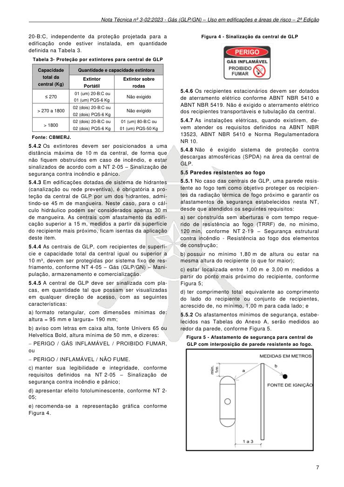

20-B:C, independente da proteção projetada para a edificação onde estiver instalada, em quantidade definida na Tabela 3.

Tabela 3- Proteção por extintores para central de GLP

Fonte: CBMERJ.

5.4.2 Os extintores devem ser posicionados a uma distância máxima de 10 m da central, de forma que não fiquem obstruídos em caso de incêndio, e estar sinalizados de acordo com a NT 2-05 - Sinalização de segurança contra incêndio e pânico.

5.4.3 Em edificações dotadas de sistema de hidrantes (canalização ou rede preventiva), é obrigatória a proteção da central de GLP por um dos hidrantes, admitindo-se 45 m de mangueira. Neste caso, para o cálculo hidráulico podem ser considerados apenas 30 m de mangueira. As centrais com afastamento da edificação superior a 15 m, medidos a partir da superfície do recipiente mais próximo, ficam isentas da aplicação deste item.

5.4.4 As centrais de GLP, com recipientes de superfície e capacidade total da central igual ou superior a 10 m³, devem ser protegidas por sistema fixo de resfriamento, conforme NT 4-05 - Gás (GLP/GN) - Manipulação, armazenamento e comercialização.

5.4.5 A central de GLP deve ser sinalizada com placas, em quantidade tal que possam ser visualizadas em qualquer direção de acesso, com as seguintes características:

a) formato retangular, com dimensões mínimas de: altura = 95 mm e largura= 190 mm;

b) aviso com letras em caixa alta, fonte Univers 65 ou Helveltica Bold, altura mínima de 50 mm, e dizeres:

− PERIGO / GÁS INFLAMÁVEL / PROIBIDO FUMAR, ou

### − PERIGO / INFLAMÁVEL / NÃO FUME.

c) manter sua legibilidade e integridade, conforme requisitos definidos na NT 2-05 - Sinalização de segurança contra incêndio e pânico;

d) apresentar efeito fotoluminescente, conforme NT 2- 05;

e) recomenda-se a representação gráfica conforme Figura 4.

Figura 4 - Sinalização da central de GLP

5.4.6 Os recipientes estacionários devem ser dotados de aterramento elétrico conforme ABNT NBR 5410 e ABNT NBR 5419. Não é exigido o aterramento elétrico dos recipientes transportáveis e tubulação da central.

5.4.7 As instalações elétricas, quando existirem, devem atender os requisitos definidos na ABNT NBR 13523, ABNT NBR 5410 e Norma Regulamentadora NR 10.

5.4.8 Não é exigido sistema de proteção contra descargas atmosféricas (SPDA) na área da central de GLP.

5.5 Paredes resistentes ao fogo

5.5.1 No caso das centrais de GLP, uma parede resistente ao fogo tem como objetivo proteger os recipientes da radiação térmica de fogo próximo e garantir os afastamentos de segurança estabelecidos nesta NT, desde que atendidos os seguintes requisitos:

a) ser construída sem aberturas e com tempo requerido de resistência ao fogo (TRRF) de, no mínimo, 120 min, conforme NT 2-19 - Segurança estrutural contra incêndio - Resistência ao fogo dos elementos de construção;

b) possuir no mínimo 1,80 m de altura ou estar na mesma altura do recipiente (o que for maior);

c) estar localizada entre 1,00 m e 3,00 m medidos a partir do ponto mais próximo do recipiente, conforme Figura 5;

d) ter comprimento total equivalente ao comprimento do lado do recipiente ou conjunto de recipientes, acrescido de, no mínimo, 1,00 m para cada lado; e

5.5.2 Os afastamentos mínimos de segurança, estabelecidos nas Tabelas do Anexo A, serão medidos ao redor da parede, conforme Figura 5.

Figura 5 - Afastamento de segurança para central de

GLP com interposição de parede resistente ao fogo.

### Tabelas extraídas (bruto, não usar para citação)
#### Tabela 1 da página

| Capacidade total da central (Kg) | Quantidade e capacidade extintora |  |
| --- | --- | --- |
|  | Extintor Portátil | Extintor sobre rodas |
| ≤ 270 | 01 (um) 20-B:C ou 01 (um) PQS-6 Kg | Não exigido |
| > 270 a 1800 | 02 (dois) 20-B:C ou 02 (dois) PQS-6 Kg | Não exigido |
| > 1800 | 02 (dois) 20-B:C ou 02 (dois) PQS-6 Kg | 01 (um) 80-B:C ou 01 (um) PQS-50 Kg |

<!-- tabela-conferida: Tabela 3 p7 -->
### Tabela 3 — Proteção por extintores para central de GLP (conferida)

| Capacidade total da central (Kg) | Quantidade e capacidade extintora — Extintor Portátil | Quantidade e capacidade extintora — Extintor sobre rodas |
| --- | --- | --- |
| ≤ 270 | 01 (um) 20-B:C ou 01 (um) PQS-6 Kg | Não exigido |
| > 270 a 1800 | 02 (dois) 20-B:C ou 02 (dois) PQS-6 Kg | Não exigido |
| > 1800 | 02 (dois) 20-B:C ou 02 (dois) PQS-6 Kg | 01 (um) 80-B:C ou 01 (um) PQS-50 Kg |

Fonte: NT 3-02, página 7, Tabela 3; conferida em 2026-09-29 (visual + texto).
Fonte: CBMERJ.
"Quantidade e capacidade extintora" é célula mesclada sobre as colunas Extintor Portátil e Extintor sobre rodas.
<!-- /tabela-conferida: Tabela 3 p7 -->

---

## Página 8

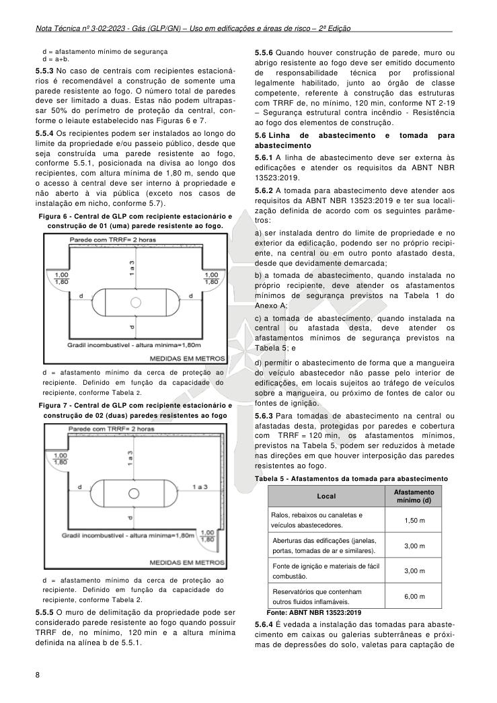

d = afastamento mínimo de segurança d = a+b.

5.5.3 No caso de centrais com recipientes estacionários é recomendável a construção de somente uma parede resistente ao fogo. O número total de paredes deve ser limitado a duas. Estas não podem ultrapassar 50% do perímetro de proteção da central, conforme o leiaute estabelecido nas Figuras 6 e 7.

5.5.4 Os recipientes podem ser instalados ao longo do limite da propriedade e/ou passeio público, desde que seja construída uma parede resistente ao fogo, conforme 5.5.1, posicionada na divisa ao longo dos recipientes, com altura mínima de 1,80 m, sendo que o acesso à central deve ser interno à propriedade e não aberto à via pública (exceto nos casos de instalação em nicho, conforme 5.7).

Figura 6 - Central de GLP com recipiente estacionário e

construção de 01 (uma) parede resistente ao fogo.

d = afastamento mínimo da cerca de proteção ao recipiente. Definido em função da capacidade do recipiente, conforme Tabela 2.

Figura 7 - Central de GLP com recipiente estacionário e

construção de 02 (duas) paredes resistentes ao fogo

d = afastamento mínimo da cerca de proteção ao recipiente. Definido em função da capacidade do recipiente, conforme Tabela 2.

5.5.5 O muro de delimitação da propriedade pode ser considerado parede resistente ao fogo quando possuir TRRF de, no mínimo, 120 min e a altura mínima definida na alínea b de 5.5.1.

5.5.6 Quando houver construção de parede, muro ou abrigo resistente ao fogo deve ser emitido documento de responsabilidade técnica por profissional legalmente habilitado, junto ao órgão de classe competente, referente à construção das estruturas com TRRF de, no mínimo, 120 min, conforme NT 2-19 - Segurança estrutural contra incêndio - Resistência ao fogo dos elementos de construção.

5.6 Linha de abastecimento e tomada para abastecimento

5.6.1 A linha de abastecimento deve ser externa às edificações e atender os requisitos da ABNT NBR 13523:2019.

5.6.2 A tomada para abastecimento deve atender aos requisitos da ABNT NBR 13523:2019 e ter sua localização definida de acordo com os seguintes parâmetros:

a) ser instalada dentro do limite de propriedade e no exterior da edificação, podendo ser no próprio recipiente, na central ou em outro ponto afastado desta, desde que devidamente demarcada;

b) a tomada de abastecimento, quando instalada no próprio recipiente, deve atender os afastamentos mínimos de segurança previstos na Tabela 1 do Anexo A;

c) a tomada de abastecimento, quando instalada na central ou afastada desta, deve atender os afastamentos mínimos de segurança previstos na Tabela 5; e

d) permitir o abastecimento de forma que a mangueira do veículo abastecedor não passe pelo interior de edificações, em locais sujeitos ao tráfego de veículos sobre a mangueira, ou próximo de fontes de calor ou fontes de ignição.

5.6.3 Para tomadas de abastecimento na central ou afastadas desta, protegidas por paredes e cobertura com TRRF = 120 min, os afastamentos mínimos, previstos na Tabela 5, podem ser reduzidos à metade nas direções em que houver interposição das paredes resistentes ao fogo.

Tabela 5 - Afastamentos da tomada para abastecimento

Fonte: ABNT NBR 13523:2019

5.6.4 É vedada a instalação das tomadas para abastecimento em caixas ou galerias subterrâneas e próximas de depressões do solo, valetas para captação de

### Tabelas extraídas (bruto, não usar para citação)
#### Tabela 1 da página

| Local |  | Afastamento |  |
| --- | --- | --- | --- |
|  |  | mínimo (d) |  |
| Ralos, rebaixos ou canaletas e veículos abastecedores. | 1,50 m |  |  |
| Aberturas das edificações (janelas, portas, tomadas de ar e similares). | 3,00 m |  |  |
| Fonte de ignição e materiais de fácil combustão. | 3,00 m |  |  |
| Reservatórios que contenham outros fluidos inflamáveis. | 6,00 m |  |  |

---

## Página 9

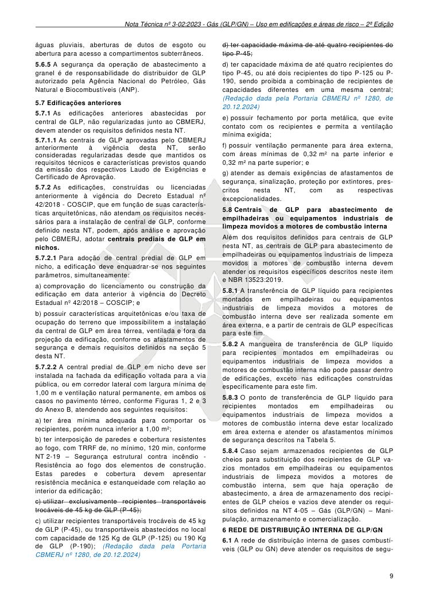

águas pluviais, aberturas de dutos de esgoto ou abertura para acesso a compartimentos subterrâneos.

5.6.5 A segurança da operação de abastecimento a granel é de responsabilidade do distribuidor de GLP autorizado pela Agência Nacional do Petróleo, Gás Natural e Biocombustíveis (ANP).

5.7 Edificações anteriores

5.7.1 As edificações anteriores abastecidas por central de GLP, não regularizadas junto ao CBMERJ, devem atender os requisitos definidos nesta NT.

5.7.1.1 As centrais de GLP aprovadas pelo CBMERJ anteriormente à vigência desta NT, serão consideradas regularizadas desde que mantidos os requisitos técnicos e características previstos quando da emissão dos respectivos Laudo de Exigências e Certificado de Aprovação.

5.7.2 As edificações, construídas ou licenciadas anteriormente à vigência do Decreto Estadual nº 42/2018 - COSCIP, que em função de suas características arquitetônicas, não atendam os requisitos necessários para a instalação de central de GLP, conforme definido nesta NT, podem, após análise e aprovação pelo CBMERJ, adotar centrais prediais de GLP em nichos.

5.7.2.1 Para adoção de central predial de GLP em nicho, a edificação deve enquadrar-se nos seguintes parâmetros, simultaneamente:

a) comprovação do licenciamento ou construção da edificação em data anterior à vigência do Decreto Estadual nº 42/2018 - COSCIP; e

b) possuir características arquitetônicas e/ou taxa de ocupação do terreno que impossibilitem a instalação da central de GLP em área térrea, ventilada e fora da projeção da edificação, conforme os afastamentos de segurança e demais requisitos definidos na seção 5 desta NT.

5.7.2.2 A central predial de GLP em nicho deve ser instalada na fachada da edificação voltada para a via pública, ou em corredor lateral com largura mínima de 1,00 m e ventilação natural permanente, em ambos os casos no pavimento térreo, conforme Figuras 1, 2 e 3 do Anexo B, atendendo aos seguintes requisitos:

a) ter área mínima adequada para comportar os recipientes, porém nunca inferior a 1,00 m²;

b) ter interposição de paredes e cobertura resistentes ao fogo, com TRRF de, no mínimo, 120 min, conforme NT 2-19 - Segurança estrutural contra incêndio - Resistência ao fogo dos elementos de construção. Estas paredes e cobertura devem apresentar resistência mecânica e estanqueidade com relação ao interior da edificação;

c) utilizar exclusivamente recipientes transportáveis trocáveis de 45 kg de GLP (P-45);

c) utilizar recipientes transportáveis trocáveis de 45 kg de GLP (P-45), ou transportáveis abastecidos no local com capacidade de 125 Kg de GLP (P-125) ou 190 Kg de GLP (P-190); (Redação dada pela Portaria CBMERJ nº 1280, de 20.12.2024)

d) ter capacidade máxima de até quatro recipientes do tipo P-45;

d) ter capacidade máxima de até quatro recipientes do tipo P-45, ou até dois recipientes do tipo P-125 ou P- 190, sendo proibida a combinação de recipientes de capacidades diferentes em uma mesma central; (Redação dada pela Portaria CBMERJ nº 1280, de 20.12.2024)

e) possuir fechamento por porta metálica, que evite contato com os recipientes e permita a ventilação mínima exigida;

f) possuir ventilação permanente para área externa, com áreas mínimas de 0,32 m² na parte inferior e 0,32 m² na parte superior; e

g) atender as demais exigências de afastamentos de segurança, sinalização, proteção por extintores, prescritos nesta NT, com as respectivas excepcionalidades.

5.8 Centrais de GLP para abastecimento de empilhadeiras ou equipamentos industriais de limpeza movidos a motores de combustão interna

Além dos requisitos definidos para centrais de GLP nesta NT, as centrais de GLP para abastecimento de empilhadeiras ou equipamentos industriais de limpeza movidos a motores de combustão interna devem atender os requisitos específicos descritos neste item e NBR 13523:2019.

5.8.1 A transferência de GLP líquido para recipientes montados em empilhadeiras ou equipamentos industriais de limpeza movidos a motores de combustão interna deve ser realizada somente em área externa, e a partir de centrais de GLP específicas para este fim.

5.8.2 A mangueira de transferência de GLP líquido para recipientes montados em empilhadeiras ou equipamentos industriais de limpeza movidos a motores de combustão interna não pode passar dentro de edificações, exceto nas edificações construídas especificamente para este fim.

5.8.3 O ponto de transferência de GLP líquido para recipientes montados em empilhadeiras ou equipamentos industriais de limpeza movidos a motores de combustão interna deve estar localizado em área externa e atender os afastamentos mínimos de segurança descritos na Tabela 5.

5.8.4 Caso sejam armazenados recipientes de GLP cheios para substituição dos recipientes de GLP vazios montados em empilhadeiras ou equipamentos industriais de limpeza movidos a motores de combustão interna, sem que haja operação de abastecimento, a área de armazenamento dos recipientes de GLP cheios e vazios deve atender os requisitos definidos na NT 4-05 - Gás (GLP/GN) - Manipulação, armazenamento e comercialização.

### 6 REDE DE DISTRIBUIÇÃO INTERNA DE GLP/GN

6.1 A rede de distribuição interna de gases combustíveis (GLP ou GN) deve atender os requisitos de segu-

---

## Página 10

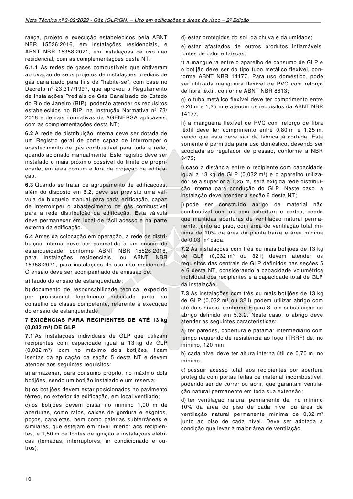

rança, projeto e execução estabelecidos pela ABNT NBR 15526:2016, em instalações residenciais, e ABNT NBR 15358:2021, em instalações de uso não residencial, com as complementações desta NT.

6.1.1 As redes de gases combustíveis que obtiveram aprovação de seus projetos de instalações prediais de gás canalizado para fins de "habite-se", com base no Decreto nº 23.317/1997, que aprovou o Regulamento de Instalações Prediais de Gás Canalizado do Estado do Rio de Janeiro (RIP), poderão atender os requisitos estabelecidos no RIP, na Instrução Normativa nº 73/ 2018 e demais normativas da AGENERSA aplicáveis, com as complementações desta NT;

6.2 A rede de distribuição interna deve ser dotada de um Registro geral de corte capaz de interromper o abastecimento de gás combustível para toda a rede, quando acionado manualmente. Este registro deve ser instalado o mais próximo possível do limite de propriedade, em área comum e fora da projeção da edificação.

6.3 Quando se tratar de agrupamento de edificações, além do disposto em 6.2, deve ser previsto uma válvula de bloqueio manual para cada edificação, capaz de interromper o abastecimento de gás combustível para a rede distribuição da edificação. Esta válvula deve permanecer em local de fácil acesso e na parte externa da edificação.

6.4 Antes da colocação em operação, a rede de distribuição interna deve ser submetida a um ensaio de estanqueidade, conforme ABNT NBR 15526:2016, para instalações residenciais, ou ABNT NBR 15358:2021, para instalações de uso não residencial. O ensaio deve ser acompanhado da emissão de:

a) laudo do ensaio de estanqueidade;

b) documento de responsabilidade técnica, expedido por profissional legalmente habilitado junto ao conselho de classe competente, referente à execução do ensaio de estanqueidade.

### 7 EXIGÊNCIAS PARA RECIPIENTES DE ATÉ 13 kg (0,032 m³) DE GLP

7.1 As instalações individuais de GLP que utilizam recipientes com capacidade igual a 13 kg de GLP (0,032 m³), com no máximo dois botijões, ficam isentas da aplicação da seção 5 desta NT e devem atender aos seguintes requisitos:

a) armazenar, para consumo próprio, no máximo dois botijões, sendo um botijão instalado e um reserva;

b) os botijões devem estar posicionados no pavimento térreo, no exterior da edificação, em local ventilado;

c) os botijões devem distar no mínimo 1,00 m de aberturas, como ralos, caixas de gordura e esgotos, poços, canaletas, bem como galerias subterrâneas e similares, que estejam em nível inferior aos recipientes, e 1,50 m de fontes de ignição e instalações elétricas (tomadas, interruptores, ar condicionado e outros);

d) estar protegidos do sol, da chuva e da umidade;

e) estar afastados de outros produtos inflamáveis, fontes de calor e faíscas;

f) a mangueira entre o aparelho de consumo de GLP e o botijão deve ser do tipo tubo metálico flexível, conforme ABNT NBR 14177. Para uso doméstico, pode ser utilizada mangueira flexível de PVC com reforço de fibra têxtil, conforme ABNT NBR 8613;

g) o tubo metálico flexível deve ter comprimento entre 0,20 m e 1,25 m e atender os requisitos da ABNT NBR 14177;

h) a mangueira flexível de PVC com reforço de fibra têxtil deve ter comprimento entre 0,80 m e 1,25 m, sendo que esta deve sair da fábrica já cortada. Esta somente é permitida para uso doméstico, devendo ser acoplada ao regulador de pressão, conforme a NBR 8473;

i) caso a distância entre o recipiente com capacidade igual a 13 kg de GLP (0,032 m³) e o aparelho utilizador seja superior a 1,25 m, será exigida rede distribuição interna para condução do GLP. Neste caso, a instalação deve atender a seção 6 desta NT;

j) pode ser construído abrigo de material não combustível com ou sem cobertura e portas, desde que mantidas aberturas de ventilação natural permanente, junto ao piso, com área de ventilação total mínima de 10% da área da planta baixa e área mínima de 0,03 m² cada.

7.2 As instalações com três ou mais botijões de 13 kg de GLP (0,032 m³ ou 32 l) devem atender os requisitos das centrais de GLP definidos nas seções 5 e 6 desta NT, considerando a capacidade volumétrica individual dos recipientes e a capacidade total de GLP da instalação.

7.3 As instalações com três ou mais botijões de 13 kg de GLP (0,032 m³ ou 32 l) podem utilizar abrigo com até dois níveis, conforme Figura 8, em substituição ao abrigo definido em 5.3.2. Neste caso, o abrigo deve atender as seguintes características:

a) ter paredes, cobertura e patamar intermediário com tempo requerido de resistência ao fogo (TRRF) de, no mínimo, 120 min;

b) cada nível deve ter altura interna útil de 0,70 m, no mínimo;

c) possuir acesso total aos recipientes por abertura protegida com portas feitas de material incombustível, podendo ser de correr ou abrir, que garantam ventilação natural permanente em toda sua extensão;

d) ter ventilação natural permanente de, no mínimo 10% da área do piso de cada nível ou área de ventilação natural permanente mínima de 0,32 m² junto ao piso de cada nível. Deve ser adotada a condição que levar à maior área de ventilação.

---

## Página 11

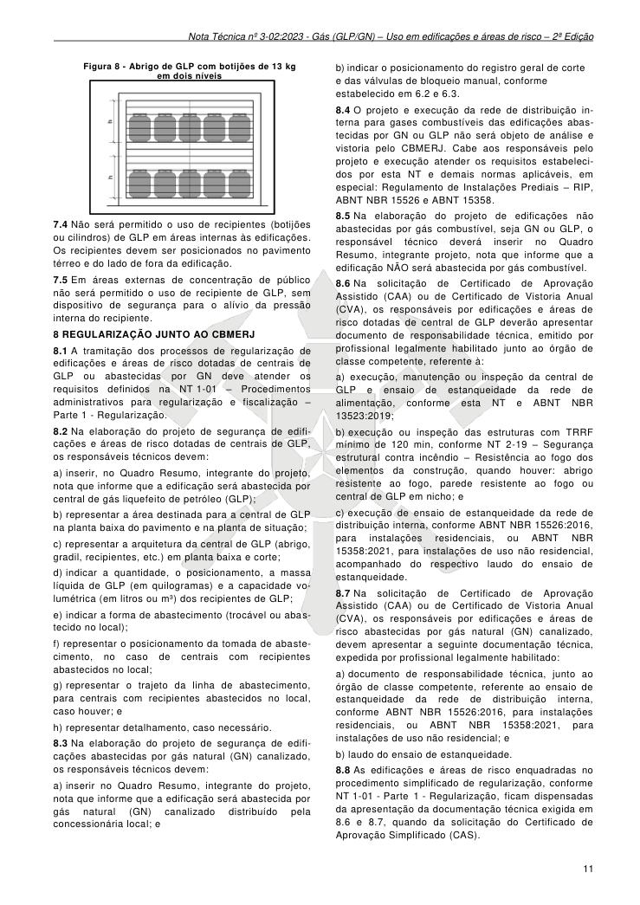

Figura 8 - Abrigo de GLP com botijões de 13 kg

em dois níveis

7.4 Não será permitido o uso de recipientes (botijões ou cilindros) de GLP em áreas internas às edificações. Os recipientes devem ser posicionados no pavimento térreo e do lado de fora da edificação.

7.5 Em áreas externas de concentração de público não será permitido o uso de recipiente de GLP, sem dispositivo de segurança para o alívio da pressão interna do recipiente.

### 8 REGULARIZAÇÃO JUNTO AO CBMERJ

8.1 A tramitação dos processos de regularização de edificações e áreas de risco dotadas de centrais de GLP ou abastecidas por GN deve atender os requisitos definidos na NT 1-01 - Procedimentos administrativos para regularização e fiscalização - Parte 1 - Regularização.

8.2 Na elaboração do projeto de segurança de edificações e áreas de risco dotadas de centrais de GLP, os responsáveis técnicos devem:

a) inserir, no Quadro Resumo, integrante do projeto, nota que informe que a edificação será abastecida por central de gás liquefeito de petróleo (GLP);

b) representar a área destinada para a central de GLP na planta baixa do pavimento e na planta de situação;

c) representar a arquitetura da central de GLP (abrigo, gradil, recipientes, etc.) em planta baixa e corte;

d) indicar a quantidade, o posicionamento, a massa líquida de GLP (em quilogramas) e a capacidade volumétrica (em litros ou m³) dos recipientes de GLP;

e) indicar a forma de abastecimento (trocável ou abastecido no local);

f) representar o posicionamento da tomada de abastecimento, no caso de centrais com recipientes abastecidos no local;

g) representar o trajeto da linha de abastecimento, para centrais com recipientes abastecidos no local, caso houver; e

h) representar detalhamento, caso necessário.

8.3 Na elaboração do projeto de segurança de edificações abastecidas por gás natural (GN) canalizado, os responsáveis técnicos devem:

a) inserir no Quadro Resumo, integrante do projeto, nota que informe que a edificação será abastecida por gás natural (GN) canalizado distribuído pela concessionária local; e

b) indicar o posicionamento do registro geral de corte e das válvulas de bloqueio manual, conforme estabelecido em 6.2 e 6.3.

8.4 O projeto e execução da rede de distribuição interna para gases combustíveis das edificações abastecidas por GN ou GLP não será objeto de análise e vistoria pelo CBMERJ. Cabe aos responsáveis pelo projeto e execução atender os requisitos estabelecidos por esta NT e demais normas aplicáveis, em especial: Regulamento de Instalações Prediais - RIP, ABNT NBR 15526 e ABNT 15358.

8.5 Na elaboração do projeto de edificações não abastecidas por gás combustível, seja GN ou GLP, o responsável técnico deverá inserir no Quadro Resumo, integrante projeto, nota que informe que a edificação NÃO será abastecida por gás combustível.

8.6 Na solicitação de Certificado de Aprovação Assistido (CAA) ou de Certificado de Vistoria Anual (CVA), os responsáveis por edificações e áreas de risco dotadas de central de GLP deverão apresentar documento de responsabilidade técnica, emitido por profissional legalmente habilitado junto ao órgão de classe competente, referente à:

a) execução, manutenção ou inspeção da central de GLP e ensaio de estanqueidade da rede de alimentação, conforme esta NT e ABNT NBR 13523:2019;

b) execução ou inspeção das estruturas com TRRF mínimo de 120 min, conforme NT 2-19 - Segurança estrutural contra incêndio - Resistência ao fogo dos elementos da construção, quando houver: abrigo resistente ao fogo, parede resistente ao fogo ou central de GLP em nicho; e

c) execução de ensaio de estanqueidade da rede de distribuição interna, conforme ABNT NBR 15526:2016, para instalações residenciais, ou ABNT NBR 15358:2021, para instalações de uso não residencial, acompanhado do respectivo laudo do ensaio de estanqueidade.

8.7 Na solicitação de Certificado de Aprovação Assistido (CAA) ou de Certificado de Vistoria Anual (CVA), os responsáveis por edificações e áreas de risco abastecidas por gás natural (GN) canalizado, devem apresentar a seguinte documentação técnica, expedida por profissional legalmente habilitado:

a) documento de responsabilidade técnica, junto ao órgão de classe competente, referente ao ensaio de estanqueidade da rede de distribuição interna, conforme ABNT NBR 15526:2016, para instalações residenciais, ou ABNT NBR 15358:2021, para instalações de uso não residencial; e

b) laudo do ensaio de estanqueidade.

8.8 As edificações e áreas de risco enquadradas no procedimento simplificado de regularização, conforme NT 1-01 - Parte 1 - Regularização, ficam dispensadas da apresentação da documentação técnica exigida em 8.6 e 8.7, quando da solicitação do Certificado de Aprovação Simplificado (CAS).

---

## Página 12

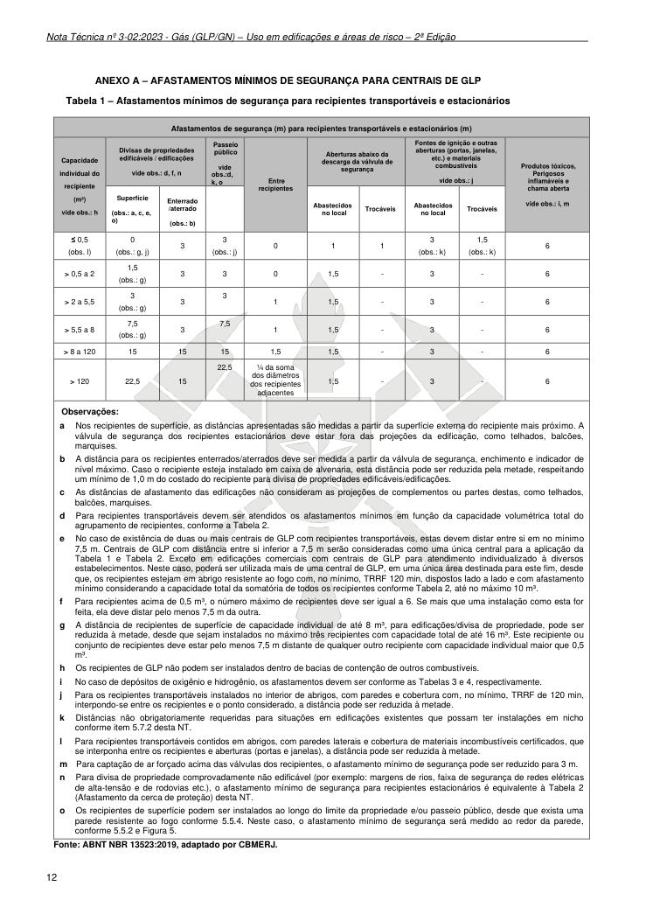

### ANEXO A - AFASTAMENTOS MÍNIMOS DE SEGURANÇA PARA CENTRAIS DE GLP

Tabela 1 - Afastamentos mínimos de segurança para recipientes transportáveis e estacionários

Fonte: ABNT NBR 13523:2019, adaptado por CBMERJ.

### Tabelas extraídas (bruto, não usar para citação)
#### Tabela 1 da página

|  | Afastamentos de segurança (m) para recipientes transportáveis e estacionários (m) |  |  |  |  |  |  |  |  |  |  |  |  |  |  |
| --- | --- | --- | --- | --- | --- | --- | --- | --- | --- | --- | --- | --- | --- | --- | --- |
| Capacidade individual do recipiente (m³) vide obs.: h |  | Divisas de propriedades edificáveis / edificações vide obs.: d, f, n |  |  | Passeio |  | Entre recipientes | Aberturas abaixo da descarga da válvula de segurança |  |  | Fontes de ignição e outras aberturas (portas, janelas, |  |  | Produtos tóxicos, Perigosos inflamáveis e chama aberta vide obs.: i, m |  |
|  |  |  |  |  | público |  |  |  |  |  | etc.) e materiais |  |  |  |  |
|  |  |  |  |  | vide |  |  |  |  |  | combustíveis |  |  |  |  |
|  |  |  |  |  | obs.:d, |  |  |  |  |  |  |  |  |  |  |
|  |  |  |  |  | k, o |  |  |  |  |  | vide obs.: j |  |  |  |  |
|  |  | Superfície (obs.: a, c, e, o) | Enterrado /aterrado (obs.: b) |  |  |  |  | Abastecidos no local | Trocáveis | Abastecidos no local |  | Trocáveis |  |  |  |
| ≤ 0,5 (obs. l) |  | 0 (obs.: g, j) | 3 | 3 (obs.: j) |  |  | 0 | 1 | 1 | 3 (obs.: k) |  | 1,5 (obs.: k) |  | 6 |  |
| > 0,5 a 2 |  | 1,5 (obs.: g) | 3 | 3 |  |  | 0 | 1,5 | - | 3 |  | - |  | 6 |  |
| > 2 a 5,5 |  | 3 (obs.: g) | 3 | 3 |  |  | 1 | 1,5 | - | 3 |  | - |  | 6 |  |
| > 5,5 a 8 |  | 7,5 (obs.: g) | 3 | 7,5 |  |  | 1 | 1,5 | - | 3 |  | - |  | 6 |  |
| > 8 a 120 |  | 15 | 15 | 15 |  |  | 1,5 | 1,5 | - | 3 |  | - |  | 6 |  |
| > 120 |  | 22,5 | 15 | 22,5 |  |  | ¼ da soma dos diâmetros dos recipientes adjacentes | 1,5 | - | 3 |  | - |  | 6 |  |
| Observações: a Nos recipientes de superfície, as distâncias apresentadas são medidas a partir da superfície externa do recipiente mais próximo. A válvula de segurança dos recipientes estacionários deve estar fora das projeções da edificação, como telhados, balcões, marquises. b A distância para os recipientes enterrados/aterrados deve ser medida a partir da válvula de segurança, enchimento e indicador de nível máximo. Caso o recipiente esteja instalado em caixa de alvenaria, esta distância pode ser reduzida pela metade, respeitando um mínimo de 1,0 m do costado do recipiente para divisa de propriedades edificáveis/edificações. c As distâncias de afastamento das edificações não consideram as projeções de complementos ou partes destas, como telhados, balcões, marquises. d Para recipientes transportáveis devem ser atendidos os afastamentos mínimos em função da capacidade volumétrica total do agrupamento de recipientes, conforme a Tabela 2. e No caso de existência de duas ou mais centrais de GLP com recipientes transportáveis, estas devem distar entre si em no mínimo 7,5 m. Centrais de GLP com distância entre si inferior a 7,5 m serão consideradas como uma única central para a aplicação da Tabela 1 e Tabela 2. Exceto em edificações comerciais com centrais de GLP para atendimento individualizado à diversos estabelecimentos. Neste caso, poderá ser utilizada mais de uma central de GLP, em uma única área destinada para este fim, desde que, os recipientes estejam em abrigo resistente ao fogo com, no mínimo, TRRF 120 min, dispostos lado a lado e com afastamento mínimo considerando a capacidade total da somatória de todos os recipientes conforme Tabela 2, até no máximo 10 m³. f Para recipientes acima de 0,5 m³, o número máximo de recipientes deve ser igual a 6. Se mais que uma instalação como esta for feita, ela deve distar pelo menos 7,5 m da outra. g A distância de recipientes de superfície de capacidade individual de até 8 m³, para edificações/divisa de propriedade, pode ser reduzida à metade, desde que sejam instalados no máximo três recipientes com capacidade total de até 16 m³. Este recipiente ou conjunto de recipientes deve estar pelo menos 7,5 m distante de qualquer outro recipiente com capacidade individual maior que 0,5 m³. h Os recipientes de GLP não podem ser instalados dentro de bacias de contenção de outros combustíveis. i No caso de depósitos de oxigênio e hidrogênio, os afastamentos devem ser conforme as Tabelas 3 e 4, respectivamente. j Para os recipientes transportáveis instalados no interior de abrigos, com paredes e cobertura com, no mínimo, TRRF de 120 min, interpondo-se entre os recipientes e o ponto considerado, a distância pode ser reduzida à metade. k Distâncias não obrigatoriamente requeridas para situações em edificações existentes que possam ter instalações em nicho conforme item 5.7.2 desta NT. l Para recipientes transportáveis contidos em abrigos, com paredes laterais e cobertura de materiais incombustíveis certificados, que se interponha entre os recipientes e aberturas (portas e janelas), a distância pode ser reduzida à metade. m Para captação de ar forçado acima das válvulas dos recipientes, o afastamento mínimo de segurança pode ser reduzido para 3 m. n Para divisa de propriedade comprovadamente não edificável (por exemplo: margens de rios, faixa de segurança de redes elétricas de alta-tensão e de rodovias etc.), o afastamento mínimo de segurança para recipientes estacionários é equivalente à Tabela 2 (Afastamento da cerca de proteção) desta NT. o Os recipientes de superfície podem ser instalados ao longo do limite da propriedade e/ou passeio público, desde que exista uma parede resistente ao fogo conforme 5.5.4. Neste caso, o afastamento mínimo de segurança será medido ao redor da parede, conforme 5.5.2 e Figura 5. |  |  |  |  |  |  |  |  |  |  |  |  |  |  |  |

---

## Página 13

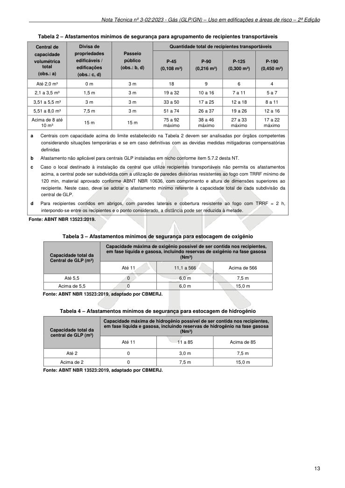

Tabela 2 - Afastamentos mínimos de segurança para agrupamento de recipientes transportáveis

Fonte: ABNT NBR 13523:2019.

Tabela 3 - Afastamentos mínimos de segurança para estocagem de oxigênio

Fonte: ABNT NBR 13523:2019, adaptado por CBMERJ.

Tabela 4 - Afastamentos mínimos de segurança para estocagem de hidrogênio

Fonte: ABNT NBR 13523:2019, adaptado por CBMERJ.

### Tabelas extraídas (bruto, não usar para citação)
#### Tabela 1 da página

|  | Central de |  |  | Divisa de |  | Passeio público (obs.: b, d) |  | Quantidade total de recipientes transportáveis |  |  |  |  |
| --- | --- | --- | --- | --- | --- | --- | --- | --- | --- | --- | --- | --- |
|  | capacidade |  |  | propriedades |  |  | P-45 (0,108 m³) |  | P-90 (0,216 m³) | P-125 (0,300 m³) | P-190 (0,450 m³) |  |
|  | volumétrica |  |  | edificáveis / |  |  |  |  |  |  |  |  |
|  | total |  |  | edificações |  |  |  |  |  |  |  |  |
|  | (obs.: a) |  |  | (obs.: c, d) |  |  |  |  |  |  |  |  |
| Até 2,0 m³ |  |  | 0 m |  |  | 3 m | 18 |  | 9 | 6 | 4 |  |
| 2,1 a 3,5 m³ |  |  | 1,5 m |  |  | 3 m | 19 a 32 |  | 10 a 16 | 7 a 11 | 5 a 7 |  |
| 3,51 a 5,5 m³ |  |  | 3 m |  |  | 3 m | 33 a 50 |  | 17 a 25 | 12 a 18 | 8 a 11 |  |
| 5,51 a 8,0 m³ |  |  | 7,5 m |  |  | 3 m | 51 a 74 |  | 26 a 37 | 19 a 26 | 12 a 16 |  |
| Acima de 8 até 10 m³ |  |  | 15 m |  |  | 15 m | 75 a 92 máximo |  | 38 a 46 máximo | 27 a 33 máximo | 17 a 22 máximo |  |
| a Centrais com capacidade acima do limite estabelecido na Tabela 2 devem ser analisadas por órgãos competentes considerando situações temporárias e se em caso definitivas com as devidas medidas mitigadoras compensatórias definidas b Afastamento não aplicável para centrais GLP instaladas em nicho conforme item 5.7.2 desta NT. c Caso o local destinado à instalação da central que utilize recipientes transportáveis não permita os afastamentos acima, a central pode ser subdividida com a utilização de paredes divisórias resistentes ao fogo com TRRF mínimo de 120 min, material aprovado conforme ABNT NBR 10636, com comprimento e altura de dimensões superiores ao recipiente. Neste caso, deve se adotar o afastamento mínimo referente à capacidade total de cada subdivisão da central de GLP. d Para recipientes contidos em abrigos, com paredes laterais e cobertura resistente ao fogo com TRRF = 2 h, interpondo-se entre os recipientes e o ponto considerado, a distância pode ser reduzida à metade. |  |  |  |  |  |  |  |  |  |  |  |  |

#### Tabela 2 da página

| Capacidade total da Central de GLP (m³) |  | Capacidade máxima de oxigênio possível de ser contida nos recipientes, |  |  |  |
| --- | --- | --- | --- | --- | --- |
|  |  | em fase líquida e gasosa, incluindo reservas de oxigênio na fase gasosa |  |  |  |
|  |  | (Nm³) |  |  |  |
|  | Até 11 |  | 11,1 a 566 | Acima de 566 |  |
| Até 5,5 | 0 |  | 6,0 m | 7,5 m |  |
| Acima de 5,5 | 0 |  | 6,0 m | 15,0 m |  |

#### Tabela 3 da página

| Capacidade total da central de GLP (m³) |  | Capacidade máxima de hidrogênio possível de ser contida nos recipientes, |  |  |  |
| --- | --- | --- | --- | --- | --- |
|  |  | em fase líquida e gasosa, incluindo reservas de hidrogênio na fase gasosa |  |  |  |
|  |  | (Nm³) |  |  |  |
|  | Até 11 |  | 11 a 85 | Acima de 85 |  |
| Até 2 | 0 |  | 3,0 m | 7,5 m |  |
| Acima de 2 | 0 |  | 7,5 m | 15,0 m |  |

---

## Página 14

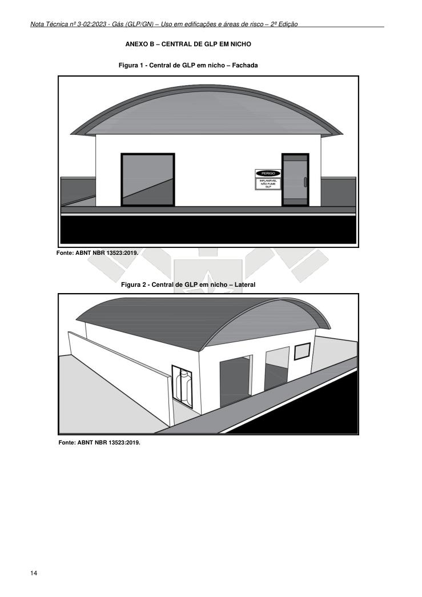

### ANEXO B - CENTRAL DE GLP EM NICHO

Figura 1 - Central de GLP em nicho - Fachada

Fonte: ABNT NBR 13523:2019.

Figura 2 - Central de GLP em nicho - Lateral

Fonte: ABNT NBR 13523:2019.

---

## Página 15

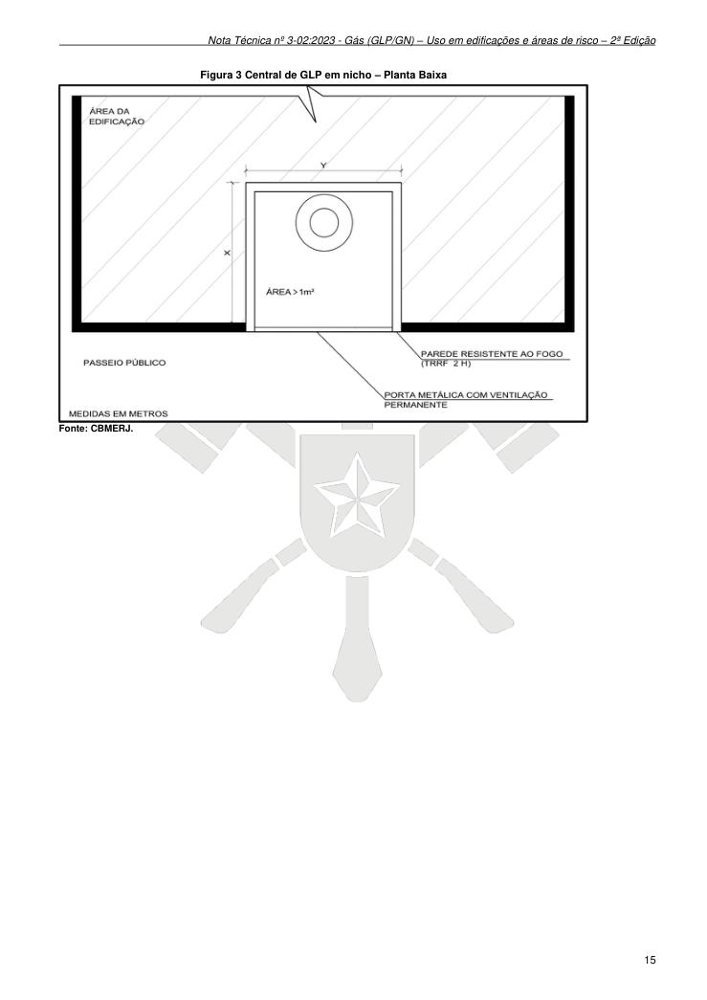

Figura 3 Central de GLP em nicho - Planta Baixa

Fonte: CBMERJ.
