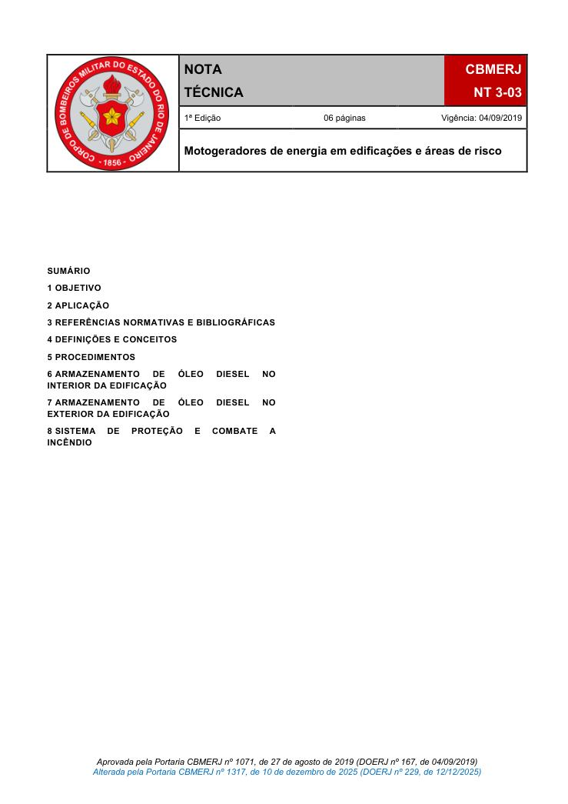
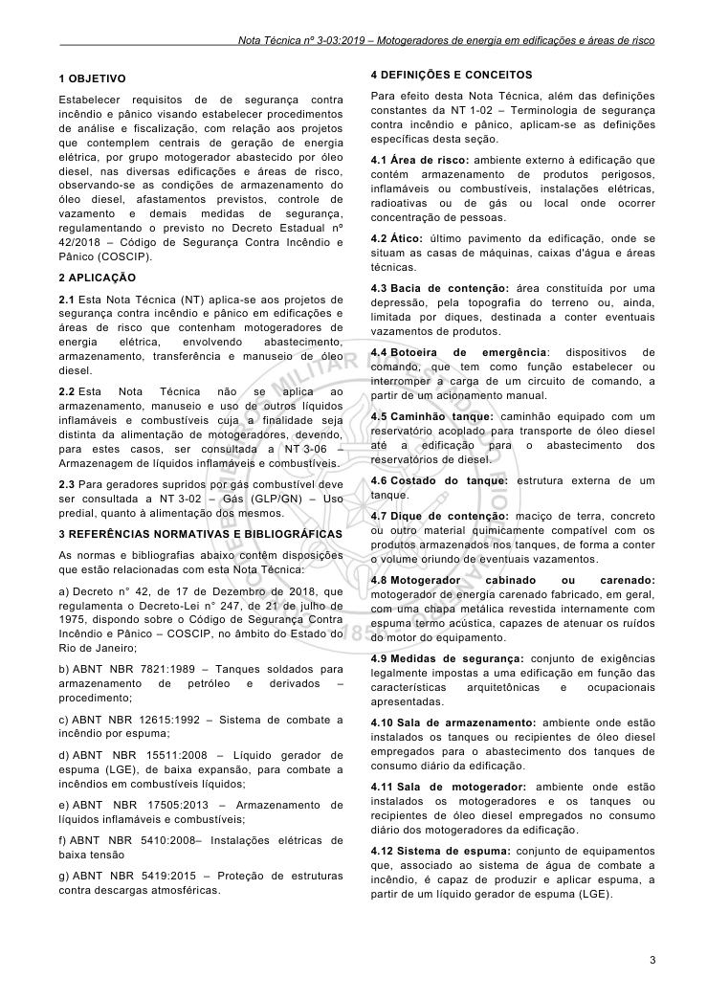
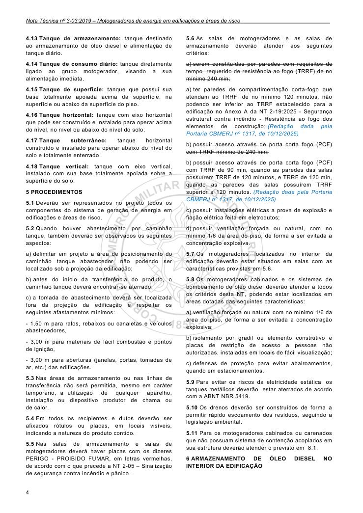
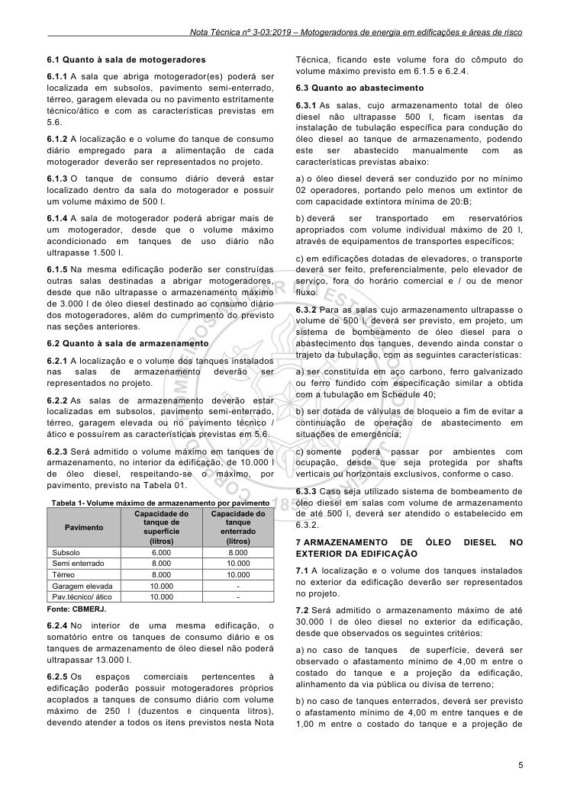
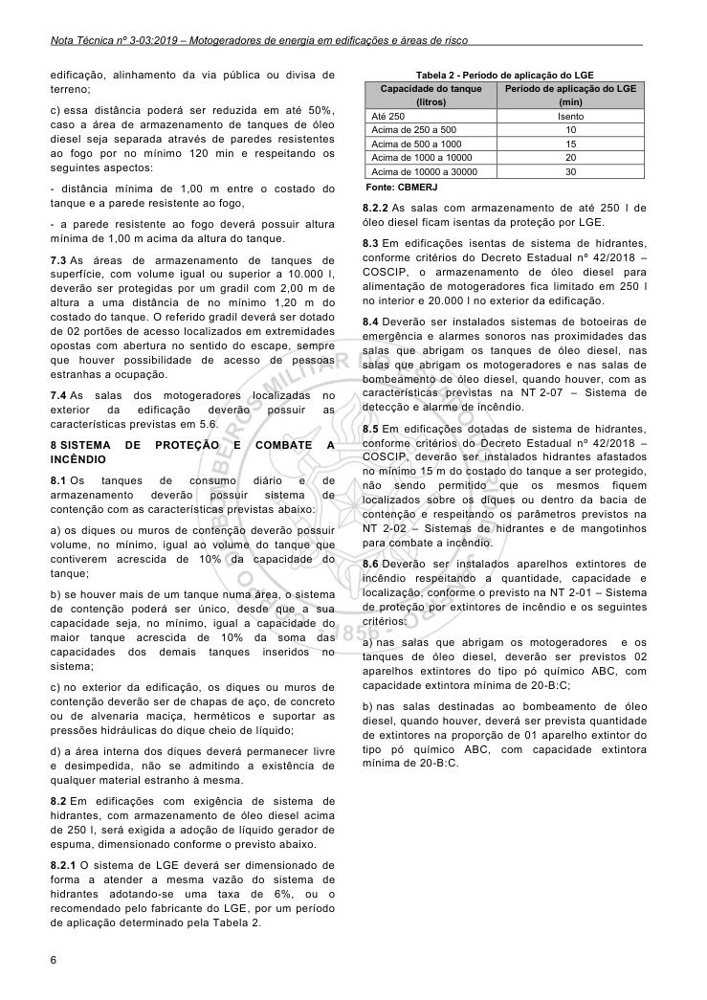

# NT 3-03 - Motogeradores de energia em edificações e áreas de risco

> Conversão integral para consulta computacional. A numeração de página do PDF foi preservada. Quando houver tabela complexa, símbolo ou desenho, conferir também a representação visual indicada e o PDF oficial.

## Sumário por página

- [Página 1](#pagina-1)
- [Página 2](#pagina-2)
- [Página 3](#pagina-3)
- [Página 4](#pagina-4)
- [Página 5](#pagina-5)
- [Página 6](#pagina-6)

---

## Página 1

### SUMÁRIO

### 1 OBJETIVO

### 2 APLICAÇÃO

### 3 REFERÊNCIAS NORMATIVAS E BIBLIOGRÁFICAS

### 4 DEFINIÇÕES E CONCEITOS

### 5 PROCEDIMENTOS

### 6 ARMAZENAMENTO DE ÓLEO DIESEL NO INTERIOR DA EDIFICAÇÃO

### 7 ARMAZENAMENTO DE ÓLEO DIESEL NO EXTERIOR DA EDIFICAÇÃO

### 8 SISTEMA DE PROTEÇÃO E COMBATE A INCÊNDIO

Aprovada pela Portaria CBMERJ nº 1071, de 27 de agosto de 2019 (DOERJ nº 167, de 04/09/2019) Alterada pela Portaria CBMERJ nº 1317, de 10 de dezembro de 2025 (DOERJ nº 229, de 12/12/2025)

### Tabelas extraídas

#### Tabela 1 da página

|  | NOTA TÉCNICA |  | CBMERJ |  |
| --- | --- | --- | --- | --- |
|  |  |  | NT 3-03 |  |
|  | 1ª Edição 06 páginas Vigência: 04/09/2019 |  |  |  |
|  | Motogeradores de energia em edificações e áreas de risco |  |  |  |

---

## Página 2

Corpo de Bombeiros Militar do Estado do Rio de Janeiro CBMERJ Praça da República, nº 45, Centro, Rio de Janeiro - RJ. CEP: 20.211-350. www.cbmerj.rj.gov.br http://www.cbmerj.rj.gov.br/notas-tecnicas

---

## Página 3

### 1 OBJETIVO

Estabelecer requisitos de de segurança contra incêndio e pânico visando estabelecer procedimentos de análise e fiscalização, com relação aos projetos que contemplem centrais de geração de energia elétrica, por grupo motogerador abastecido por óleo diesel, nas diversas edificações e áreas de risco, observando-se as condições de armazenamento do óleo diesel, afastamentos previstos, controle de vazamento e demais medidas de segurança, regulamentando o previsto no Decreto Estadual nº 42/2018 - Código de Segurança Contra Incêndio e Pânico (COSCIP).

### 2 APLICAÇÃO

2.1 Esta Nota Técnica (NT) aplica-se aos projetos de segurança contra incêndio e pânico em edificações e áreas de risco que contenham motogeradores de energia elétrica, envolvendo abastecimento, armazenamento, transferência e manuseio de óleo diesel.

2.2 Esta Nota Técnica não se aplica ao armazenamento, manuseio e uso de outros líquidos inflamáveis e combustíveis cuja a finalidade seja distinta da alimentação de motogeradores, devendo, para estes casos, ser consultada a NT 3-06 - Armazenagem de líquidos inflamáveis e combustíveis.

2.3 Para geradores supridos por gás combustível deve ser consultada a NT 3-02 - Gás (GLP/GN) - Uso predial, quanto à alimentação dos mesmos.

### 3 REFERÊNCIAS NORMATIVAS E BIBLIOGRÁFICAS

As normas e bibliografias abaixo contêm disposições que estão relacionadas com esta Nota Técnica:

a) Decreto n° 42, de 17 de Dezembro de 2018, que regulamenta o Decreto-Lei n° 247, de 21 de julho de 1975, dispondo sobre o Código de Segurança Contra Incêndio e Pânico - COSCIP, no âmbito do Estado do Rio de Janeiro;

b) ABNT NBR 7821:1989 - Tanques soldados para armazenamento de petróleo e derivados - procedimento;

c) ABNT NBR 12615:1992 - Sistema de combate a incêndio por espuma;

d) ABNT NBR 15511:2008 - Líquido gerador de espuma (LGE), de baixa expansão, para combate a incêndios em combustíveis líquidos;

e) ABNT NBR 17505:2013 - Armazenamento de líquidos inflamáveis e combustíveis;

f) ABNT NBR 5410:2008- Instalações elétricas de baixa tensão

g) ABNT NBR 5419:2015 - Proteção de estruturas contra descargas atmosféricas.

### 4 DEFINIÇÕES E CONCEITOS

Para efeito desta Nota Técnica, além das definições constantes da NT 1-02 - Terminologia de segurança contra incêndio e pânico, aplicam-se as definições específicas desta seção.

4.1 Área de risco: ambiente externo à edificação que contém armazenamento de produtos perigosos, inflamáveis ou combustíveis, instalações elétricas, radioativas ou de gás ou local onde ocorrer concentração de pessoas.

4.2 Ático: último pavimento da edificação, onde se situam as casas de máquinas, caixas d'água e áreas técnicas.

4.3 Bacia de contenção: área constituída por uma depressão, pela topografia do terreno ou, ainda, limitada por diques, destinada a conter eventuais vazamentos de produtos.

4.4 Botoeira de emergência: dispositivos de comando, que tem como função estabelecer ou interromper a carga de um circuito de comando, a partir de um acionamento manual.

4.5 Caminhão tanque: caminhão equipado com um reservatório acoplado para transporte de óleo diesel até a edificação para o abastecimento dos reservatórios de diesel.

4.6 Costado do tanque: estrutura externa de um tanque.

4.7 Dique de contenção: maciço de terra, concreto ou outro material quimicamente compatível com os produtos armazenados nos tanques, de forma a conter o volume oriundo de eventuais vazamentos.

4.8 Motogerador cabinado ou carenado: motogerador de energia carenado fabricado, em geral, com uma chapa metálica revestida internamente com espuma termo acústica, capazes de atenuar os ruídos do motor do equipamento.

4.9 Medidas de segurança: conjunto de exigências legalmente impostas a uma edificação em função das características arquitetônicas e ocupacionais apresentadas.

4.10 Sala de armazenamento: ambiente onde estão instalados os tanques ou recipientes de óleo diesel empregados para o abastecimento dos tanques de consumo diário da edificação.

4.11 Sala de motogerador: ambiente onde estão instalados os motogeradores e os tanques ou recipientes de óleo diesel empregados no consumo diário dos motogeradores da edificação.

4.12 Sistema de espuma: conjunto de equipamentos que, associado ao sistema de água de combate a incêndio, é capaz de produzir e aplicar espuma, a partir de um líquido gerador de espuma (LGE).

---

## Página 4

4.13 Tanque de armazenamento: tanque destinado ao armazenamento de óleo diesel e alimentação de tanque diário.

4.14 Tanque de consumo diário: tanque diretamente ligado ao grupo motogerador, visando a sua alimentação imediata.

4.15 Tanque de superfície: tanque que possui sua base totalmente apoiada acima da superfície, na superfície ou abaixo da superfície do piso.

4.16 Tanque horizontal: tanque com eixo horizontal que pode ser construído e instalado para operar acima do nível, no nível ou abaixo do nível do solo.

4.17 Tanque subterrâneo: tanque horizontal construído e instalado para operar abaixo do nível do solo e totalmente enterrado.

4.18 Tanque vertical: tanque com eixo vertical, instalado com sua base totalmente apoiada sobre a superfície do solo.

### 5 PROCEDIMENTOS

5.1 Deverão ser representados no projeto todos os componentes do sistema de geração de energia em edificações e áreas de risco.

5.2 Quando houver abastecimento por caminhão tanque, também deverão ser observados os seguintes aspectos:

a) delimitar em projeto a área de posicionamento do caminhão tanque abastecedor, não podendo ser localizado sob a projeção da edificação;

b) antes do início da transferência do produto, o caminhão tanque deverá encontrar-se aterrado;

c) a tomada de abastecimento deverá ser localizada fora da projeção da edificação e respeitar os seguintes afastamentos mínimos:

- 1,50 m para ralos, rebaixos ou canaletas e veículos abastecedores,

- 3,00 m para materiais de fácil combustão e pontos de ignição,

- 3,00 m para aberturas (janelas, portas, tomadas de ar, etc.) das edificações.

5.3 Nas áreas de armazenamento ou nas linhas de transferência não será permitida, mesmo em caráter temporário, a utilização de qualquer aparelho, instalação ou dispositivo produtor de chama ou de calor.

5.4 Em todos os recipientes e dutos deverão ser afixados rótulos ou placas, em locais visíveis, indicando a natureza do produto contido.

5.5 Nas salas de armazenamento e salas de motogeradores deverá haver placas com os dizeres PERIGO - PROIBIDO FUMAR, em letras vermelhas, de acordo com o que precede a NT 2-05 - Sinalização de segurança contra incêndio e pânico.

5.6 As salas de motogeradores e as salas de armazenamento deverão atender aos seguintes critérios:

a) serem constituídas por paredes com requisitos de tempo requerido de resistência ao fogo (TRRF) de no mínimo 240 min;

a) ter paredes de compartimentação corta-fogo que atendam ao TRRF, de no mínimo 120 minutos, não podendo ser inferior ao TRRF estabelecido para a edificação no Anexo A da NT 2-19:2025 - Segurança estrutural contra incêndio - Resistência ao fogo dos elementos de construção; (Redação dada pela Portaria CBMERJ nº 1317, de 10/12/2025)

b) possuir acesso através de porta corta fogo (PCF) com TRRF mínimo de 240 min;

b) possuir acesso através de porta corta fogo (PCF) com TRRF de 90 min, quando as paredes das salas possuírem TRRF de 120 minutos, e TRRF de 120 min, quando as paredes das salas possuírem TRRF superior a 120 minutos. (Redação dada pela Portaria CBMERJ nº 1317, de 10/12/2025)

c) possuir instalações elétricas a prova de explosão e fiação elétrica feita em eletrodutos;

d) possuir ventilação forçada ou natural, com no mínimo 1/6 da área do piso, de forma a ser evitada a concentração explosiva.

5.7 Os motogeradores localizados no interior da edificação deverão estar situados em salas com as características previstas em 5.6.

5.8 Os motogeradores cabinados e os sistemas de bombeamento de óleo diesel deverão atender a todos os critérios desta NT, podendo estar localizados em áreas dotadas das seguintes características:

a) ventilação forçada ou natural com no mínimo 1/6 da área do piso, de forma a ser evitada a concentração explosiva;

b) isolamento por gradil ou elemento construtivo e placas de restrição de acesso a pessoas não autorizadas, instaladas em locais de fácil visualização;

c) defensas de proteção para evitar abalroamentos, quando em estacionamentos.

5.9 Para evitar os riscos da eletricidade estática, os tanques metálicos deverão estar aterrados de acordo com a ABNT NBR 5419.

5.10 Os drenos deverão ser construídos de forma a permitir rápido escoamento dos resíduos, seguindo a legislação ambiental.

5.11 Para os motogeradores cabinados ou carenados que não possuam sistema de contenção acoplados em sua estrutura deverão atender o previsto em 8.1.

### 6 ARMAZENAMENTO DE ÓLEO DIESEL NO INTERIOR DA EDIFICAÇÃO

---

## Página 5

6.1 Quanto à sala de motogeradores

6.1.1 A sala que abriga motogerador(es) poderá ser localizada em subsolos, pavimento semi-enterrado, térreo, garagem elevada ou no pavimento estritamente técnico/ático e com as características previstas em 5.6.

6.1.2 A localização e o volume do tanque de consumo diário empregado para a alimentação de cada motogerador deverão ser representados no projeto.

6.1.3 O tanque de consumo diário deverá estar localizado dentro da sala do motogerador e possuir um volume máximo de 500 l.

6.1.4 A sala de motogerador poderá abrigar mais de um motogerador, desde que o volume máximo acondicionado em tanques de uso diário não ultrapasse 1.500 l.

6.1.5 Na mesma edificação poderão ser construídas outras salas destinadas a abrigar motogeradores, desde que não ultrapasse o armazenamento máximo de 3.000 l de óleo diesel destinado ao consumo diário dos motogeradores, além do cumprimento do previsto nas seções anteriores.

6.2 Quanto à sala de armazenamento

6.2.1 A localização e o volume dos tanques instalados nas salas de armazenamento deverão ser representados no projeto.

6.2.2 As salas de armazenamento deverão estar localizadas em subsolos, pavimento semi-enterrado, térreo, garagem elevada ou no pavimento técnico / ático e possuírem as características previstas em 5.6.

6.2.3 Será admitido o volume máximo em tanques de armazenamento, no interior da edificação, de 10.000 l de óleo diesel, respeitando-se o máximo, por pavimento, previsto na Tabela 01.

Tabela 1- Volume máximo de armazenamento por pavimento

Fonte: CBMERJ.

6.2.4 No interior de uma mesma edificação, o somatório entre os tanques de consumo diário e os tanques de armazenamento de óleo diesel não poderá ultrapassar 13.000 l.

6.2.5 Os espaços comerciais pertencentes à edificação poderão possuir motogeradores próprios acoplados a tanques de consumo diário com volume máximo de 250 l (duzentos e cinquenta litros), devendo atender a todos os itens previstos nesta Nota

Técnica, ficando este volume fora do cômputo do volume máximo previsto em 6.1.5 e 6.2.4.

6.3 Quanto ao abastecimento

6.3.1 As salas, cujo armazenamento total de óleo diesel não ultrapasse 500 l, ficam isentas da instalação de tubulação específica para condução do óleo diesel ao tanque de armazenamento, podendo este ser abastecido manualmente com as características previstas abaixo:

a) o óleo diesel deverá ser conduzido por no mínimo 02 operadores, portando pelo menos um extintor de com capacidade extintora mínima de 20:B;

b) deverá ser transportado em reservatórios apropriados com volume individual máximo de 20 l, através de equipamentos de transportes específicos;

c) em edificações dotadas de elevadores, o transporte deverá ser feito, preferencialmente, pelo elevador de serviço, fora do horário comercial e / ou de menor fluxo.

6.3.2 Para as salas cujo armazenamento ultrapasse o volume de 500 l, deverá ser previsto, em projeto, um sistema de bombeamento de óleo diesel para o abastecimento dos tanques, devendo ainda constar o trajeto da tubulação, com as seguintes características:

a) ser constituída em aço carbono, ferro galvanizado ou ferro fundido com especificação similar a obtida com a tubulação em Schedule 40;

b) ser dotada de válvulas de bloqueio a fim de evitar a continuação de operação de abastecimento em situações de emergência;

c) somente poderá passar por ambientes com ocupação, desde que seja protegida por shafts verticais ou horizontais exclusivos, conforme o caso.

6.3.3 Caso seja utilizado sistema de bombeamento de óleo diesel em salas com volume de armazenamento de até 500 l, deverá ser atendido o estabelecido em 6.3.2.

### 7 ARMAZENAMENTO DE ÓLEO DIESEL NO EXTERIOR DA EDIFICAÇÃO

7.1 A localização e o volume dos tanques instalados no exterior da edificação deverão ser representados no projeto.

7.2 Será admitido o armazenamento máximo de até 30.000 l de óleo diesel no exterior da edificação, desde que observados os seguintes critérios:

a) no caso de tanques de superfície, deverá ser observado o afastamento mínimo de 4,00 m entre o costado do tanque e a projeção da edificação, alinhamento da via pública ou divisa de terreno;

b) no caso de tanques enterrados, deverá ser previsto o afastamento mínimo de 4,00 m entre tanques e de 1,00 m entre o costado do tanque e a projeção de

### Tabelas extraídas

#### Tabela 1 da página

| Pavimento |  | Capacidade do |  |  | Capacidade do |  |
| --- | --- | --- | --- | --- | --- | --- |
|  |  | tanque de |  |  | tanque |  |
|  |  | superfície |  |  | enterrado |  |
|  |  | (litros) |  |  | (litros) |  |
| Subsolo | 6.000 |  |  | 8.000 |  |  |
| Semi enterrado | 8.000 |  |  | 10.000 |  |  |
| Térreo | 8.000 |  |  | 10.000 |  |  |
| Garagem elevada | 10.000 |  |  | - |  |  |
| Pav.técnico/ ático | 10.000 |  |  | - |  |  |

---

## Página 6

edificação, alinhamento da via pública ou divisa de terreno;

c) essa distância poderá ser reduzida em até 50%, caso a área de armazenamento de tanques de óleo diesel seja separada através de paredes resistentes ao fogo por no mínimo 120 min e respeitando os seguintes aspectos:

- distância mínima de 1,00 m entre o costado do tanque e a parede resistente ao fogo,

- a parede resistente ao fogo deverá possuir altura mínima de 1,00 m acima da altura do tanque.

7.3 As áreas de armazenamento de tanques de superfície, com volume igual ou superior a 10.000 l, deverão ser protegidas por um gradil com 2,00 m de altura a uma distância de no mínimo 1,20 m do costado do tanque. O referido gradil deverá ser dotado de 02 portões de acesso localizados em extremidades opostas com abertura no sentido do escape, sempre que houver possibilidade de acesso de pessoas estranhas a ocupação.

7.4 As salas dos motogeradores localizadas no exterior da edificação deverão possuir as características previstas em 5.6.

### 8 SISTEMA DE PROTEÇÃO E COMBATE A INCÊNDIO

8.1 Os tanques de consumo diário e de armazenamento deverão possuir sistema de contenção com as características previstas abaixo:

a) os diques ou muros de contenção deverão possuir volume, no mínimo, igual ao volume do tanque que contiverem acrescida de 10% da capacidade do tanque;

b) se houver mais de um tanque numa área, o sistema de contenção poderá ser único, desde que a sua capacidade seja, no mínimo, igual a capacidade do maior tanque acrescida de 10% da soma das capacidades dos demais tanques inseridos no sistema;

c) no exterior da edificação, os diques ou muros de contenção deverão ser de chapas de aço, de concreto ou de alvenaria maciça, herméticos e suportar as pressões hidráulicas do dique cheio de líquido;

d) a área interna dos diques deverá permanecer livre e desimpedida, não se admitindo a existência de qualquer material estranho à mesma.

8.2 Em edificações com exigência de sistema de hidrantes, com armazenamento de óleo diesel acima de 250 l, será exigida a adoção de líquido gerador de espuma, dimensionado conforme o previsto abaixo.

8.2.1 O sistema de LGE deverá ser dimensionado de forma a atender a mesma vazão do sistema de hidrantes adotando-se uma taxa de 6%, ou o recomendado pelo fabricante do LGE, por um período de aplicação determinado pela Tabela 2.

Fonte: CBMERJ

8.2.2 As salas com armazenamento de até 250 l de óleo diesel ficam isentas da proteção por LGE.

8.3 Em edificações isentas de sistema de hidrantes, conforme critérios do Decreto Estadual nº 42/2018 - COSCIP, o armazenamento de óleo diesel para alimentação de motogeradores fica limitado em 250 l no interior e 20.000 l no exterior da edificação.

8.4 Deverão ser instalados sistemas de botoeiras de emergência e alarmes sonoros nas proximidades das salas que abrigam os tanques de óleo diesel, nas salas que abrigam os motogeradores e nas salas de bombeamento de óleo diesel, quando houver, com as características previstas na NT 2-07 - Sistema de detecção e alarme de incêndio.

8.5 Em edificações dotadas de sistema de hidrantes, conforme critérios do Decreto Estadual nº 42/2018 - COSCIP, deverão ser instalados hidrantes afastados no mínimo 15 m do costado do tanque a ser protegido, não sendo permitido que os mesmos fiquem localizados sobre os diques ou dentro da bacia de contenção e respeitando os parâmetros previstos na NT 2-02 - Sistemas de hidrantes e de mangotinhos para combate a incêndio.

8.6 Deverão ser instalados aparelhos extintores de incêndio respeitando a quantidade, capacidade e localização, conforme o previsto na NT 2-01 - Sistema de proteção por extintores de incêndio e os seguintes critérios:

a) nas salas que abrigam os motogeradores e os tanques de óleo diesel, deverão ser previstos 02 aparelhos extintores do tipo pó químico ABC, com capacidade extintora mínima de 20-B:C;

b) nas salas destinadas ao bombeamento de óleo diesel, quando houver, deverá ser prevista quantidade de extintores na proporção de 01 aparelho extintor do tipo pó químico ABC, com capacidade extintora mínima de 20-B:C.

### Tabelas extraídas

#### Tabela 1 da página

|  | Capacidade do tanque |  |  | Período de aplicação do LGE |  |
| --- | --- | --- | --- | --- | --- |
|  | (litros) |  |  | (min) |  |
| Até 250 |  |  | Isento |  |  |
| Acima de 250 a 500 |  |  | 10 |  |  |
| Acima de 500 a 1000 |  |  | 15 |  |  |
| Acima de 1000 a 10000 |  |  | 20 |  |  |
| Acima de 10000 a 30000 |  |  | 30 |  |  |
