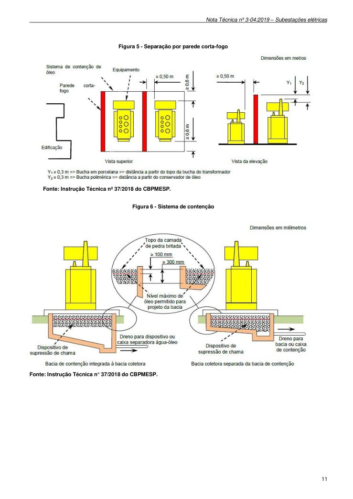

# NT 3-04 - Subestações elétricas

> Conversão integral para consulta computacional. A numeração de página do PDF foi preservada. Quando houver tabela complexa, símbolo ou desenho, conferir também a representação visual indicada e o PDF oficial.

## Sumário por página

- [Página 1](#pagina-1)
- [Página 2](#pagina-2)
- [Página 3](#pagina-3)
- [Página 4](#pagina-4)
- [Página 5](#pagina-5)
- [Página 6](#pagina-6)
- [Página 7](#pagina-7)
- [Página 8](#pagina-8)
- [Página 9](#pagina-9)
- [Página 10](#pagina-10)
- [Página 11](#pagina-11)

---

## Página 1

Aprovada pela Portaria CBMERJ nº 1071, de 27 de agosto de 2019.

### SUMÁRIO

### 1 OBJETIVO

### 2 APLICAÇÃO

### 3 REFERÊNCIAS NORMATIVAS E BIBLIOGRÁFICAS

### 4 DEFINIÇÕES E CONCEITOS

### 5 PROCEDIMENTOS

### ANEXO

A - Modelo de subestação elétrica, figuras, conformação e afastamentos

### Tabelas extraídas (bruto, não usar para citação)
#### Tabela 1 da página

|  |  |  |  | NOTA |  |  | CBMERJ |  |
| --- | --- | --- | --- | --- | --- | --- | --- | --- |
|  |  |  |  | TÉCNICA |  |  | NT 3-04 |  |
|  |  |  | Versão: 01 11 páginas Vigência: 04/09/2019 |  |  |  |  |  |
|  |  |  | Subestações elétricas |  |  |  |  |  |

---

## Página 2

> Página sem texto extraível suficiente; consultar a representação visual ou o PDF oficial.

---

## Página 3

### 1 OBJETIVO

Estabelecer requisitos contra incêndio em subestações elétricas, regulamentando o previsto no Decreto Estadual nº 42/2018 - Código de Segurança Contra Incêndio e Pânico - COSCIP, no âmbito do Estado do Rio de Janeiro.

### 2 APLICAÇÃO

Esta Nota Técnica (NT) aplica-se a todos os tipos de instalações onde existem subestações elétricas refrigeradas a óleo ou a seco.

### 3 REFERÊNCIAS NORMATIVAS E BIBLIOGRÁFICAS

As normas e bibliografias abaixo contêm disposições que estão relacionadas com esta Nota Técnica:

a) Decreto nº 42, de 17 de Dezembro de 2018, que regulamenta o Decreto-Lei nº 247, de 21 de julho de 1975, dispondo sobre o Código de Segurança Contra Incêndio e Pânico - COSCIP, no âmbito do Estado do Rio de Janeiro;

b) Instrução técnica N° 37/2018 do Corpo de Bombeiros Militar do Estado de São Paulo;

c) ABNT NBR 9442:1988 - Materiais de construção - Determinação do índice de propagação superficial de chama pelo método do painel radiante - Método de ensaio;

d) ABNT NBR 10898:2013 - Sistema de iluminação de emergência - Procedimento;

e) ABNT NBR 11711:2003 - Portas e vedadores cortafogo com núcleo de madeira para isolamento de riscos em ambientes comerciais e industriais;

f) ABNT NBR 12693:2013 - Sistemas de proteção por extintores de incêndio - Procedimento;

g) ABNT NBR 17240:2010 - Sistemas de detecção e alarme de incêndio - Projeto, instalação, comissionamento e manutenção de sistemas de detecção e alarme de incêndio - Requisitos.

h) ABNT NBR 13231:2015 - Proteção contra incêndio em subestações elétricas.

### 4 DEFINIÇÕES E CONCEITOS

Para efeito desta Nota Técnica, além das definições constantes da NT 1-02 - Terminologia de segurança contra incêndio e pânico, aplicam-se as definições específicas desta seção.

4.1 Área útil: área de piso de um compartimento, excluindo as áreas horizontais das paredes e colunas.

4.2 Centrais de comunicação: Área destinada ao comando e controle presencial ou remoto das unidades de subestações elétricas.

4.3 Distância elétrica: distância mínima em linha reta entre partes energizadas expostas de um equipamento e partes metálicas da instalação ou entre

partes energizadas expostas de equipamentos (distância elétrica fase-terra).

4.4 Edificação ou material resistente a fogo: material de construção com propriedades de resistir à ação do fogo por determinado período de tempo, mantendo sua segurança estrutural, estanqueidade e isolamento, onde aplicável.

4.5 Parede corta-fogo: tipo de compartimentação que, sob a ação do fogo, conserva suas características de resistência mecânica, estanqueidade à propagação da chama e proporciona um isolamento térmico tal que a temperatura medida sobre a superfície não exposta não ultrapasse 140°C durante um tempo especificado.

4.6 Tempo requerido de resistência ao fogo (TRRF): tempo mínimo em minutos que um elemento estrutural deve impedir a propagação do fogo sem comprometer sua função estrutural.

4.7 Via de acesso: arruamento trafegável para aproximação e operação dos veículos e equipamentos de emergência, junto às edificações ou área de risco.

4.8 Subestação: conjunto de equipamentos usados para controlar as características e/ou a distribuição da potência elétrica, podendo apresentar várias possibilidades de projeto, o qual pode exigir dispositivos de manobra, transformação, reação, correção e/ou proteção.

4.8.1 Subestação transformadora: aquela que converte a tensão de suprimento para um nível diferente, maior ou menor, sendo designada, respectivamente, transformadora elevadora e transformadora abaixadora.

4.8.2 Subestação seccionadora de manobra ou de chaveamento: aquela que interliga circuitos de suprimento sob o mesmo nível de tensão, possibilitando a sua multiplicação. É também adotada para possibilitar o seccionamento de circuitos, permitindo sua energização em trechos sucessivos de menos comprimento.

4.8.3 Subestação transformadora e seccionadora: aquela que converte a tensão de suprimento para um nível diferente, maior ou menor, e também interliga circuitos de suprimento sob o mesmo nível de tensão, possibilitando a sua multiplicação.

4.8.4 Subestação de transição: aquela que faz a transição do circuito de alta tensão aéreo para o subterrâneo ou vice versa, possibilitando a interligação entre subestações.

4.8.5 Subestação externa ou ao tempo: aquela em que os equipamentos são instalados ao tempo e sujeitos, portanto, às condições atmosféricas desfavoráveis de temperatura, chuva, poluição, vento, etc.

4.8.6 Subestação interna ou abrigada: aquela em que os equipamentos são instalados ao abrigo do tempo, podendo tal abrigo consistir de uma edificação ou de

---

## Página 4

Código de Segurança Contra Incêndio e Pânico - Estado do Rio de Janeiro

uma câmara subterrânea. Subestações abrigadas podem consistir de cubículos metálicos, além de subestações isoladas a gás, tal como hexafluoreto de enxofre (SF6).

### 5 PROCEDIMENTOS

5.1 Requisitos construtivos para as edificações que abrigam subestação elétrica

5.1.1 As edificações que abrigam subestação elétrica devem possuir estrutura de concreto armado ou de aço protegido com alvenaria ou materiais refratários, conforme a NT 2-19 - Segurança estrutural contra incêndio - Resistência ao fogo dos elementos da construção.

5.1.2 Teto e piso em laje de concreto armado maciço ou pré-fabricado.

5.1.3 Paredes de alvenaria ou em concreto armado com acabamento em material incombustível.

5.1.4 Cobertura, forro de teto e pisos falsos e respectivas estruturas, em materiais incombustíveis.

5.1.5 Acabamentos internos devem ser previstos de materiais classe B, definidos na ABNT NBR 9442.

5.1.6 Requisitos para as instalações elétricas auxiliares que devem estar de acordo com as ABNT NBR 5410, ABNT NBR 14039, ABNT NBR IEC/TS 60079-39.

5.1.7 Requisitos para as instalações elétricas devem estar de acordo com a ABNT NBR 13231.

5.2 Requisitos de projeto para as edificações que abrigam subestação elétrica.

5.2.1 Salas, galerias, canaletas, cabos e túneis de cabos

5.2.1.1 O posicionamento dos cabos deve ser feito de maneira uniforme e ordenada, evitando-se cruzamento e superposições.

5.2.1.2 As bandejas e suportes devem ser de material incombustível, protegido contra a umidade.

5.2.1.3 Os cabos de força e os cabos de controle devem ser fisicamente separados e ter sua função, numeração e tensão identificadas.

5.2.1.4 O pé direito das salas, galerias e túneis deve ser de, no mínimo 2 m, considerando entre piso e o teto. Deverá ter a largura mínima de 1 m. O arranjo físico deve permitir o acesso de um homem com aparelho de respiração autônoma, a desocupação imediata e a extinção de incêndio com a utilização de extintores portáteis.

5.2.1.5 Deve ser prevista ventilação natural complementada por ventilação forçada, quando necessário, em toda instalação de subestação elétrica abrigada, num percentual mínimo de 10% de sua área útil.

5.2.1.6 Os quadros de supervisão e comando dos sistemas fixos de proteção contra incêndio da

subestação devem estar localizados na sala de controle ou em área de supervisão contínua. A sinalização, luminosa e sonora, de funcionamento dos quadros deve ser diferente de outras existentes no local.

5.2.1.7 A vedação dos cabos contra risco de incêndio ou alastramento de chamas pode ser conforme exemplificado nas Figuras 1, 2, e 3.

5.2.2 Transformadores e reatores de potência

5.2.2.1 Os transformadores e reatores de potência podem ser instalados, interna ou externamente às edificações, e devem ser separados fisicamente por barreiras de proteção contra propagação de incêndio, quando necessário, conforme Figura 5.

5.2.2.2 A passagem de estruturas sobre transformadores ou reatores de potência deve se restringir às essenciais, ou seja, aquelas referentes as suas próprias ligações.

5.2.2.3 As paredes tipos corta-fogos não devem ser utilizadas como meio de suporte de equipamentos, tais como: barramentos, isoladores, suportes, pararaios e outros.

5.2.2.4 Locais ou áreas específicas devem ser previstos para instalação dos dispositivos de comando e acionamento dos sistemas fixos de proteção contra incêndio.

5.3 Requisitos básicos de proteção contra incêndio para as edificações que abrigam subestação elétrica.

5.3.1 Extintores de incêndios

5.3.1.1 Os aparelhos extintores devem ser selecionados, conforme segue:

a) Os conjuntos de transformadores, reatores e reguladores de tensão, bem como unidades individuais destes equipamentos, devem ser protegidos com extintores de incêndio de pó químico seco ou CO2;

b) Quando protegida por extintor sobrerrodas, a capacidade será de no mínimo 10-B:C quando a carga extintora for de (CO2); 80-B:C quando a carga extintora for de carga de pó BC; e 6-A:80-B:C quando a carga extintora for de pó ABC;

c) Quando protegida por extintor portátil, a capacidade será de no mínimo 5-B:C quando a carga extintora for de (CO2); 20-B:C quando a carga extintora for de carga de pó BC; e 2-A:20-B:C quando a carga extintora for de pó ABC;

d) A cada 250 KVA deve ser previsto uma unidade extintora conforme alínea c do 5.3.1.1, até no máximo do limite de 1.000 KVA;

e) Acima de 1.000 KVA deve ser previsto uma unidade extintora conforme alínea b do 5.3.1.1;

---

## Página 5

f) Quando existir valores de KVA não inteiros conforme os valores de referência das alíneas d e alínea e, deverá ser considerado uma unidade inteira acima da quantidade solicitada nas alíneas;

g) Os extintores devem ser instalados em locais de fácil acesso, sinalizados, abrigados contra intempéries e identificados;

h) Os extintores devem ser equipados com rodas especiais para deslocamento sobre superfícies irregulares, por exemplo, locais com brita, possuindo diâmetro e largura dimensionados para esta finalidade e carga de pó.

5.3.2 Barreiras de proteção

As barreiras de proteção devem ser instaladas para separação de riscos de propagação de chamas.

5.3.3 Parede tipo corta-fogo

5.3.3.1 A parede tipo corta-fogo deve apresentar as seguintes dimensões para transformadores e reatores de potência, conforme a Figura 5.

a) Para transformadores, a altura deve ser de 0,30 m acima do topo do tanque conservador de óleo;

b) Para reatores de potência, a altura deve ser de 0,60 m acima do topo do tanque;

c) O comprimento total da parede deve, no mínimo, ultrapassar o comprimento total do equipamento protegido em 0,60 m;

d) Distância livre mínima de separação física, entre a parede e o equipamento protegido, deve ser de 0,50 m.

5.3.3.2 Para edificações e equipamentos, quando a distância livre de separação física for inferior a 8 m, devem ser considerados os seguintes critérios (ver Figura 4):

a) Que a parede sofrendo colapso estrutural, caindo parcial ou totalmente, não atinja equipamentos, edificações ou vias de trânsito de pessoas ou rotas de fuga;

b) Que a parede não permita a passagem de calor e chamas para locais próximos.

5.3.3.3 Para edificações e equipamentos, quando a distância livre de separação física for igual ou superior a 15 m, não há necessidade de separá-los, interpondo-se parede tipo corta-fogo.

5.3.3.4 Para edificações e equipamentos, quando a distância livre de separação física atender as Tabelas 1 e 2, não há necessidade de separá-los interpondo-se parede tipo corta-fogo (ver Figura 4).

5.3.3.5 Para transformadores em instalações internas, adotam-se as recomendações mínimas conforme a Tabela 3.

5.3.3.6 Sistema de contenção de líquido isolante

5.3.3.6.1 Os transformadores e reatores de potência imersos em óleo mineral isolante devem ser instalados sobre sistema de contenção de líquido isolante consistindo de bacia de captação com sistema de drenagem interligado à caixa de contenção e dispositivo separador água/óleo.

5.3.3.6.2 O fluído drenado deve ser encaminhado para sistema coletor específico, que direcione os efluentes para dispositivo separador de água-óleo, com as seguintes características:

a) permitir fácil retirada do óleo isolante drenado;

b) permitir a drenagem da água;

c) apresentar resistência à corrosão pela água e pelo óleo isolante;

d) possuir meios com proteção que possibilitem a inspeção interna; e) apresentar capacidade mínima correspondente ao volume do óleo vertido do equipamento sinistrado, acrescido do volume de água do sistema de proteção contra incêndio, se previsto, mais o volume de água pluvial da área de coleta da bacia, acrescida do volume ocupado pelo dispositivo separador de água e óleo.

5.3.3.6.3 O dispositivo separador de água e óleo deve ser previsto em área específica, separado de outras instalações e equipamentos.

5.3.3.6.4 Quando da utilização de óleo vegetal isolante que cumprem com os critérios de biodegradabilidade e toxicidade da ABNT NBR 13231, os transformadores e/ou reatores de potência, sob a aprovação, podem dispensar o uso somente da bacia de captação com sistema de drenagem interligado à caixa de contenção (separadora de água/óleo) e utilizar sistemas de contenção através de diques.

5.3.4 Sistema de detecção e alarme

Todas as edificações que abrigam subestações elétricas em seu interior devem dispor de um sistema de detecção e alarme de incêndio, que deve estar em conformidade com a NT 2-07 - Sistema de detecção e alarme de incêndio.

5.4 Exigências mínimas para cada tipo de subestação elétrica

5.4.1 Subestação transformadora externa ou ao tempo

5.4.1.1 Via de acesso para veículos de emergência, conforme NT 2-16 - Acesso de viaturas em edificações.

5.4.1.2 Barreiras de proteção que devem ser instaladas para separação de riscos de choque elétrico.

5.4.1.3 Identificação dos cabos quanto a sua voltagem e sua identificação no sistema.

5.4.1.4 Os extintores portáteis e sobrerrodas devem ser previstos conforme o item 5.3.1.

---

## Página 6

Código de Segurança Contra Incêndio e Pânico - Estado do Rio de Janeiro

5.4.1.5 A sinalização de segurança seguirá as prescrições da NT 2-05 - Sinalização de segurança contra incêndio e pânico.

5.4.1.6 Além do previsto acima, a edificação deverá obedecer às exigências conforme a Tabela 30 do Decreto Estadual nº 42/2018 - COSIP, de acordo com o seu enquadramento.

5.4.2 Subestação transformadora interna ou abrigada

5.4.2.1 Via de acesso a veículos de emergência, conforme NT 2-16 - Acesso de viaturas em edificações.

5.4.2.2 Parede corta-fogo, de acordo com 5.3.3, em transformadores, reatores de potência e reguladores de tensão.

5.4.2.3 Barreiras de proteção que devem ser instaladas para separação de riscos de choque elétrico.

5.4.2.4 Identificação dos cabos quanto a sua Voltagem e sua identificação no sistema.

5.4.2.5 Separação de transformadores, reatores de potência e reguladores de tensão, em relação a outros equipamentos e edificações, conforme Tabela 1 e 2.

5.4.2.6 Extintores portáteis e sobrerrodas devem ser previstos conforme 5.3.1.

5.4.2.7 A sinalização de segurança seguirá as prescrições da NT 2-05 - Sinalização de segurança contra incêndio e pânico.

5.4.2.8 Sistema de alarme de incêndio.

5.4.2.9 Sistema de ventilação natural.

5.4.2.10 Sistema de ventilação Mecânica forçada.

5.4.2.11 Além do previsto acima, a edificação deverá obedecer às exigências conforme a Tabela 30 do Decreto Estadual nº 42/2018 - COSIP desta NT, de acordo com o seu enquadramento.

5.4.2.12 Deverá possuir sistema de contenção para equipamentos imersos em líquido isolante, instalados internamente, quando o volume líquido isolante for igual ou superior a 400 l e ser projetado para conter 110% do volume total de óleo do maior equipamento.

5.4.3 Subestação seccionadora de manobra ou de chaveamento Externa ou ao tempo

5.4.3.1 Via de acesso a veículos de emergência, conforme NT 2-16 - Acesso de viaturas em edificações.

5.4.3.2 Barreiras de proteção que devem ser instaladas para separação de riscos de choque elétrico.

5.4.3.3 Extintores portáteis e sobrerrodas deverão ser previstos conforme 5.3.1.

5.4.3.4 A sinalização de segurança seguirá as prescrições da NT 2-05 - Sinalização de segurança contra incêndio e pânico.

5.4.3.5 Identificação dos cabos quanto a sua Voltagem e sua identificação no sistema.

5.4.4 Subestação seccionadora de manobra ou de chaveamento interna ou abrigada

5.4.4.1 Via de acesso a veículos de emergência, conforme NT 2-16 - Acesso de viaturas em edificações.

5.4.4.2 Barreiras de proteção que devem ser instaladas para separação de riscos de choque elétrico.

5.4.4.3 Extintores portáteis e sobrerrodas deverão ser previstos conforme 5.3.1.

5.4.4.4 A sinalização de segurança seguirá as prescrições da NT 2-05 - Sinalização de segurança contra incêndio e pânico.

5.4.4.5 Identificação dos cabos quanto a sua Voltagem e sua identificação no sistema.

5.4.4.6 Sistema de alarme de incêndio.

5.4.4.7 Sistema de ventilação natural.

5.4.4.8 Sistema de ventilação Mecânica forçada.

5.4.4.9 Além do previsto acima, a edificação deverá obedecer às exigências conforme a Tabela 30 do Decreto Estadual nº 42/2018 - COSIP, de acordo com o seu enquadramento.

5.4.5 Subestação Transformadora e Seccionadora Externa ou ao Tempo

5.4.5.1 Via de acesso a veículos de emergência, conforme NT 2-16 - Acesso de viaturas em edificações.

5.4.5.2 Barreiras de proteção que devem ser instaladas para separação de riscos de choque elétrico.

5.4.5.3 Extintores portáteis e sobrerrodas deverão ser previstos conforme 5.3.1.

5.4.5.4 A sinalização de segurança seguirá as prescrições da NT 2-05 - Sinalização de segurança contra incêndio e pânico.

5.4.5.5 Identificação dos cabos quanto a sua voltagem e sua identificação no sistema.

5.4.6 Subestação Transformadora e Seccionadora Interna ou Abrigada

5.4.6.1 Via de acesso a veículos de emergência, conforme NT 2-16 - Acesso de viaturas em edificações.

5.4.6.2 Paredes corta-fogo, de acordo com 5.3.3, em transformadores, reatores de potência e reguladores de tensão.

5.4.6.3 Barreiras de proteção que devem ser instaladas para separação de riscos de choque elétrico.

5.4.6.4 Extintores portáteis e sobrerrodas deverão ser previstos conforme 5.3.1.

---

## Página 7

5.4.6.5 Separação de transformadores, reatores de potência, reguladores de tensão e chaves de manobras em relação a outros equipamentos e edificações, no mínimo, a 15 m.

5.4.6.6 A sinalização de segurança seguirá as prescrições da NT 2-05 - Sinalização de segurança contra incêndio e pânico.

5.4.6.7 Identificação dos cabos quanto a sua Voltagem e sua identificação no sistema.

5.4.6.8 Sistema de alarme de incêndio.

5.4.6.9 Sistema de ventilação natural.

5.4.6.10 Sistema de ventilação Mecânica forçada

5.4.6.11 Além do previsto acima, a edificação deverá obedecer às exigências conforme a Tabela 30 do Decreto Estadual nº 42/2018 - COSIP, de acordo com o seu enquadramento.

5.4.6.12 Deverá possuir sistema de contenção para equipamentos imersos em líquido isolante, instalados internamente, quando o volume líquido isolante for igual ou superior a 400 l e ser projetado para conter 110% do volume total de óleo do maior equipamento.

5.5 Procedimentos de regularização das subestações elétricas junto ao CBMERJ

5.5.1 As subestações elétricas do tipo refrigeradas a óleo devem ser contempladas por projeto de segurança contra incêndio e pânico, tendo em vista a exigência de sistemas fixos de combate a incêndio e a capacidade de contenção do óleo isolante necessário para seu funcionamento.

5.5.2 As subestações elétricas a seco devem ser contempladas por projeto de segurança contra incêndio e pânico, caso a edificação principal adjacente à subestação elétrica tenha área maior que 900 m² e/ou altura de três ou mais pavimentos.

5.5.3 Nos casos em que a subestação estiver coberta pelo projeto de segurança contra incêndio e pânico, e a edificação possuir plano de emergência, este deverá cobrir também a subestação.

5.5.4 Nos casos em que forem previstos Casa de Máquina de Incêndio devem ser adotados os requisitos:

5.5.4.1 As casas de bombas devem ser acionadas por motores de combustão interna, com características semelhantes a de motogeradores.

5.5.4.2 Os painéis de controle e comando das bombas de incêndio devem ser independentes, situados em locais ventilados e de fácil acesso.

5.6 Centrais de Comunicação

5.6.1 As edificações destinadas a centrais de comunicação devem atender às prescrições do Decreto Estadual nº 42/2018 - (COSCIP).

---

## Página 8

### ANEXO A - EXIGÊNCIAS PARA EDIFICAÇÕES E ÁREAS DE RISCO

Tabela 1 - Distâncias mínimas de separação entre transformadores e edificações

Fonte: Instrução Técnica nº 37/2018 do CBPMESP.

Tabela 2: Distâncias mínimas de separação entre transformadores e equipamentos adjacentes

Fonte: Instrução Técnica nº 37/2018 do CBPMESP.

Tabela 3: Recomendações mínimas para transformadores em instalações internas

Fonte: Instrução Técnica nº 37/2018 do CBPMESP.

---

## Página 9

### ANEXO B - MODELO DE SUBESTAÇÃO ELÉTRICA, FIGURAS, CONFORMAÇÃO E AFASTAMENTOS

Figura 1 - Vedação em canaletas de cabos

Fonte: Instrução Técnica n° 37/2018 do CBPMESP.

Figura 2 - Vedação de abertura para passagem de cabos entre ambientes compartimentados

Fonte: Instrução Técnica nº 37/2018 do CBPMESP.

---

## Página 10

Código de Segurança Contra Incêndio e Pânico - Estado do Rio de Janeiro

Figura 3 - Exemplo de vedação de cabos posicionados em bandejas, dentro de salas, galerias ou túneis.

Fonte: Instrução Técnica nº 37/2018 do CBPMESP.

Figura 4 - Distância de separação mínima entre transformador imerso em líquido isolante instalado e edificação

Fonte: Instrução Técnica nº 37/2018 do CBPMESP.

---

## Página 11

Figura 5 - Separação por parede corta-fogo

Fonte: Instrução Técnica nº 37/2018 do CBPMESP.

Figura 6 - Sistema de contenção

Fonte: Instrução Técnica n° 37/2018 do CBPMESP.
