# NT 3-06 - Armazenagem de líquidos inflamáveis e combustíveis

> Conversão integral para consulta computacional. A numeração de página do PDF foi preservada. Quando houver tabela complexa, símbolo ou desenho, conferir também a representação visual indicada e o PDF oficial.

## Sumário por página

- [Página 1](#pagina-1)
- [Página 2](#pagina-2)
- [Página 3](#pagina-3)
- [Página 4](#pagina-4)
- [Página 5](#pagina-5)
- [Página 6](#pagina-6)
- [Página 7](#pagina-7)
- [Página 8](#pagina-8)
- [Página 9](#pagina-9)
- [Página 10](#pagina-10)
- [Página 11](#pagina-11)
- [Página 12](#pagina-12)
- [Página 13](#pagina-13)
- [Página 14](#pagina-14)
- [Página 15](#pagina-15)
- [Página 16](#pagina-16)

---

## Página 1

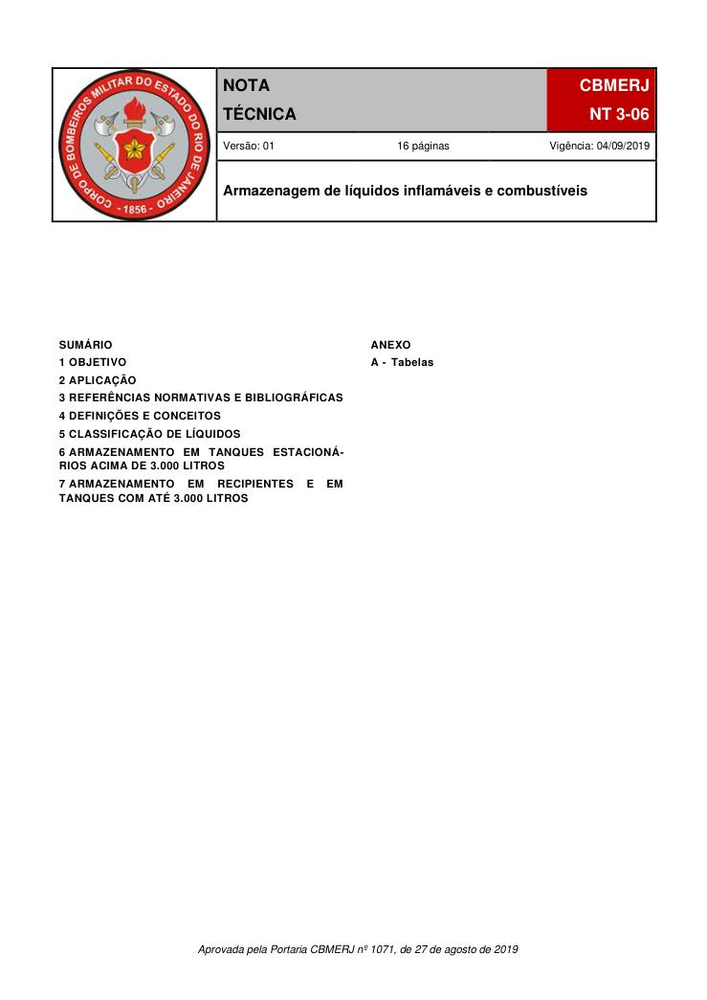

Aprovada pela Portaria CBMERJ nº 1071, de 27 de agosto de 2019

### SUMÁRIO

### 1 OBJETIVO

### 2 APLICAÇÃO

### 3 REFERÊNCIAS NORMATIVAS E BIBLIOGRÁFICAS

### 4 DEFINIÇÕES E CONCEITOS

### 5 CLASSIFICAÇÃO DE LÍQUIDOS

### 6 ARMAZENAMENTO EM TANQUES ESTACIONÁRIOS ACIMA DE 3.000 LITROS

### 7 ARMAZENAMENTO EM RECIPIENTES E EM TANQUES COM ATÉ 3.000 LITROS

### ANEXO

A - Tabelas

### Tabelas extraídas (bruto, não usar para citação)
#### Tabela 1 da página

|  |  | NOTA |  |  | CBMERJ |  |
| --- | --- | --- | --- | --- | --- | --- |
|  |  | TÉCNICA |  |  | NT 3-06 |  |
|  | Versão: 01 16 páginas Vigência: 04/09/2019 |  |  |  |  |  |
|  | Armazenagem de líquidos inflamáveis e combustíveis |  |  |  |  |  |

---

## Página 2

> Página sem texto extraível suficiente; consultar a representação visual ou o PDF oficial.

---

## Página 3

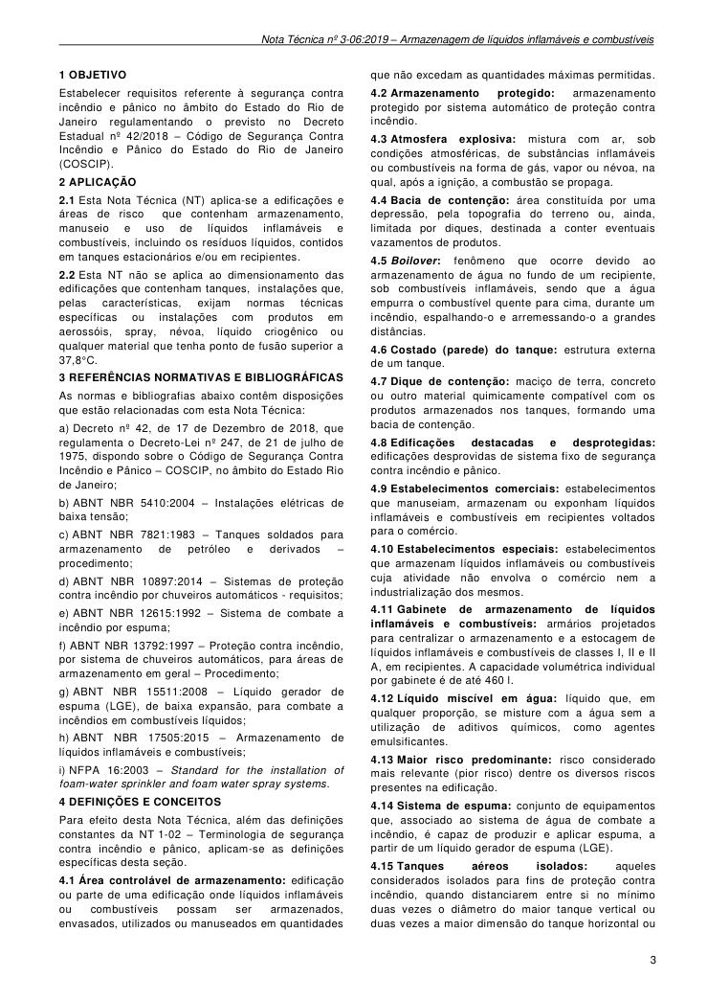

### 1 OBJETIVO

Estabelecer requisitos referente à segurança contra incêndio e pânico no âmbito do Estado do Rio de Janeiro regulamentando o previsto no Decreto Estadual nº 42/2018 - Código de Segurança Contra Incêndio e Pânico do Estado do Rio de Janeiro (COSCIP).

### 2 APLICAÇÃO

2.1 Esta Nota Técnica (NT) aplica-se a edificações e áreas de risco que contenham armazenamento, manuseio e uso de líquidos inflamáveis e combustíveis, incluindo os resíduos líquidos, contidos em tanques estacionários e/ou em recipientes.

2.2 Esta NT não se aplica ao dimensionamento das edificações que contenham tanques, instalações que, pelas características, exijam normas técnicas específicas ou instalações com produtos em aerossóis, spray, névoa, líquido criogênico ou qualquer material que tenha ponto de fusão superior a 37,8°C.

### 3 REFERÊNCIAS NORMATIVAS E BIBLIOGRÁFICAS

As normas e bibliografias abaixo contêm disposições que estão relacionadas com esta Nota Técnica:

a) Decreto nº 42, de 17 de Dezembro de 2018, que regulamenta o Decreto-Lei nº 247, de 21 de julho de 1975, dispondo sobre o Código de Segurança Contra Incêndio e Pânico - COSCIP, no âmbito do Estado Rio de Janeiro;

b) ABNT NBR 5410:2004 - Instalações elétricas de baixa tensão;

c) ABNT NBR 7821:1983 - Tanques soldados para armazenamento de petróleo e derivados - procedimento;

d) ABNT NBR 10897:2014 - Sistemas de proteção contra incêndio por chuveiros automáticos - requisitos;

e) ABNT NBR 12615:1992 - Sistema de combate a incêndio por espuma;

f) ABNT NBR 13792:1997 - Proteção contra incêndio, por sistema de chuveiros automáticos, para áreas de armazenamento em geral - Procedimento;

g) ABNT NBR 15511:2008 - Líquido gerador de espuma (LGE), de baixa expansão, para combate a incêndios em combustíveis líquidos;

h) ABNT NBR 17505:2015 - Armazenamento de líquidos inflamáveis e combustíveis;

i) NFPA 16:2003 - Standard for the installation of foam-water sprinkler and foam water spray systems.

### 4 DEFINIÇÕES E CONCEITOS

Para efeito desta Nota Técnica, além das definições constantes da NT 1-02 - Terminologia de segurança contra incêndio e pânico, aplicam-se as definições específicas desta seção.

4.1 Área controlável de armazenamento: edificação ou parte de uma edificação onde líquidos inflamáveis ou combustíveis possam ser armazenados, envasados, utilizados ou manuseados em quantidades

que não excedam as quantidades máximas permitidas.

4.2 Armazenamento protegido: armazenamento protegido por sistema automático de proteção contra incêndio.

4.3 Atmosfera explosiva: mistura com ar, sob condições atmosféricas, de substâncias inflamáveis ou combustíveis na forma de gás, vapor ou névoa, na qual, após a ignição, a combustão se propaga.

4.4 Bacia de contenção: área constituída por uma depressão, pela topografia do terreno ou, ainda, limitada por diques, destinada a conter eventuais vazamentos de produtos.

4.5 Boilover: fenômeno que ocorre devido ao armazenamento de água no fundo de um recipiente, sob combustíveis inflamáveis, sendo que a água empurra o combustível quente para cima, durante um incêndio, espalhando-o e arremessando-o a grandes distâncias.

4.6 Costado (parede) do tanque: estrutura externa de um tanque.

4.7 Dique de contenção: maciço de terra, concreto ou outro material quimicamente compatível com os produtos armazenados nos tanques, formando uma bacia de contenção.

4.8 Edificações destacadas e desprotegidas: edificações desprovidas de sistema fixo de segurança contra incêndio e pânico.

4.9 Estabelecimentos comerciais: estabelecimentos que manuseiam, armazenam ou exponham líquidos inflamáveis e combustíveis em recipientes voltados para o comércio.

4.10 Estabelecimentos especiais: estabelecimentos que armazenam líquidos inflamáveis ou combustíveis cuja atividade não envolva o comércio nem a industrialização dos mesmos.

4.11 Gabinete de armazenamento de líquidos inflamáveis e combustíveis: armários projetados para centralizar o armazenamento e a estocagem de líquidos inflamáveis e combustíveis de classes I, II e II A, em recipientes. A capacidade volumétrica individual por gabinete é de até 460 l.

4.12 Líquido miscível em água: líquido que, em qualquer proporção, se misture com a água sem a utilização de aditivos químicos, como agentes emulsificantes.

4.13 Maior risco predominante: risco considerado mais relevante (pior risco) dentre os diversos riscos presentes na edificação.

4.14 Sistema de espuma: conjunto de equipamentos que, associado ao sistema de água de combate a incêndio, é capaz de produzir e aplicar espuma, a partir de um líquido gerador de espuma (LGE).

4.15 Tanques aéreos isolados: aqueles considerados isolados para fins de proteção contra incêndio, quando distanciarem entre si no mínimo duas vezes o diâmetro do maior tanque vertical ou duas vezes a maior dimensão do tanque horizontal ou

---

## Página 4

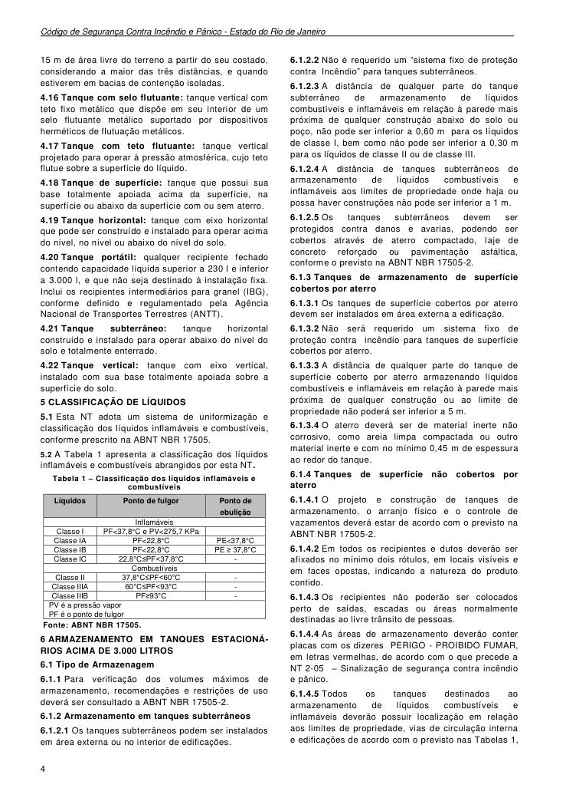

Código de Segurança Contra Incêndio e Pânico - Estado do Rio de Janeiro

15 m de área livre do terreno a partir do seu costado, considerando a maior das três distâncias, e quando estiverem em bacias de contenção isoladas.

4.16 Tanque com selo flutuante: tanque vertical com teto fixo metálico que dispõe em seu interior de um selo flutuante metálico suportado por dispositivos herméticos de flutuação metálicos.

4.17 Tanque com teto flutuante: tanque vertical projetado para operar à pressão atmosférica, cujo teto flutue sobre a superfície do líquido.

4.18 Tanque de superfície: tanque que possui sua base totalmente apoiada acima da superfície, na superfície ou abaixo da superfície com ou sem aterro.

4.19 Tanque horizontal: tanque com eixo horizontal que pode ser construído e instalado para operar acima do nível, no nível ou abaixo do nível do solo.

4.20 Tanque portátil: qualquer recipiente fechado contendo capacidade líquida superior a 230 l e inferior a 3.000 l, e que não seja destinado à instalação fixa. Inclui os recipientes intermediários para granel (IBG), conforme definido e regulamentado pela Agência Nacional de Transportes Terrestres (ANTT).

4.21 Tanque subterrâneo: tanque horizontal construído e instalado para operar abaixo do nível do solo e totalmente enterrado.

4.22 Tanque vertical: tanque com eixo vertical, instalado com sua base totalmente apoiada sobre a superfície do solo.

### 5 CLASSIFICAÇÃO DE LÍQUIDOS

5.1 Esta NT adota um sistema de uniformização e classificação dos líquidos inflamáveis e combustíveis, conforme prescrito na ABNT NBR 17505.

5.2 A Tabela 1 apresenta a classificação dos líquidos inflamáveis e combustíveis abrangidos por esta NT.

Tabela 1 - Classificação dos líquidos inflamáveis e

combustíveis

### 6 ARMAZENAMENTO EM TANQUES ESTACIONÁRIOS ACIMA DE 3.000 LITROS

6.1 Tipo de Armazenagem

6.1.1 Para verificação dos volumes máximos de armazenamento, recomendações e restrições de uso deverá ser consultado a ABNT NBR 17505-2.

6.1.2 Armazenamento em tanques subterrâneos

6.1.2.1 Os tanques subterrâneos podem ser instalados em área externa ou no interior de edificações.

6.1.2.2 Não é requerido um “sistema fixo de proteção contra Incêndio” para tanques subterrâneos.

6.1.2.3 A distância de qualquer parte do tanque subterrâneo de armazenamento de líquidos combustíveis e inflamáveis em relação à parede mais próxima de qualquer construção abaixo do solo ou poço, não pode ser inferior a 0,60 m para os líquidos de classe I, bem como não pode ser inferior a 0,30 m para os líquidos de classe II ou de classe III.

6.1.2.4 A distância de tanques subterrâneos de armazenamento de líquidos combustíveis e inflamáveis aos limites de propriedade onde haja ou possa haver construções não pode ser inferior a 1 m.

6.1.2.5 Os tanques subterrâneos devem ser protegidos contra danos e avarias, podendo ser cobertos através de aterro compactado, laje de concreto reforçado ou pavimentação asfáltica, conforme o previsto na ABNT NBR 17505-2.

6.1.3 Tanques de armazenamento de superfície cobertos por aterro

6.1.3.1 Os tanques de superfície cobertos por aterro devem ser instalados em área externa a edificação.

6.1.3.2 Não será requerido um sistema fixo de proteção contra incêndio para tanques de superfície cobertos por aterro.

6.1.3.3 A distância de qualquer parte do tanque de superfície coberto por aterro armazenando líquidos combustíveis e inflamáveis em relação à parede mais próxima de qualquer construção ou ao limite de propriedade não poderá ser inferior a 5 m.

6.1.3.4 O aterro deverá ser de material inerte não corrosivo, como areia limpa compactada ou outro material inerte e com no mínimo 0,45 m de espessura ao redor do tanque.

6.1.4 Tanques de superfície não cobertos por aterro

6.1.4.1 O projeto e construção de tanques de armazenamento, o arranjo físico e o controle de vazamentos deverá estar de acordo com o previsto na ABNT NBR 17505-2.

6.1.4.2 Em todos os recipientes e dutos deverão ser afixados no mínimo dois rótulos, em locais visíveis e em faces opostas, indicando a natureza do produto contido.

6.1.4.3 Os recipientes não poderão ser colocados perto de saídas, escadas ou áreas normalmente destinadas ao livre trânsito de pessoas.

6.1.4.4 As áreas de armazenamento deverão conter placas com os dizeres PERIGO - PROIBIDO FUMAR, em letras vermelhas, de acordo com o que precede a NT 2-05 - Sinalização de segurança contra incêndio e pânico.

6.1.4.5 Todos os tanques destinados ao armazenamento de líquidos combustíveis e inflamáveis deverão possuir localização em relação aos limites de propriedade, vias de circulação interna e edificações de acordo com o previsto nas Tabelas 1,

### Tabelas extraídas (bruto, não usar para citação)
#### Tabela 1 da página

| Líquidos | Ponto de fulgor |  | Ponto de |  |
| --- | --- | --- | --- | --- |
|  |  |  | ebulição |  |
| Inflamáveis |  |  |  |  |
| Classe I | PF<37,8°C e PV<275,7 KPa |  |  |  |
| Classe IA | PF<22,8°C | PE<37,8°C |  |  |
| Classe IB | PF<22,8°C | PE ≥ 37,8°C |  |  |
| Classe IC | 22,8°C≤PF<37,8°C | - |  |  |
| Combustíveis |  |  |  |  |
| Classe II | 37,8°C≤PF<60°C | - |  |  |
| Classe IIIA | 60°C≤PF<93°C | - |  |  |
| Classe IIIB | PF≥93°C | - |  |  |
| PV é a pressão vapor PF é o ponto de fulgor |  |  |  |  |

<!-- tabela-conferida: Tabela 1 p4 -->
### Tabela 1 — Classificação dos líquidos inflamáveis e combustíveis (conferida)

| Líquidos | Ponto de fulgor | Ponto de ebulição |
| --- | --- | --- |
| Inflamáveis | Inflamáveis | Inflamáveis |
| Classe I | PF<37,8°C e PV<275,7 KPa |  |
| Classe IA | PF<22,8°C | PE<37,8°C |
| Classe IB | PF<22,8°C | PE ≥ 37,8°C |
| Classe IC | 22,8°C≤PF<37,8°C | - |
| Combustíveis | Combustíveis | Combustíveis |
| Classe II | 37,8°C≤PF<60°C | - |
| Classe IIIA | 60°C≤PF<93°C | - |
| Classe IIIB | PF≥93°C | - |

Fonte: NT 3-06, página 4, Tabela 1; conferida em 2026-09-29 (visual + geometrica).
Legenda da tabela: PV é a pressão vapor; PF é o ponto de fulgor.
Fonte indicada na página: ABNT NBR 17505.
<!-- /tabela-conferida: Tabela 1 p4 -->

---

## Página 5

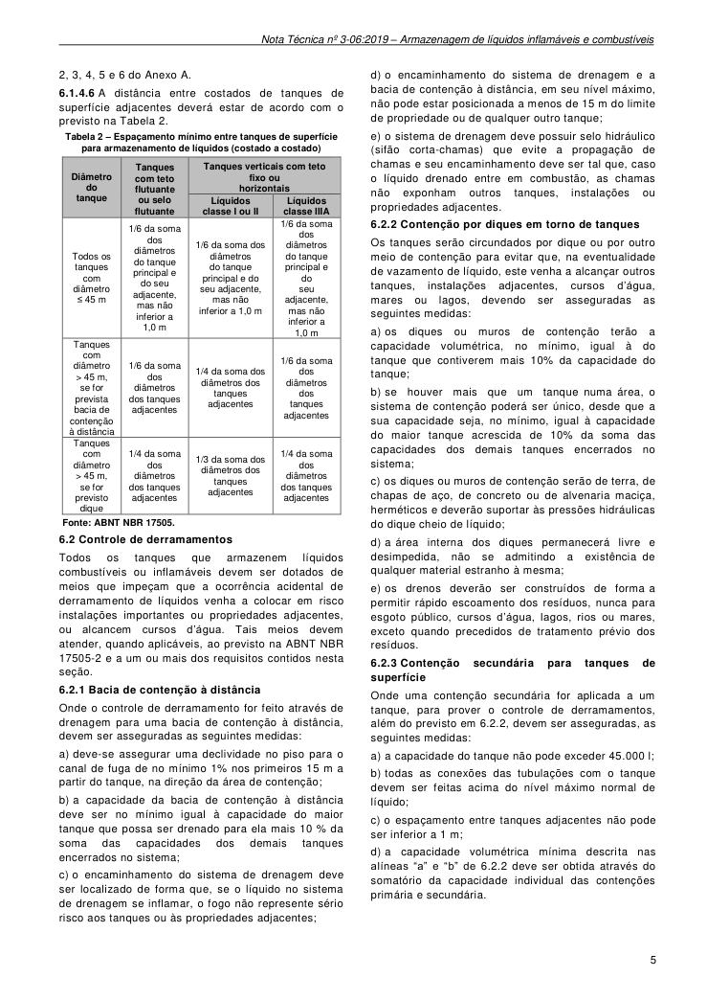

2, 3, 4, 5 e 6 do Anexo A.

6.1.4.6 A distância entre costados de tanques de superfície adjacentes deverá estar de acordo com o previsto na Tabela 2.

Tabela 2 - Espaçamento mínimo entre tanques de superfície

para armazenamento de líquidos (costado a costado)

Fonte: ABNT NBR 17505.

6.2 Controle de derramamentos

Todos os tanques que armazenem líquidos combustíveis ou inflamáveis devem ser dotados de meios que impeçam que a ocorrência acidental de derramamento de líquidos venha a colocar em risco instalações importantes ou propriedades adjacentes, ou alcancem cursos d’água. Tais meios devem atender, quando aplicáveis, ao previsto na ABNT NBR 17505-2 e a um ou mais dos requisitos contidos nesta seção.

6.2.1 Bacia de contenção à distância

Onde o controle de derramamento for feito através de drenagem para uma bacia de contenção à distância, devem ser asseguradas as seguintes medidas:

a) deve-se assegurar uma declividade no piso para o canal de fuga de no mínimo 1% nos primeiros 15 m a partir do tanque, na direção da área de contenção;

b) a capacidade da bacia de contenção à distância deve ser no mínimo igual à capacidade do maior tanque que possa ser drenado para ela mais 10 % da soma das capacidades dos demais tanques encerrados no sistema;

c) o encaminhamento do sistema de drenagem deve ser localizado de forma que, se o líquido no sistema de drenagem se inflamar, o fogo não represente sério risco aos tanques ou às propriedades adjacentes;

d) o encaminhamento do sistema de drenagem e a bacia de contenção à distância, em seu nível máximo, não pode estar posicionada a menos de 15 m do limite de propriedade ou de qualquer outro tanque;

e) o sistema de drenagem deve possuir selo hidráulico (sifão corta-chamas) que evite a propagação de chamas e seu encaminhamento deve ser tal que, caso o líquido drenado entre em combustão, as chamas não exponham outros tanques, instalações ou propriedades adjacentes.

6.2.2 Contenção por diques em torno de tanques

Os tanques serão circundados por dique ou por outro meio de contenção para evitar que, na eventualidade de vazamento de líquido, este venha a alcançar outros tanques, instalações adjacentes, cursos d’água, mares ou lagos, devendo ser asseguradas as seguintes medidas:

a) os diques ou muros de contenção terão a capacidade volumétrica, no mínimo, igual à do tanque que contiverem mais 10% da capacidade do tanque;

b) se houver mais que um tanque numa área, o sistema de contenção poderá ser único, desde que a sua capacidade seja, no mínimo, igual à capacidade do maior tanque acrescida de 10% da soma das capacidades dos demais tanques encerrados no sistema;

c) os diques ou muros de contenção serão de terra, de chapas de aço, de concreto ou de alvenaria maciça, herméticos e deverão suportar às pressões hidráulicas do dique cheio de líquido;

d) a área interna dos diques permanecerá livre e desimpedida, não se admitindo a existência de qualquer material estranho à mesma;

e) os drenos deverão ser construídos de forma a permitir rápido escoamento dos resíduos, nunca para esgoto público, cursos d’água, lagos, rios ou mares, exceto quando precedidos de tratamento prévio dos resíduos.

6.2.3 Contenção secundária para tanques de superfície

Onde uma contenção secundária for aplicada a um tanque, para prover o controle de derramamentos, além do previsto em 6.2.2, devem ser asseguradas, as seguintes medidas:

a) a capacidade do tanque não pode exceder 45.000 l;

b) todas as conexões das tubulações com o tanque devem ser feitas acima do nível máximo normal de líquido;

c) o espaçamento entre tanques adjacentes não pode ser inferior a 1 m;

d) a capacidade volumétrica mínima descrita nas alíneas “a” e “b” de 6.2.2 deve ser obtida através do somatório da capacidade individual das contenções primária e secundária.

### Tabelas extraídas (bruto, não usar para citação)
#### Tabela 1 da página

| Diâmetro do tanque |  | Tanques |  |  | Tanques verticais com teto |  |  |  |  |
| --- | --- | --- | --- | --- | --- | --- | --- | --- | --- |
|  |  | com teto |  |  | fixo ou |  |  |  |  |
|  |  | flutuante |  |  | horizontais |  |  |  |  |
|  |  | ou selo |  |  | Líquidos |  |  | Líquidos |  |
|  |  | flutuante |  |  | classe I ou II |  |  | classe IIIA |  |
| Todos os tanques com diâmetro ≤ 45 m | 1/6 da soma dos diâmetros do tanque principal e do seu adjacente, mas não inferior a 1,0 m |  |  | 1/6 da soma dos diâmetros do tanque principal e do seu adjacente, mas não inferior a 1,0 m |  |  | 1/6 da soma dos diâmetros do tanque principal e do seu adjacente, mas não inferior a 1,0 m |  |  |
| Tanques com diâmetro > 45 m, se for prevista bacia de contenção à distância | 1/6 da soma dos diâmetros dos tanques adjacentes |  |  | 1/4 da soma dos diâmetros dos tanques adjacentes |  |  | 1/6 da soma dos diâmetros dos tanques adjacentes |  |  |
| Tanques com diâmetro > 45 m, se for previsto dique | 1/4 da soma dos diâmetros dos tanques adjacentes |  |  | 1/3 da soma dos diâmetros dos tanques adjacentes |  |  | 1/4 da soma dos diâmetros dos tanques adjacentes |  |  |

---

## Página 6

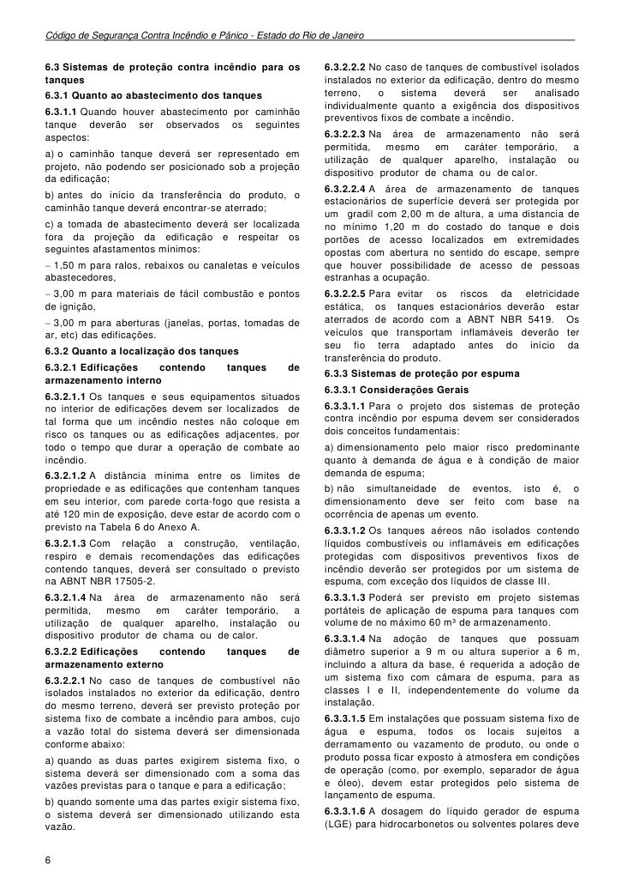

Código de Segurança Contra Incêndio e Pânico - Estado do Rio de Janeiro

6.3 Sistemas de proteção contra incêndio para os tanques

6.3.1 Quanto ao abastecimento dos tanques

6.3.1.1 Quando houver abastecimento por caminhão tanque deverão ser observados os seguintes aspectos:

a) o caminhão tanque deverá ser representado em projeto, não podendo ser posicionado sob a projeção da edificação;

b) antes do início da transferência do produto, o caminhão tanque deverá encontrar-se aterrado;

c) a tomada de abastecimento deverá ser localizada fora da projeção da edificação e respeitar os seguintes afastamentos mínimos:

 1,50 m para ralos, rebaixos ou canaletas e veículos abastecedores,

 3,00 m para materiais de fácil combustão e pontos de ignição,

 3,00 m para aberturas (janelas, portas, tomadas de ar, etc) das edificações.

6.3.2 Quanto a localização dos tanques

6.3.2.1 Edificações contendo tanques de armazenamento interno

6.3.2.1.1 Os tanques e seus equipamentos situados no interior de edificações devem ser localizados de tal forma que um incêndio nestes não coloque em risco os tanques ou as edificações adjacentes, por todo o tempo que durar a operação de combate ao incêndio.

6.3.2.1.2 A distância mínima entre os limites de propriedade e as edificações que contenham tanques em seu interior, com parede corta-fogo que resista a até 120 min de exposição, deve estar de acordo com o previsto na Tabela 6 do Anexo A.

6.3.2.1.3 Com relação a construção, ventilação, respiro e demais recomendações das edificações contendo tanques, deverá ser consultado o previsto na ABNT NBR 17505-2.

6.3.2.1.4 Na área de armazenamento não será permitida, mesmo em caráter temporário, a utilização de qualquer aparelho, instalação ou dispositivo produtor de chama ou de calor.

6.3.2.2 Edificações contendo tanques de armazenamento externo

6.3.2.2.1 No caso de tanques de combustível não isolados instalados no exterior da edificação, dentro do mesmo terreno, deverá ser previsto proteção por sistema fixo de combate a incêndio para ambos, cujo a vazão total do sistema deverá ser dimensionada conforme abaixo:

a) quando as duas partes exigirem sistema fixo, o sistema deverá ser dimensionado com a soma das vazões previstas para o tanque e para a edificação;

b) quando somente uma das partes exigir sistema fixo, o sistema deverá ser dimensionado utilizando esta vazão.

6.3.2.2.2 No caso de tanques de combustível isolados instalados no exterior da edificação, dentro do mesmo terreno, o sistema deverá ser analisado individualmente quanto a exigência dos dispositivos preventivos fixos de combate a incêndio.

6.3.2.2.3 Na área de armazenamento não será permitida, mesmo em caráter temporário, a utilização de qualquer aparelho, instalação ou dispositivo produtor de chama ou de calor.

6.3.2.2.4 A área de armazenamento de tanques estacionários de superfície deverá ser protegida por um gradil com 2,00 m de altura, a uma distancia de no mínimo 1,20 m do costado do tanque e dois portões de acesso localizados em extremidades opostas com abertura no sentido do escape, sempre que houver possibilidade de acesso de pessoas estranhas a ocupação.

6.3.2.2.5 Para evitar os riscos da eletricidade estática, os tanques estacionários deverão estar aterrados de acordo com a ABNT NBR 5419. Os veículos que transportam inflamáveis deverão ter seu fio terra adaptado antes do início da transferência do produto.

6.3.3 Sistemas de proteção por espuma

6.3.3.1 Considerações Gerais

6.3.3.1.1 Para o projeto dos sistemas de proteção contra incêndio por espuma devem ser considerados dois conceitos fundamentais:

a) dimensionamento pelo maior risco predominante quanto à demanda de água e à condição de maior demanda de espuma;

b) não simultaneidade de eventos, isto é, o dimensionamento deve ser feito com base na ocorrência de apenas um evento.

6.3.3.1.2 Os tanques aéreos não isolados contendo líquidos combustíveis ou inflamáveis em edificações protegidas com dispositivos preventivos fixos de incêndio deverão ser protegidos por um sistema de espuma, com exceção dos líquidos de classe III.

6.3.3.1.3 Poderá ser previsto em projeto sistemas portáteis de aplicação de espuma para tanques com volume de no máximo 60 m³ de armazenamento.

6.3.3.1.4 Na adoção de tanques que possuam diâmetro superior a 9 m ou altura superior a 6 m, incluindo a altura da base, é requerida a adoção de um sistema fixo com câmara de espuma, para as classes I e II, independentemente do volume da instalação.

6.3.3.1.5 Em instalações que possuam sistema fixo de água e espuma, todos os locais sujeitos a derramamento ou vazamento de produto, ou onde o produto possa ficar exposto à atmosfera em condições de operação (como, por exemplo, separador de água e óleo), devem estar protegidos pelo sistema de lançamento de espuma.

6.3.3.1.6 A dosagem do líquido gerador de espuma (LGE) para hidrocarbonetos ou solventes polares deve

---

## Página 7

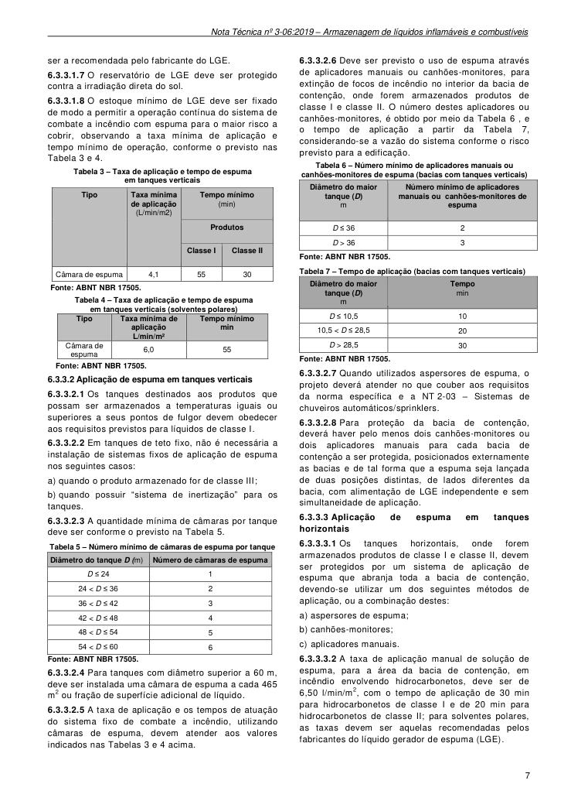

ser a recomendada pelo fabricante do LGE.

6.3.3.1.7 O reservatório de LGE deve ser protegido contra a irradiação direta do sol.

6.3.3.1.8 O estoque mínimo de LGE deve ser fixado de modo a permitir a operação contínua do sistema de combate a incêndio com espuma para o maior risco a cobrir, observando a taxa mínima de aplicação e tempo mínimo de operação, conforme o previsto nas Tabela 3 e 4.

Tabela 3 - Taxa de aplicação e tempo de espuma

em tanques verticais

Fonte: ABNT NBR 17505.

Tabela 4 - Taxa de aplicação e tempo de espuma

em tanques verticais (solventes polares) Tipo Taxa mínima de

Tempo mínimo

min

Câmara de

espuma 6,0 55

Fonte: ABNT NBR 17505.

6.3.3.2 Aplicação de espuma em tanques verticais

6.3.3.2.1 Os tanques destinados aos produtos que possam ser armazenados a temperaturas iguais ou superiores a seus pontos de fulgor devem obedecer aos requisitos previstos para líquidos de classe I.

6.3.3.2.2 Em tanques de teto fixo, não é necessária a instalação de sistemas fixos de aplicação de espuma nos seguintes casos:

a) quando o produto armazenado for de classe III;

b) quando possuir “sistema de inertização” para os tanques.

6.3.3.2.3 A quantidade mínima de câmaras por tanque deve ser conforme o previsto na Tabela 5.

Tabela 5 - Número mínimo de câmaras de espuma por tanque

Fonte: ABNT NBR 17505.

6.3.3.2.4 Para tanques com diâmetro superior a 60 m, deve ser instalada uma câmara de espuma a cada 465 m2 ou fração de superfície adicional de líquido.

6.3.3.2.5 A taxa de aplicação e os tempos de atuação do sistema fixo de combate a incêndio, utilizando câmaras de espuma, devem atender aos valores indicados nas Tabelas 3 e 4 acima.

6.3.3.2.6 Deve ser previsto o uso de espuma através de aplicadores manuais ou canhões-monitores, para extinção de focos de incêndio no interior da bacia de contenção, onde forem armazenados produtos de classe I e classe II. O número destes aplicadores ou canhões-monitores, é obtido por meio da Tabela 6, e o tempo de aplicação a partir da Tabela 7, considerando-se a vazão do sistema conforme o risco previsto para a edificação.

Tabela 6 - Número mínimo de aplicadores manuais ou canhões-monitores de espuma (bacias com tanques verticais)

Fonte: ABNT NBR 17505.

Tabela 7 - Tempo de aplicação (bacias com tanques verticais)

Fonte: ABNT NBR 17505.

6.3.3.2.7 Quando utilizados aspersores de espuma, o projeto deverá atender no que couber aos requisitos da norma específica e a NT 2-03 - Sistemas de chuveiros automáticos/sprinklers.

6.3.3.2.8 Para proteção da bacia de contenção, deverá haver pelo menos dois canhões-monitores ou dois aplicadores manuais para cada bacia de contenção a ser protegida, posicionados externamente as bacias e de tal forma que a espuma seja lançada de duas posições distintas, de lados diferentes da bacia, com alimentação de LGE independente e sem simultaneidade de aplicação.

6.3.3.3 Aplicação de espuma em tanques horizontais

6.3.3.3.1 Os tanques horizontais, onde forem armazenados produtos de classe I e classe II, devem ser protegidos por um sistema de aplicação de espuma que abranja toda a bacia de contenção, devendo-se utilizar um dos seguintes métodos de aplicação, ou a combinação destes:

a) aspersores de espuma;

b) canhões-monitores;

c) aplicadores manuais.

6.3.3.3.2 A taxa de aplicação manual de solução de espuma, para a área da bacia de contenção, em incêndio envolvendo hidrocarbonetos, deve ser de 6,50 l/min/m2, com o tempo de aplicação de 30 min para hidrocarbonetos de classe I e de 20 min para hidrocarbonetos de classe II; para solventes polares, as taxas devem ser aquelas recomendadas pelos fabricantes do líquido gerador de espuma (LGE).

### Tabelas extraídas (bruto, não usar para citação)
#### Tabela 1 da página

| Diâmetro do maior | Número mínimo de aplicadores |
| --- | --- |
| tanque (D) | manuais ou canhões-monitores de |
| m | espuma |
|  |  |
| D ≤ 36 | 2 |
| D > 36 | 3 |

#### Tabela 2 da página

| Tipo | Taxa mínima de aplicação (L/min/m2) | Tempo mínimo |  |
| --- | --- | --- | --- |
|  |  | (min) |  |
|  |  |  |  |
|  |  | Produtos |  |
|  |  |  |  |
|  |  | Classe I | Classe II |
|  |  |  |  |
| Câmara de espuma | 4,1 | 55 | 30 |

#### Tabela 3 da página

| Diâmetro do maior | Tempo |
| --- | --- |
| tanque (D) | min |
| m |  |
| D ≤ 10,5 | 10 |
| 10,5 < D ≤ 28,5 | 20 |
| D > 28,5 | 30 |

#### Tabela 4 da página

|  | Taxa mínima de |
| --- | --- |
|  | aplicação |
|  | L/min/m² |
| 6,0 |  |

#### Tabela 5 da página

| Diâmetro do tanque D (m) | Número de câmaras de espuma |
| --- | --- |
| D ≤ 24 | 1 |
| 24 < D ≤ 36 | 2 |
| 36 < D ≤ 42 | 3 |
| 42 < D ≤ 48 | 4 |
| 48 < D ≤ 54 | 5 |
| 54 < D ≤ 60 | 6 |

<!-- tabela-conferida: Tabela 3 p7 -->
### Tabela 3 — Taxa de aplicação e tempo de espuma em tanques verticais (conferida)

| Tipo | Taxa mínima de aplicação (L/min/m²) | Tempo mínimo (min) — classe I | Tempo mínimo (min) — classe II |
| --- | --- | --- | --- |
| Câmara de espuma | 4,1 | 55 | 30 |

Fonte: NT 3-06, página 7, Tabela 3; conferida em 2026-09-29 (visual + geometrica).
Fonte indicada na página: ABNT NBR 17505.
<!-- /tabela-conferida: Tabela 3 p7 -->

<!-- tabela-conferida: Tabela 5 p7 -->
### Tabela 5 — Número mínimo de câmaras de espuma por tanque (conferida)

| Diâmetro do tanque D (m) | Número de câmaras de espuma |
| --- | --- |
| D ≤ 24 | 1 |
| 24 < D ≤ 36 | 2 |
| 36 < D ≤ 42 | 3 |
| 42 < D ≤ 48 | 4 |
| 48 < D ≤ 54 | 5 |
| 54 < D ≤ 60 | 6 |

Fonte: NT 3-06, página 7, Tabela 5; conferida em 2026-09-29 (visual + geometrica).
Fonte indicada na página: ABNT NBR 17505.
Pelo item 6.3.2.4, para tanques com diâmetro superior a 60 m deve ser instalada uma câmara de espuma a cada 465 m² ou fração de superfície adicional de líquido.
<!-- /tabela-conferida: Tabela 5 p7 -->

<!-- tabela-conferida: Tabela 6 p7 -->
### Tabela 6 — Número mínimo de aplicadores manuais ou canhões-monitores de espuma (bacias com tanques verticais) (conferida)

| Diâmetro do maior tanque (D) m | Número mínimo de aplicadores manuais ou canhões-monitores de espuma |
| --- | --- |
| D ≤ 36 | 2 |
| D > 36 | 3 |

Fonte: NT 3-06, página 7, Tabela 6; conferida em 2026-09-29 (visual + geometrica).
Fonte indicada na página: ABNT NBR 17505.
<!-- /tabela-conferida: Tabela 6 p7 -->

<!-- tabela-conferida: Tabela 7 p7 -->
### Tabela 7 — Tempo de aplicação (bacias com tanques verticais) (conferida)

| Diâmetro do maior tanque (D) m | Tempo min |
| --- | --- |
| D ≤ 10,5 | 10 |
| 10,5 < D ≤ 28,5 | 20 |
| D > 28,5 | 30 |

Fonte: NT 3-06, página 7, Tabela 7; conferida em 2026-09-29 (visual + geometrica).
Fonte indicada na página: ABNT NBR 17505.
<!-- /tabela-conferida: Tabela 7 p7 -->

---

## Página 8

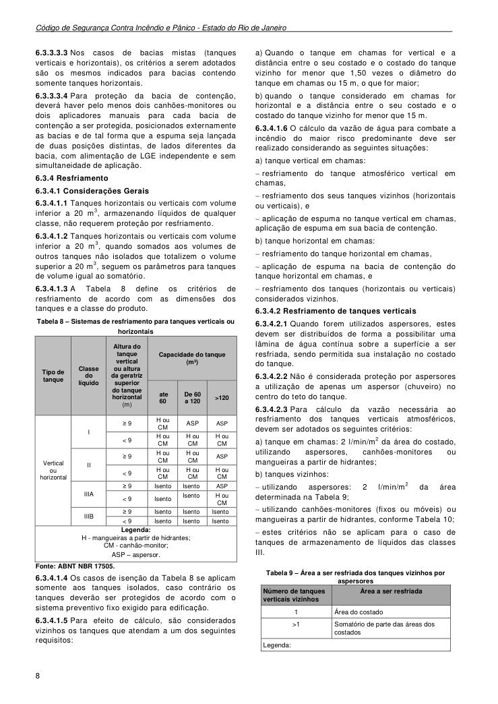

Código de Segurança Contra Incêndio e Pânico - Estado do Rio de Janeiro

6.3.3.3.3 Nos casos de bacias mistas (tanques verticais e horizontais), os critérios a serem adotados são os mesmos indicados para bacias contendo somente tanques horizontais.

6.3.3.3.4 Para proteção da bacia de contenção, deverá haver pelo menos dois canhões-monitores ou dois aplicadores manuais para cada bacia de contenção a ser protegida, posicionados externamente as bacias e de tal forma que a espuma seja lançada de duas posições distintas, de lados diferentes da bacia, com alimentação de LGE independente e sem simultaneidade de aplicação.

6.3.4 Resfriamento

6.3.4.1 Considerações Gerais

6.3.4.1.1 Tanques horizontais ou verticais com volume inferior a 20 m3, armazenando líquidos de qualquer classe, não requerem proteção por resfriamento.

6.3.4.1.2 Tanques horizontais ou verticais com volume inferior a 20 m3, quando somados aos volumes de outros tanques não isolados que totalizem o volume superior a 20 m3, seguem os parâmetros para tanques de volume igual ao somatório.

6.3.4.1.3 A Tabela 8 define os critérios de resfriamento de acordo com as dimensões dos tanques e a classe do produto.

Tabela 8 - Sistemas de resfriamento para tanques verticais ou

horizontais

Fonte: ABNT NBR 17505.

6.3.4.1.4 Os casos de isenção da Tabela 8 se aplicam somente aos tanques isolados, caso contrário os tanques deverão ser protegidos de acordo com o sistema preventivo fixo exigido para edificação.

6.3.4.1.5 Para efeito de cálculo, são considerados vizinhos os tanques que atendam a um dos seguintes requisitos:

a) Quando o tanque em chamas for vertical e a distância entre o seu costado e o costado do tanque vizinho for menor que 1,50 vezes o diâmetro do tanque em chamas ou 15 m, o que for maior;

b) quando o tanque considerado em chamas for horizontal e a distância entre o seu costado e o costado do tanque vizinho for menor que 15 m.

6.3.4.1.6 O cálculo da vazão de água para combate a incêndio do maior risco predominante deve ser realizado considerando as seguintes situações:

a) tanque vertical em chamas:

 resfriamento do tanque atmosférico vertical em chamas,

 resfriamento dos seus tanques vizinhos (horizontais ou verticais), e

 aplicação de espuma no tanque vertical em chamas, aplicação de espuma em sua bacia de contenção.

b) tanque horizontal em chamas:

 resfriamento do tanque horizontal em chamas,

 aplicação de espuma na bacia de contenção do tanque horizontal em chamas, e

 resfriamento dos tanques (horizontais ou verticais) considerados vizinhos.

6.3.4.2 Resfriamento de tanques verticais

6.3.4.2.1 Quando forem utilizados aspersores, estes devem ser distribuídos de forma a possibilitar uma lâmina de água contínua sobre a superfície a ser resfriada, sendo permitida sua instalação no costado do tanque.

6.3.4.2.2 Não é considerada proteção por aspersores a utilização de apenas um aspersor (chuveiro) no centro do teto do tanque.

6.3.4.2.3 Para cálculo da vazão necessária ao resfriamento dos tanques verticais atmosféricos, devem ser adotados os seguintes critérios:

a) tanque em chamas: 2 l/min/m2 da área do costado, utilizando aspersores, canhões-monitores ou mangueiras a partir de hidrantes;

b) tanques vizinhos:

 utilizando aspersores: 2 l/min/m2 da área determinada na Tabela 9;

 utilizando canhões-monitores (fixos ou móveis) ou mangueiras a partir de hidrantes, conforme Tabela 10;

 estes critérios não se aplicam para o caso de tanques de armazenamento de líquidos das classes III.

Tabela 9 - Área a ser resfriada dos tanques vizinhos por

aspersores

### Tabelas extraídas (bruto, não usar para citação)
#### Tabela 1 da página

| Tipo de tanque | Classe do líquido | Altura do tanque vertical ou altura da geratriz superior do tanque horizontal (m) | Capacidade do tanque (m³) |  |  |
| --- | --- | --- | --- | --- | --- |
|  |  |  | ate 60 | De 60 a 120 | >120 |
| Vertical ou horizontal | I | ≥ 9 | H ou CM | ASP | ASP |
|  |  | < 9 | H ou CM | H ou CM | H ou CM |
|  | II | ≥ 9 | H ou CM | H ou CM | ASP |
|  |  | < 9 | H ou CM | H ou CM | H ou CM |
|  | IIIA | ≥ 9 | Isento | Isento | ASP |
|  |  | < 9 | Isento | Isento | H ou CM |
|  | IIIB | ≥ 9 | Isento | Isento | Isento |
|  |  | < 9 | Isento | Isento | Isento |
| Legenda: H - mangueiras a partir de hidrantes; CM - canhão-monitor; ASP - aspersor. |  |  |  |  |  |

#### Tabela 2 da página

| Número de tanques | Área a ser resfriada |
| --- | --- |
| verticais vizinhos |  |
| 1 | Área do costado |
| >1 | Somatório de parte das áreas dos costados |
| Legenda: |  |

<!-- tabela-conferida: Tabela 8 p8 -->
### Tabela 8 — Sistemas de resfriamento para tanques verticais ou horizontais (conferida)

| Tipo de tanque | Classe do líquido | Altura (m) | Capacidade até 60 m³ | De 60 a 120 m³ | > 120 m³ |
| --- | --- | --- | --- | --- | --- |
| Vertical ou horizontal | I | ≥ 9 | H ou CM | ASP | ASP |
| Vertical ou horizontal | I | < 9 | H ou CM | H ou CM | H ou CM |
| Vertical ou horizontal | II | ≥ 9 | H ou CM | H ou CM | ASP |
| Vertical ou horizontal | II | < 9 | H ou CM | H ou CM | H ou CM |
| Vertical ou horizontal | IIIA | ≥ 9 | Isento | Isento | ASP |
| Vertical ou horizontal | IIIA | < 9 | Isento | Isento | H ou CM |
| Vertical ou horizontal | IIIB | ≥ 9 | Isento | Isento | Isento |
| Vertical ou horizontal | IIIB | < 9 | Isento | Isento | Isento |

Fonte: NT 3-06, página 8, Tabela 8; conferida em 2026-09-29 (visual + geometrica).
Legenda da tabela: H - mangueiras a partir de hidrantes; CM - canhão-monitor; ASP - aspersor.
Pelo item 6.3.4.1.4, os casos de isenção da Tabela 8 se aplicam somente aos tanques isolados.
Fonte indicada na página: ABNT NBR 17505.
<!-- /tabela-conferida: Tabela 8 p8 -->

<!-- tabela-conferida: Tabela 9 p8 -->
### Tabela 9 — Área a ser resfriada dos tanques vizinhos por aspersores (conferida)

| Número de tanques verticais vizinhos | Área a ser resfriada |
| --- | --- |
| 1 | Área do costado |
| >1 | Somatório de parte das áreas dos costados |

Fonte: NT 3-06, página 8, Tabela 9; conferida em 2026-09-29 (visual + geometrica).
Legenda da tabela (continua no alto da página 9):
a) Para até dois tanques vizinhos: Taxa por metro quadrado de metade do somatório das áreas do teto e costado dos tanques vizinhos. Para tanques de teto flutuante, não pode ser considerada a área do teto.
b) Para mais de dois tanques vizinhos: Taxa por metro quadrado de um terço do somatório das áreas dos tetos e costados dos tanques vizinhos. Para tanques de teto flutuante, não podem ser consideradas as áreas dos tetos.
Fonte indicada na página: ABNT NBR 17505.
<!-- /tabela-conferida: Tabela 9 p8 -->

---

## Página 9

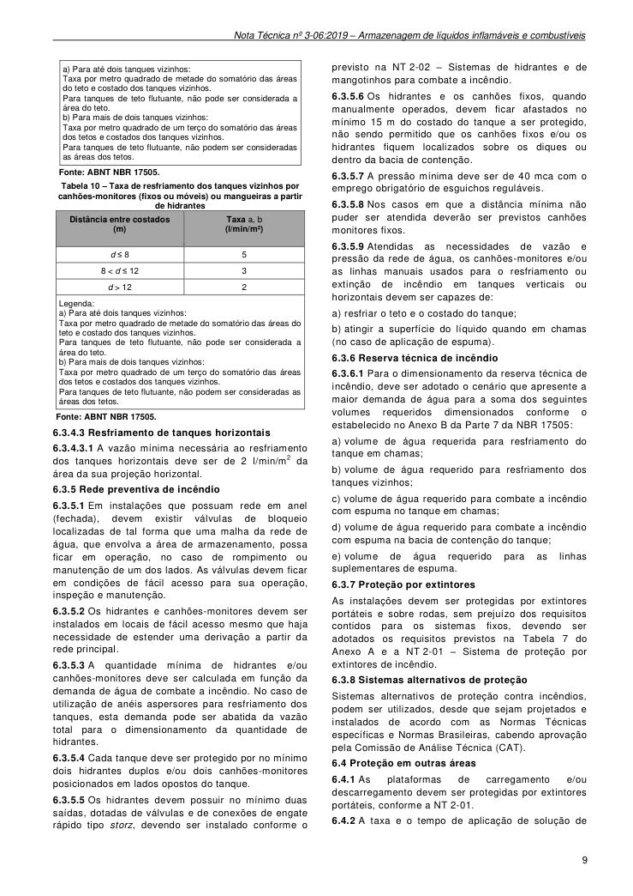

a) Para até dois tanques vizinhos: Taxa por metro quadrado de metade do somatório das áreas do teto e costado dos tanques vizinhos. Para tanques de teto flutuante, não pode ser considerada a área do teto. b) Para mais de dois tanques vizinhos: Taxa por metro quadrado de um terço do somatório das áreas dos tetos e costados dos tanques vizinhos. Para tanques de teto flutuante, não podem ser consideradas as áreas dos tetos.

Fonte: ABNT NBR 17505.

Tabela 10 - Taxa de resfriamento dos tanques vizinhos por canhões-monitores (fixos ou móveis) ou mangueiras a partir

de hidrantes

Fonte: ABNT NBR 17505.

6.3.4.3 Resfriamento de tanques horizontais

6.3.4.3.1 A vazão mínima necessária ao resfriamento dos tanques horizontais deve ser de 2 l/min/m2 da área da sua projeção horizontal.

6.3.5 Rede preventiva de incêndio

6.3.5.1 Em instalações que possuam rede em anel (fechada), devem existir válvulas de bloqueio localizadas de tal forma que uma malha da rede de água, que envolva a área de armazenamento, possa ficar em operação, no caso de rompimento ou manutenção de um dos lados. As válvulas devem ficar em condições de fácil acesso para sua operação, inspeção e manutenção.

6.3.5.2 Os hidrantes e canhões-monitores devem ser instalados em locais de fácil acesso mesmo que haja necessidade de estender uma derivação a partir da rede principal.

6.3.5.3 A quantidade mínima de hidrantes e/ou canhões-monitores deve ser calculada em função da demanda de água de combate a incêndio. No caso de utilização de anéis aspersores para resfriamento dos tanques, esta demanda pode ser abatida da vazão total para o dimensionamento da quantidade de hidrantes.

6.3.5.4 Cada tanque deve ser protegido por no mínimo dois hidrantes duplos e/ou dois canhões-monitores posicionados em lados opostos do tanque.

6.3.5.5 Os hidrantes devem possuir no mínimo duas saídas, dotadas de válvulas e de conexões de engate rápido tipo storz, devendo ser instalado conforme o

previsto na NT 2-02 - Sistemas de hidrantes e de mangotinhos para combate a incêndio.

6.3.5.6 Os hidrantes e os canhões fixos, quando manualmente operados, devem ficar afastados no mínimo 15 m do costado do tanque a ser protegido, não sendo permitido que os canhões fixos e/ou os hidrantes fiquem localizados sobre os diques ou dentro da bacia de contenção.

6.3.5.7 A pressão mínima deve ser de 40 mca com o emprego obrigatório de esguichos reguláveis.

6.3.5.8 Nos casos em que a distância mínima não puder ser atendida deverão ser previstos canhões monitores fixos.

6.3.5.9 Atendidas as necessidades de vazão e pressão da rede de água, os canhões-monitores e/ou as linhas manuais usados para o resfriamento ou extinção de incêndio em tanques verticais ou horizontais devem ser capazes de:

a) resfriar o teto e o costado do tanque;

b) atingir a superfície do líquido quando em chamas (no caso de aplicação de espuma).

6.3.6 Reserva técnica de incêndio

6.3.6.1 Para o dimensionamento da reserva técnica de incêndio, deve ser adotado o cenário que apresente a maior demanda de água para a soma dos seguintes volumes requeridos dimensionados conforme o estabelecido no Anexo B da Parte 7 da NBR 17505:

a) volume de água requerida para resfriamento do tanque em chamas;

b) volume de água requerido para resfriamento dos tanques vizinhos;

c) volume de água requerido para combate a incêndio com espuma no tanque em chamas;

d) volume de água requerido para combate a incêndio com espuma na bacia de contenção do tanque;

e) volume de água requerido para as linhas suplementares de espuma.

6.3.7 Proteção por extintores

As instalações devem ser protegidas por extintores portáteis e sobre rodas, sem prejuízo dos requisitos contidos para os sistemas fixos, devendo ser adotados os requisitos previstos na Tabela 7 do Anexo A e a NT 2-01 - Sistema de proteção por extintores de incêndio.

6.3.8 Sistemas alternativos de proteção

Sistemas alternativos de proteção contra incêndios, podem ser utilizados, desde que sejam projetados e instalados de acordo com as Normas Técnicas específicas e Normas Brasileiras, cabendo aprovação pela Comissão de Análise Técnica (CAT).

6.4 Proteção em outras áreas

6.4.1 As plataformas de carregamento e/ou descarregamento devem ser protegidas por extintores portáteis, conforme a NT 2-01.

6.4.2 A taxa e o tempo de aplicação de solução de

### Tabelas extraídas (bruto, não usar para citação)
#### Tabela 1 da página

| Distância entre costados | Taxa a, b |
| --- | --- |
| (m) | (l/min/m²) |
|  |  |
| d ≤ 8 | 5 |
| 8 < d ≤ 12 | 3 |
| d > 12 | 2 |
| Legenda: a) Para até dois tanques vizinhos: Taxa por metro quadrado de metade do somatório das áreas do teto e costado dos tanques vizinhos. Para tanques de teto flutuante, não pode ser considerada a área do teto. b) Para mais de dois tanques vizinhos: Taxa por metro quadrado de um terço do somatório das áreas dos tetos e costados dos tanques vizinhos. Para tanques de teto flutuante, não podem ser consideradas as áreas dos tetos. |  |

<!-- tabela-conferida: Tabela 10 p9 -->
### Tabela 10 — Taxa de resfriamento dos tanques vizinhos por canhões-monitores (fixos ou móveis) ou mangueiras a partir de hidrantes (conferida)

| Distância entre costados (m) | Taxa a, b (l/min/m²) |
| --- | --- |
| d ≤ 8 | 5 |
| 8 < d ≤ 12 | 3 |
| d > 12 | 2 |

Fonte: NT 3-06, página 9, Tabela 10; conferida em 2026-09-29 (visual + geometrica).
Legenda da tabela:
a) Para até dois tanques vizinhos: Taxa por metro quadrado de metade do somatório das áreas do teto e costado dos tanques vizinhos. Para tanques de teto flutuante, não pode ser considerada a área do teto.
b) Para mais de dois tanques vizinhos: Taxa por metro quadrado de um terço do somatório das áreas dos tetos e costados dos tanques vizinhos. Para tanques de teto flutuante, não podem ser consideradas as áreas dos tetos.
Fonte indicada na página: ABNT NBR 17505.
<!-- /tabela-conferida: Tabela 10 p9 -->

---

## Página 10

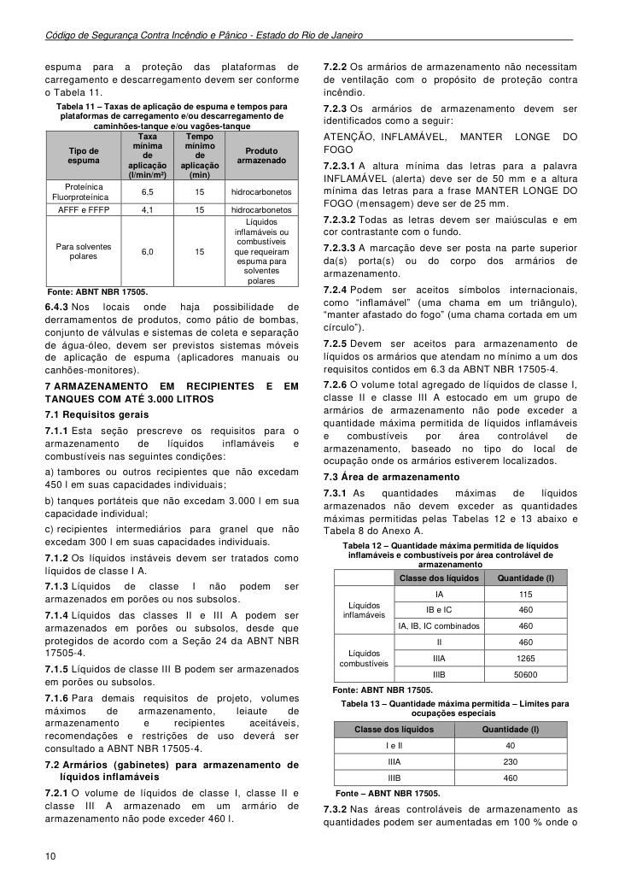

Código de Segurança Contra Incêndio e Pânico - Estado do Rio de Janeiro

espuma para a proteção das plataformas de carregamento e descarregamento devem ser conforme o Tabela 11.

Tabela 11 - Taxas de aplicação de espuma e tempos para

plataformas de carregamento e/ou descarregamento de

caminhões-tanque e/ou vagões-tanque

6.4.3 Nos locais onde haja possibilidade de derramamentos de produtos, como pátio de bombas, conjunto de válvulas e sistemas de coleta e separação de água-óleo, devem ser previstos sistemas móveis de aplicação de espuma (aplicadores manuais ou canhões-monitores).

### 7 ARMAZENAMENTO EM RECIPIENTES E EM TANQUES COM ATÉ 3.000 LITROS

7.1 Requisitos gerais

7.1.1 Esta seção prescreve os requisitos para o armazenamento de líquidos inflamáveis e combustíveis nas seguintes condições:

a) tambores ou outros recipientes que não excedam 450 l em suas capacidades individuais;

b) tanques portáteis que não excedam 3.000 l em sua capacidade individual;

c) recipientes intermediários para granel que não excedam 300 l em suas capacidades individuais.

7.1.2 Os líquidos instáveis devem ser tratados como líquidos de classe I A.

7.1.3 Líquidos de classe I não podem ser armazenados em porões ou nos subsolos.

7.1.4 Líquidos das classes II e III A podem ser armazenados em porões ou subsolos, desde que protegidos de acordo com a Seção 24 da ABNT NBR 17505-4.

7.1.5 Líquidos de classe III B podem ser armazenados em porões ou subsolos.

7.1.6 Para demais requisitos de projeto, volumes máximos de armazenamento, leiaute de armazenamento e recipientes aceitáveis, recomendações e restrições de uso deverá ser consultado a ABNT NBR 17505-4.

7.2 Armários (gabinetes) para armazenamento de

líquidos inflamáveis

7.2.1 O volume de líquidos de classe I, classe II e classe III A armazenado em um armário de armazenamento não pode exceder 460 l.

7.2.2 Os armários de armazenamento não necessitam de ventilação com o propósito de proteção contra incêndio.

7.2.3 Os armários de armazenamento devem ser identificados como a seguir:

### ATENÇÃO, INFLAMÁVEL, MANTER LONGE DO FOGO

7.2.3.1 A altura mínima das letras para a palavra INFLAMÁVEL (alerta) deve ser de 50 mm e a altura mínima das letras para a frase MANTER LONGE DO FOGO (mensagem) deve ser de 25 mm.

7.2.3.2 Todas as letras devem ser maiúsculas e em cor contrastante com o fundo.

7.2.3.3 A marcação deve ser posta na parte superior da(s) porta(s) ou do corpo dos armários de armazenamento.

7.2.4 Podem ser aceitos símbolos internacionais, como “inflamável” (uma chama em um triângulo), “manter afastado do fogo” (uma chama cortada em um círculo”).

7.2.5 Devem ser aceitos para armazenamento de líquidos os armários que atendam no mínimo a um dos requisitos contidos em 6.3 da ABNT NBR 17505-4.

7.2.6 O volume total agregado de líquidos de classe I, classe II e classe III A estocado em um grupo de armários de armazenamento não pode exceder a quantidade máxima permitida de líquidos inflamáveis e combustíveis por área controlável de armazenamento, baseado no tipo do local de ocupação onde os armários estiverem localizados.

7.3 Área de armazenamento

7.3.1 As quantidades máximas de líquidos armazenados não devem exceder as quantidades máximas permitidas pelas Tabelas 12 e 13 abaixo e Tabela 8 do Anexo A.

Tabela 12 - Quantidade máxima permitida de líquidos

inflamáveis e combustíveis por área controlável de

armazenamento

Fonte: ABNT NBR 17505.

Tabela 13 - Quantidade máxima permitida - Limites para

ocupações especiais

Fonte - ABNT NBR 17505.

7.3.2 Nas áreas controláveis de armazenamento as quantidades podem ser aumentadas em 100 % onde o

### Tabelas extraídas (bruto, não usar para citação)
#### Tabela 1 da página

| Tipo de espuma |  | Taxa |  |  | Tempo |  | Produto armazenado |
| --- | --- | --- | --- | --- | --- | --- | --- |
|  |  | mínima |  |  | mínimo |  |  |
|  |  | de |  |  | de |  |  |
|  |  | aplicação |  |  | aplicação |  |  |
|  |  | (l/min/m²) |  |  | (min) |  |  |
| Proteínica Fluorproteínica | 6,5 |  |  | 15 |  |  | hidrocarbonetos |
| AFFF e FFFP | 4,1 |  |  | 15 |  |  | hidrocarbonetos |
| Para solventes polares | 6,0 |  |  | 15 |  |  | Líquidos inflamáveis ou combustíveis que requeiram espuma para solventes polares |

#### Tabela 2 da página

|  | Classe dos líquidos | Quantidade (l) |
| --- | --- | --- |
| Líquidos inflamáveis | IA | 115 |
|  | IB e IC | 460 |
|  | IA, IB, IC combinados | 460 |
| Líquidos combustíveis | II | 460 |
|  | IIIA | 1265 |
|  | IIIB | 50600 |

#### Tabela 3 da página

| Classe dos líquidos | Quantidade (l) |
| --- | --- |
| I e II | 40 |
| IIIA | 230 |
| IIIB | 460 |

<!-- tabela-conferida: Tabela 11 p10 -->
### Tabela 11 — Taxas de aplicação de espuma e tempos para plataformas de carregamento e/ou descarregamento de caminhões-tanque e/ou vagões-tanque (conferida)

| Tipo de espuma | Taxa mínima de aplicação (l/min/m²) | Tempo mínimo de aplicação (min) | Produto armazenado |
| --- | --- | --- | --- |
| Proteínica Fluorproteínica | 6,5 | 15 | hidrocarbonetos |
| AFFF e FFFP | 4,1 | 15 | hidrocarbonetos |
| Para solventes polares | 6,0 | 15 | Líquidos inflamáveis ou combustíveis que requeiram espuma para solventes polares |

Fonte: NT 3-06, página 10, Tabela 11; conferida em 2026-09-29 (visual + geometrica).
Fonte indicada na página: ABNT NBR 17505.
<!-- /tabela-conferida: Tabela 11 p10 -->

<!-- tabela-conferida: Tabela 12 p10 -->
### Tabela 12 — Quantidade máxima permitida de líquidos inflamáveis e combustíveis por área controlável de armazenamento (conferida)

|  | Classe dos líquidos | Quantidade (l) |
| --- | --- | --- |
| Líquidos inflamáveis | IA | 115 |
| Líquidos inflamáveis | IB e IC | 460 |
| Líquidos inflamáveis | IA, IB, IC combinados | 460 |
| Líquidos combustíveis | II | 460 |
| Líquidos combustíveis | IIIA | 1265 |
| Líquidos combustíveis | IIIB | 50600 |

Fonte: NT 3-06, página 10, Tabela 12; conferida em 2026-09-29 (visual + geometrica).
Fonte indicada na página: ABNT NBR 17505.
O item 7.3.2 (logo abaixo da Tabela 13) trata do aumento dessas quantidades nas áreas controláveis de armazenamento; ver o texto do item.
<!-- /tabela-conferida: Tabela 12 p10 -->

<!-- tabela-conferida: Tabela 13 p10 -->
### Tabela 13 — Quantidade máxima permitida – Limites para ocupações especiais (conferida)

| Classe dos líquidos | Quantidade (l) |
| --- | --- |
| I e II | 40 |
| IIIA | 230 |
| IIIB | 460 |

Fonte: NT 3-06, página 10, Tabela 13; conferida em 2026-09-29 (visual + geometrica).
Fonte indicada na página: ABNT NBR 17505.
<!-- /tabela-conferida: Tabela 13 p10 -->

---

## Página 11

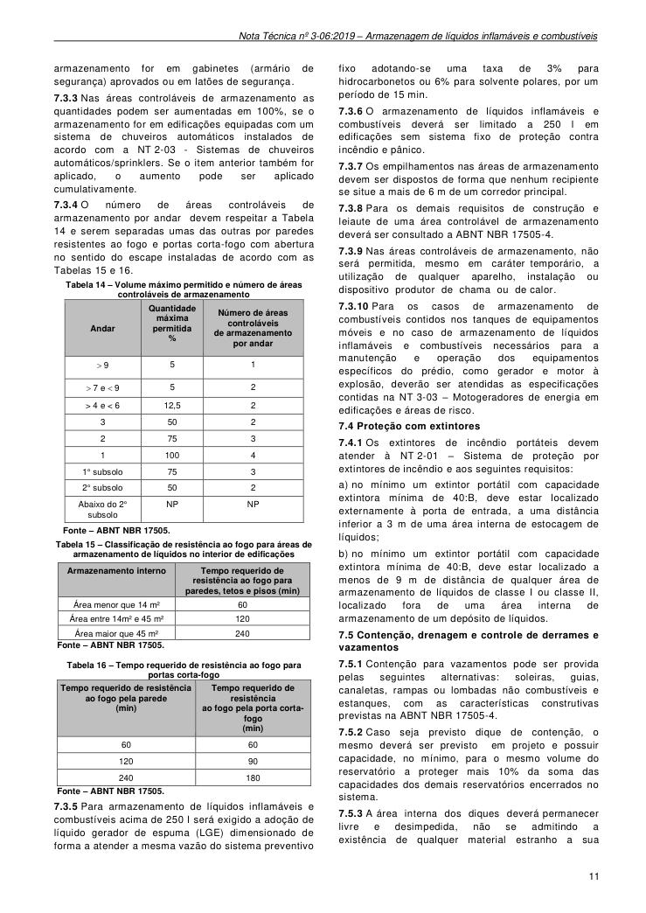

armazenamento for em gabinetes (armário de segurança) aprovados ou em latões de segurança.

7.3.3 Nas áreas controláveis de armazenamento as quantidades podem ser aumentadas em 100%, se o armazenamento for em edificações equipadas com um sistema de chuveiros automáticos instalados de acordo com a NT 2-03 - Sistemas de chuveiros automáticos/sprinklers. Se o item anterior também for aplicado, o aumento pode ser aplicado cumulativamente.

7.3.4 O número de áreas controláveis de armazenamento por andar devem respeitar a Tabela 14 e serem separadas umas das outras por paredes resistentes ao fogo e portas corta-fogo com abertura no sentido do escape instaladas de acordo com as Tabelas 15 e 16.

Tabela 14 - Volume máximo permitido e número de áreas

controláveis de armazenamento

Fonte - ABNT NBR 17505.

Tabela 15 - Classificação de resistência ao fogo para áreas de

armazenamento de líquidos no interior de edificações

Tabela 16 - Tempo requerido de resistência ao fogo para

portas corta-fogo

Fonte - ABNT NBR 17505.

7.3.5 Para armazenamento de líquidos inflamáveis e combustíveis acima de 250 l será exigido a adoção de líquido gerador de espuma (LGE) dimensionado de forma a atender a mesma vazão do sistema preventivo

fixo adotando-se uma taxa de 3% para hidrocarbonetos ou 6% para solvente polares, por um período de 15 min.

7.3.6 O armazenamento de líquidos inflamáveis e combustíveis deverá ser limitado a 250 l em edificações sem sistema fixo de proteção contra incêndio e pânico.

7.3.7 Os empilhamentos nas áreas de armazenamento devem ser dispostos de forma que nenhum recipiente se situe a mais de 6 m de um corredor principal.

7.3.8 Para os demais requisitos de construção e leiaute de uma área controlável de armazenamento deverá ser consultado a ABNT NBR 17505-4.

7.3.9 Nas áreas controláveis de armazenamento, não será permitida, mesmo em caráter temporário, a utilização de qualquer aparelho, instalação ou dispositivo produtor de chama ou de calor.

7.3.10 Para os casos de armazenamento de combustíveis contidos nos tanques de equipamentos móveis e no caso de armazenamento de líquidos inflamáveis e combustíveis necessários para a manutenção e operação dos equipamentos específicos do prédio, como gerador e motor à explosão, deverão ser atendidas as especificações contidas na NT 3-03 - Motogeradores de energia em edificações e áreas de risco.

7.4 Proteção com extintores

7.4.1 Os extintores de incêndio portáteis devem atender à NT 2-01 - Sistema de proteção por extintores de incêndio e aos seguintes requisitos:

a) no mínimo um extintor portátil com capacidade extintora mínima de 40:B, deve estar localizado externamente à porta de entrada, a uma distância inferior a 3 m de uma área interna de estocagem de líquidos;

b) no mínimo um extintor portátil com capacidade extintora mínima de 40:B, deve estar localizado a menos de 9 m de distância de qualquer área de armazenamento de líquidos de classe I ou classe II, localizado fora de uma área interna de armazenamento de um depósito de líquidos.

7.5 Contenção, drenagem e controle de derrames e vazamentos

7.5.1 Contenção para vazamentos pode ser provida pelas seguintes alternativas: soleiras, guias, canaletas, rampas ou lombadas não combustíveis e estanques, com as características construtivas previstas na ABNT NBR 17505-4.

7.5.2 Caso seja previsto dique de contenção, o mesmo deverá ser previsto em projeto e possuir capacidade, no mínimo, para o mesmo volume do reservatório a proteger mais 10% da soma das capacidades dos demais reservatórios encerrados no sistema.

7.5.3 A área interna dos diques deverá permanecer livre e desimpedida, não se admitindo a existência de qualquer material estranho a sua

### Tabelas extraídas (bruto, não usar para citação)
#### Tabela 1 da página

| Andar | Quantidade | Número de áreas controláveis de armazenamento por andar |
| --- | --- | --- |
|  | máxima |  |
|  | permitida |  |
|  | % |  |
|  |  |  |
| 9 | 5 | 1 |
| 7 e 9 | 5 | 2 |
| > 4 e < 6 | 12,5 | 2 |
| 3 | 50 | 2 |
| 2 | 75 | 3 |
| 1 | 100 | 4 |
| 1° subsolo | 75 | 3 |
| 2° subsolo | 50 | 2 |
| Abaixo do 2° subsolo | NP | NP |

#### Tabela 2 da página

| Armazenamento interno |  | Tempo requerido de |  |
| --- | --- | --- | --- |
|  |  | resistência ao fogo para |  |
|  |  | paredes, tetos e pisos (min) |  |
| Área menor que 14 m² | 60 |  |  |
| Área entre 14m² e 45 m² | 120 |  |  |
| Área maior que 45 m² | 240 |  |  |

#### Tabela 3 da página

| Tempo requerido de resistência ao fogo pela parede (min) | Tempo requerido de |
| --- | --- |
|  | resistência |
|  | ao fogo pela porta corta- |
|  | fogo |
|  | (min) |
| 60 | 60 |
| 120 | 90 |
| 240 | 180 |

<!-- tabela-conferida: Tabela 14 p11 -->
### Tabela 14 — Volume máximo permitido e número de áreas controláveis de armazenamento (conferida)

| Andar | Quantidade máxima permitida % | Número de áreas controláveis de armazenamento por andar |
| --- | --- | --- |
| > 9 | 5 | 1 |
| > 7 e < 9 | 5 | 2 |
| > 4 e < 6 | 12,5 | 2 |
| 3 | 50 | 2 |
| 2 | 75 | 3 |
| 1 | 100 | 4 |
| 1° subsolo | 75 | 3 |
| 2° subsolo | 50 | 2 |
| Abaixo do 2° subsolo | NP | NP |

Fonte: NT 3-06, página 11, Tabela 14; conferida em 2026-09-29 (visual + geometrica).
Fonte indicada na página: ABNT NBR 17505.
NP: não permitido (sigla sem legenda na página).
<!-- /tabela-conferida: Tabela 14 p11 -->

<!-- tabela-conferida: Tabela 15 p11 -->
### Tabela 15 — Classificação de resistência ao fogo para áreas de armazenamento de líquidos no interior de edificações (conferida)

| Armazenamento interno | Tempo requerido de resistência ao fogo para paredes, tetos e pisos (min) |
| --- | --- |
| Área menor que 14 m² | 60 |
| Área entre 14m² e 45 m² | 120 |
| Área maior que 45 m² | 240 |

Fonte: NT 3-06, página 11, Tabela 15; conferida em 2026-09-29 (visual + geometrica).
Fonte indicada na página: ABNT NBR 17505.
<!-- /tabela-conferida: Tabela 15 p11 -->

<!-- tabela-conferida: Tabela 16 p11 -->
### Tabela 16 — Tempo requerido de resistência ao fogo para portas corta-fogo (conferida)

| Tempo requerido de resistência ao fogo pela parede (min) | Tempo requerido de resistência ao fogo pela porta corta-fogo (min) |
| --- | --- |
| 60 | 60 |
| 120 | 90 |
| 240 | 180 |

Fonte: NT 3-06, página 11, Tabela 16; conferida em 2026-09-29 (visual + geometrica).
Fonte indicada na página: ABNT NBR 17505.
<!-- /tabela-conferida: Tabela 16 p11 -->

---

## Página 12

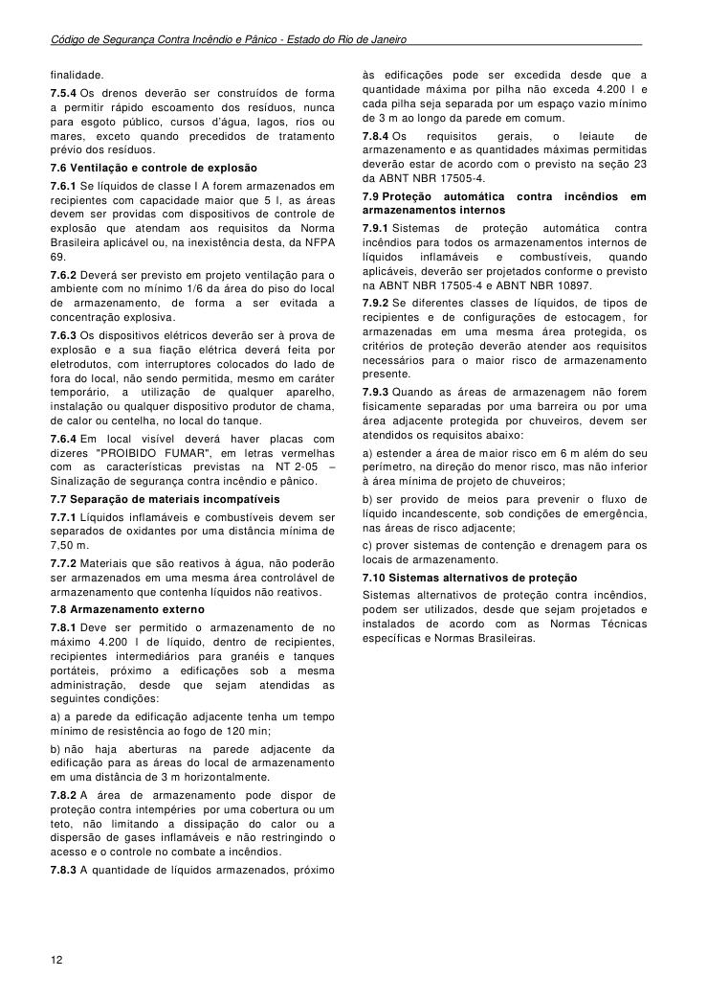

Código de Segurança Contra Incêndio e Pânico - Estado do Rio de Janeiro

finalidade.

7.5.4 Os drenos deverão ser construídos de forma a permitir rápido escoamento dos resíduos, nunca para esgoto público, cursos d’água, lagos, rios ou mares, exceto quando precedidos de tratamento prévio dos resíduos.

7.6 Ventilação e controle de explosão

7.6.1 Se líquidos de classe I A forem armazenados em recipientes com capacidade maior que 5 l, as áreas devem ser providas com dispositivos de controle de explosão que atendam aos requisitos da Norma Brasileira aplicável ou, na inexistência desta, da NFPA 69.

7.6.2 Deverá ser previsto em projeto ventilação para o ambiente com no mínimo 1/6 da área do piso do local de armazenamento, de forma a ser evitada a concentração explosiva.

7.6.3 Os dispositivos elétricos deverão ser à prova de explosão e a sua fiação elétrica deverá feita por eletrodutos, com interruptores colocados do lado de fora do local, não sendo permitida, mesmo em caráter temporário, a utilização de qualquer aparelho, instalação ou qualquer dispositivo produtor de chama, de calor ou centelha, no local do tanque.

7.6.4 Em local visível deverá haver placas com dizeres "PROIBIDO FUMAR", em letras vermelhas com as características previstas na NT 2-05 - Sinalização de segurança contra incêndio e pânico.

7.7 Separação de materiais incompatíveis

7.7.1 Líquidos inflamáveis e combustíveis devem ser separados de oxidantes por uma distância mínima de 7,50 m.

7.7.2 Materiais que são reativos à água, não poderão ser armazenados em uma mesma área controlável de armazenamento que contenha líquidos não reativos.

7.8 Armazenamento externo

7.8.1 Deve ser permitido o armazenamento de no máximo 4.200 l de líquido, dentro de recipientes, recipientes intermediários para granéis e tanques portáteis, próximo a edificações sob a mesma administração, desde que sejam atendidas as seguintes condições:

a) a parede da edificação adjacente tenha um tempo mínimo de resistência ao fogo de 120 min;

b) não haja aberturas na parede adjacente da edificação para as áreas do local de armazenamento em uma distância de 3 m horizontalmente.

7.8.2 A área de armazenamento pode dispor de proteção contra intempéries por uma cobertura ou um teto, não limitando a dissipação do calor ou a dispersão de gases inflamáveis e não restringindo o acesso e o controle no combate a incêndios.

7.8.3 A quantidade de líquidos armazenados, próximo

às edificações pode ser excedida desde que a quantidade máxima por pilha não exceda 4.200 l e cada pilha seja separada por um espaço vazio mínimo de 3 m ao longo da parede em comum.

7.8.4 Os requisitos gerais, o leiaute de armazenamento e as quantidades máximas permitidas deverão estar de acordo com o previsto na seção 23 da ABNT NBR 17505-4.

7.9 Proteção automática contra incêndios em armazenamentos internos

7.9.1 Sistemas de proteção automática contra incêndios para todos os armazenamentos internos de líquidos inflamáveis e combustíveis, quando aplicáveis, deverão ser projetados conforme o previsto na ABNT NBR 17505-4 e ABNT NBR 10897.

7.9.2 Se diferentes classes de líquidos, de tipos de recipientes e de configurações de estocagem, for armazenadas em uma mesma área protegida, os critérios de proteção deverão atender aos requisitos necessários para o maior risco de armazenamento presente.

7.9.3 Quando as áreas de armazenagem não forem fisicamente separadas por uma barreira ou por uma área adjacente protegida por chuveiros, devem ser atendidos os requisitos abaixo:

a) estender a área de maior risco em 6 m além do seu perímetro, na direção do menor risco, mas não inferior à área mínima de projeto de chuveiros;

b) ser provido de meios para prevenir o fluxo de líquido incandescente, sob condições de emergência, nas áreas de risco adjacente;

c) prover sistemas de contenção e drenagem para os locais de armazenamento.

7.10 Sistemas alternativos de proteção

Sistemas alternativos de proteção contra incêndios, podem ser utilizados, desde que sejam projetados e instalados de acordo com as Normas Técnicas específicas e Normas Brasileiras.

---

## Página 13

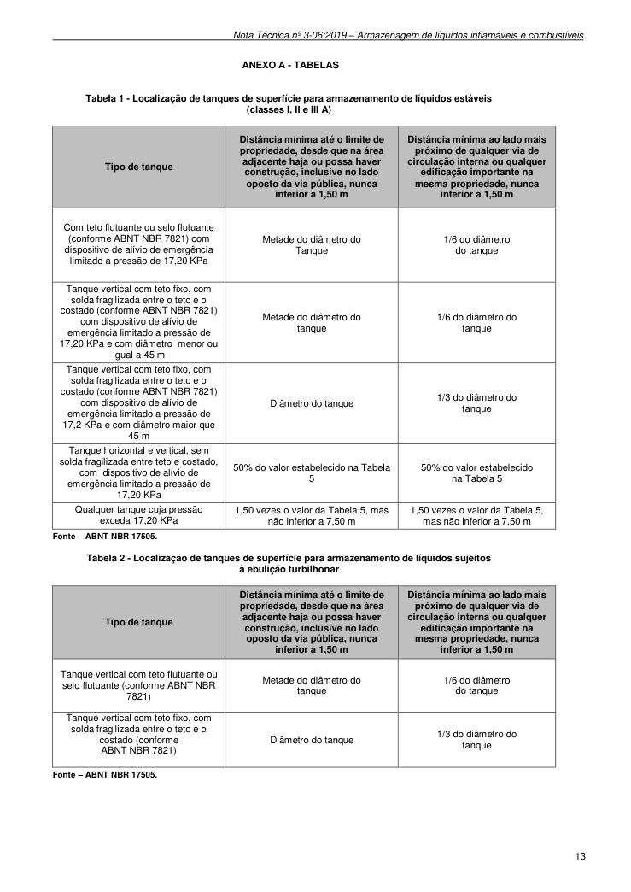

### ANEXO A - TABELAS

Tabela 1 - Localização de tanques de superfície para armazenamento de líquidos estáveis

(classes I, II e III A)

Fonte - ABNT NBR 17505.

Tabela 2 - Localização de tanques de superfície para armazenamento de líquidos sujeitos

à ebulição turbilhonar

Fonte - ABNT NBR 17505.

### Tabelas extraídas (bruto, não usar para citação)
#### Tabela 1 da página

| Tipo de tanque |  | Distância mínima até o limite de |  |  | Distância mínima ao lado mais |  |
| --- | --- | --- | --- | --- | --- | --- |
|  |  | propriedade, desde que na área |  |  | próximo de qualquer via de |  |
|  |  | adjacente haja ou possa haver |  |  | circulação interna ou qualquer |  |
|  |  | construção, inclusive no lado |  |  | edificação importante na |  |
|  |  | oposto da via pública, nunca |  |  | mesma propriedade, nunca |  |
|  |  | inferior a 1,50 m |  |  | inferior a 1,50 m |  |
| Com teto flutuante ou selo flutuante (conforme ABNT NBR 7821) com dispositivo de alívio de emergência limitado a pressão de 17,20 KPa | Metade do diâmetro do Tanque |  |  | 1/6 do diâmetro do tanque |  |  |
| Tanque vertical com teto fixo, com solda fragilizada entre o teto e o costado (conforme ABNT NBR 7821) com dispositivo de alívio de emergência limitado a pressão de 17,20 KPa e com diâmetro menor ou igual a 45 m | Metade do diâmetro do tanque |  |  | 1/6 do diâmetro do tanque |  |  |
| Tanque vertical com teto fixo, com solda fragilizada entre o teto e o costado (conforme ABNT NBR 7821) com dispositivo de alívio de emergência limitado a pressão de 17,2 KPa e com diâmetro maior que 45 m | Diâmetro do tanque |  |  | 1/3 do diâmetro do tanque |  |  |
| Tanque horizontal e vertical, sem solda fragilizada entre teto e costado, com dispositivo de alívio de emergência limitado a pressão de 17,20 KPa | 50% do valor estabelecido na Tabela 5 |  |  | 50% do valor estabelecido na Tabela 5 |  |  |
| Qualquer tanque cuja pressão exceda 17,20 KPa | 1,50 vezes o valor da Tabela 5, mas não inferior a 7,50 m |  |  | 1,50 vezes o valor da Tabela 5, mas não inferior a 7,50 m |  |  |

#### Tabela 2 da página

| Tipo de tanque |  | Distância mínima até o limite de |  |  | Distância mínima ao lado mais |  |
| --- | --- | --- | --- | --- | --- | --- |
|  |  | propriedade, desde que na área |  |  | próximo de qualquer via de |  |
|  |  | adjacente haja ou possa haver |  |  | circulação interna ou qualquer |  |
|  |  | construção, inclusive no lado |  |  | edificação importante na |  |
|  |  | oposto da via pública, nunca |  |  | mesma propriedade, nunca |  |
|  |  | inferior a 1,50 m |  |  | inferior a 1,50 m |  |
| Tanque vertical com teto flutuante ou selo flutuante (conforme ABNT NBR 7821) | Metade do diâmetro do tanque |  |  | 1/6 do diâmetro do tanque |  |  |
| Tanque vertical com teto fixo, com solda fragilizada entre o teto e o costado (conforme ABNT NBR 7821) | Diâmetro do tanque |  |  | 1/3 do diâmetro do tanque |  |  |

<!-- tabela-conferida: Tabela 1 do Anexo A p13 -->
### Tabela 1 do Anexo A — Localização de tanques de superfície para armazenamento de líquidos estáveis (classes I, II e III A) (conferida)

| Tipo de tanque | Distância mínima até o limite de propriedade, desde que na área adjacente haja ou possa haver construção, inclusive no lado oposto da via pública, nunca inferior a 1,50 m | Distância mínima ao lado mais próximo de qualquer via de circulação interna ou qualquer edificação importante na mesma propriedade, nunca inferior a 1,50 m |
| --- | --- | --- |
| Com teto flutuante ou selo flutuante (conforme ABNT NBR 7821) com dispositivo de alívio de emergência limitado a pressão de 17,20 KPa | Metade do diâmetro do Tanque | 1/6 do diâmetro do tanque |
| Tanque vertical com teto fixo, com solda fragilizada entre o teto e o costado (conforme ABNT NBR 7821) com dispositivo de alívio de emergência limitado a pressão de 17,20 KPa e com diâmetro menor ou igual a 45 m | Metade do diâmetro do tanque | 1/6 do diâmetro do tanque |
| Tanque vertical com teto fixo, com solda fragilizada entre o teto e o costado (conforme ABNT NBR 7821) com dispositivo de alívio de emergência limitado a pressão de 17,2 KPa e com diâmetro maior que 45 m | Diâmetro do tanque | 1/3 do diâmetro do tanque |
| Tanque horizontal e vertical, sem solda fragilizada entre teto e costado, com dispositivo de alívio de emergência limitado a pressão de 17,20 KPa | 50% do valor estabelecido na Tabela 5 | 50% do valor estabelecido na Tabela 5 |
| Qualquer tanque cuja pressão exceda 17,20 KPa | 1,50 vezes o valor da Tabela 5, mas não inferior a 7,50 m | 1,50 vezes o valor da Tabela 5, mas não inferior a 7,50 m |

Fonte: NT 3-06, página 13, Tabela 1 do Anexo A; conferida em 2026-09-29 (visual + geometrica).
Fonte indicada na página: ABNT NBR 17505.
"Tabela 5" nesta tabela é a Tabela 5 do Anexo A (p. 14).
<!-- /tabela-conferida: Tabela 1 do Anexo A p13 -->

<!-- tabela-conferida: Tabela 2 do Anexo A p13 -->
### Tabela 2 do Anexo A — Localização de tanques de superfície para armazenamento de líquidos sujeitos à ebulição turbilhonar (conferida)

| Tipo de tanque | Distância mínima até o limite de propriedade, desde que na área adjacente haja ou possa haver construção, inclusive no lado oposto da via pública, nunca inferior a 1,50 m | Distância mínima ao lado mais próximo de qualquer via de circulação interna ou qualquer edificação importante na mesma propriedade, nunca inferior a 1,50 m |
| --- | --- | --- |
| Tanque vertical com teto flutuante ou selo flutuante (conforme ABNT NBR 7821) | Metade do diâmetro do tanque | 1/6 do diâmetro do tanque |
| Tanque vertical com teto fixo, com solda fragilizada entre o teto e o costado (conforme ABNT NBR 7821) | Diâmetro do tanque | 1/3 do diâmetro do tanque |

Fonte: NT 3-06, página 13, Tabela 2 do Anexo A; conferida em 2026-09-29 (visual + geometrica).
Fonte indicada na página: ABNT NBR 17505.
<!-- /tabela-conferida: Tabela 2 do Anexo A p13 -->

---

## Página 14

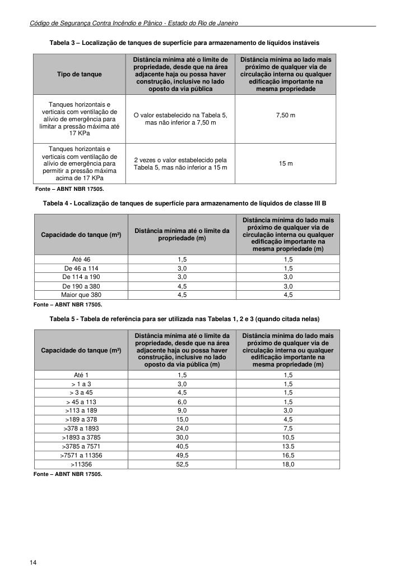

Código de Segurança Contra Incêndio e Pânico - Estado do Rio de Janeiro

Tabela 3 - Localização de tanques de superfície para armazenamento de líquidos instáveis

Fonte - ABNT NBR 17505.

Tabela 4 - Localização de tanques de superfície para armazenamento de líquidos de classe III B

Fonte - ABNT NBR 17505.

Tabela 5 - Tabela de referência para ser utilizada nas Tabelas 1, 2 e 3 (quando citada nelas)

Fonte - ABNT NBR 17505.

### Tabelas extraídas (bruto, não usar para citação)
#### Tabela 1 da página

| Tipo de tanque |  | Distância mínima até o limite de |  |  | Distância mínima ao lado mais |  |
| --- | --- | --- | --- | --- | --- | --- |
|  |  | propriedade, desde que na área |  |  | próximo de qualquer via de |  |
|  |  | adjacente haja ou possa haver |  |  | circulação interna ou qualquer |  |
|  |  | construção, inclusive no lado |  |  | edificação importante na |  |
|  |  | oposto da via pública |  |  | mesma propriedade |  |
| Tanques horizontais e verticais com ventilação de alívio de emergência para limitar a pressão máxima até 17 KPa | O valor estabelecido na Tabela 5, mas não inferior a 7,50 m |  |  | 7,50 m |  |  |
| Tanques horizontais e verticais com ventilação de alívio de emergência para permitir a pressão máxima acima de 17 KPa | 2 vezes o valor estabelecido pela Tabela 5, mas não inferior a 15 m |  |  | 15 m |  |  |

#### Tabela 2 da página

| Capacidade do tanque (m³) | Distância mínima até o limite da propriedade (m) |  | Distância mínima do lado mais |  |
| --- | --- | --- | --- | --- |
|  |  |  | próximo de qualquer via de |  |
|  |  |  | circulação interna ou qualquer |  |
|  |  |  | edificação importante na |  |
|  |  |  | mesma propriedade (m) |  |
| Até 46 | 1,5 | 1,5 |  |  |
| De 46 a 114 | 3,0 | 1,5 |  |  |
| De 114 a 190 | 3,0 | 3,0 |  |  |
| De 190 a 380 | 4,5 | 3,0 |  |  |
| Maior que 380 | 4,5 | 4,5 |  |  |

#### Tabela 3 da página

| Capacidade do tanque (m³) |  | Distância mínima até o limite da |  |  | Distância mínima do lado mais |  |
| --- | --- | --- | --- | --- | --- | --- |
|  |  | propriedade, desde que na área |  |  | próximo de qualquer via de |  |
|  |  | adjacente haja ou possa haver |  |  | circulação interna ou qualquer |  |
|  |  | construção, inclusive no lado |  |  | edificação importante na |  |
|  |  | oposto da via pública (m) |  |  | mesma propriedade (m) |  |
| Até 1 | 1,5 |  |  | 1,5 |  |  |
| > 1 a 3 | 3,0 |  |  | 1,5 |  |  |
| > 3 a 45 | 4,5 |  |  | 1,5 |  |  |
| > 45 a 113 | 6,0 |  |  | 1,5 |  |  |
| >113 a 189 | 9,0 |  |  | 3,0 |  |  |
| >189 a 378 | 15,0 |  |  | 4,5 |  |  |
| >378 a 1893 | 24,0 |  |  | 7,5 |  |  |
| >1893 a 3785 | 30,0 |  |  | 10,5 |  |  |
| >3785 a 7571 | 40,5 |  |  | 13.5 |  |  |
| >7571 a 11356 | 49,5 |  |  | 16,5 |  |  |
| >11356 | 52,5 |  |  | 18,0 |  |  |

<!-- tabela-conferida: Tabela 3 do Anexo A p14 -->
### Tabela 3 do Anexo A — Localização de tanques de superfície para armazenamento de líquidos instáveis (conferida)

| Tipo de tanque | Distância mínima até o limite de propriedade, desde que na área adjacente haja ou possa haver construção, inclusive no lado oposto da via pública | Distância mínima ao lado mais próximo de qualquer via de circulação interna ou qualquer edificação importante na mesma propriedade |
| --- | --- | --- |
| Tanques horizontais e verticais com ventilação de alívio de emergência para limitar a pressão máxima até 17 KPa | O valor estabelecido na Tabela 5, mas não inferior a 7,50 m | 7,50 m |
| Tanques horizontais e verticais com ventilação de alívio de emergência para permitir a pressão máxima acima de 17 KPa | 2 vezes o valor estabelecido pela Tabela 5, mas não inferior a 15 m | 15 m |

Fonte: NT 3-06, página 14, Tabela 3 do Anexo A; conferida em 2026-09-29 (visual + geometrica).
Fonte indicada na página: ABNT NBR 17505.
<!-- /tabela-conferida: Tabela 3 do Anexo A p14 -->

<!-- tabela-conferida: Tabela 4 do Anexo A p14 -->
### Tabela 4 do Anexo A — Localização de tanques de superfície para armazenamento de líquidos de classe III B (conferida)

| Capacidade do tanque (m³) | Distância mínima até o limite da propriedade (m) | Distância mínima do lado mais próximo de qualquer via de circulação interna ou qualquer edificação importante na mesma propriedade (m) |
| --- | --- | --- |
| Até 46 | 1,5 | 1,5 |
| De 46 a 114 | 3,0 | 1,5 |
| De 114 a 190 | 3,0 | 3,0 |
| De 190 a 380 | 4,5 | 3,0 |
| Maior que 380 | 4,5 | 4,5 |

Fonte: NT 3-06, página 14, Tabela 4 do Anexo A; conferida em 2026-09-29 (visual + geometrica).
Fonte indicada na página: ABNT NBR 17505.
<!-- /tabela-conferida: Tabela 4 do Anexo A p14 -->

<!-- tabela-conferida: Tabela 5 do Anexo A p14 -->
### Tabela 5 do Anexo A — Tabela de referência para ser utilizada nas Tabelas 1, 2 e 3 (quando citada nelas) (conferida)

| Capacidade do tanque (m³) | Distância mínima até o limite da propriedade, desde que na área adjacente haja ou possa haver construção, inclusive no lado oposto da via pública (m) | Distância mínima do lado mais próximo de qualquer via de circulação interna ou qualquer edificação importante na mesma propriedade (m) |
| --- | --- | --- |
| Até 1 | 1,5 | 1,5 |
| > 1 a 3 | 3,0 | 1,5 |
| > 3 a 45 | 4,5 | 1,5 |
| > 45 a 113 | 6,0 | 1,5 |
| >113 a 189 | 9,0 | 3,0 |
| >189 a 378 | 15,0 | 4,5 |
| >378 a 1893 | 24,0 | 7,5 |
| >1893 a 3785 | 30,0 | 10,5 |
| >3785 a 7571 | 40,5 | 13.5 |
| >7571 a 11356 | 49,5 | 16,5 |
| >11356 | 52,5 | 18,0 |

Fonte: NT 3-06, página 14, Tabela 5 do Anexo A; conferida em 2026-09-29 (visual + geometrica).
Fonte indicada na página: ABNT NBR 17505.
Conferência: as duas distâncias crescem (ou ficam iguais) com a capacidade.
<!-- /tabela-conferida: Tabela 5 do Anexo A p14 -->

---

## Página 15

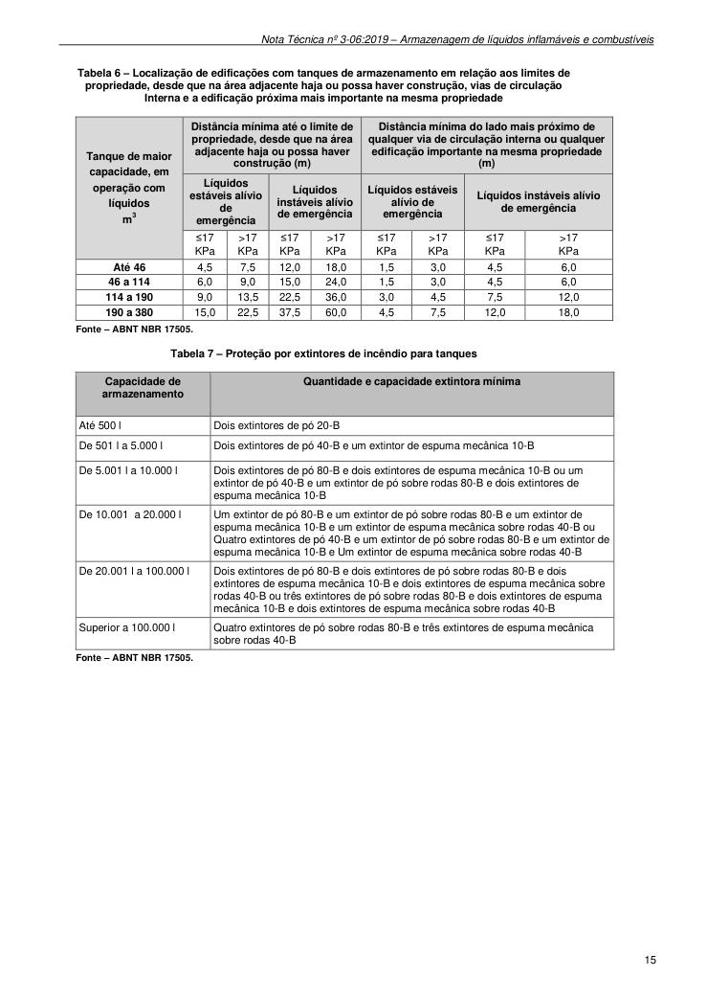

Tabela 6 - Localização de edificações com tanques de armazenamento em relação aos limites de

propriedade, desde que na área adjacente haja ou possa haver construção, vias de circulação

Interna e a edificação próxima mais importante na mesma propriedade

Fonte - ABNT NBR 17505.

Tabela 7 - Proteção por extintores de incêndio para tanques

Fonte - ABNT NBR 17505.

### Tabelas extraídas (bruto, não usar para citação)
#### Tabela 1 da página

| Tanque de maior capacidade, em operação com líquidos m3 |  | Distância mínima até o limite de |  |  |  |  |  |  | Distância mínima do lado mais próximo de |  |  |  |  |
| --- | --- | --- | --- | --- | --- | --- | --- | --- | --- | --- | --- | --- | --- |
|  |  | propriedade, desde que na área |  |  |  |  |  |  | qualquer via de circulação interna ou qualquer |  |  |  |  |
|  |  | adjacente haja ou possa haver |  |  |  |  |  |  | edificação importante na mesma propriedade |  |  |  |  |
|  |  | construção (m) |  |  |  |  |  |  | (m) |  |  |  |  |
|  |  | Líquidos |  |  | Líquidos instáveis alívio de emergência |  |  | Líquidos estáveis alívio de emergência |  |  | Líquidos instáveis alívio de emergência |  |  |
|  |  | estáveis alívio |  |  |  |  |  |  |  |  |  |  |  |
|  |  | de |  |  |  |  |  |  |  |  |  |  |  |
|  |  | emergência |  |  |  |  |  |  |  |  |  |  |  |
|  | ≤17 KPa |  | >17 KPa |  | ≤17 KPa | >17 KPa |  | ≤17 KPa |  | >17 KPa | ≤17 KPa | >17 KPa |  |
| Até 46 | 4,5 |  | 7,5 |  | 12,0 | 18,0 |  | 1,5 |  | 3,0 | 4,5 | 6,0 |  |
| 46 a 114 | 6,0 |  | 9,0 |  | 15,0 | 24,0 |  | 1,5 |  | 3,0 | 4,5 | 6,0 |  |
| 114 a 190 | 9,0 |  | 13,5 |  | 22,5 | 36,0 |  | 3,0 |  | 4,5 | 7,5 | 12,0 |  |
| 190 a 380 | 15,0 |  | 22,5 |  | 37,5 | 60,0 |  | 4,5 |  | 7,5 | 12,0 | 18,0 |  |

#### Tabela 2 da página

| Capacidade de | Quantidade e capacidade extintora mínima |
| --- | --- |
| armazenamento |  |
|  |  |
| Até 500 l | Dois extintores de pó 20-B |
| De 501 l a 5.000 l | Dois extintores de pó 40-B e um extintor de espuma mecânica 10-B |
| De 5.001 l a 10.000 l | Dois extintores de pó 80-B e dois extintores de espuma mecânica 10-B ou um extintor de pó 40-B e um extintor de pó sobre rodas 80-B e dois extintores de espuma mecânica 10-B |
| De 10.001 a 20.000 l | Um extintor de pó 80-B e um extintor de pó sobre rodas 80-B e um extintor de espuma mecânica 10-B e um extintor de espuma mecânica sobre rodas 40-B ou Quatro extintores de pó 40-B e um extintor de pó sobre rodas 80-B e um extintor de espuma mecânica 10-B e Um extintor de espuma mecânica sobre rodas 40-B |
| De 20.001 l a 100.000 l | Dois extintores de pó 80-B e dois extintores de pó sobre rodas 80-B e dois extintores de espuma mecânica 10-B e dois extintores de espuma mecânica sobre rodas 40-B ou três extintores de pó sobre rodas 80-B e dois extintores de espuma mecânica 10-B e dois extintores de espuma mecânica sobre rodas 40-B |
| Superior a 100.000 l | Quatro extintores de pó sobre rodas 80-B e três extintores de espuma mecânica sobre rodas 40-B |

<!-- tabela-conferida: Tabela 7 do Anexo A p15 -->
### Tabela 7 do Anexo A — Proteção por extintores de incêndio para tanques (conferida)

| Capacidade de armazenamento | Quantidade e capacidade extintora mínima |
| --- | --- |
| Até 500 l | Dois extintores de pó 20-B |
| De 501 l a 5.000 l | Dois extintores de pó 40-B e um extintor de espuma mecânica 10-B |
| De 5.001 l a 10.000 l | Dois extintores de pó 80-B e dois extintores de espuma mecânica 10-B ou um extintor de pó 40-B e um extintor de pó sobre rodas 80-B e dois extintores de espuma mecânica 10-B |
| De 10.001 a 20.000 l | Um extintor de pó 80-B e um extintor de pó sobre rodas 80-B e um extintor de espuma mecânica 10-B e um extintor de espuma mecânica sobre rodas 40-B ou Quatro extintores de pó 40-B e um extintor de pó sobre rodas 80-B e um extintor de espuma mecânica 10-B e Um extintor de espuma mecânica sobre rodas 40-B |
| De 20.001 l a 100.000 l | Dois extintores de pó 80-B e dois extintores de pó sobre rodas 80-B e dois extintores de espuma mecânica 10-B e dois extintores de espuma mecânica sobre rodas 40-B ou três extintores de pó sobre rodas 80-B e dois extintores de espuma mecânica 10-B e dois extintores de espuma mecânica sobre rodas 40-B |
| Superior a 100.000 l | Quatro extintores de pó sobre rodas 80-B e três extintores de espuma mecânica sobre rodas 40-B |

Fonte: NT 3-06, página 15, Tabela 7 do Anexo A; conferida em 2026-09-29 (visual + geometrica).
Fonte indicada na página: ABNT NBR 17505.
<!-- /tabela-conferida: Tabela 7 do Anexo A p15 -->

---

## Página 16

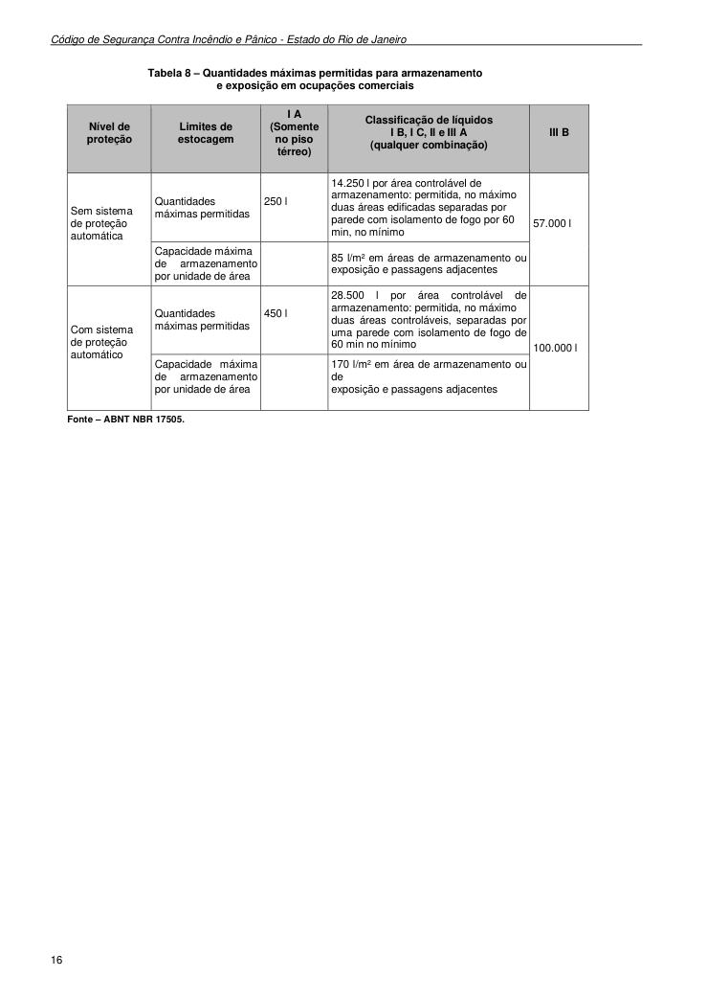

Código de Segurança Contra Incêndio e Pânico - Estado do Rio de Janeiro

Tabela 8 - Quantidades máximas permitidas para armazenamento

e exposição em ocupações comerciais

Fonte - ABNT NBR 17505.

### Tabelas extraídas (bruto, não usar para citação)
#### Tabela 1 da página

|  |  | I A |  | III B |
| --- | --- | --- | --- | --- |
|  |  |  | Classificação de líquidos |  |
| Nível de | Limites de | (Somente |  |  |
|  |  |  | I B, I C, II e III A |  |
| proteção | estocagem | no piso |  |  |
|  |  |  | (qualquer combinação) |  |
|  |  | térreo) |  |  |
|  |  |  |  |  |
|  |  |  |  |  |
|  |  |  |  |  |
| Sem sistema de proteção automática | Quantidades máximas permitidas | 250 l | 14.250 l por área controlável de armazenamento: permitida, no máximo duas áreas edificadas separadas por parede com isolamento de fogo por 60 min, no mínimo | 57.000 l |
|  | Capacidade máxima de armazenamento por unidade de área |  | 85 l/m² em áreas de armazenamento ou exposição e passagens adjacentes |  |
| Com sistema de proteção automático | Quantidades máximas permitidas | 450 l | 28.500 l por área controlável de armazenamento: permitida, no máximo duas áreas controláveis, separadas por uma parede com isolamento de fogo de 60 min no mínimo | 100.000 l |
|  | Capacidade máxima de armazenamento por unidade de área |  | 170 l/m² em área de armazenamento ou de exposição e passagens adjacentes |  |
<!-- tabela-conferida: Tabela 8 do Anexo A p16 -->
### Tabela 8 do Anexo A — Quantidades máximas permitidas para armazenamento e exposição em ocupações comerciais (conferida)

| Nível de proteção | Limites de estocagem | I A (Somente no piso térreo) | Classificação de líquidos I B, I C, II e III A (qualquer combinação) | III B |
| --- | --- | --- | --- | --- |
| Sem sistema de proteção automática | Quantidades máximas permitidas | 250 l | 14.250 l por área controlável de armazenamento: permitida, no máximo duas áreas edificadas separadas por parede com isolamento de fogo por 60 min, no mínimo | 57.000 l |
| Sem sistema de proteção automática | Capacidade máxima de armazenamento por unidade de área |  | 85 l/m² em áreas de armazenamento ou exposição e passagens adjacentes | 57.000 l |
| Com sistema de proteção automático | Quantidades máximas permitidas | 450 l | 28.500 l por área controlável de armazenamento: permitida, no máximo duas áreas controláveis, separadas por uma parede com isolamento de fogo de 60 min no mínimo | 100.000 l |
| Com sistema de proteção automático | Capacidade máxima de armazenamento por unidade de área |  | 170 l/m² em área de armazenamento ou de exposição e passagens adjacentes | 100.000 l |

Fonte: NT 3-06, página 16, Tabela 8 do Anexo A; conferida em 2026-09-29 (visual + geometrica).
Fonte indicada na página: ABNT NBR 17505.
Conferência aritmética: com sistema automático os limites dobram (14.250 → 28.500 l; 85 → 170 l/m²); o de I A vai de 250 para 450 l e o de III B de 57.000 para 100.000 l.
<!-- /tabela-conferida: Tabela 8 do Anexo A p16 -->

