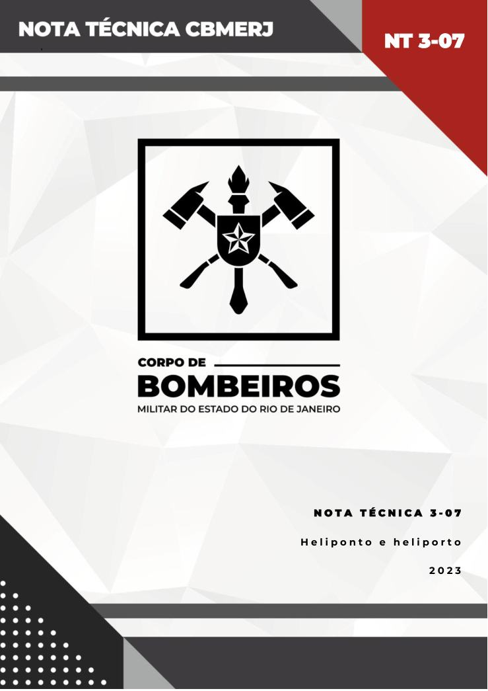
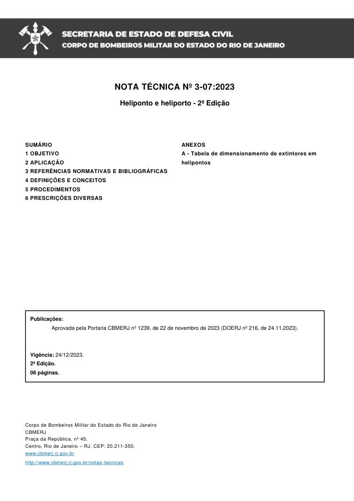
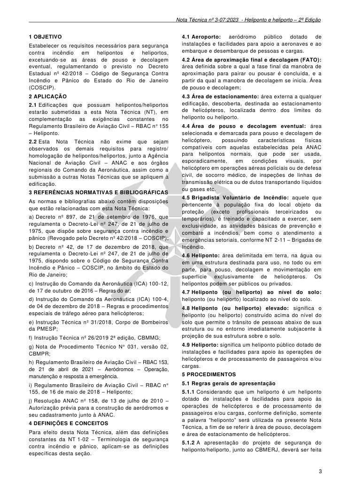
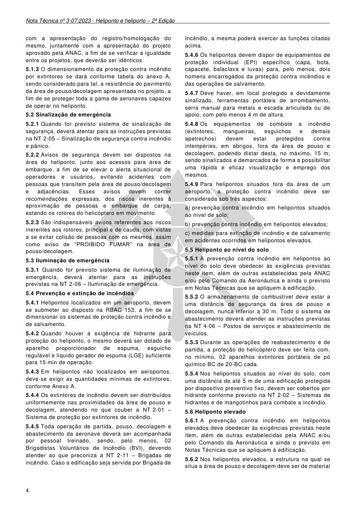
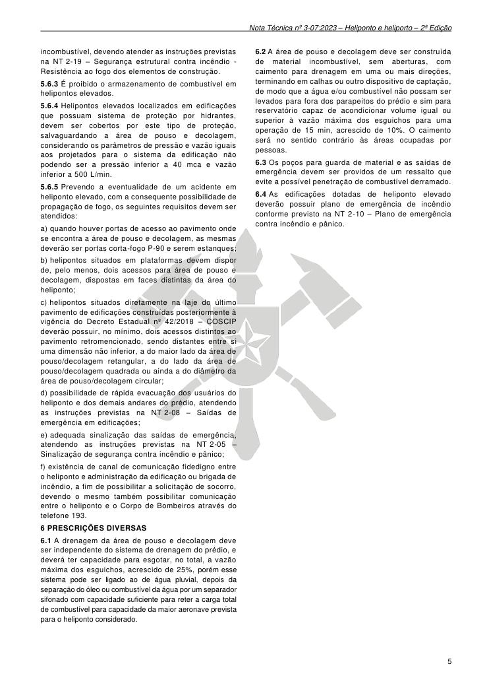
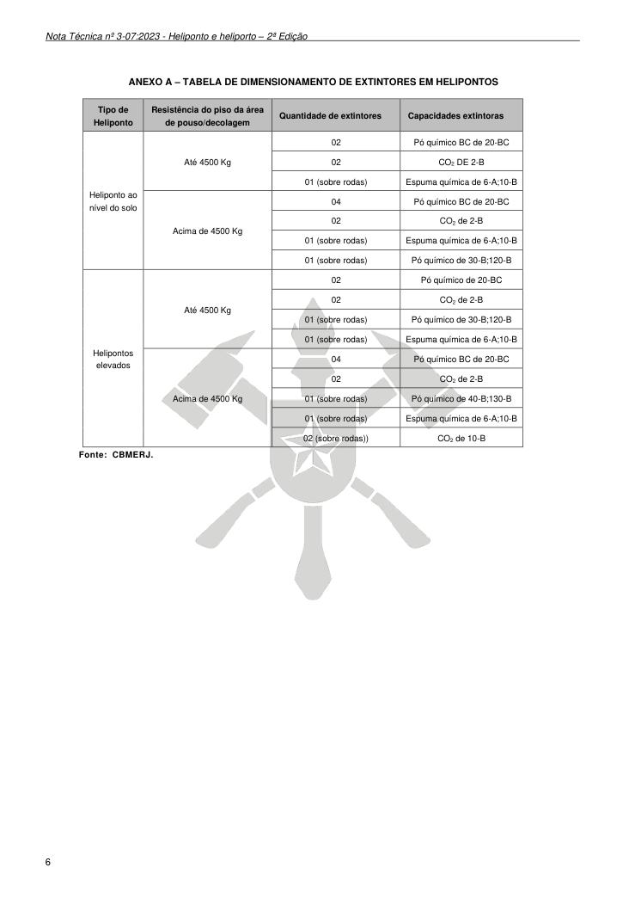

# NT 3-07 - Heliponto e heliporto

> Conversão integral para consulta computacional. A numeração de página do PDF foi preservada. Quando houver tabela complexa, símbolo ou desenho, conferir também a representação visual indicada e o PDF oficial.

## Sumário por página

- [Página 1](#pagina-1)
- [Página 2](#pagina-2)
- [Página 3](#pagina-3)
- [Página 4](#pagina-4)
- [Página 5](#pagina-5)
- [Página 6](#pagina-6)

---

## Página 1

### NT 3-07

’

### N O T A T É C N I C A 3 - 0 7

H e l i p o n t o e h e l i p o r t o

2 0 2 3

---

## Página 2

NOTA TÉCNICA Nº 3-07:2023

Heliponto e heliporto - 2ª Edição

Aprovada pela Portaria CBMERJ nº 1239, de 22 de novembro de 2023 (DOERJ nº 216, de 24.11.2023).

Publicada no Boletim da SEDEC/CBMERJ nº XX, de XX de XX de 2023.

### SUMÁRIO

### 1 OBJETIVO

### 2 APLICAÇÃO

### 3 REFERÊNCIAS NORMATIVAS E BIBLIOGRÁFICAS

### 4 DEFINIÇÕES E CONCEITOS

### 5 PROCEDIMENTOS

### 6 PRESCRIÇÕES DIVERSAS

Publicações:

Vigência: 24/12/2023.

2ª Edição.

06 páginas.

Corpo de Bombeiros Militar do Estado do Rio de Janeiro CBMERJ Praça da República, nº 45, Centro, Rio de Janeiro - RJ. CEP: 20.211-350. www.cbmerj.rj.gov.br

http://www.cbmerj.rj.gov.br/notas-tecnicas

### ANEXOS

A - Tabela de dimensionamento de extintores em

helipontos

---

## Página 3

### 1 OBJETIVO

Estabelecer os requisitos necessários para segurança contra incêndio em helipontos e heliportos, excetuando-se as áreas de pouso e decolagem eventual, regulamentando o previsto no Decreto Estadual nº 42/2018 - Código de Segurança Contra Incêndio e Pânico do Estado do Rio de Janeiro (COSCIP).

### 2 APLICAÇÃO

2.1 Edificações que possuam helipontos/heliportos estarão submetidas a esta Nota Técnica (NT), em complementação as exigências constantes no Regulamento Brasileiro de Aviação Civil - RBAC n° 155 - Heliponto.

2.2 Esta Nota Técnica não exime que sejam observados os demais requisitos para registro/ homologação de helipontos/heliportos, junto a Agência Nacional de Aviação Civil - ANAC e aos órgãos regionais do Comando da Aeronáutica, assim como a submissão a outras Notas Técnicas que se apliquem à edificação.

### 3 REFERÊNCIAS NORMATIVAS E BIBLIOGRÁFICAS

As normas e bibliografias abaixo contêm disposições que estão relacionadas com esta Nota Técnica:

a) Decreto nº 897, de 21 de setembro de 1976, que regulamenta o Decreto-Lei nº 247, de 21 de julho de 1975, que dispõe sobre segurança contra incêndio e pânico (Revogado pelo Decreto nº 42/2018 - COSCIP);

b) Decreto nº 42, de 17 de dezembro de 2018, que regulamenta o Decreto-Lei nº 247, de 21 de julho de 1975, dispondo sobre o Código de Segurança Contra Incêndio e Pânico - COSCIP, no âmbito do Estado do Rio de Janeiro;

c) Instrução do Comando da Aeronáutica (ICA) 100-12, de 17 de outubro de 2016 - Regras do ar;

d) Instrução do Comando da Aeronáutica (ICA) 100-4, de 04 de dezembro de 2018 - Regras e procedimentos especiais de tráfego aéreo para helicópteros;

e) Instrução Técnica nº 31/2018, Corpo de Bombeiros da PMESP;

f) Instrução Técnica nº 26/2019 2ª edição, CBMMG;

g) Nota de Procedimento Técnico N° 031, versão 02, CBMPR;

h) Regulamento Brasileiro de Aviação Civil - RBAC 153, de 21 de abril de 2021 - Aeródromos - Operação, manutenção e resposta a emergência.

i) Regulamento Brasileiro de Aviação Civil - RBAC n° 155, de 16 de maio de 2018 - Heliponto;

j) Resolução ANAC nº 158, de 13 de julho de 2010 - Autorização prévia para a construção de aeródromos e seu cadastramento junto à ANAC.

### 4 DEFINIÇÕES E CONCEITOS

Para efeito desta Nota Técnica, além das definições constantes da NT 1-02 - Terminologia de segurança contra incêndio e pânico, aplicam-se as definições específicas desta seção.

4.1 Aeroporto: aeródromo público dotado de instalações e facilidades para apoio a aeronaves e ao embarque e desembarque de pessoas e cargas.

4.2 Área de aproximação final e decolagem (FATO): área definida sobre a qual a fase final da manobra de aproximação para pairar ou pousar é concluída, e a partir da qual a manobra de decolagem se inicia. Área de pouso e decolagem;

4.3 Área de estacionamento: área externa a qualquer edificação, descoberta, destinada ao estacionamento de helicópteros, localizada dentro dos limites do heliponto ou heliporto.

4.4 Área de pouso e decolagem eventual: área selecionada e demarcada para pouso e decolagem de helicóptero, possuindo características físicas compatíveis com aquelas estabelecidas pela ANAC para helipontos normais, que pode ser usada, esporadicamente, em condições visuais, por helicóptero em operações aéreas policiais ou de defesa civil, de socorro médico, de inspeções de linhas de transmissão elétrica ou de dutos transportando líquidos ou gases etc.

4.5 Brigadista Voluntário de Incêndio: aquele que pertencente à população fixa do local objeto da proteção (exceto profissionais terceirizados ou temporários), é treinado e capacitado a exercer, sem exclusividade, as atividades básicas de prevenção e combate a incêndios, bem como o atendimento a emergências setoriais, conforme NT 2-11 - Brigadas de Incêndio.

4.6 Heliponto: área delimitada em terra, na água ou em uma estrutura destinada para uso, no todo ou em parte, para pouso, decolagem e movimentação em superfície exclusivamente de helicópteros. Os helipontos podem ser públicos ou privados.

4.7 Heliponto (ou heliporto) ao nível do solo: heliponto (ou heliporto) localizado ao nível do solo.

4.8 Heliponto (ou heliporto) elevado: significa o heliponto (ou heliporto) construído acima do nível do solo que permite o trânsito de pessoas abaixo de sua estrutura ou no entorno imediatamente subjacente à projeção de sua estrutura sobre o solo.

4.9 Heliporto: significa um heliponto público dotado de instalações e facilidades para apoio às operações de helicópteros e de processamento de passageiros e/ou cargas.

### 5 PROCEDIMENTOS

5.1 Regras gerais de apresentação

5.1.1 Considerando que um heliporto é um heliponto dotado de instalações e facilidades para apoio às operações de helicópteros e de processamento de passageiros e/ou cargas, conforme definição, somente a palavra “heliponto” será utilizada na presente Nota Técnica, a fim de se referir à área de pouso, decolagem e área de estacionamento de helicópteros.

5.1.2 A apresentação do projeto de segurança do heliponto/heliporto, junto ao CBMERJ, deverá ser feita

---

## Página 4

com a apresentação do registro/homologação do mesmo, juntamente com a apresentação do projeto aprovado pela ANAC, a fim de se verificar a igualdade entre os projetos, que deverão ser idênticos.

5.1.3 O dimensionamento da proteção contra incêndio por extintores se dará conforme tabela do anexo A, sendo considerado para tal, a resistência do pavimento da área de pouso/decolagem apresentada no projeto, a fim de se proteger toda a gama de aeronaves capazes de operar no heliponto.

5.2 Sinalização de emergência

5.2.1 Quando for previsto sistema de sinalização de segurança, deverá atentar para as instruções previstas na NT 2-05 - Sinalização de segurança contra incêndio e pânico.

5.2.2 Avisos de segurança devem ser dispostos na área do heliponto, junto aos acessos para área de embarque, a fim de se elevar o alerta situacional de operadores e usuários, evitando acidentes com pessoas que transitem pela área de pouso/decolagem e adjacências. Esses avisos devem conter recomendações expressas, dos riscos inerentes à aproximação de pessoas e embarque de carga, estando os rotores do helicóptero em movimento.

5.2.3 São indispensáveis avisos referentes aos riscos inerentes aos rotores, principal e de cauda, com vistas a se evitar colisão de pessoas com os mesmos, assim como aviso de “PROIBIDO FUMAR” na área de pouso/decolagem.

5.3 Iluminação de emergência

5.3.1 Quando for previsto sistema de iluminação de emergência, deverá atentar para as instruções previstas na NT 2-06 - Iluminação de emergência.

5.4 Prevenção e extinção de incêndios

5.4.1 Helipontos localizados em um aeroporto, devem se submeter ao disposto na RBAC 153, a fim de se dimensionar os sistemas de proteção contra incêndio e de salvamento.

5.4.2 Quando houver a exigência de hidrante para proteção do heliponto, o mesmo deverá ser dotado de aparelho proporcionador de espuma, esguicho regulável e líquido gerador de espuma (LGE) suficiente para 15 min de operação.

5.4.3 Em helipontos não localizados em aeroportos, deve-se exigir as quantidades mínimas de extintores, conforme Anexo A.

5.4.4 Os extintores de incêndio devem ser distribuídos uniformemente nas proximidades da área de pouso e decolagem, atendendo no que couber a NT 2-01 - Sistema de proteção por extintores de incêndio.

5.4.5 Toda operação de partida, pouso, decolagem e abastecimento da aeronave deverá ser acompanhada por pessoal treinado, sendo, pelo menos, 02 Brigadistas Voluntários de Incêndio (BVI), devendo atender ao que preconiza a NT 2-11 - Brigadas de incêndio. Caso a edificação seja servida por Brigada de

Incêndio, a mesma poderá exercer as funções citadas acima.

5.4.6 Os helipontos devem dispor de equipamentos de proteção individual (EPI) específico (capa, bota, capacete, balaclava e luvas) para, pelo menos, dois homens encarregados da proteção contra incêndios e das operações de salvamento.

5.4.7 Deve haver, em local protegido e devidamente sinalizado, ferramentas portáteis de arrombamento, serra manual para metais e escada articulada ou de apoio, com pelo menos 4 m de altura.

5.4.8 Os equipamentos de combate a incêndio (extintores, mangueiras, esguichos e demais apetrechos) devem estar protegidos contra intempéries, em abrigos, fora da área de pouso e decolagem, podendo distar desta, no máximo, 15 m, sendo sinalizados e demarcados de forma a possibilitar uma rápida e eficaz visualização e emprego dos mesmos.

5.4.9 Para helipontos situados fora da área de um aeroporto, a proteção contra incêndio deve ser considerada sob três aspectos:

a) prevenção contra incêndio em helipontos situados ao nível de solo;

b) prevenção contra incêndio em helipontos elevados;

c) medidas para extinção de incêndio e de salvamento em acidentes ocorridos em helipontos elevados.

5.5 Heliponto ao nível do solo

5.5.1 A prevenção contra incêndio em helipontos ao nível do solo deve obedecer às exigências previstas neste item, além de outras estabelecidas pela ANAC e/ou pelo Comando da Aeronáutica e ainda o previsto em Notas Técnicas que se apliquem à edificação.

5.5.2 O armazenamento de combustível deve estar a uma distância de segurança da área de pouso e decolagem, nunca inferior a 30 m. Todo o sistema de abastecimento deverá atender as instruções previstas na NT 4-06 - Postos de serviços e abastecimento de veículos.

5.5.3 Durante as operações de reabastecimento e de partida, a proteção do helicóptero deve ser feita com, no mínimo, 02 aparelhos extintores portáteis de pó químico BC de 20-BC cada.

5.5.4 Nos helipontos situados ao nível do solo, com uma distância de até 5 m de uma edificação protegida por dispositivo preventivo fixo, devem ser cobertos por hidrante conforme previsto na NT 2-02 - Sistemas de hidrantes e de mangotinhos para combate a incêndio.

5.6 Heliponto elevado

5.6.1 A prevenção contra incêndio em helipontos elevados deve obedecer às exigências previstas neste item, além de outras estabelecidas pela ANAC e/ou pelo Comando da Aeronáutica e ainda o previsto em Notas Técnicas que se apliquem à edificação.

5.6.2 Nos helipontos elevados, a estrutura na qual se situa a área de pouso e decolagem deve ser de material

---

## Página 5

incombustível, devendo atender as instruções previstas na NT 2-19 - Segurança estrutural contra incêndio - Resistência ao fogo dos elementos de construção.

5.6.3 É proibido o armazenamento de combustível em helipontos elevados.

5.6.4 Helipontos elevados localizados em edificações que possuam sistema de proteção por hidrantes, devem ser cobertos por este tipo de proteção, salvaguardando a área de pouso e decolagem, considerando os parâmetros de pressão e vazão iguais aos projetados para o sistema da edificação não podendo ser a pressão inferior a 40 mca e vazão inferior a 500 L/min.

5.6.5 Prevendo a eventualidade de um acidente em heliponto elevado, com a consequente possibilidade de propagação de fogo, os seguintes requisitos devem ser atendidos:

a) quando houver portas de acesso ao pavimento onde se encontra a área de pouso e decolagem, as mesmas deverão ser portas corta-fogo P-90 e serem estanques;

b) helipontos situados em plataformas devem dispor de, pelo menos, dois acessos para área de pouso e decolagem, dispostas em faces distintas da área do heliponto;

c) helipontos situados diretamente na laje do último pavimento de edificações construídas posteriormente à vigência do Decreto Estadual nº 42/2018 - COSCIP deverão possuir, no mínimo, dois acessos distintos ao pavimento retromencionado, sendo distantes entre si uma dimensão não inferior, a do maior lado da área de pouso/decolagem retangular, a do lado da área de pouso/decolagem quadrada ou ainda a do diâmetro da área de pouso/decolagem circular;

d) possibilidade de rápida evacuação dos usuários do heliponto e dos demais andares do prédio, atendendo as instruções previstas na NT 2-08 - Saídas de emergência em edificações;

e) adequada sinalização das saídas de emergência, atendendo as instruções previstas na NT 2-05 - Sinalização de segurança contra incêndio e pânico;

f) existência de canal de comunicação fidedigno entre o heliponto e administração da edificação ou brigada de incêndio, a fim de possibilitar a solicitação de socorro, devendo o mesmo também possibilitar comunicação entre o heliponto e o Corpo de Bombeiros através do telefone 193.

### 6 PRESCRIÇÕES DIVERSAS

6.1 A drenagem da área de pouso e decolagem deve ser independente do sistema de drenagem do prédio, e deverá ter capacidade para esgotar, no total, a vazão máxima dos esguichos, acrescido de 25%, porém esse sistema pode ser ligado ao de água pluvial, depois da separação do óleo ou combustível da água por um separador sifonado com capacidade suficiente para reter a carga total de combustível para capacidade da maior aeronave prevista para o heliponto considerado.

6.2 A área de pouso e decolagem deve ser construída de material incombustível, sem aberturas, com caimento para drenagem em uma ou mais direções, terminando em calhas ou outro dispositivo de captação, de modo que a água e/ou combustível não possam ser levados para fora dos parapeitos do prédio e sim para reservatório capaz de acondicionar volume igual ou superior à vazão máxima dos esguichos para uma operação de 15 min, acrescido de 10%. O caimento será no sentido contrário às áreas ocupadas por pessoas.

6.3 Os poços para guarda de material e as saídas de emergência devem ser providos de um ressalto que evite a possível penetração de combustível derramado.

6.4 As edificações dotadas de heliponto elevado deverão possuir plano de emergência de incêndio conforme previsto na NT 2-10 - Plano de emergência contra incêndio e pânico.

---

## Página 6

### ANEXO A - TABELA DE DIMENSIONAMENTO DE EXTINTORES EM HELIPONTOS

Fonte: CBMERJ.

### Tabelas extraídas

#### Tabela 1 da página

|  | Tipo de |  |  | Resistência do piso da área |  | Quantidade de extintores | Capacidades extintoras |
| --- | --- | --- | --- | --- | --- | --- | --- |
|  | Heliponto |  |  | de pouso/decolagem |  |  |  |
| Heliponto ao nível do solo |  |  | Até 4500 Kg |  |  | 02 | Pó químico BC de 20-BC |
|  |  |  |  |  |  | 02 | CO DE 2-B 2 |
|  |  |  |  |  |  | 01 (sobre rodas) | Espuma química de 6-A;10-B |
|  |  |  | Acima de 4500 Kg |  |  | 04 | Pó químico BC de 20-BC |
|  |  |  |  |  |  | 02 | CO de 2-B 2 |
|  |  |  |  |  |  | 01 (sobre rodas) | Espuma química de 6-A;10-B |
|  |  |  |  |  |  | 01 (sobre rodas) | Pó químico de 30-B;120-B |
| Helipontos elevados |  |  | Até 4500 Kg |  |  | 02 | Pó químico de 20-BC |
|  |  |  |  |  |  | 02 | CO de 2-B 2 |
|  |  |  |  |  |  | 01 (sobre rodas) | Pó químico de 30-B;120-B |
|  |  |  |  |  |  | 01 (sobre rodas) | Espuma química de 6-A;10-B |
|  |  |  | Acima de 4500 Kg |  |  | 04 | Pó químico BC de 20-BC |
|  |  |  |  |  |  | 02 | CO de 2-B 2 |
|  |  |  |  |  |  | 01 (sobre rodas) | Pó químico de 40-B;130-B |
|  |  |  |  |  |  | 01 (sobre rodas) | Espuma química de 6-A;10-B |
|  |  |  |  |  |  | 02 (sobre rodas)) | CO de 10-B 2 |
