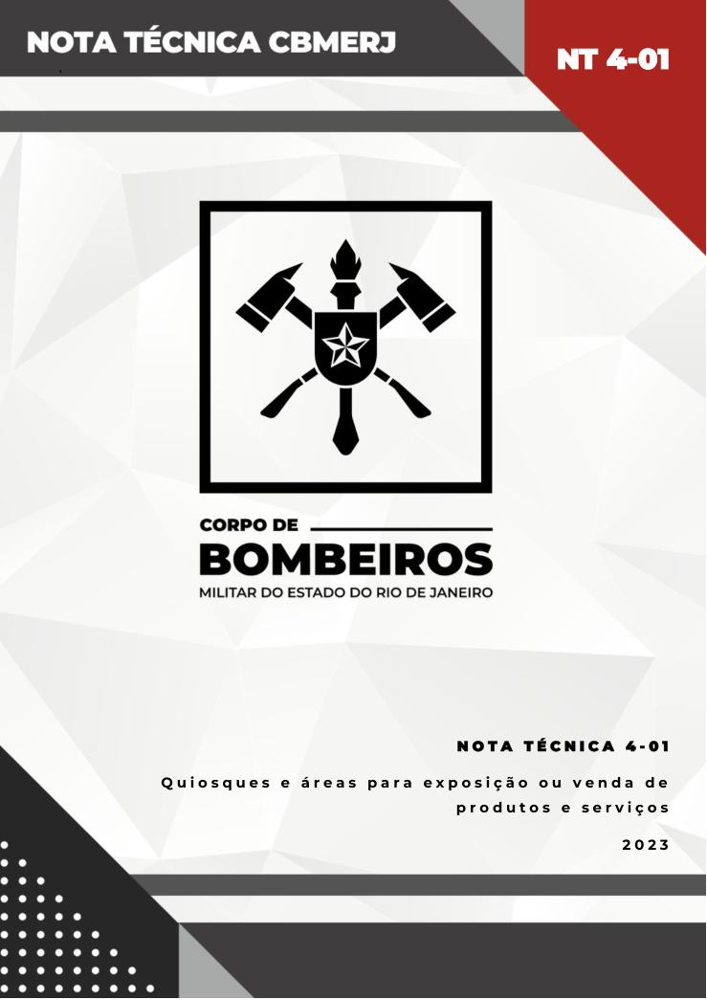
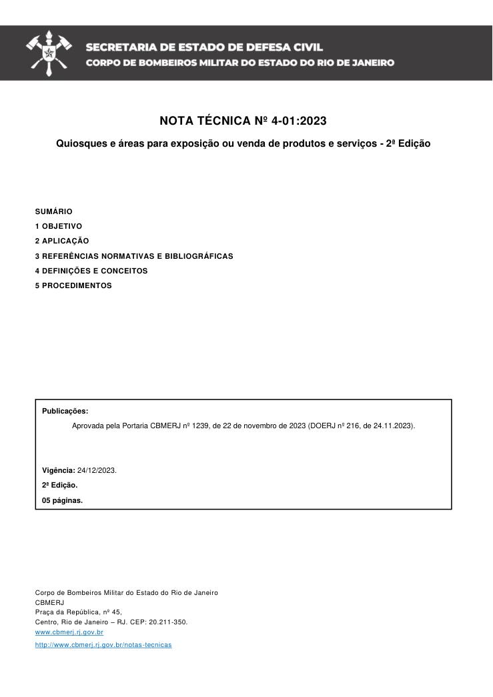
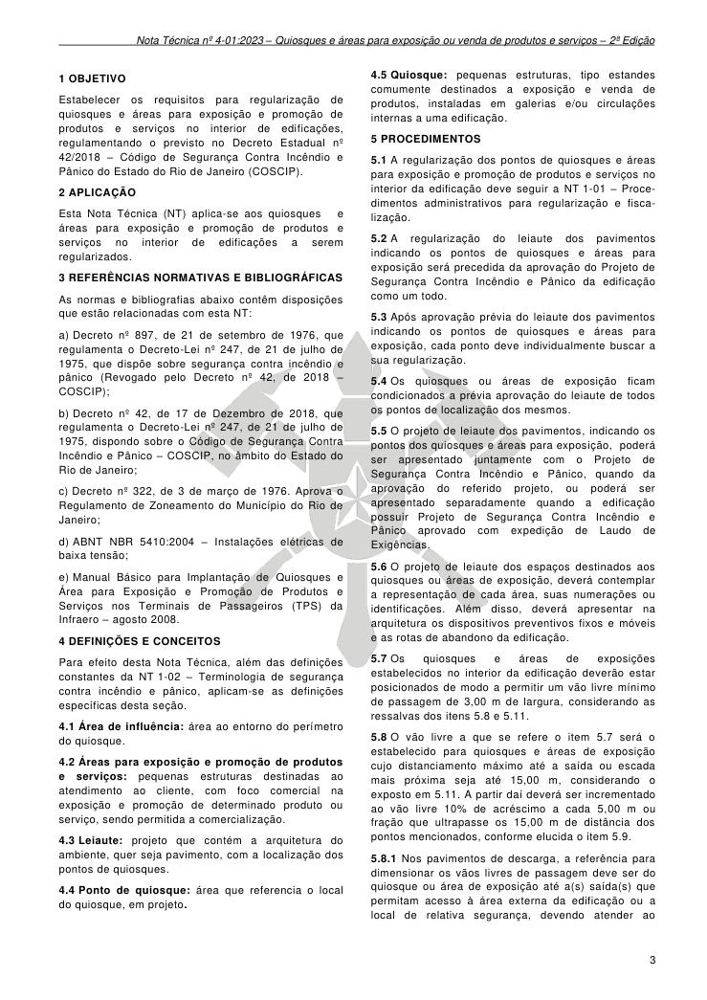
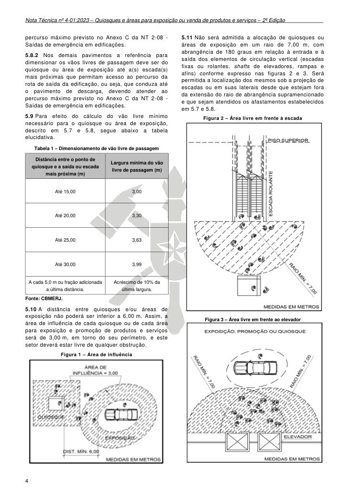
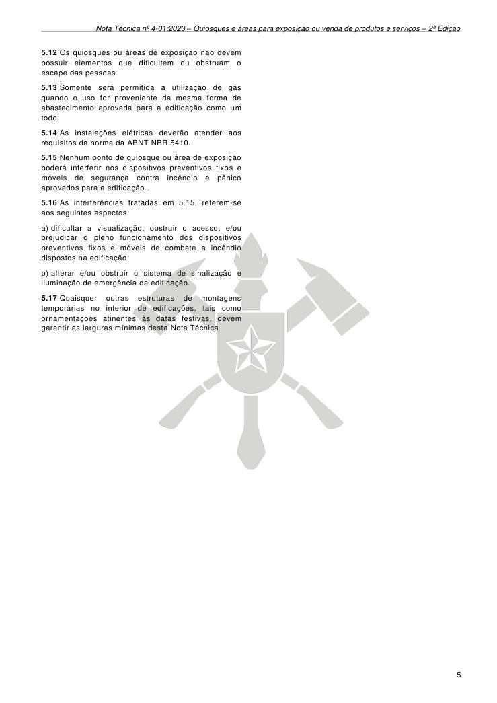

# NT 4-01 - Quiosques e áreas para exposição ou venda de produtos e serviços

> Conversão integral para consulta computacional. A numeração de página do PDF foi preservada. Quando houver tabela complexa, símbolo ou desenho, conferir também a representação visual indicada e o PDF oficial.

## Sumário por página

- [Página 1](#pagina-1)
- [Página 2](#pagina-2)
- [Página 3](#pagina-3)
- [Página 4](#pagina-4)
- [Página 5](#pagina-5)

---

## Página 1

### NT 4-01

’

### N O T A T É C N I C A 4 - 0 1

Q u i o s q u e s e á r e a s p a r a e x p o s i ç ã o o u v e n d a d e

p r o d u t o s e s e r v i ç o s

2 0 2 3

---

## Página 2

NOTA TÉCNICA Nº 4-01:2023

Quiosques e áreas para exposição ou venda de produtos e serviços - 2ª Edição

### SUMÁRIO

### 1 OBJETIVO

### 2 APLICAÇÃO

### 3 REFERÊNCIAS NORMATIVAS E BIBLIOGRÁFICAS

### 4 DEFINIÇÕES E CONCEITOS

### 5 PROCEDIMENTOS

Publicações:

Aprovada pela Portaria CBMERJ nº 1239, de 22 de novembro de 2023 (DOERJ nº 216, de 24.11.2023).

Publicada no Boletim da SEDEC/CBMERJ nº XX, de XX de XX de 2023.

Vigência: 24/12/2023.

2ª Edição.

05 páginas.

Corpo de Bombeiros Militar do Estado do Rio de Janeiro CBMERJ Praça da República, nº 45, Centro, Rio de Janeiro - RJ. CEP: 20.211-350. www.cbmerj.rj.gov.br

http://www.cbmerj.rj.gov.br/notas-tecnicas

---

## Página 3

### 1 OBJETIVO

Estabelecer os requisitos para regularização de quiosques e áreas para exposição e promoção de produtos e serviços no interior de edificações, regulamentando o previsto no Decreto Estadual nº 42/2018 - Código de Segurança Contra Incêndio e Pânico do Estado do Rio de Janeiro (COSCIP).

### 2 APLICAÇÃO

Esta Nota Técnica (NT) aplica-se aos quiosques e áreas para exposição e promoção de produtos e serviços no interior de edificações a serem regularizados.

### 3 REFERÊNCIAS NORMATIVAS E BIBLIOGRÁFICAS

As normas e bibliografias abaixo contêm disposições que estão relacionadas com esta NT:

a) Decreto nº 897, de 21 de setembro de 1976, que regulamenta o Decreto-Lei nº 247, de 21 de julho de 1975, que dispõe sobre segurança contra incêndio e pânico (Revogado pelo Decreto nº 42, de 2018 - COSCIP);

b) Decreto nº 42, de 17 de Dezembro de 2018, que regulamenta o Decreto-Lei nº 247, de 21 de julho de 1975, dispondo sobre o Código de Segurança Contra Incêndio e Pânico - COSCIP, no âmbito do Estado do Rio de Janeiro;

c) Decreto nº 322, de 3 de março de 1976. Aprova o Regulamento de Zoneamento do Município do Rio de Janeiro;

d) ABNT NBR 5410:2004 - Instalações elétricas de baixa tensão;

e) Manual Básico para Implantação de Quiosques e Área para Exposição e Promoção de Produtos e Serviços nos Terminais de Passageiros (TPS) da Infraero - agosto 2008.

### 4 DEFINIÇÕES E CONCEITOS

Para efeito desta Nota Técnica, além das definições constantes da NT 1-02 - Terminologia de segurança contra incêndio e pânico, aplicam-se as definições específicas desta seção.

4.1 Área de influência: área ao entorno do perímetro do quiosque.

4.2 Áreas para exposição e promoção de produtos e serviços: pequenas estruturas destinadas ao atendimento ao cliente, com foco comercial na exposição e promoção de determinado produto ou serviço, sendo permitida a comercialização.

4.3 Leiaute: projeto que contém a arquitetura do ambiente, quer seja pavimento, com a localização dos pontos de quiosques.

4.4 Ponto de quiosque: área que referencia o local do quiosque, em projeto.

4.5 Quiosque: pequenas estruturas, tipo estandes comumente destinados a exposição e venda de produtos, instaladas em galerias e/ou circulações internas a uma edificação.

### 5 PROCEDIMENTOS

5.1 A regularização dos pontos de quiosques e áreas para exposição e promoção de produtos e serviços no interior da edificação deve seguir a NT 1-01 - Procedimentos administrativos para regularização e fiscalização.

5.2 A regularização do leiaute dos pavimentos indicando os pontos de quiosques e áreas para exposição será precedida da aprovação do Projeto de Segurança Contra Incêndio e Pânico da edificação como um todo.

5.3 Após aprovação prévia do leiaute dos pavimentos indicando os pontos de quiosques e áreas para exposição, cada ponto deve individualmente buscar a sua regularização.

5.4 Os quiosques ou áreas de exposição ficam condicionados a prévia aprovação do leiaute de todos os pontos de localização dos mesmos.

5.5 O projeto de leiaute dos pavimentos, indicando os pontos dos quiosques e áreas para exposição, poderá ser apresentado juntamente com o Projeto de Segurança Contra Incêndio e Pânico, quando da aprovação do referido projeto, ou poderá ser apresentado separadamente quando a edificação possuir Projeto de Segurança Contra Incêndio e Pânico aprovado com expedição de Laudo de Exigências.

5.6 O projeto de leiaute dos espaços destinados aos quiosques ou áreas de exposição, deverá contemplar a representação de cada área, suas numerações ou identificações. Além disso, deverá apresentar na arquitetura os dispositivos preventivos fixos e móveis e as rotas de abandono da edificação.

5.7 Os quiosques e áreas de exposições estabelecidos no interior da edificação deverão estar posicionados de modo a permitir um vão livre mínimo de passagem de 3,00 m de largura, considerando as ressalvas dos itens 5.8 e 5.11.

5.8 O vão livre a que se refere o item 5.7 será o estabelecido para quiosques e áreas de exposição cujo distanciamento máximo até a saída ou escada mais próxima seja até 15,00 m, considerando o exposto em 5.11. A partir daí deverá ser incrementado ao vão livre 10% de acréscimo a cada 5,00 m ou fração que ultrapasse os 15,00 m de distância dos pontos mencionados, conforme elucida o item 5.9.

5.8.1 Nos pavimentos de descarga, a referência para dimensionar os vãos livres de passagem deve ser do quiosque ou área de exposição até a(s) saída(s) que permitam acesso à área externa da edificação ou a local de relativa segurança, devendo atender ao

---

## Página 4

percurso máximo previsto no Anexo C da NT 2-08 - Saídas de emergência em edificações.

5.8.2 Nos demais pavimentos a referência para dimensionar os vãos livres de passagem deve ser do quiosque ou área de exposição até a(s) escada(s) mais próximas que permitam acesso ao percurso da rota de saída da edificação, ou seja, que conduza até o pavimento de descarga, devendo atender ao percurso máximo previsto no Anexo C da NT 2-08 - Saídas de emergência em edificações.

5.9 Para efeito do cálculo do vão livre mínimo necessário para o quiosque ou área de exposição, descrito em 5.7 e 5.8, segue abaixo a tabela elucidativa.

Tabela 1 - Dimensionamento de vão livre de passagem

Fonte: CBMERJ.

5.10 A distância entre quiosques e/ou áreas de exposição não poderá ser inferior a 6,00 m. Assim, a área de influência de cada quiosque ou de cada área para exposição e promoção de produtos e serviços será de 3,00 m, em torno do seu perímetro, e este setor deverá estar livre de qualquer obstrução.

Figura 1 - Área de influência

5.11 Não será admitida a alocação de quiosques ou áreas de exposição em um raio de 7,00 m, com abrangência de 180 graus em relação à entrada e à saída dos elementos de circulação vertical (escadas fixas ou rolantes, shafts de elevadores, rampas e afins) conforme expresso nas figuras 2 e 3. Será permitida a localização dos mesmos sob a projeção de escadas ou em suas laterais desde que estejam fora da extensão do raio de abrangência supramencionado e que sejam atendidos os afastamentos estabelecidos em 5.7 e 5.8.

Figura 2 - Área livre em frente à escada

Fonte: CBMERJ.

Figura 3 - Área livre em frente ao elevador

### Tabelas extraídas (bruto, não usar para citação)
#### Tabela 1 da página

|  | Distância entre o ponto de |  | Largura mínima do vão livre de passagem (m) |
| --- | --- | --- | --- |
|  | quiosque e a saída ou escada |  |  |
|  | mais próxima (m) |  |  |
| Até 15,00 |  |  | 3,00 |
| Até 20,00 |  |  | 3,30 |
| Até 25,00 |  |  | 3,63 |
| Até 30,00 |  |  | 3,99 |
| A cada 5,0 m ou fração adicionada a última distância. |  |  | Acréscimo de 10% da última largura. |

<!-- tabela-conferida: Tabela 1 p4 -->
### Tabela 1 — Dimensionamento de vão livre de passagem (conferida)

| Distância entre o ponto de quiosque e a saída ou escada mais próxima (m) | Largura mínima do vão livre de passagem (m) |
| --- | --- |
| Até 15,00 | 3,00 |
| Até 20,00 | 3,30 |
| Até 25,00 | 3,63 |
| Até 30,00 | 3,99 |
| A cada 5,0 m ou fração adicionada a última distância. | Acréscimo de 10% da última largura. |

Fonte: NT 4-01, página 4, Tabela 1; conferida em 2026-09-29 (visual + geometrica).
Fonte indicada na página: CBMERJ.
Conferência aritmética: cada largura é 10 % maior que a anterior, arredondada para baixo no centímetro (3,00 → 3,30 → 3,63 → 3,993 ≈ 3,99).
<!-- /tabela-conferida: Tabela 1 p4 -->

---

## Página 5

5.12 Os quiosques ou áreas de exposição não devem possuir elementos que dificultem ou obstruam o escape das pessoas.

5.13 Somente será permitida a utilização de gás quando o uso for proveniente da mesma forma de abastecimento aprovada para a edificação como um todo.

5.14 As instalações elétricas deverão atender aos requisitos da norma da ABNT NBR 5410.

5.15 Nenhum ponto de quiosque ou área de exposição poderá interferir nos dispositivos preventivos fixos e móveis de segurança contra incêndio e pânico aprovados para a edificação.

5.16 As interferências tratadas em 5.15, referem-se aos seguintes aspectos:

a) dificultar a visualização, obstruir o acesso, e/ou prejudicar o pleno funcionamento dos dispositivos preventivos fixos e móveis de combate a incêndio dispostos na edificação;

b) alterar e/ou obstruir o sistema de sinalização e iluminação de emergência da edificação.

5.17 Quaisquer outras estruturas de montagens temporárias no interior de edificações, tais como ornamentações atinentes às datas festivas, devem garantir as larguras mínimas desta Nota Técnica.
