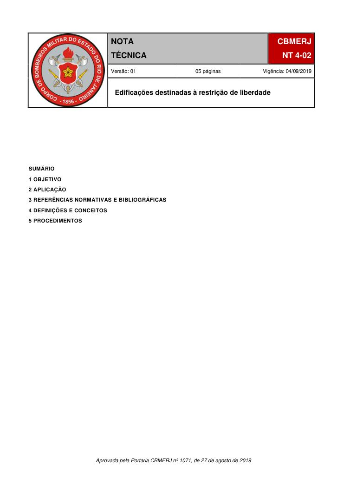

# NT 4-02 - Edificações destinadas à restrição de liberdade

> Conversão integral para consulta computacional. A numeração de página do PDF foi preservada. Quando houver tabela complexa, símbolo ou desenho, conferir também a representação visual indicada e o PDF oficial.

## Sumário por página

- [Página 1](#pagina-1)
- [Página 2](#pagina-2)
- [Página 3](#pagina-3)
- [Página 4](#pagina-4)
- [Página 5](#pagina-5)

---

## Página 1

### SUMÁRIO

### 1 OBJETIVO

### 2 APLICAÇÃO

### 3 REFERÊNCIAS NORMATIVAS E BIBLIOGRÁFICAS

### 4 DEFINIÇÕES E CONCEITOS

### 5 PROCEDIMENTOS

Aprovada pela Portaria CBMERJ nº 1071, de 27 de agosto de 2019

### Tabelas extraídas

#### Tabela 1 da página

|  |  |  |  | NOTA TÉCNICA |  | CBMERJ |  |  |
| --- | --- | --- | --- | --- | --- | --- | --- | --- |
|  |  |  |  |  |  | NT 4-02 |  |  |
|  |  |  |  | Versão: 01 05 páginas Vigência: 04/09/2019 |  |  |  |  |
|  |  |  |  | Edificações destinadas à restrição de liberdade |  |  |  |  |

---

## Página 2

> Página sem texto extraível suficiente; consultar a representação visual ou o PDF oficial.

---

## Página 3

### 1 OBJETIVO

Estabelecer os requisitos de segurança contra incêndio e pânico para as edificações destinadas à restrição de liberdade das pessoas, tais como penitenciárias, cadeias públicas, colônias agrícolas, industriais ou similares, casas do albergado, centros de observação criminológica, serviços de atenção ao paciente judiciário e centrais de penas e medidas alternativas regulamentando o Decreto Estadual nº 42/2018 - Código de Segurança Contra Incêndio e Pânico do Estado do Rio de Janeiro (COSCIP).

### 2 APLICAÇÃO

Esta Nota Técnica (NT) aplica-se aos estabelecimentos penais, destinados à restrição de liberdade das pessoas, que estejam submetidos às exigências contidas no Decreto Estadual nº 42/2018 - COSCIP.

### 3 REFERÊNCIAS NORMATIVAS E BIBLIOGRÁFICAS

As normas e bibliografias abaixo contêm disposições que estão relacionadas com esta NT:

a) Decreto nº 42, de 17 de dezembro de 2018 - Regulamenta o Decreto-Lei nº 247, de 21 de julho de 1975, dispondo sobre o Código de Segurança Contra Incêndio e Pânico - COSCIP, no âmbito do Estado do Rio de Janeiro;

b) Resolução nº 9, de 09 de Novembro de 2011, do Conselho Nacional De Política Criminal e Penitenciária - CNPCP / Ministério da Justiça - Edita as Diretrizes Básicas para Arquitetura Penal, revogando o disposto da Resolução CNPCP nº 3, de 23 de setembro de 2005.

### 4 DEFINIÇÕES E CONCEITOS

Para efeito desta Nota Técnica, além das definições constantes na NT 1-02 - Terminologia de segurança contra incêndio e pânico, aplicam-se as definições específicas desta seção.

4.1 Cadeias públicas ou estabelecimentos congêneres: destinados ao recolhimento de pessoas presas em caráter provisório.

4.2 Casas do albergado: destinadas a abrigar pessoas presas que cumprem pena privativa de liberdade em regime aberto, ou pena de limitação de fins de semana.

4.3 Cela coletiva: qualquer cômodo com a mesma função de uma cela individual, porém com capacidade para abrigar mais de uma pessoa presa simultaneamente.

4.4 Cela individual: menor célula possível de um estabelecimento penal. Neste cômodo devem ser previstos cama e área de higienização pessoal com pelo menos lavatório e aparelho sanitário, além da circulação.

4.5 Central de penas e medidas alternativas:

destinada a atender pessoas que cumprem penas e medidas alternativas.

4.6 Centros de observação criminológica: estabelecimentos penais de regime fechado e de segurança máxima onde devem ser realizados os exames cujos resultados serão encaminhados às Comissões Técnicas de Classificação, as quais indicarão o tipo de estabelecimento e o tratamento adequado para cada pessoa presa.

4.7 Colônias agrícolas, industriais ou similares: destinadas a abrigar pessoas presas que cumprem pena em regime semiaberto.

4.8 Complexos ou conjuntos penais: conjunto arquitetônico de unidades penais que formem um sistema de atendimentos com algumas funções centralizadas e compartilhadas pelas unidades que o constituem.

4.9 Estabelecimentos para idosos: estabelecimentos penais próprios, ou seções, ou módulos autônomos, incorporados ou anexos a estabelecimentos para adultos, destinados a abrigar pessoas presas que tenham no mínimo 60 anos de idade ao ingressarem ou as que completem essa idade durante o tempo de privação de liberdade.

4.10 Estabelecimentos penais: todos aqueles utilizados pela Justiça com a finalidade de alojar ou atender pessoas presas, quer provisórias, quer condenadas, ou ainda aquelas que estejam submetidas à medida de segurança.

4.11 Hospitais de custódia e tratamento, aqui denominados serviço de atenção ao paciente judiciário: destinados a atender pessoas submetidas à medida de segurança.

4.12 Módulo de celas: conjunto de celas individuais e/ou coletivas, que podem ser dispostas em alas (corredores) e possuem a estrutura intrínseca às atividades primordiais e cotidianas das pessoas presas como, por exemplo, refeitório, pátio descoberto (pátio de Sol), pátio coberto. Normalmente possui uma entrada única assistida por um controle de agentes de segurança penitenciária. O módulo de celas pode ser chamado também de raio, bloco, pavilhão, vivência, entre outros.

4.13 Pátio de sol: espaço coletivo destinado ao banho de sol e ao lazer.

4.14 Penitenciárias: destinados ao recolhimento de pessoas presas com condenação à pena privativa de liberdade em regime fechado, dotadas de celas individuais e coletivas.

4.15 Setor externo: setor cujo fluxo componha-se de pessoas estranhas ao estabelecimento (visitas), guarda externa e pessoal administrativo.

4.16 Setor intermediário: setor onde possam vir a circular pessoas dos setores externo e interno.

---

## Página 4

Código de Segurança Contra Incêndio e Pânico - Estado do Rio de Janeiro________________________________________

4.17 Setor interno: setor onde o uso é exclusivamente de pessoas presas e de funcionários.

### 5 PROCEDIMENTOS

5.1 As exigências para as edificações destinadas à restrição de liberdade de pessoas, ou estabelecimentos penais, deverão atender ao Decreto Estadual nº 42/2018 - COSCIP, permitindo-se as ressalvas desta NT.

5.1.1 Canalização Preventiva

Admite-se a não instalação de hidrantes dentro do setor interno do estabelecimento prisional, ou seja, na área destinada exclusivamente aos internos e funcionários, em virtude das características de ocupação da edificação, sendo autorizado o uso de até 4 lances de mangueiras de 38 mm (1 1/2”), do Tipo II, com distância máxima a proteger de 60 m, respeitando-se os obstáculos decorrentes das compartimentações a serem vencidas, desde que atendidas as exigências específicas de pressão e vazão constantes na NT 2-02 - Sistemas de hidrantes e de mangotinhos para combate a incêndio, em complementação ao previsto no Decreto Estadual nº 42/2018 - COSCIP.

5.1.2 Saídas de Emergência

Deverão atender aos requisitos da NT 2-08 - Saídas de emergência em edificações, sendo permitidas as seguintes alterações:

a) circulações adotadas na área prisional (módulos de celas individuais ou coletivas) devem ter a largura mínima de 2 m para corredores que possuam celas em apenas uma de suas laterais, e de 2,50 m para aqueles com celas nas duas laterais;

b) circulações que interligam os módulos de celas (individuais ou coletivos) à outras áreas do setor interno devem ter a largura mínima de 2,50 m;

c) todos os módulos de celas (individuais ou coletivos) devem possuir ligação para um pátio cercado, geralmente destinado ao banho de Sol (Pátio de Sol), por se tratar de local de relativa segurança, de forma a garantir um escape rápido e seguro em caso de sinistro, garantindo-se as larguras mínimas definidas nas alíneas a e b, conforme o caso;

d) Fica somente o setor interno do estabelecimento prisional dispensado da exigência de escada enclausurada à prova de fumaça, quando couber, garantindo abertura mínima de ventilação de 0,40 m² e que não se criem obstáculos na circulação dos internos. As escadas deverão ser dotadas de corrimão de alvenaria em ambos os lados.

5.1.3 Sistema de Proteção Contra Descargas Atmosféricas

Quando instalados, deverão atender aos requisitos da NT 2-12 - Sistema de proteção contra descargas atmosféricas (SPDA).

5.1.4 Aparelhos Extintores

Deverão atender aos requisitos da NT 2-01 - Sistema de proteção por extintores de incêndio, sendo permitidas as seguintes alterações:

a) admite-se que não se instalem aparelhos extintores dentro do setor interno do estabelecimento prisional, ou seja, na área destinada exclusivamente aos internos e funcionários. Para tanto, deverão existir aparelhos extintores exclusivos para a proteção do setor interno, instalados nas áreas de acesso exclusivo aos funcionários, os quais deverão estar acessíveis a uma distância máxima de 60 m entre um aparelho e o ponto mais distante a ser protegido;

b) ficam excluídos do cálculo para efeito de área máxima a ser protegida por unidade extintora, os módulos de celas e demais áreas do setor interno, onde haja circulação de detentos;

c) fica mantido no setor externo e intermediário, a área máxima a ser protegida e a distância máxima para o alcance do operador, por unidade extintora, conforme a NT 2-01 - Sistema de proteção por extintores de incêndio.

5.1.5 Iluminação de emergência e Sinalização de segurança contra incêndio e pânico

Deverão atender aos requisitos das NT 2-06 - Iluminação de emergência e NT 2-05 - Sinalização de segurança contra incêndio e pânico, para os setores excludentes ao setor interno a qual deverá orientar para a área externa da edificação. No setor interno haverá apenas iluminação de emergência embutidas em alvenaria, nas áreas de circulação que interligam os módulos de celas aos pátios cercados, destinados ao banho de Sol.

5.1.6 Detecção e alarme de incêndio

Quando instalados, deverão atender aos requisitos da NT 2-07 - Sistema de detecção e alarme de Incêndio, sendo permitido que as botoeiras de acionamento do alarme estejam exclusivamente nas áreas de acesso único de funcionários.

5.1.7 Acesso de viaturas

Deverão atender aos requisitos da NT 2-16 - Acesso de viaturas em edificações.

5.1.8 Brigada de incêndio

Deverão atender aos requisitos da NT 2-11 - Brigadas de incêndio, sendo permitida a seguinte alteração: ser constituída por funcionários devidamente capacitados e composta, no setor interno, por todos os funcionários.

5.1.9 Projeto de Segurança Contra Incêndio e Pânico

Na planta de situação do projeto de segurança, deverão ser identificadas, de forma clara, as áreas que compõem os setores externo, intermediário e

---

## Página 5

interno, com a finalidade de definir corretamente as exigências contidas nesta NT.

5.1.10 A Casa de Máquinas de Incêndio (CMI), a Reserva Técnica para Incêndio (RTI), bem como a subestação de energia elétrica, os grupos geradores, a central de gás e etc., por motivo de segurança, devem ser localizados no setor externo da edificação, sem acesso aos internos.

5.1.11 As edificações destinadas à restrição de liberdade de pessoas que possuírem áreas destinadas a atendimento hospitalar ou similares deverão atender aos requisitos do Decreto Estadual nº 42/2018 - COSCIP.

5.1.12 Sistemas de Chuveiros Automáticos / Sprinklers

Deverão atender aos requisitos da NT 2-03 - Sistemas de chuveiros automáticos / sprinklers, sendo permitidas as seguintes alterações:

a) admite-se que não se instalem bicos de chuveiros automáticos / sprinklers dentro do setor interno do estabelecimento prisional, ou seja, na área destinada exclusivamente aos internos e funcionários.
