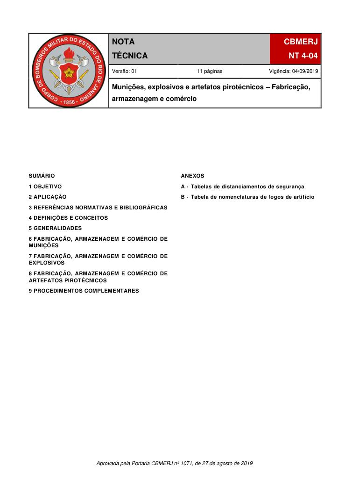
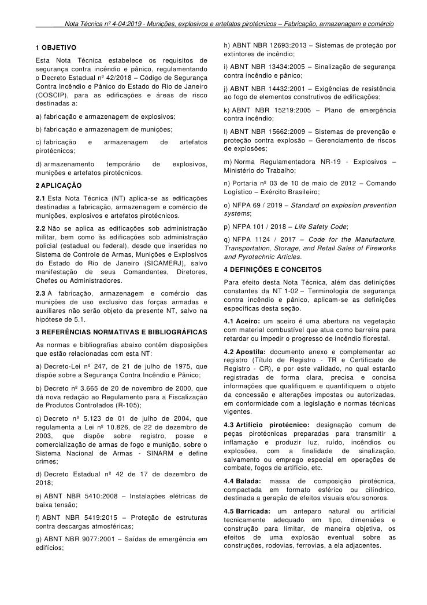
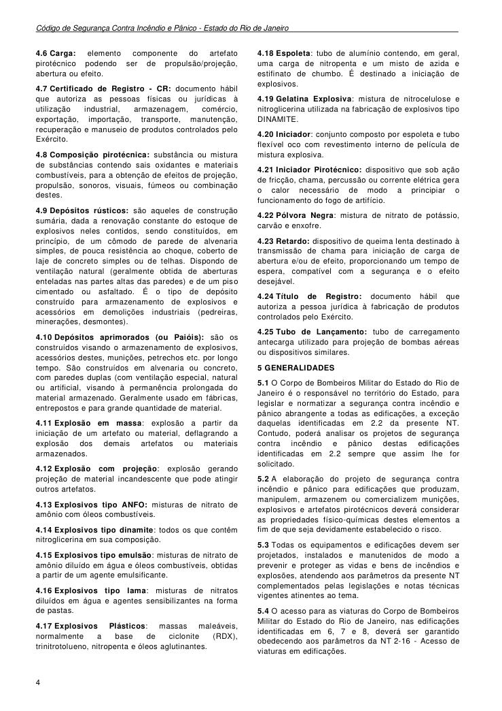
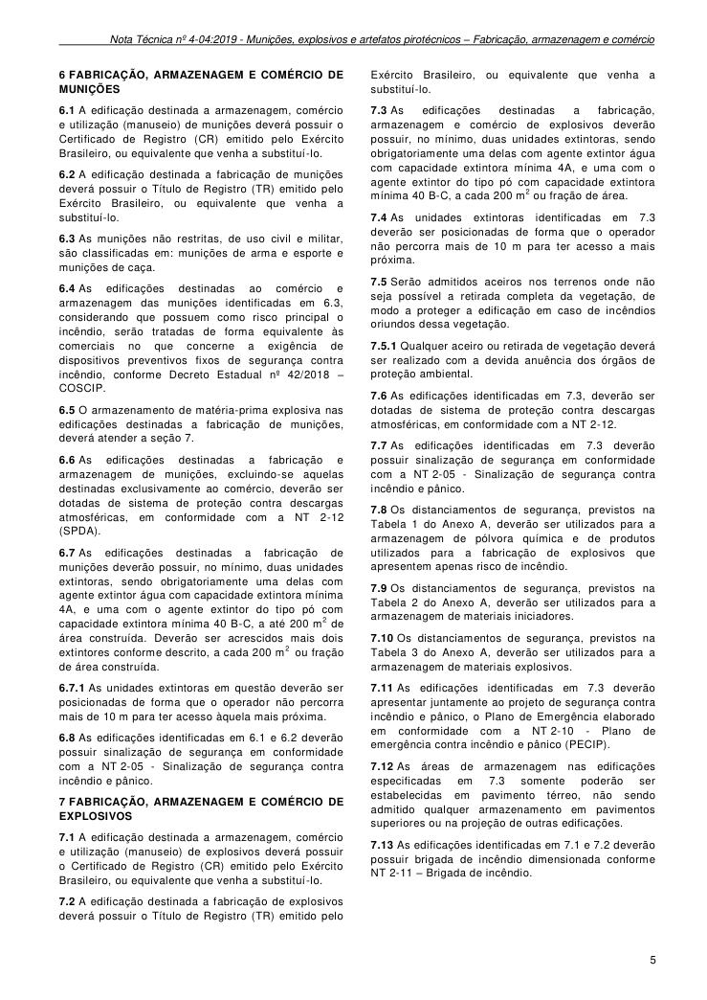
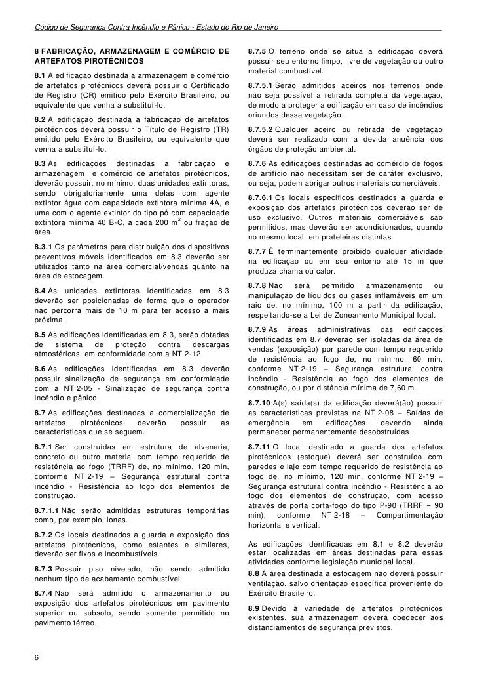
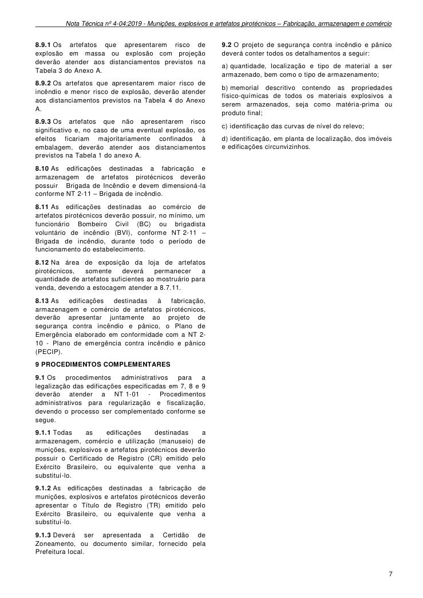
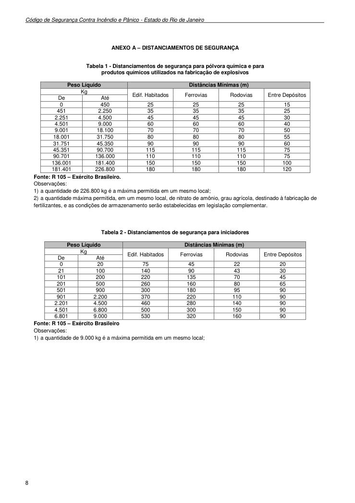
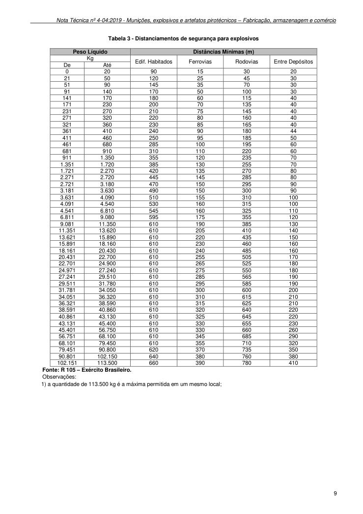
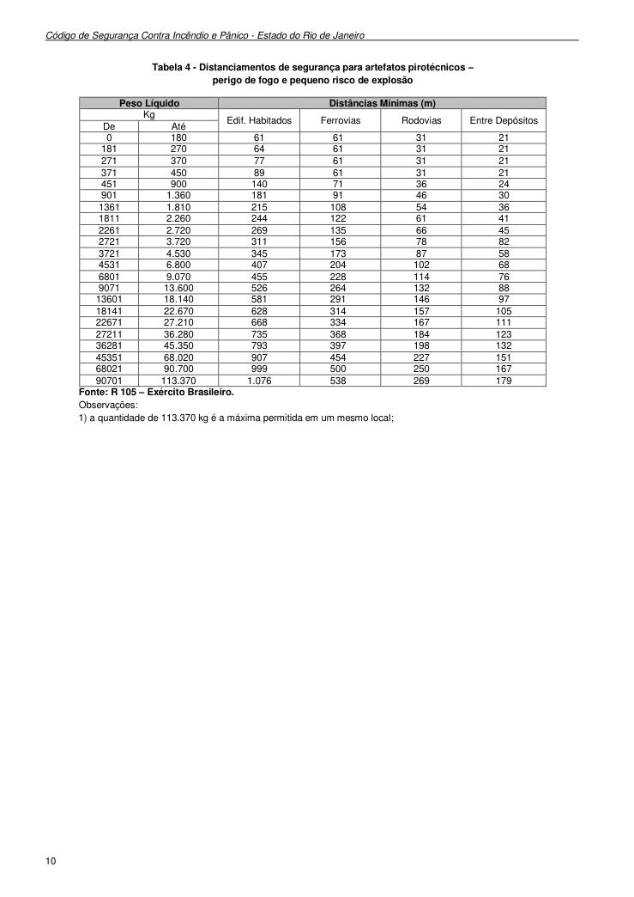
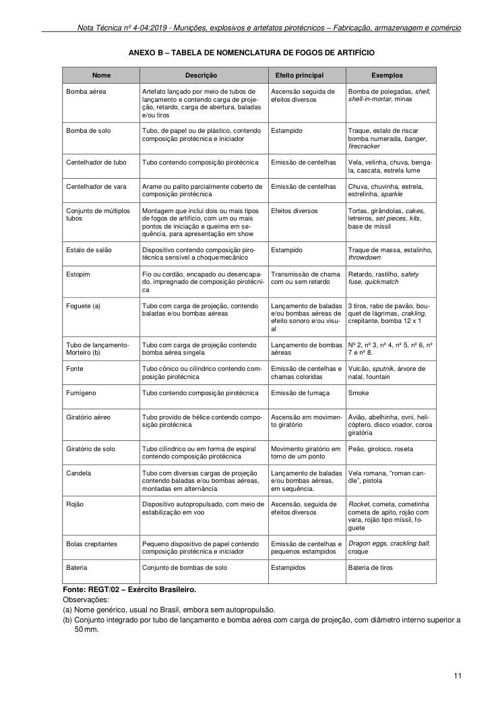

# NT 4-04 - Munições, explosivos e artefatos pirotécnicos - Fabricação, armazenagem e comércio

> Conversão integral para consulta computacional. A numeração de página do PDF foi preservada. Quando houver tabela complexa, símbolo ou desenho, conferir também a representação visual indicada e o PDF oficial.

## Sumário por página

- [Página 1](#pagina-1)
- [Página 2](#pagina-2)
- [Página 3](#pagina-3)
- [Página 4](#pagina-4)
- [Página 5](#pagina-5)
- [Página 6](#pagina-6)
- [Página 7](#pagina-7)
- [Página 8](#pagina-8)
- [Página 9](#pagina-9)
- [Página 10](#pagina-10)
- [Página 11](#pagina-11)

---

## Página 1

Aprovada pela Portaria CBMERJ nº 1071, de 27 de agosto de 2019

### SUMÁRIO

### 1 OBJETIVO

### 2 APLICAÇÃO

### 3 REFERÊNCIAS NORMATIVAS E BIBLIOGRÁFICAS

### 4 DEFINIÇÕES E CONCEITOS

### 5 GENERALIDADES

### 6 FABRICAÇÃO, ARMAZENAGEM E COMÉRCIO DE MUNIÇÕES

### 7 FABRICAÇÃO, ARMAZENAGEM E COMÉRCIO DE EXPLOSIVOS

### 8 FABRICAÇÃO, ARMAZENAGEM E COMÉRCIO DE ARTEFATOS PIROTÉCNICOS

### 9 PROCEDIMENTOS COMPLEMENTARES

### ANEXOS

A - Tabelas de distanciamentos de segurança

B - Tabela de nomenclaturas de fogos de artifício

### Tabelas extraídas (bruto, não usar para citação)
#### Tabela 1 da página

|  |  |  | NOTA TÉCNICA |  | CBMERJ |  |
| --- | --- | --- | --- | --- | --- | --- |
|  |  |  |  |  | NT 4-04 |  |
|  |  |  | Versão: 01 11 páginas Vigência: 04/09/2019 |  |  |  |
|  |  |  | Munições, explosivos e artefatos pirotécnicos - Fabricação, armazenagem e comércio |  |  |  |

---

## Página 2

> Página sem texto extraível suficiente; consultar a representação visual ou o PDF oficial.

---

## Página 3

### 1 OBJETIVO

Esta Nota Técnica estabelece os requisitos de segurança contra incêndio e pânico, regulamentando o Decreto Estadual nº 42/2018 - Código de Segurança Contra Incêndio e Pânico do Estado do Rio de Janeiro (COSCIP), para as edificações e áreas de risco destinadas a:

a) fabricação e armazenagem de explosivos;

b) fabricação e armazenagem de munições;

c) fabricação e armazenagem de artefatos pirotécnicos;

d) armazenamento temporário de explosivos, munições e artefatos pirotécnicos.

### 2 APLICAÇÃO

2.1 Esta Nota Técnica (NT) aplica-se as edificações destinadas a fabricação, armazenagem e comércio de munições, explosivos e artefatos pirotécnicos.

2.2 Não se aplica as edificações sob administração militar, bem como às edificações sob administração policial (estadual ou federal), desde que inseridas no Sistema de Controle de Armas, Munições e Explosivos do Estado do Rio de Janeiro (SICAMERJ), salvo manifestação de seus Comandantes, Diretores, Chefes ou Administradores.

2.3 A fabricação, armazenagem e comércio das munições de uso exclusivo das forças armadas e auxiliares não serão objeto da presente NT, salvo na hipótese de 5.1.

### 3 REFERÊNCIAS NORMATIVAS E BIBLIOGRÁFICAS

As normas e bibliografias abaixo contêm disposições que estão relacionadas com esta NT:

a) Decreto-Lei nº 247, de 21 de julho de 1975, que dispõe sobre a Segurança Contra Incêndio e Pânico;

b) Decreto nº 3.665 de 20 de novembro de 2000, que dá nova redação ao Regulamento para a Fiscalização de Produtos Controlados (R-105);

c) Decreto nº 5.123 de 01 de julho de 2004, que regulamenta a Lei nº 10.826, de 22 de dezembro de 2003, que dispõe sobre registro, posse e comercialização de armas de fogo e munição, sobre o Sistema Nacional de Armas - SINARM e define crimes;

d) Decreto Estadual nº 42 de 17 de dezembro de 2018;

e) ABNT NBR 5410:2008 - Instalações elétricas de baixa tensão;

f) ABNT NBR 5419:2015 - Proteção de estruturas contra descargas atmosféricas;

g) ABNT NBR 9077:2001 - Saídas de emergência em edifícios;

h) ABNT NBR 12693:2013 - Sistemas de proteção por extintores de incêndio;

i) ABNT NBR 13434:2005 - Sinalização de segurança contra incêndio e pânico;

j) ABNT NBR 14432:2001 - Exigências de resistência ao fogo de elementos construtivos de edificações;

k) ABNT NBR 15219:2005 - Plano de emergência contra incêndio;

l) ABNT NBR 15662:2009 - Sistemas de prevenção e proteção contra explosão - Gerenciamento de riscos de explosões;

m) Norma Regulamentadora NR-19 - Explosivos - Ministério do Trabalho;

n) Portaria nº 03 de 10 de maio de 2012 - Comando Logístico - Exército Brasileiro;

o) NFPA 69 / 2019 - Standard on explosion prevention systems;

p) NFPA 101 / 2018 - Life Safety Code;

q) NFPA 1124 / 2017 - Code for the Manufacture, Transportation, Storage, and Retail Sales of Fireworks and Pyrotechnic Articles.

### 4 DEFINIÇÕES E CONCEITOS

Para efeito desta Nota Técnica, além das definições constantes da NT 1-02 - Terminologia de segurança contra incêndio e pânico, aplicam-se as definições específicas desta seção.

4.2 Apostila: documento anexo e complementar ao registro (Título de Registro - TR e Certificado de Registro - CR), e por este validado, no qual estarão registradas de forma clara, precisa e concisa informações que qualifiquem e quantifiquem o objeto da concessão e alterações impostas ou autorizadas, em conformidade com a legislação e normas técnicas vigentes.

4.3 Artifício pirotécnico: designação comum de peças pirotécnicas preparadas para transmitir a inflamação e produzir luz, ruído, incêndios ou explosões, com a finalidade de sinalização, salvamento ou emprego especial em operações de combate, fogos de artifício, etc.

4.4 Balada: massa de composição pirotécnica, compactada em formato esférico ou cilíndrico, destinada a geração de efeitos visuais e/ou sonoros.

4.5 Barricada: um anteparo natural ou artificial tecnicamente adequado em tipo, dimensões e construção para limitar, de maneira objetiva, os efeitos de uma explosão eventual sobre as construções, rodovias, ferrovias, a ela adjacentes.

### Tabelas extraídas (bruto, não usar para citação)
#### Tabela 1 da página

|  | m aceiro é uma abertura na vegetação |
| --- | --- |
| com material combustível que atua como barreira para |  |
| retardar ou impedir o progresso de incêndio florestal. |  |

---

## Página 4

Código de Segurança Contra Incêndio e Pânico - Estado do Rio de Janeiro

4.6 Carga: elemento componente do artefato pirotécnico podendo ser de propulsão/projeção, abertura ou efeito.

4.7 Certificado de Registro - CR: documento hábil que autoriza as pessoas físicas ou jurídicas à utilização industrial, armazenagem, comércio, exportação, importação, transporte, manutenção, recuperação e manuseio de produtos controlados pelo Exército.

4.8 Composição pirotécnica: substância ou mistura de substâncias contendo sais oxidantes e materiais combustíveis, para a obtenção de efeitos de projeção, propulsão, sonoros, visuais, fúmeos ou combinação destes.

4.9 Depósitos rústicos: são aqueles de construção sumária, dada a renovação constante do estoque de explosivos neles contidos, sendo constituídos, em princípio, de um cômodo de parede de alvenaria simples, de pouca resistência ao choque, coberto de laje de concreto simples ou de telhas. Dispondo de ventilação natural (geralmente obtida de aberturas enteladas nas partes altas das paredes) e de um piso cimentado ou asfaltado. É o tipo de depósito construído para armazenamento de explosivos e acessórios em demolições industriais (pedreiras, minerações, desmontes).

4.10 Depósitos aprimorados (ou Paióis): são os construídos visando o armazenamento de explosivos, acessórios destes, munições, petrechos etc. por longo tempo. São construídos em alvenaria ou concreto, com paredes duplas (com ventilação especial, natural ou artificial, visando à permanência prolongada do material armazenado. Geralmente usado em fábricas, entrepostos e para grande quantidade de material.

4.11 Explosão em massa: explosão a partir da iniciação de um artefato ou material, deflagrando a explosão dos demais artefatos ou materiais armazenados.

4.12 Explosão com projeção: explosão gerando projeção de material incandescente que pode atingir outros artefatos.

4.13 Explosivos tipo ANFO: misturas de nitrato de amônio com óleos combustíveis.

4.14 Explosivos tipo dinamite: todos os que contêm nitroglicerina em sua composição.

4.15 Explosivos tipo emulsão: misturas de nitrato de amônio diluído em água e óleos combustíveis, obtidas a partir de um agente emulsificante.

4.16 Explosivos tipo lama: misturas de nitratos diluídos em água e agentes sensibilizantes na forma de pastas.

4.17 Explosivos Plásticos: massas maleáveis, normalmente a base de ciclonite (RDX), trinitrotolueno, nitropenta e óleos aglutinantes.

4.18 Espoleta: tubo de alumínio contendo, em geral, uma carga de nitropenta e um misto de azida e estifinato de chumbo. É destinado a iniciação de explosivos.

4.19 Gelatina Explosiva: mistura de nitrocelulose e nitroglicerina utilizada na fabricação de explosivos tipo DINAMITE.

4.20 Iniciador: conjunto composto por espoleta e tubo flexível oco com revestimento interno de película de mistura explosiva.

4.21 Iniciador Pirotécnico: dispositivo que sob ação de fricção, chama, percussão ou corrente elétrica gera o calor necessário de modo a principiar o funcionamento do fogo de artifício.

4.22 Pólvora Negra: mistura de nitrato de potássio, carvão e enxofre.

4.23 Retardo: dispositivo de queima lenta destinado à transmissão de chama para iniciação de carga de abertura e/ou de efeito, proporcionando um tempo de espera, compatível com a segurança e o efeito desejável.

4.24 Título de Registro: documento hábil que autoriza a pessoa jurídica à fabricação de produtos controlados pelo Exército.

4.25 Tubo de Lançamento: tubo de carregamento antecarga utilizado para projeção de bombas aéreas ou dispositivos similares.

### 5 GENERALIDADES

5.1 O Corpo de Bombeiros Militar do Estado do Rio de Janeiro é o responsável no território do Estado, para legislar e normatizar a segurança contra incêndio e pânico abrangente a todas as edificações, a exceção daquelas identificadas em 2.2 da presente NT. Contudo, poderá analisar os projetos de segurança contra incêndio e pânico destas edificações identificadas em 2.2 sempre que assim lhe for solicitado.

5.2 A elaboração do projeto de segurança contra incêndio e pânico para edificações que produzam, manipulem, armazenem ou comercializem munições, explosivos e artefatos pirotécnicos deverá considerar as propriedades físico-químicas destes elementos a fim de que seja devidamente estabelecido o risco.

5.3 Todas os equipamentos e edificações devem ser projetados, instalados e manutenidos de modo a prevenir e proteger as vidas e bens de incêndios e explosões, atendendo aos parâmetros da presente NT complementados pelas legislações e notas técnicas vigentes atinentes ao tema.

5.4 O acesso para as viaturas do Corpo de Bombeiros Militar do Estado do Rio de Janeiro, nas edificações identificadas em 6, 7 e 8, deverá ser garantido obedecendo aos parâmetros da NT 2-16 - Acesso de viaturas em edificações.

---

## Página 5

### 6 FABRICAÇÃO, ARMAZENAGEM E COMÉRCIO DE MUNIÇÕES

6.1 A edificação destinada a armazenagem, comércio e utilização (manuseio) de munições deverá possuir o Certificado de Registro (CR) emitido pelo Exército Brasileiro, ou equivalente que venha a substituí-lo.

6.2 A edificação destinada a fabricação de munições deverá possuir o Título de Registro (TR) emitido pelo Exército Brasileiro, ou equivalente que venha a substituí-lo.

6.3 As munições não restritas, de uso civil e militar, são classificadas em: munições de arma e esporte e munições de caça.

6.4 As edificações destinadas ao comércio e armazenagem das munições identificadas em 6.3, considerando que possuem como risco principal o incêndio, serão tratadas de forma equivalente às comerciais no que concerne a exigência de dispositivos preventivos fixos de segurança contra incêndio, conforme Decreto Estadual nº 42/2018 - COSCIP.

6.5 O armazenamento de matéria-prima explosiva nas edificações destinadas a fabricação de munições, deverá atender a seção 7.

6.6 As edificações destinadas a fabricação e armazenagem de munições, excluindo-se aquelas destinadas exclusivamente ao comércio, deverão ser dotadas de sistema de proteção contra descargas atmosféricas, em conformidade com a NT 2-12 (SPDA).

6.7 As edificações destinadas a fabricação de munições deverão possuir, no mínimo, duas unidades extintoras, sendo obrigatoriamente uma delas com agente extintor água com capacidade extintora mínima 4A, e uma com o agente extintor do tipo pó com capacidade extintora mínima 40 B-C, a até 200 m2 de área construída. Deverão ser acrescidos mais dois extintores conforme descrito, a cada 200 m 2 ou fração de área construída.

6.7.1 As unidades extintoras em questão deverão ser posicionadas de forma que o operador não percorra mais de 10 m para ter acesso àquela mais próxima.

6.8 As edificações identificadas em 6.1 e 6.2 deverão possuir sinalização de segurança em conformidade com a NT 2-05 - Sinalização de segurança contra incêndio e pânico.

### 7 FABRICAÇÃO, ARMAZENAGEM E COMÉRCIO DE EXPLOSIVOS

7.1 A edificação destinada a armazenagem, comércio e utilização (manuseio) de explosivos deverá possuir o Certificado de Registro (CR) emitido pelo Exército Brasileiro, ou equivalente que venha a substituí-lo.

7.2 A edificação destinada a fabricação de explosivos deverá possuir o Título de Registro (TR) emitido pelo

Exército Brasileiro, ou equivalente que venha a substituí-lo.

7.3 As edificações destinadas a fabricação, armazenagem e comércio de explosivos deverão possuir, no mínimo, duas unidades extintoras, sendo obrigatoriamente uma delas com agente extintor água com capacidade extintora mínima 4A, e uma com o agente extintor do tipo pó com capacidade extintora mínima 40 B-C, a cada 200 m2 ou fração de área.

7.4 As unidades extintoras identificadas em 7.3 deverão ser posicionadas de forma que o operador não percorra mais de 10 m para ter acesso a mais próxima.

7.5 Serão admitidos aceiros nos terrenos onde não seja possível a retirada completa da vegetação, de modo a proteger a edificação em caso de incêndios oriundos dessa vegetação.

7.5.1 Qualquer aceiro ou retirada de vegetação deverá ser realizado com a devida anuência dos órgãos de proteção ambiental.

7.6 As edificações identificadas em 7.3, deverão ser dotadas de sistema de proteção contra descargas atmosféricas, em conformidade com a NT 2-12.

7.7 As edificações identificadas em 7.3 deverão possuir sinalização de segurança em conformidade com a NT 2-05 - Sinalização de segurança contra incêndio e pânico.

7.8 Os distanciamentos de segurança, previstos na Tabela 1 do Anexo A, deverão ser utilizados para a armazenagem de pólvora química e de produtos utilizados para a fabricação de explosivos que apresentem apenas risco de incêndio.

7.9 Os distanciamentos de segurança, previstos na Tabela 2 do Anexo A, deverão ser utilizados para a armazenagem de materiais iniciadores.

7.10 Os distanciamentos de segurança, previstos na Tabela 3 do Anexo A, deverão ser utilizados para a armazenagem de materiais explosivos.

7.11 As edificações identificadas em 7.3 deverão apresentar juntamente ao projeto de segurança contra incêndio e pânico, o Plano de Emergência elaborado em conformidade com a NT 2-10 - Plano de emergência contra incêndio e pânico (PECIP).

7.12 As áreas de armazenagem nas edificações especificadas em 7.3 somente poderão ser estabelecidas em pavimento térreo, não sendo admitido qualquer armazenamento em pavimentos superiores ou na projeção de outras edificações.

7.13 As edificações identificadas em 7.1 e 7.2 deverão possuir brigada de incêndio dimensionada conforme NT 2-11 - Brigada de incêndio.

---

## Página 6

Código de Segurança Contra Incêndio e Pânico - Estado do Rio de Janeiro

### 8 FABRICAÇÃO, ARMAZENAGEM E COMÉRCIO DE ARTEFATOS PIROTÉCNICOS

8.1 A edificação destinada a armazenagem e comércio de artefatos pirotécnicos deverá possuir o Certificado de Registro (CR) emitido pelo Exército Brasileiro, ou equivalente que venha a substituí-lo.

8.2 A edificação destinada a fabricação de artefatos pirotécnicos deverá possuir o Título de Registro (TR) emitido pelo Exército Brasileiro, ou equivalente que venha a substituí-lo.

8.3 As edificações destinadas a fabricação e armazenagem e comércio de artefatos pirotécnicos, deverão possuir, no mínimo, duas unidades extintoras, sendo obrigatoriamente uma delas com agente extintor água com capacidade extintora mínima 4A, e uma com o agente extintor do tipo pó com capacidade extintora mínima 40 B-C, a cada 200 m2 ou fração de área.

8.3.1 Os parâmetros para distribuição dos dispositivos preventivos móveis identificados em 8.3 deverão ser utilizados tanto na área comercial/vendas quanto na área de estocagem.

8.4 As unidades extintoras identificadas em 8.3 deverão ser posicionadas de forma que o operador não percorra mais de 10 m para ter acesso a mais próxima.

8.5 As edificações identificadas em 8.3, serão dotadas de sistema de proteção contra descargas atmosféricas, em conformidade com a NT 2-12.

8.6 As edificações identificadas em 8.3 deverão possuir sinalização de segurança em conformidade com a NT 2-05 - Sinalização de segurança contra incêndio e pânico.

8.7 As edificações destinadas a comercialização de artefatos pirotécnicos deverão possuir as características que se seguem.

8.7.1 Ser construídas em estrutura de alvenaria, concreto ou outro material com tempo requerido de resistência ao fogo (TRRF) de, no mínimo, 120 min, conforme NT 2-19 - Segurança estrutural contra incêndio - Resistência ao fogo dos elementos de construção.

8.7.1.1 Não serão admitidas estruturas temporárias como, por exemplo, lonas.

8.7.2 Os locais destinados a guarda e exposição dos artefatos pirotécnicos, como estantes e similares, deverão ser fixos e incombustíveis.

8.7.3 Possuir piso nivelado, não sendo admitido nenhum tipo de acabamento combustível.

8.7.4 Não será admitido o armazenamento ou exposição dos artefatos pirotécnicos em pavimento superior ou subsolo, sendo somente permitido no pavimento térreo.

8.7.5 O terreno onde se situa a edificação deverá possuir seu entorno limpo, livre de vegetação ou outro material combustível.

8.7.5.1 Serão admitidos aceiros nos terrenos onde não seja possível a retirada completa da vegetação, de modo a proteger a edificação em caso de incêndios oriundos dessa vegetação.

8.7.5.2 Qualquer aceiro ou retirada de vegetação deverá ser realizado com a devida anuência dos órgãos de proteção ambiental.

8.7.6 As edificações destinadas ao comércio de fogos de artifício não necessitam ser de caráter exclusivo, ou seja, podem abrigar outros materiais comerciáveis.

8.7.6.1 Os locais específicos destinados a guarda e exposição dos artefatos pirotécnicos deverão ser de uso exclusivo. Outros materiais comerciáveis são permitidos, mas deverão ser acondicionados, quando no mesmo local, em prateleiras distintas.

8.7.7 É terminantemente proibido qualquer atividade na edificação ou em seu entorno até 15 m que produza chama ou calor.

8.7.8 Não será permitido armazenamento ou manipulação de líquidos ou gases inflamáveis em um raio de, no mínimo, 100 m a partir da edificação, respeitando-se a Lei de Zoneamento Municipal local.

8.7.9 As áreas administrativas das edificações identificadas em 8.7 deverão ser isoladas da área de vendas (exposição) por parede com tempo requerido de resistência ao fogo de, no mínimo, 60 min, conforme NT 2-19 - Segurança estrutural contra incêndio - Resistência ao fogo dos elementos de construção, ou por distância mínima de 7,60 m.

8.7.10 A(s) saída(s) da edificação deverá(ão) possuir as características previstas na NT 2-08 - Saídas de emergência em edificações, devendo ainda permanecer permanentemente desobstruídas.

8.7.11 O local destinado a guarda dos artefatos pirotécnicos (estoque) deverá ser construído com paredes e laje com tempo requerido de resistência ao fogo de, no mínimo, 120 min, conforme NT 2-19 - Segurança estrutural contra incêndio - Resistência ao fogo dos elementos de construção, com acesso através de porta corta-fogo do tipo P-90 (TRRF = 90 min), conforme NT 2-18 - Compartimentação horizontal e vertical.

As edificações identificadas em 8.1 e 8.2 deverão estar localizadas em áreas destinadas para essas atividades conforme legislação municipal local.

8.8 A área destinada a estocagem não deverá possuir ventilação, salvo orientação específica proveniente do Exército Brasileiro.

8.9 Devido à variedade de artefatos pirotécnicos existentes, sua armazenagem deverá obedecer aos distanciamentos de segurança previstos.

---

## Página 7

8.9.1 Os artefatos que apresentarem risco de explosão em massa ou explosão com projeção deverão atender aos distanciamentos previstos na Tabela 3 do Anexo A.

8.9.2 Os artefatos que apresentarem maior risco de incêndio e menor risco de explosão, deverão atender aos distanciamentos previstos na Tabela 4 do Anexo A.

8.9.3 Os artefatos que não apresentarem risco significativo e, no caso de uma eventual explosão, os efeitos ficariam majoritariamente confinados à embalagem, deverão atender aos distanciamentos previstos na Tabela 1 do anexo A.

8.10 As edificações destinadas a fabricação e armazenagem de artefatos pirotécnicos deverão possuir Brigada de Incêndio e devem dimensioná-la conforme NT 2-11 - Brigada de incêndio.

8.11 As edificações destinadas ao comércio de artefatos pirotécnicos deverão possuir, no mínimo, um funcionário Bombeiro Civil (BC) ou brigadista voluntário de incêndio (BVI), conforme NT 2-11 - Brigada de incêndio, durante todo o período de funcionamento do estabelecimento.

8.12 Na área de exposição da loja de artefatos pirotécnicos, somente deverá permanecer a quantidade de artefatos suficientes ao mostruário para venda, devendo a estocagem atender a 8.7.11.

8.13 As edificações destinadas à fabricação, armazenagem e comércio de artefatos pirotécnicos, deverão apresentar juntamente ao projeto de segurança contra incêndio e pânico, o Plano de Emergência elaborado em conformidade com a NT 2- 10 - Plano de emergência contra incêndio e pânico (PECIP).

### 9 PROCEDIMENTOS COMPLEMENTARES

9.1 Os procedimentos administrativos para a legalização das edificações especificadas em 7, 8 e 9 deverão atender a NT 1-01 - Procedimentos administrativos para regularização e fiscalização, devendo o processo ser complementado conforme se segue.

9.1.1 Todas as edificações destinadas a armazenagem, comércio e utilização (manuseio) de munições, explosivos e artefatos pirotécnicos deverão possuir o Certificado de Registro (CR) emitido pelo Exército Brasileiro, ou equivalente que venha a substituí-lo.

9.1.2 As edificações destinadas a fabricação de munições, explosivos e artefatos pirotécnicos deverão apresentar o Título de Registro (TR) emitido pelo Exército Brasileiro, ou equivalente que venha a substituí-lo.

9.1.3 Deverá ser apresentada a Certidão de Zoneamento, ou documento similar, fornecido pela Prefeitura local.

9.2 O projeto de segurança contra incêndio e pânico deverá conter todos os detalhamentos a seguir:

a) quantidade, localização e tipo de material a ser armazenado, bem como o tipo de armazenamento;

b) memorial descritivo contendo as propriedades físico-químicas de todos os materiais explosivos a serem armazenados, seja como matéria-prima ou produto final;

c) identificação das curvas de nível do relevo;

d) identificação, em planta de localização, dos imóveis e edificações circunvizinhos.

---

## Página 8

Código de Segurança Contra Incêndio e Pânico - Estado do Rio de Janeiro

### ANEXO A - DISTANCIAMENTOS DE SEGURANÇA

Tabela 1 - Distanciamentos de segurança para pólvora química e para

produtos químicos utilizados na fabricação de explosivos

Tabela 2 - Distanciamentos de segurança para iniciadores

### Tabelas extraídas (bruto, não usar para citação)
#### Tabela 1 da página

|  | Peso Líquido |  |  | Distâncias Mínimas (m) |  |  |  |  |
| --- | --- | --- | --- | --- | --- | --- | --- | --- |
| Kg |  |  | Edif. Habitados |  | Ferrovias | Rodovias | Entre Depósitos |  |
| De |  | Até |  |  |  |  |  |  |
| 0 |  | 450 | 25 |  | 25 | 25 | 15 |  |
| 451 |  | 2.250 | 35 |  | 35 | 35 | 25 |  |
| 2.251 |  | 4.500 | 45 |  | 45 | 45 | 30 |  |
| 4.501 |  | 9.000 | 60 |  | 60 | 60 | 40 |  |
| 9.001 |  | 18.100 | 70 |  | 70 | 70 | 50 |  |
| 18.001 |  | 31.750 | 80 |  | 80 | 80 | 55 |  |
| 31.751 |  | 45.350 | 90 |  | 90 | 90 | 60 |  |
| 45.351 |  | 90.700 | 115 |  | 115 | 115 | 75 |  |
| 90.701 |  | 136.000 | 110 |  | 110 | 110 | 75 |  |
| 136.001 |  | 181.400 | 150 |  | 150 | 150 | 100 |  |
| 181.401 |  | 226.800 | 180 |  | 180 | 180 | 120 |  |

#### Tabela 2 da página

|  | Peso Líquido |  |  | Distâncias Mínimas (m) |  |  |  |  |
| --- | --- | --- | --- | --- | --- | --- | --- | --- |
| Kg De Até |  |  |  | Edif. Habitados | Ferrovias | Rodovias | Entre Depósitos |  |
| De |  |  |  |  |  |  |  |  |
| 0 |  | 20 |  | 75 | 45 | 22 | 20 |  |
| 21 |  | 100 |  | 140 | 90 | 43 | 30 |  |
| 101 |  | 200 |  | 220 | 135 | 70 | 45 |  |
| 201 |  | 500 |  | 260 | 160 | 80 | 65 |  |
| 501 |  | 900 |  | 300 | 180 | 95 | 90 |  |
| 901 |  | 2.200 |  | 370 | 220 | 110 | 90 |  |
| 2.201 |  | 4.500 |  | 460 | 280 | 140 | 90 |  |
| 4.501 |  | 6.800 |  | 500 | 300 | 150 | 90 |  |
| 6.801 |  | 9.000 |  | 530 | 320 | 160 | 90 |  |

---

## Página 9

Tabela 3 - Distanciamentos de segurança para explosivos

### Tabelas extraídas (bruto, não usar para citação)
#### Tabela 1 da página

|  | Peso Líquido |  |  |  | Distâncias Mínimas (m) |  |  |  |  |
| --- | --- | --- | --- | --- | --- | --- | --- | --- | --- |
| Kg |  |  |  | Edif. Habitados |  | Ferrovias | Rodovias | Entre Depósitos |  |
| De |  | Até |  |  |  |  |  |  |  |
| 0 |  | 20 |  | 90 |  | 15 | 30 | 20 |  |
| 21 |  | 50 |  | 120 |  | 25 | 45 | 30 |  |
| 51 |  | 90 |  | 145 |  | 35 | 70 | 30 |  |
| 91 |  | 140 |  | 170 |  | 50 | 100 | 30 |  |
| 141 |  | 170 |  | 180 |  | 60 | 115 | 40 |  |
| 171 |  | 230 |  | 200 |  | 70 | 135 | 40 |  |
| 231 |  | 270 |  | 210 |  | 75 | 145 | 40 |  |
| 271 |  | 320 |  | 220 |  | 80 | 160 | 40 |  |
| 321 |  | 360 |  | 230 |  | 85 | 165 | 40 |  |
| 361 |  | 410 |  | 240 |  | 90 | 180 | 44 |  |
| 411 |  | 460 |  | 250 |  | 95 | 185 | 50 |  |
| 461 |  | 680 |  | 285 |  | 100 | 195 | 60 |  |
| 681 |  | 910 |  | 310 |  | 110 | 220 | 60 |  |
| 911 |  | 1.350 |  | 355 |  | 120 | 235 | 70 |  |
| 1.351 |  | 1.720 |  | 385 |  | 130 | 255 | 70 |  |
| 1.721 |  | 2.270 |  | 420 |  | 135 | 270 | 80 |  |
| 2.271 |  | 2.720 |  | 445 |  | 145 | 285 | 80 |  |
| 2.721 |  | 3.180 |  | 470 |  | 150 | 295 | 90 |  |
| 3.181 |  | 3.630 |  | 490 |  | 150 | 300 | 90 |  |
| 3.631 |  | 4.090 |  | 510 |  | 155 | 310 | 100 |  |
| 4.091 |  | 4.540 |  | 530 |  | 160 | 315 | 100 |  |
| 4.541 |  | 6.810 |  | 545 |  | 160 | 325 | 110 |  |
| 6.811 |  | 9.080 |  | 595 |  | 175 | 355 | 120 |  |
| 9.081 |  | 11.350 |  | 610 |  | 190 | 385 | 130 |  |
| 11.351 |  | 13.620 |  | 610 |  | 205 | 410 | 140 |  |
| 13.621 |  | 15.890 |  | 610 |  | 220 | 435 | 150 |  |
| 15.891 |  | 18.160 |  | 610 |  | 230 | 460 | 160 |  |
| 18.161 |  | 20.430 |  | 610 |  | 240 | 485 | 160 |  |
| 20.431 |  | 22.700 |  | 610 |  | 255 | 505 | 170 |  |
| 22.701 |  | 24.900 |  | 610 |  | 265 | 525 | 180 |  |
| 24.971 |  | 27.240 |  | 610 |  | 275 | 550 | 180 |  |
| 27.241 |  | 29.510 |  | 610 |  | 285 | 565 | 190 |  |
| 29.511 |  | 31.780 |  | 610 |  | 295 | 585 | 190 |  |
| 31.781 |  | 34.050 |  | 610 |  | 300 | 600 | 200 |  |
| 34.051 |  | 36.320 |  | 610 |  | 310 | 615 | 210 |  |
| 36.321 |  | 38.590 |  | 610 |  | 315 | 625 | 210 |  |
| 38.591 |  | 40.860 |  | 610 |  | 320 | 640 | 220 |  |
| 40.861 |  | 43.130 |  | 610 |  | 325 | 645 | 220 |  |
| 43.131 |  | 45.400 |  | 610 |  | 330 | 655 | 230 |  |
| 45.401 |  | 56.750 |  | 610 |  | 330 | 660 | 260 |  |
| 56.751 |  | 68.100 |  | 610 |  | 345 | 685 | 290 |  |
| 68.101 |  | 79.450 |  | 610 |  | 355 | 710 | 320 |  |
| 79.451 |  | 90.800 |  | 620 |  | 370 | 735 | 350 |  |
| 90.801 |  | 102.150 |  | 640 |  | 380 | 760 | 380 |  |
| 102.151 |  | 113.500 |  | 660 |  | 390 | 780 | 410 |  |

---

## Página 10

Código de Segurança Contra Incêndio e Pânico - Estado do Rio de Janeiro

Tabela 4 - Distanciamentos de segurança para artefatos pirotécnicos -

perigo de fogo e pequeno risco de explosão

### Tabelas extraídas (bruto, não usar para citação)
#### Tabela 1 da página

|  | Peso Líquido |  |  |  | Distâncias Mínimas (m) |  |  |  |  |
| --- | --- | --- | --- | --- | --- | --- | --- | --- | --- |
| Kg |  |  |  | Edif. Habitados |  | Ferrovias | Rodovias | Entre Depósitos |  |
| De |  | Até |  |  |  |  |  |  |  |
| 0 |  | 180 |  | 61 |  | 61 | 31 | 21 |  |
| 181 |  | 270 |  | 64 |  | 61 | 31 | 21 |  |
| 271 |  | 370 |  | 77 |  | 61 | 31 | 21 |  |
| 371 |  | 450 |  | 89 |  | 61 | 31 | 21 |  |
| 451 |  | 900 |  | 140 |  | 71 | 36 | 24 |  |
| 901 |  | 1.360 |  | 181 |  | 91 | 46 | 30 |  |
| 1361 |  | 1.810 |  | 215 |  | 108 | 54 | 36 |  |
| 1811 |  | 2.260 |  | 244 |  | 122 | 61 | 41 |  |
| 2261 |  | 2.720 |  | 269 |  | 135 | 66 | 45 |  |
| 2721 |  | 3.720 |  | 311 |  | 156 | 78 | 82 |  |
| 3721 |  | 4.530 |  | 345 |  | 173 | 87 | 58 |  |
| 4531 |  | 6.800 |  | 407 |  | 204 | 102 | 68 |  |
| 6801 |  | 9.070 |  | 455 |  | 228 | 114 | 76 |  |
| 9071 |  | 13.600 |  | 526 |  | 264 | 132 | 88 |  |
| 13601 |  | 18.140 |  | 581 |  | 291 | 146 | 97 |  |
| 18141 |  | 22.670 |  | 628 |  | 314 | 157 | 105 |  |
| 22671 |  | 27.210 |  | 668 |  | 334 | 167 | 111 |  |
| 27211 |  | 36.280 |  | 735 |  | 368 | 184 | 123 |  |
| 36281 |  | 45.350 |  | 793 |  | 397 | 198 | 132 |  |
| 45351 |  | 68.020 |  | 907 |  | 454 | 227 | 151 |  |
| 68021 |  | 90.700 |  | 999 |  | 500 | 250 | 167 |  |
| 90701 |  | 113.370 |  | 1.076 |  | 538 | 269 | 179 |  |

---

## Página 11

### ANEXO B - TABELA DE NOMENCLATURA DE FOGOS DE ARTIFÍCIO

Fonte: REGT/02 - Exército Brasileiro. Observações: (a) Nome genérico, usual no Brasil, embora sem autopropulsão. (b) Conjunto integrado por tubo de lançamento e bomba aérea com carga de projeção, com diâmetro interno superior a

50 mm.

### Tabelas extraídas (bruto, não usar para citação)
#### Tabela 1 da página

| Nome | Descrição | Efeito principal | Exemplos |
| --- | --- | --- | --- |
| Bomba aérea | Artefato lançado por meio de tubos de lançamento e contendo carga de projeção, retardo, carga de abertura, baladas e/ou tiros | Ascensão seguida de efeitos diversos | Bomba de polegadas, shell, shell-in-mortar, minas |
| Bomba de solo | Tubo, de papel ou de plástico, contendo composição pirotécnica e iniciador | Estampido | Traque, estalo de riscar bomba numerada, banger, firecracker |
| Centelhador de tubo | Tubo contendo composição pirotécnica | Emissão de centelhas | Vela, velinha, chuva, bengala, cascata, estrela lume |
| Centelhador de vara | Arame ou palito parcialmente coberto de composição pirotécnica | Emissão de centelhas | Chuva, chuvinha, estrela, estrelinha, sparkle |
| Conjunto de múltiplos tubos | Montagem que inclui dois ou mais tipos de fogos de artifício, com um ou mais pontos de iniciação e queima em sequência, para apresentação em show | Efeitos diversos | Tortas, girândolas, cakes, letreiros, set pieces, kits, base de míssil |
| Estalo de salão | Dispositivo contendo composição pirotécnica sensível a choque mecânico | Estampido | Traque de massa, estalinho, throwdown |
| Estopim | Fio ou cordão, encapado ou desencapado, impregnado de composição pirotécnica | Transmissão de chama com ou sem retardo | Retardo, rastilho, safety fuse, quickmatch |
| Foguete (a) | Tubo com carga de projeção, contendo baladas e/ou bombas aéreas | Lançamento de baladas e/ou bombas aéreas de efeito sonoro e/ou visual | 3 tiros, rabo de pavão, bouquet de lágrimas, crakling, crepitante, bomba 12 x 1 |
| Tubo de lançamentoMorteiro (b) | Tubo com carga de projeção contendo bomba aérea singela | Lançamento de bombas aéreas | Nº 2, nº 3, nº 4, nº 5, nº 6, nº 7 e nº 8. |
| Fonte | Tubo cônico ou cilíndrico contendo composição pirotécnica | Emissão de centelhas e chamas coloridas | Vulcão, sputnik, árvore de natal, fountain |
| Fumígeno | Tubo contendo composição pirotécnica | Emissão de fumaça | Smoke |
| Giratório aéreo | Tubo provido de hélice contendo composição pirotécnica | Ascensão em movimento giratório | Avião, abelhinha, ovni, helicóptero, disco voador, coroa giratória |
| Giratório de solo | Tubo cilíndrico ou em forma de espiral contendo composição pirotécnica | Movimento giratório em torno de um ponto | Peão, giroloco, roseta |
| Candela | Tubo com diversas cargas de projeção contendo baladas e/ou bombas aéreas, montadas em alternância | Lançamento de baladas e/ou bombas aéreas, em sequência. | Vela romana, “roman candle”, pistola |
| Rojão | Dispositivo autopropulsado, com meio de estabilização em voo | Ascensão, seguida de efeitos diversos | Rocket, cometa, cometinha cometa de apito, rojão com vara, rojão tipo míssil, foguete |
| Bolas crepitantes | Pequeno dispositivo de papel contendo composição pirotécnica e iniciador | Emissão de centelhas e pequenos estampidos | Dragon eggs, crackling ball, croque |
| Bateria | Conjunto de bombas de solo | Estampidos | Bateria de tiros |
