# NT 4-05 - Gás (GLP-GN) - Manipulação, armazenamento e comercialização

> Conversão integral para consulta computacional. A numeração de página do PDF foi preservada. Quando houver tabela complexa, símbolo ou desenho, conferir também a representação visual indicada e o PDF oficial.

## Sumário por página

- [Página 1](#pagina-1)
- [Página 2](#pagina-2)
- [Página 3](#pagina-3)
- [Página 4](#pagina-4)
- [Página 5](#pagina-5)
- [Página 6](#pagina-6)
- [Página 7](#pagina-7)
- [Página 8](#pagina-8)
- [Página 9](#pagina-9)
- [Página 10](#pagina-10)
- [Página 11](#pagina-11)
- [Página 12](#pagina-12)
- [Página 13](#pagina-13)
- [Página 14](#pagina-14)
- [Página 15](#pagina-15)
- [Página 16](#pagina-16)
- [Página 17](#pagina-17)
- [Página 18](#pagina-18)
- [Página 19](#pagina-19)
- [Página 20](#pagina-20)
- [Página 21](#pagina-21)
- [Página 22](#pagina-22)
- [Página 23](#pagina-23)

---

## Página 1

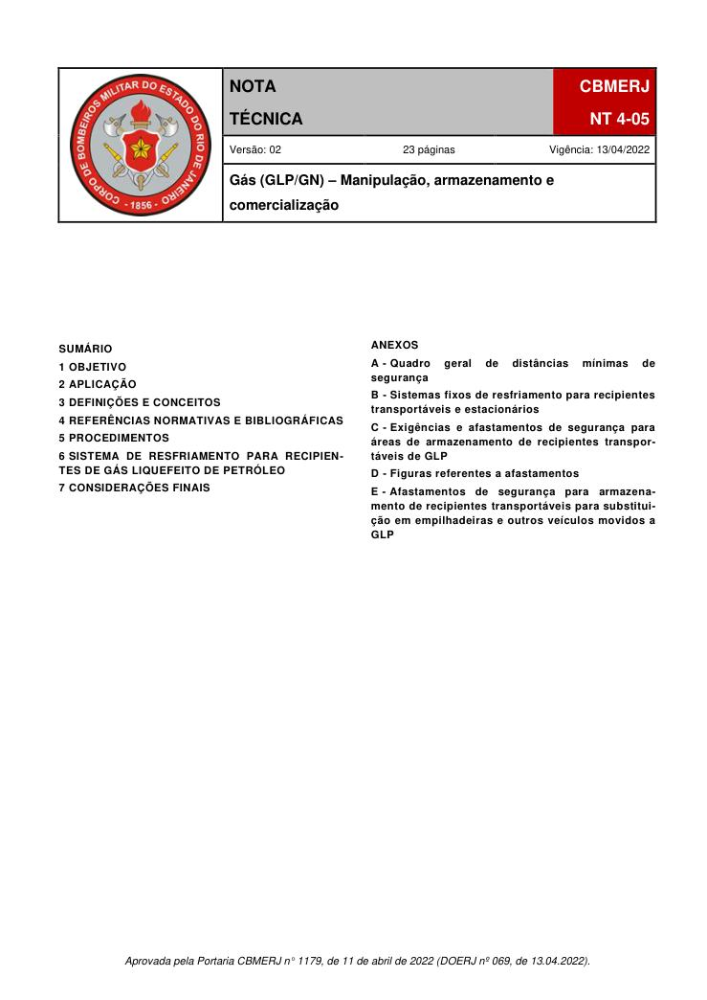

Aprovada pela Portaria CBMERJ n° 1179, de 11 de abril de 2022 (DOERJ nº 069, de 13.04.2022).

### SUMÁRIO

### 1 OBJETIVO

### 2 APLICAÇÃO

### 3 DEFINIÇÕES E CONCEITOS

### 4 REFERÊNCIAS NORMATIVAS E BIBLIOGRÁFICAS

### 5 PROCEDIMENTOS

### 6 SISTEMA DE RESFRIAMENTO PARA RECIPIENTES DE GÁS LIQUEFEITO DE PETRÓLEO

### 7 CONSIDERAÇÕES FINAIS

### ANEXOS

A - Quadro geral de distâncias mínimas de segurança

B - Sistemas fixos de resfriamento para recipientes transportáveis e estacionários

C - Exigências e afastamentos de segurança para áreas de armazenamento de recipientes transportáveis de GLP

D - Figuras referentes a afastamentos

E - Afastamentos de segurança para armazenamento de recipientes transportáveis para substituição em empilhadeiras e outros veículos movidos a GLP

### Tabelas extraídas

#### Tabela 1 da página

|  |  | NOTA |  |  | CBMERJ |  |
| --- | --- | --- | --- | --- | --- | --- |
|  |  | TÉCNICA |  |  | NT 4-05 |  |
|  | Versão: 02 23 páginas Vigência: 13/04/2022 |  |  |  |  |  |
|  | Gás (GLP/GN) - Manipulação, armazenamento e comercialização |  |  |  |  |  |

---

## Página 2

Corpo de Bombeiros Militar do Estado do Rio de Janeiro CBMERJ

Praça da República, nº 45, Centro, Rio de Janeiro - RJ. CEP: 20.211-350. www.cbmerj.rj.gov.br http://www.cbmerj.rj.gov.br/notas-tecnicas

---

## Página 3

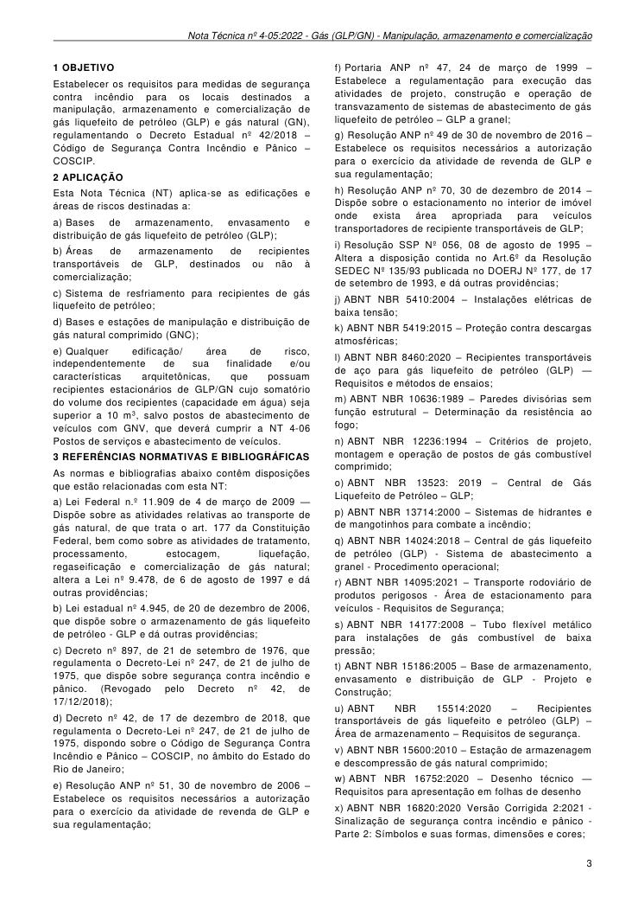

### 1 OBJETIVO

Estabelecer os requisitos para medidas de segurança contra incêndio para os locais destinados a manipulação, armazenamento e comercialização de gás liquefeito de petróleo (GLP) e gás natural (GN), regulamentando o Decreto Estadual nº 42/2018 - Código de Segurança Contra Incêndio e Pânico - COSCIP.

### 2 APLICAÇÃO

Esta Nota Técnica (NT) aplica-se as edificações e áreas de riscos destinadas a:

a) Bases de armazenamento, envasamento e distribuição de gás liquefeito de petróleo (GLP);

b) Áreas de armazenamento de recipientes transportáveis de GLP, destinados ou não à comercialização;

c) Sistema de resfriamento para recipientes de gás liquefeito de petróleo;

d) Bases e estações de manipulação e distribuição de gás natural comprimido (GNC);

e) Qualquer edificação/ área de risco, independentemente de sua finalidade e/ou características arquitetônicas, que possuam recipientes estacionários de GLP/GN cujo somatório do volume dos recipientes (capacidade em água) seja superior a 10 m3, salvo postos de abastecimento de veículos com GNV, que deverá cumprir a NT 4-06 Postos de serviços e abastecimento de veículos.

### 3 REFERÊNCIAS NORMATIVAS E BIBLIOGRÁFICAS

As normas e bibliografias abaixo contêm disposições que estão relacionadas com esta NT:

a) Lei Federal n.º 11.909 de 4 de março de 2009 - Dispõe sobre as atividades relativas ao transporte de gás natural, de que trata o art. 177 da Constituição Federal, bem como sobre as atividades de tratamento, processamento, estocagem, liquefação, regaseificação e comercialização de gás natural; altera a Lei nº 9.478, de 6 de agosto de 1997 e dá outras providências;

b) Lei estadual nº 4.945, de 20 de dezembro de 2006, que dispõe sobre o armazenamento de gás liquefeito de petróleo - GLP e dá outras providências;

c) Decreto nº 897, de 21 de setembro de 1976, que regulamenta o Decreto-Lei nº 247, de 21 de julho de 1975, que dispõe sobre segurança contra incêndio e pânico. (Revogado pelo Decreto nº 42, de 17/12/2018);

d) Decreto nº 42, de 17 de dezembro de 2018, que regulamenta o Decreto-Lei nº 247, de 21 de julho de 1975, dispondo sobre o Código de Segurança Contra Incêndio e Pânico - COSCIP, no âmbito do Estado do Rio de Janeiro;

e) Resolução ANP nº 51, 30 de novembro de 2006 - Estabelece os requisitos necessários a autorização para o exercício da atividade de revenda de GLP e sua regulamentação;

f) Portaria ANP nº 47, 24 de março de 1999 - Estabelece a regulamentação para execução das atividades de projeto, construção e operação de transvazamento de sistemas de abastecimento de gás liquefeito de petróleo - GLP a granel;

g) Resolução ANP nº 49 de 30 de novembro de 2016 - Estabelece os requisitos necessários a autorização para o exercício da atividade de revenda de GLP e sua regulamentação;

h) Resolução ANP nº 70, 30 de dezembro de 2014 - Dispõe sobre o estacionamento no interior de imóvel onde exista área apropriada para veículos transportadores de recipiente transportáveis de GLP;

i) Resolução SSP Nº 056, 08 de agosto de 1995 - Altera a disposição contida no Art.6º da Resolução SEDEC Nº 135/93 publicada no DOERJ Nº 177, de 17 de setembro de 1993, e dá outras providências;

j) ABNT NBR 5410:2004 - Instalações elétricas de baixa tensão;

k) ABNT NBR 5419:2015 - Proteção contra descargas atmosféricas;

l) ABNT NBR 8460:2020 - Recipientes transportáveis de aço para gás liquefeito de petróleo (GLP) - Requisitos e métodos de ensaios;

m) ABNT NBR 10636:1989 - Paredes divisórias sem função estrutural - Determinação da resistência ao fogo;

n) ABNT NBR 12236:1994 - Critérios de projeto, montagem e operação de postos de gás combustível comprimido;

o) ABNT NBR 13523: 2019 - Central de Gás Liquefeito de Petróleo - GLP;

p) ABNT NBR 13714:2000 - Sistemas de hidrantes e de mangotinhos para combate a incêndio;

q) ABNT NBR 14024:2018 - Central de gás liquefeito de petróleo (GLP) - Sistema de abastecimento a granel - Procedimento operacional;

r) ABNT NBR 14095:2021 - Transporte rodoviário de produtos perigosos - Área de estacionamento para veículos - Requisitos de Segurança;

s) ABNT NBR 14177:2008 - Tubo flexível metálico para instalações de gás combustível de baixa pressão;

t) ABNT NBR 15186:2005 - Base de armazenamento, envasamento e distribuição de GLP - Projeto e Construção;

u) ABNT NBR 15514:2020 - Recipientes transportáveis de gás liquefeito e petróleo (GLP) - Área de armazenamento - Requisitos de segurança.

v) ABNT NBR 15600:2010 - Estação de armazenagem e descompressão de gás natural comprimido;

w) ABNT NBR 16752:2020 - Desenho técnico - Requisitos para apresentação em folhas de desenho

x) ABNT NBR 16820:2020 Versão Corrigida 2:2021 - Sinalização de segurança contra incêndio e pânico - Parte 2: Símbolos e suas formas, dimensões e cores;

---

## Página 4

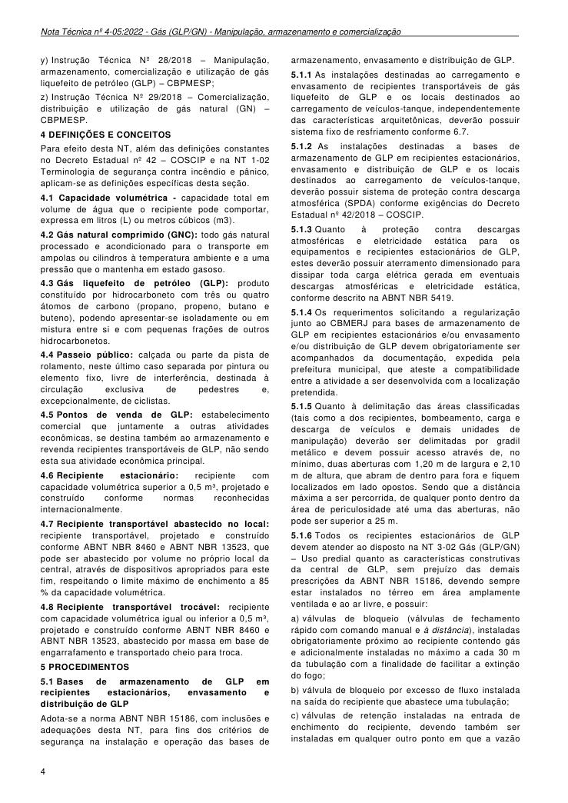

y) Instrução Técnica Nº 28/2018 - Manipulação, armazenamento, comercialização e utilização de gás liquefeito de petróleo (GLP) - CBPMESP;

z) Instrução Técnica Nº 29/2018 - Comercialização, distribuição e utilização de gás natural (GN) - CBPMESP.

### 4 DEFINIÇÕES E CONCEITOS

Para efeito desta NT, além das definições constantes no Decreto Estadual nº 42 - COSCIP e na NT 1-02 Terminologia de segurança contra incêndio e pânico, aplicam-se as definições específicas desta seção.

4.1 Capacidade volumétrica - capacidade total em volume de água que o recipiente pode comportar, expressa em litros (L) ou metros cúbicos (m3).

4.2 Gás natural comprimido (GNC): todo gás natural processado e acondicionado para o transporte em ampolas ou cilindros à temperatura ambiente e a uma pressão que o mantenha em estado gasoso.

4.3 Gás liquefeito de petróleo (GLP): produto constituído por hidrocarboneto com três ou quatro átomos de carbono (propano, propeno, butano e buteno), podendo apresentar-se isoladamente ou em mistura entre si e com pequenas frações de outros hidrocarbonetos.

4.4 Passeio público: calçada ou parte da pista de rolamento, neste último caso separada por pintura ou elemento fixo, livre de interferência, destinada à circulação exclusiva de pedestres e, excepcionalmente, de ciclistas.

4.5 Pontos de venda de GLP: estabelecimento comercial que juntamente a outras atividades econômicas, se destina também ao armazenamento e revenda recipientes transportáveis de GLP, não sendo esta sua atividade econômica principal.

4.6 Recipiente estacionário: recipiente com capacidade volumétrica superior a 0,5 m³, projetado e construído conforme normas reconhecidas internacionalmente.

4.7 Recipiente transportável abastecido no local: recipiente transportável, projetado e construído conforme ABNT NBR 8460 e ABNT NBR 13523, que pode ser abastecido por volume no próprio local da central, através de dispositivos apropriados para este fim, respeitando o limite máximo de enchimento a 85 % da capacidade volumétrica.

4.8 Recipiente transportável trocável: recipiente com capacidade volumétrica igual ou inferior a 0,5 m³, projetado e construído conforme ABNT NBR 8460 e ABNT NBR 13523, abastecido por massa em base de engarrafamento e transportado cheio para troca.

### 5 PROCEDIMENTOS

5.1 Bases de armazenamento de GLP em recipientes estacionários, envasamento e distribuição de GLP

Adota-se a norma ABNT NBR 15186, com inclusões e adequações desta NT, para fins dos critérios de segurança na instalação e operação das bases de

armazenamento, envasamento e distribuição de GLP.

5.1.1 As instalações destinadas ao carregamento e envasamento de recipientes transportáveis de gás liquefeito de GLP e os locais destinados ao carregamento de veículos-tanque, independentemente das características arquitetônicas, deverão possuir sistema fixo de resfriamento conforme 6.7.

5.1.2 As instalações destinadas a bases de armazenamento de GLP em recipientes estacionários, envasamento e distribuição de GLP e os locais destinados ao carregamento de veículos-tanque, deverão possuir sistema de proteção contra descarga atmosférica (SPDA) conforme exigências do Decreto Estadual nº 42/2018 - COSCIP.

5.1.3 Quanto à proteção contra descargas atmosféricas e eletricidade estática para os equipamentos e recipientes estacionários de GLP, estes deverão possuir aterramento dimensionado para dissipar toda carga elétrica gerada em eventuais descargas atmosféricas e eletricidade estática, conforme descrito na ABNT NBR 5419.

5.1.4 Os requerimentos solicitando a regularização junto ao CBMERJ para bases de armazenamento de GLP em recipientes estacionários e/ou envasamento e/ou distribuição de GLP devem obrigatoriamente ser acompanhados da documentação, expedida pela prefeitura municipal, que ateste a compatibilidade entre a atividade a ser desenvolvida com a localização pretendida.

5.1.5 Quanto à delimitação das áreas classificadas (tais como a dos recipientes, bombeamento, carga e descarga de veículos e demais unidades de manipulação) deverão ser delimitadas por gradil metálico e devem possuir acesso através de, no mínimo, duas aberturas com 1,20 m de largura e 2,10 m de altura, que abram de dentro para fora e fiquem localizados em lado opostos. Sendo que a distância máxima a ser percorrida, de qualquer ponto dentro da área de periculosidade até uma das aberturas, não pode ser superior a 25 m.

5.1.6 Todos os recipientes estacionários de GLP devem atender ao disposto na NT 3-02 Gás (GLP/GN) - Uso predial quanto as características construtivas da central de GLP, sem prejuízo das demais prescrições da ABNT NBR 15186, devendo sempre estar instalados no térreo em área amplamente ventilada e ao ar livre, e possuir:

a) válvulas de bloqueio (válvulas de fechamento rápido com comando manual e à distância), instaladas obrigatoriamente próximo ao recipiente contendo gás e adicionalmente instaladas no máximo a cada 30 m da tubulação com a finalidade de facilitar a extinção do fogo;

b) válvula de bloqueio por excesso de fluxo instalada na saída do recipiente que abastece uma tubulação;

### Tabelas extraídas

#### Tabela 1 da página

|  | entrada de |
| --- | --- |
| enchimento do recipiente, devendo também ser |  |
| instaladas em qualquer outro ponto |  |

---

## Página 5

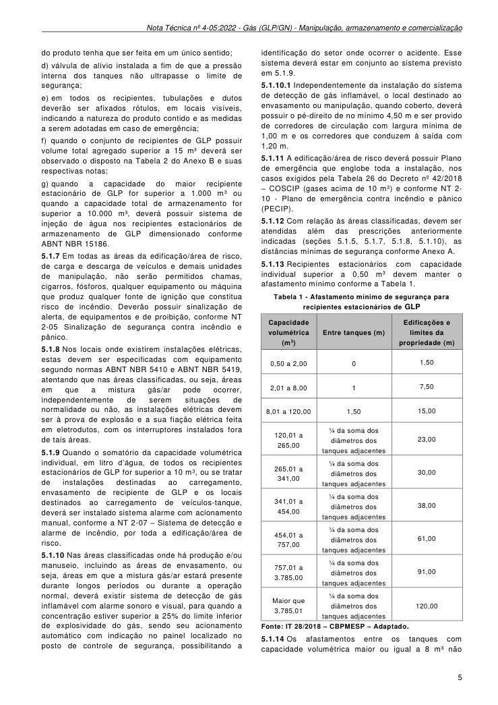

do produto tenha que ser feita em um único sentido;

d) válvula de alívio instalada a fim de que a pressão interna dos tanques não ultrapasse o limite de segurança;

e) em todos os recipientes, tubulações e dutos deverão ser afixados rótulos, em locais visíveis, indicando a natureza do produto contido e as medidas a serem adotadas em caso de emergência;

f) quando o conjunto de recipientes de GLP possuir volume total agregado superior a 15 m³ deverá ser observado o disposto na Tabela 2 do Anexo B e suas respectivas notas;

g) quando a capacidade do maior recipiente estacionário de GLP for superior a 1.000 m3 ou quando a capacidade total de armazenamento for superior a 10.000 m³, deverá possuir sistema de injeção de água nos recipientes estacionários de armazenamento de GLP dimensionado conforme ABNT NBR 15186.

5.1.7 Em todas as áreas da edificação/área de risco, de carga e descarga de veículos e demais unidades de manipulação, não serão permitidos chamas, cigarros, fósforos, qualquer equipamento ou máquina que produz qualquer fonte de ignição que constitua risco de incêndio. Deverão possuir sinalização de alerta, de equipamentos e de proibição, conforme NT 2-05 Sinalização de segurança contra incêndio e pânico.

5.1.8 Nos locais onde existirem instalações elétricas, estas devem ser especificadas com equipamento segundo normas ABNT NBR 5410 e ABNT NBR 5419, atentando que nas áreas classificadas, ou seja, áreas em que a mistura gás/ar pode ocorrer, independentemente de serem situações de normalidade ou não, as instalações elétricas devem ser à prova de explosão e a sua fiação elétrica feita em eletrodutos, com os interruptores instalados fora de tais áreas.

5.1.9 Quando o somatório da capacidade volumétrica individual, em litro d’água, de todos os recipientes estacionários de GLP for superior a 10 m3, ou se tratar de instalações destinadas ao carregamento, envasamento de recipiente de GLP e os locais destinados ao carregamento de veículos-tanque, deverá ser instalado sistema alarme com acionamento manual, conforme a NT 2-07 - Sistema de detecção e alarme de incêndio, por toda a edificação/área de risco.

5.1.10 Nas áreas classificadas onde há produção e/ou manuseio, incluindo as áreas de envasamento, ou seja, áreas em que a mistura gás/ar estará presente durante longos períodos ou durante a operação normal, deverá existir sistema de detecção de gás inflamável com alarme sonoro e visual, para quando a concentração estiver superior a 25% do limite inferior de explosividade do gás, sendo seu acionamento automático com indicação no painel localizado no posto de controle de segurança, possibilitando a

identificação do setor onde ocorrer o acidente. Esse sistema deverá estar em conjunto ao sistema previsto em 5.1.9.

5.1.10.1 Independentemente da instalação do sistema de detecção de gás inflamável, o local destinado ao envasamento ou manipulação, quando coberto, deverá possuir o pé-direito de no mínimo 4,50 m e ser provido de corredores de circulação com largura mínima de 1,00 m e os corredores que conduzem à saída com 1,20 m.

5.1.11 A edificação/área de risco deverá possuir Plano de emergência que englobe toda a instalação, nos casos exigidos pela Tabela 26 do Decreto nº 42/2018 - COSCIP (gases acima de 10 m3) e conforme NT 2- 10 - Plano de emergência contra incêndio e pânico (PECIP).

5.1.12 Com relação às áreas classificadas, devem ser atendidas além das prescrições anteriormente indicadas (seções 5.1.5, 5.1.7, 5.1.8, 5.1.10), as distâncias mínimas de segurança conforme Anexo A.

5.1.13 Recipientes estacionários com capacidade individual superior a 0,50 m3 devem manter o afastamento mínimo conforme a Tabela 1.

Tabela 1 - Afastamento mínimo de segurança para

recipientes estacionários de GLP

Fonte: IT 28/2018 - CBPMESP - Adaptado.

5.1.14 Os afastamentos entre os tanques com capacidade volumétrica maior ou igual a 8 m³ não

### Tabelas extraídas

#### Tabela 1 da página

|  | Capacidade |  | Entre tanques (m) |  | Edificações e |  |
| --- | --- | --- | --- | --- | --- | --- |
|  | volumétrica |  |  |  | limites da |  |
|  | (m3) |  |  |  | propriedade (m) |  |
| 0,50 a 2,00 |  |  | 0 | 1,50 |  |  |
| 2,01 a 8,00 |  |  | 1 | 7,50 |  |  |
| 8,01 a 120,00 |  |  | 1,50 | 15,00 |  |  |
| 120,01 a 265,00 |  |  | ¼ da soma dos diâmetros dos tanques adjacentes | 23,00 |  |  |
| 265,01 a 341,00 |  |  | ¼ da soma dos diâmetros dos tanques adjacentes | 30,00 |  |  |
| 341,01 a 454,00 |  |  | ¼ da soma dos diâmetros dos tanques adjacentes | 38,00 |  |  |
| 454,01 a 757,00 |  |  | ¼ da soma dos diâmetros dos tanques adjacentes | 61,00 |  |  |
| 757,01 a 3.785,00 |  |  | ¼ da soma dos diâmetros dos tanques adjacentes | 91,00 |  |  |
| Maior que 3.785,01 |  |  | ¼ da soma dos diâmetros dos tanques adjacentes | 120,00 |  |  |

---

## Página 6

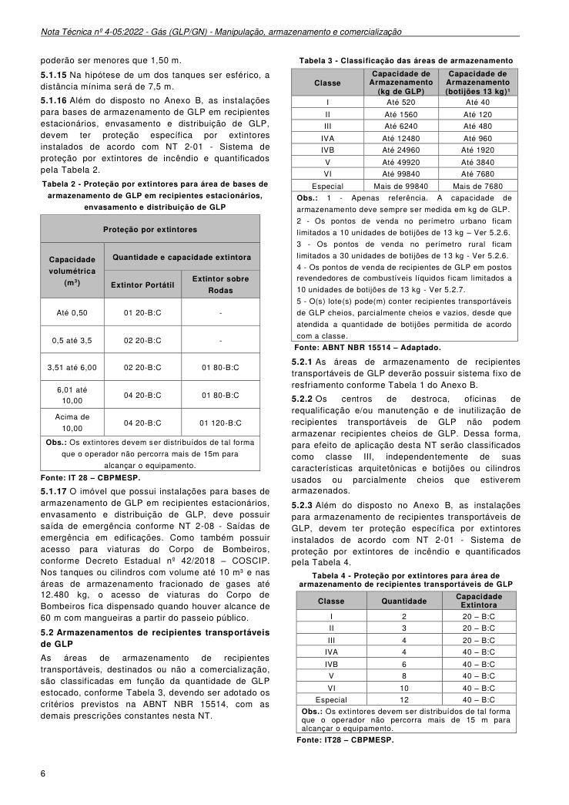

poderão ser menores que 1,50 m.

5.1.15 Na hipótese de um dos tanques ser esférico, a distância mínima será de 7,5 m.

5.1.16 Além do disposto no Anexo B, as instalações para bases de armazenamento de GLP em recipientes estacionários, envasamento e distribuição de GLP, devem ter proteção específica por extintores instalados de acordo com NT 2-01 - Sistema de proteção por extintores de incêndio e quantificados pela Tabela 2.

Tabela 2 - Proteção por extintores para área de bases de

armazenamento de GLP em recipientes estacionários,

envasamento e distribuição de GLP

Fonte: IT 28 - CBPMESP.

5.1.17 O imóvel que possui instalações para bases de armazenamento de GLP em recipientes estacionários, envasamento e distribuição de GLP, deve possuir saída de emergência conforme NT 2-08 - Saídas de emergência em edificações. Como também possuir acesso para viaturas do Corpo de Bombeiros, conforme Decreto Estadual nº 42/2018 - COSCIP. Nos tanques ou cilindros com volume até 10 m³ e nas áreas de armazenamento fracionado de gases até 12.480 kg, o acesso de viaturas do Corpo de Bombeiros fica dispensado quando houver alcance de 60 m com mangueiras a partir do passeio público.

5.2 Armazenamentos de recipientes transportáveis de GLP

As áreas de armazenamento de recipientes transportáveis, destinados ou não a comercialização, são classificadas em função da quantidade de GLP estocado, conforme Tabela 3, devendo ser adotado os critérios previstos na ABNT NBR 15514, com as demais prescrições constantes nesta NT.

Tabela 3 - Classificação das áreas de armazenamento

Fonte: ABNT NBR 15514 - Adaptado.

5.2.1 As áreas de armazenamento de recipientes transportáveis de GLP deverão possuir sistema fixo de resfriamento conforme Tabela 1 do Anexo B.

5.2.2 Os centros de destroca, oficinas de requalificação e/ou manutenção e de inutilização de recipientes transportáveis de GLP não podem armazenar recipientes cheios de GLP. Dessa forma, para efeito de aplicação desta NT serão classificados como classe III, independentemente de suas características arquitetônicas e botijões ou cilindros usados ou parcialmente cheios que estiverem armazenados.

5.2.3 Além do disposto no Anexo B, as instalações para armazenamento de recipientes transportáveis de GLP, devem ter proteção específica por extintores instalados de acordo com NT 2-01 - Sistema de proteção por extintores de incêndio e quantificados pela Tabela 4.

Tabela 4 - Proteção por extintores para área de armazenamento de recipientes transportáveis de GLP

### Tabelas extraídas

#### Tabela 1 da página

| Classe | Capacidade de Armazenamento (kg de GLP) |  |  | Capacidade de |  |
| --- | --- | --- | --- | --- | --- |
|  |  |  |  | Armazenamento |  |
|  |  |  |  | (botijões 13 kg)¹ |  |
| I | Até 520 |  | Até 40 |  |  |
| II | Até 1560 |  | Até 120 |  |  |
| III | Até 6240 |  | Até 480 |  |  |
| IVA | Até 12480 |  | Até 960 |  |  |
| IVB | Até 24960 |  | Até 1920 |  |  |
| V | Até 49920 |  | Até 3840 |  |  |
| VI | Até 99840 |  | Até 7680 |  |  |
| Especial | Mais de 99840 |  | Mais de 7680 |  |  |
| Obs.: 1 - Apenas referência. A capacidade de armazenamento deve sempre ser medida em kg de GLP. 2 - Os pontos de venda no perímetro urbano ficam limitados a 10 unidades de botijões de 13 kg - Ver 5.2.6. 3 - Os pontos de venda no perímetro rural ficam limitados a 30 unidades de botijões de 13 kg - Ver 5.2.6. 4 - Os pontos de venda de recipientes de GLP em postos revendedores de combustíveis líquidos ficam limitados a 10 unidades de botijões de 13 kg - Ver 5.2.7. 5 - O(s) lote(s) pode(m) conter recipientes transportáveis de GLP cheios, parcialmente cheios e vazios, desde que atendida a quantidade de botijões permitida de acordo com a classe. |  |  |  |  |  |

#### Tabela 2 da página

| Proteção por extintores |  |  |  |  |
| --- | --- | --- | --- | --- |
| Capacidade volumétrica (m3) | Quantidade e capacidade extintora |  |  |  |
|  | Extintor Portátil |  | Extintor sobre |  |
|  |  |  | Rodas |  |
| Até 0,50 | 01 20-B:C | - |  |  |
| 0,5 até 3,5 | 02 20-B:C | - |  |  |
| 3,51 até 6,00 | 02 20-B:C | 01 80-B:C |  |  |
| 6,01 até 10,00 | 04 20-B:C | 01 80-B:C |  |  |
| Acima de 10,00 | 04 20-B:C | 01 120-B:C |  |  |
| Obs.: Os extintores devem ser distribuídos de tal forma que o operador não percorra mais de 15m para alcançar o equipamento. |  |  |  |  |

#### Tabela 3 da página

| Classe | Quantidade |  | Capacidade |  |
| --- | --- | --- | --- | --- |
|  |  |  | Extintora |  |
| I | 2 | 20 - B:C |  |  |
| II | 3 | 20 - B:C |  |  |
| III | 4 | 20 - B:C |  |  |
| IVA | 4 | 40 - B:C |  |  |
| IVB | 6 | 40 - B:C |  |  |
| V | 8 | 40 - B:C |  |  |
| VI | 10 | 40 - B:C |  |  |
| Especial | 12 | 40 - B:C |  |  |
| Obs.: Os extintores devem ser distribuídos de tal forma que o operador não percorra mais de 15 m para alcançar o equipamento. |  |  |  |  |

---

## Página 7

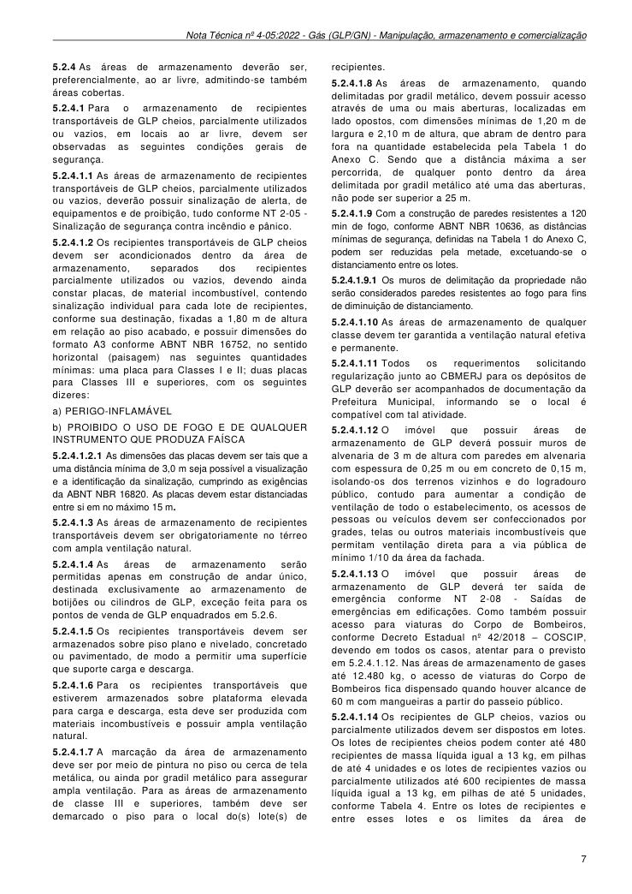

5.2.4 As áreas de armazenamento deverão ser, preferencialmente, ao ar livre, admitindo-se também áreas cobertas.

5.2.4.1 Para o armazenamento de recipientes transportáveis de GLP cheios, parcialmente utilizados ou vazios, em locais ao ar livre, devem ser observadas as seguintes condições gerais de segurança.

5.2.4.1.1 As áreas de armazenamento de recipientes transportáveis de GLP cheios, parcialmente utilizados ou vazios, deverão possuir sinalização de alerta, de equipamentos e de proibição, tudo conforme NT 2-05 - Sinalização de segurança contra incêndio e pânico.

5.2.4.1.2 Os recipientes transportáveis de GLP cheios devem ser acondicionados dentro da área de armazenamento, separados dos recipientes parcialmente utilizados ou vazios, devendo ainda constar placas, de material incombustível, contendo sinalização individual para cada lote de recipientes, conforme sua destinação, fixadas a 1,80 m de altura em relação ao piso acabado, e possuir dimensões do formato A3 conforme ABNT NBR 16752, no sentido horizontal (paisagem) nas seguintes quantidades mínimas: uma placa para Classes I e II; duas placas para Classes III e superiores, com os seguintes dizeres:

a) PERIGO-INFLAMÁVEL

b) PROIBIDO O USO DE FOGO E DE QUALQUER INSTRUMENTO QUE PRODUZA FAÍSCA

5.2.4.1.2.1 As dimensões das placas devem ser tais que a uma distância mínima de 3,0 m seja possível a visualização e a identificação da sinalização, cumprindo as exigências da ABNT NBR 16820. As placas devem estar distanciadas entre si em no máximo 15 m.

5.2.4.1.3 As áreas de armazenamento de recipientes transportáveis devem ser obrigatoriamente no térreo com ampla ventilação natural.

5.2.4.1.4 As áreas de armazenamento serão permitidas apenas em construção de andar único, destinada exclusivamente ao armazenamento de botijões ou cilindros de GLP, exceção feita para os pontos de venda de GLP enquadrados em 5.2.6.

5.2.4.1.5 Os recipientes transportáveis devem ser armazenados sobre piso plano e nivelado, concretado ou pavimentado, de modo a permitir uma superfície que suporte carga e descarga.

5.2.4.1.6 Para os recipientes transportáveis que estiverem armazenados sobre plataforma elevada para carga e descarga, esta deve ser produzida com materiais incombustíveis e possuir ampla ventilação natural.

5.2.4.1.7 A marcação da área de armazenamento deve ser por meio de pintura no piso ou cerca de tela metálica, ou ainda por gradil metálico para assegurar ampla ventilação. Para as áreas de armazenamento de classe III e superiores, também deve ser demarcado o piso para o local do(s) lote(s) de

recipientes.

5.2.4.1.8 As áreas de armazenamento, quando delimitadas por gradil metálico, devem possuir acesso através de uma ou mais aberturas, localizadas em lado opostos, com dimensões mínimas de 1,20 m de largura e 2,10 m de altura, que abram de dentro para fora na quantidade estabelecida pela Tabela 1 do Anexo C. Sendo que a distância máxima a ser percorrida, de qualquer ponto dentro da área delimitada por gradil metálico até uma das aberturas, não pode ser superior a 25 m.

5.2.4.1.9 Com a construção de paredes resistentes a 120 min de fogo, conforme ABNT NBR 10636, as distâncias mínimas de segurança, definidas na Tabela 1 do Anexo C, podem ser reduzidas pela metade, excetuando-se o distanciamento entre os lotes.

5.2.4.1.9.1 Os muros de delimitação da propriedade não serão considerados paredes resistentes ao fogo para fins de diminuição de distanciamento.

5.2.4.1.10 As áreas de armazenamento de qualquer classe devem ter garantida a ventilação natural efetiva e permanente.

5.2.4.1.11 Todos os requerimentos solicitando regularização junto ao CBMERJ para os depósitos de GLP deverão ser acompanhados de documentação da Prefeitura Municipal, informando se o local é compatível com tal atividade.

5.2.4.1.12 O imóvel que possuir áreas de armazenamento de GLP deverá possuir muros de alvenaria de 3 m de altura com paredes em alvenaria com espessura de 0,25 m ou em concreto de 0,15 m, isolando-os dos terrenos vizinhos e do logradouro público, contudo para aumentar a condição de ventilação de todo o estabelecimento, os acessos de pessoas ou veículos devem ser confeccionados por grades, telas ou outros materiais incombustíveis que permitam ventilação direta para a via pública de mínimo 1/10 da área da fachada.

5.2.4.1.13 O imóvel que possuir áreas de armazenamento de GLP deverá ter saída de emergência conforme NT 2-08 - Saídas de emergências em edificações. Como também possuir acesso para viaturas do Corpo de Bombeiros, conforme Decreto Estadual nº 42/2018 - COSCIP, devendo em todos os casos, atentar para o previsto em 5.2.4.1.12. Nas áreas de armazenamento de gases até 12.480 kg, o acesso de viaturas do Corpo de Bombeiros fica dispensado quando houver alcance de 60 m com mangueiras a partir do passeio público.

5.2.4.1.14 Os recipientes de GLP cheios, vazios ou parcialmente utilizados devem ser dispostos em lotes. Os lotes de recipientes cheios podem conter até 480 recipientes de massa líquida igual a 13 kg, em pilhas de até 4 unidades e os lotes de recipientes vazios ou parcialmente utilizados até 600 recipientes de massa líquida igual a 13 kg, em pilhas de até 5 unidades, conforme Tabela 4. Entre os lotes de recipientes e entre esses lotes e os limites da área de

---

## Página 8

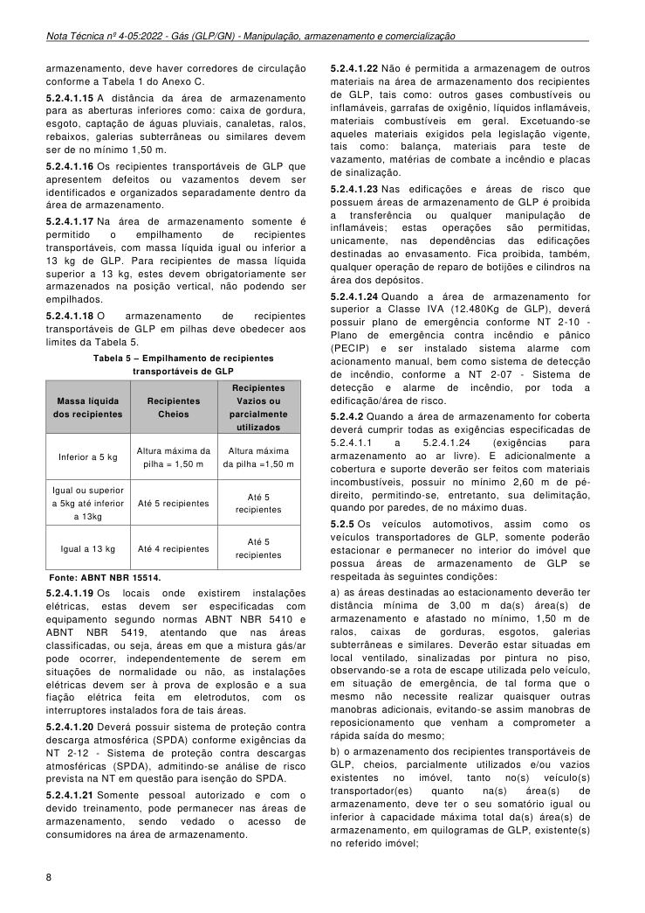

armazenamento, deve haver corredores de circulação conforme a Tabela 1 do Anexo C.

5.2.4.1.15 A distância da área de armazenamento para as aberturas inferiores como: caixa de gordura, esgoto, captação de águas pluviais, canaletas, ralos, rebaixos, galerias subterrâneas ou similares devem ser de no mínimo 1,50 m.

5.2.4.1.16 Os recipientes transportáveis de GLP que apresentem defeitos ou vazamentos devem ser identificados e organizados separadamente dentro da área de armazenamento.

5.2.4.1.17 Na área de armazenamento somente é permitido o empilhamento de recipientes transportáveis, com massa líquida igual ou inferior a 13 kg de GLP. Para recipientes de massa líquida superior a 13 kg, estes devem obrigatoriamente ser armazenados na posição vertical, não podendo ser empilhados.

5.2.4.1.18 O armazenamento de recipientes transportáveis de GLP em pilhas deve obedecer aos limites da Tabela 5.

Tabela 5 - Empilhamento de recipientes

transportáveis de GLP

Fonte: ABNT NBR 15514.

5.2.4.1.19 Os locais onde existirem instalações elétricas, estas devem ser especificadas com equipamento segundo normas ABNT NBR 5410 e ABNT NBR 5419, atentando que nas áreas classificadas, ou seja, áreas em que a mistura gás/ar pode ocorrer, independentemente de serem em situações de normalidade ou não, as instalações elétricas devem ser à prova de explosão e a sua fiação elétrica feita em eletrodutos, com os interruptores instalados fora de tais áreas.

5.2.4.1.20 Deverá possuir sistema de proteção contra descarga atmosférica (SPDA) conforme exigências da NT 2-12 - Sistema de proteção contra descargas atmosféricas (SPDA), admitindo-se análise de risco prevista na NT em questão para isenção do SPDA.

5.2.4.1.21 Somente pessoal autorizado e com o devido treinamento, pode permanecer nas áreas de armazenamento, sendo vedado o acesso de consumidores na área de armazenamento.

5.2.4.1.22 Não é permitida a armazenagem de outros materiais na área de armazenamento dos recipientes de GLP, tais como: outros gases combustíveis ou inflamáveis, garrafas de oxigênio, líquidos inflamáveis, materiais combustíveis em geral. Excetuando-se aqueles materiais exigidos pela legislação vigente, tais como: balança, materiais para teste de vazamento, matérias de combate a incêndio e placas de sinalização.

5.2.4.1.23 Nas edificações e áreas de risco que possuem áreas de armazenamento de GLP é proibida a transferência ou qualquer manipulação de inflamáveis; estas operações são permitidas, unicamente, nas dependências das edificações destinadas ao envasamento. Fica proibida, também, qualquer operação de reparo de botijões e cilindros na área dos depósitos.

5.2.4.1.24 Quando a área de armazenamento for superior a Classe IVA (12.480Kg de GLP), deverá possuir plano de emergência conforme NT 2-10 - Plano de emergência contra incêndio e pânico (PECIP) e ser instalado sistema alarme com acionamento manual, bem como sistema de detecção de incêndio, conforme a NT 2-07 - Sistema de detecção e alarme de incêndio, por toda a edificação/área de risco.

5.2.4.2 Quando a área de armazenamento for coberta deverá cumprir todas as exigências especificadas de 5.2.4.1.1 a 5.2.4.1.24 (exigências para armazenamento ao ar livre). E adicionalmente a cobertura e suporte deverão ser feitos com materiais incombustíveis, possuir no mínimo 2,60 m de pédireito, permitindo-se, entretanto, sua delimitação, quando por paredes, de no máximo duas.

5.2.5 Os veículos automotivos, assim como os veículos transportadores de GLP, somente poderão estacionar e permanecer no interior do imóvel que possua áreas de armazenamento de GLP se respeitada às seguintes condições:

a) as áreas destinadas ao estacionamento deverão ter distância mínima de 3,00 m da(s) área(s) de armazenamento e afastado no mínimo, 1,50 m de ralos, caixas de gorduras, esgotos, galerias subterrâneas e similares. Deverão estar situadas em local ventilado, sinalizadas por pintura no piso, observando-se a rota de escape utilizada pelo veículo, em situação de emergência, de tal forma que o mesmo não necessite realizar quaisquer outras manobras adicionais, evitando-se assim manobras de reposicionamento que venham a comprometer a rápida saída do mesmo;

b) o armazenamento dos recipientes transportáveis de GLP, cheios, parcialmente utilizados e/ou vazios existentes no imóvel, tanto no(s) veículo(s) transportador(es) quanto na(s) área(s) de armazenamento, deve ter o seu somatório igual ou inferior à capacidade máxima total da(s) área(s) de armazenamento, em quilogramas de GLP, existente(s) no referido imóvel;

### Tabelas extraídas

#### Tabela 1 da página

| Massa líquida dos recipientes | Recipientes Cheios |  | Recipientes |  |
| --- | --- | --- | --- | --- |
|  |  |  | Vazios ou |  |
|  |  |  | parcialmente |  |
|  |  |  | utilizados |  |
| Inferior a 5 kg | Altura máxima da pilha = 1,50 m | Altura máxima da pilha =1,50 m |  |  |
| Igual ou superior a 5kg até inferior a 13kg | Até 5 recipientes | Até 5 recipientes |  |  |
| Igual a 13 kg | Até 4 recipientes | Até 5 recipientes |  |  |

---

## Página 9

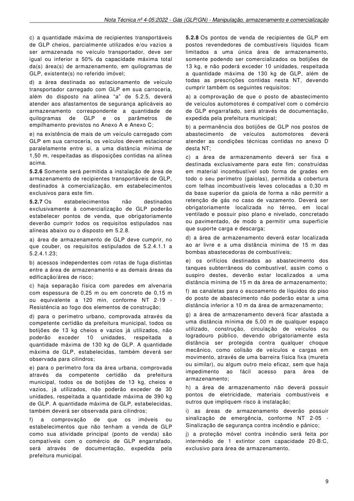

c) a quantidade máxima de recipientes transportáveis de GLP cheios, parcialmente utilizados e/ou vazios a ser armazenada no veículo transportador, deve ser igual ou inferior a 50% da capacidade máxima total da(s) área(s) de armazenamento, em quilogramas de GLP, existente(s) no referido imóvel;

d) a área destinada ao estacionamento de veículo transportador carregado com GLP em sua carroceria, além do disposto na alínea “a” de 5.2.5, deverá atender aos afastamentos de segurança aplicáveis ao armazenamento correspondente a quantidade de quilogramas de GLP e os parâmetros de empilhamento previstos no Anexo A e Anexo C;

e) na existência de mais de um veículo carregado com GLP em sua carroceria, os veículos devem estacionar paralelamente entre si, a uma distância mínima de 1,50 m, respeitadas as disposições contidas na alínea acima.

5.2.6 Somente será permitida a instalação de área de armazenamento de recipientes transportáveis de GLP, destinados à comercialização, em estabelecimentos exclusivos para este fim.

5.2.7 Os estabelecimentos não destinados exclusivamente à comercialização de GLP poderão estabelecer pontos de venda, que obrigatoriamente deverão cumprir todos os requisitos estipulados nas alíneas abaixo ou o disposto em 5.2.8.

a) área de armazenamento de GLP deve cumprir, no que couber, os requisitos estipulados de 5.2.4.1.1 a 5.2.4.1.23;

b) acessos independentes com rotas de fuga distintas entre a área de armazenamento e as demais áreas da edificação/área de risco;

c) haja separação física com paredes em alvenaria com espessura de 0,25 m ou em concreto de 0,15 m ou equivalente a 120 min, conforme NT 2-19 - Resistência ao fogo dos elementos de construção;

d) para o perímetro urbano, comprovada através da competente certidão da prefeitura municipal, todos os botijões de 13 kg cheios e vazios já utilizados, não poderão exceder 10 unidades, respeitada a quantidade máxima de 130 kg de GLP. A quantidade máxima de GLP, estabelecidas, também deverá ser observada para cilindros;

e) para o perímetro fora da área urbana, comprovada através da competente certidão da prefeitura municipal, todos os de botijões de 13 kg, cheios e vazios, já utilizados, não poderão exceder de 30 unidades, respeitada a quantidade máxima de 390 kg de GLP. A quantidade máxima de GLP, estabelecidas, também deverá ser observada para cilindros;

f) a comprovação de que os imóveis ou estabelecimentos que não tenham a venda de GLP como sua atividade principal (ponto de venda) são compatíveis com o comércio de GLP engarrafado, será através de documentação, expedida pela prefeitura municipal.

5.2.8 Os pontos de venda de recipientes de GLP em postos revendedores de combustíveis líquidos ficam limitados a uma única área de armazenamento, somente podendo ser comercializados os botijões de 13 kg, e não poderá exceder 10 unidades, respeitada a quantidade máxima de 130 kg de GLP, além de todas as prescrições contidas nesta NT, devendo cumprir também os seguintes requisitos:

a) a comprovação de que o posto de abastecimento de veículos automotores é compatível com o comércio de GLP engarrafado, será através de documentação, expedida pela prefeitura municipal;

b) a permanência dos botijões de GLP nos postos de abastecimento de veículos automotores deverá atender as condições técnicas contidas no anexo D desta NT;

c) a área de armazenamento deverá ser fixa e destinada exclusivamente para este fim; construídas em material incombustível sob forma de grades em todo o seu perímetro (gaiolas), permitida a cobertura com telhas incombustíveis leves colocadas a 0,30 m da base superior da gaiola de forma a não permitir a retenção de gás no caso de vazamento. Deverá ser obrigatoriamente localizada no térreo, em local ventilado e possuir piso plano e nivelado, concretado ou pavimentado, de modo a permitir uma superfície que suporte carga e descarga;

d) a área de armazenamento deverá estar localizada ao ar livre e a uma distância mínima de 15 m das bombas abastecedoras de combustíveis;

e) os orifícios destinados ao abastecimento dos tanques subterrâneos do combustível, assim como o suspiro destes, deverão estar localizados a uma distância mínima de 15 m da área de armazenamento;

f) as canaletas para o escoamento de líquidos do piso do posto de abastecimento não poderão estar a uma distância inferior a 10 m da área de armazenamento;

g) a área de armazenamento deverá ficar afastada a uma distância mínima de 5,00 m de qualquer espaço utilizado, construção, circulação de veículos ou logradouro público, devendo obrigatoriamente esta distância ser protegida contra qualquer choque mecânico, como colisão de veículos e cargas em movimento, através de uma barreira física fixa (mureta ou similar), ou algum outro meio eficaz, sem que haja impedimento ao fácil acesso para área de armazenamento;

h) a área de armazenamento não deverá possuir pontos de eletricidade, materiais combustíveis e outros que impliquem risco à instalação;

i) as áreas de armazenamento deverão possuir sinalização de emergência, conforme NT 2-05 - Sinalização de segurança contra incêndio e pânico;

j) a proteção móvel contra incêndio será feita por intermédio de 1 extintor com capacidade 20-B:C, exclusivo para área de armazenamento.

---

## Página 10

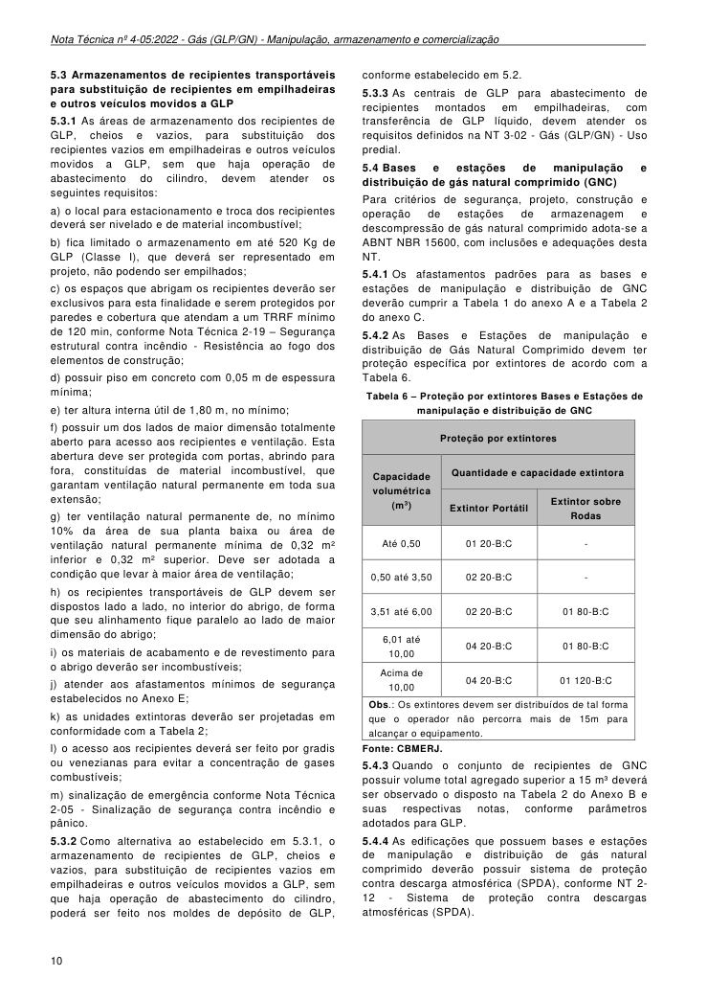

5.3 Armazenamentos de recipientes transportáveis para substituição de recipientes em empilhadeiras e outros veículos movidos a GLP

5.3.1 As áreas de armazenamento dos recipientes de GLP, cheios e vazios, para substituição dos recipientes vazios em empilhadeiras e outros veículos movidos a GLP, sem que haja operação de abastecimento do cilindro, devem atender os seguintes requisitos:

a) o local para estacionamento e troca dos recipientes deverá ser nivelado e de material incombustível;

b) fica limitado o armazenamento em até 520 Kg de GLP (Classe I), que deverá ser representado em projeto, não podendo ser empilhados;

c) os espaços que abrigam os recipientes deverão ser exclusivos para esta finalidade e serem protegidos por paredes e cobertura que atendam a um TRRF mínimo de 120 min, conforme Nota Técnica 2-19 - Segurança estrutural contra incêndio - Resistência ao fogo dos elementos de construção;

d) possuir piso em concreto com 0,05 m de espessura mínima;

e) ter altura interna útil de 1,80 m, no mínimo;

f) possuir um dos lados de maior dimensão totalmente aberto para acesso aos recipientes e ventilação. Esta abertura deve ser protegida com portas, abrindo para fora, constituídas de material incombustível, que garantam ventilação natural permanente em toda sua extensão;

g) ter ventilação natural permanente de, no mínimo 10% da área de sua planta baixa ou área de ventilação natural permanente mínima de 0,32 m² inferior e 0,32 m² superior. Deve ser adotada a condição que levar à maior área de ventilação;

h) os recipientes transportáveis de GLP devem ser dispostos lado a lado, no interior do abrigo, de forma que seu alinhamento fique paralelo ao lado de maior dimensão do abrigo;

i) os materiais de acabamento e de revestimento para o abrigo deverão ser incombustíveis;

j) atender aos afastamentos mínimos de segurança estabelecidos no Anexo E;

k) as unidades extintoras deverão ser projetadas em conformidade com a Tabela 2;

l) o acesso aos recipientes deverá ser feito por gradis ou venezianas para evitar a concentração de gases combustíveis;

m) sinalização de emergência conforme Nota Técnica 2-05 - Sinalização de segurança contra incêndio e pânico.

5.3.2 Como alternativa ao estabelecido em 5.3.1, o armazenamento de recipientes de GLP, cheios e vazios, para substituição de recipientes vazios em empilhadeiras e outros veículos movidos a GLP, sem que haja operação de abastecimento do cilindro, poderá ser feito nos moldes de depósito de GLP,

conforme estabelecido em 5.2.

5.3.3 As centrais de GLP para abastecimento de recipientes montados em empilhadeiras, com transferência de GLP líquido, devem atender os requisitos definidos na NT 3-02 - Gás (GLP/GN) - Uso predial.

5.4 Bases e estações de manipulação e distribuição de gás natural comprimido (GNC)

Para critérios de segurança, projeto, construção e operação de estações de armazenagem e descompressão de gás natural comprimido adota-se a ABNT NBR 15600, com inclusões e adequações desta NT.

5.4.1 Os afastamentos padrões para as bases e estações de manipulação e distribuição de GNC deverão cumprir a Tabela 1 do anexo A e a Tabela 2 do anexo C.

5.4.2 As Bases e Estações de manipulação e distribuição de Gás Natural Comprimido devem ter proteção específica por extintores de acordo com a Tabela 6.

Tabela 6 - Proteção por extintores Bases e Estações de

manipulação e distribuição de GNC

Fonte: CBMERJ.

5.4.3 Quando o conjunto de recipientes de GNC possuir volume total agregado superior a 15 m³ deverá ser observado o disposto na Tabela 2 do Anexo B e suas respectivas notas, conforme parâmetros adotados para GLP.

5.4.4 As edificações que possuem bases e estações de manipulação e distribuição de gás natural comprimido deverão possuir sistema de proteção contra descarga atmosférica (SPDA), conforme NT 2- 12 - Sistema de proteção contra descargas atmosféricas (SPDA).

### Tabelas extraídas

#### Tabela 1 da página

| Proteção por extintores |  |  |  |  |
| --- | --- | --- | --- | --- |
| Capacidade volumétrica (m3) | Quantidade e capacidade extintora |  |  |  |
|  | Extintor Portátil |  | Extintor sobre |  |
|  |  |  | Rodas |  |
| Até 0,50 | 01 20-B:C | - |  |  |
| 0,50 até 3,50 | 02 20-B:C | - |  |  |
| 3,51 até 6,00 | 02 20-B:C | 01 80-B:C |  |  |
| 6,01 até 10,00 | 04 20-B:C | 01 80-B:C |  |  |
| Acima de 10,00 | 04 20-B:C | 01 120-B:C |  |  |
| Obs.: Os extintores devem ser distribuídos de tal forma que o operador não percorra mais de 15m para alcançar o equipamento. |  |  |  |  |

---

## Página 11

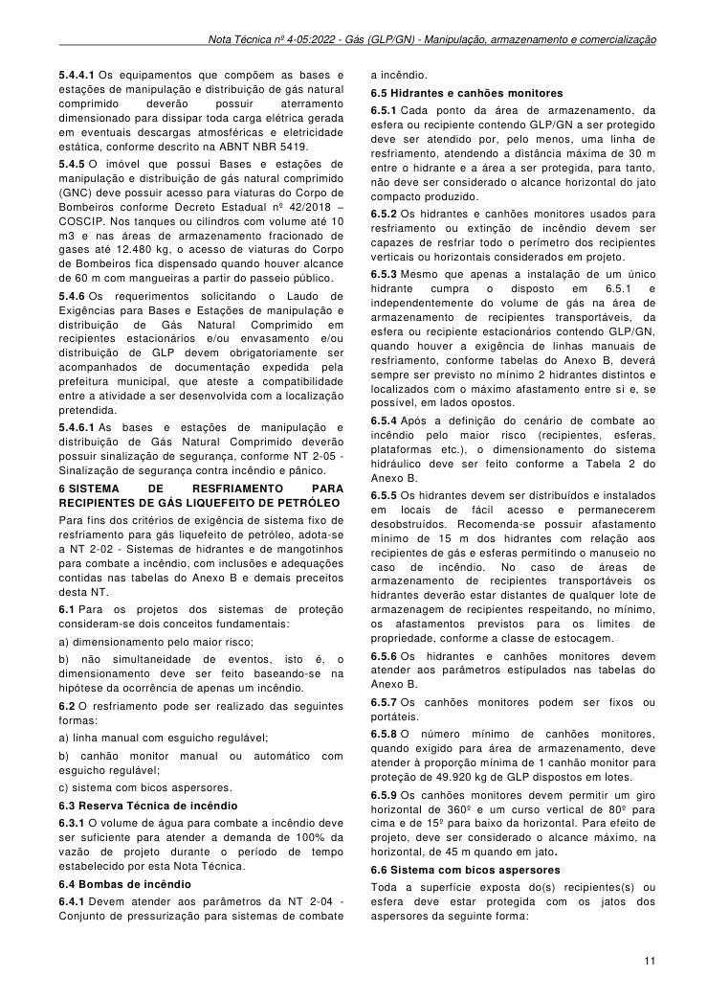

5.4.4.1 Os equipamentos que compõem as bases e estações de manipulação e distribuição de gás natural comprimido deverão possuir aterramento dimensionado para dissipar toda carga elétrica gerada em eventuais descargas atmosféricas e eletricidade estática, conforme descrito na ABNT NBR 5419.

5.4.5 O imóvel que possui Bases e estações de manipulação e distribuição de gás natural comprimido (GNC) deve possuir acesso para viaturas do Corpo de Bombeiros conforme Decreto Estadual nº 42/2018 - COSCIP. Nos tanques ou cilindros com volume até 10 m3 e nas áreas de armazenamento fracionado de gases até 12.480 kg, o acesso de viaturas do Corpo de Bombeiros fica dispensado quando houver alcance de 60 m com mangueiras a partir do passeio público.

5.4.6 Os requerimentos solicitando o Laudo de Exigências para Bases e Estações de manipulação e distribuição de Gás Natural Comprimido em recipientes estacionários e/ou envasamento e/ou distribuição de GLP devem obrigatoriamente ser acompanhados de documentação expedida pela prefeitura municipal, que ateste a compatibilidade entre a atividade a ser desenvolvida com a localização pretendida.

5.4.6.1 As bases e estações de manipulação e distribuição de Gás Natural Comprimido deverão possuir sinalização de segurança, conforme NT 2-05 - Sinalização de segurança contra incêndio e pânico.

### 6 SISTEMA DE RESFRIAMENTO PARA RECIPIENTES DE GÁS LIQUEFEITO DE PETRÓLEO

Para fins dos critérios de exigência de sistema fixo de resfriamento para gás liquefeito de petróleo, adota-se a NT 2-02 - Sistemas de hidrantes e de mangotinhos para combate a incêndio, com inclusões e adequações contidas nas tabelas do Anexo B e demais preceitos desta NT.

6.1 Para os projetos dos sistemas de proteção consideram-se dois conceitos fundamentais:

a) dimensionamento pelo maior risco;

b) não simultaneidade de eventos, isto é, o dimensionamento deve ser feito baseando-se na hipótese da ocorrência de apenas um incêndio.

6.2 O resfriamento pode ser realizado das seguintes formas:

a) linha manual com esguicho regulável;

b) canhão monitor manual ou automático com esguicho regulável;

c) sistema com bicos aspersores.

6.3 Reserva Técnica de incêndio

6.3.1 O volume de água para combate a incêndio deve ser suficiente para atender a demanda de 100% da vazão de projeto durante o período de tempo estabelecido por esta Nota Técnica.

6.4 Bombas de incêndio

6.4.1 Devem atender aos parâmetros da NT 2-04 - Conjunto de pressurização para sistemas de combate

a incêndio.

6.5 Hidrantes e canhões monitores

6.5.1 Cada ponto da área de armazenamento, da esfera ou recipiente contendo GLP/GN a ser protegido deve ser atendido por, pelo menos, uma linha de resfriamento, atendendo a distância máxima de 30 m entre o hidrante e a área a ser protegida, para tanto, não deve ser considerado o alcance horizontal do jato compacto produzido.

6.5.2 Os hidrantes e canhões monitores usados para resfriamento ou extinção de incêndio devem ser capazes de resfriar todo o perímetro dos recipientes verticais ou horizontais considerados em projeto.

6.5.3 Mesmo que apenas a instalação de um único hidrante cumpra o disposto em 6.5.1 e independentemente do volume de gás na área de armazenamento de recipientes transportáveis, da esfera ou recipiente estacionários contendo GLP/GN, quando houver a exigência de linhas manuais de resfriamento, conforme tabelas do Anexo B, deverá sempre ser previsto no mínimo 2 hidrantes distintos e localizados com o máximo afastamento entre si e, se possível, em lados opostos.

6.5.4 Após a definição do cenário de combate ao incêndio pelo maior risco (recipientes, esferas, plataformas etc.), o dimensionamento do sistema hidráulico deve ser feito conforme a Tabela 2 do Anexo B.

6.5.5 Os hidrantes devem ser distribuídos e instalados em locais de fácil acesso e permanecerem desobstruídos. Recomenda-se possuir afastamento mínimo de 15 m dos hidrantes com relação aos recipientes de gás e esferas permitindo o manuseio no caso de incêndio. No caso de áreas de armazenamento de recipientes transportáveis os hidrantes deverão estar distantes de qualquer lote de armazenagem de recipientes respeitando, no mínimo, os afastamentos previstos para os limites de propriedade, conforme a classe de estocagem.

6.5.6 Os hidrantes e canhões monitores devem atender aos parâmetros estipulados nas tabelas do Anexo B.

6.5.7 Os canhões monitores podem ser fixos ou portáteis.

6.5.8 O número mínimo de canhões monitores, quando exigido para área de armazenamento, deve atender à proporção mínima de 1 canhão monitor para proteção de 49.920 kg de GLP dispostos em lotes.

6.5.9 Os canhões monitores devem permitir um giro horizontal de 360º e um curso vertical de 80º para cima e de 15º para baixo da horizontal. Para efeito de projeto, deve ser considerado o alcance máximo, na horizontal, de 45 m quando em jato.

6.6 Sistema com bicos aspersores

Toda a superfície exposta do(s) recipientes(s) ou esfera deve estar protegida com os jatos dos aspersores da seguinte forma:

---

## Página 12

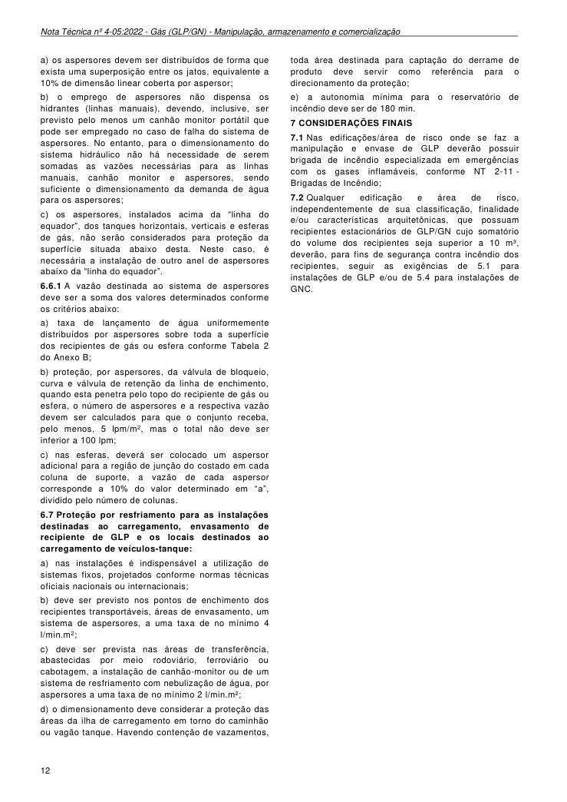

a) os aspersores devem ser distribuídos de forma que exista uma superposição entre os jatos, equivalente a 10% de dimensão linear coberta por aspersor;

b) o emprego de aspersores não dispensa os hidrantes (linhas manuais), devendo, inclusive, ser previsto pelo menos um canhão monitor portátil que pode ser empregado no caso de falha do sistema de aspersores. No entanto, para o dimensionamento do sistema hidráulico não há necessidade de serem somadas as vazões necessárias para as linhas manuais, canhão monitor e aspersores, sendo suficiente o dimensionamento da demanda de água para os aspersores;

c) os aspersores, instalados acima da “linha do equador”, dos tanques horizontais, verticais e esferas de gás, não serão considerados para proteção da superfície situada abaixo desta. Neste caso, é necessária a instalação de outro anel de aspersores abaixo da “linha do equador”.

6.6.1 A vazão destinada ao sistema de aspersores deve ser a soma dos valores determinados conforme os critérios abaixo:

a) taxa de lançamento de água uniformemente distribuídos por aspersores sobre toda a superfície dos recipientes de gás ou esfera conforme Tabela 2 do Anexo B;

b) proteção, por aspersores, da válvula de bloqueio, curva e válvula de retenção da linha de enchimento, quando esta penetra pelo topo do recipiente de gás ou esfera, o número de aspersores e a respectiva vazão devem ser calculados para que o conjunto receba, pelo menos, 5 lpm/m2, mas o total não deve ser inferior a 100 lpm;

c) nas esferas, deverá ser colocado um aspersor adicional para a região de junção do costado em cada coluna de suporte, a vazão de cada aspersor corresponde a 10% do valor determinado em “a”, dividido pelo número de colunas.

6.7 Proteção por resfriamento para as instalações destinadas ao carregamento, envasamento de recipiente de GLP e os locais destinados ao carregamento de veículos-tanque:

a) nas instalações é indispensável a utilização de sistemas fixos, projetados conforme normas técnicas oficiais nacionais ou internacionais;

b) deve ser previsto nos pontos de enchimento dos recipientes transportáveis, áreas de envasamento, um sistema de aspersores, a uma taxa de no mínimo 4 l/min.m2;

c) deve ser prevista nas áreas de transferência, abastecidas por meio rodoviário, ferroviário ou cabotagem, a instalação de canhão-monitor ou de um sistema de resfriamento com nebulização de água, por aspersores a uma taxa de no mínimo 2 l/min.m²;

d) o dimensionamento deve considerar a proteção das áreas da ilha de carregamento em torno do caminhão ou vagão tanque. Havendo contenção de vazamentos,

toda área destinada para captação do derrame de produto deve servir como referência para o direcionamento da proteção;

e) a autonomia mínima para o reservatório de incêndio deve ser de 180 min.

### 7 CONSIDERAÇÕES FINAIS

7.1 Nas edificações/área de risco onde se faz a manipulação e envase de GLP deverão possuir brigada de incêndio especializada em emergências com os gases inflamáveis, conforme NT 2-11 - Brigadas de Incêndio;

7.2 Qualquer edificação e área de risco, independentemente de sua classificação, finalidade e/ou características arquitetônicas, que possuam recipientes estacionários de GLP/GN cujo somatório do volume dos recipientes seja superior a 10 m³, deverão, para fins de segurança contra incêndio dos recipientes, seguir as exigências de 5.1 para instalações de GLP e/ou de 5.4 para instalações de GNC.

---

## Página 13

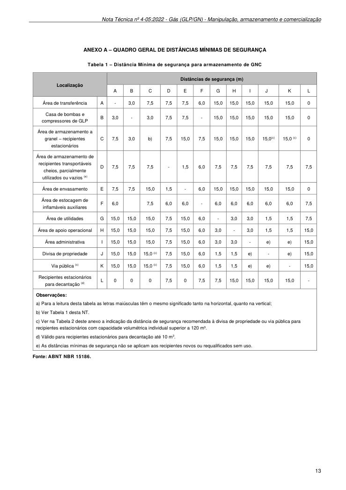

### ANEXO A - QUADRO GERAL DE DISTÂNCIAS MÍNIMAS DE SEGURANÇA

Tabela 1 - Distância Mínima de segurança para armazenamento de GNC

Fonte: ABNT NBR 15186.

### Tabelas extraídas

#### Tabela 1 da página

| Localização |  |  | Distâncias de segurança (m) |  |  |  |  |  |  |  |  |  |  |  |  |
| --- | --- | --- | --- | --- | --- | --- | --- | --- | --- | --- | --- | --- | --- | --- | --- |
|  |  | A |  | B | C | D | E | F | G | H | I | J | K | L |  |
| Área de transferência | A | - |  | 3,0 | 7,5 | 7,5 | 7,5 | 6,0 | 15,0 | 15,0 | 15,0 | 15,0 | 15,0 | 0 |  |
| Casa de bombas e compressores de GLP | B | 3,0 |  | - | 3,0 | 7,5 | 7,5 | - | 15,0 | 15,0 | 15,0 | 15,0 | 15,0 | 0 |  |
| Área de armazenamento a granel - recipientes estacionários | C | 7,5 |  | 3,0 | b) | 7,5 | 15,0 | 7,5 | 15,0 | 15,0 | 15,0 | 15,0(c) | 15,0 (c) | 0 |  |
| Área de armazenamento de recipientes transportáveis cheios, parcialmente utilizados ou vazios (e) | D | 7,5 |  | 7,5 | 7,5 | - | 1,5 | 6,0 | 7,5 | 7,5 | 7,5 | 7,5 | 7,5 | 7,5 |  |
| Área de envasamento | E | 7,5 |  | 7,5 | 15,0 | 1,5 | - | 6,0 | 15,0 | 15,0 | 15,0 | 15,0 | 15,0 | 0 |  |
| Área de estocagem de inflamáveis auxiliares | F | 6,0 |  |  | 7,5 | 6,0 | 6,0 | - | 6,0 | 6,0 | 6,0 | 6,0 | 6,0 | 7,5 |  |
| Área de utilidades | G | 15,0 |  | 15,0 | 15,0 | 7,5 | 15,0 | 6,0 | - | 3,0 | 3,0 | 1,5 | 1,5 | 7,5 |  |
| Área de apoio operacional | H | 15,0 |  | 15,0 | 15,0 | 7,5 | 15,0 | 6,0 | 3,0 | - | 3,0 | 1,5 | 1,5 | 15,0 |  |
| Área administrativa | I | 15,0 |  | 15,0 | 15,0 | 7,5 | 15,0 | 6,0 | 3,0 | 3,0 | - | e) | e) | 15,0 |  |
| Divisa de propriedade | J | 15,0 |  | 15,0 | 15,0 (c) | 7,5 | 15,0 | 6,0 | 1,5 | 1,5 | e) | - | e) | 15,0 |  |
| Via pública (c) | K | 15,0 |  | 15,0 | 15,0 (c) | 7,5 | 15,0 | 6,0 | 1,5 | 1,5 | e) | e) | - | 15,0 |  |
| Recipientes estacionários para decantação (d) | L | 0 |  | 0 | 0 | 7,5 | 0 | 7,5 | 7,5 | 15,0 | 15,0 | 15,0 | 15,0 | - |  |
| Observações: a) Para a leitura desta tabela as letras maiúsculas têm o mesmo significado tanto na horizontal, quanto na vertical; b) Ver Tabela 1 desta NT. c) Ver na Tabela 2 deste anexo a indicação da distância de segurança recomendada à divisa de propriedade ou via pública para recipientes estacionários com capacidade volumétrica individual superior a 120 m³. d) Válido para recipientes estacionários para decantação até 10 m3. e) As distâncias mínimas de segurança não se aplicam aos recipientes novos ou requalificados sem uso. |  |  |  |  |  |  |  |  |  |  |  |  |  |  |  |

---

## Página 14

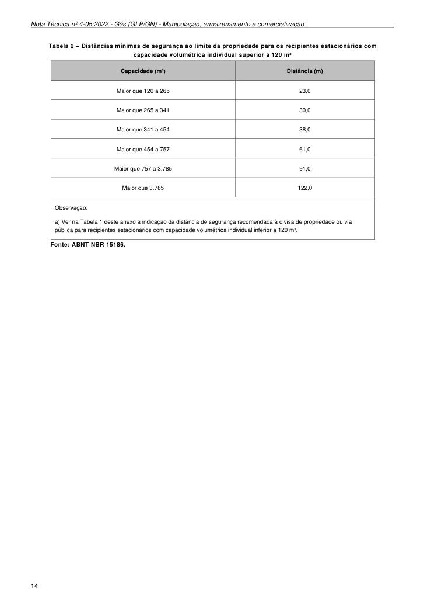

Tabela 2 - Distâncias mínimas de segurança ao limite da propriedade para os recipientes estacionários com

capacidade volumétrica individual superior a 120 m³

Fonte: ABNT NBR 15186.

### Tabelas extraídas

#### Tabela 1 da página

|  | Capacidade (m³) |  |  | Distância (m) |  |
| --- | --- | --- | --- | --- | --- |
| Maior que 120 a 265 |  |  | 23,0 |  |  |
| Maior que 265 a 341 |  |  | 30,0 |  |  |
| Maior que 341 a 454 |  |  | 38,0 |  |  |
| Maior que 454 a 757 |  |  | 61,0 |  |  |
| Maior que 757 a 3.785 |  |  | 91,0 |  |  |
| Maior que 3.785 |  |  | 122,0 |  |  |
| Observação: a) Ver na Tabela 1 deste anexo a indicação da distância de segurança recomendada à divisa de propriedade ou via pública para recipientes estacionários com capacidade volumétrica individual inferior a 120 m³. |  |  |  |  |  |

---

## Página 15

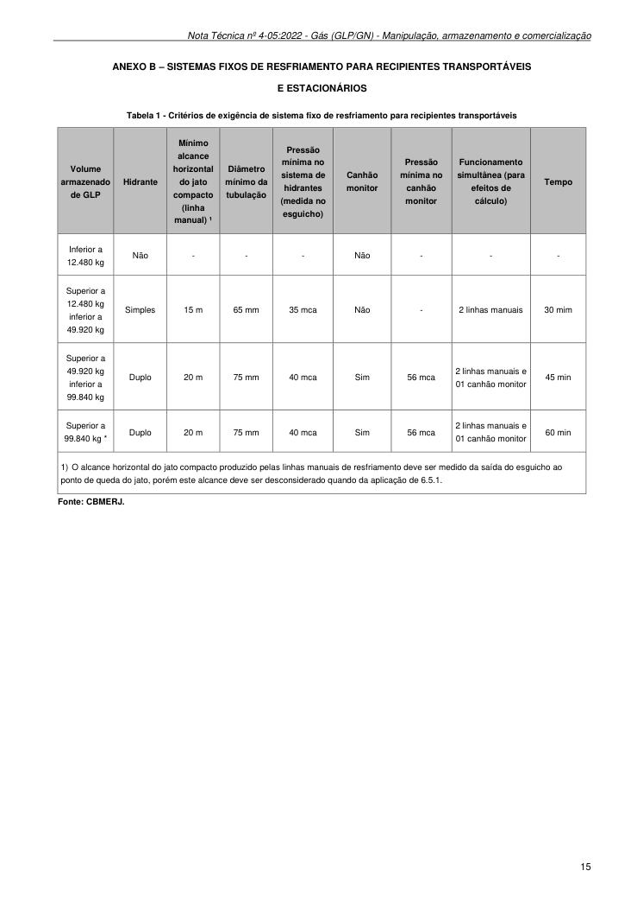

### ANEXO B - SISTEMAS FIXOS DE RESFRIAMENTO PARA RECIPIENTES TRANSPORTÁVEIS

### E ESTACIONÁRIOS

Tabela 1 - Critérios de exigência de sistema fixo de resfriamento para recipientes transportáveis

Fonte: CBMERJ.

### Tabelas extraídas

#### Tabela 1 da página

|  | Hidrante | Mínimo | Diâmetro mínimo da tubulação |  | Canhão monitor |  |  | Tempo |
| --- | --- | --- | --- | --- | --- | --- | --- | --- |
|  |  |  |  | Pressão |  |  |  |  |
|  |  | alcance |  |  |  | Pressão | Funcionamento |  |
| Volume |  |  |  | mínima no |  |  |  |  |
|  |  | horizontal |  |  |  |  |  |  |
|  |  |  |  | sistema de |  | mínima no | simultânea (para |  |
| armazenado |  | do jato |  |  |  |  |  |  |
|  |  |  |  | hidrantes |  | canhão | efeitos de |  |
| de GLP |  | compacto |  |  |  |  |  |  |
|  |  |  |  | (medida no |  | monitor | cálculo) |  |
|  |  | (linha |  |  |  |  |  |  |
|  |  |  |  | esguicho) |  |  |  |  |
|  |  | manual) ¹ |  |  |  |  |  |  |
|  |  |  |  |  |  |  |  |  |
| Inferior a | Não |  | - |  | Não |  |  | - |
|  |  | - |  | - |  | - | - |  |
| 12.480 kg |  |  |  |  |  |  |  |  |
|  |  |  |  |  |  |  |  |  |
| Superior a | Simples |  | 65 mm |  | Não |  |  | 30 mim |
| 12.480 kg |  | 15 m |  | 35 mca |  | - | 2 linhas manuais |  |
| inferior a |  |  |  |  |  |  |  |  |
| 49.920 kg |  |  |  |  |  |  |  |  |
| Superior a | Duplo |  | 75 mm |  | Sim |  |  | 45 min |
|  |  |  |  |  |  |  | 2 linhas manuais e |  |
| 49.920 kg |  | 20 m |  | 40 mca |  | 56 mca |  |  |
| inferior a |  |  |  |  |  |  | 01 canhão monitor |  |
| 99.840 kg |  |  |  |  |  |  |  |  |
|  |  |  |  |  |  |  |  |  |
| Superior a | Duplo |  | 75 mm |  | Sim |  | 2 linhas manuais e | 60 min |
|  |  | 20 m |  | 40 mca |  | 56 mca |  |  |
| 99.840 kg * |  |  |  |  |  |  | 01 canhão monitor |  |
|  |  |  |  |  |  |  |  |  |
| 1) O alcance horizontal do jato compacto produzido pelas linhas manuais de resfriamento deve ser medido da saída do esguicho ao |  |  |  |  |  |  |  |  |
| ponto de queda do jato, porém este alcance deve ser desconsiderado quando da aplicação de 6.5.1. |  |  |  |  |  |  |  |  |

---

## Página 16

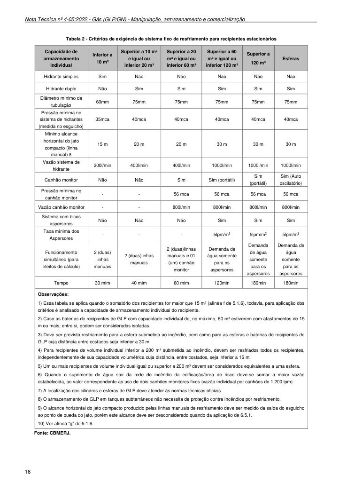

Tabela 2 - Critérios de exigência de sistema fixo de resfriamento para recipientes estacionários

Fonte: CBMERJ.

### Tabelas extraídas

#### Tabela 1 da página

|  | Capacidade de |  | Inferior a 10 m³ |  | Superior a 10 m³ |  |  | Superior a 20 |  |  | Superior a 60 |  | Superior a 120 m³ | Esferas |
| --- | --- | --- | --- | --- | --- | --- | --- | --- | --- | --- | --- | --- | --- | --- |
|  | armazenamento |  |  |  | e igual ou |  |  | m³ e igual ou |  |  | m³ e igual ou |  |  |  |
|  | individual |  |  |  | inferior 20 m³ |  |  | inferior 60 m³ |  |  | inferior 120 m³ |  |  |  |
| Hidrante simples |  |  | Sim | Não |  |  | Não |  |  | Não |  |  | Não | Não |
| Hidrante duplo |  |  | Não | Sim |  |  | Sim |  |  | Sim |  |  | Sim | Sim |
| Diâmetro mínimo da tubulação |  |  | 60mm | 75mm |  |  | 75mm |  |  | 75mm |  |  | 75mm | 75mm |
| Pressão mínima no sistema de hidrantes (medida no esguicho) |  |  | 35mca | 40mca |  |  | 40mca |  |  | 40mca |  |  | 40mca | 40mca |
| Mínimo alcance horizontal do jato compacto (linha manual) 8 |  |  | 15 m | 20 m |  |  | 20 m |  |  | 30 m |  |  | 30 m | 30 m |
| Vazão sistema de hidrante |  |  | 200l/min | 400l/min |  |  | 400l/min |  |  | 1000l/min |  |  | 1000l/min | 1000l/min |
| Canhão monitor |  |  | Não | Não |  |  | Sim |  |  | Sim (portátil) |  |  | Sim (portátil) | Sim (Auto oscilatório) |
| Pressão mínima no canhão monitor |  |  | - | - |  |  | 56 mca |  |  | 56 mca |  |  | 56 mca | 56 mca |
| Vazão canhão monitor |  |  | - | - |  |  | 800l/min |  |  | 800l/min |  |  | 800l/min | 800l/min |
| Sistema com bicos aspersores |  |  | Não | Não |  |  | Não |  |  | Sim |  |  | Sim | Sim |
| Taxa mínima dos Aspersores |  |  | - | - |  |  | - |  |  | 5lpm/m2 |  |  | 5lpm/m2 | 5lpm/m2 |
| Funcionamento simultâneo (para efeitos de cálculo) |  |  | 2 (duas) linhas manuais | 2 (duas)linhas manuais |  |  | 2 (duas)linhas manuais e 01 (um) canhão monitor |  |  | Demanda de água somente para os aspersores |  |  | Demanda de água somente para os aspersores | Demanda de água somente para os aspersores |
| Tempo |  |  | 30 mim | 40 mim |  |  | 60 mim |  |  | 120min |  |  | 180min | 180min |
| Observações: 1) Essa tabela se aplica quando o somatório dos recipientes for maior que 15 m³ (alínea f de 5.1.6), todavia, para aplicação dos critérios é analisado a capacidade de armazenamento individual do recipiente. 2) Caso as baterias de recipientes de GLP com capacidade individual de, no máximo, 60 m³ estiverem com afastamentos de 15 m ou mais, entre si, podem ser consideradas isoladas. 3) Deve ser previsto resfriamento para a esfera submetida ao incêndio, bem como para as esferas e baterias de recipientes de GLP cuja distância entre costados seja inferior a 30 m. 4) Para recipientes de volume individual inferior a 200 m³ submetida ao incêndio, devem ser resfriados todos os recipientes, independentemente de sua capacidade volumétrica cuja distância, entre costados, seja inferior a 15 m. 5) Um ou mais recipientes de volume individual igual ou superior a 200 m³ devem ser considerados equivalentes a uma esfera. 6) Quando o suprimento de água sair da rede de incêndio da edificação/área de risco deve-se somar a maior vazão estabelecida, ao valor correspondente ao uso de dois canhões monitores fixos (vazão individual por canhões de 1.200 lpm). 7) A localização dos cilindros e esferas de GLP deve atender às normas técnicas oficiais. 8) O armazenamento de GLP em tanques subterrâneos não necessita de proteção contra incêndios por resfriamento. 9) O alcance horizontal do jato compacto produzido pelas linhas manuais de resfriamento deve ser medido da saída do esguicho ao ponto de queda do jato, porém este alcance deve ser desconsiderado quando da aplicação de 6.5.1. 10) Ver alínea “g” de 5.1.6. |  |  |  |  |  |  |  |  |  |  |  |  |  |  |

---

## Página 17

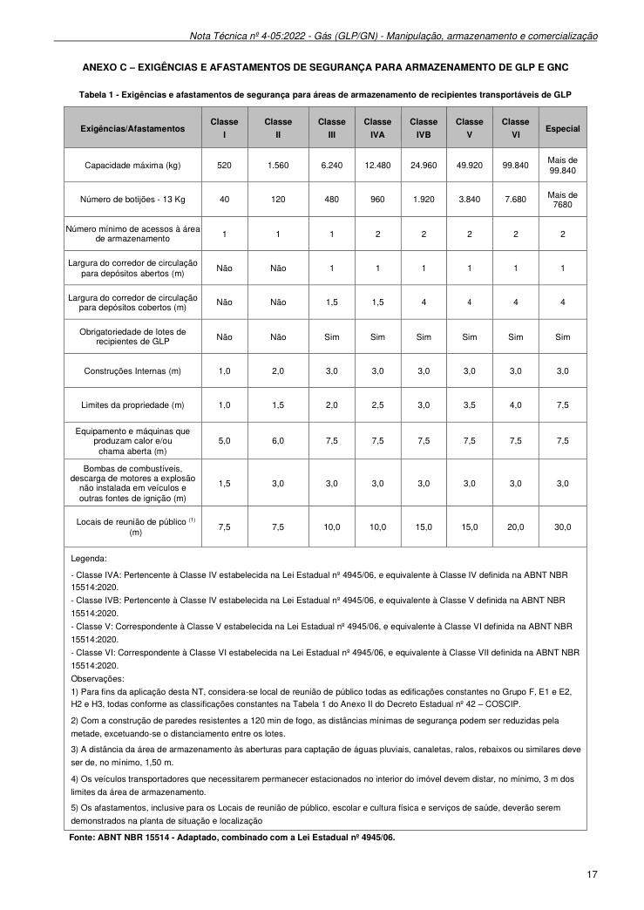

### ANEXO C - EXIGÊNCIAS E AFASTAMENTOS DE SEGURANÇA PARA ARMAZENAMENTO DE GLP E GNC

Tabela 1 - Exigências e afastamentos de segurança para áreas de armazenamento de recipientes transportáveis de GLP

Fonte: ABNT NBR 15514 - Adaptado, combinado com a Lei Estadual nº 4945/06.

### Tabelas extraídas

#### Tabela 1 da página

|  |  |  |  |  |  |  |  |  |
| --- | --- | --- | --- | --- | --- | --- | --- | --- |
|  | Classe | Classe | Classe | Classe | Classe | Classe | Classe |  |
| Exigências/Afastamentos |  |  |  |  |  |  |  | Especial |
|  | I | II | III | IVA | IVB | V | VI |  |
|  |  |  |  |  |  |  |  |  |
|  |  |  |  |  |  |  |  |  |
| Capacidade máxima (kg) | 520 | 1.560 | 6.240 | 12.480 | 24.960 | 49.920 | 99.840 | Mais de 99.840 |
| Número de botijões - 13 Kg | 40 | 120 | 480 | 960 | 1.920 | 3.840 | 7.680 | Mais de 7680 |
| Número mínimo de acessos à área de armazenamento | 1 | 1 | 1 | 2 | 2 | 2 | 2 | 2 |
| Largura do corredor de circulação para depósitos abertos (m) | Não | Não | 1 | 1 | 1 | 1 | 1 | 1 |
| Largura do corredor de circulação para depósitos cobertos (m) | Não | Não | 1,5 | 1,5 | 4 | 4 | 4 | 4 |
| Obrigatoriedade de lotes de recipientes de GLP | Não | Não | Sim | Sim | Sim | Sim | Sim | Sim |
| Construções Internas (m) | 1,0 | 2,0 | 3,0 | 3,0 | 3,0 | 3,0 | 3,0 | 3,0 |
| Limites da propriedade (m) | 1,0 | 1,5 | 2,0 | 2,5 | 3,0 | 3,5 | 4,0 | 7,5 |
| Equipamento e máquinas que produzam calor e/ou chama aberta (m) | 5,0 | 6,0 | 7,5 | 7,5 | 7,5 | 7,5 | 7,5 | 7,5 |
| Bombas de combustíveis, descarga de motores a explosão não instalada em veículos e outras fontes de ignição (m) | 1,5 | 3,0 | 3,0 | 3,0 | 3,0 | 3,0 | 3,0 | 3,0 |
| Locais de reunião de público (1) (m) | 7,5 | 7,5 | 10,0 | 10,0 | 15,0 | 15,0 | 20,0 | 30,0 |
| Legenda: - Classe IVA: Pertencente à Classe IV estabelecida na Lei Estadual nº 4945/06, e equivalente à Classe IV definida na ABNT NBR 15514:2020. - Classe IVB: Pertencente à Classe IV estabelecida na Lei Estadual nº 4945/06, e equivalente à Classe V definida na ABNT NBR 15514:2020. - Classe V: Correspondente à Classe V estabelecida na Lei Estadual nº 4945/06, e equivalente à Classe VI definida na ABNT NBR 15514:2020. - Classe VI: Correspondente à Classe VI estabelecida na Lei Estadual nº 4945/06, e equivalente à Classe VII definida na ABNT NBR 15514:2020. Observações: 1) Para fins da aplicação desta NT, considera-se local de reunião de público todas as edificações constantes no Grupo F, E1 e E2, H2 e H3, todas conforme as classificações constantes na Tabela 1 do Anexo II do Decreto Estadual nº 42 - COSCIP. 2) Com a construção de paredes resistentes a 120 min de fogo, as distâncias mínimas de segurança podem ser reduzidas pela metade, excetuando-se o distanciamento entre os lotes. 3) A distância da área de armazenamento às aberturas para captação de águas pluviais, canaletas, ralos, rebaixos ou similares deve ser de, no mínimo, 1,50 m. 4) Os veículos transportadores que necessitarem permanecer estacionados no interior do imóvel devem distar, no mínimo, 3 m dos limites da área de armazenamento. 5) Os afastamentos, inclusive para os Locais de reunião de público, escolar e cultura física e serviços de saúde, deverão serem demonstrados na planta de situação e localização |  |  |  |  |  |  |  |  |

---

## Página 18

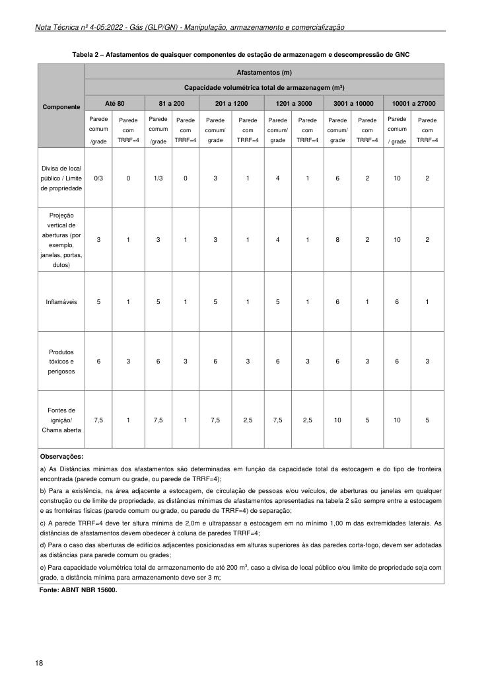

Tabela 2 - Afastamentos de quaisquer componentes de estação de armazenagem e descompressão de GNC

Fonte: ABNT NBR 15600.

### Tabelas extraídas

#### Tabela 1 da página

| Componente | Afastamentos (m) |  |  |  |  |  |  |  |  |  |  |  |
| --- | --- | --- | --- | --- | --- | --- | --- | --- | --- | --- | --- | --- |
|  | Capacidade volumétrica total de armazenagem (m3) |  |  |  |  |  |  |  |  |  |  |  |
|  | Até 80 |  | 81 a 200 |  | 201 a 1200 |  | 1201 a 3000 |  | 3001 a 10000 |  | 10001 a 27000 |  |
|  | Parede comum /grade | Parede com TRRF=4 | Parede comum /grade | Parede com TRRF=4 | Parede comum/ grade | Parede com TRRF=4 | Parede comum/ grade | Parede com TRRF=4 | Parede comum/ grade | Parede com TRRF=4 | Parede comum / grade | Parede com TRRF=4 |
| Divisa de local público / Limite de propriedade | 0/3 | 0 | 1/3 | 0 | 3 | 1 | 4 | 1 | 6 | 2 | 10 | 2 |
| Projeção vertical de aberturas (por exemplo, janelas, portas, dutos) | 3 | 1 | 3 | 1 | 3 | 1 | 4 | 1 | 8 | 2 | 10 | 2 |
| Inflamáveis | 5 | 1 | 5 | 1 | 5 | 1 | 5 | 1 | 6 | 1 | 6 | 1 |
| Produtos tóxicos e perigosos | 6 | 3 | 6 | 3 | 6 | 3 | 6 | 3 | 6 | 3 | 6 | 3 |
| Fontes de ignição/ Chama aberta | 7,5 | 1 | 7,5 | 1 | 7,5 | 2,5 | 7,5 | 2,5 | 10 | 5 | 10 | 5 |
| Observações: a) As Distâncias mínimas dos afastamentos são determinadas em função da capacidade total da estocagem e do tipo de fronteira encontrada (parede comum ou grade, ou parede de TRRF=4); b) Para a existência, na área adjacente a estocagem, de circulação de pessoas e/ou veículos, de aberturas ou janelas em qualquer construção ou de limite de propriedade, as distâncias mínimas de afastamentos apresentadas na tabela 2 são sempre entre a estocagem e as fronteiras físicas (parede comum ou grade, ou parede de TRRF=4) de separação; c) A parede TRRF=4 deve ter altura mínima de 2,0m e ultrapassar a estocagem em no mínimo 1,00 m das extremidades laterais. As distâncias de afastamentos devem obedecer à coluna de paredes TRRF=4; d) Para o caso das aberturas de edifícios adjacentes posicionadas em alturas superiores às das paredes corta-fogo, devem ser adotadas as distâncias para parede comum ou grades; e) Para capacidade volumétrica total de armazenamento de até 200 m3, caso a divisa de local público e/ou limite de propriedade seja com grade, a distância mínima para armazenamento deve ser 3 m; |  |  |  |  |  |  |  |  |  |  |  |  |

---

## Página 19

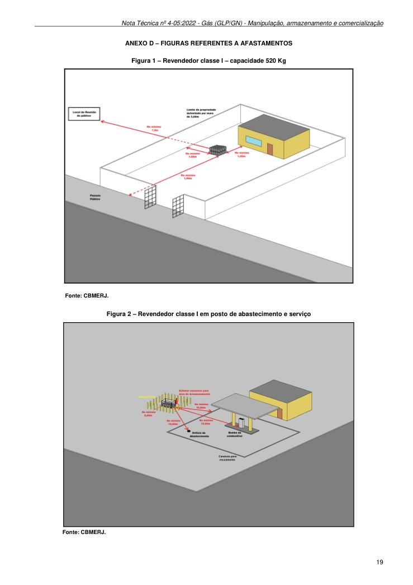

### ANEXO D - FIGURAS REFERENTES A AFASTAMENTOS

Figura 1 - Revendedor classe I - capacidade 520 Kg

Fonte: CBMERJ.

Figura 2 - Revendedor classe I em posto de abastecimento e serviço

Fonte: CBMERJ.

---

## Página 20

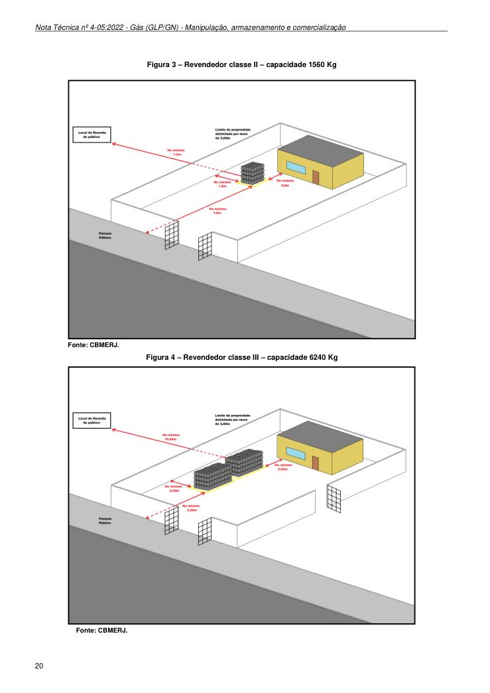

Figura 3 - Revendedor classe II - capacidade 1560 Kg

7,50

1,50 2,00

1,50

Fonte: CBMERJ.

Figura 4 - Revendedor classe III - capacidade 6240 Kg

Fonte: CBMERJ.

---

## Página 21

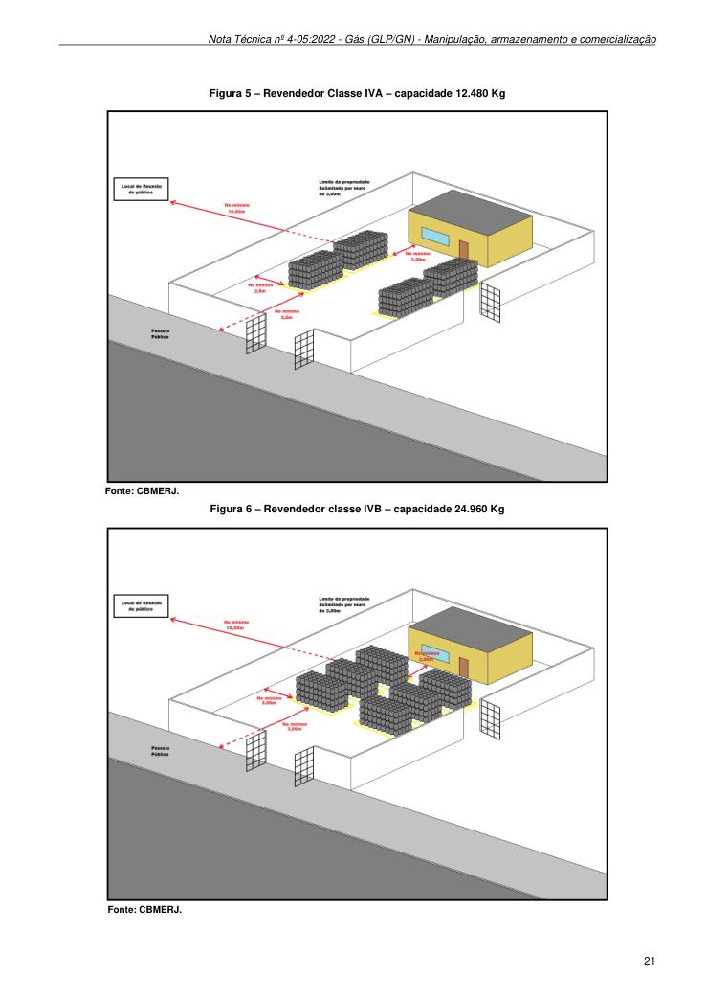

Figura 5 - Revendedor Classe IVA - capacidade 12.480 Kg

Fonte: CBMERJ.

Figura 6 - Revendedor classe IVB - capacidade 24.960 Kg

15,00

3,00

3,00

Fonte: CBMERJ.

---

## Página 22

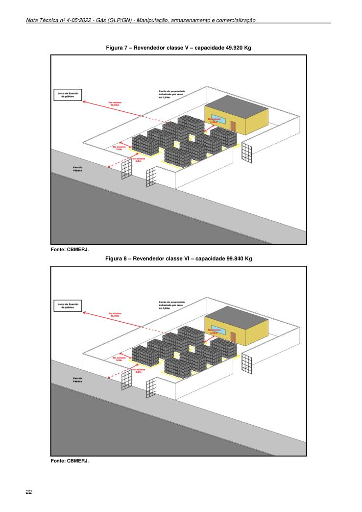

Figura 7 - Revendedor classe V - capacidade 49.920 Kg

Fonte: CBMERJ.

Figura 8 - Revendedor classe VI - capacidade 99.840 Kg

Fonte: CBMERJ.

---

## Página 23

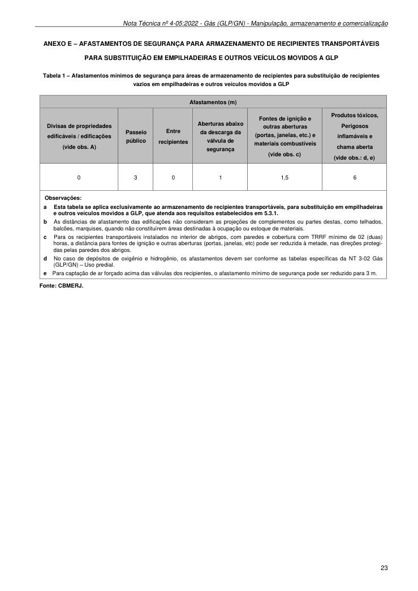

### ANEXO E - AFASTAMENTOS DE SEGURANÇA PARA ARMAZENAMENTO DE RECIPIENTES TRANSPORTÁVEIS

### PARA SUBSTITUIÇÃO EM EMPILHADEIRAS E OUTROS VEÍCULOS MOVIDOS A GLP

Tabela 1 - Afastamentos mínimos de segurança para áreas de armazenamento de recipientes para substituição de recipientes

vazios em empilhadeiras e outros veículos movidos a GLP

Fonte: CBMERJ.

### Tabelas extraídas

#### Tabela 1 da página

|  | Afastamentos (m) |  |  |  |  |  |  |  |
| --- | --- | --- | --- | --- | --- | --- | --- | --- |
| Divisas de propriedades edificáveis / edificações (vide obs. A) |  | Passeio público | Entre recipientes | Aberturas abaixo da descarga da válvula de segurança | Fontes de ignição e outras aberturas (portas, janelas, etc.) e materiais combustíveis (vide obs. c) |  | Produtos tóxicos, |  |
|  |  |  |  |  |  |  | Perigosos |  |
|  |  |  |  |  |  |  | inflamáveis e |  |
|  |  |  |  |  |  |  | chama aberta |  |
|  |  |  |  |  |  |  | (vide obs.: d, e) |  |
| 0 |  | 3 | 0 | 1 | 1,5 | 6 |  |  |
| Observações: a Esta tabela se aplica exclusivamente ao armazenamento de recipientes transportáveis, para substituição em empilhadeiras e outros veículos movidos a GLP, que atenda aos requisitos estabelecidos em 5.3.1. b As distâncias de afastamento das edificações não consideram as projeções de complementos ou partes destas, como telhados, balcões, marquises, quando não constituírem áreas destinadas à ocupação ou estoque de materiais. c Para os recipientes transportáveis instalados no interior de abrigos, com paredes e cobertura com TRRF mínimo de 02 (duas) horas, a distância para fontes de ignição e outras aberturas (portas, janelas, etc) pode ser reduzida à metade, nas direções protegidas pelas paredes dos abrigos. d No caso de depósitos de oxigênio e hidrogênio, os afastamentos devem ser conforme as tabelas específicas da NT 3-02 Gás (GLP/GN) - Uso predial. e Para captação de ar forçado acima das válvulas dos recipientes, o afastamento mínimo de segurança pode ser reduzido para 3 m. |  |  |  |  |  |  |  |  |
