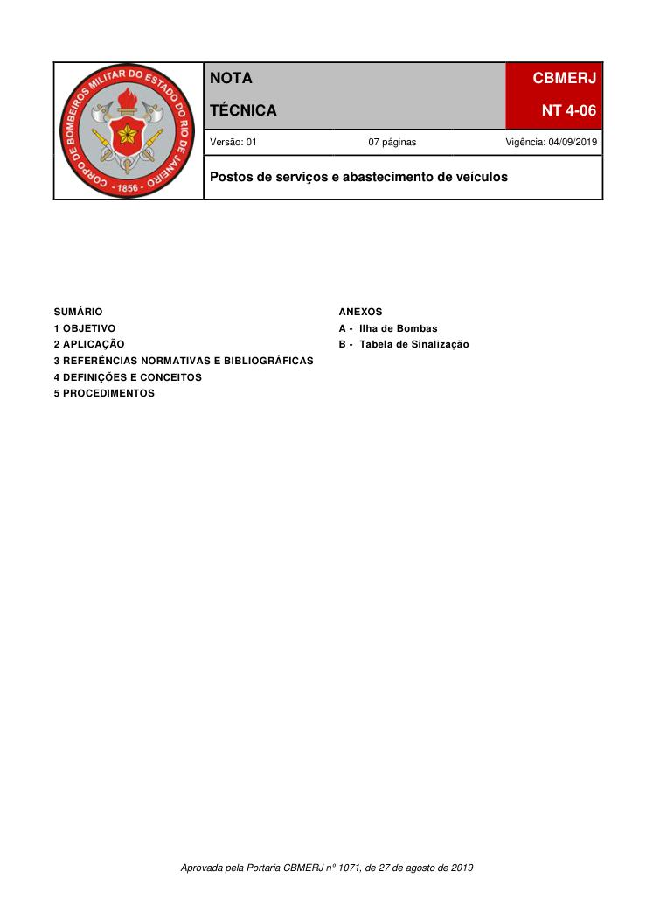
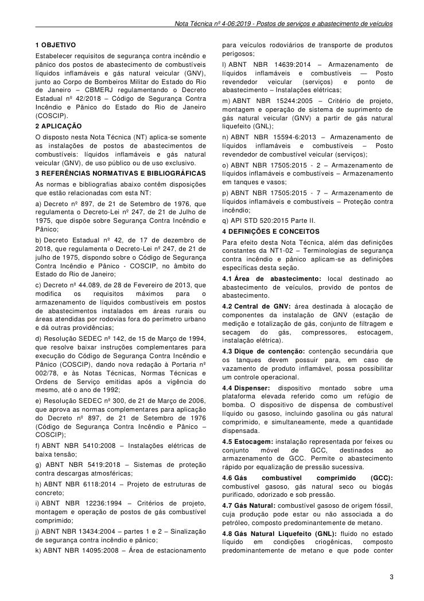
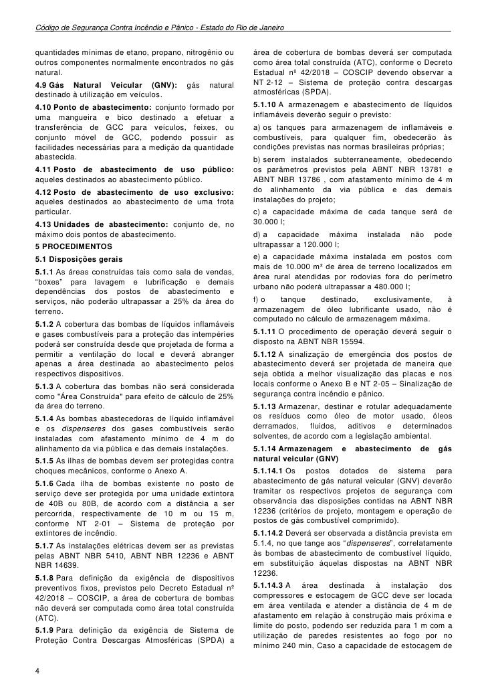
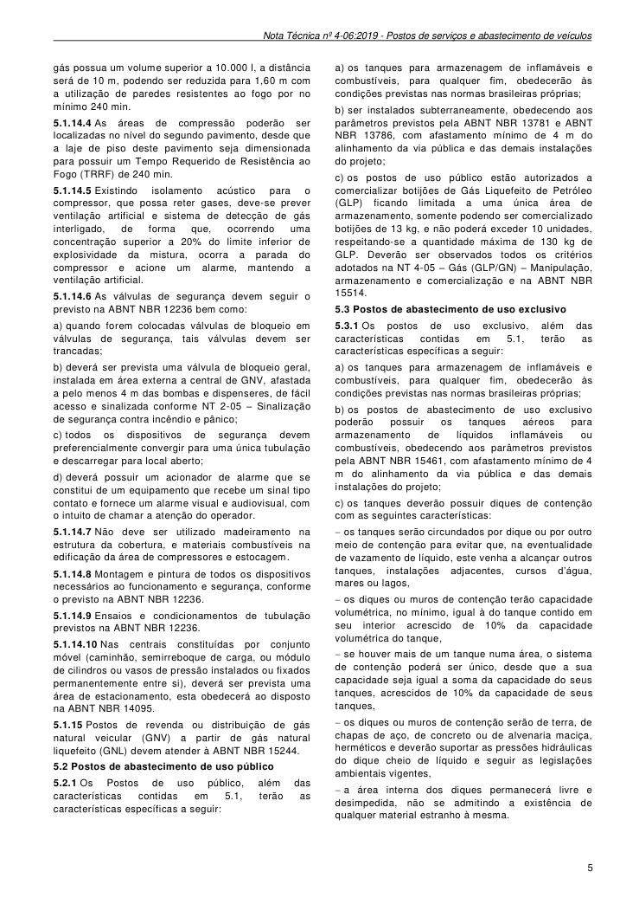
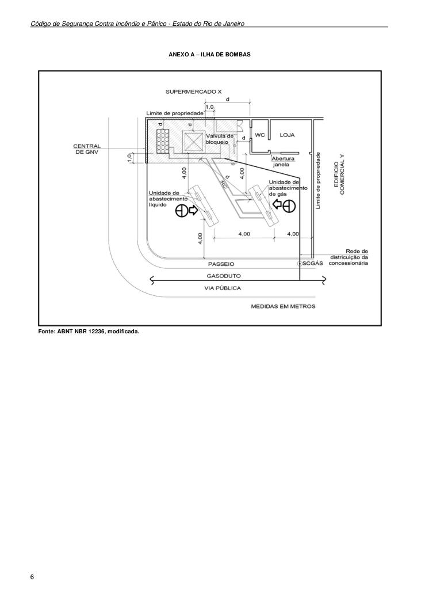
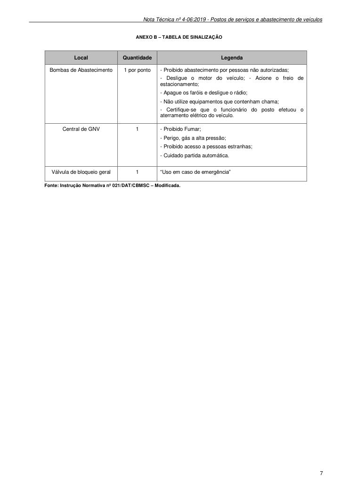

# NT 4-06 - Postos de serviços e abastecimento de veículos

> Conversão integral para consulta computacional. A numeração de página do PDF foi preservada. Quando houver tabela complexa, símbolo ou desenho, conferir também a representação visual indicada e o PDF oficial.

## Sumário por página

- [Página 1](#pagina-1)
- [Página 2](#pagina-2)
- [Página 3](#pagina-3)
- [Página 4](#pagina-4)
- [Página 5](#pagina-5)
- [Página 6](#pagina-6)
- [Página 7](#pagina-7)

---

## Página 1

Aprovada pela Portaria CBMERJ nº 1071, de 27 de agosto de 2019

### SUMÁRIO

### 1 OBJETIVO

### 2 APLICAÇÃO

### 3 REFERÊNCIAS NORMATIVAS E BIBLIOGRÁFICAS

### 4 DEFINIÇÕES E CONCEITOS

### 5 PROCEDIMENTOS

### ANEXOS

A - Ilha de Bombas

B - Tabela de Sinalização

### Tabelas extraídas (bruto, não usar para citação)
#### Tabela 1 da página

|  |  |  |  | NOTA |  |  | CBMERJ |  |
| --- | --- | --- | --- | --- | --- | --- | --- | --- |
|  |  |  |  | TÉCNICA |  |  | NT 4-06 |  |
|  |  |  | Versão: 01 07 páginas Vigência: 04/09/2019 |  |  |  |  |  |
|  |  |  | Postos de serviços e abastecimento de veículos |  |  |  |  |  |

---

## Página 2

> Página sem texto extraível suficiente; consultar a representação visual ou o PDF oficial.

---

## Página 3

### 1 OBJETIVO

Estabelecer requisitos de segurança contra incêndio e pânico dos postos de abastecimento de combustíveis líquidos inflamáveis e gás natural veicular (GNV), junto ao Corpo de Bombeiros Militar do Estado do Rio de Janeiro - CBMERJ regulamentando o Decreto Estadual nº 42/2018 - Código de Segurança Contra Incêndio e Pânico do Estado do Rio de Janeiro (COSCIP).

### 2 APLICAÇÃO

O disposto nesta Nota Técnica (NT) aplica-se somente as instalações de postos de abastecimentos de combustíveis: líquidos inflamáveis e gás natural veicular (GNV), de uso público ou de uso exclusivo.

### 3 REFERÊNCIAS NORMATIVAS E BIBLIOGRÁFICAS

As normas e bibliografias abaixo contêm disposições que estão relacionadas com esta NT:

a) Decreto nº 897, de 21 de Setembro de 1976, que regulamenta o Decreto-Lei nº 247, de 21 de Julho de 1975, que dispõe sobre Segurança Contra Incêndio e Pânico;

b) Decreto Estadual nº 42, de 17 de dezembro de 2018, que regulamenta o Decreto-Lei nº 247, de 21 de julho de 1975, dispondo sobre o Código de Segurança Contra Incêndio e Pânico - COSCIP, no âmbito do Estado do Rio de Janeiro;

c) Decreto nº 44.089, de 28 de Fevereiro de 2013, que modifica os requisitos máximos para o armazenamento de líquidos combustíveis em postos de abastecimentos instalados em áreas rurais ou áreas atendidas por rodovias fora do perímetro urbano e dá outras providências;

d) Resolução SEDEC nº 142, de 15 de Março de 1994, que resolve baixar instruções complementares para execução do Código de Segurança Contra Incêndio e Pânico (COSCIP), dando nova redação à Portaria nº 002/78, e às Notas Técnicas, Normas Técnicas e Ordens de Serviço emitidas após a vigência do mesmo, até o ano de 1992;

e) Resolução SEDEC nº 300, de 21 de Março de 2006, que aprova as normas complementares para aplicação do Decreto nº 897, de 21 de Setembro de 1976 (Código de Segurança Contra Incêndio e Pânico - COSCIP);

f) ABNT NBR 5410:2008 - Instalações elétricas de baixa tensão;

g) ABNT NBR 5419:2018 - Sistemas de proteção contra descargas atmosféricas;

h) ABNT NBR 6118:2014 - Projeto de estruturas de concreto;

i) ABNT NBR 12236:1994 - Critérios de projeto, montagem e operação de postos de gás combustível comprimido;

j) ABNT NBR 13434:2004 - partes 1 e 2 - Sinalização de segurança contra incêndio e pânico;

k) ABNT NBR 14095:2008 - Área de estacionamento

para veículos rodoviários de transporte de produtos perigosos;

l) ABNT NBR 14639:2014 - Armazenamento de líquidos inflamáveis e combustíveis - Posto revendedor veicular (serviços) e ponto de abastecimento - Instalações elétricas;

m) ABNT NBR 15244:2005 - Critério de projeto, montagem e operação de sistema de suprimento de gás natural veicular (GNV) a partir de gás natural liquefeito (GNL);

n) ABNT NBR 15594-6:2013 - Armazenamento de líquidos inflamáveis e combustíveis - Posto revendedor de combustível veicular (serviços);

o) ABNT NBR 17505:2015 - 2 - Armazenamento de líquidos inflamáveis e combustíveis - Armazenamento em tanques e vasos;

p) ABNT NBR 17505:2015 - 7 - Armazenamento de líquidos inflamáveis e combustíveis - Proteção contra incêndio;

q) API STD 520:2015 Parte II.

### 4 DEFINIÇÕES E CONCEITOS

Para efeito desta Nota Técnica, além das definições constantes da NT1-02 - Terminologias de segurança contra incêndio e pânico aplicam-se as definições específicas desta seção.

4.1 Área de abastecimento: local destinado ao abastecimento de veículos, provido de pontos de abastecimento.

4.2 Central de GNV: área destinada à alocação de componentes da instalação de GNV (estação de medição e totalização de gás, conjunto de filtragem e secagem do gás, compressores, estocagem, instalação elétrica).

4.4 Dispenser: dispositivo montado sobre uma plataforma elevada referido como um refúgio de bomba. O dispositivo de dispensa de combustível líquido ou gasoso, incluindo gasolina ou gás natural comprimido, e simultaneamente, mede a quantidade dispensada.

4.5 Estocagem: instalação representada por feixes ou conjunto móvel de GCC, destinados ao armazenamento de GCC. Permite o abastecimento rápido por equalização de pressão sucessiva.

4.6 Gás combustível comprimido (GCC): combustível gasoso, gás natural seco ou biogás purificado, odorizado e sob pressão.

4.7 Gás Natural: combustível gasoso de origem fóssil, cuja produção pode estar ou não associada a do petróleo, composto predominantemente de metano.

4.8 Gás Natural Liquefeito (GNL): fluido no estado líquido em condições criogênicas, composto predominantemente de metano e que pode conter

### Tabelas extraídas (bruto, não usar para citação)
#### Tabela 1 da página

|  | contenção secundária que |
| --- | --- |
| os tanques devem possuir para, em caso de |  |
| vazamento de produto inflamável, possa possibilitar |  |
| um controle operacional |  |

---

## Página 4

Código de Segurança Contra Incêndio e Pânico - Estado do Rio de Janeiro

quantidades mínimas de etano, propano, nitrogênio ou outros componentes normalmente encontrados no gás natural.

4.9 Gás Natural Veicular (GNV): gás natural destinado à utilização em veículos.

4.10 Ponto de abastecimento: conjunto formado por uma mangueira e bico destinado a efetuar a transferência de GCC para veículos, feixes, ou conjunto móvel de GCC, podendo possuir as facilidades necessárias para a medição da quantidade abastecida.

4.11 Posto de abastecimento de uso público: aqueles destinados ao abastecimento público.

4.12 Posto de abastecimento de uso exclusivo: aqueles destinados ao abastecimento de uma frota particular.

4.13 Unidades de abastecimento: conjunto de, no máximo dois pontos de abastecimento.

### 5 PROCEDIMENTOS

5.1 Disposições gerais

5.1.1 As áreas construídas tais como sala de vendas, “boxes” para lavagem e lubrificação e demais dependências dos postos de abastecimento e serviços, não poderão ultrapassar a 25% da área do terreno.

5.1.2 A cobertura das bombas de líquidos inflamáveis e gases combustíveis para a proteção das intempéries poderá ser construída desde que projetada de forma a permitir a ventilação do local e deverá abranger apenas a área destinada ao abastecimento pelos respectivos dispositivos.

5.1.3 A cobertura das bombas não será considerada como "Área Construída" para efeito de cálculo de 25% da área do terreno.

5.1.4 As bombas abastecedoras de líquido inflamável e os dispenseres dos gases combustíveis serão instaladas com afastamento mínimo de 4 m do alinhamento da via pública e das demais instalações.

5.1.5 As ilhas de bombas devem ser protegidas contra choques mecânicos, conforme o Anexo A.

5.1.6 Cada ilha de bombas existente no posto de serviço deve ser protegida por uma unidade extintora de 40B ou 80B, de acordo com a distância a ser percorrida, respectivamente de 10 m ou 15 m, conforme NT 2-01 - Sistema de proteção por extintores de incêndio.

5.1.7 As instalações elétricas devem ser as previstas pelas ABNT NBR 5410, ABNT NBR 12236 e ABNT NBR 14639.

5.1.8 Para definição da exigência de dispositivos preventivos fixos, previstos pelo Decreto Estadual nº 42/2018 - COSCIP, a área de cobertura de bombas não deverá ser computada como área total construída (ATC).

5.1.9 Para definição da exigência de Sistema de Proteção Contra Descargas Atmosféricas (SPDA) a

área de cobertura de bombas deverá ser computada como área total construída (ATC), conforme o Decreto Estadual nº 42/2018 - COSCIP devendo observar a NT 2-12 - Sistema de proteção contra descargas atmosféricas (SPDA).

5.1.10 A armazenagem e abastecimento de líquidos inflamáveis deverão seguir o previsto:

a) os tanques para armazenagem de inflamáveis e combustíveis, para qualquer fim, obedecerão às condições previstas nas normas brasileiras próprias;

b) serem instalados subterraneamente, obedecendo os parâmetros previstos pela ABNT NBR 13781 e ABNT NBR 13786, com afastamento mínimo de 4 m do alinhamento da via pública e das demais instalações do projeto;

c) a capacidade máxima de cada tanque será de 30.000 l;

d) a capacidade máxima instalada não pode ultrapassar a 120.000 l;

e) a capacidade máxima instalada em postos com mais de 10.000 m² de área de terreno localizados em área rural atendidas por rodovias fora do perímetro urbano não poderá ultrapassar a 480.000 l;

f) o tanque destinado, exclusivamente, à armazenagem de óleo lubrificante usado, não é computado no cálculo de armazenagem máxima.

5.1.11 O procedimento de operação deverá seguir o disposto na ABNT NBR 15594.

5.1.12 A sinalização de emergência dos postos de abastecimento deverá ser projetada de maneira que seja obtida a melhor visualização das placas e nos locais conforme o Anexo B e NT 2-05 - Sinalização de segurança contra incêndio e pânico.

5.1.13 Armazenar, destinar e rotular adequadamente os resíduos como óleo de motor usado, óleos derramados, fluidos, aditivos e determinados solventes, de acordo com a legislação ambiental.

5.1.14 Armazenagem e abastecimento de gás natural veicular (GNV)

5.1.14.1 Os postos dotados de sistema para abastecimento de gás natural veicular (GNV) deverão tramitar os respectivos projetos de segurança com observância das disposições contidas na ABNT NBR 12236 (critérios de projeto, montagem e operação de postos de gás combustível comprimido).

5.1.14.2 Deverá ser observada a distância prevista em 5.1.4, no que tange aos “dispenseres”, correlatamente às bombas de abastecimento de combustível líquido, em substituição àquelas dispostas na ABNT NBR 12236.

5.1.14.3 A área destinada à instalação dos compressores e estocagem de GCC deve ser locada em área ventilada e atender a distância de 4 m de afastamento em relação à construção mais próxima e limite do posto, podendo ser reduzida para 1 m com a utilização de paredes resistentes ao fogo por no mínimo 240 min, Caso a capacidade de estocagem de

---

## Página 5

gás possua um volume superior a 10.000 l, a distância será de 10 m, podendo ser reduzida para 1,60 m com a utilização de paredes resistentes ao fogo por no mínimo 240 min.

5.1.14.4 As áreas de compressão poderão ser localizadas no nível do segundo pavimento, desde que a laje de piso deste pavimento seja dimensionada para possuir um Tempo Requerido de Resistência ao Fogo (TRRF) de 240 min.

5.1.14.6 As válvulas de segurança devem seguir o previsto na ABNT NBR 12236 bem como:

a) quando forem colocadas válvulas de bloqueio em válvulas de segurança, tais válvulas devem ser trancadas;

b) deverá ser prevista uma válvula de bloqueio geral, instalada em área externa a central de GNV, afastada a pelo menos 4 m das bombas e dispenseres, de fácil acesso e sinalizada conforme NT 2-05 - Sinalização de segurança contra incêndio e pânico;

c) todos os dispositivos de segurança devem preferencialmente convergir para uma única tubulação e descarregar para local aberto;

d) deverá possuir um acionador de alarme que se constitui de um equipamento que recebe um sinal tipo contato e fornece um alarme visual e audiovisual, com o intuito de chamar a atenção do operador.

5.1.14.7 Não deve ser utilizado madeiramento na estrutura da cobertura, e materiais combustíveis na edificação da área de compressores e estocagem.

5.1.14.8 Montagem e pintura de todos os dispositivos necessários ao funcionamento e segurança, conforme o previsto na ABNT NBR 12236.

5.1.14.9 Ensaios e condicionamentos de tubulação previstos na ABNT NBR 12236.

5.1.14.10 Nas centrais constituídas por conjunto móvel (caminhão, semirreboque de carga, ou módulo de cilindros ou vasos de pressão instalados ou fixados permanentemente entre si), deverá ser prevista uma área de estacionamento, esta obedecerá ao disposto na ABNT NBR 14095.

5.1.15 Postos de revenda ou distribuição de gás natural veicular (GNV) a partir de gás natural liquefeito (GNL) devem atender à ABNT NBR 15244.

5.2 Postos de abastecimento de uso público

5.2.1 Os Postos de uso público, além das características contidas em 5.1, terão as características específicas a seguir:

a) os tanques para armazenagem de inflamáveis e combustíveis, para qualquer fim, obedecerão às condições previstas nas normas brasileiras próprias;

b) ser instalados subterraneamente, obedecendo aos parâmetros previstos pela ABNT NBR 13781 e ABNT NBR 13786, com afastamento mínimo de 4 m do alinhamento da via pública e das demais instalações do projeto;

c) os postos de uso público estão autorizados a comercializar botijões de Gás Liquefeito de Petróleo (GLP) ficando limitada a uma única área de armazenamento, somente podendo ser comercializado botijões de 13 kg, e não poderá exceder 10 unidades, respeitando-se a quantidade máxima de 130 kg de GLP. Deverão ser observados todos os critérios adotados na NT 4-05 - Gás (GLP/GN) - Manipulação, armazenamento e comercialização e na ABNT NBR 15514.

5.3 Postos de abastecimento de uso exclusivo

5.3.1 Os postos de uso exclusivo, além das características contidas em 5.1, terão as características específicas a seguir:

a) os tanques para armazenagem de inflamáveis e combustíveis, para qualquer fim, obedecerão às condições previstas nas normas brasileiras próprias;

b) os postos de abastecimento de uso exclusivo poderão possuir os tanques aéreos para armazenamento de líquidos inflamáveis ou combustíveis, obedecendo aos parâmetros previstos pela ABNT NBR 15461, com afastamento mínimo de 4 m do alinhamento da via pública e das demais instalações do projeto;

c) os tanques deverão possuir diques de contenção com as seguintes características:

 os tanques serão circundados por dique ou por outro meio de contenção para evitar que, na eventualidade de vazamento de líquido, este venha a alcançar outros tanques, instalações adjacentes, cursos d’água, mares ou lagos,

 os diques ou muros de contenção terão capacidade volumétrica, no mínimo, igual à do tanque contido em seu interior acrescido de 10% da capacidade volumétrica do tanque,

 se houver mais de um tanque numa área, o sistema de contenção poderá ser único, desde que a sua capacidade seja igual a soma da capacidade do seus tanques, acrescidos de 10% da capacidade de seus tanques,

 os diques ou muros de contenção serão de terra, de chapas de aço, de concreto ou de alvenaria maciça, herméticos e deverão suportar as pressões hidráulicas do dique cheio de líquido e seguir as legislações ambientais vigentes,

 a área interna dos diques permanecerá livre e desimpedida, não se admitindo a existência de qualquer material estranho à mesma.

### Tabelas extraídas (bruto, não usar para citação)
#### Tabela 1 da página

|  | Existindo isolamento acústico para o |
| --- | --- |
| compressor, que possa reter gases, deve-se prever |  |
| ventilação artificial e sistema de detecção de gás |  |
| interligado, de forma que, ocorrendo uma |  |
| concentração superior a 20% do limite inferior de |  |
| explosividade da mistura, ocorra a parada do |  |
| compressor e acione um alarme, mantendo a |  |
| ventilação artificial. |  |

---

## Página 6

Código de Segurança Contra Incêndio e Pânico - Estado do Rio de Janeiro

### ANEXO A - ILHA DE BOMBAS

Fonte: ABNT NBR 12236, modificada.

---

## Página 7

### ANEXO B - TABELA DE SINALIZAÇÃO

Fonte: Instrução Normativa nº 021/DAT/CBMSC - Modificada.

### Tabelas extraídas (bruto, não usar para citação)
#### Tabela 1 da página

| Local | Quantidade | Legenda |
| --- | --- | --- |
| Bombas de Abastecimento | 1 por ponto | - Proibido abastecimento por pessoas não autorizadas; - Desligue o motor do veículo; - Acione o freio de estacionamento; - Apague os faróis e desligue o rádio; - Não utilize equipamentos que contenham chama; - Certifique-se que o funcionário do posto efetuou o aterramento elétrico do veículo. |
| Central de GNV | 1 | - Proibido Fumar; - Perigo, gás a alta pressão; - Proibido acesso a pessoas estranhas; - Cuidado partida automática. |
| Válvula de bloqueio geral | 1 | “Uso em caso de emergen̂ cia” |
