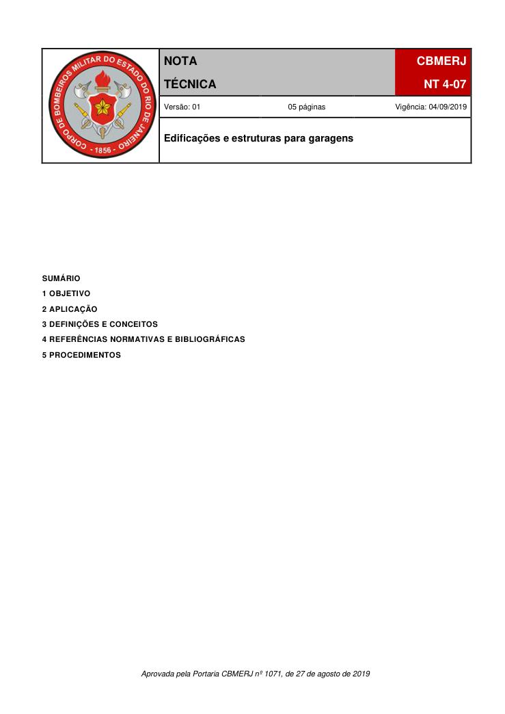
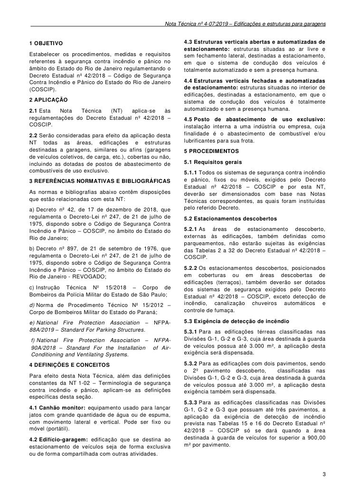
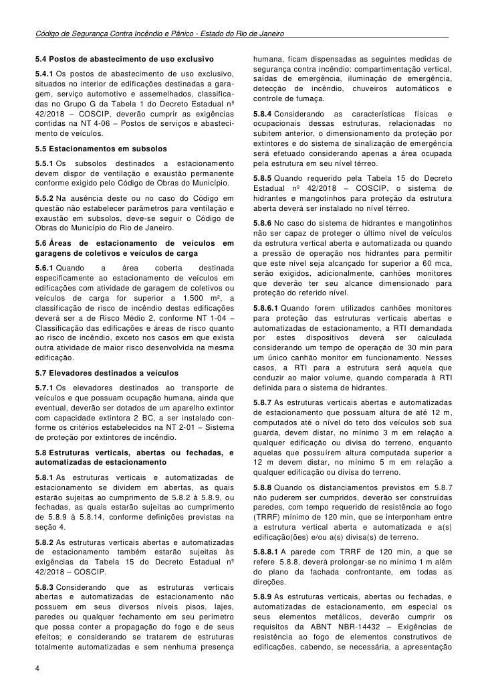
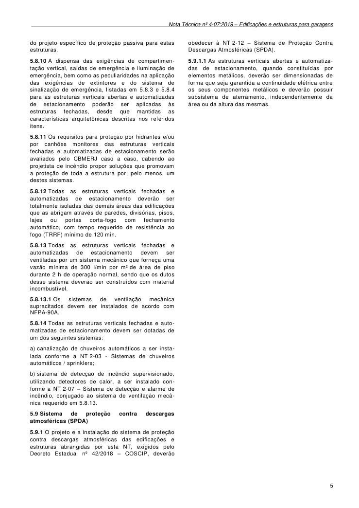

# NT 4-07 - Edificações e estruturas para garagens

> Conversão integral para consulta computacional. A numeração de página do PDF foi preservada. Quando houver tabela complexa, símbolo ou desenho, conferir também a representação visual indicada e o PDF oficial.

## Sumário por página

- [Página 1](#pagina-1)
- [Página 2](#pagina-2)
- [Página 3](#pagina-3)
- [Página 4](#pagina-4)
- [Página 5](#pagina-5)

---

## Página 1

### SUMÁRIO

### 1 OBJETIVO

### 2 APLICAÇÃO

### 3 DEFINIÇÕES E CONCEITOS

### 4 REFERÊNCIAS NORMATIVAS E BIBLIOGRÁFICAS

### 5 PROCEDIMENTOS

Aprovada pela Portaria CBMERJ nº 1071, de 27 de agosto de 2019

### Tabelas extraídas (bruto, não usar para citação)
#### Tabela 1 da página

|  |  | NOTA |  |  | CBMERJ |  |
| --- | --- | --- | --- | --- | --- | --- |
|  |  | TÉCNICA |  |  | NT 4-07 |  |
|  | Versão: 01 05 páginas Vigência: 04/09/2019 |  |  |  |  |  |
|  | Edificações e estruturas para garagens |  |  |  |  |  |

---

## Página 2

> Página sem texto extraível suficiente; consultar a representação visual ou o PDF oficial.

---

## Página 3

### 1 OBJETIVO

Estabelecer os procedimentos, medidas e requisitos referentes à segurança contra incêndio e pânico no âmbito do Estado do Rio de Janeiro regulamentando o Decreto Estadual nº 42/2018 - Código de Segurança Contra Incêndio e Pânico do Estado do Rio de Janeiro (COSCIP).

### 2 APLICAÇÃO

2.1 Esta Nota Técnica (NT) aplica-se às regulamentações do Decreto Estadual nº 42/2018 - COSCIP.

2.2 Serão consideradas para efeito da aplicação desta NT todas as áreas, edificações e estruturas destinadas a garagens, similares ou afins (garagens de veículos coletivos, de carga, etc.), cobertas ou não, incluindo as dotadas de postos de abastecimento de combustíveis de uso exclusivo.

### 3 REFERÊNCIAS NORMATIVAS E BIBLIOGRÁFICAS

As normas e bibliografias abaixo contêm disposições que estão relacionadas com esta NT:

a) Decreto nº 42, de 17 de dezembro de 2018, que regulamenta o Decreto-Lei nº 247, de 21 de julho de 1975, dispondo sobre o Código de Segurança Contra Incêndio e Pânico - COSCIP, no âmbito do Estado do Rio de Janeiro;

b) Decreto nº 897, de 21 de setembro de 1976, que regulamenta o Decreto-Lei nº 247, de 21 de julho de 1975, dispondo sobre o Código de Segurança Contra Incêndio e Pânico - COSCIP, no âmbito do Estado do Rio de Janeiro - REVOGADO;

c) Instrução Técnica Nº 15/2018 - Corpo de Bombeiros da Polícia Militar do Estado de São Paulo;

d) Norma de Procedimento Técnico Nº 15/2012 - Corpo de Bombeiros Militar do Estado do Paraná;

e) National Fire Protection Association - NFPA- 88A/2019 - Standard For Parking Structures.

f) National Fire Protection Association - NFPA- 90A/2018 - Standard For the Installation of AirConditioning and Ventilating Systems.

### 4 DEFINIÇÕES E CONCEITOS

Para efeito desta Nota Técnica, além das definições constantes da NT 1-02 - Terminologia de segurança contra incêndio e pânico, aplicam-se as definições específicas desta seção.

4.1 Canhão monitor: equipamento usado para lançar jatos com grande quantidade de água ou de espuma, com movimento lateral e vertical. Pode ser fixo ou móvel (portátil).

4.2 Edifício-garagem: edificação que se destina ao estacionamento de veículos seja de forma exclusiva ou de forma compartilhada com outras atividades.

4.3 Estruturas verticais abertas e automatizadas de estacionamento: estruturas situadas ao ar livre e sem fechamento lateral, destinadas a estacionamento, em que o sistema de condução dos veículos é totalmente automatizado e sem a presença humana.

4.5 Posto de abastecimento de uso exclusivo: instalação interna a uma indústria ou empresa, cuja finalidade é o abastecimento de combustível e/ou lubrificantes para sua frota.

### 5 PROCEDIMENTOS

5.1 Requisitos gerais

5.1.1 Todos os sistemas de segurança contra incêndio e pânico, fixos ou móveis, exigidos pelo Decreto Estadual nº 42/2018 - COSCIP e por esta NT, deverão ser dimensionados com base nas Notas Técnicas correspondentes, as quais foram instituídas pelo referido Decreto.

5.2 Estacionamentos descobertos

5.2.1 As áreas de estacionamento descoberto, externas às edificações, também definidas como parqueamentos, não estarão sujeitas às exigências das Tabelas 2 a 32 do Decreto Estadual nº 42/2018 - COSCIP.

5.2.2 Os estacionamentos descobertos, posicionados em coberturas ou em áreas descobertas de edificações (terraços), também deverão ser dotados dos sistemas de segurança exigidos pelo Decreto Estadual nº 42/2018 - COSCIP, exceto detecção de incêndio, canalização chuveiros automáticos e controle de fumaça.

5.3 Exigência de detecção de incêndio

5.3.1 Para as edificações térreas classificadas nas Divisões G-1, G-2 e G-3, cuja área destinada à guarda de veículos possua até 3.000 m², a aplicação desta exigência será dispensada.

5.3.2 Para as edificações com dois pavimentos, sendo o 2º pavimento descoberto, classificadas nas Divisões G-1, G-2 e G-3, cuja área destinada à guarda de veículos possua até 3.000 m², a aplicação desta exigência também será dispensada.

5.3.3 Para as edificações classificadas nas Divisões G-1, G-2 e G-3 que possuam até três pavimentos, a aplicação da exigência de detecção de incêndio prevista nas Tabelas 15 e 16 do Decreto Estadual nº 42/2018 - COSCIP só se dará quando a área destinada à guarda de veículos for superior a 900,00 m² por pavimento.

### Tabelas extraídas (bruto, não usar para citação)
#### Tabela 1 da página

|  | em que o |
| --- | --- |
| sistema de condução dos veículos é totalmente |  |
| automatizado e sem a presença humana. |  |

---

## Página 4

Código de Segurança Contra Incêndio e Pânico - Estado do Rio de Janeiro

5.4 Postos de abastecimento de uso exclusivo

5.4.1 Os postos de abastecimento de uso exclusivo, situados no interior de edificações destinadas a garagem, serviço automotivo e assemelhados, classificadas no Grupo G da Tabela 1 do Decreto Estadual nº 42/2018 - COSCIP, deverão cumprir as exigências contidas na NT 4-06 - Postos de serviços e abastecimento de veículos.

5.5 Estacionamentos em subsolos

5.5.1 Os subsolos destinados a estacionamento devem dispor de ventilação e exaustão permanente conforme exigido pelo Código de Obras do Município.

5.5.2 Na ausência deste ou no caso do Código em questão não estabelecer parâmetros para ventilação e exaustão em subsolos, deve-se seguir o Código de Obras do Município do Rio de Janeiro.

5.6 Áreas de estacionamento de veículos em garagens de coletivos e veículos de carga

5.6.1 Quando a área coberta destinada especificamente ao estacionamento de veículos em edificações com atividade de garagem de coletivos ou veículos de carga for superior a 1.500 m², a classificação de risco de incêndio destas edificações deverá ser a de Risco Médio 2, conforme NT 1-04 - Classificação das edificações e áreas de risco quanto ao risco de incêndio, exceto nos casos em que exista outra atividade de maior risco desenvolvida na mesma edificação.

5.7 Elevadores destinados a veículos

5.7.1 Os elevadores destinados ao transporte de veículos e que possuam ocupação humana, ainda que eventual, deverão ser dotados de um aparelho extintor com capacidade extintora 2 BC, a ser instalado conforme os critérios estabelecidos na NT 2-01 - Sistema de proteção por extintores de incêndio.

5.8 Estruturas verticais, abertas ou fechadas, e automatizadas de estacionamento

5.8.1 As estruturas verticais e automatizadas de estacionamento se dividem em abertas, as quais estarão sujeitas ao cumprimento de 5.8.2 à 5.8.9, ou fechadas, as quais estarão sujeitas ao cumprimento de 5.8.9 à 5.8.14, conforme definições previstas na seção 4.

5.8.2 As estruturas verticais abertas e automatizadas de estacionamento também estarão sujeitas às exigências da Tabela 15 do Decreto Estadual nº 42/2018 - COSCIP.

5.8.3 Considerando que as estruturas verticais abertas e automatizadas de estacionamento não possuem em seus diversos níveis pisos, lajes, paredes ou qualquer fechamento em seu perímetro que possa conter a propagação do fogo e de seus efeitos; e considerando se tratarem de estruturas totalmente automatizadas e sem nenhuma presença

humana, ficam dispensadas as seguintes medidas de segurança contra incêndio: compartimentação vertical, saídas de emergência, iluminação de emergência, detecção de incêndio, chuveiros automáticos e controle de fumaça.

5.8.4 Considerando as características físicas e ocupacionais dessas estruturas, relacionadas no subitem anterior, o dimensionamento da proteção por extintores e do sistema de sinalização de emergência será efetuado considerando apenas a área ocupada pela estrutura em seu nível térreo.

5.8.5 Quando requerido pela Tabela 15 do Decreto Estadual nº 42/2018 - COSCIP, o sistema de hidrantes e mangotinhos para proteção da estrutura aberta deverá ser instalado no nível térreo.

5.8.6 No caso do sistema de hidrantes e mangotinhos não ser capaz de proteger o último nível de veículos da estrutura vertical aberta e automatizada ou quando a pressão de operação nos hidrantes para permitir que este nível seja alcançado for superior a 60 mca, serão exigidos, adicionalmente, canhões monitores que deverão ter seu alcance dimensionado para proteção do referido nível.

5.8.6.1 Quando forem utilizados canhões monitores para proteção das estruturas verticais abertas e automatizadas de estacionamento, a RTI demandada por estes dispositivos deverá ser calculada considerando um tempo de operação de 30 min para um único canhão monitor em funcionamento. Nesses casos, a RTI para a estrutura será aquela que conduzir ao maior volume, quando comparada à RTI definida para o sistema de hidrantes.

5.8.7 As estruturas verticais abertas e automatizadas de estacionamento que possuam altura de até 12 m, computados até o nível do teto dos veículos sob sua guarda, devem distar, no mínimo 3 m em relação a qualquer edificação ou divisa do terreno, enquanto aquelas que possuírem altura computada superior a 12 m devem distar, no mínimo 5 m em relação a qualquer edificação ou divisa do terreno.

5.8.8 Quando os distanciamentos previstos em 5.8.7 não puderem ser cumpridos, deverão ser construídas paredes, com tempo requerido de resistência ao fogo (TRRF) mínimo de 120 min, que se interponham entre a estrutura vertical aberta e automatizada e a(s) edificação(ões) e/ou a(s) divisa(s) de terreno.

5.8.8.1 A parede com TRRF de 120 min, a que se refere 5.8.8, deverá prolongar-se no mínimo 1 m além do plano da fachada confrontante, em todas as direções.

5.8.9 As estruturas verticais, abertas ou fechadas, e automatizadas de estacionamento, em especial os seus elementos metálicos, deverão cumprir os requisitos da ABNT NBR-14432 - Exigências de resistência ao fogo de elementos construtivos de edificações, cabendo, se necessária, a apresentação

---

## Página 5

do projeto específico de proteção passiva para estas estruturas.

5.8.10 A dispensa das exigências de compartimentação vertical, saídas de emergência e iluminação de emergência, bem como as peculiaridades na aplicação das exigências de extintores e do sistema de sinalização de emergência, listadas em 5.8.3 e 5.8.4 para as estruturas verticais abertas e automatizadas de estacionamento poderão ser aplicadas às estruturas fechadas, desde que mantidas as características arquitetônicas descritas nos referidos itens.

5.8.11 Os requisitos para proteção por hidrantes e/ou por canhões monitores das estruturas verticais fechadas e automatizadas de estacionamento serão avaliados pelo CBMERJ caso a caso, cabendo ao projetista de incêndio propor soluções que promovam a proteção de toda a estrutura por, pelo menos, um destes sistemas.

5.8.12 Todas as estruturas verticais fechadas e automatizadas de estacionamento deverão ser totalmente isoladas das demais áreas das edificações que as abrigam através de paredes, divisórias, pisos, lajes ou portas corta-fogo com fechamento automático, com tempo requerido de resistência ao fogo (TRRF) mínimo de 120 min.

5.8.13 Todas as estruturas verticais fechadas e automatizadas de estacionamento devem ser ventiladas por um sistema mecânico que forneça uma vazão mínima de 300 l/min por m² de área de piso durante 2 h de operação normal, sendo que os dutos desse sistema deverão ser construídos com material incombustível.

5.8.13.1 Os sistemas de ventilação mecânica supracitados devem ser instalados de acordo com NFPA-90A.

5.8.14 Todas as estruturas verticais fechadas e automatizadas de estacionamento devem ser dotadas de um dos seguintes sistemas:

a) canalização de chuveiros automáticos a ser instalada conforme a NT 2-03 - Sistemas de chuveiros automáticos / sprinklers;

b) sistema de detecção de incêndio supervisionado, utilizando detectores de calor, a ser instalado conforme a NT 2-07 - Sistema de detecção e alarme de incêndio, conjugado ao sistema de ventilação mecânica requerido em 5.8.13.

5.9 Sistema de proteção contra descargas atmosféricas (SPDA)

5.9.1 O projeto e a instalação do sistema de proteção contra descargas atmosféricas das edificações e estruturas abrangidas por esta NT, exigidos pelo Decreto Estadual nº 42/2018 - COSCIP, deverão

obedecer à NT 2-12 - Sistema de Proteção Contra Descargas Atmosféricas (SPDA).

5.9.1.1 As estruturas verticais abertas e automatizadas de estacionamento, quando constituídas por elementos metálicos, deverão ser dimensionadas de forma que seja garantida a continuidade elétrica entre os seus componentes metálicos e deverão possuir subsistema de aterramento, independentemente da área ou da altura das mesmas.
