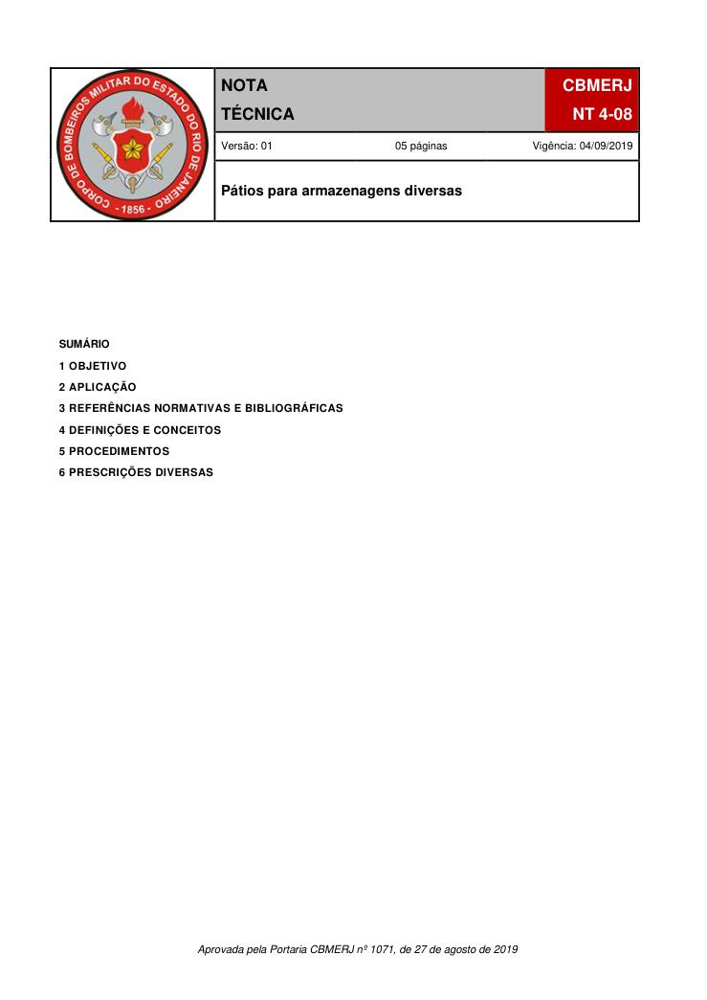
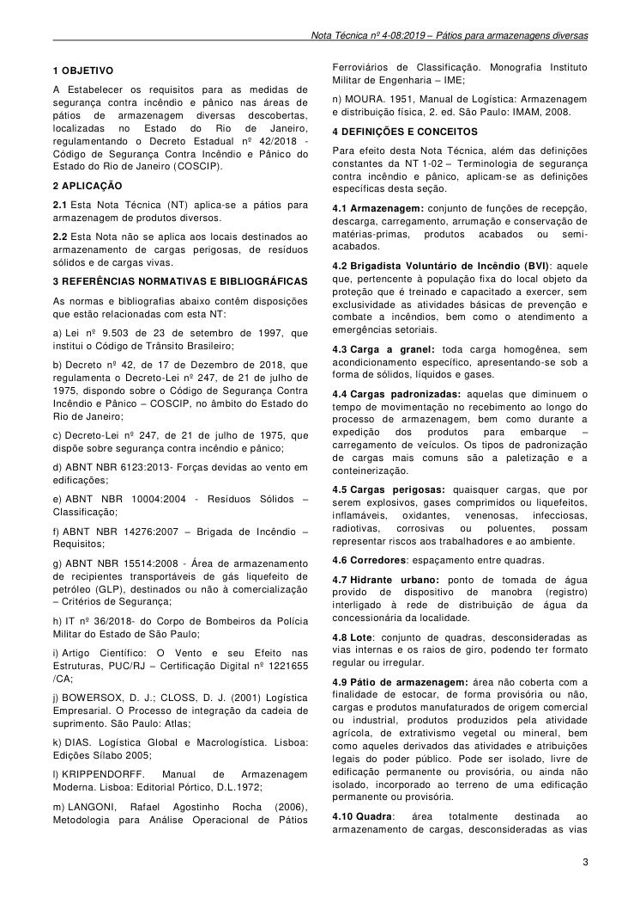
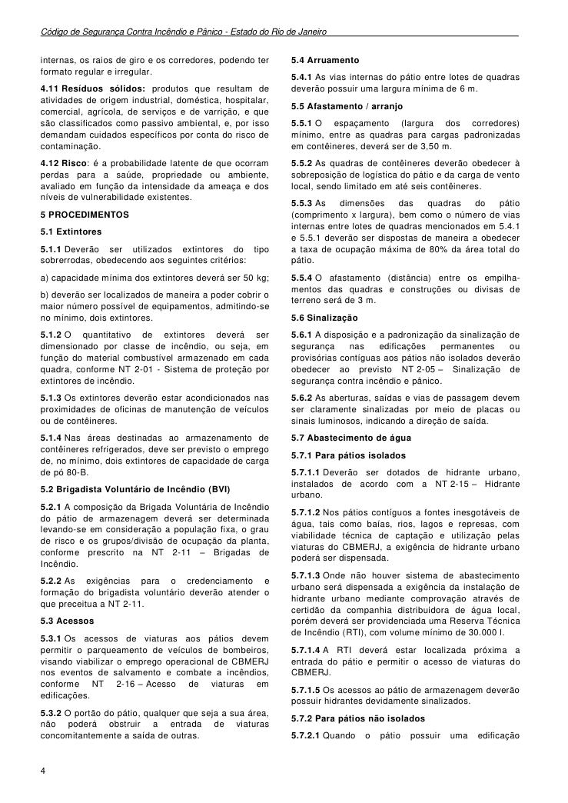
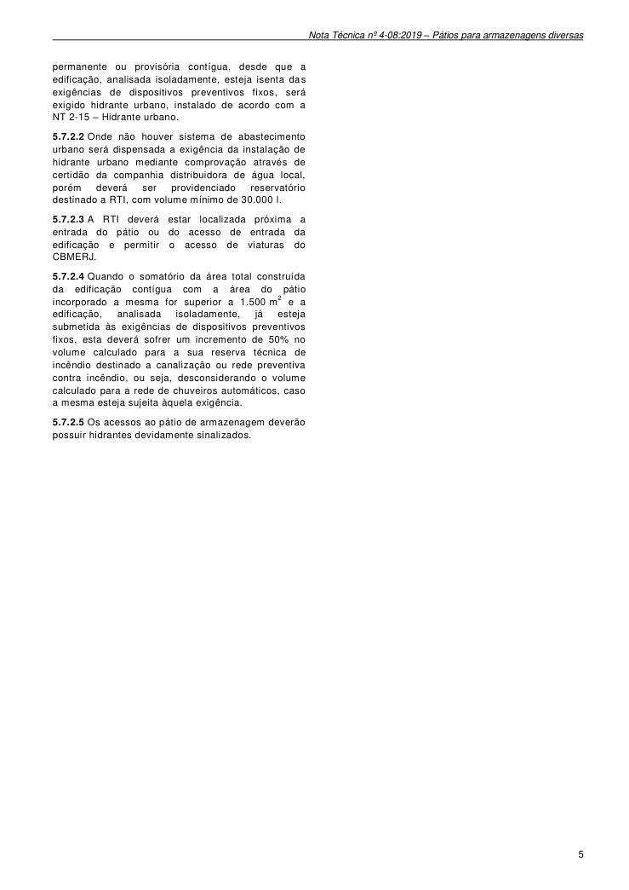

# NT 4-08 - Pátios para armazenagens diversas

> Conversão integral para consulta computacional. A numeração de página do PDF foi preservada. Quando houver tabela complexa, símbolo ou desenho, conferir também a representação visual indicada e o PDF oficial.

## Sumário por página

- [Página 1](#pagina-1)
- [Página 2](#pagina-2)
- [Página 3](#pagina-3)
- [Página 4](#pagina-4)
- [Página 5](#pagina-5)

---

## Página 1

### SUMÁRIO

### 1 OBJETIVO

### 2 APLICAÇÃO

### 3 REFERÊNCIAS NORMATIVAS E BIBLIOGRÁFICAS

### 4 DEFINIÇÕES E CONCEITOS

### 5 PROCEDIMENTOS

### 6 PRESCRIÇÕES DIVERSAS

Aprovada pela Portaria CBMERJ nº 1071, de 27 de agosto de 2019

### Tabelas extraídas (bruto, não usar para citação)
#### Tabela 1 da página

|  |  |  |  | NOTA |  |  | CBMERJ |  |
| --- | --- | --- | --- | --- | --- | --- | --- | --- |
|  |  |  |  | TÉCNICA |  |  | NT 4-08 |  |
|  |  |  | Versão: 01 05 páginas Vigência: 04/09/2019 |  |  |  |  |  |
|  |  |  | Pátios para armazenagens diversas |  |  |  |  |  |

---

## Página 2

> Página sem texto extraível suficiente; consultar a representação visual ou o PDF oficial.

---

## Página 3

### 1 OBJETIVO

A Estabelecer os requisitos para as medidas de segurança contra incêndio e pânico nas áreas de pátios de armazenagem diversas descobertas, localizadas no Estado do Rio de Janeiro, regulamentando o Decreto Estadual nº 42/2018 - Código de Segurança Contra Incêndio e Pânico do Estado do Rio de Janeiro (COSCIP).

### 2 APLICAÇÃO

2.1 Esta Nota Técnica (NT) aplica-se a pátios para armazenagem de produtos diversos.

2.2 Esta Nota não se aplica aos locais destinados ao armazenamento de cargas perigosas, de resíduos sólidos e de cargas vivas.

### 3 REFERÊNCIAS NORMATIVAS E BIBLIOGRÁFICAS

As normas e bibliografias abaixo contêm disposições que estão relacionadas com esta NT:

a) Lei nº 9.503 de 23 de setembro de 1997, que institui o Código de Trânsito Brasileiro;

b) Decreto nº 42, de 17 de Dezembro de 2018, que regulamenta o Decreto-Lei nº 247, de 21 de julho de 1975, dispondo sobre o Código de Segurança Contra Incêndio e Pânico - COSCIP, no âmbito do Estado do Rio de Janeiro;

c) Decreto-Lei nº 247, de 21 de julho de 1975, que dispõe sobre segurança contra incêndio e pânico;

d) ABNT NBR 6123:2013- Forças devidas ao vento em edificações;

e) ABNT NBR 10004:2004 - Resíduos Sólidos - Classificação;

f) ABNT NBR 14276:2007 - Brigada de Incêndio - Requisitos;

g) ABNT NBR 15514:2008 - Área de armazenamento de recipientes transportáveis de gás liquefeito de petróleo (GLP), destinados ou não à comercialização - Critérios de Segurança;

h) IT nº 36/2018- do Corpo de Bombeiros da Polícia Militar do Estado de São Paulo;

i) Artigo Científico: O Vento e seu Efeito nas Estruturas, PUC/RJ - Certificação Digital nº 1221655 /CA;

j) BOWERSOX, D. J.; CLOSS, D. J. (2001) Logística Empresarial. O Processo de integração da cadeia de suprimento. São Paulo: Atlas;

k) DIAS. Logística Global e Macrologística. Lisboa: Edições Sílabo 2005;

l) KRIPPENDORFF. Manual de Armazenagem Moderna. Lisboa: Editorial Pórtico, D.L.1972;

m) LANGONI, Rafael Agostinho Rocha (2006), Metodologia para Análise Operacional de Pátios

Ferroviários de Classificação. Monografia Instituto Militar de Engenharia - IME;

n) MOURA. 1951, Manual de Logística: Armazenagem e distribuição física, 2. ed. São Paulo: IMAM, 2008.

### 4 DEFINIÇÕES E CONCEITOS

Para efeito desta Nota Técnica, além das definições constantes da NT 1-02 - Terminologia de segurança contra incêndio e pânico, aplicam-se as definições específicas desta seção.

4.1 Armazenagem: conjunto de funções de recepção, descarga, carregamento, arrumação e conservação de matérias-primas, produtos acabados ou semiacabados.

4.2 Brigadista Voluntário de Incêndio (BVI): aquele que, pertencente à população fixa do local objeto da proteção que é treinado e capacitado a exercer, sem exclusividade as atividades básicas de prevenção e combate a incêndios, bem como o atendimento a emergências setoriais.

4.4 Cargas padronizadas: aquelas que diminuem o tempo de movimentação no recebimento ao longo do processo de armazenagem, bem como durante a expedição dos produtos para embarque - carregamento de veículos. Os tipos de padronização de cargas mais comuns são a paletização e a conteinerização.

4.5 Cargas perigosas: quaisquer cargas, que por serem explosivos, gases comprimidos ou liquefeitos, inflamáveis, oxidantes, venenosas, infecciosas, radiotivas, corrosivas ou poluentes, possam representar riscos aos trabalhadores e ao ambiente.

4.6 Corredores: espaçamento entre quadras.

4.7 Hidrante urbano: ponto de tomada de água provido de dispositivo de manobra (registro) interligado à rede de distribuição de água da concessionária da localidade.

4.8 Lote: conjunto de quadras, desconsideradas as vias internas e os raios de giro, podendo ter formato regular ou irregular.

4.9 Pátio de armazenagem: área não coberta com a finalidade de estocar, de forma provisória ou não, cargas e produtos manufaturados de origem comercial ou industrial, produtos produzidos pela atividade agrícola, de extrativismo vegetal ou mineral, bem como aqueles derivados das atividades e atribuições legais do poder público. Pode ser isolado, livre de edificação permanente ou provisória, ou ainda não isolado, incorporado ao terreno de uma edificação permanente ou provisória.

4.10 Quadra: área totalmente destinada ao armazenamento de cargas, desconsideradas as vias

### Tabelas extraídas (bruto, não usar para citação)
#### Tabela 1 da página

|  | toda carga homogênea, sem |
| --- | --- |
| acondicionamento específico, apresentando-se sob a |  |
| forma de sólidos, líquidos e gases. |  |

---

## Página 4

Código de Segurança Contra Incêndio e Pânico - Estado do Rio de Janeiro

internas, os raios de giro e os corredores, podendo ter formato regular e irregular.

4.11 Resíduos sólidos: produtos que resultam de atividades de origem industrial, doméstica, hospitalar, comercial, agrícola, de serviços e de varrição, e que são classificados como passivo ambiental, e, por isso demandam cuidados específicos por conta do risco de contaminação.

4.12 Risco: é a probabilidade latente de que ocorram perdas para a saúde, propriedade ou ambiente, avaliado em função da intensidade da ameaça e dos níveis de vulnerabilidade existentes.

### 5 PROCEDIMENTOS

5.1 Extintores

5.1.1 Deverão ser utilizados extintores do tipo sobrerrodas, obedecendo aos seguintes critérios:

a) capacidade mínima dos extintores deverá ser 50 kg;

b) deverão ser localizados de maneira a poder cobrir o maior número possível de equipamentos, admitindo-se no mínimo, dois extintores.

5.1.2 O quantitativo de extintores deverá ser dimensionado por classe de incêndio, ou seja, em função do material combustível armazenado em cada quadra, conforme NT 2-01 - Sistema de proteção por extintores de incêndio.

5.1.3 Os extintores deverão estar acondicionados nas proximidades de oficinas de manutenção de veículos ou de contêineres.

5.1.4 Nas áreas destinadas ao armazenamento de contêineres refrigerados, deve ser previsto o emprego de, no mínimo, dois extintores de capacidade de carga de pó 80-B.

5.2 Brigadista Voluntário de Incêndio (BVI)

5.2.1 A composição da Brigada Voluntária de Incêndio do pátio de armazenagem deverá ser determinada levando-se em consideração a população fixa, o grau de risco e os grupos/divisão de ocupação da planta, conforme prescrito na NT 2-11 - Brigadas de Incêndio.

5.2.2 As exigências para o credenciamento e formação do brigadista voluntário deverão atender o que preceitua a NT 2-11.

5.3 Acessos

5.3.1 Os acessos de viaturas aos pátios devem permitir o parqueamento de veículos de bombeiros, visando viabilizar o emprego operacional de CBMERJ nos eventos de salvamento e combate a incêndios, conforme NT 2-16 - Acesso de viaturas em edificações.

5.3.2 O portão do pátio, qualquer que seja a sua área, não poderá obstruir a entrada de viaturas concomitantemente a saída de outras.

5.4 Arruamento

5.4.1 As vias internas do pátio entre lotes de quadras deverão possuir uma largura mínima de 6 m.

5.5 Afastamento / arranjo

5.5.1 O espaçamento (largura dos corredores) mínimo, entre as quadras para cargas padronizadas em contêineres, deverá ser de 3,50 m.

5.5.2 As quadras de contêineres deverão obedecer à sobreposição de logística do pátio e da carga de vento local, sendo limitado em até seis contêineres.

5.5.3 As dimensões das quadras do pátio (comprimento x largura), bem como o número de vias internas entre lotes de quadras mencionados em 5.4.1 e 5.5.1 deverão ser dispostas de maneira a obedecer a taxa de ocupação máxima de 80% da área total do pátio.

5.5.4 O afastamento (distância) entre os empilhamentos das quadras e construções ou divisas de terreno será de 3 m.

5.6 Sinalização

5.6.1 A disposição e a padronização da sinalização de segurança nas edificações permanentes ou provisórias contíguas aos pátios não isolados deverão obedecer ao previsto NT 2-05 - Sinalização de segurança contra incêndio e pânico.

5.6.2 As aberturas, saídas e vias de passagem devem ser claramente sinalizadas por meio de placas ou sinais luminosos, indicando a direção de saída.

5.7 Abastecimento de água

5.7.1 Para pátios isolados

5.7.1.1 Deverão ser dotados de hidrante urbano, instalados de acordo com a NT 2-15 - Hidrante urbano.

5.7.1.2 Nos pátios contíguos a fontes inesgotáveis de água, tais como baías, rios, lagos e represas, com viabilidade técnica de captação e utilização pelas viaturas do CBMERJ, a exigência de hidrante urbano poderá ser dispensada.

5.7.1.3 Onde não houver sistema de abastecimento urbano será dispensada a exigência da instalação de hidrante urbano mediante comprovação através de certidão da companhia distribuidora de água local, porém deverá ser providenciada uma Reserva Técnica de Incêndio (RTI), com volume mínimo de 30.000 l.

5.7.1.4 A RTI deverá estar localizada próxima a entrada do pátio e permitir o acesso de viaturas do CBMERJ.

5.7.1.5 Os acessos ao pátio de armazenagem deverão possuir hidrantes devidamente sinalizados.

5.7.2 Para pátios não isolados

5.7.2.1 Quando o pátio possuir uma edificação

---

## Página 5

permanente ou provisória contígua, desde que a edificação, analisada isoladamente, esteja isenta das exigências de dispositivos preventivos fixos, será exigido hidrante urbano, instalado de acordo com a NT 2-15 - Hidrante urbano.

5.7.2.2 Onde não houver sistema de abastecimento urbano será dispensada a exigência da instalação de hidrante urbano mediante comprovação através de certidão da companhia distribuidora de água local, porém deverá ser providenciado reservatório destinado a RTI, com volume mínimo de 30.000 l.

5.7.2.3 A RTI deverá estar localizada próxima a entrada do pátio ou do acesso de entrada da edificação e permitir o acesso de viaturas do CBMERJ.

5.7.2.4 Quando o somatório da área total construída da edificação contígua com a área do pátio incorporado a mesma for superior a 1.500 m2 e a edificação, analisada isoladamente, já esteja submetida às exigências de dispositivos preventivos fixos, esta deverá sofrer um incremento de 50% no volume calculado para a sua reserva técnica de incêndio destinado a canalização ou rede preventiva contra incêndio, ou seja, desconsiderando o volume calculado para a rede de chuveiros automáticos, caso a mesma esteja sujeita àquela exigência.

5.7.2.5 Os acessos ao pátio de armazenagem deverão possuir hidrantes devidamente sinalizados.
