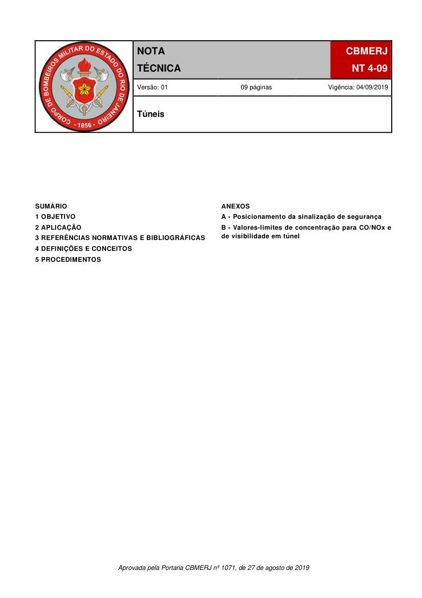
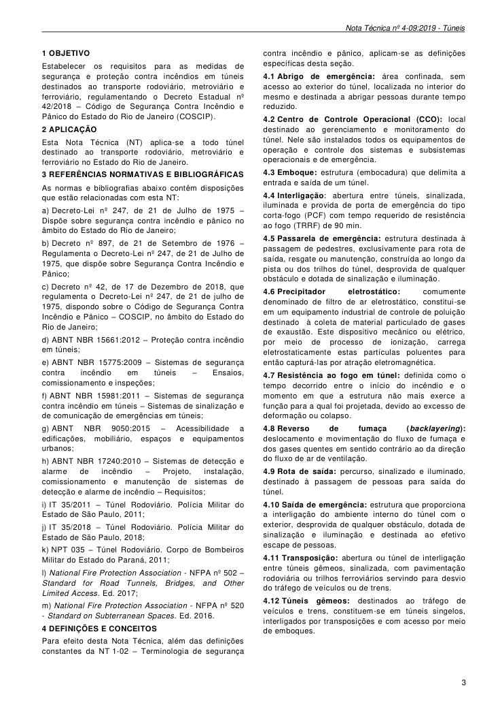
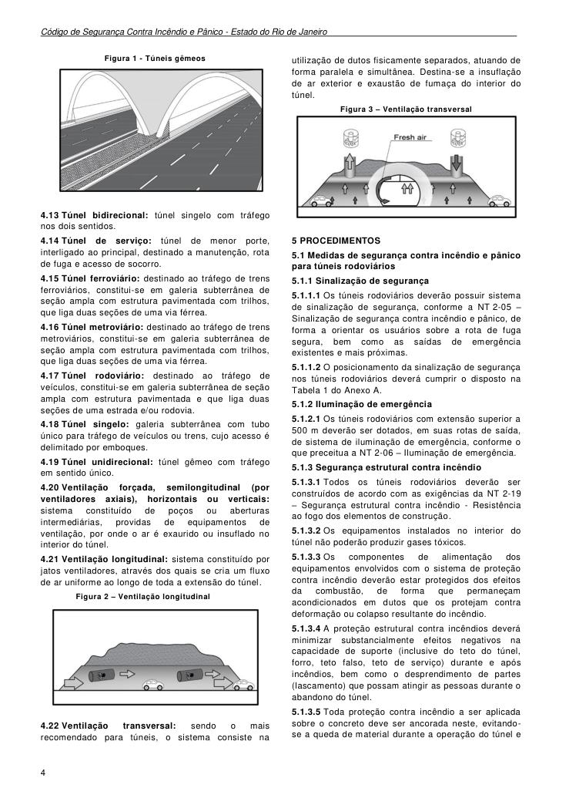
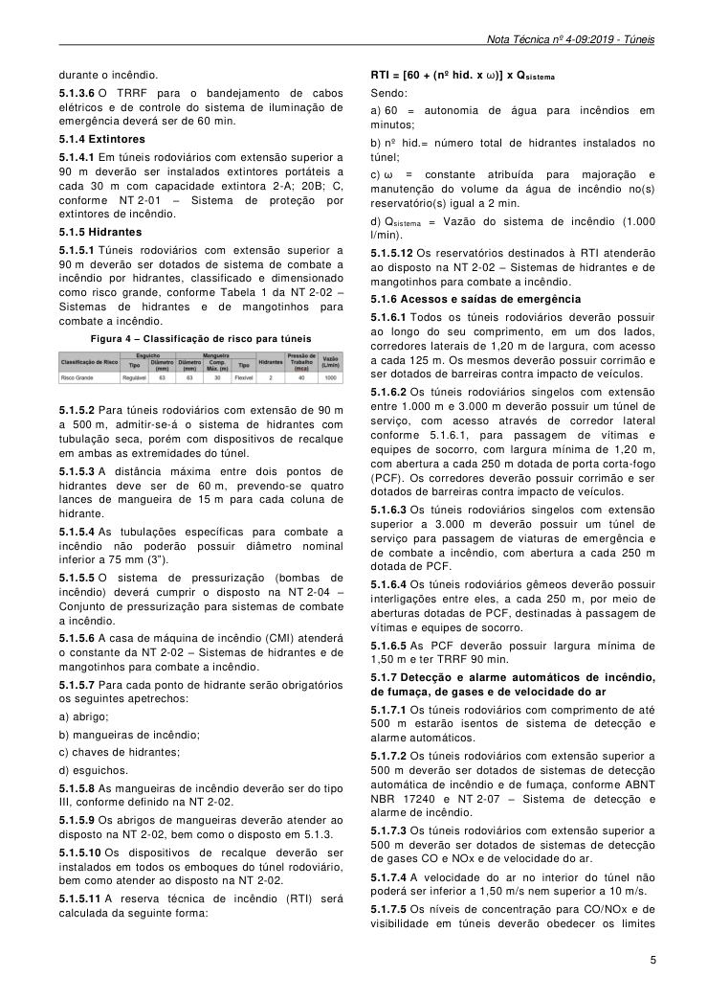
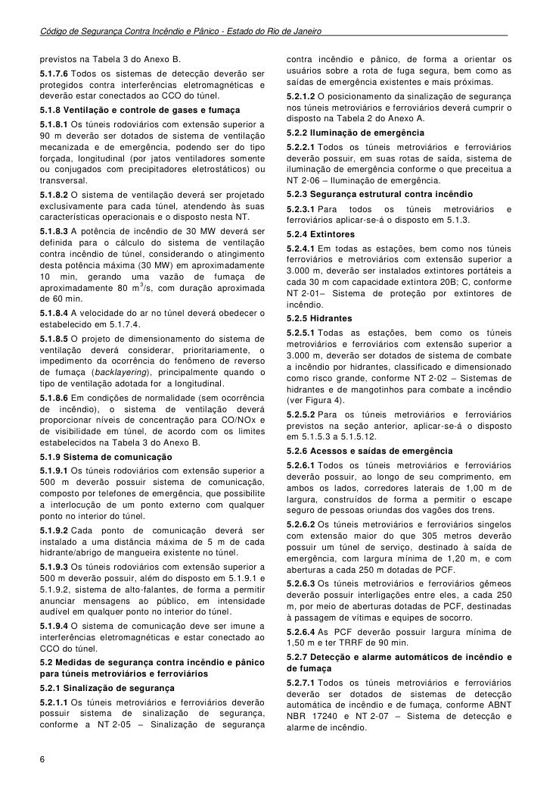
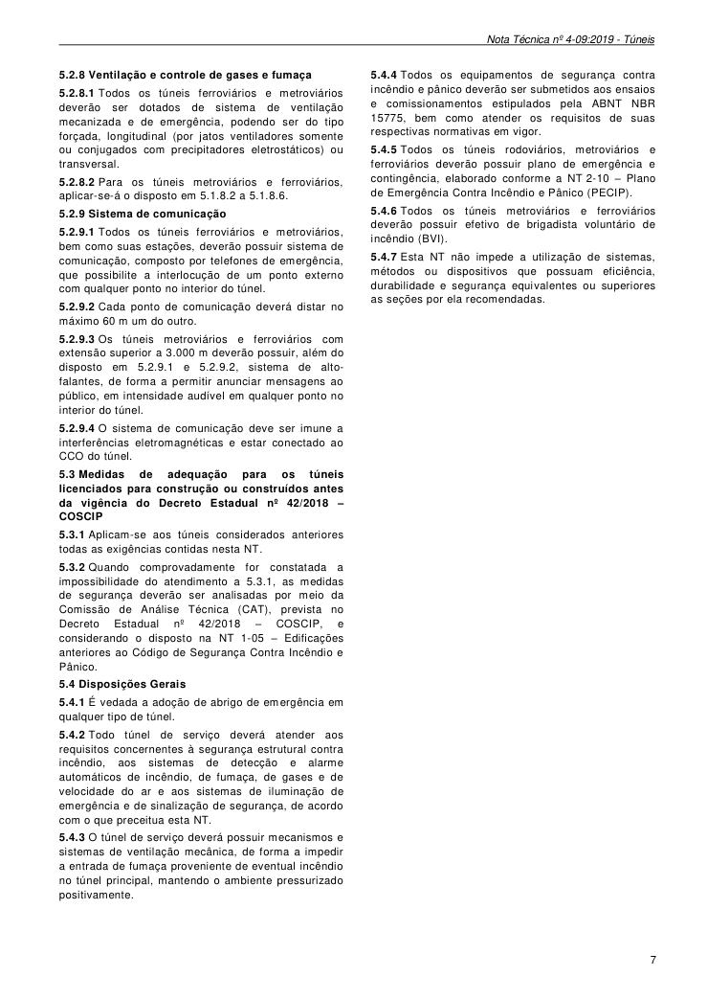
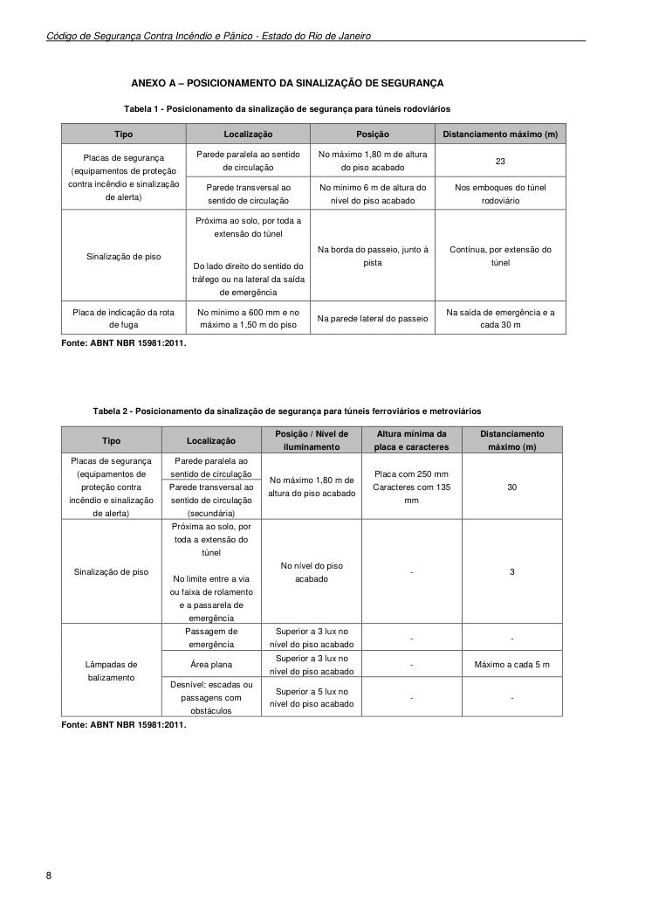

# NT 4-09 - Túneis

> Conversão integral para consulta computacional. A numeração de página do PDF foi preservada. Quando houver tabela complexa, símbolo ou desenho, conferir também a representação visual indicada e o PDF oficial.

## Sumário por página

- [Página 1](#pagina-1)
- [Página 2](#pagina-2)
- [Página 3](#pagina-3)
- [Página 4](#pagina-4)
- [Página 5](#pagina-5)
- [Página 6](#pagina-6)
- [Página 7](#pagina-7)
- [Página 8](#pagina-8)
- [Página 9](#pagina-9)

---

## Página 1

Aprovada pela Portaria CBMERJ nº 1071, de 27 de agosto de 2019

### SUMÁRIO

### 1 OBJETIVO

### 2 APLICAÇÃO

### 3 REFERÊNCIAS NORMATIVAS E BIBLIOGRÁFICAS

### 4 DEFINIÇÕES E CONCEITOS

### 5 PROCEDIMENTOS

### ANEXOS

A - Posicionamento da sinalização de segurança

B - Valores-limites de concentração para CO/NOx e de visibilidade em túnel

### Tabelas extraídas (bruto, não usar para citação)
#### Tabela 1 da página

|  |  | NOTA |  |  | CBMERJ |  |
| --- | --- | --- | --- | --- | --- | --- |
|  |  | TÉCNICA |  |  | NT 4-09 |  |
|  | Versão: 01 09 páginas Vigência: 04/09/2019 |  |  |  |  |  |
|  | Túneis |  |  |  |  |  |

---

## Página 2

> Página sem texto extraível suficiente; consultar a representação visual ou o PDF oficial.

---

## Página 3

### 1 OBJETIVO

Estabelecer os requisitos para as medidas de segurança e proteção contra incêndios em túneis destinados ao transporte rodoviário, metroviário e ferroviário, regulamentando o Decreto Estadual nº 42/2018 - Código de Segurança Contra Incêndio e Pânico do Estado do Rio de Janeiro (COSCIP).

### 2 APLICAÇÃO

Esta Nota Técnica (NT) aplica-se a todo túnel destinado ao transporte rodoviário, metroviário e ferroviário no Estado do Rio de Janeiro.

### 3 REFERÊNCIAS NORMATIVAS E BIBLIOGRÁFICAS

As normas e bibliografias abaixo contêm disposições que estão relacionadas com esta NT:

a) Decreto-Lei nº 247, de 21 de Julho de 1975 - Dispõe sobre segurança contra incêndio e pânico no âmbito do Estado do Rio de Janeiro;

b) Decreto nº 897, de 21 de Setembro de 1976 - Regulamenta o Decreto-Lei nº 247, de 21 de Julho de 1975, que dispõe sobre Segurança Contra Incêndio e Pânico;

c) Decreto nº 42, de 17 de Dezembro de 2018, que regulamenta o Decreto-Lei nº 247, de 21 de julho de 1975, dispondo sobre o Código de Segurança Contra Incêndio e Pânico - COSCIP, no âmbito do Estado do Rio de Janeiro;

d) ABNT NBR 15661:2012 - Proteção contra incêndio em túneis;

e) ABNT NBR 15775:2009 - Sistemas de segurança contra incêndio em túneis - Ensaios, comissionamento e inspeções;

f) ABNT NBR 15981:2011 - Sistemas de segurança contra incêndio em túneis - Sistemas de sinalização e de comunicação de emergências em túneis;

g) ABNT NBR 9050:2015 - Acessibilidade a edificações, mobiliário, espaços e equipamentos urbanos;

h) ABNT NBR 17240:2010 - Sistemas de detecção e alarme de incêndio - Projeto, instalação, comissionamento e manutenção de sistemas de detecção e alarme de incêndio - Requisitos;

i) IT 35/2011 - Túnel Rodoviário. Polícia Militar do Estado de São Paulo, 2011;

j) IT 35/2018 - Túnel Rodoviário. Polícia Militar do Estado de São Paulo, 2018;

k) NPT 035 - Túnel Rodoviário. Corpo de Bombeiros Militar do Estado do Paraná, 2011;

l) National Fire Protection Association - NFPA nº 502 - Standard for Road Tunnels, Bridges, and Other Limited Access. Ed. 2017;

m) National Fire Protection Association - NFPA nº 520 - Standard on Subterranean Spaces. Ed. 2016.

### 4 DEFINIÇÕES E CONCEITOS

Para efeito desta Nota Técnica, além das definições constantes da NT 1-02 - Terminologia de segurança

contra incêndio e pânico, aplicam-se as definições específicas desta seção.

4.1 Abrigo de emergência: área confinada, sem acesso ao exterior do túnel, localizada no interior do mesmo e destinada a abrigar pessoas durante tempo reduzido.

4.2 Centro de Controle Operacional (CCO): local destinado ao gerenciamento e monitoramento do túnel. Nele são instalados todos os equipamentos de operação e controle dos sistemas e subsistemas operacionais e de emergência.

4.3 Emboque: estrutura (embocadura) que delimita a entrada e saída de um túnel.

4.4 Interligação: abertura entre túneis, sinalizada, iluminada e provida de porta de emergência do tipo corta-fogo (PCF) com tempo requerido de resistência ao fogo (TRRF) de 90 min.

4.5 Passarela de emergência: estrutura destinada à passagem de pedestres, exclusivamente para rota de saída, resgate ou manutenção, construída ao longo da pista ou dos trilhos do túnel, desprovida de qualquer obstáculo e dotada de sinalização e iluminação.

4.6 Precipitador eletrostático: comumente denominado de filtro de ar eletrostático, constitui-se em um equipamento industrial de controle de poluição destinado à coleta de material particulado de gases de exaustão. Este dispositivo mecânico ou elétrico, por meio de processo de ionização, carrega eletrostaticamente estas partículas poluentes para então capturá-las por atração eletromagnética.

4.7 Resistência ao fogo em túnel: definida como o tempo decorrido entre o início do incêndio e o momento em que a estrutura não mais exerce a função para a qual foi projetada, devido ao excesso de deformação ou colapso.

4.8 Reverso de fumaça (backlayering): deslocamento e movimentação do fluxo de fumaça e dos gases quentes em sentido contrário ao da direção do fluxo de ar de ventilação.

4.9 Rota de saída: percurso, sinalizado e iluminado, destinado à passagem de pessoas para saída do túnel.

4.10 Saída de emergência: estrutura que proporciona a interligação do ambiente interno do túnel com o exterior, desprovida de qualquer obstáculo, dotada de sinalização e iluminação e destinada ao efetivo escape de pessoas.

4.11 Transposição: abertura ou túnel de interligação entre túneis gêmeos, sinalizada, com pavimentação rodoviária ou trilhos ferroviários servindo para desvio do tráfego de veículos ou de trens.

4.12 Túneis gêmeos: destinados ao tráfego de veículos e trens, constituem-se em túneis singelos, interligados por transposições e com acesso por meio de emboques.

---

## Página 4

Código de Segurança Contra Incêndio e Pânico - Estado do Rio de Janeiro

Figura 1 - Túneis gêmeos

4.13 Túnel bidirecional: túnel singelo com tráfego nos dois sentidos.

4.14 Túnel de serviço: túnel de menor porte, interligado ao principal, destinado a manutenção, rota de fuga e acesso de socorro.

4.15 Túnel ferroviário: destinado ao tráfego de trens ferroviários, constitui-se em galeria subterrânea de seção ampla com estrutura pavimentada com trilhos, que liga duas seções de uma via férrea.

4.16 Túnel metroviário: destinado ao tráfego de trens metroviários, constitui-se em galeria subterrânea de seção ampla com estrutura pavimentada com trilhos, que liga duas seções de uma via férrea.

4.17 Túnel rodoviário: destinado ao tráfego de veículos, constitui-se em galeria subterrânea de seção ampla com estrutura pavimentada e que liga duas seções de uma estrada e/ou rodovia.

4.18 Túnel singelo: galeria subterrânea com tubo único para tráfego de veículos ou trens, cujo acesso é delimitado por emboques.

4.19 Túnel unidirecional: túnel gêmeo com tráfego em sentido único.

4.20 Ventilação forçada, semilongitudinal (por ventiladores axiais), horizontais ou verticais: sistema constituído de poços ou aberturas intermediárias, providas de equipamentos de ventilação, por onde o ar é exaurido ou insuflado no interior do túnel.

4.21 Ventilação longitudinal: sistema constituído por jatos ventiladores, através dos quais se cria um fluxo de ar uniforme ao longo de toda a extensão do túnel.

Figura 2 - Ventilação longitudinal

4.22 Ventilação transversal: sendo o mais recomendado para túneis, o sistema consiste na

utilização de dutos fisicamente separados, atuando de forma paralela e simultânea. Destina-se a insuflação de ar exterior e exaustão de fumaça do interior do túnel.

Figura 3 - Ventilação transversal

### 5 PROCEDIMENTOS

5.1 Medidas de segurança contra incêndio e pânico para túneis rodoviários

5.1.1 Sinalização de segurança

5.1.1.1 Os túneis rodoviários deverão possuir sistema de sinalização de segurança, conforme a NT 2-05 - Sinalização de segurança contra incêndio e pânico, de forma a orientar os usuários sobre a rota de fuga segura, bem como as saídas de emergência existentes e mais próximas.

5.1.1.2 O posicionamento da sinalização de segurança nos túneis rodoviários deverá cumprir o disposto na Tabela 1 do Anexo A.

5.1.2 Iluminação de emergência

5.1.2.1 Os túneis rodoviários com extensão superior a 500 m deverão ser dotados, em suas rotas de saída, de sistema de iluminação de emergência, conforme o que preceitua a NT 2-06 - Iluminação de emergência.

5.1.3 Segurança estrutural contra incêndio

5.1.3.1 Todos os túneis rodoviários deverão ser construídos de acordo com as exigências da NT 2-19 - Segurança estrutural contra incêndio - Resistência ao fogo dos elementos de construção.

5.1.3.2 Os equipamentos instalados no interior do túnel não poderão produzir gases tóxicos.

5.1.3.3 Os componentes de alimentação dos equipamentos envolvidos com o sistema de proteção contra incêndio deverão estar protegidos dos efeitos da combustão, de forma que permaneçam acondicionados em dutos que os protejam contra deformação ou colapso resultante do incêndio.

5.1.3.4 A proteção estrutural contra incêndios deverá minimizar substancialmente efeitos negativos na capacidade de suporte (inclusive do teto do túnel, forro, teto falso, teto de serviço) durante e após incêndios, bem como o desprendimento de partes (lascamento) que possam atingir as pessoas durante o abandono do túnel.

5.1.3.5 Toda proteção contra incêndio a ser aplicada sobre o concreto deve ser ancorada neste, evitandose a queda de material durante a operação do túnel e

---

## Página 5

durante o incêndio.

5.1.3.6 O TRRF para o bandejamento de cabos elétricos e de controle do sistema de iluminação de emergência deverá ser de 60 min.

5.1.4 Extintores

5.1.4.1 Em túneis rodoviários com extensão superior a 90 m deverão ser instalados extintores portáteis a cada 30 m com capacidade extintora 2-A; 20B; C, conforme NT 2-01 - Sistema de proteção por extintores de incêndio.

5.1.5 Hidrantes

5.1.5.1 Túneis rodoviários com extensão superior a 90 m deverão ser dotados de sistema de combate a incêndio por hidrantes, classificado e dimensionado como risco grande, conforme Tabela 1 da NT 2-02 - Sistemas de hidrantes e de mangotinhos para combate a incêndio.

Figura 4 - Classificação de risco para túneis

5.1.5.2 Para túneis rodoviários com extensão de 90 m a 500 m, admitir-se-á o sistema de hidrantes com tubulação seca, porém com dispositivos de recalque em ambas as extremidades do túnel.

5.1.5.3 A distância máxima entre dois pontos de hidrantes deve ser de 60 m, prevendo-se quatro lances de mangueira de 15 m para cada coluna de hidrante.

5.1.5.4 As tubulações específicas para combate a incêndio não poderão possuir diâmetro nominal inferior a 75 mm (3”).

5.1.5.5 O sistema de pressurização (bombas de incêndio) deverá cumprir o disposto na NT 2-04 - Conjunto de pressurização para sistemas de combate a incêndio.

5.1.5.6 A casa de máquina de incêndio (CMI) atenderá o constante da NT 2-02 - Sistemas de hidrantes e de mangotinhos para combate a incêndio.

5.1.5.7 Para cada ponto de hidrante serão obrigatórios os seguintes apetrechos:

a) abrigo;

b) mangueiras de incêndio;

c) chaves de hidrantes;

d) esguichos.

5.1.5.8 As mangueiras de incêndio deverão ser do tipo III, conforme definido na NT 2-02.

5.1.5.9 Os abrigos de mangueiras deverão atender ao disposto na NT 2-02, bem como o disposto em 5.1.3.

5.1.5.10 Os dispositivos de recalque deverão ser instalados em todos os emboques do túnel rodoviário, bem como atender ao disposto na NT 2-02.

5.1.5.11 A reserva técnica de incêndio (RTI) será calculada da seguinte forma:

RTI = [60 + (nº hid. x ω)] x Qsistema

Sendo:

a) 60 = autonomia de água para incêndios em minutos;

b) nº hid.= número total de hidrantes instalados no túnel;

c) ω = constante atribuída para majoração e manutenção do volume da água de incêndio no(s) reservatório(s) igual a 2 min.

d) Qsistema = Vazão do sistema de incêndio (1.000 l/min).

5.1.5.12 Os reservatórios destinados à RTI atenderão ao disposto na NT 2-02 - Sistemas de hidrantes e de mangotinhos para combate a incêndio.

5.1.6 Acessos e saídas de emergência

5.1.6.1 Todos os túneis rodoviários deverão possuir ao longo do seu comprimento, em um dos lados, corredores laterais de 1,20 m de largura, com acesso a cada 125 m. Os mesmos deverão possuir corrimão e ser dotados de barreiras contra impacto de veículos.

5.1.6.2 Os túneis rodoviários singelos com extensão entre 1.000 m e 3.000 m deverão possuir um túnel de serviço, com acesso através de corredor lateral conforme 5.1.6.1, para passagem de vítimas e equipes de socorro, com largura mínima de 1,20 m, com abertura a cada 250 m dotada de porta corta-fogo (PCF). Os corredores deverão possuir corrimão e ser dotados de barreiras contra impacto de veículos.

5.1.6.3 Os túneis rodoviários singelos com extensão superior a 3.000 m deverão possuir um túnel de serviço para passagem de viaturas de emergência e de combate a incêndio, com abertura a cada 250 m dotada de PCF.

5.1.6.4 Os túneis rodoviários gêmeos deverão possuir interligações entre eles, a cada 250 m, por meio de aberturas dotadas de PCF, destinadas à passagem de vítimas e equipes de socorro.

5.1.6.5 As PCF deverão possuir largura mínima de 1,50 m e ter TRRF 90 min.

5.1.7 Detecção e alarme automáticos de incêndio, de fumaça, de gases e de velocidade do ar

5.1.7.1 Os túneis rodoviários com comprimento de até 500 m estarão isentos de sistema de detecção e alarme automáticos.

5.1.7.2 Os túneis rodoviários com extensão superior a 500 m deverão ser dotados de sistemas de detecção automática de incêndio e de fumaça, conforme ABNT NBR 17240 e NT 2-07 - Sistema de detecção e alarme de incêndio.

5.1.7.3 Os túneis rodoviários com extensão superior a 500 m deverão ser dotados de sistemas de detecção de gases CO e NOx e de velocidade do ar.

5.1.7.4 A velocidade do ar no interior do túnel não poderá ser inferior a 1,50 m/s nem superior a 10 m/s.

5.1.7.5 Os níveis de concentração para CO/NOx e de visibilidade em túneis deverão obedecer os limites

---

## Página 6

Código de Segurança Contra Incêndio e Pânico - Estado do Rio de Janeiro

previstos na Tabela 3 do Anexo B.

5.1.7.6 Todos os sistemas de detecção deverão ser protegidos contra interferências eletromagnéticas e deverão estar conectados ao CCO do túnel.

5.1.8 Ventilação e controle de gases e fumaça

5.1.8.1 Os túneis rodoviários com extensão superior a 90 m deverão ser dotados de sistema de ventilação mecanizada e de emergência, podendo ser do tipo forçada, longitudinal (por jatos ventiladores somente ou conjugados com precipitadores eletrostáticos) ou transversal.

5.1.8.2 O sistema de ventilação deverá ser projetado exclusivamente para cada túnel, atendendo às suas características operacionais e o disposto nesta NT.

5.1.8.3 A potência de incêndio de 30 MW deverá ser definida para o cálculo do sistema de ventilação contra incêndio de túnel, considerando o atingimento desta potência máxima (30 MW) em aproximadamente 10 min, gerando uma vazão de fumaça de aproximadamente 80 m3/s, com duração aproximada de 60 min.

5.1.8.4 A velocidade do ar no túnel deverá obedecer o estabelecido em 5.1.7.4.

5.1.8.5 O projeto de dimensionamento do sistema de ventilação deverá considerar, prioritariamente, o impedimento da ocorrência do fenômeno de reverso de fumaça (backlayering), principalmente quando o tipo de ventilação adotada for a longitudinal.

5.1.8.6 Em condições de normalidade (sem ocorrência de incêndio), o sistema de ventilação deverá proporcionar níveis de concentração para CO/NOx e de visibilidade em túnel, de acordo com os limites estabelecidos na Tabela 3 do Anexo B.

5.1.9 Sistema de comunicação

5.1.9.1 Os túneis rodoviários com extensão superior a 500 m deverão possuir sistema de comunicação, composto por telefones de emergência, que possibilite a interlocução de um ponto externo com qualquer ponto no interior do túnel.

5.1.9.2 Cada ponto de comunicação deverá ser instalado a uma distância máxima de 5 m de cada hidrante/abrigo de mangueira existente no túnel.

5.1.9.3 Os túneis rodoviários com extensão superior a 500 m deverão possuir, além do disposto em 5.1.9.1 e 5.1.9.2, sistema de alto-falantes, de forma a permitir anunciar mensagens ao público, em intensidade audível em qualquer ponto no interior do túnel.

5.1.9.4 O sistema de comunicação deve ser imune a interferências eletromagnéticas e estar conectado ao CCO do túnel.

5.2 Medidas de segurança contra incêndio e pânico para túneis metroviários e ferroviários

5.2.1 Sinalização de segurança

5.2.1.1 Os túneis metroviários e ferroviários deverão possuir sistema de sinalização de segurança, conforme a NT 2-05 - Sinalização de segurança

contra incêndio e pânico, de forma a orientar os usuários sobre a rota de fuga segura, bem como as saídas de emergência existentes e mais próximas.

5.2.1.2 O posicionamento da sinalização de segurança nos túneis metroviários e ferroviários deverá cumprir o disposto na Tabela 2 do Anexo A.

5.2.2 Iluminação de emergência

5.2.2.1 Todos os túneis metroviários e ferroviários deverão possuir, em suas rotas de saída, sistema de iluminação de emergência conforme o que preceitua a NT 2-06 - Iluminação de emergência.

5.2.3 Segurança estrutural contra incêndio

5.2.3.1 Para todos os túneis metroviários e ferroviários aplicar-se-á o disposto em 5.1.3.

5.2.4 Extintores

5.2.4.1 Em todas as estações, bem como nos túneis ferroviários e metroviários com extensão superior a 3.000 m, deverão ser instalados extintores portáteis a cada 30 m com capacidade extintora 20B; C, conforme NT 2-01- Sistema de proteção por extintores de incêndio.

5.2.5 Hidrantes

5.2.5.1 Todas as estações, bem como os túneis metroviários e ferroviários com extensão superior a 3.000 m, deverão ser dotados de sistema de combate a incêndio por hidrantes, classificado e dimensionado como risco grande, conforme NT 2-02 - Sistemas de hidrantes e de mangotinhos para combate a incêndio (ver Figura 4).

5.2.5.2 Para os túneis metroviários e ferroviários previstos na seção anterior, aplicar-se-á o disposto em 5.1.5.3 a 5.1.5.12.

5.2.6 Acessos e saídas de emergência

5.2.6.1 Todos os túneis metroviários e ferroviários deverão possuir, ao longo de seu comprimento, em ambos os lados, corredores laterais de 1,00 m de largura, construídos de forma a permitir o escape seguro de pessoas oriundas dos vagões dos trens.

5.2.6.2 Os túneis metroviários e ferroviários singelos com extensão maior do que 305 metros deverão possuir um túnel de serviço, destinado à saída de emergência, com largura mínima de 1,20 m, e com aberturas a cada 250 m dotadas de PCF.

5.2.6.3 Os túneis metroviários e ferroviários gêmeos deverão possuir interligações entre eles, a cada 250 m, por meio de aberturas dotadas de PCF, destinadas à passagem de vítimas e equipes de socorro.

5.2.6.4 As PCF deverão possuir largura mínima de 1,50 m e ter TRRF de 90 min.

5.2.7 Detecção e alarme automáticos de incêndio e de fumaça

5.2.7.1 Todos os túneis metroviários e ferroviários deverão ser dotados de sistemas de detecção automática de incêndio e de fumaça, conforme ABNT NBR 17240 e NT 2-07 - Sistema de detecção e alarme de incêndio.

---

## Página 7

5.2.8 Ventilação e controle de gases e fumaça

5.2.8.1 Todos os túneis ferroviários e metroviários deverão ser dotados de sistema de ventilação mecanizada e de emergência, podendo ser do tipo forçada, longitudinal (por jatos ventiladores somente ou conjugados com precipitadores eletrostáticos) ou transversal.

5.2.8.2 Para os túneis metroviários e ferroviários, aplicar-se-á o disposto em 5.1.8.2 a 5.1.8.6.

5.2.9 Sistema de comunicação

5.2.9.1 Todos os túneis ferroviários e metroviários, bem como suas estações, deverão possuir sistema de comunicação, composto por telefones de emergência, que possibilite a interlocução de um ponto externo com qualquer ponto no interior do túnel.

5.2.9.2 Cada ponto de comunicação deverá distar no máximo 60 m um do outro.

5.2.9.3 Os túneis metroviários e ferroviários com extensão superior a 3.000 m deverão possuir, além do disposto em 5.2.9.1 e 5.2.9.2, sistema de altofalantes, de forma a permitir anunciar mensagens ao público, em intensidade audível em qualquer ponto no interior do túnel.

5.2.9.4 O sistema de comunicação deve ser imune a interferências eletromagnéticas e estar conectado ao CCO do túnel.

5.3 Medidas de adequação para os túneis licenciados para construção ou construídos antes da vigência do Decreto Estadual nº 42/2018 - COSCIP

5.3.1 Aplicam-se aos túneis considerados anteriores todas as exigências contidas nesta NT.

5.3.2 Quando comprovadamente for constatada a impossibilidade do atendimento a 5.3.1, as medidas de segurança deverão ser analisadas por meio da Comissão de Análise Técnica (CAT), prevista no Decreto Estadual nº 42/2018 - COSCIP, e considerando o disposto na NT 1-05 - Edificações anteriores ao Código de Segurança Contra Incêndio e Pânico.

5.4 Disposições Gerais

5.4.1 É vedada a adoção de abrigo de emergência em qualquer tipo de túnel.

5.4.2 Todo túnel de serviço deverá atender aos requisitos concernentes à segurança estrutural contra incêndio, aos sistemas de detecção e alarme automáticos de incêndio, de fumaça, de gases e de velocidade do ar e aos sistemas de iluminação de emergência e de sinalização de segurança, de acordo com o que preceitua esta NT.

5.4.3 O túnel de serviço deverá possuir mecanismos e sistemas de ventilação mecânica, de forma a impedir a entrada de fumaça proveniente de eventual incêndio no túnel principal, mantendo o ambiente pressurizado positivamente.

5.4.4 Todos os equipamentos de segurança contra incêndio e pânico deverão ser submetidos aos ensaios e comissionamentos estipulados pela ABNT NBR 15775, bem como atender os requisitos de suas respectivas normativas em vigor.

5.4.5 Todos os túneis rodoviários, metroviários e ferroviários deverão possuir plano de emergência e contingência, elaborado conforme a NT 2-10 - Plano de Emergência Contra Incêndio e Pânico (PECIP).

5.4.6 Todos os túneis metroviários e ferroviários deverão possuir efetivo de brigadista voluntário de incêndio (BVI).

5.4.7 Esta NT não impede a utilização de sistemas, métodos ou dispositivos que possuam eficiência, durabilidade e segurança equivalentes ou superiores as seções por ela recomendadas.

---

## Página 8

Código de Segurança Contra Incêndio e Pânico - Estado do Rio de Janeiro

### ANEXO A - POSICIONAMENTO DA SINALIZAÇÃO DE SEGURANÇA

Tabela 1 - Posicionamento da sinalização de segurança para túneis rodoviários

Fonte: ABNT NBR 15981:2011.

Tabela 2 - Posicionamento da sinalização de segurança para túneis ferroviários e metroviários

Fonte: ABNT NBR 15981:2011.

### Tabelas extraídas (bruto, não usar para citação)
#### Tabela 1 da página

|  | Tipo |  |  | Localização |  |  | Posição |  |  | Distanciamento máximo (m) |  |
| --- | --- | --- | --- | --- | --- | --- | --- | --- | --- | --- | --- |
| Placas de segurança (equipamentos de proteção contra incêndio e sinalização de alerta) |  |  | Parede paralela ao sentido de circulação |  |  | No máximo 1,80 m de altura do piso acabado |  |  | 23 |  |  |
|  |  |  | Parede transversal ao sentido de circulação |  |  | No mínimo 6 m de altura do nível do piso acabado |  |  | Nos emboques do túnel rodoviário |  |  |
| Sinalização de piso |  |  | Próxima ao solo, por toda a extensão do túnel Do lado direito do sentido do tráfego ou na lateral da saída de emergência |  |  | Na borda do passeio, junto à pista |  |  | Contínua, por extensão do túnel |  |  |
| Placa de indicação da rota de fuga |  |  | No mínimo a 600 mm e no máximo a 1,50 m do piso |  |  | Na parede lateral do passeio |  |  | Na saída de emergência e a cada 30 m |  |  |

#### Tabela 2 da página

| Tipo | Localização |  | Posição / Nível de |  |  | Altura mínima da |  |  | Distanciamento |  |
| --- | --- | --- | --- | --- | --- | --- | --- | --- | --- | --- |
|  |  |  | iluminamento |  |  | placa e caracteres |  |  | máximo (m) |  |
| Placas de segurança (equipamentos de proteção contra incêndio e sinalização de alerta) | Parede paralela ao sentido de circulação | No máximo 1,80 m de altura do piso acabado |  |  | Placa com 250 mm Caracteres com 135 mm |  |  | 30 |  |  |
|  | Parede transversal ao sentido de circulação (secundária) |  |  |  |  |  |  |  |  |  |
| Sinalização de piso | Próxima ao solo, por toda a extensão do túnel No limite entre a via ou faixa de rolamento e a passarela de emergência | No nível do piso acabado |  |  | - |  |  | 3 |  |  |
| Lâmpadas de balizamento | Passagem de emergência | Superior a 3 lux no nível do piso acabado |  |  | - |  |  | - |  |  |
|  | Área plana | Superior a 3 lux no nível do piso acabado |  |  | - |  |  | Máximo a cada 5 m |  |  |
|  | Desnível: escadas ou passagens com obstáculos | Superior a 5 lux no nível do piso acabado |  |  | - |  |  | - |  |  |

---

## Página 9

### ANEXO B - VALORES-LIMITES DE CONCENTRAÇÃO DE GASES E VISIBILIDADE EM TÚNEL

Tabela 3 - Valores-limites de concentração para CO/NOx e de visibilidade em túnel

Fonte: ABNT NBR 15661:2012.

### Tabelas extraídas (bruto, não usar para citação)
#### Tabela 1 da página

| Gases / Visibilidade |  | Concentração (ppm) |  |  | Concentração (ppm) |  |
| --- | --- | --- | --- | --- | --- | --- |
|  |  | Nível de operação normal |  |  | Nível de operação em congestionamento |  |
| CO | 70 |  |  | 90 |  |  |
| NOx | 1 |  |  | 1 |  |  |
| Visibilidade | 0,005 m-1 |  |  | 0,007 m-1 |  |  |
