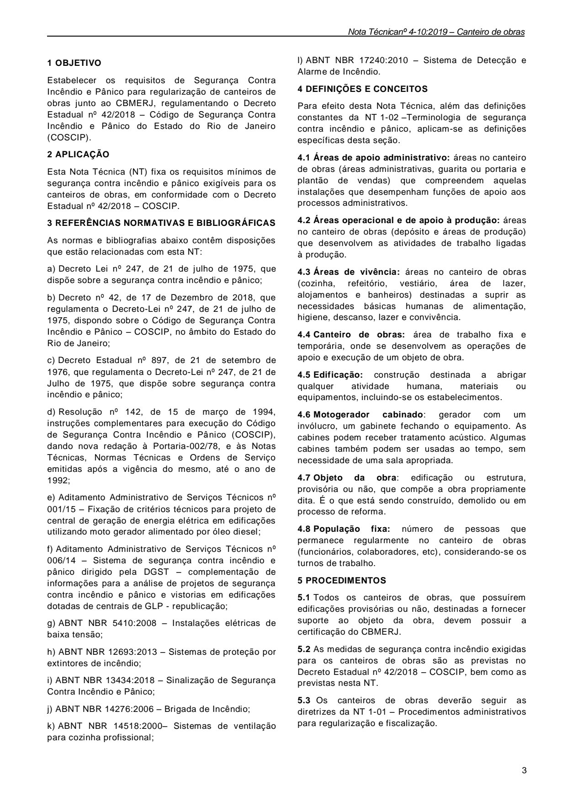
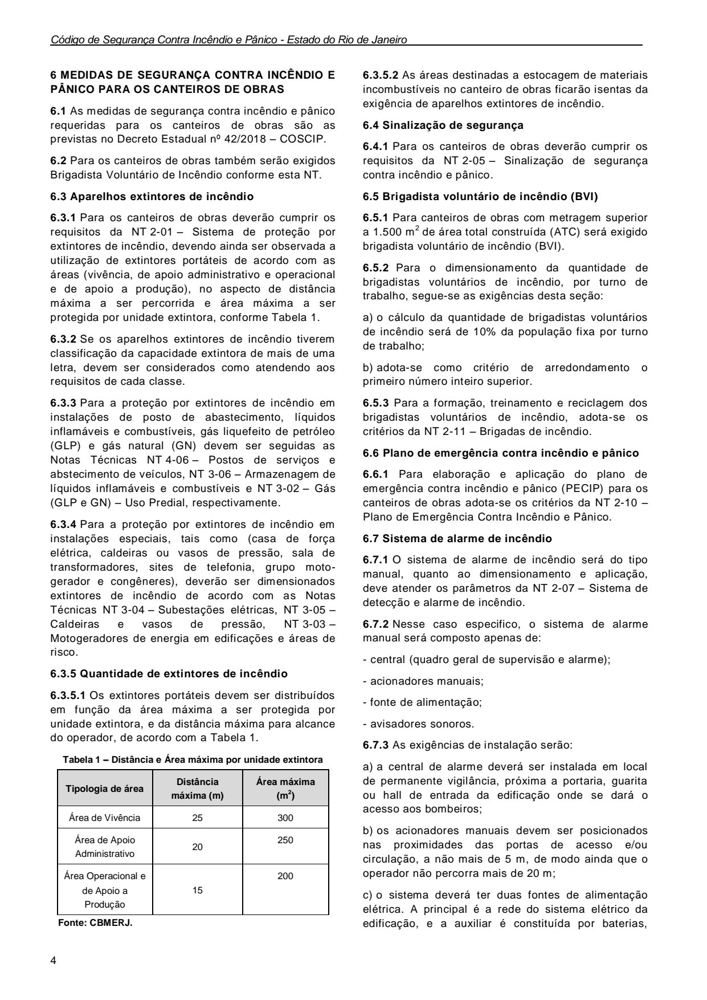

# NT 4-10 - Canteiro de obras

> Conversão integral para consulta computacional. A numeração de página do PDF foi preservada. Quando houver tabela complexa, símbolo ou desenho, conferir também a representação visual indicada e o PDF oficial.

## Sumário por página

- [Página 1](#pagina-1)
- [Página 2](#pagina-2)
- [Página 3](#pagina-3)
- [Página 4](#pagina-4)
- [Página 5](#pagina-5)

---

## Página 1

### SUMÁRIO

### 1 OBJETIVO

### 2 APLICAÇÃO

### 3 REFERÊNCIAS NORMATIVAS E BIBLIOGRÁFICAS

### 4 DEFINIÇÕES E CONCEITOS

### 5 PROCEDIMENTOS

### 6 MEDIDAS DE SEGURANÇA CONTRA INCÊNDIO E PÂNICO PARA OS CANTEIRO DE OBRAS

### 7 DISPOSIÇÕES GERAIS

Aprovada pela Portaria CBMERJ nº 1071, de 27 de agosto de 2019

### Tabelas extraídas (bruto, não usar para citação)
#### Tabela 1 da página

|  |  | NOTA |  |  | CBMERJ |  |
| --- | --- | --- | --- | --- | --- | --- |
|  |  | TÉCNICA |  |  | NT 4-10 |  |
|  | Versão: 01 05 páginas Vigência: 04/09/2019 |  |  |  |  |  |
|  | Canteiro de obras |  |  |  |  |  |

---

## Página 2

> Página sem texto extraível suficiente; consultar a representação visual ou o PDF oficial.

---

## Página 3

Nota Técnicanº 4-10:2019 - Canteiro de obras

### 1 OBJETIVO

Estabelecer os requisitos de Segurança Contra Incêndio e Pânico para regularização de canteiros de obras junto ao CBMERJ, regulamentando o Decreto Estadual nº 42/2018 - Código de Segurança Contra Incêndio e Pânico do Estado do Rio de Janeiro (COSCIP).

### 2 APLICAÇÃO

Esta Nota Técnica (NT) fixa os requisitos mínimos de segurança contra incêndio e pânico exigíveis para os canteiros de obras, em conformidade com o Decreto Estadual nº 42/2018 - COSCIP.

### 3 REFERÊNCIAS NORMATIVAS E BIBLIOGRÁFICAS

As normas e bibliografias abaixo contêm disposições que estão relacionadas com esta NT:

a) Decreto Lei nº 247, de 21 de julho de 1975, que dispõe sobre a segurança contra incêndio e pânico;

b) Decreto nº 42, de 17 de Dezembro de 2018, que regulamenta o Decreto-Lei nº 247, de 21 de julho de 1975, dispondo sobre o Código de Segurança Contra Incêndio e Pânico - COSCIP, no âmbito do Estado do Rio de Janeiro;

c) Decreto Estadual nº 897, de 21 de setembro de 1976, que regulamenta o Decreto-Lei nº 247, de 21 de Julho de 1975, que dispõe sobre segurança contra incêndio e pânico;

d) Resolução nº 142, de 15 de março de 1994, instruções complementares para execução do Código de Segurança Contra Incêndio e Pânico (COSCIP), dando nova redação à Portaria-002/78, e às Notas Técnicas, Normas Técnicas e Ordens de Serviço emitidas após a vigência do mesmo, até o ano de 1992;

e) Aditamento Administrativo de Serviços Técnicos nº 001/15 - Fixação de critérios técnicos para projeto de central de geração de energia elétrica em edificações utilizando moto gerador alimentado por óleo diesel;

f) Aditamento Administrativo de Serviços Técnicos nº 006/14 - Sistema de segurança contra incêndio e pânico dirigido pela DGST - complementação de informações para a análise de projetos de segurança contra incêndio e pânico e vistorias em edificações dotadas de centrais de GLP - republicação;

g) ABNT NBR 5410:2008 - Instalações elétricas de baixa tensão;

h) ABNT NBR 12693:2013 - Sistemas de proteção por extintores de incêndio;

i) ABNT NBR 13434:2018 - Sinalização de Segurança Contra Incêndio e Pânico;

j) ABNT NBR 14276:2006 - Brigada de Incêndio;

k) ABNT NBR 14518:2000- Sistemas de ventilação para cozinha profissional;

l) ABNT NBR 17240:2010 - Sistema de Detecção e Alarme de Incêndio.

### 4 DEFINIÇÕES E CONCEITOS

Para efeito desta Nota Técnica, além das definições constantes da NT 1-02 -Terminologia de segurança contra incêndio e pânico, aplicam-se as definições específicas desta seção.

4.1 Áreas de apoio administrativo: áreas no canteiro de obras (áreas administrativas, guarita ou portaria e plantão de vendas) que compreendem aquelas instalações que desempenham funções de apoio aos processos administrativos.

4.3 Áreas de vivência: áreas no canteiro de obras (cozinha, refeitório, vestiário, área de lazer, alojamentos e banheiros) destinadas a suprir as necessidades básicas humanas de alimentação, higiene, descanso, lazer e convivência.

4.4 Canteiro de obras: área de trabalho fixa e temporária, onde se desenvolvem as operações de apoio e execução de um objeto de obra.

4.5 Edificação: construção destinada a abrigar qualquer atividade humana, materiais ou equipamentos, incluindo-se os estabelecimentos.

### 5 PROCEDIMENTOS

5.1 Todos os canteiros de obras, que possuírem edificações provisórias ou não, destinadas a fornecer suporte ao objeto da obra, devem possuir a certificação do CBMERJ.

5.2 As medidas de segurança contra incêndio exigidas para os canteiros de obras são as previstas no Decreto Estadual nº 42/2018 - COSCIP, bem como as previstas nesta NT.

5.3 Os canteiros de obras deverão seguir as diretrizes da NT 1-01 - Procedimentos administrativos para regularização e fiscalização.

### Tabelas extraídas (bruto, não usar para citação)
#### Tabela 1 da página

| que | desenvolvem as atividades de trabalho ligadas |  |
| --- | --- | --- |
| à produção. |  |  |

#### Tabela 2 da página

| 4.6 Motogerador cabinado: | gerador com um |  |
| --- | --- | --- |
| invólucro, um gabinete fechando o equipamento. As |  |  |
| cabines podem receber tratamento acústico. Algumas |  |  |
| cabines também podem ser usadas ao tempo, sem |  |  |
| necessidade de uma sala apropriada. |  |  |

#### Tabela 3 da página

| 4.7 | Objeto da obra: edificação ou estrutura, |  |
| --- | --- | --- |
| provisória ou não, que compõe a obra propriamente |  |  |
| dita. É o que está sendo construído, demolido ou em |  |  |
| processo de reforma. |  |  |

#### Tabela 4 da página

| 4.8 | População fixa: número de pessoas que |  |
| --- | --- | --- |
| permanece regularmente no canteiro de obras |  |  |
| (funcionários, colaboradores, etc), considerando-se os |  |  |
| turnos de trabalho. |  |  |

---

## Página 4

Código de Segurança Contra Incêndio e Pânico - Estado do Rio de Janeiro

### 6 MEDIDAS DE SEGURANÇA CONTRA INCÊNDIO E PÂNICO PARA OS CANTEIROS DE OBRAS

6.1 As medidas de segurança contra incêndio e pânico requeridas para os canteiros de obras são as previstas no Decreto Estadual nº 42/2018 - COSCIP.

6.2 Para os canteiros de obras também serão exigidos Brigadista Voluntário de Incêndio conforme esta NT.

6.3 Aparelhos extintores de incêndio

6.3.1 Para os canteiros de obras deverão cumprir os requisitos da NT 2-01 - Sistema de proteção por extintores de incêndio, devendo ainda ser observada a utilização de extintores portáteis de acordo com as áreas (vivência, de apoio administrativo e operacional e de apoio a produção), no aspecto de distância máxima a ser percorrida e área máxima a ser protegida por unidade extintora, conforme Tabela 1.

6.3.2 Se os aparelhos extintores de incêndio tiverem classificação da capacidade extintora de mais de uma letra, devem ser considerados como atendendo aos requisitos de cada classe.

6.3.3 Para a proteção por extintores de incêndio em instalações de posto de abastecimento, líquidos inflamáveis e combustíveis, gás liquefeito de petróleo (GLP) e gás natural (GN) devem ser seguidas as Notas Técnicas NT 4-06 - Postos de serviços e abstecimento de veículos, NT 3-06 - Armazenagem de líquidos inflamáveis e combustíveis e NT 3-02 - Gás (GLP e GN) - Uso Predial, respectivamente.

6.3.4 Para a proteção por extintores de incêndio em instalações especiais, tais como (casa de força elétrica, caldeiras ou vasos de pressão, sala de transformadores, sites de telefonia, grupo motogerador e congêneres), deverão ser dimensionados extintores de incêndio de acordo com as Notas Técnicas NT 3-04 - Subestações elétricas, NT 3-05 - Caldeiras e vasos de pressão, NT 3-03 - Motogeradores de energia em edificações e áreas de risco.

6.3.5 Quantidade de extintores de incêndio

6.3.5.1 Os extintores portáteis devem ser distribuídos em função da área máxima a ser protegida por unidade extintora, e da distância máxima para alcance do operador, de acordo com a Tabela 1.

Tabela 1 - Distância e Área máxima por unidade extintora

6.3.5.2 As áreas destinadas a estocagem de materiais incombustíveis no canteiro de obras ficarão isentas da exigência de aparelhos extintores de incêndio.

6.4 Sinalização de segurança

6.4.1 Para os canteiros de obras deverão cumprir os requisitos da NT 2-05 - Sinalização de segurança contra incêndio e pânico.

6.5 Brigadista voluntário de incêndio (BVI)

6.5.1 Para canteiros de obras com metragem superior a 1.500 m2 de área total construída (ATC) será exigido brigadista voluntário de incêndio (BVI).

6.5.2 Para o dimensionamento da quantidade de brigadistas voluntários de incêndio, por turno de trabalho, segue-se as exigências desta seção:

a) o cálculo da quantidade de brigadistas voluntários de incêndio será de 10% da população fixa por turno de trabalho;

b) adota-se como critério de arredondamento o primeiro número inteiro superior.

6.5.3 Para a formação, treinamento e reciclagem dos brigadistas voluntários de incêndio, adota-se os critérios da NT 2-11 - Brigadas de incêndio.

6.6 Plano de emergência contra incêndio e pânico

6.6.1 Para elaboração e aplicação do plano de emergência contra incêndio e pânico (PECIP) para os canteiros de obras adota-se os critérios da NT 2-10 - Plano de Emergência Contra Incêndio e Pânico.

6.7 Sistema de alarme de incêndio

6.7.1 O sistema de alarme de incêndio será do tipo manual, quanto ao dimensionamento e aplicação, deve atender os parâmetros da NT 2-07 - Sistema de detecção e alarme de incêndio.

6.7.2 Nesse caso especifico, o sistema de alarme manual será composto apenas de:

- central (quadro geral de supervisão e alarme);

- acionadores manuais;

- fonte de alimentação;

- avisadores sonoros.

6.7.3 As exigências de instalação serão:

a) a central de alarme deverá ser instalada em local de permanente vigilância, próxima a portaria, guarita ou hall de entrada da edificação onde se dará o acesso aos bombeiros;

b) os acionadores manuais devem ser posicionados nas proximidades das portas de acesso e/ou circulação, a não mais de 5 m, de modo ainda que o operador não percorra mais de 20 m;

c) o sistema deverá ter duas fontes de alimentação elétrica. A principal é a rede do sistema elétrico da edificação, e a auxiliar é constituída por baterias,

### Tabelas extraídas (bruto, não usar para citação)
#### Tabela 1 da página

|  | Tipologia de área |  | Distância |  |  | Área máxima |  |  |
| --- | --- | --- | --- | --- | --- | --- | --- | --- |
|  |  |  | máxima (m) |  |  | (m2) |  |  |
|  | Área de Vivência | 25 |  |  | 300 |  |  |  |
|  | Área de Apoio Administrativo | 20 |  |  | 250 |  |  |  |
|  | Área Operacional e de Apoio a Produção | 15 |  |  | 200 |  |  |  |
| Fonte: CBMERJ. |  |  |  |  |  |  |  |  |

<!-- tabela-conferida: Tabela 1 p4 -->
### Tabela 1 — Distância e Área máxima por unidade extintora (conferida)

| Tipologia de área | Distância máxima (m) | Área máxima (m²) |
| --- | --- | --- |
| Área de Vivência | 25 | 300 |
| Área de Apoio Administrativo | 20 | 250 |
| Área Operacional e de Apoio a Produção | 15 | 200 |

Fonte: NT 4-10, página 4, Tabela 1; conferida em 2026-09-29 (visual + geometrica).
Fonte indicada na página: CBMERJ.
<!-- /tabela-conferida: Tabela 1 p4 -->

---

## Página 5

Nota Técnicanº 4-10:2019 - Canteiro de obras

nobreak ou motogerador para um suprimento de, no mínimo, 30 min para as indicações sonoras;

d) os avisadores sonoros deverão emitir sons distintos de outros sistemas, de modo a serem perceptíveis em toda a área a ser protegida.

6.8 Saídas de Emergência

6.8.1 Os canteiros de obras deverão cumprir os requisitos da NT 2-08 - Saída de emergência em edificações.

6.9 Acesso de viatura em edificações

6.9.1 Os canteiros de obras deverão cumprir os requisitos da NT 2-16 - Acesso de viatura em edificações.

### 7 CONSIDERAÇÕES FINAIS

7.1 Havendo sistema de gás combustível, líquidos inflamáveis ou combustíveis, posto de abastecimento, explosivos, produtos perigosos, entre outros riscos especiais no canteiro de obras, observar as Notas Técnicas específicas.

7.2 A certificação do canteiro de obras é independente e diferente da certificação do objeto da obra.

7.3 As cozinhas localizadas no canteiro de obras deverão cumprir os requisitos da NT 3-01 - Cozinha profissional.

7.4 O sistema de geração de energia elétrica deverá seguir as exigências da NT 3-03 - Motogeradores de energia em edificações e áreas de risco.

7.5 Após a conclusão do objeto da obra, caso seja de interesse do responsável legal do canteiro de obras em permanecer com as áreas edificadas para uso permanente, deverá providenciar a regularização junto ao CBMERJ da nova ocupação pretendida.
