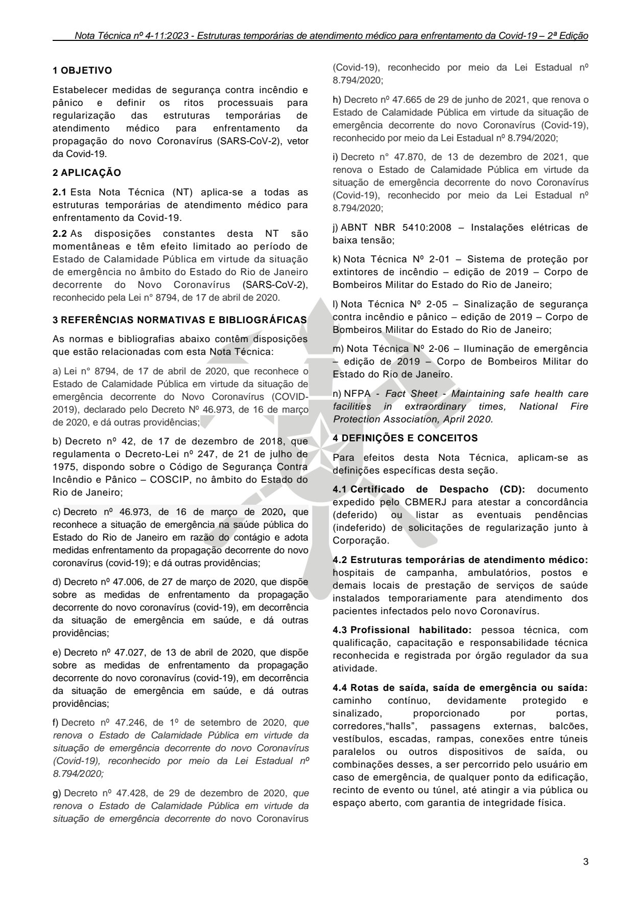

# NT 4-11 - Estruturas temporárias de atendimento médico para enfrentamento da Covid-19

> Conversão integral para consulta computacional. A numeração de página do PDF foi preservada. Quando houver tabela complexa, símbolo ou desenho, conferir também a representação visual indicada e o PDF oficial.

## Sumário por página

- [Página 1](#pagina-1)
- [Página 2](#pagina-2)
- [Página 3](#pagina-3)
- [Página 4](#pagina-4)
- [Página 5](#pagina-5)

---

## Página 1

### NT 4-11

### N O T A T É C N I C A 4 - 1 1

E s t r u t u r a s t e m p o r á r i a s d e a t e n d i m e n t o m é d i c o

p a r a e n f r e n t a m e n t o d a C o v i d - 1 9

2 0 2 3

---

## Página 2

NOTA TÉCNICA Nº 4-11:2023

Estruturas temporárias de atendimento médico para enfrentamento da Covid-19 -

2ª Edição

### SUMÁRIO

### 1 OBJETIVO

### 2 APLICAÇÃO

### 3 REFERÊNCIAS NORMATIVAS E BIBLIOGRÁFICAS

### 4 DEFINIÇÕES E CONCEITOS

### 5 MEDIDAS DE SEGURANÇA CONTRA INCÊNDIO E

### PÂNICO

### 6 REQUISITOS BÁSICOS PARA REGULARIZAÇÃO

### 7 DISPOSIÇÕES FINAIS

Publicações:

Aprovada pela Portaria CBMERJ nº 1239, de 22 de novembro de 2023 (DOERJ nº 216, de 24.11.2023).

Publicada no Boletim da SEDEC/CBMERJ nº XX, de XX de XX de 2023.

Vigência: 24/12/2023.

2ª Edição.

05 páginas.

Corpo de Bombeiros Militar do Estado do Rio de Janeiro CBMERJ Praça da República, nº 45, Centro, Rio de Janeiro - RJ. CEP: 20.211-350. www.cbmerj.rj.gov.br

http://www.cbmerj.rj.gov.br/notas-tecnicas

---

## Página 3

### 1 OBJETIVO

Estabelecer medidas de segurança contra incêndio e pânico e definir os ritos processuais para regularização das estruturas temporárias de atendimento médico para enfrentamento da propagação do novo Coronavírus (SARS-CoV-2), vetor da Covid-19.

### 2 APLICAÇÃO

2.1 Esta Nota Técnica (NT) aplica-se a todas as estruturas temporárias de atendimento médico para enfrentamento da Covid-19.

2.2 As disposições constantes desta NT são momentâneas e têm efeito limitado ao período de Estado de Calamidade Pública em virtude da situação de emergência no âmbito do Estado do Rio de Janeiro decorrente do Novo Coronavírus (SARS-CoV-2), reconhecido pela Lei n° 8794, de 17 de abril de 2020.

### 3 REFERÊNCIAS NORMATIVAS E BIBLIOGRÁFICAS

As normas e bibliografias abaixo contêm disposições que estão relacionadas com esta Nota Técnica:

b) Decreto nº 42, de 17 de dezembro de 2018, que regulamenta o Decreto-Lei nº 247, de 21 de julho de 1975, dispondo sobre o Código de Segurança Contra Incêndio e Pânico - COSCIP, no âmbito do Estado do Rio de Janeiro;

c) Decreto nº 46.973, de 16 de março de 2020, que reconhece a situação de emergência na saúde pública do Estado do Rio de Janeiro em razão do contágio e adota medidas enfrentamento da propagação decorrente do novo coronavírus (covid-19); e dá outras providências;

d) Decreto nº 47.006, de 27 de março de 2020, que dispõe sobre as medidas de enfrentamento da propagação decorrente do novo coronavírus (covid-19), em decorrência da situação de emergência em saúde, e dá outras providências;

e) Decreto nº 47.027, de 13 de abril de 2020, que dispõe sobre as medidas de enfrentamento da propagação decorrente do novo coronavírus (covid-19), em decorrência da situação de emergência em saúde, e dá outras providências;

j) ABNT NBR 5410:2008 - Instalações elétricas de baixa tensão;

k) Nota Técnica Nº 2-01 - Sistema de proteção por extintores de incêndio - edição de 2019 - Corpo de Bombeiros Militar do Estado do Rio de Janeiro;

l) Nota Técnica Nº 2-05 - Sinalização de segurança contra incêndio e pânico - edição de 2019 - Corpo de Bombeiros Militar do Estado do Rio de Janeiro;

m) Nota Técnica Nº 2-06 - Iluminação de emergência - edição de 2019 - Corpo de Bombeiros Militar do Estado do Rio de Janeiro.

n) NFPA - Fact Sheet - Maintaining safe health care facilities in extraordinary times, National Fire Protection Association, April 2020.

### 4 DEFINIÇÕES E CONCEITOS

Para efeitos desta Nota Técnica, aplicam-se as definições específicas desta seção.

4.1 Certificado de Despacho (CD): documento expedido pelo CBMERJ para atestar a concordância (deferido) ou listar as eventuais pendências (indeferido) de solicitações de regularização junto à Corporação.

4.2 Estruturas temporárias de atendimento médico: hospitais de campanha, ambulatórios, postos e demais locais de prestação de serviços de saúde instalados temporariamente para atendimento dos pacientes infectados pelo novo Coronavírus.

4.3 Profissional habilitado: pessoa técnica, com qualificação, capacitação e responsabilidade técnica reconhecida e registrada por órgão regulador da sua atividade.

4.4 Rotas de saída, saída de emergência ou saída: caminho contínuo, devidamente protegido e sinalizado, proporcionado por portas, corredores,“halls”, passagens externas, balcões, vestíbulos, escadas, rampas, conexões entre túneis paralelos ou outros dispositivos de saída, ou combinações desses, a ser percorrido pelo usuário em caso de emergência, de qualquer ponto da edificação, recinto de evento ou túnel, até atingir a via pública ou espaço aberto, com garantia de integridade física.

### Tabelas extraídas (bruto, não usar para citação)
#### Tabela 1 da página

| (Covid-19), reconhecido por meio da Lei Estadual nº |  |
| --- | --- |
| 8.794/2020; |  |

#### Tabela 2 da página

| h) | Decreto nº 47.665 de 29 de junho de 2021, que renova o |  |
| --- | --- | --- |
| Estado de Calamidade Pública em virtude da situação de |  |  |
| emergência decorrente do novo Coronavírus (Covid-19), |  |  |
| reconhecido por meio da Lei Estadual nº 8.794/2020; |  |  |

#### Tabela 3 da página

| i) | Decreto n° 47.870, de 13 de dezembro de 2021, que |  |
| --- | --- | --- |
| renova o Estado de Calamidade Pública em virtude da |  |  |
| situação de emergência decorrente do novo Coronavírus |  |  |
| (Covid-19), reconhecido por meio da Lei Estadual nº |  |  |
| 8.794/2020; |  |  |

#### Tabela 4 da página

| a) Lei n° 8794, de 17 de abril de 2020, que reconhece o |  |
| --- | --- |
| Estado de Calamidade Pública em virtude da situação de |  |
| emergência decorrente do Novo Coronavírus (COVID- |  |
| 2019), declarado pelo Decreto Nº 46.973, de 16 de março |  |
| de 2020, e dá outras providências; |  |

#### Tabela 5 da página

| Decreto nº 46.973, de 16 de março de 2020 | , que |
| --- | --- |

#### Tabela 6 da página

| f) | Decreto nº 47.246, de 1º de setembro de 2020, que |  |
| --- | --- | --- |
| renova o Estado de Calamidade Pública em virtude da |  |  |
| situação de emergência decorrente do novo Coronavírus |  |  |
| (Covid-19), reconhecido por meio da Lei Estadual nº |  |  |
| 8.794/2020; |  |  |

#### Tabela 7 da página

| g) | Decreto nº 47.428, de 29 de dezembro de 2020, que |
| --- | --- |
| renova o Estado de Calamidade Pública em virtude da |  |
| situação de emergência decorrente do novo Coronavírus |  |

---

## Página 4

### 5 MEDIDAS DE SEGURANÇA CONTRA INCÊNDIO E PÂNICO

5.1 Exigências para estruturas temporárias de atendimento médico

5.1.1 Considerando a necessidade de urgência na instalação, adequação e operacionalização das estruturas temporárias de atendimento médico, o CBMERJ define, excepcionalmente, as seguintes medidas básicas de segurança contra incêndio e pânico a serem exigidas:

a) Extintores de incêndio

b) Sinalização de segurança contra incêndio e pânico

c) Iluminação de emergência

d) Adequação das rotas de saída

e) Plano de Operações

f) Controle de riscos específicos

5.1.2 Em função da situação emergencial e das peculiaridades ocupacionais e sanitárias de cada instalação, em especial àquelas atinentes aos riscos de contágio pela Covid-19, os locais de instalação e/ou os quantitativos de dispositivos a serem exigidos pelo CBMERJ poderão ser alterados, a pedido dos gestores e/ou responsáveis técnicos pelas estruturas temporárias de atendimento médico, mediante a apresentação de fundamento técnico que justifique tal pleito.

5.2 Extintores de incêndio

Devem ser dimensionados de acordo com as classes de fogo a proteger, na proporção de 01 (uma) unidade extintora para proteção de uma área máxima de 150 m² (cento e cinquenta metros quadrados) e instalados conforme prevê a NT 2-01 - Sistema de proteção por extintores de incêndio.

5.3 Sinalização de segurança contra incêndio e pânico

Deve atender aos requisitos da NT 2-05 - Sinalização de segurança contra incêndio e pânico.

5.4 Iluminação de emergência

Deve atender aos requisitos da NT 2-06 - Iluminação de emergência.

5.5 Adequação das rotas de saída

5.5.1 Devem ser asseguradas as condições adequadas de acessibilidade em todo o percurso das rotas de saída, a fim de garantir o abandono seguro, em caso de incêndio ou pânico, e permitir o acesso de equipes de socorro.

5.5.2 A NT 2-08 Saídas de emergência deve ser utilizada como referência para as adequações possíveis, de forma não prescritiva, de modo a não inviabilizar a operação da estrutura temporária durante o enfrentamento da emergência em saúde

pública de importância internacional, decorrente do novo Coronavírus (SARS-CoV-2), vetor da Covid-19.

5.5.3 Recomenda-se que as larguras mínimas a serem adotadas nas rotas de saída sejam de:

a) 1,20 m, para corredores destinados exclusivamente à circulação de setores administrativos, serviços ou técnicos, sem possibilidade de circulação de pacientes, quer seja em utilização normal ou em emergência; e

b) 2,20 m, para as demais áreas.

5.6 Plano de Operações

5.6.1 O Plano de Operações (PO) será elaborado pelo CBMERJ a fim de estabelecer as ações de pronta resposta a eventos em que se fizer necessária sua atuação. As unidades, que elaborarem PO, devem dar publicidade ao seu inteiro teor através dos meios necessários no âmbito do CBMERJ.

5.6.2 O responsável pela estrutura temporária de atendimento médico deve fornecer ao CBMERJ as informações necessárias à elaboração do Plano de Operações, tais como: características estruturais, ocupacionais e humanas, riscos, recursos existentes e contato telefônico direto disponível 24 horas.

5.6.3 O Plano de Operações poderá determinar medidas compensatórias a serem observadas pelo responsável pela estrutura temporária de atendimento médico para mitigação dos riscos existentes.

5.7 Controle de riscos específicos

5.7.1 A proteção contra incêndio nas instalações elétricas de baixa tensão deve atender ao disposto na ABNT NBR 5410.

5.7.2 A localização, afastamento de segurança, sistema de contenção e proteção por extintores dos grupos motogeradores e recipientes de combustível devem estar de acordo com a NT 3-03 Motogeradores de energia em edificações e áreas de risco.

5.7.3 A localização, afastamento de segurança e proteção por extintores das centrais de GLP devem estar de acordo com NT 3-02 Gás (GLP/GN) - Uso predial.

5.7.4 A execução e manutenção das instalações elétricas e demais riscos específicos (geradores, subestações de energia elétrica, gases e/ou líquidos inflamáveis ou combustíveis, gases medicinais, caldeiras e vasos sob pressão, etc) deve ser realizada por profissional habilitado, com observância das normas aplicáveis, a fim de promover o funcionamento seguro e a redução do risco de incêndio.

### 6 REQUISITOS BÁSICOS PARA REGULARIZAÇÃO

6.1 Os processos de aprovação das estruturas temporárias de atendimento médico poderão ser protocolados na Diretoria Geral de Serviços Técnicos ou, para estruturas com área de até 1.500 m² (mil e

---

## Página 5

quinhentos metros quadrados), nas Seções de Serviços Técnicos dos quartéis do Corpo de Bombeiros Militar do Estado do Rio de Janeiro da localidade.

6.2 Deverá compor o processo de solicitação de regularização junto ao CBMERJ, o documento de responsabilidade técnica, conforme entidade de classe correspondente, referente à:

a) execução das instalações elétricas, incluindo a eventual implantação de grupos geradores de energia;

b) execução da central de GLP e ensaio de estanqueidade da rede de distribuição interna de gases combustíveis (gás liquefeito de petróleo - GLP ou gás natural - GN), quando houver.

6.3 Fica dispensada a apresentação do projeto arquitetônico da estrutura temporária de atendimento médico, tendo em vista o caráter de excepcionalidade e urgência atual, cabendo ao profissional responsável pela implantação da mesma o correto preenchimento das informações constantes do requerimento eletrônico.

6.4 Recomenda-se a apresentação do projeto arquitetônico da estrutura temporária de atendimento médico com área superior a 1.500 m² (mil e quinhentos metros quadrados).

6.5 Realizada a abertura do processo de regularização, o CBMERJ procederá uma vistoria técnica prévia no local com o intuito de definir as medidas de segurança contra incêndio e pânico cabíveis, nos termos da seção 5.

6.6 Durante o transcurso do processo de regularização, o Grupamento de Bombeiro Militar da localidade deverá, em conjunto com os gestores e responsáveis técnicos da estrutura temporária de atendimento médico, providenciar a elaboração de um Plano de Operações conforme item 5.6, que norteará eventuais atendimentos do CBMERJ nas instalações em questão.

6.7 Após a análise e a definição das exigências cabíveis para a estrutura temporária de atendimento médico, será emitido um único Certificado de Despacho Deferido, o qual representará a regularização da estrutura junto ao CBMERJ.

6.7.1 O Certificado de Despacho Deferido será temporário com efeito limitado ao período em que perdurarem as medidas de enfrentamento da propagação do novo Coronavírus (SARS-CoV-2), vetor da Covid-19.

### 7 DISPOSIÇÕES FINAIS

7.1 As medidas básicas de segurança contra incêndio e pânico definidas nesta NT devem aceitar possíveis adequações de modo a não inviabilizar a operação da estrutura temporária durante o enfrentamento da emergência em saúde pública de importância internacional, decorrente do novo Coronavírus (SARS-

CoV-2), vetor da Covid-19.

7.2 No caso de um princípio de incêndio é fundamental ser capaz de identificá-lo rapidamente. A supervisão direta por funcionários, detectores de fumaça ou alarmes de fumaça são algumas das formas de identificação.

7.3 Ao identificar uma situação de emergência, qualquer pessoa, através dos meios de comunicação existentes ou sistema de alarme, pode alertar os ocupantes. O alerta pode ser executado automaticamente em edificações dotadas de sistema de detecção e alarme de incêndio.

7.4 Recomenda-se que a estrutura temporária de atendimento médico seja dotada de aviso sonoro e/ou luminoso, originado por uma pessoa ou por um dispositivo automático, destinado a alertar as pessoas sobre a existência de uma emergência.

7.5 Identificado um princípio de incêndio ou emergência, o CBMERJ deve ser imediatamente acionado. Durante o acionamento, o solicitante deve:

a) informar qual é a emergência (ex: incêndio, explosão, vazamento de gás, etc.);

b) informar o endereço completo da edificação, pontos de referência e/ou acessos;

c) informar o nome e o número do telefone utilizado, informar as características da emergência, local ou pavimento e eventuais vítimas e suas condições, recepcionar o CBMERJ na chegada ao local para orientação e possíveis informações adicionais.
