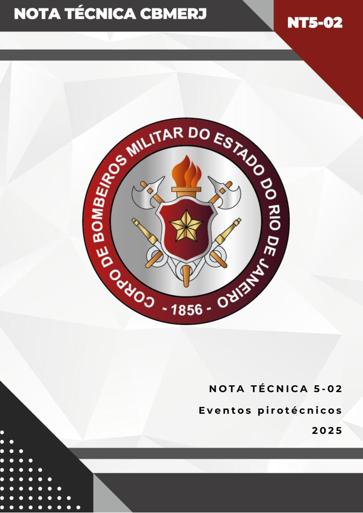
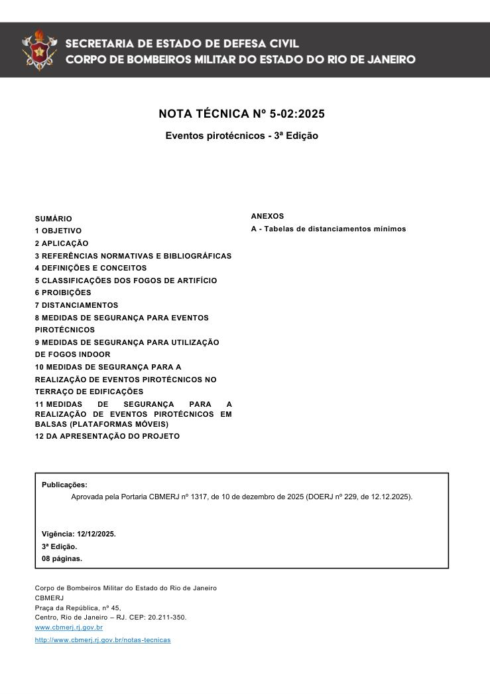
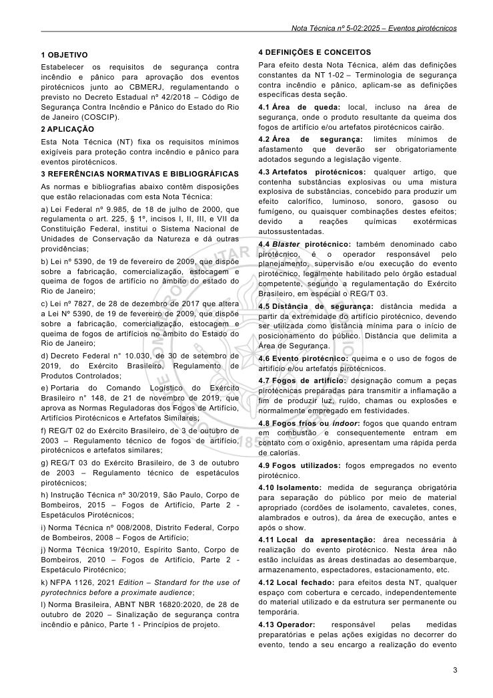
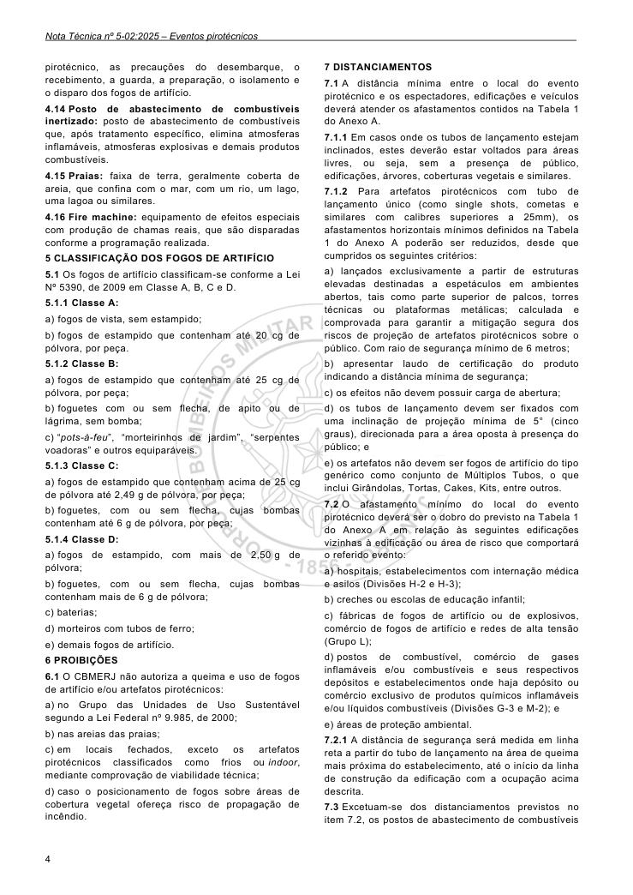
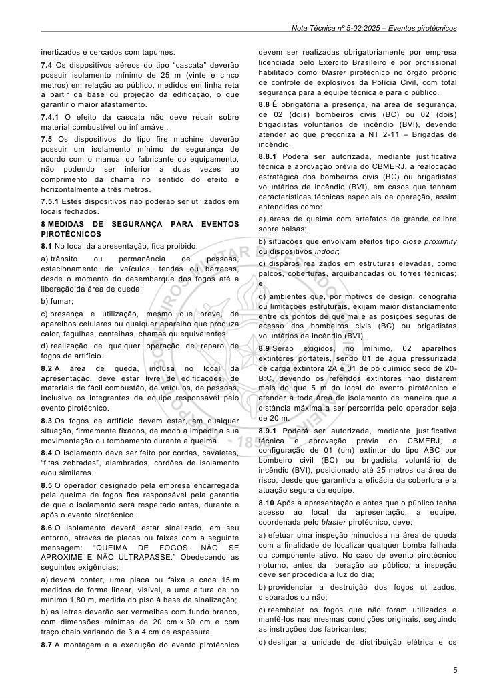
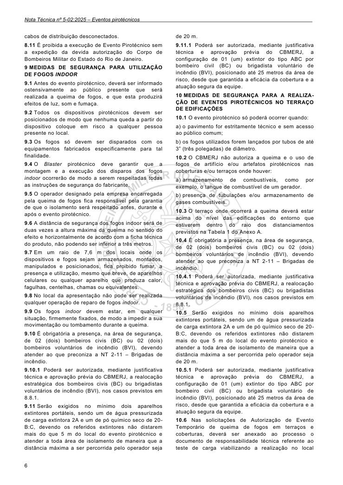
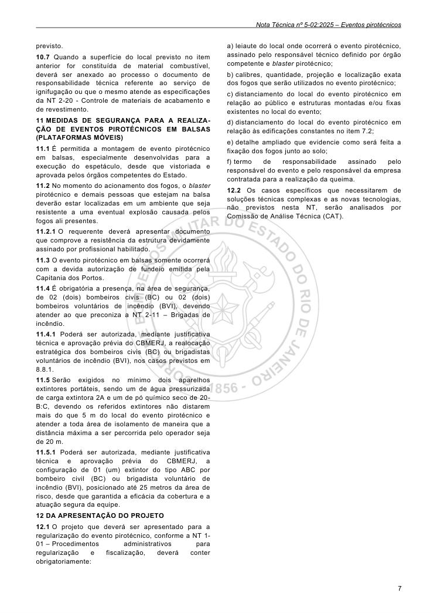
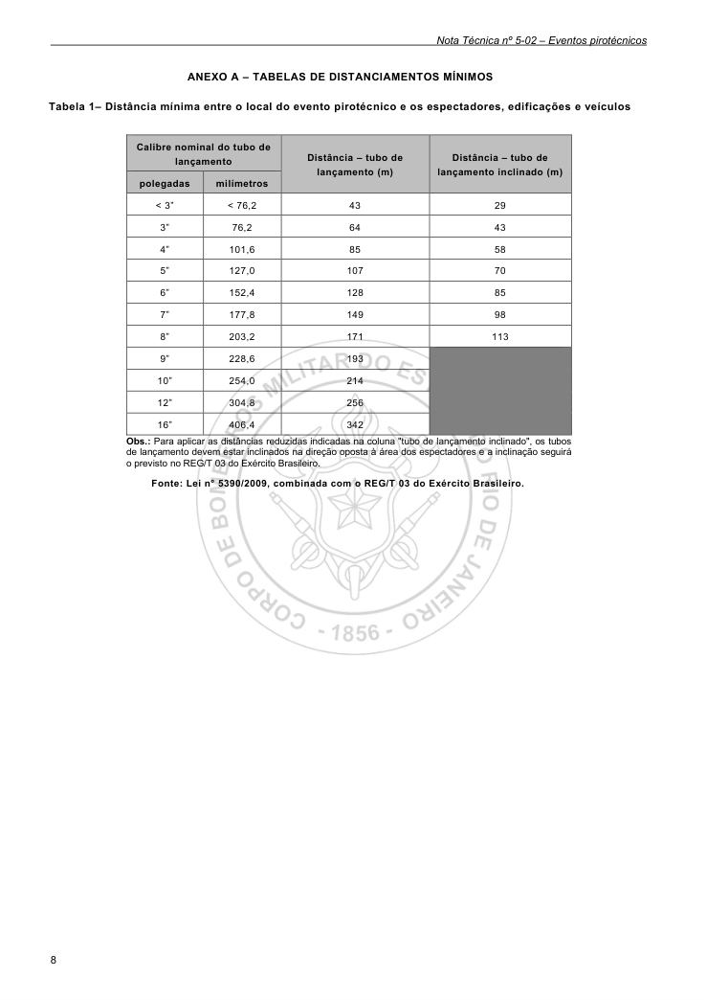

# NT 5-02 - Eventos pirotécnicos

> Conversão integral para consulta computacional. A numeração de página do PDF foi preservada. Quando houver tabela complexa, símbolo ou desenho, conferir também a representação visual indicada e o PDF oficial.

## Sumário por página

- [Página 1](#pagina-1)
- [Página 2](#pagina-2)
- [Página 3](#pagina-3)
- [Página 4](#pagina-4)
- [Página 5](#pagina-5)
- [Página 6](#pagina-6)
- [Página 7](#pagina-7)
- [Página 8](#pagina-8)

---

## Página 1

### NT5-02

### N O T A T É C N I C A 5 - 0 2

E v e n t o s p i r o t é c n i c o s

2 0 2 5

### Tabelas extraídas (bruto, não usar para citação)
#### Tabela 1 da página

|  | PROJETO DE REVISÃO/2025 NOTA TÉCNICA CBMERJ |  |
| --- | --- | --- |
| P | ROJETO DE NOTA TÉCNICA CBMERJ |  |

---

## Página 2

NOTA TÉCNICA Nº 5-02:2025

Eventos pirotécnicos - 3ª Edição

Aprovada pela Portaria CBMERJ nº 1317, de 10 de dezembro de 2025 (DOERJ nº 229, de 12.12.2025).

Publicada no Boletim da SEDEC/CBMERJ nº XX, de XX de XX de 202

### SUMÁRIO

### 1 OBJETIVO

### 2 APLICAÇÃO

### 3 REFERÊNCIAS NORMATIVAS E BIBLIOGRÁFICAS

### 4 DEFINIÇÕES E CONCEITOS

### 5 CLASSIFICAÇÕES DOS FOGOS DE ARTIFÍCIO

### 6 PROIBIÇÕES

### 7 DISTANCIAMENTOS

### 8 MEDIDAS DE SEGURANÇA PARA EVENTOS

### PIROTÉCNICOS

### 9 MEDIDAS DE SEGURANÇA PARA UTILIZAÇÃO

### DE FOGOS INDOOR

### 10 MEDIDAS DE SEGURANÇA PARA A

### REALIZAÇÃO DE EVENTOS PIROTÉCNICOS NO

### TERRAÇO DE EDIFICAÇÕES

### 11 MEDIDAS DE SEGURANÇA PARA A REALIZAÇÃO DE EVENTOS PIROTÉCNICOS EM BALSAS (PLATAFORMAS MÓVEIS)

### 12 DA APRESENTAÇÃO DO PROJETO

Publicações:

3.

Vigência: 12/12/2025.

3ª Edição.

08 páginas.

Corpo de Bombeiros Militar do Estado do Rio de Janeiro CBMERJ Praça da República, nº 45, Centro, Rio de Janeiro - RJ. CEP: 20.211-350. www.cbmerj.rj.gov.br

http://www.cbmerj.rj.gov.br/notas-tecnicas

### ANEXOS

A - Tabelas de distanciamentos mínimos

---

## Página 3

### 1 OBJETIVO

Estabelecer os requisitos de segurança contra incêndio e pânico para aprovação dos eventos pirotécnicos junto ao CBMERJ, regulamentando o previsto no Decreto Estadual nº 42/2018 - Código de Segurança Contra Incêndio e Pânico do Estado do Rio de Janeiro (COSCIP).

### 2 APLICAÇÃO

Esta Nota Técnica (NT) fixa os requisitos mínimos exigíveis para proteção contra incêndio e pânico para eventos pirotécnicos.

### 3 REFERÊNCIAS NORMATIVAS E BIBLIOGRÁFICAS

As normas e bibliografias abaixo contêm disposições que estão relacionadas com esta Nota Técnica:

a) Lei Federal nº 9.985, de 18 de julho de 2000, que regulamenta o art. 225, § 1º, incisos I, II, III, e VII da Constituição Federal, institui o Sistema Nacional de Unidades de Conservação da Natureza e dá outras providências;

b) Lei nº 5390, de 19 de fevereiro de 2009, que dispõe sobre a fabricação, comercialização, estocagem e queima de fogos de artifício no âmbito do estado do Rio de Janeiro;

c) Lei nº 7827, de 28 de dezembro de 2017 que altera a Lei Nº 5390, de 19 de fevereiro de 2009, que dispõe sobre a fabricação, comercialização, estocagem e queima de fogos de artifícios no âmbito do Estado do Rio de Janeiro;

d) Decreto Federal n° 10.030, de 30 de setembro de 2019, do Exército Brasileiro, Regulamento de Produtos Controlados;

e) Portaria do Comando Logístico do Exército Brasileiro n° 148, de 21 de novembro de 2019, que aprova as Normas Reguladoras dos Fogos de Artifício, Artifícios Pirotécnicos e Artefatos Similares;

f) REG/T 02 do Exército Brasileiro, de 3 de outubro de 2003 - Regulamento técnico de fogos de artifício, pirotécnicos e artefatos similares;

g) REG/T 03 do Exército Brasileiro, de 3 de outubro de 2003 - Regulamento técnico de espetáculos pirotécnicos;

h) Instrução Técnica nº 30/2019, São Paulo, Corpo de Bombeiros, 2015 - Fogos de Artifício, Parte 2 - Espetáculos Pirotécnicos;

i) Norma Técnica nº 008/2008, Distrito Federal, Corpo de Bombeiros, 2008 - Fogos de Artifício;

j) Norma Técnica 19/2010, Espírito Santo, Corpo de Bombeiros, 2010 - Fogos de Artifício, Parte 2 - Espetáculo Pirotécnico;

k) NFPA 1126, 2021 Edition - Standard for the use of pyrotechnics before a proximate audience;

l) Norma Brasileira, ABNT NBR 16820:2020, de 28 de outubro de 2020 - Sinalização de segurança contra incêndio e pânico, Parte 1 - Princípios de projeto.

### 4 DEFINIÇÕES E CONCEITOS

Para efeito desta Nota Técnica, além das definições constantes da NT 1-02 - Terminologia de segurança contra incêndio e pânico, aplicam-se as definições específicas desta seção.

4.1 Área de queda: local, incluso na área de segurança, onde o produto resultante da queima dos fogos de artifício e/ou artefatos pirotécnicos cairão.

4.2 Área de segurança: limites mínimos de afastamento que deverão ser obrigatoriamente adotados segundo a legislação vigente.

4.3 Artefatos pirotécnicos: qualquer artigo, que contenha substâncias explosivas ou uma mistura explosiva de substâncias, concebido para produzir um efeito calorífico, luminoso, sonoro, gasoso ou fumígeno, ou quaisquer combinações destes efeitos; devido a reações químicas exotérmicas autossustentadas.

4.4 Blaster pirotécnico: também denominado cabo pirotécnico, é o operador responsável pelo planejamento, supervisão e/ou execução do evento pirotécnico, legalmente habilitado pelo órgão estadual competente, segundo a regulamentação do Exército Brasileiro, em especial o REG/T 03.

4.5 Distância de segurança: distância medida a partir da extremidade do artifício pirotécnico, devendo ser utilizada como distância mínima para o início de posicionamento do público. Distância que delimita a Área de Segurança.

4.6 Evento pirotécnico: queima e o uso de fogos de artifício e/ou artefatos pirotécnicos.

4.7 Fogos de artifício: designação comum a peças pirotécnicas preparadas para transmitir a inflamação a fim de produzir luz, ruído, chamas ou explosões e normalmente empregado em festividades.

4.8 Fogos frios ou indoor: fogos que quando entram em combustão e consequentemente entram em contato com o oxigênio, apresentam uma rápida perda de calorias.

4.9 Fogos utilizados: fogos empregados no evento pirotécnico.

4.10 Isolamento: medida de segurança obrigatória para separação do público por meio de material apropriado (cordões de isolamento, cavaletes, cones, alambrados e outros), da área de execução, antes e após o show.

4.11 Local da apresentação: área necessária à realização do evento pirotécnico. Nesta área não estão incluídas as áreas destinadas ao desembarque, armazenamento, espectadores, estacionamento, etc.

4.12 Local fechado: para efeitos desta NT, qualquer espaço com cobertura e cercado, independentemente do material utilizado e da estrutura ser permanente ou temporária.

4.13 Operador: responsável pelas medidas preparatórias e pelas ações exigidas no decorrer do evento, tendo a seu encargo a realização do evento

---

## Página 4

pirotécnico, as precauções do desembarque, o recebimento, a guarda, a preparação, o isolamento e o disparo dos fogos de artifício.

4.14 Posto de abastecimento de combustíveis inertizado: posto de abastecimento de combustíveis que, após tratamento específico, elimina atmosferas inflamáveis, atmosferas explosivas e demais produtos combustíveis.

4.15 Praias: faixa de terra, geralmente coberta de areia, que confina com o mar, com um rio, um lago, uma lagoa ou similares.

### 5 CLASSIFICAÇÃO DOS FOGOS DE ARTIFÍCIO

5.1 Os fogos de artifício classificam-se conforme a Lei Nº 5390, de 2009 em Classe A, B, C e D.

5.1.1 Classe A:

a) fogos de vista, sem estampido;

b) fogos de estampido que contenham até 20 cg de pólvora, por peça.

5.1.2 Classe B:

a) fogos de estampido que contenham até 25 cg de pólvora, por peça;

b) foguetes com ou sem flecha, de apito ou de lágrima, sem bomba;

c) “pots-à-feu”, “morteirinhos de jardim”, “serpentes voadoras” e outros equiparáveis.

5.1.3 Classe C:

a) fogos de estampido que contenham acima de 25 cg de pólvora até 2,49 g de pólvora, por peça;

b) foguetes, com ou sem flecha, cujas bombas contenham até 6 g de pólvora, por peça;

5.1.4 Classe D:

a) fogos de estampido, com mais de 2,50 g de pólvora;

b) foguetes, com ou sem flecha, cujas bombas contenham mais de 6 g de pólvora;

c) baterias;

d) morteiros com tubos de ferro;

e) demais fogos de artifício.

### 6 PROIBIÇÕES

6.1 O CBMERJ não autoriza a queima e uso de fogos de artifício e/ou artefatos pirotécnicos:

a) no Grupo das Unidades de Uso Sustentável segundo a Lei Federal nº 9.985, de 2000;

b) nas areias das praias;

c) em locais fechados, exceto os artefatos pirotécnicos classificados como frios ou indoor, mediante comprovação de viabilidade técnica;

d) caso o posicionamento de fogos sobre áreas de cobertura vegetal ofereça risco de propagação de incêndio.

### 7 DISTANCIAMENTOS

7.1 A distância mínima entre o local do evento pirotécnico e os espectadores, edificações e veículos deverá atender os afastamentos contidos na Tabela 1 do Anexo A.

7.1.1 Em casos onde os tubos de lançamento estejam inclinados, estes deverão estar voltados para áreas livres, ou seja, sem a presença de público, edificações, árvores, coberturas vegetais e similares.

7.1.2 Para artefatos pirotécnicos com tubo de lançamento único (como single shots, cometas e similares com calibres superiores a 25mm), os afastamentos horizontais mínimos definidos na Tabela 1 do Anexo A poderão ser reduzidos, desde que cumpridos os seguintes critérios:

7.2 O afastamento mínimo do local do evento pirotécnico deverá ser o dobro do previsto na Tabela 1 do Anexo A em relação às seguintes edificações vizinhas à edificação ou área de risco que comportará o referido evento:

a) hospitais, estabelecimentos com internação médica e asilos (Divisões H-2 e H-3);

b) creches ou escolas de educação infantil;

c) fábricas de fogos de artifício ou de explosivos, comércio de fogos de artifício e redes de alta tensão (Grupo L);

d) postos de combustível, comércio de gases inflamáveis e/ou combustíveis e seus respectivos depósitos e estabelecimentos onde haja depósito ou comércio exclusivo de produtos químicos inflamáveis e/ou líquidos combustíveis (Divisões G-3 e M-2); e

e) áreas de proteção ambiental.

7.2.1 A distância de segurança será medida em linha reta a partir do tubo de lançamento na área de queima mais próxima do estabelecimento, até o início da linha de construção da edificação com a ocupação acima descrita.

7.3 Excetuam-se dos distanciamentos previstos no item 7.2, os postos de abastecimento de combustíveis

### Tabelas extraídas (bruto, não usar para citação)
#### Tabela 1 da página

|  | Fire machine: equipamento de efeitos especiais |
| --- | --- |
| com produção de chamas reais, que são disparadas |  |
| conforme a programação realizada. |  |

#### Tabela 2 da página

| a) lançados exclusivamente a partir de estruturas |  |  |  |  |
| --- | --- | --- | --- | --- |
| elevadas destinadas a espetáculos em ambientes |  |  |  |  |
| abertos, tais como parte superior de palcos, torres |  |  |  |  |
| técnicas ou plataformas metálicas; calculada e |  |  |  |  |
| comprovada para garantir a mitigação segura dos |  |  |  |  |
| riscos de projeção de artefatos pirotécnicos sobre o |  |  |  |  |
| público. Com raio de segurança mínimo de 6 metros; |  |  |  |  |
| b) apresentar laudo de certificação do produto |  |  |  |  |
| indicando a distância mínima de segurança; |  |  |  |  |
| c) os efeitos não devem possuir carga de abertura; |  |  |  |  |
| d) os tubos de lançamento devem ser fixados com |  |  |  |  |
| uma inclinação de projeção mínima de 5° (cinco |  |  |  |  |
| graus), direcionada para a área oposta à presença do |  |  |  |  |
| público; e |  |  |  |  |
| e) os artefatos não devem ser fogos de artifício do tipo |  |  |  |  |
| genérico como conjunto de Múltiplos Tubos, o que |  |  |  |  |
| inclui Girândolas, Tortas, Cakes, Kits, entre outros. |  |  |  |  |

---

## Página 5

inertizados e cercados com tapumes.

7.4 Os dispositivos aéreos do tipo “cascata” deverão possuir isolamento mínimo de 25 m (vinte e cinco metros) em relação ao público, medidos em linha reta a partir da base ou projeção da edificação, o que garantir o maior afastamento.

7.4.1 O efeito da cascata não deve recair sobre material combustível ou inflamável.

7.5 Os dispositivos do tipo fire machine deverão possuir um isolamento mínimo de segurança de acordo com o manual do fabricante do equipamento, não podendo ser inferior a duas vezes ao comprimento da chama no sentido do efeito e horizontalmente a três metros.

7.5.1 Estes dispositivos não poderão ser utilizados em locais fechados.

### 8 MEDIDAS DE SEGURANÇA PARA EVENTOS PIROTÉCNICOS

8.1 No local da apresentação, fica proibido:

a) trânsito ou permanência de pessoas, estacionamento de veículos, tendas ou barracas, desde o momento do desembarque dos fogos até a liberação da área de queda;

b) fumar;

c) presença e utilização, mesmo que breve, de aparelhos celulares ou qualquer aparelho que produza calor, fagulhas, centelhas, chamas ou equivalentes;

d) realização de qualquer operação de reparo de fogos de artifício.

8.2 A área de queda, inclusa no local da apresentação, deve estar livre de edificações, de materiais de fácil combustão, de veículos, de pessoas, inclusive os integrantes da equipe responsável pelo evento pirotécnico.

8.3 Os fogos de artifício devem estar, em qualquer situação, firmemente fixados, de modo a impedir a sua movimentação ou tombamento durante a queima.

8.4 O isolamento deve ser feito por cordas, cavaletes, “fitas zebradas”, alambrados, cordões de isolamento e/ou similares.

8.5 O operador designado pela empresa encarregada pela queima de fogos fica responsável pela garantia de que o isolamento será respeitado antes, durante e após o evento pirotécnico.

8.6 O isolamento deverá estar sinalizado, em seu entorno, através de placas ou faixas com a seguinte mensagem: “QUEIMA DE FOGOS. NÃO SE APROXIME E NÃO ULTRAPASSE.” Obedecendo as seguintes exigências:

a) deverá conter, uma placa ou faixa a cada 15 m medidos de forma linear, visível, a uma altura de no mínimo 1,80 m, medida do piso à base da sinalização;

b) as letras deverão ser vermelhas com fundo branco, com dimensões mínimas de 20 cm x 30 cm e com traço cheio variando de 3 a 4 cm de espessura.

8.7 A montagem e a execução do evento pirotécnico

devem ser realizadas obrigatoriamente por empresa licenciada pelo Exército Brasileiro e por profissional habilitado como blaster pirotécnico no órgão próprio de controle de explosivos da Polícia Civil, com total segurança para a equipe técnica e para o público.

8.8 É obrigatória a presença, na área de segurança, de 02 (dois) bombeiros civis (BC) ou 02 (dois) brigadistas voluntários de incêndio (BVI), devendo atender ao que preconiza a NT 2-11 - Brigadas de incêndio.

8.8.1 Poderá ser autorizada, mediante justificativa técnica e aprovação prévia do CBMERJ, a realocação estratégica dos bombeiros civis (BC) ou brigadistas voluntários de incêndio (BVI), em casos que tenham características técnicas especiais de operação, assim entendidas como:

a) áreas de queima com artefatos de grande calibre sobre balsas;

b) situações que envolvam efeitos tipo close proximity ou dispositivos indoor;

c) disparos realizados em estruturas elevadas, como palcos, coberturas, arquibancadas ou torres técnicas; e

d) ambientes que, por motivos de design, cenografia ou limitações estruturais, exijam maior distanciamento entre os pontos de queima e as posições seguras de acesso dos bombeiros civis (BC) ou brigadistas voluntários de incêndio (BVI).

8.9 Serão exigidos, no mínimo, 02 aparelhos extintores portáteis, sendo 01 de água pressurizada de carga extintora 2A e 01 de pó químico seco de 20- B:C, devendo os referidos extintores não distarem mais do que 5 m do local do evento pirotécnico e atender a toda área de isolamento de maneira que a distância máxima a ser percorrida pelo operador seja de 20 m.

8.9.1 Poderá ser autorizada, mediante justificativa técnica e aprovação prévia do CBMERJ, a configuração de 01 (um) extintor do tipo ABC por bombeiro civil (BC) ou brigadista voluntário de incêndio (BVI), posicionado até 25 metros da área de risco, desde que garantida a eficácia da cobertura e a atuação segura da equipe.

8.10 Após a apresentação e antes que o público tenha acesso ao local da apresentação, a equipe, coordenada pelo blaster pirotécnico, deve:

a) efetuar uma inspeção minuciosa na área de queda com a finalidade de localizar qualquer bomba falhada ou componente ativo. No caso de evento pirotécnico noturno, antes da liberação ao público, a inspeção deve ser procedida à luz do dia;

b) providenciar a destruição dos fogos utilizados, disparados ou não;

c) reembalar os fogos que não foram utilizados e mantê-los nas mesmas condições originais, seguindo as instruções dos fabricantes;

d) desligar a unidade de distribuição elétrica e os

---

## Página 6

cabos de distribuição desconectados.

8.11 É proibida a execução de Evento Pirotécnico sem a expedição da devida autorização do Corpo de Bombeiros Militar do Estado do Rio de Janeiro.

### 9 MEDIDAS DE SEGURANÇA PARA UTILIZAÇÃO DE FOGOS INDOOR

9.1 Antes do evento pirotécnico, deverá ser informado ostensivamente ao público presente que será realizada a queima de fogos, e que esta produzirá efeitos de luz, som e fumaça.

9.2 Todos os dispositivos pirotécnicos devem ser posicionados de modo que nenhuma queda a partir do dispositivo coloque em risco a qualquer pessoa presente no local.

9.3 Os fogos só devem ser disparados com os equipamentos fabricados especificamente para tal finalidade.

9.4 O Blaster pirotécnico deve garantir que a montagem e a execução dos disparos dos fogos indoor ocorrerão de modo a serem respeitadas todas as instruções de segurança do fabricante.

9.5 O operador designado pela empresa encarregada pela queima de fogos fica responsável pela garantia de que o isolamento será respeitado antes, durante e após o evento pirotécnico.

9.6 A distância de segurança dos fogos indoor será de duas vezes a altura máxima da queima no sentido do efeito e horizontalmente de acordo com a ficha técnica do produto, não podendo ser inferior a três metros.

9.7 Em um raio de 7,6 m dos locais onde os dispositivos e fogos sejam armazenados, montados, manipulados e posicionados, fica proibido fumar, a presença e utilização, mesmo que breve, de aparelhos celulares ou qualquer aparelho que produza calor, fagulhas, centelhas, chamas ou equivalentes.

9.8 No local da apresentação não pode ser realizada qualquer operação de reparo de fogos indoor.

9.9 Os fogos indoor devem estar, em qualquer situação, firmemente fixados, de modo a impedir a sua movimentação ou tombamento durante a queima.

9.10 É obrigatória a presença, na área de segurança, de 02 (dois) bombeiros civis (BC) ou 02 (dois) bombeiros voluntários de incêndio (BVI), devendo atender ao que preconiza a NT 2-11 - Brigadas de incêndio.

9.10.1 Poderá ser autorizada, mediante justificativa técnica e aprovação prévia do CBMERJ, a realocação estratégica dos bombeiros civis (BC) ou brigadistas voluntários de incêndio (BVI), nos casos previstos em 8.8.1.

9.11 Serão exigidos no mínimo dois aparelhos extintores portáteis, sendo um de água pressurizada de carga extintora 2A e um de pó químico seco de 20- B:C, devendo os referidos extintores não distarem mais do que 5 m do local do evento pirotécnico e atender a toda área de isolamento de maneira que a distância máxima a ser percorrida pelo operador seja

de 20 m.

9.11.1 Poderá ser autorizada, mediante justificativa técnica e aprovação prévia do CBMERJ, a configuração de 01 (um) extintor do tipo ABC por bombeiro civil (BC) ou brigadista voluntário de incêndio (BVI), posicionado até 25 metros da área de risco, desde que garantida a eficácia da cobertura e a atuação segura da equipe.

### 10 MEDIDAS DE SEGURANÇA PARA A REALIZAÇÃO DE EVENTOS PIROTÉCNICOS NO TERRAÇO DE EDIFICAÇÕES

10.1 O evento pirotécnico só poderá ocorrer quando:

a) o pavimento for estritamente técnico e sem acesso ao público comum;

b) os fogos utilizados forem lançados por tubos de até 3” (três polegadas) de diâmetro.

10.2 O CBMERJ não autoriza a queima e o uso de fogos de artifício e/ou artefatos pirotécnicos nas coberturas e/ou terraços onde houver:

a) armazenamento de combustíveis, como por exemplo, o tanque de combustível de um gerador.

b) presença de tubulações e/ou armazenamento de gases combustíveis.

10.3 O terraço onde ocorrerá a queima deverá estar acima do nível das edificações do entorno que estiverem dentro do raio dos distanciamentos previstos na Tabela 1 do Anexo A.

10.4 É obrigatória a presença, na área de segurança, de 02 (dois) bombeiros civis (BC) ou 02 (dois) bombeiros voluntários de incêndio (BVI), devendo atender ao que preconiza a NT 2-11 - Brigadas de incêndio.

10.4.1 Poderá ser autorizada, mediante justificativa técnica e aprovação prévia do CBMERJ, a realocação estratégica dos bombeiros civis (BC) ou brigadistas voluntários de incêndio (BVI), nos casos previstos em 8.8.1.

10.5 Serão exigidos no mínimo dois aparelhos extintores portáteis, sendo um de água pressurizada de carga extintora 2A e um de pó químico seco de 20- B:C, devendo os referidos extintores não distarem mais do que 5 m do local do evento pirotécnico e atender a toda área de isolamento de maneira que a distância máxima a ser percorrida pelo operador seja de 20 m.

10.5.1 Poderá ser autorizada, mediante justificativa técnica e aprovação prévia do CBMERJ, a configuração de 01 (um) extintor do tipo ABC por bombeiro civil (BC) ou brigadista voluntário de incêndio (BVI), posicionado até 25 metros da área de risco, desde que garantida a eficácia da cobertura e a atuação segura da equipe.

10.6 Nas solicitações de Autorização de Evento Temporário de queima de fogos em terraços e coberturas, deverá ser anexado ao processo o documento de responsabilidade técnica referente ao teste de carga viabilizando a realização no local

---

## Página 7

previsto.

10.7 Quando a superfície do local previsto no item anterior for constituída de material combustível, deverá ser anexado ao processo o documento de responsabilidade técnica referente ao serviço de ignifugação ou que o mesmo atende as especificações da NT 2-20 - Controle de materiais de acabamento e de revestimento.

### 11 MEDIDAS DE SEGURANÇA PARA A REALIZAÇÃO DE EVENTOS PIROTÉCNICOS EM BALSAS (PLATAFORMAS MÓVEIS)

11.1 É permitida a montagem de evento pirotécnico em balsas, especialmente desenvolvidas para a execução do espetáculo, desde que vistoriada e aprovada pelos órgãos competentes do Estado.

11.2 No momento do acionamento dos fogos, o blaster pirotécnico e demais pessoas que estejam na balsa deverão estar localizadas em um ambiente que seja resistente a uma eventual explosão causada pelos fogos ali presentes.

11.2.1 O requerente deverá apresentar documento que comprove a resistência da estrutura devidamente assinado por profissional habilitado.

11.3 O evento pirotécnico em balsas somente ocorrerá com a devida autorização de fundeio emitida pela Capitania dos Portos.

11.4 É obrigatória a presença, na área de segurança, de 02 (dois) bombeiros civis (BC) ou 02 (dois) bombeiros voluntários de incêndio (BVI), devendo atender ao que preconiza a NT 2-11 - Brigadas de incêndio.

11.4.1 Poderá ser autorizada, mediante justificativa técnica e aprovação prévia do CBMERJ, a realocação estratégica dos bombeiros civis (BC) ou brigadistas voluntários de incêndio (BVI), nos casos previstos em 8.8.1.

11.5 Serão exigidos no mínimo dois aparelhos extintores portáteis, sendo um de água pressurizada de carga extintora 2A e um de pó químico seco de 20- B:C, devendo os referidos extintores não distarem mais do que 5 m do local do evento pirotécnico e atender a toda área de isolamento de maneira que a distância máxima a ser percorrida pelo operador seja de 20 m.

11.5.1 Poderá ser autorizada, mediante justificativa técnica e aprovação prévia do CBMERJ, a configuração de 01 (um) extintor do tipo ABC por bombeiro civil (BC) ou brigadista voluntário de incêndio (BVI), posicionado até 25 metros da área de risco, desde que garantida a eficácia da cobertura e a atuação segura da equipe.

### 12 DA APRESENTAÇÃO DO PROJETO

12.1 O projeto que deverá ser apresentado para a regularização do evento pirotécnico, conforme a NT 1- 01 - Procedimentos administrativos para regularização e fiscalização, deverá conter obrigatoriamente:

a) leiaute do local onde ocorrerá o evento pirotécnico, assinado pelo responsável técnico definido por órgão competente e blaster pirotécnico;

b) calibres, quantidade, projeção e localização exata dos fogos que serão utilizados no evento pirotécnico;

c) distanciamento do local do evento pirotécnico em relação ao público e estruturas montadas e/ou fixas existentes no local do evento;

d) distanciamento do local do evento pirotécnico em relação às edificações constantes no item 7.2;

e) detalhe ampliado que evidencie como será feita a fixação dos fogos junto ao solo;

f) termo de responsabilidade assinado pelo responsável do evento e pelo responsável da empresa contratada para a realização da queima.

12.2 Os casos específicos que necessitarem de soluções técnicas complexas e as novas tecnologias, não previstos nesta NT, serão analisados por Comissão de Análise Técnica (CAT).

---

## Página 8

### ANEXO A - TABELAS DE DISTANCIAMENTOS MÍNIMOS

Tabela 1- Distância mínima entre o local do evento pirotécnico e os espectadores, edificações e veículos

Obs.: Para aplicar as distâncias reduzidas indicadas na coluna "tubo de lançamento inclinado", os tubos de lançamento devem estar inclinados na direção oposta à área dos espectadores e a inclinação seguirá o previsto no REG/T 03 do Exército Brasileiro.

Fonte: Lei n° 5390/2009, combinada com o REG/T 03 do Exército Brasileiro.

### Tabelas extraídas (bruto, não usar para citação)
#### Tabela 1 da página

|  | Calibre nominal do tubo de |  |  |  |  | Distância - tubo de lançamento (m) | Distância - tubo de lançamento inclinado (m) |
| --- | --- | --- | --- | --- | --- | --- | --- |
|  | lançamento |  |  |  |  |  |  |
|  | polegadas |  |  | milímetros |  |  |  |
| < 3” |  |  | < 76,2 |  |  | 43 | 29 |
| 3” |  |  | 76,2 |  |  | 64 | 43 |
| 4” |  |  | 101,6 |  |  | 85 | 58 |
| 5” |  |  | 127,0 |  |  | 107 | 70 |
| 6” |  |  | 152,4 |  |  | 128 | 85 |
| 7” |  |  | 177,8 |  |  | 149 | 98 |
| 8” |  |  | 203,2 |  |  | 171 | 113 |
| 9” |  |  | 228,6 |  |  | 193 |  |
| 10” |  |  | 254,0 |  |  | 214 |  |
| 12” |  |  | 304,8 |  |  | 256 |  |
| 16” |  |  | 406,4 |  |  | 342 |  |
