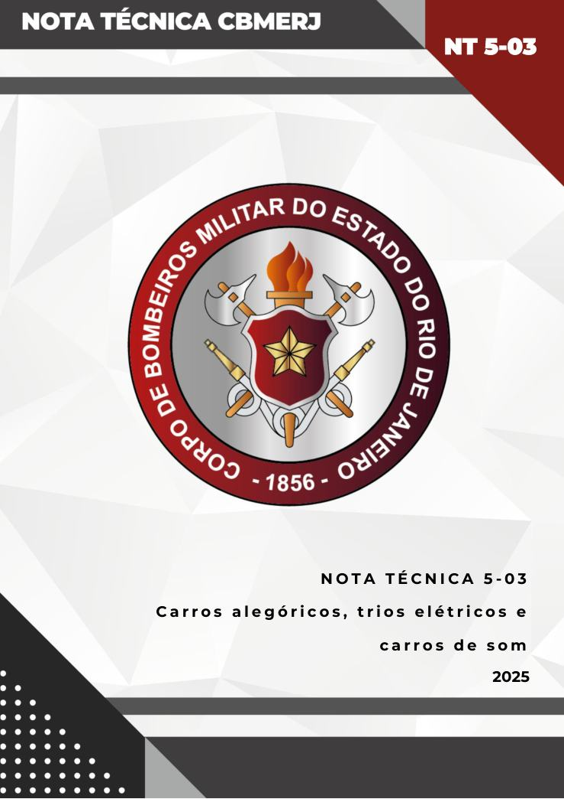
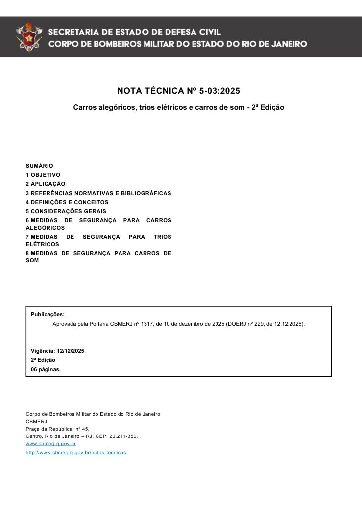
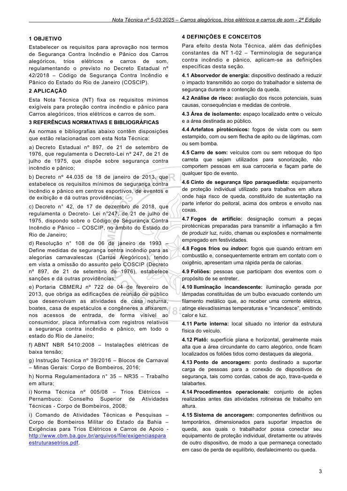
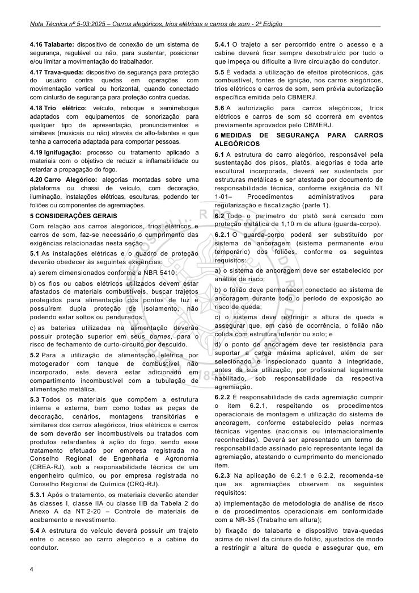
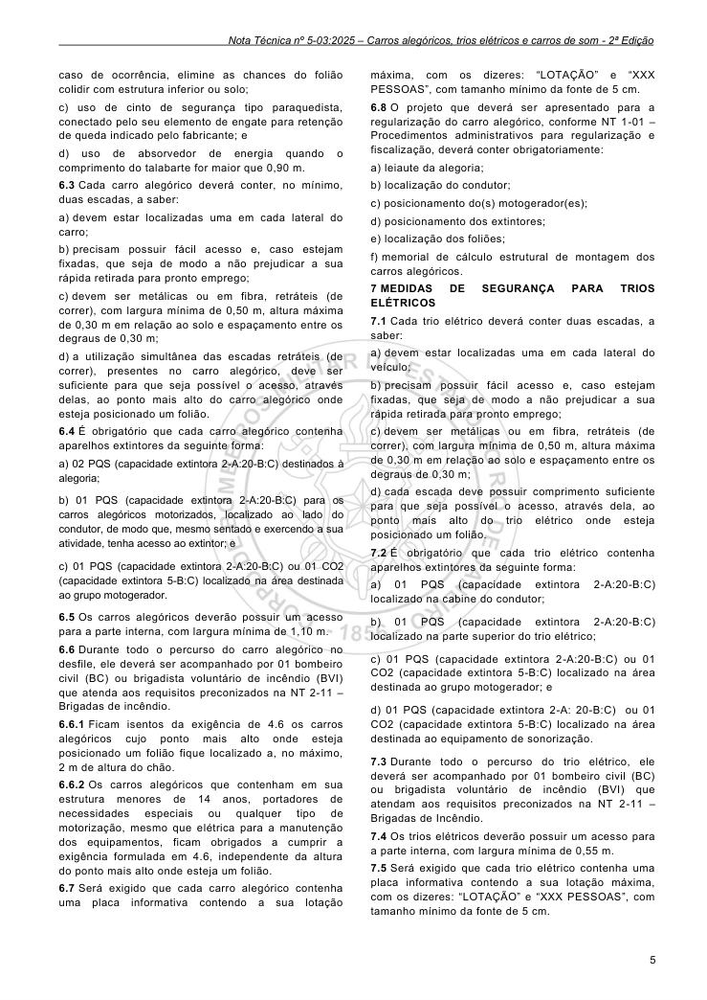
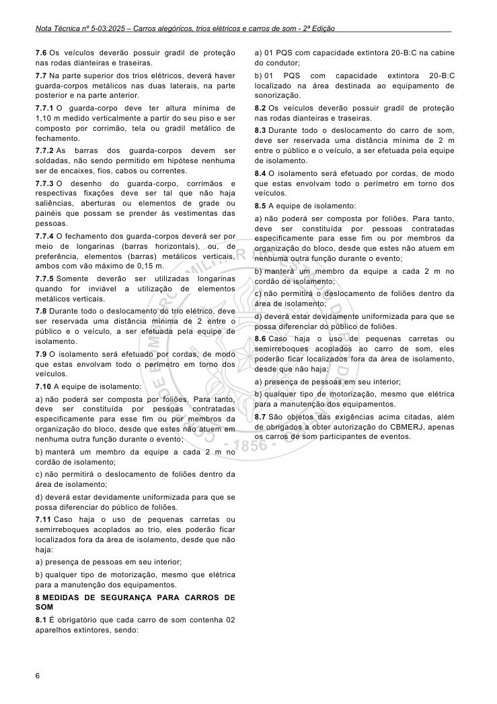

# NT 5-03 - Carros alegóricos, trios elétricos e carros de som

> Conversão integral para consulta computacional. A numeração de página do PDF foi preservada. Quando houver tabela complexa, símbolo ou desenho, conferir também a representação visual indicada e o PDF oficial.

## Sumário por página

- [Página 1](#pagina-1)
- [Página 2](#pagina-2)
- [Página 3](#pagina-3)
- [Página 4](#pagina-4)
- [Página 5](#pagina-5)
- [Página 6](#pagina-6)

---

## Página 1

### NT 5-03 NT 5-03

### NT 5-03

### N O T A T É C N I C A 5 - 0 3

C a r r o s a l e g ó r i c o s, t r i o s e l é t r i c o s e

c a r r o s d e s o m

2025

---

## Página 2

NOTA TÉCNICA Nº 5-03:2025

Carros alegóricos, trios elétricos e carros de som - 2ª Edição

### SUMÁRIO

### 1 OBJETIVO

### 2 APLICAÇÃO

### 3 REFERÊNCIAS NORMATIVAS E BIBLIOGRÁFICAS

### 4 DEFINIÇÕES E CONCEITOS

### 5 CONSIDERAÇÕES GERAIS

### 6 MEDIDAS DE SEGURANÇA PARA CARROS ALEGÓRICOS

### 7 MEDIDAS DE SEGURANÇA PARA TRIOS ELÉTRICOS

### 8 MEDIDAS DE SEGURANÇA PARA CARROS DE SOM

Publicações:

Aprovada pela Portaria CBMERJ nº 1317, de 10 de dezembro de 2025 (DOERJ nº 229, de 12.12.2025).

Publicada no Boletim da SEDEC/CBMERJ nº XX, de XX de XX de 2023.

Vigência: 12/12/2025.

2ª Edição

06 páginas.

Corpo de Bombeiros Militar do Estado do Rio de Janeiro CBMERJ Praça da República, nº 45, Centro, Rio de Janeiro - RJ. CEP: 20.211-350. www.cbmerj.rj.gov.br

http://www.cbmerj.rj.gov.br/notas-tecnicas

### SEM VALOR LEGAL

---

## Página 3

### 1 OBJETIVO

Estabelecer os requisitos para aprovação nos termos de Segurança Contra Incêndio e Pânico dos Carros alegóricos, trios elétricos e carros de som, regulamentando o previsto no Decreto Estadual nº 42/2018 - Código de Segurança Contra Incêndio e Pânico do Estado do Rio de Janeiro (COSCIP).

### 2 APLICAÇÃO

Esta Nota Técnica (NT) fixa os requisitos mínimos exigíveis para proteção contra incêndio e pânico para Carros alegóricos, trios elétricos e carros de som.

### 3 REFERÊNCIAS NORMATIVAS E BIBLIOGRÁFICAS

As normas e bibliografias abaixo contêm disposições que estão relacionadas com esta Nota Técnica:

a) Decreto Estadual nº 897, de 21 de setembro de 1976, que regulamenta o Decreto-Lei nº 247, de 21 de julho de 1975, que dispõe sobre segurança contra incêndio e pânico;

b) Decreto nº 44.035 de 18 de janeiro de 2013, que estabelece os requisitos mínimos de segurança contra incêndio e pânico em centros esportivos, de eventos e de exibição e dá outras providências;

c) Decreto n° 42, de 17 de dezembro de 2018, que regulamenta o Decreto- Lei n°247, de 21 de julho de 1975, dispondo sobre o Código de Segurança Contra Incêndio e Pânico - COSCIP, no âmbito do Estado do Rio de Janeiro;

d) Resolução n° 108 de 06 de janeiro de 1993 - Define medidas de segurança contra incêndio para as alegorias carnavalescas (Carros Alegóricos), tendo em vista a omissão do assunto pelo COSCIP (Decreto nº 897, de 21 de setembro de 1976), estabelece sanções e dá outras providências;

e) Portaria CBMERJ nº 722 de 04 de fevereiro de 2013, que obriga as edificações de reunião de público que desenvolvam as atividades de casa noturna, boates, casa de espetáculos e congêneres a afixarem, nos acessos de entrada, de forma visível ao consumidor, placa informativa com registros relativos a segurança contra incêndio e pânico, em todo o estado do Rio de Janeiro;

f) ABNT NBR 5410:2008 - Instalações elétricas de baixa tensão;

g) Instrução Técnica nº 39/2016 - Blocos de Carnaval - Minas Gerais: Corpo de Bombeiros, 2016;

h) Norma Regulamentadora n° 35 - NR35 - Trabalho em altura;

i) Norma Técnica nº 005/08 - Trios Elétricos - Pernambuco: Conselho Superior de Atividades Técnicas - Corpo de Bombeiros, 2008;

i) Comando de Atividades Técnicas e Pesquisas - Corpo de Bombeiros Militar do Estado da Bahia - Exigências para Trios Elétricos e Carros de Apoio - http://www.cbm.ba.gov.br/arquivos/file/exigenciaspara estruturasetrios.pdf.

### 4 DEFINIÇÕES E CONCEITOS

Para efeito desta Nota Técnica, além das definições constantes da NT 1-02 - Terminologia de segurança contra incêndio e pânico, aplicam-se as definições específicas desta seção.

4.1 Absorvedor de energia: dispositivo destinado a reduzir o impacto transmitido ao corpo do trabalhador e sistema de segurança durante a contenção da queda.

4.2 Análise de risco: avaliação dos riscos potenciais, suas causas, consequências e medidas de controle.

4.3 Área de isolamento: espaço localizado entre o veículo e a área destinada ao público.

4.4 Artefatos pirotécnicos: fogos de vista com ou sem estampido, com ou sem flecha de apito ou de lágrimas, com ou sem bomba.

4.5 Carro de som: veículos com ou sem reboque do tipo carreta que sejam utilizados para sonorização, não comportem pessoas em sua carroceria e façam parte de qualquer tipo de evento.

4.6 Cinto de segurança tipo paraquedista: equipamento de proteção individual utilizado para trabalhos em altura onde haja risco de queda, constituído de sustentação na parte inferior do peitoral, acima dos ombros e envolto nas coxas.

4.7 Fogos de artifício: designação comum a peças pirotécnicas preparadas para transmitir a inflamação a fim de produzir luz, ruído, chamas ou explosões e normalmente empregado em festividades.

4.8 Fogos frios ou indoor: fogos que quando entram em combustão e, consequentemente entram em contato com o oxigênio, apresentam uma rápida perda de calorias.

4.9 Foliões: pessoas que participam dos eventos com o propósito de se entreter.

4.10 Iluminação incandescente: iluminação gerada por lâmpadas constituídas de um bulbo evacuado contendo um filamento metálico que, ao receber uma corrente elétrica, atinge elevadíssimas temperaturas e “incandesce”, emitindo calor e luz.

4.11 Parte interna: local situado no interior da estrutura física do veículo.

4.12 Platô: superfície plana e horizontal, geralmente mais alta que a área circundante do carro alegórico, onde ficam localizados os foliões tidos como destaques da alegoria.

4.13 Ponto de ancoragem: ponto destinado a suportar carga de pessoas para a conexão de dispositivos de segurança, tais como cordas, cabos de aço, trava-queda e talabartes.

4.14 Procedimentos operacionais: conjunto de ações realizadas antes das atividades rotineiras de trabalho em altura.

4.15 Sistema de ancoragem: componentes definitivos ou temporários, dimensionados para suportar impactos de queda, aos quais o trabalhador possa conectar seu equipamento de proteção individual, diretamente ou através de outro dispositivo, de modo a que permaneça conectado em caso de perda de equilíbrio, desfalecimento ou queda.

---

## Página 4

4.16 Talabarte: dispositivo de conexão de um sistema de segurança, regulável ou não, para sustentar, posicionar e/ou limitar a movimentação do trabalhador.

4.17 Trava-queda: dispositivo de segurança para proteção do usuário contra quedas em operações com movimentação vertical ou horizontal, quando conectado com cinturão de segurança para proteção contra quedas.

4.18 Trio elétrico: veículo, reboque e semirreboque adaptados com equipamentos de sonorização para qualquer tipo de apresentação, pronunciamentos e similares (musicais ou não) através de alto-falantes e que tenha a carroceria adaptada para comportar pessoas.

4.19 Ignifugação: processo ou tratamento aplicado a materiais com o objetivo de reduzir a inflamabilidade ou retardar a propagação do fogo.

4.20 Carro Alegórico: alegorias montadas sobre uma plataforma ou chassi de veículo, com decoração, iluminação, instalações elétricas, esculturas, podendo ter foliões ou componentes de agremiações.

### 5 CONSIDERAÇÕES GERAIS

Com relação aos carros alegóricos, trios elétricos e carros de som, faz-se necessário o cumprimento das exigências relacionadas nesta seção.

5.1 As instalações elétricas e o quadro de proteção deverão obedecer às seguintes exigências:

a) serem dimensionados conforme a NBR 5410;

b) os fios ou cabos elétricos utilizados devem estar afastados de materiais combustíveis, buscar trajetos protegidos para alimentação dos pontos de luz e possuírem dupla proteção de isolamento, não podendo estar soltos ou pendurados;

c) as baterias utilizadas na alimentação deverão possuir proteção superior em seus bornes, para o risco de fechamento de curto-circuito por descuido.

5.2 Para a utilização de alimentação elétrica por motogerador com tanque de combustível não incorporado, este deverá estar adicionado em compartimento incombustível com a tubulação de alimentação metálica.

5.3 Todos os materiais que compõem a estrutura interna e externa, bem como todas as peças de decoração, cenários, montagens transitórias e similares dos carros alegóricos, trios elétricos e carros de som deverão ser incombustíveis ou tratados com produtos retardantes à ação do fogo, sendo esse tratamento efetuado por empresa registrada no Conselho Regional de Engenharia e Agronomia (CREA-RJ), sob a responsabilidade técnica de um engenheiro químico, ou por empresa registrada no Conselho Regional de Química (CRQ-RJ).

5.3.1 Após o tratamento, os materiais deverão atender às classes I, classe IIA ou classe IIB da Tabela 2 do Anexo A da NT 2-20 - Controle de materiais de acabamento e revestimento.

5.4 A estrutura do veículo deverá possuir um trajeto entre o acesso ao carro alegórico e a cabine do condutor.

5.4.1 O trajeto a ser percorrido entre o acesso e a cabine deverá ficar sempre desobstruído por tudo o que impeça ou dificulte a livre circulação do condutor.

5.5 É vedada a utilização de efeitos pirotécnicos, gás combustível, fontes de ignição, nos carros alegóricos, trios elétricos e carros de som, sem prévia autorização específica emitida pelo CBMERJ.

5.6 A autorização para carros alegóricos, trios elétricos e carros de som só ocorrerá em eventos previamente aprovados pelo CBMERJ.

### 6 MEDIDAS DE SEGURANÇA PARA CARROS ALEGÓRICOS

6.1 A estrutura do carro alegórico, responsável pela sustentação dos pisos, platôs, alegorias e toda arte escultural incorporada, deverá ser sustentada por estruturas metálicas e ser atestada por documento de responsabilidade técnica, conforme exigência da NT 1-01- Procedimentos administrativos para regularização e fiscalização (parte 1).

6.2 Todo o perímetro do platô será cercado com proteção metálica de 1,10 m de altura (guarda-corpo).

6.2.1 O guarda-corpo poderá ser substituído por sistema de ancoragem (sistema permanente e/ou temporário) dos foliões, conforme os seguintes requisitos:

a) o sistema de ancoragem deve ser estabelecido por análise de risco;

b) o folião deve permanecer conectado ao sistema de ancoragem durante todo o período de exposição ao risco de queda;

c) o sistema deve restringir a altura de queda e assegurar que, em caso de ocorrência, o folião não colida com estrutura inferior ou solo; e

d) o ponto de ancoragem deve ter resistência para suportar a carga máxima aplicável, além de ser selecionado e inspecionado quanto à integridade, antes da sua utilização, por profissional legalmente habilitado, sob responsabilidade da respectiva agremiação.

6.2.2 É responsabilidade de cada agremiação cumprir o item 6.2.1, respeitando os procedimentos operacionais de montagem e utilização do sistema de ancoragem, conforme estabelecido pelas normas técnicas vigentes (nacionais ou internacionalmente reconhecidas). Deverá ser apresentado um termo de responsabilidade assinado pelo representante legal da agremiação, atestando o cumprimento do mencionado item.

6.2.3 Na aplicação de 6.2.1 e 6.2.2, recomenda-se que as agremiações observem os seguintes requisitos:

a) implementação de metodologia de análise de risco e de procedimentos operacionais em conformidade com a NR-35 (Trabalho em altura);

b) fixação do talabarte e dispositivo trava-quedas acima do nível da cintura do folião, ajustados de modo a restringir a altura de queda e assegurar que, em

---

## Página 5

caso de ocorrência, elimine as chances do folião colidir com estrutura inferior ou solo;

c) uso de cinto de segurança tipo paraquedista, conectado pelo seu elemento de engate para retenção de queda indicado pelo fabricante; e

d) uso de absorvedor de energia quando o comprimento do talabarte for maior que 0,90 m.

6.3 Cada carro alegórico deverá conter, no mínimo, duas escadas, a saber:

a) devem estar localizadas uma em cada lateral do carro;

b) precisam possuir fácil acesso e, caso estejam fixadas, que seja de modo a não prejudicar a sua rápida retirada para pronto emprego;

c) devem ser metálicas ou em fibra, retráteis (de correr), com largura mínima de 0,50 m, altura máxima de 0,30 m em relação ao solo e espaçamento entre os degraus de 0,30 m;

d) a utilização simultânea das escadas retráteis (de correr), presentes no carro alegórico, deve ser suficiente para que seja possível o acesso, através delas, ao ponto mais alto do carro alegórico onde esteja posicionado um folião.

6.4 É obrigatório que cada carro alegórico contenha aparelhos extintores da seguinte forma:

a) 02 PQS (capacidade extintora 2-A:20-B:C) destinados à alegoria;

b) 01 PQS (capacidade extintora 2-A:20-B:C) para os carros alegóricos motorizados, localizado ao lado do condutor, de modo que, mesmo sentado e exercendo a sua atividade, tenha acesso ao extintor; e

c) 01 PQS (capacidade extintora 2-A:20-B:C) ou 01 CO2 (capacidade extintora 5-B:C) localizado na área destinada ao grupo motogerador.

6.5 Os carros alegóricos deverão possuir um acesso para a parte interna, com largura mínima de 1,10 m.

6.6 Durante todo o percurso do carro alegórico no desfile, ele deverá ser acompanhado por 01 bombeiro civil (BC) ou brigadista voluntário de incêndio (BVI) que atenda aos requisitos preconizados na NT 2-11 - Brigadas de incêndio.

6.6.1 Ficam isentos da exigência de 4.6 os carros alegóricos cujo ponto mais alto onde esteja posicionado um folião fique localizado a, no máximo, 2 m de altura do chão.

6.6.2 Os carros alegóricos que contenham em sua estrutura menores de 14 anos, portadores de necessidades especiais ou qualquer tipo de motorização, mesmo que elétrica para a manutenção dos equipamentos, ficam obrigados a cumprir a exigência formulada em 4.6, independente da altura do ponto mais alto onde esteja um folião.

6.7 Será exigido que cada carro alegórico contenha uma placa informativa contendo a sua lotação

máxima, com os dizeres: “LOTAÇÃO” e “XXX PESSOAS”, com tamanho mínimo da fonte de 5 cm.

6.8 O projeto que deverá ser apresentado para a regularização do carro alegórico, conforme NT 1-01 - Procedimentos administrativos para regularização e fiscalização, deverá conter obrigatoriamente:

a) leiaute da alegoria;

b) localização do condutor;

c) posicionamento do(s) motogerador(es);

d) posicionamento dos extintores;

e) localização dos foliões;

f) memorial de cálculo estrutural de montagem dos carros alegóricos.

### 7 MEDIDAS DE SEGURANÇA PARA TRIOS ELÉTRICOS

7.1 Cada trio elétrico deverá conter duas escadas, a saber:

a) devem estar localizadas uma em cada lateral do veículo;

b) precisam possuir fácil acesso e, caso estejam fixadas, que seja de modo a não prejudicar a sua rápida retirada para pronto emprego;

c) devem ser metálicas ou em fibra, retráteis (de correr), com largura mínima de 0,50 m, altura máxima de 0,30 m em relação ao solo e espaçamento entre os degraus de 0,30 m;

d) cada escada deve possuir comprimento suficiente para que seja possível o acesso, através dela, ao ponto mais alto do trio elétrico onde esteja posicionado um folião.

7.2 É obrigatório que cada trio elétrico contenha aparelhos extintores da seguinte forma:

a) 01 PQS (capacidade extintora 2-A:20-B:C) localizado na cabine do condutor;

b) 01 PQS (capacidade extintora 2-A:20-B:C) localizado na parte superior do trio elétrico;

c) 01 PQS (capacidade extintora 2-A:20-B:C) ou 01 CO2 (capacidade extintora 5-B:C) localizado na área destinada ao grupo motogerador; e

d) 01 PQS (capacidade extintora 2-A: 20-B:C) ou 01 CO2 (capacidade extintora 5-B:C) localizado na área destinada ao equipamento de sonorização.

7.3 Durante todo o percurso do trio elétrico, ele deverá ser acompanhado por 01 bombeiro civil (BC) ou brigadista voluntário de incêndio (BVI) que atendam aos requisitos preconizados na NT 2-11 - Brigadas de Incêndio.

7.4 Os trios elétricos deverão possuir um acesso para a parte interna, com largura mínima de 0,55 m.

7.5 Será exigido que cada trio elétrico contenha uma placa informativa contendo a sua lotação máxima, com os dizeres: “LOTAÇÃO” e “XXX PESSOAS”, com tamanho mínimo da fonte de 5 cm.

---

## Página 6

7.6 Os veículos deverão possuir gradil de proteção nas rodas dianteiras e traseiras.

7.7 Na parte superior dos trios elétricos, deverá haver guarda-corpos metálicos nas duas laterais, na parte posterior e na parte anterior.

7.7.1 O guarda-corpo deve ter altura mínima de 1,10 m medido verticalmente a partir do seu piso e ser composto por corrimão, tela ou gradil metálico de fechamento.

7.7.2 As barras dos guarda-corpos devem ser soldadas, não sendo permitido em hipótese nenhuma ser de encaixes, fios, cabos ou correntes.

7.7.3 O desenho do guarda-corpo, corrimãos e respectivas fixações deve ser tal que não haja saliências, aberturas ou elementos de grade ou painéis que possam se prender às vestimentas das pessoas.

7.8 Durante todo o deslocamento do trio elétrico, deve ser reservada uma distância mínima de 2 entre o público e o veículo, a ser efetuada pela equipe de isolamento.

7.9 O isolamento será efetuado por cordas, de modo que estas envolvam todo o perímetro em torno dos veículos.

7.10 A equipe de isolamento:

a) não poderá ser composta por foliões. Para tanto, deve ser constituída por pessoas contratadas especificamente para esse fim ou por membros da organização do bloco, desde que estes não atuem em nenhuma outra função durante o evento;

b) manterá um membro da equipe a cada 2 m no cordão de isolamento;

c) não permitirá o deslocamento de foliões dentro da área de isolamento;

d) deverá estar devidamente uniformizada para que se possa diferenciar do público de foliões.

7.11 Caso haja o uso de pequenas carretas ou semirreboques acoplados ao trio, eles poderão ficar localizados fora da área de isolamento, desde que não haja:

a) presença de pessoas em seu interior;

b) qualquer tipo de motorização, mesmo que elétrica para a manutenção dos equipamentos.

### 8 MEDIDAS DE SEGURANÇA PARA CARROS DE SOM

8.1 É obrigatório que cada carro de som contenha 02 aparelhos extintores, sendo:

a) 01 PQS com capacidade extintora 20-B:C na cabine do condutor;

b) 01 PQS com capacidade extintora 20-B:C localizado na área destinada ao equipamento de sonorização.

8.2 Os veículos deverão possuir gradil de proteção nas rodas dianteiras e traseiras.

8.3 Durante todo o deslocamento do carro de som, deve ser reservada uma distância mínima de 2 m entre o público e o veículo, a ser efetuada pela equipe de isolamento.

8.4 O isolamento será efetuado por cordas, de modo que estas envolvam todo o perímetro em torno dos veículos.

8.5 A equipe de isolamento:

a) não poderá ser composta por foliões. Para tanto, deve ser constituída por pessoas contratadas especificamente para esse fim ou por membros da organização do bloco, desde que estes não atuem em nenhuma outra função durante o evento;

b) manterá um membro da equipe a cada 2 m no cordão de isolamento;

c) não permitirá o deslocamento de foliões dentro da área de isolamento;

d) deverá estar devidamente uniformizada para que se possa diferenciar do público de foliões.

8.6 Caso haja o uso de pequenas carretas ou semirreboques acoplados ao carro de som, eles poderão ficar localizados fora da área de isolamento, desde que não haja:

a) presença de pessoas em seu interior;

b) qualquer tipo de motorização, mesmo que elétrica para a manutenção dos equipamentos.

8.7 São objetos das exigências acima citadas, além de obrigados a obter autorização do CBMERJ, apenas os carros de som participantes de eventos.

### Tabelas extraídas

#### Tabela 1 da página

|  | de |
| --- | --- |
| preferência, elementos (barras) metálicos verticais, |  |
| ambos com vão máximo de 0,15 m. |  |

#### Tabela 2 da página

|  | Somente deverão ser utilizadas longarinas |
| --- | --- |
| quando for inviável a utilização de elementos |  |
| metálicos verticais. |  |
