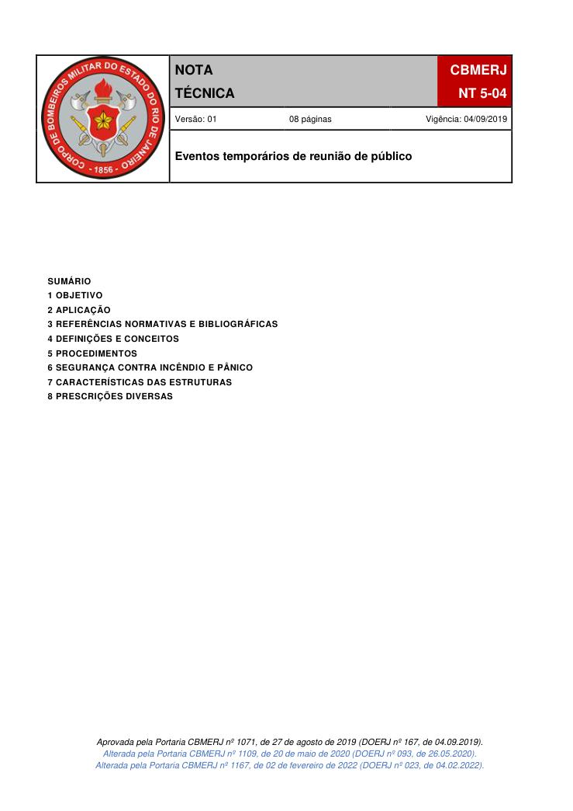
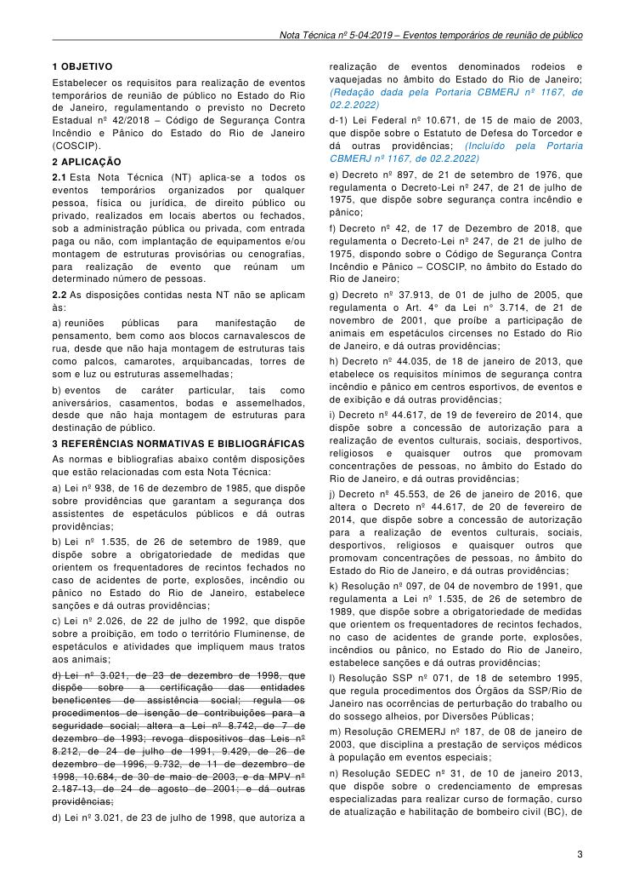
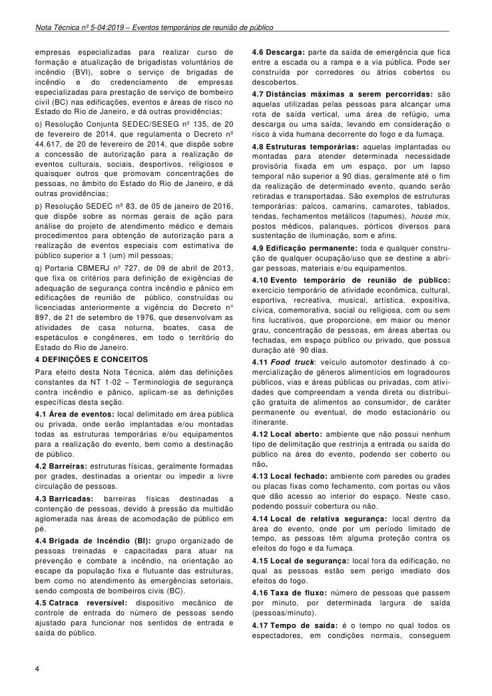
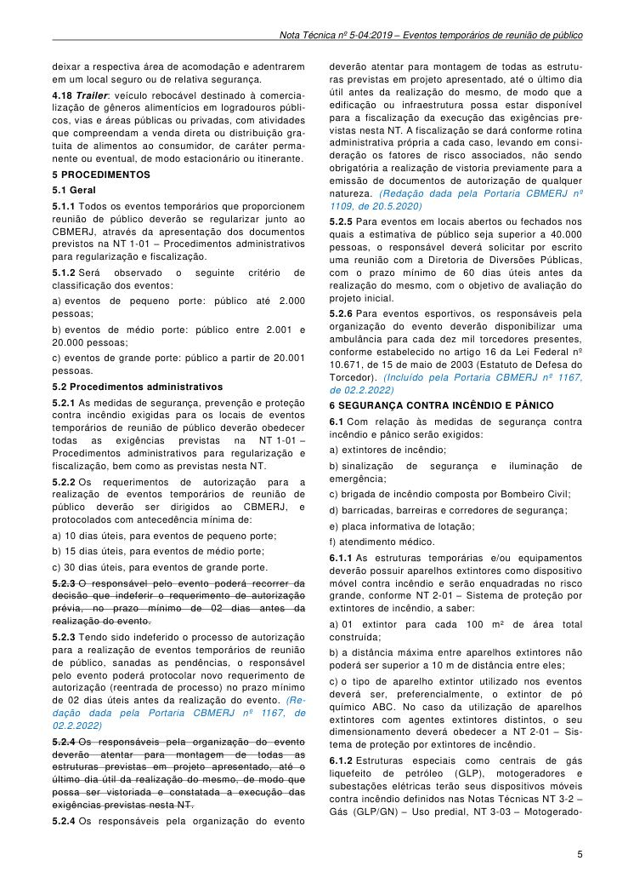
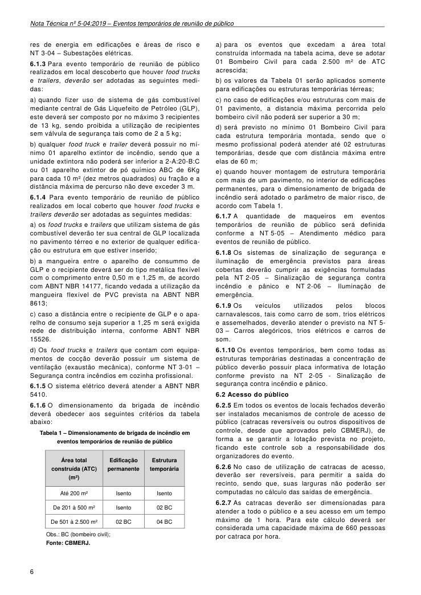
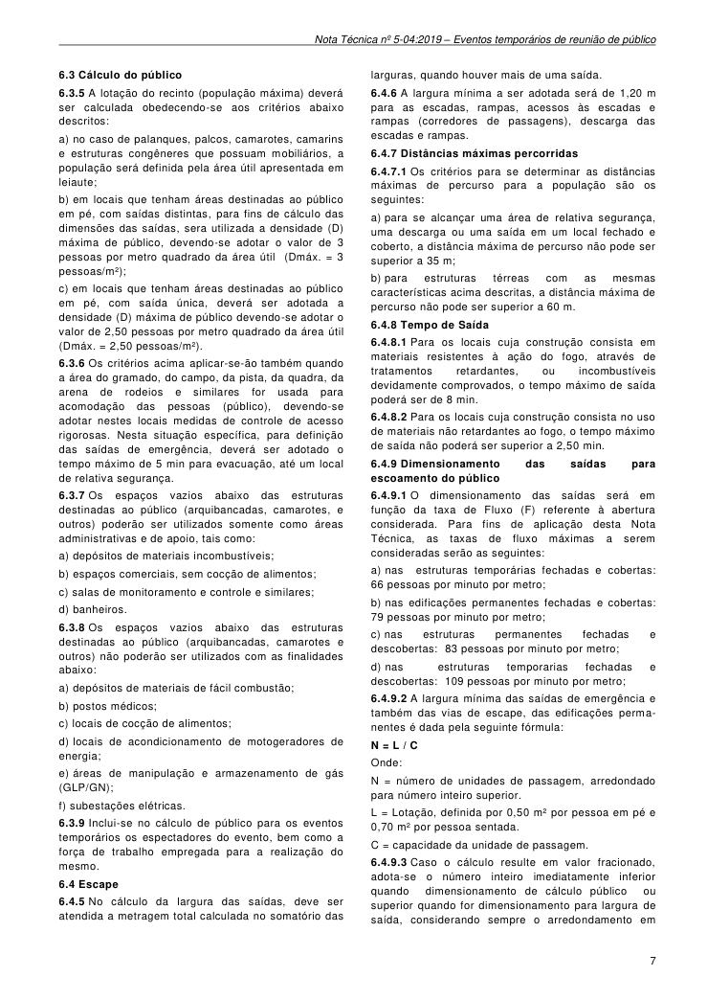
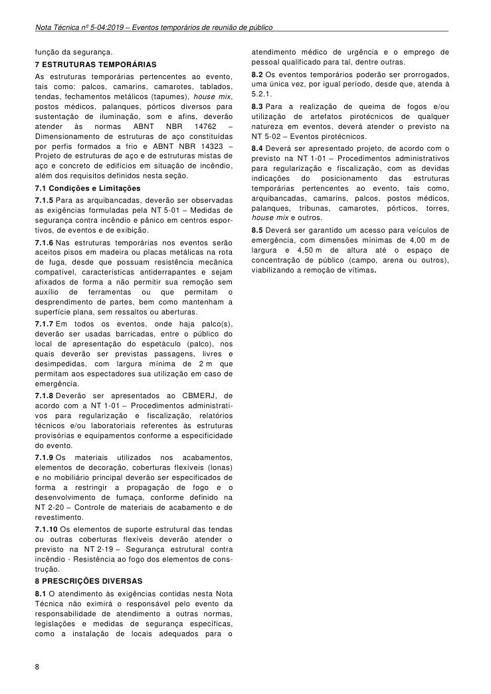

# NT 5-04 - Eventos temporários de reunião de público

> Conversão integral para consulta computacional. A numeração de página do PDF foi preservada. Quando houver tabela complexa, símbolo ou desenho, conferir também a representação visual indicada e o PDF oficial.

## Sumário por página

- [Página 1](#pagina-1)
- [Página 2](#pagina-2)
- [Página 3](#pagina-3)
- [Página 4](#pagina-4)
- [Página 5](#pagina-5)
- [Página 6](#pagina-6)
- [Página 7](#pagina-7)
- [Página 8](#pagina-8)

---

## Página 1

### SUMÁRIO

### 1 OBJETIVO

### 2 APLICAÇÃO

### 3 REFERÊNCIAS NORMATIVAS E BIBLIOGRÁFICAS

### 4 DEFINIÇÕES E CONCEITOS

### 5 PROCEDIMENTOS

### 6 SEGURANÇA CONTRA INCÊNDIO E PÂNICO

### 7 CARACTERÍSTICAS DAS ESTRUTURAS

### 8 PRESCRIÇÕES DIVERSAS

Aprovada pela Portaria CBMERJ nº 1071, de 27 de agosto de 2019 (DOERJ nº 167, de 04.09.2019).

Alterada pela Portaria CBMERJ nº 1109, de 20 de maio de 2020 (DOERJ nº 093, de 26.05.2020). Alterada pela Portaria CBMERJ nº 1167, de 02 de fevereiro de 2022 (DOERJ nº 023, de 04.02.2022).

### Tabelas extraídas

#### Tabela 1 da página

|  |  | NOTA |  |  | CBMERJ |  |
| --- | --- | --- | --- | --- | --- | --- |
|  |  | TÉCNICA |  |  | NT 5-04 |  |
|  | Versão: 01 08 páginas Vigência: 04/09/2019 |  |  |  |  |  |
|  | Eventos temporários de reunião de público |  |  |  |  |  |

---

## Página 2

Corpo de Bombeiros Militar do Estado do Rio de Janeiro CBMERJ

Praça da República, nº 45,

Centro, Rio de Janeiro - RJ. CEP: 20.211-350.

www.cbmerj.rj.gov.br http://www.cbmerj.rj.gov.br/notas-tecnicas

---

## Página 3

### 1 OBJETIVO

Estabelecer os requisitos para realização de eventos temporários de reunião de público no Estado do Rio de Janeiro, regulamentando o previsto no Decreto Estadual nº 42/2018 - Código de Segurança Contra Incêndio e Pânico do Estado do Rio de Janeiro (COSCIP).

### 2 APLICAÇÃO

2.1 Esta Nota Técnica (NT) aplica-se a todos os eventos temporários organizados por qualquer pessoa, física ou jurídica, de direito público ou privado, realizados em locais abertos ou fechados, sob a administração pública ou privada, com entrada paga ou não, com implantação de equipamentos e/ou montagem de estruturas provisórias ou cenografias, para realização de evento que reúnam um determinado número de pessoas.

2.2 As disposições contidas nesta NT não se aplicam às:

a) reuniões públicas para manifestação de pensamento, bem como aos blocos carnavalescos de rua, desde que não haja montagem de estruturas tais como palcos, camarotes, arquibancadas, torres de som e luz ou estruturas assemelhadas;

b) eventos de caráter particular, tais como aniversários, casamentos, bodas e assemelhados, desde que não haja montagem de estruturas para destinação de público.

### 3 REFERÊNCIAS NORMATIVAS E BIBLIOGRÁFICAS

As normas e bibliografias abaixo contêm disposições que estão relacionadas com esta Nota Técnica:

a) Lei nº 938, de 16 de dezembro de 1985, que dispõe sobre providências que garantam a segurança dos assistentes de espetáculos públicos e dá outras providências;

b) Lei nº 1.535, de 26 de setembro de 1989, que dispõe sobre a obrigatoriedade de medidas que orientem os frequentadores de recintos fechados no caso de acidentes de porte, explosões, incêndio ou pânico no Estado do Rio de Janeiro, estabelece sanções e dá outras providências;

c) Lei nº 2.026, de 22 de julho de 1992, que dispõe sobre a proibição, em todo o território Fluminense, de espetáculos e atividades que impliquem maus tratos aos animais;

d) Lei nº 3.021, de 23 de dezembro de 1998, que dispõe sobre a certificação das entidades beneficentes de assistência social; regula os procedimentos de isenção de contribuições para a seguridade social; altera a Lei nº 8.742, de 7 de dezembro de 1993; revoga dispositivos das Leis nº 8.212, de 24 de julho de 1991, 9.429, de 26 de dezembro de 1996, 9.732, de 11 de dezembro de 1998, 10.684, de 30 de maio de 2003, e da MPV nº 2.187-13, de 24 de agosto de 2001; e dá outras providências;

d) Lei nº 3.021, de 23 de julho de 1998, que autoriza a

realização de eventos denominados rodeios e vaquejadas no âmbito do Estado do Rio de Janeiro; (Redação dada pela Portaria CBMERJ nº 1167, de 02.2.2022)

d-1) Lei Federal nº 10.671, de 15 de maio de 2003, que dispõe sobre o Estatuto de Defesa do Torcedor e dá outras providências; (Incluído pela Portaria CBMERJ nº 1167, de 02.2.2022)

e) Decreto nº 897, de 21 de setembro de 1976, que regulamenta o Decreto-Lei nº 247, de 21 de julho de 1975, que dispõe sobre segurança contra incêndio e pânico;

f) Decreto nº 42, de 17 de Dezembro de 2018, que regulamenta o Decreto-Lei nº 247, de 21 de julho de 1975, dispondo sobre o Código de Segurança Contra Incêndio e Pânico - COSCIP, no âmbito do Estado do Rio de Janeiro;

g) Decreto nº 37.913, de 01 de julho de 2005, que regulamenta o Art. 4° da Lei n° 3.714, de 21 de novembro de 2001, que proíbe a participação de animais em espetáculos circenses no Estado do Rio de Janeiro, e dá outras providências;

h) Decreto nº 44.035, de 18 de janeiro de 2013, que etabelece os requisitos mínimos de segurança contra incêndio e pânico em centros esportivos, de eventos e de exibição e dá outras providências;

i) Decreto nº 44.617, de 19 de fevereiro de 2014, que dispõe sobre a concessão de autorização para a realização de eventos culturais, sociais, desportivos, religiosos e quaisquer outros que promovam concentrações de pessoas, no âmbito do Estado do Rio de Janeiro, e dá outras providências;

j) Decreto nº 45.553, de 26 de janeiro de 2016, que altera o Decreto nº 44.617, de 20 de fevereiro de 2014, que dispõe sobre a concessão de autorização para a realização de eventos culturais, sociais, desportivos, religiosos e quaisquer outros que promovam concentrações de pessoas, no âmbito do Estado do Rio de Janeiro, e dá outras providências;

k) Resolução nº 097, de 04 de novembro de 1991, que regulamenta a Lei nº 1.535, de 26 de setembro de 1989, que dispõe sobre a obrigatoriedade de medidas que orientem os frequentadores de recintos fechados, no caso de acidentes de grande porte, explosões, incêndios ou pânico, no Estado do Rio de Janeiro, estabelece sanções e dá outras providências;

l) Resolução SSP nº 071, de 18 de setembro 1995, que regula procedimentos dos Órgãos da SSP/Rio de Janeiro nas ocorrências de perturbação do trabalho ou do sossego alheios, por Diversões Públicas;

m) Resolução CREMERJ nº 187, de 08 de janeiro de 2003, que disciplina a prestação de serviços médicos à população em eventos especiais;

n) Resolução SEDEC nº 31, de 10 de janeiro 2013, que dispõe sobre o credenciamento de empresas especializadas para realizar curso de formação, curso de atualização e habilitação de bombeiro civil (BC), de

---

## Página 4

empresas especializadas para realizar curso de formação e atualização de brigadistas voluntários de incêndio (BVI), sobre o serviço de brigadas de incêndio e do credenciamento de empresas especializadas para prestação de serviço de bombeiro civil (BC) nas edificações, eventos e áreas de risco no Estado do Rio de Janeiro, e dá outras providências;

o) Resolução Conjunta SEDEC/SESEG nº 135, de 20 de fevereiro de 2014, que regulamenta o Decreto nº 44.617, de 20 de fevereiro de 2014, que dispõe sobre a concessão de autorização para a realização de eventos culturais, sociais, desportivos, religiosos e quaisquer outros que promovam concentrações de pessoas, no âmbito do Estado do Rio de Janeiro, e dá outras providências;

p) Resolução SEDEC nº 83, de 05 de janeiro de 2016, que dispõe sobre as normas gerais de ação para análise do projeto de atendimento médico e demais procedimentos para obtenção de autorização para a realização de eventos especiais com estimativa de público superior a 1 (um) mil pessoas;

q) Portaria CBMERJ nº 727, de 09 de abril de 2013, que fixa os critérios para definição de exigências de adequação de segurança contra incêndio e pânico em edificações de reunião de público, construídas ou licenciadas anteriormente a vigência do Decreto n° 897, de 21 de setembro de 1976, que desenvolvam as atividades de casa noturna, boates, casa de espetáculos e congêneres, em todo o território do Estado do Rio de Janeiro.

### 4 DEFINIÇÕES E CONCEITOS

Para efeito desta Nota Técnica, além das definições constantes da NT 1-02 - Terminologia de segurança contra incêndio e pânico, aplicam-se as definições específicas desta seção.

4.1 Área de eventos: local delimitado em área pública ou privada, onde serão implantadas e/ou montadas todas as estruturas temporárias e/ou equipamentos para a realização do evento, bem como a destinação de público.

4.2 Barreiras: estruturas físicas, geralmente formadas por grades, destinadas a orientar ou impedir a livre circulação de pessoas.

4.3 Barricadas: barreiras físicas destinadas a contenção de pessoas, devido à pressão da multidão aglomerada nas áreas de acomodação de público em pé.

4.4 Brigada de Incêndio (BI): grupo organizado de pessoas treinadas e capacitadas para atuar na prevenção e combate a incêndio, na orientação ao escape da população fixa e flutuante das estruturas, bem como no atendimento às emergências setoriais, sendo composta de bombeiros civis (BC).

4.5 Catraca reversível: dispositivo mecânico de controle de entrada do número de pessoas sendo ajustado para funcionar nos sentidos de entrada e saída do público.

4.6 Descarga: parte da saída de emergência que fica entre a escada ou a rampa e a via pública. Pode ser construída por corredores ou átrios cobertos ou descobertos.

4.7 Distâncias máximas a serem percorridas: são aquelas utilizadas pelas pessoas para alcançar uma rota de saída vertical, uma área de refúgio, uma descarga ou uma saída, levando em consideração o risco à vida humana decorrente do fogo e da fumaça.

4.8 Estruturas temporárias: aquelas implantadas ou montadas para atender determinada necessidade provisória fixada em um espaço, por um lapso temporal não superior a 90 dias, geralmente até o fim da realização de determinado evento, quando serão retiradas e transportadas. São exemplos de estruturas temporárias: palcos, camarins, camarotes, tablados, tendas, fechamentos metálicos (tapumes), house mix, postos médicos, palanques, pórticos diversos para sustentação de iluminação, som e afins.

4.9 Edificação permanente: toda e qualquer construção de qualquer ocupação/uso que se destine a abrigar pessoas, materiais e/ou equipamentos.

4.10 Evento temporário de reunião de público: exercício temporário de atividade econômica, cultural, esportiva, recreativa, musical, artística, expositiva, cívica, comemorativa, social ou religiosa, com ou sem fins lucrativos, que proporcione, em maior ou menor grau, concentração de pessoas, em áreas abertas ou fechadas, em espaço público ou privado, que possua duração até 90 dias.

4.11 Food truck: veículo automotor destinado à comercialização de gêneros alimentícios em logradouros públicos, vias e áreas públicas ou privadas, com atividades que compreendam a venda direta ou distribuição gratuita de alimentos ao consumidor, de caráter permanente ou eventual, de modo estacionário ou itinerante.

4.12 Local aberto: ambiente que não possui nenhum tipo de delimitação que restrinja a entrada ou saída do público na área do evento, podendo ser coberto ou não.

4.13 Local fechado: ambiente com paredes ou grades ou placas fixas como fechamento, com portas ou vãos que dão acesso ao interior do espaço. Neste caso, podendo possuir cobertura ou não.

4.14 Local de relativa segurança: local dentro da área do evento, onde por um período limitado de tempo, as pessoas têm alguma proteção contra os efeitos do fogo e da fumaça.

4.15 Local de segurança: local fora da edificação, no qual as pessoas estão sem perigo imediato dos efeitos do fogo.

4.16 Taxa de fluxo: número de pessoas que passem por minuto, por determinada largura de saída (pessoas/minuto).

4.17 Tempo de saída: é o tempo no qual todos os espectadores, em condições normais, conseguem

---

## Página 5

deixar a respectiva área de acomodação e adentrarem em um local seguro ou de relativa segurança.

4.18 Trailer: veículo rebocável destinado à comercialização de gêneros alimentícios em logradouros públicos, vias e áreas públicas ou privadas, com atividades que compreendam a venda direta ou distribuição gratuita de alimentos ao consumidor, de caráter permanente ou eventual, de modo estacionário ou itinerante.

### 5 PROCEDIMENTOS

5.1 Geral

5.1.1 Todos os eventos temporários que proporcionem reunião de público deverão se regularizar junto ao CBMERJ, através da apresentação dos documentos previstos na NT 1-01 - Procedimentos administrativos para regularização e fiscalização.

5.1.2 Será observado o seguinte critério de classificação dos eventos:

a) eventos de pequeno porte: público até 2.000 pessoas;

b) eventos de médio porte: público entre 2.001 e 20.000 pessoas;

c) eventos de grande porte: público a partir de 20.001 pessoas.

5.2 Procedimentos administrativos

5.2.1 As medidas de segurança, prevenção e proteção contra incêndio exigidas para os locais de eventos temporários de reunião de público deverão obedecer todas as exigências previstas na NT 1-01 - Procedimentos administrativos para regularização e fiscalização, bem como as previstas nesta NT.

5.2.2 Os requerimentos de autorização para a realização de eventos temporários de reunião de público deverão ser dirigidos ao CBMERJ, e protocolados com antecedência mínima de:

a) 10 dias úteis, para eventos de pequeno porte;

b) 15 dias úteis, para eventos de médio porte;

c) 30 dias úteis, para eventos de grande porte.

5.2.3 O responsável pelo evento poderá recorrer da decisão que indeferir o requerimento de autorização prévia, no prazo mínimo de 02 dias antes da realização do evento.

5.2.3 Tendo sido indeferido o processo de autorização para a realização de eventos temporários de reunião de público, sanadas as pendências, o responsável pelo evento poderá protocolar novo requerimento de autorização (reentrada de processo) no prazo mínimo de 02 dias úteis antes da realização do evento. (Redação dada pela Portaria CBMERJ nº 1167, de 02.2.2022)

5.2.4 Os responsáveis pela organização do evento deverão atentar para montagem de todas as estruturas previstas em projeto apresentado, até o último dia útil da realização do mesmo, de modo que possa ser vistoriada e constatada a execução das exigências previstas nesta NT.

5.2.4 Os responsáveis pela organização do evento

deverão atentar para montagem de todas as estruturas previstas em projeto apresentado, até o último dia útil antes da realização do mesmo, de modo que a edificação ou infraestrutura possa estar disponível para a fiscalização da execução das exigências previstas nesta NT. A fiscalização se dará conforme rotina administrativa própria a cada caso, levando em consideração os fatores de risco associados, não sendo obrigatória a realização de vistoria previamente para a emissão de documentos de autorização de qualquer natureza. (Redação dada pela Portaria CBMERJ nº 1109, de 20.5.2020)

5.2.5 Para eventos em locais abertos ou fechados nos quais a estimativa de público seja superior a 40.000 pessoas, o responsável deverá solicitar por escrito uma reunião com a Diretoria de Diversões Públicas, com o prazo mínimo de 60 dias úteis antes da realização do mesmo, com o objetivo de avaliação do projeto inicial.

5.2.6 Para eventos esportivos, os responsáveis pela organização do evento deverão disponibilizar uma ambulância para cada dez mil torcedores presentes, conforme estabelecido no artigo 16 da Lei Federal nº 10.671, de 15 de maio de 2003 (Estatuto de Defesa do Torcedor). (Incluído pela Portaria CBMERJ nº 1167, de 02.2.2022)

### 6 SEGURANÇA CONTRA INCÊNDIO E PÂNICO

6.1 Com relação às medidas de segurança contra incêndio e pânico serão exigidos:

a) extintores de incêndio;

b) sinalização de segurança e iluminação de emergência;

c) brigada de incêndio composta por Bombeiro Civil;

d) barricadas, barreiras e corredores de segurança;

e) placa informativa de lotação;

f) atendimento médico.

6.1.1 As estruturas temporárias e/ou equipamentos deverão possuir aparelhos extintores como dispositivo móvel contra incêndio e serão enquadradas no risco grande, conforme NT 2-01 - Sistema de proteção por extintores de incêndio, a saber:

a) 01 extintor para cada 100 m² de área total construída;

b) a distância máxima entre aparelhos extintores não poderá ser superior a 10 m de distância entre eles;

c) o tipo de aparelho extintor utilizado nos eventos deverá ser, preferencialmente, o extintor de pó químico ABC. No caso da utilização de aparelhos extintores com agentes extintores distintos, o seu dimensionamento deverá obedecer a NT 2-01 - Sistema de proteção por extintores de incêndio.

6.1.2 Estruturas especiais como centrais de gás liquefeito de petróleo (GLP), motogeradores e subestações elétricas terão seus dispositivos móveis contra incêndio definidos nas Notas Técnicas NT 3-2 - Gás (GLP/GN) - Uso predial, NT 3-03 - Motogerado-

---

## Página 6

res de energia em edificações e áreas de risco e NT 3-04 - Subestações elétricas.

6.1.3 Para evento temporário de reunião de público realizados em local descoberto que houver food trucks e trailers, deverão ser adotadas as seguintes medidas:

a) quando fizer uso de sistema de gás combustível mediante central de Gás Liquefeito de Petróleo (GLP), este deverá ser composto por no máximo 3 recipientes de 13 kg, sendo proibida a utilização de recipientes sem válvula de segurança tais como de 2 a 5 kg;

b) qualquer food truck e trailer deverá possuir no mínimo 01 aparelho extintor de incêndio, sendo que a unidade extintora não poderá ser inferior a 2-A:20-B:C ou 01 aparelho extintor de pó químico ABC de 6Kg para cada 10 m² (dez metros quadrados) ou fração e a distância máxima de percurso não deve exceder 3 m.

6.1.4 Para evento temporário de reunião de público realizados em local coberto que houver food trucks e trailers deverão ser adotadas as seguintes medidas:

a) os food trucks e trailers que utilizam sistema de gás combustível deverão ter sua central de GLP localizada no pavimento térreo e no exterior de qualquer edificação ou estrutura em que estiver inserido;

b) a mangueira entre o aparelho de consummo de GLP e o recipiente deverá ser do tipo metálica flexível com o comprimento entre 0,50 m e 1,25 m, de acordo com ABNT NBR 14177, ficando vedada a utilização da mangueira flexível de PVC prevista na ABNT NBR 8613;

c) caso a distância entre o recipiente de GLP e o aparelho de consumo seja superior a 1,25 m será exigida rede de distribuição interna, conforme ABNT NBR 15526.

d) Os food trucks e trailers que contam com equipamentos de cocção deverão possuir um sistema de ventilação (exaustão mecânica), conforme NT 3-01 - Segurança contra incêndios em cozinha profissional.

6.1.5 O sistema elétrico deverá atender a ABNT NBR 5410.

6.1.6 O dimensionamento da brigada de incêndio deverá obedecer aos seguintes critérios da tabela abaixo:

Tabela 1 - Dimensionamento de brigada de incêndio em

eventos temporários de reunião de público

Obs.: BC (bombeiro civil);

Fonte: CBMERJ.

a) para os eventos que excedam a área total construída informada na tabela acima, deve se adotar 01 Bombeiro Civil para cada 2.500 m² de ATC acrescida;

b) os valores da Tabela 01 serão aplicados somente para edificações ou estruturas temporárias térreas;

c) no caso de edificações e/ou estruturas com mais de 01 pavimento, a distancia máxima percorrida pelo bombeiro civil não poderá ser superior a 30 m;

d) será previsto no mínimo 01 Bombeiro Civil para cada estrutura temporária montada, sendo que o mesmo profissional poderá atender até 02 estruturas temporárias, desde que com distância máxima entre elas de 60 m;

e) quando houver montagem de estrutura temporária com mais de um pavimento, no interior de edificações permanentes, para o dimensionamento de brigada de incêndio será adotado o parâmetro de maior risco, de acordo com Tabela 1.

6.1.7 A quantidade de maqueiros em eventos temporários de reunião de público será definida conforme a NT 5-05 - Atendimento médico para eventos de reunião de público.

6.1.8 Os sistemas de sinalização de segurança e iluminação de emergência previstos para áreas cobertas deverão cumprir as exigências formuladas pela NT 2-05 - Sinalização de segurança contra incêndio e pânico e NT 2-06 - Iluminação de emergência.

6.1.9 Os veículos utilizados pelos blocos carnavalescos, tais como carro de som, trios elétricos e assemelhados, deverão atender o previsto na NT 5- 03 - Carros alegóricos, trios elétricos e carros de som.

6.1.10 Os eventos temporários, bem como todas as estruturas temporárias destinadas a concentração de público deverão possuir placa informativa de lotação conforme previsto na NT 2-05 - Sinalização de segurança contra incêndio e pânico.

6.2 Acesso do público

6.2.5 Em todos os eventos de locais fechados deverão ser instalados mecanismos de controle de acesso de público (catracas reversíveis ou outros dispositivos de controle, desde que aprovados pelo CBMERJ), de forma a se garantir a lotação prevista no projeto, ficando este controle sob a responsabilidade dos organizadores do evento.

6.2.6 No caso de utilização de catracas de acesso, deverão ser reversíveis, para permitir a saída do recinto, sendo que, suas larguras não poderão ser computadas no cálculo das saídas de emergência.

6.2.7 As catracas deverão ser dimensionadas para atender a todo o público e a seu acesso em um tempo máximo de 1 hora. Para este cálculo deverá ser considerada uma capacidade máxima de 660 pessoas por catraca por hora.

### Tabelas extraídas

#### Tabela 1 da página

|  | Área total |  | Edificação permanente | Estrutura temporária |
| --- | --- | --- | --- | --- |
|  | construída (ATC) |  |  |  |
|  | (m²) |  |  |  |
| Até 200 m² |  |  | Isento | Isento |
| De 201 à 500 m² |  |  | Isento | 02 BC |
| De 501 à 2.500 m² |  |  | 02 BC | 04 BC |

---

## Página 7

6.3 Cálculo do público

6.3.5 A lotação do recinto (população máxima) deverá ser calculada obedecendo-se aos critérios abaixo descritos:

a) no caso de palanques, palcos, camarotes, camarins e estruturas congêneres que possuam mobiliários, a população será definida pela área útil apresentada em leiaute;

b) em locais que tenham áreas destinadas ao público em pé, com saídas distintas, para fins de cálculo das dimensões das saídas, sera utilizada a densidade (D) máxima de público, devendo-se adotar o valor de 3 pessoas por metro quadrado da área útil (Dmáx. = 3 pessoas/m²);

c) em locais que tenham áreas destinadas ao público em pé, com saída única, deverá ser adotada a densidade (D) máxima de público devendo-se adotar o valor de 2,50 pessoas por metro quadrado da área útil (Dmáx. = 2,50 pessoas/m²).

6.3.6 Os critérios acima aplicar-se-ão também quando a área do gramado, do campo, da pista, da quadra, da arena de rodeios e similares for usada para acomodação das pessoas (público), devendo-se adotar nestes locais medidas de controle de acesso rigorosas. Nesta situação específica, para definição das saídas de emergência, deverá ser adotado o tempo máximo de 5 min para evacuação, até um local de relativa segurança.

6.3.7 Os espaços vazios abaixo das estruturas destinadas ao público (arquibancadas, camarotes, e outros) poderão ser utilizados somente como áreas administrativas e de apoio, tais como:

a) depósitos de materiais incombustíveis;

b) espaços comerciais, sem cocção de alimentos;

c) salas de monitoramento e controle e similares;

d) banheiros.

6.3.8 Os espaços vazios abaixo das estruturas destinadas ao público (arquibancadas, camarotes e outros) não poderão ser utilizados com as finalidades abaixo:

a) depósitos de materiais de fácil combustão;

b) postos médicos;

c) locais de cocção de alimentos;

d) locais de acondicionamento de motogeradores de energia;

e) áreas de manipulação e armazenamento de gás (GLP/GN);

f) subestações elétricas.

6.3.9 Inclui-se no cálculo de público para os eventos temporários os espectadores do evento, bem como a força de trabalho empregada para a realização do mesmo.

6.4 Escape

6.4.5 No cálculo da largura das saídas, deve ser atendida a metragem total calculada no somatório das

larguras, quando houver mais de uma saída.

6.4.6 A largura mínima a ser adotada será de 1,20 m para as escadas, rampas, acessos às escadas e rampas (corredores de passagens), descarga das escadas e rampas.

6.4.7 Distâncias máximas percorridas

6.4.7.1 Os critérios para se determinar as distâncias máximas de percurso para a população são os seguintes:

a) para se alcançar uma área de relativa segurança, uma descarga ou uma saída em um local fechado e coberto, a distância máxima de percurso não pode ser superior a 35 m;

b) para estruturas térreas com as mesmas características acima descritas, a distância máxima de percurso não pode ser superior a 60 m.

6.4.8 Tempo de Saída

6.4.8.1 Para os locais cuja construção consista em materiais resistentes à ação do fogo, através de tratamentos retardantes, ou incombustíveis devidamente comprovados, o tempo máximo de saída poderá ser de 8 min.

6.4.8.2 Para os locais cuja construção consista no uso de materiais não retardantes ao fogo, o tempo máximo de saída não poderá ser superior a 2,50 min.

6.4.9 Dimensionamento das saídas para escoamento do público

6.4.9.1 O dimensionamento das saídas será em função da taxa de Fluxo (F) referente à abertura considerada. Para fins de aplicação desta Nota Técnica, as taxas de fluxo máximas a serem consideradas serão as seguintes:

a) nas estruturas temporárias fechadas e cobertas: 66 pessoas por minuto por metro;

b) nas edificações permanentes fechadas e cobertas: 79 pessoas por minuto por metro;

c) nas estruturas permanentes fechadas e descobertas: 83 pessoas por minuto por metro;

d) nas estruturas temporarias fechadas e descobertas: 109 pessoas por minuto por metro;

6.4.9.2 A largura mínima das saídas de emergência e também das vias de escape, das edificações permanentes é dada pela seguinte fórmula:

### N = L / C

Onde:

N = número de unidades de passagem, arredondado para número inteiro superior.

L = Lotação, definida por 0,50 m² por pessoa em pé e 0,70 m² por pessoa sentada.

C = capacidade da unidade de passagem.

6.4.9.3 Caso o cálculo resulte em valor fracionado, adota-se o número inteiro imediatamente inferior quando dimensionamento de cálculo público ou superior quando for dimensionamento para largura de saída, considerando sempre o arredondamento em

---

## Página 8

função da segurança.

### 7 ESTRUTURAS TEMPORÁRIAS

As estruturas temporárias pertencentes ao evento, tais como: palcos, camarins, camarotes, tablados, tendas, fechamentos metálicos (tapumes), house mix, postos médicos, palanques, pórticos diversos para sustentação de iluminação, som e afins, deverão atender às normas ABNT NBR 14762 - Dimensionamento de estruturas de aço constituídas por perfis formados a frio e ABNT NBR 14323 - Projeto de estruturas de aço e de estruturas mistas de aço e concreto de edifícios em situação de incêndio, além dos requisitos definidos nesta seção.

7.1 Condições e Limitações

7.1.5 Para as arquibancadas, deverão ser observadas as exigências formuladas pela NT 5-01 - Medidas de segurança contra incêndio e pânico em centros esportivos, de eventos e de exibição.

7.1.6 Nas estruturas temporárias nos eventos serão aceitos pisos em madeira ou placas metálicas na rota de fuga, desde que possuam resistência mecânica compatível, características antiderrapantes e sejam afixados de forma a não permitir sua remoção sem auxílio de ferramentas ou que permitam o desprendimento de partes, bem como mantenham a superfície plana, sem ressaltos ou aberturas.

7.1.7 Em todos os eventos, onde haja palco(s), deverão ser usadas barricadas, entre o público do local de apresentação do espetáculo (palco), nos quais deverão ser previstas passagens, livres e desimpedidas, com largura mínima de 2 m que permitam aos espectadores sua utilização em caso de emergência.

7.1.8 Deverão ser apresentados ao CBMERJ, de acordo com a NT 1-01 - Procedimentos administrativos para regularização e fiscalização, relatórios técnicos e/ou laboratoriais referentes às estruturas provisórias e equipamentos conforme a especificidade do evento.

7.1.9 Os materiais utilizados nos acabamentos, elementos de decoração, coberturas flexíveis (lonas) e no mobiliário principal deverão ser especificados de forma a restringir a propagação de fogo e o desenvolvimento de fumaça, conforme definido na NT 2-20 - Controle de materiais de acabamento e de revestimento.

7.1.10 Os elementos de suporte estrutural das tendas ou outras coberturas flexíveis deverão atender o previsto na NT 2-19 - Segurança estrutural contra incêndio - Resistência ao fogo dos elementos de construção.

### 8 PRESCRIÇÕES DIVERSAS

8.1 O atendimento às exigências contidas nesta Nota Técnica não eximirá o responsável pelo evento da responsabilidade de atendimento a outras normas, legislações e medidas de segurança específicas, como a instalação de locais adequados para o

atendimento médico de urgência e o emprego de pessoal qualificado para tal, dentre outras.

8.2 Os eventos temporários poderão ser prorrogados, uma única vez, por igual período, desde que, atenda à 5.2.1.

8.3 Para a realização de queima de fogos e/ou utilização de artefatos pirotécnicos de qualquer natureza em eventos, deverá atender o previsto na NT 5-02 - Eventos pirotécnicos.

8.4 Deverá ser apresentado projeto, de acordo com o previsto na NT 1-01 - Procedimentos administrativos para regularização e fiscalização, com as devidas indicações do posicionamento das estruturas temporárias pertencentes ao evento, tais como, arquibancadas, camarins, palcos, postos médicos, palanques, tribunas, camarotes, pórticos, torres, house mix e outros.

8.5 Deverá ser garantido um acesso para veículos de emergência, com dimensões mínimas de 4,00 m de largura e 4,50 m de altura até o espaço de concentração de público (campo, arena ou outros), viabilizando a remoção de vítimas.
