# NT 5-05 - Atendimento médico para eventos de reunião de público

> Conversão integral para consulta computacional. A numeração de página do PDF foi preservada. Quando houver tabela complexa, símbolo ou desenho, conferir também a representação visual indicada e o PDF oficial.

## Sumário por página

- [Página 1](#pagina-1)
- [Página 2](#pagina-2)
- [Página 3](#pagina-3)
- [Página 4](#pagina-4)
- [Página 5](#pagina-5)
- [Página 6](#pagina-6)
- [Página 7](#pagina-7)
- [Página 8](#pagina-8)
- [Página 9](#pagina-9)
- [Página 10](#pagina-10)
- [Página 11](#pagina-11)
- [Página 12](#pagina-12)
- [Página 13](#pagina-13)

---

## Página 1

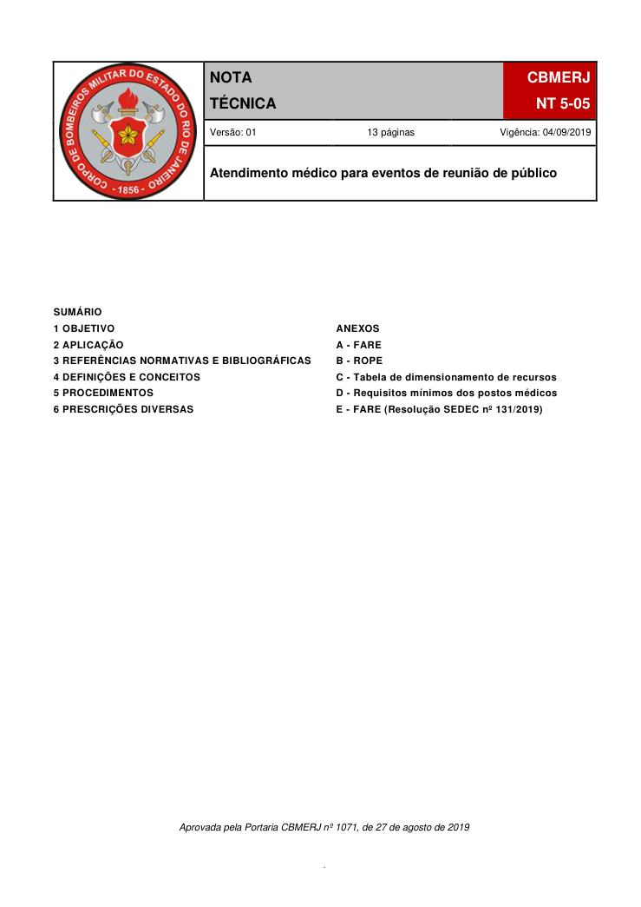

Aprovada pela Portaria CBMERJ nº 1071, de 27 de agosto de 2019

### SUMÁRIO

### 1 OBJETIVO

### 2 APLICAÇÃO

### 3 REFERÊNCIAS NORMATIVAS E BIBLIOGRÁFICAS

### 4 DEFINIÇÕES E CONCEITOS

### 5 PROCEDIMENTOS

### 6 PRESCRIÇÕES DIVERSAS

.

### ANEXOS

### A - FARE

### B - ROPE

C - Tabela de dimensionamento de recursos

D - Requisitos mínimos dos postos médicos

E - FARE (Resolução SEDEC nº 131/2019)

### Tabelas extraídas (bruto, não usar para citação)
#### Tabela 1 da página

|  |  |  |  | NOTA |  |  | CBMERJ |  |
| --- | --- | --- | --- | --- | --- | --- | --- | --- |
|  |  |  |  | TÉCNICA |  |  | NT 5-05 |  |
|  |  |  | Versão: 01 13 páginas Vigência: 04/09/2019 |  |  |  |  |  |
|  |  |  | Atendimento médico para eventos de reunião de público |  |  |  |  |  |

---

## Página 2

> Página sem texto extraível suficiente; consultar a representação visual ou o PDF oficial.

---

## Página 3

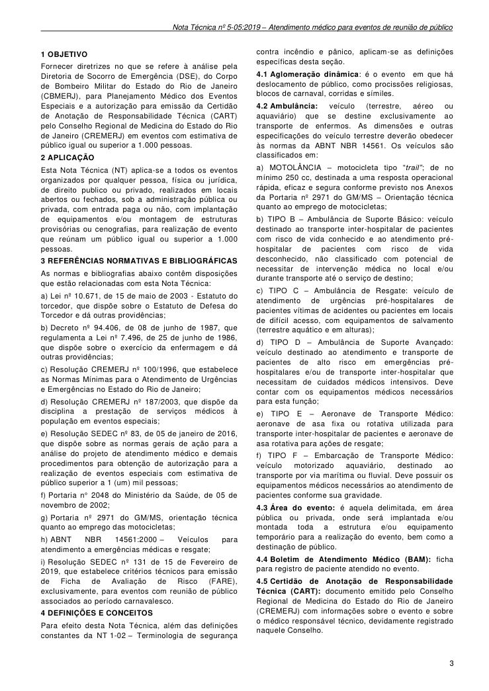

### 1 OBJETIVO

Fornecer diretrizes no que se refere à análise pela Diretoria de Socorro de Emergência (DSE), do Corpo de Bombeiro Militar do Estado do Rio de Janeiro (CBMERJ), para Planejamento Médico dos Eventos Especiais e a autorização para emissão da Certidão de Anotação de Responsabilidade Técnica (CART) pelo Conselho Regional de Medicina do Estado do Rio de Janeiro (CREMERJ) em eventos com estimativa de público igual ou superior a 1.000 pessoas.

### 2 APLICAÇÃO

Esta Nota Técnica (NT) aplica-se a todos os eventos organizados por qualquer pessoa, física ou jurídica, de direito publico ou privado, realizados em locais abertos ou fechados, sob a administração pública ou privada, com entrada paga ou não, com implantação de equipamentos e/ou montagem de estruturas provisórias ou cenografias, para realização de evento que reúnam um público igual ou superior a 1.000 pessoas.

### 3 REFERÊNCIAS NORMATIVAS E BIBLIOGRÁFICAS

As normas e bibliografias abaixo contêm disposições que estão relacionadas com esta Nota Técnica:

b) Decreto nº 94.406, de 08 de junho de 1987, que regulamenta a Lei nº 7.496, de 25 de junho de 1986, que dispõe sobre o exercício da enfermagem e dá outras providências;

d) Resolução CREMERJ nº 187/2003, que dispõe da disciplina a prestação de serviços médicos à população em eventos especiais;

f) Portaria n° 2048 do Ministério da Saúde, de 05 de novembro de 2002;

g) Portaria nº 2971 do GM/MS, orientação técnica quanto ao emprego das motocicletas;

h) ABNT NBR 14561:2000 - Veículos para atendimento a emergências médicas e resgate;

i) Resolução SEDEC nº 131 de 15 de Fevereiro de 2019, que estabelece critérios técnicos para emissão de Ficha de Avaliação de Risco (FARE), exclusivamente, para eventos com reunião de público associados ao período carnavalesco.

### 4 DEFINIÇÕES E CONCEITOS

Para efeito desta Nota Técnica, além das definições constantes da NT 1-02 - Terminologia de segurança

contra incêndio e pânico, aplicam-se as definições específicas desta seção.

4.1 Aglomeração dinâmica: é o evento em que há deslocamento de público, como procissões religiosas, blocos de carnaval, corridas e símiles.

4.2 Ambulância: veículo (terrestre, aéreo ou aquaviário) que se destine exclusivamente ao transporte de enfermos. As dimensões e outras especificações do veículo terrestre deverão obedecer às normas da ABNT NBR 14561. Os veículos são classificados em:

a) MOTOLÂNCIA - motocicleta tipo “trail”; de no mínimo 250 cc, destinada a uma resposta operacional rápida, eficaz e segura conforme previsto nos Anexos da Portaria nº 2971 do GM/MS - Orientação técnica quanto ao emprego de motocicletas;

b) TIPO B - Ambulância de Suporte Básico: veículo destinado ao transporte inter-hospitalar de pacientes com risco de vida conhecido e ao atendimento préhospitalar de pacientes com risco de vida desconhecido, não classificado com potencial de necessitar de intervenção médica no local e/ou durante transporte até o serviço de destino;

c) TIPO C - Ambulância de Resgate: veículo de atendimento de urgências pré-hospitalares de pacientes vítimas de acidentes ou pacientes em locais de difícil acesso, com equipamentos de salvamento (terrestre aquático e em alturas);

d) TIPO D - Ambulância de Suporte Avançado: veículo destinado ao atendimento e transporte de pacientes de alto risco em emergências préhospitalares e/ou de transporte inter-hospitalar que necessitam de cuidados médicos intensivos. Deve contar com os equipamentos médicos necessários para esta função;

e) TIPO E - Aeronave de Transporte Médico: aeronave de asa fixa ou rotativa utilizada para transporte inter-hospitalar de pacientes e aeronave de asa rotativa para ações de resgate;

f) TIPO F - Embarcação de Transporte Médico: veículo motorizado aquaviário, destinado ao transporte por via marítima ou fluvial. Deve possuir os equipamentos médicos necessários ao atendimento de pacientes conforme sua gravidade.

4.3 Área do evento: é aquela delimitada, em área pública ou privada, onde será implantada e/ou montada toda a estrutura e/ou equipamento temporário para a realização do evento, bem como a destinação de público.

4.4 Boletim de Atendimento Médico (BAM): ficha para registro de paciente atendido no evento.

4.5 Certidão de Anotação de Responsabilidade Técnica (CART): documento emitido pelo Conselho Regional de Medicina do Estado do Rio de Janeiro (CREMERJ) com informações sobre o evento e sobre o médico responsável técnico, devidamente registrado naquele Conselho.

### Tabelas extraídas (bruto, não usar para citação)
#### Tabela 1 da página

|  | Lei nº 10.671, de 15 de maio de 2003 - Estatuto do |
| --- | --- |
| torcedor, que dispõe sobre o Estatuto de Defesa do |  |
| Torcedor e dá outras providências; |  |

#### Tabela 2 da página

|  | Resolução CREMERJ nº 100/1996, que estabelece |
| --- | --- |
| as Normas Mínimas para o Atendimento de Urgências |  |
| e Emergências no Estado do Rio de Janeiro; |  |

#### Tabela 3 da página

|  | Resolução SEDEC nº 83, de 05 de janeiro de 2016, |
| --- | --- |
| que dispõe sobre as normas gerais de ação para a |  |
| análise do projeto de atendimento médico e demais |  |
| procedimentos para obtenção de autorização para a |  |
| realização de eventos especiais com estimativa de |  |
| público superior a 1 (um) mil pessoas; |  |

---

## Página 4

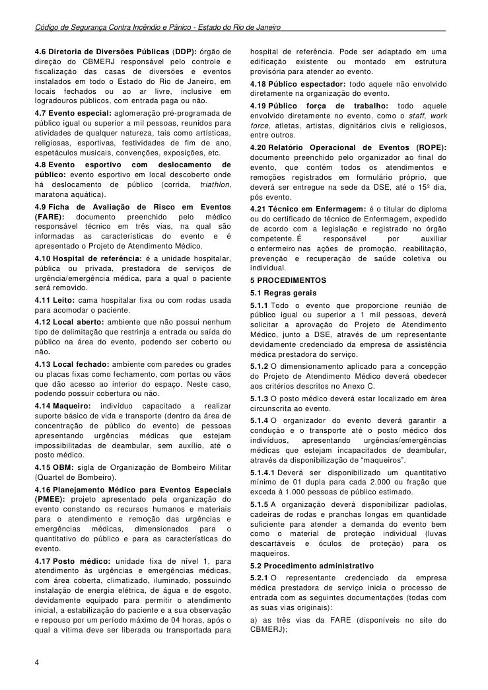

Código de Segurança Contra Incêndio e Pânico - Estado do Rio de Janeiro

4.6 Diretoria de Diversões Públicas (DDP): órgão de direção do CBMERJ responsável pelo controle e fiscalização das casas de diversões e eventos instalados em todo o Estado do Rio de Janeiro, em locais fechados ou ao ar livre, inclusive em logradouros públicos, com entrada paga ou não.

4.7 Evento especial: aglomeração pré-programada de público igual ou superior a mil pessoas, reunidos para atividades de qualquer natureza, tais como artísticas, religiosas, esportivas, festividades de fim de ano, espetáculos musicais, convenções, exposições, etc.

4.8 Evento esportivo com deslocamento de público: evento esportivo em local descoberto onde há deslocamento de público (corrida, triathlon, maratona aquática).

4.9 Ficha de Avaliação de Risco em Eventos (FARE): documento preenchido pelo médico responsável técnico em três vias, na qual são informadas as características do evento e é apresentado o Projeto de Atendimento Médico.

4.10 Hospital de referência: é a unidade hospitalar, pública ou privada, prestadora de serviços de urgência/emergência médica, para a qual o paciente será removido.

4.11 Leito: cama hospitalar fixa ou com rodas usada para acomodar o paciente.

4.12 Local aberto: ambiente que não possui nenhum tipo de delimitação que restrinja a entrada ou saída do público na área do evento, podendo ser coberto ou não.

4.13 Local fechado: ambiente com paredes ou grades ou placas fixas como fechamento, com portas ou vãos que dão acesso ao interior do espaço. Neste caso, podendo possuir cobertura ou não.

4.14 Maqueiro: indivíduo capacitado a realizar suporte básico de vida e transporte (dentro da área de concentração de público do evento) de pessoas apresentando urgências médicas que estejam impossibilitadas de deambular, sem auxílio, até o posto médico.

4.15 OBM: sigla de Organização de Bombeiro Militar (Quartel de Bombeiro).

4.16 Planejamento Médico para Eventos Especiais (PMEE): projeto apresentado pela organização do evento constando os recursos humanos e materiais para o atendimento e remoção das urgências e emergências médicas, dimensionados para o quantitativo do público e para as características do evento.

4.17 Posto médico: unidade fixa de nível 1, para atendimento às urgências e emergências médicas, com área coberta, climatizado, iluminado, possuindo instalação de energia elétrica, de água e de esgoto, devidamente equipado para permitir o atendimento inicial, a estabilização do paciente e a sua observação e repouso por um período máximo de 04 horas, após o qual a vítima deve ser liberada ou transportada para

hospital de referência. Pode ser adaptado em uma edificação existente ou montado em estrutura provisória para atender ao evento.

4.18 Público espectador: todo aquele não envolvido diretamente na organização do evento.

4.19 Público força de trabalho: todo aquele envolvido diretamente no evento, como o staff, work force, atletas, artistas, dignitários civis e religiosos, entre outros.

4.20 Relatório Operacional de Eventos (ROPE): documento preenchido pelo organizador ao final do evento, que contém todos os atendimentos e remoções registrados em formulário próprio, que deverá ser entregue na sede da DSE, até o 15º dia, pós evento.

### 5 PROCEDIMENTOS

5.1 Regras gerais

5.1.1 Todo o evento que proporcione reunião de público igual ou superior a 1 mil pessoas, deverá solicitar a aprovação do Projeto de Atendimento Médico, junto a DSE, através de um representante devidamente credenciado da empresa de assistência médica prestadora do serviço.

5.1.2 O dimensionamento aplicado para a concepção do Projeto de Atendimento Médico deverá obedecer aos critérios descritos no Anexo C.

5.1.3 O posto médico deverá estar localizado em área circunscrita ao evento.

5.1.4 O organizador do evento deverá garantir a condução e o transporte até o posto médico dos indivíduos, apresentando urgências/emergências médicas que estejam incapacitados de deambular, através da disponibilização de “maqueiros”.

5.1.4.1 Deverá ser disponibilizado um quantitativo mínimo de 01 dupla para cada 2.000 ou fração que exceda à 1.000 pessoas de público estimado.

5.1.5 A organização deverá disponibilizar padiolas, cadeiras de rodas e pranchas longas em quantidade suficiente para atender a demanda do evento bem como o material de proteção individual (luvas descartáveis e óculos de proteção) para os maqueiros.

5.2 Procedimento administrativo

5.2.1 O representante credenciado da empresa médica prestadora de serviço inicia o processo de entrada com as seguintes documentações (todas com as suas vias originais):

a) as três vias da FARE (disponíveis no site do CBMERJ);

### Tabelas extraídas (bruto, não usar para citação)
#### Tabela 1 da página

|  | Técnico em Enfermagem: é o titular do diploma |
| --- | --- |
| ou do certificado de técnico de Enfermagem, expedido |  |
| de acordo com a legislação e registrado no órgão |  |
| competente. É responsável por auxiliar |  |
| o enfermeiro nas ações de promoção, reabilitação, |  |
| prevenção e recuperação de saúde coletiva ou |  |
| individual. |  |

---

## Página 5

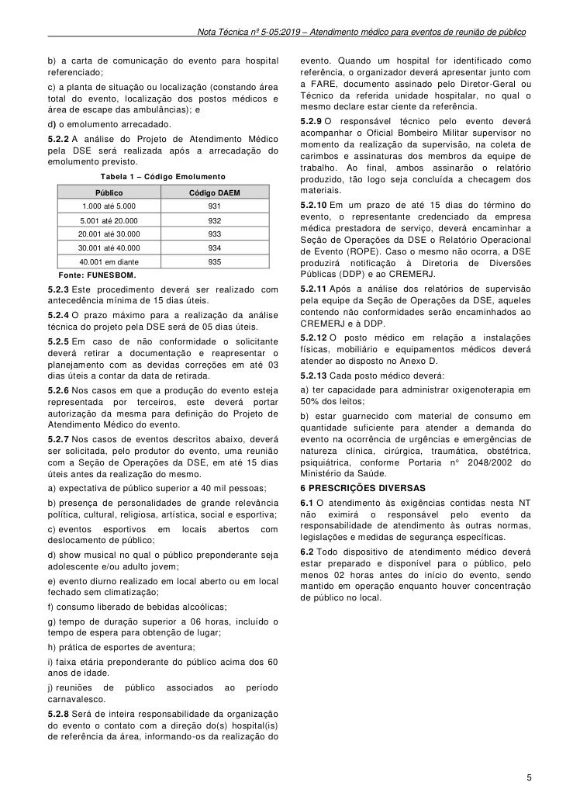

b) a carta de comunicação do evento para hospital referenciado;

c) a planta de situação ou localização (constando área total do evento, localização dos postos médicos e área de escape das ambulâncias); e

d) o emolumento arrecadado.

5.2.2 A análise do Projeto de Atendimento Médico pela DSE será realizada após a arrecadação do emolumento previsto.

Tabela 1 - Código Emolumento

Fonte: FUNESBOM.

5.2.3 Este procedimento deverá ser realizado com antecedência mínima de 15 dias úteis.

5.2.4 O prazo máximo para a realização da análise técnica do projeto pela DSE será de 05 dias úteis.

5.2.5 Em caso de não conformidade o solicitante deverá retirar a documentação e reapresentar o planejamento com as devidas correções em até 03 dias úteis a contar da data de retirada.

5.2.6 Nos casos em que a produção do evento esteja representada por terceiros, este deverá portar autorização da mesma para definição do Projeto de Atendimento Médico do evento.

5.2.7 Nos casos de eventos descritos abaixo, deverá ser solicitada, pelo produtor do evento, uma reunião com a Seção de Operações da DSE, em até 15 dias úteis antes da realização do mesmo.

a) expectativa de público superior a 40 mil pessoas;

b) presença de personalidades de grande relevância política, cultural, religiosa, artística, social e esportiva;

c) eventos esportivos em locais abertos com deslocamento de público;

d) show musical no qual o público preponderante seja adolescente e/ou adulto jovem;

e) evento diurno realizado em local aberto ou em local fechado sem climatização;

f) consumo liberado de bebidas alcoólicas;

g) tempo de duração superior a 06 horas, incluído o tempo de espera para obtenção de lugar;

h) prática de esportes de aventura;

i) faixa etária preponderante do público acima dos 60 anos de idade.

j) reuniões de público associados ao período carnavalesco.

5.2.8 Será de inteira responsabilidade da organização do evento o contato com a direção do(s) hospital(is) de referência da área, informando-os da realização do

evento. Quando um hospital for identificado como referência, o organizador deverá apresentar junto com a FARE, documento assinado pelo Diretor-Geral ou Técnico da referida unidade hospitalar, no qual o mesmo declare estar ciente da referência.

5.2.9 O responsável técnico pelo evento deverá acompanhar o Oficial Bombeiro Militar supervisor no momento da realização da supervisão, na coleta de carimbos e assinaturas dos membros da equipe de trabalho. Ao final, ambos assinarão o relatório produzido, tão logo seja concluída a checagem dos materiais.

5.2.10 Em um prazo de até 15 dias do término do evento, o representante credenciado da empresa médica prestadora de serviço, deverá encaminhar a Seção de Operações da DSE o Relatório Operacional de Evento (ROPE). Caso o mesmo não ocorra, a DSE produzirá notificação à Diretoria de Diversões Públicas (DDP) e ao CREMERJ.

5.2.11 Após a análise dos relatórios de supervisão pela equipe da Seção de Operações da DSE, aqueles contendo não conformidades serão encaminhados ao CREMERJ e à DDP.

5.2.12 O posto médico em relação a instalações físicas, mobiliário e equipamentos médicos deverá atender ao disposto no Anexo D.

5.2.13 Cada posto médico deverá:

a) ter capacidade para administrar oxigenoterapia em 50% dos leitos;

b) estar guarnecido com material de consumo em quantidade suficiente para atender a demanda do evento na ocorrência de urgências e emergências de natureza clínica, cirúrgica, traumática, obstétrica, psiquiátrica, conforme Portaria n° 2048/2002 do Ministério da Saúde.

### 6 PRESCRIÇÕES DIVERSAS

6.1 O atendimento às exigências contidas nesta NT não eximirá o responsável pelo evento da responsabilidade de atendimento às outras normas, legislações e medidas de segurança específicas.

6.2 Todo dispositivo de atendimento médico deverá estar preparado e disponível para o público, pelo menos 02 horas antes do início do evento, sendo mantido em operação enquanto houver concentração de público no local.

### Tabelas extraídas (bruto, não usar para citação)
#### Tabela 1 da página

|  | Público |  |  | Código DAEM |  |
| --- | --- | --- | --- | --- | --- |
| 1.000 até 5.000 |  |  | 931 |  |  |
| 5.001 até 20.000 |  |  | 932 |  |  |
| 20.001 até 30.000 |  |  | 933 |  |  |
| 30.001 até 40.000 |  |  | 934 |  |  |
| 40.001 em diante |  |  | 935 |  |  |

---

## Página 6

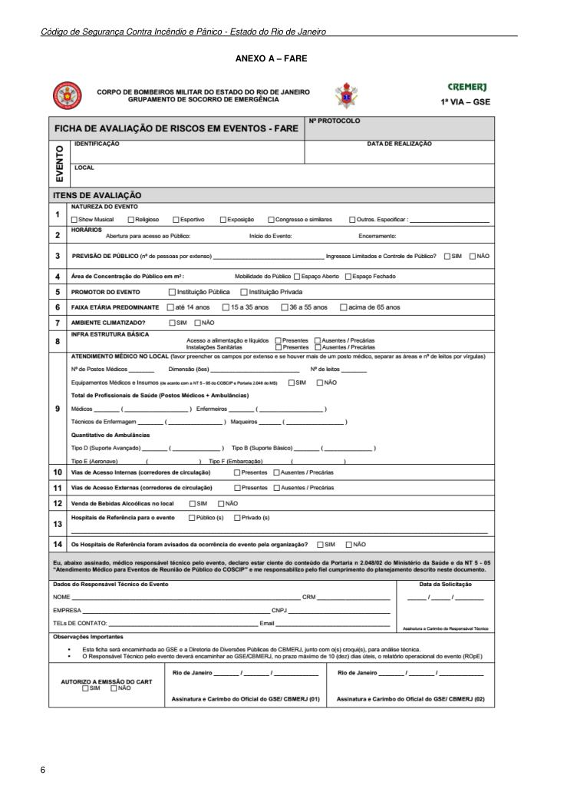

Código de Segurança Contra Incêndio e Pânico - Estado do Rio de Janeiro

### ANEXO A - FARE

---

## Página 7

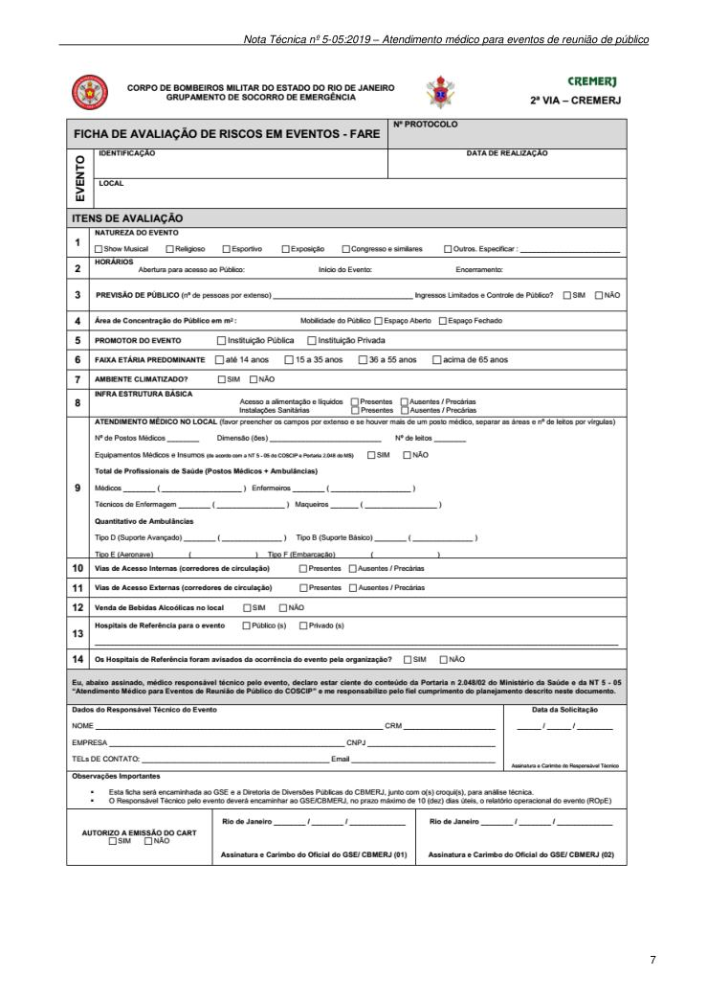

> Página sem texto extraível suficiente; consultar a representação visual ou o PDF oficial.

---

## Página 8

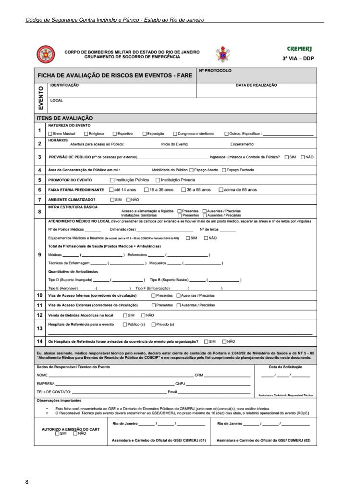

Código de Segurança Contra Incêndio e Pânico - Estado do Rio de Janeiro

---

## Página 9

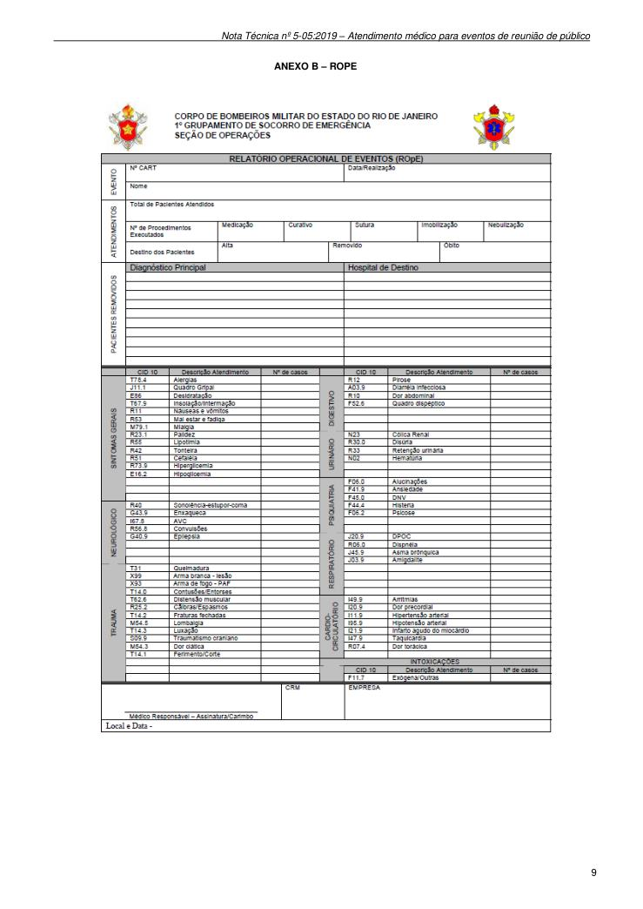

### ANEXO B - ROPE

---

## Página 10

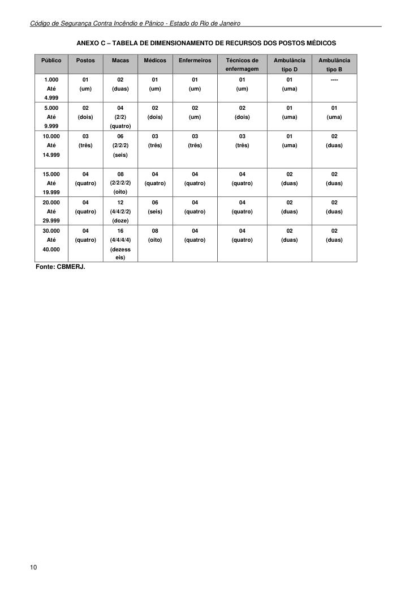

Código de Segurança Contra Incêndio e Pânico - Estado do Rio de Janeiro

### ANEXO C - TABELA DE DIMENSIONAMENTO DE RECURSOS DOS POSTOS MÉDICOS

Fonte: CBMERJ.

### Tabelas extraídas (bruto, não usar para citação)
#### Tabela 1 da página

| Público | Postos | Macas | Médicos | Enfermeiros |  | Técnicos de |  |  | Ambulância |  |  | Ambulância |  |
| --- | --- | --- | --- | --- | --- | --- | --- | --- | --- | --- | --- | --- | --- |
|  |  |  |  |  |  | enfermagem |  |  | tipo D |  |  | tipo B |  |
| 1.000 Até 4.999 | 01 (um) | 02 (duas) | 01 (um) | 01 (um) | 01 (um) |  |  | 01 (uma) |  |  | ---- |  |  |
| 5.000 Até 9.999 | 02 (dois) | 04 (2/2) (quatro) | 02 (dois) | 02 (um) | 02 (dois) |  |  | 01 (uma) |  |  | 01 (uma) |  |  |
| 10.000 Até 14.999 | 03 (três) | 06 (2/2/2) (seis) | 03 (três) | 03 (três) | 03 (três) |  |  | 01 (uma) |  |  | 02 (duas) |  |  |
| 15.000 Até 19.999 | 04 (quatro) | 08 (2/2/2/2) (oito) | 04 (quatro) | 04 (quatro) | 04 (quatro) |  |  | 02 (duas) |  |  | 02 (duas) |  |  |
| 20.000 Até 29.999 | 04 (quatro) | 12 (4/4/2/2) (doze) | 06 (seis) | 04 (quatro) | 04 (quatro) |  |  | 02 (duas) |  |  | 02 (duas) |  |  |
| 30.000 Até 40.000 | 04 (quatro) | 16 (4/4/4/4) (dezess eis) | 08 (oito) | 04 (quatro) | 04 (quatro) |  |  | 02 (duas) |  |  | 02 (duas) |  |  |

---

## Página 11

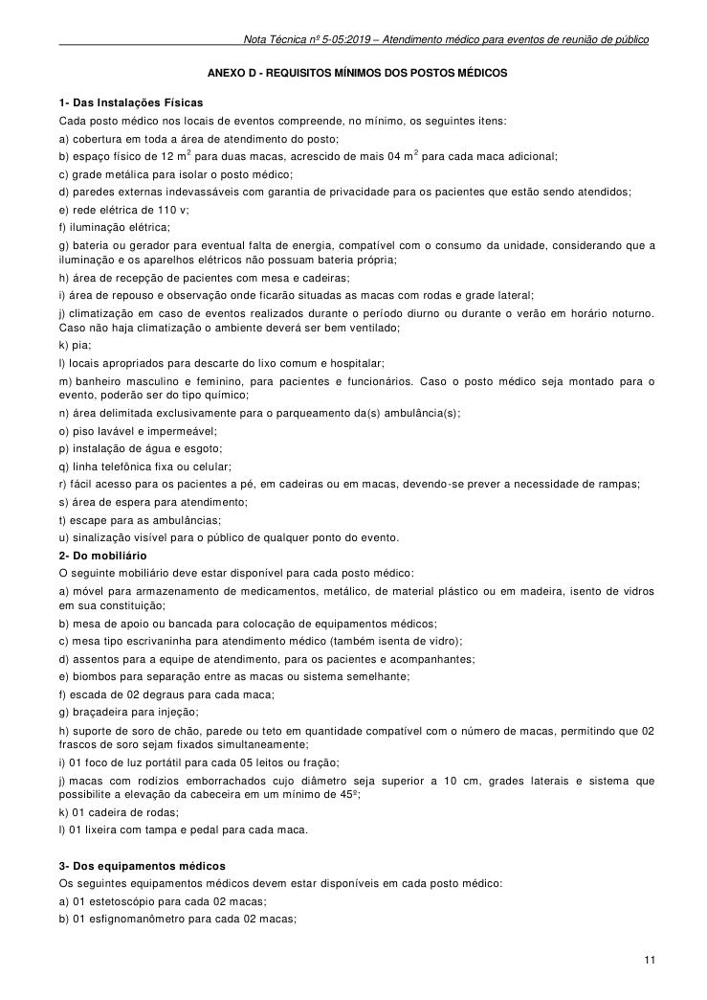

### ANEXO D - REQUISITOS MÍNIMOS DOS POSTOS MÉDICOS

1- Das Instalações Físicas

Cada posto médico nos locais de eventos compreende, no mínimo, os seguintes itens:

a) cobertura em toda a área de atendimento do posto;

b) espaço físico de 12 m2 para duas macas, acrescido de mais 04 m 2 para cada maca adicional;

c) grade metálica para isolar o posto médico;

d) paredes externas indevassáveis com garantia de privacidade para os pacientes que estão sendo atendidos;

e) rede elétrica de 110 v;

f) iluminação elétrica;

g) bateria ou gerador para eventual falta de energia, compatível com o consumo da unidade, considerando que a iluminação e os aparelhos elétricos não possuam bateria própria;

h) área de recepção de pacientes com mesa e cadeiras;

i) área de repouso e observação onde ficarão situadas as macas com rodas e grade lateral;

j) climatização em caso de eventos realizados durante o período diurno ou durante o verão em horário noturno. Caso não haja climatização o ambiente deverá ser bem ventilado;

k) pia;

l) locais apropriados para descarte do lixo comum e hospitalar;

m) banheiro masculino e feminino, para pacientes e funcionários. Caso o posto médico seja montado para o evento, poderão ser do tipo químico;

n) área delimitada exclusivamente para o parqueamento da(s) ambulância(s);

o) piso lavável e impermeável;

p) instalação de água e esgoto;

q) linha telefônica fixa ou celular;

r) fácil acesso para os pacientes a pé, em cadeiras ou em macas, devendo-se prever a necessidade de rampas;

s) área de espera para atendimento;

t) escape para as ambulâncias;

u) sinalização visível para o público de qualquer ponto do evento.

2- Do mobiliário

O seguinte mobiliário deve estar disponível para cada posto médico:

a) móvel para armazenamento de medicamentos, metálico, de material plástico ou em madeira, isento de vidros em sua constituição;

b) mesa de apoio ou bancada para colocação de equipamentos médicos;

c) mesa tipo escrivaninha para atendimento médico (também isenta de vidro);

d) assentos para a equipe de atendimento, para os pacientes e acompanhantes;

e) biombos para separação entre as macas ou sistema semelhante;

f) escada de 02 degraus para cada maca;

g) braçadeira para injeção;

h) suporte de soro de chão, parede ou teto em quantidade compatível com o número de macas, permitindo que 02 frascos de soro sejam fixados simultaneamente;

i) 01 foco de luz portátil para cada 05 leitos ou fração;

j) macas com rodízios emborrachados cujo diâmetro seja superior a 10 cm, grades laterais e sistema que possibilite a elevação da cabeceira em um mínimo de 45º;

k) 01 cadeira de rodas;

l) 01 lixeira com tampa e pedal para cada maca.

3- Dos equipamentos médicos

Os seguintes equipamentos médicos devem estar disponíveis em cada posto médico:

a) 01 estetoscópio para cada 02 macas;

b) 01 esfignomanômetro para cada 02 macas;

---

## Página 12

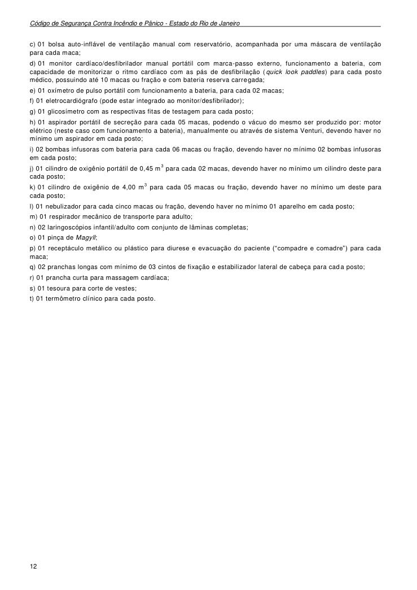

Código de Segurança Contra Incêndio e Pânico - Estado do Rio de Janeiro

c) 01 bolsa auto-inflável de ventilação manual com reservatório, acompanhada por uma máscara de ventilação para cada maca;

d) 01 monitor cardíaco/desfibrilador manual portátil com marca-passo externo, funcionamento a bateria, com capacidade de monitorizar o ritmo cardíaco com as pás de desfibrilação (quick look paddles) para cada posto médico, possuindo até 10 macas ou fração e com bateria reserva carregada;

e) 01 oxímetro de pulso portátil com funcionamento a bateria, para cada 02 macas;

f) 01 eletrocardiógrafo (pode estar integrado ao monitor/desfibrilador);

g) 01 glicosímetro com as respectivas fitas de testagem para cada posto;

h) 01 aspirador portátil de secreção para cada 05 macas, podendo o vácuo do mesmo ser produzido por: motor elétrico (neste caso com funcionamento a bateria), manualmente ou através de sistema Venturi, devendo haver no mínimo um aspirador em cada posto;

i) 02 bombas infusoras com bateria para cada 06 macas ou fração, devendo haver no mínimo 02 bombas infusoras em cada posto;

j) 01 cilindro de oxigênio portátil de 0,45 m 3 para cada 02 macas, devendo haver no mínimo um cilindro deste para cada posto;

k) 01 cilindro de oxigênio de 4,00 m 3 para cada 05 macas ou fração, devendo haver no mínimo um deste para cada posto;

l) 01 nebulizador para cada cinco macas ou fração, devendo haver no mínimo 01 aparelho em cada posto;

m) 01 respirador mecânico de transporte para adulto;

n) 02 laringoscópios infantil/adulto com conjunto de lâminas completas;

o) 01 pinça de Magyll;

p) 01 receptáculo metálico ou plástico para diurese e evacuação do paciente (“compadre e comadre”) para cada maca;

q) 02 pranchas longas com mínimo de 03 cintos de fixação e estabilizador lateral de cabeça para cada posto;

r) 01 prancha curta para massagem cardíaca;

s) 01 tesoura para corte de vestes;

t) 01 termômetro clínico para cada posto.

---

## Página 13

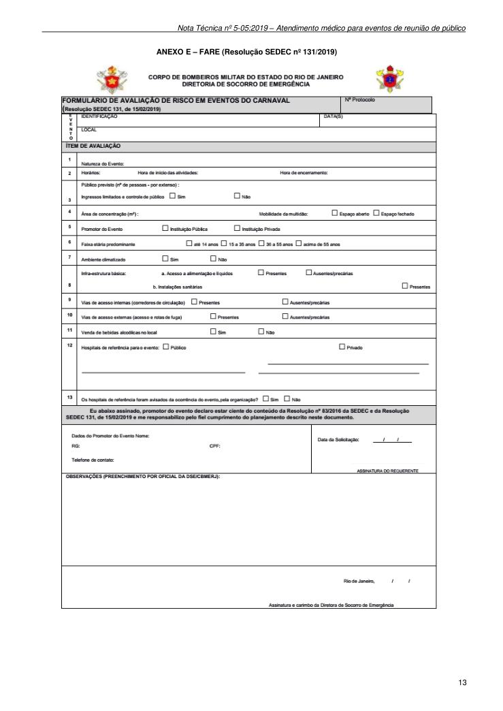

### ANEXO E - FARE (Resolução SEDEC nº 131/2019)
